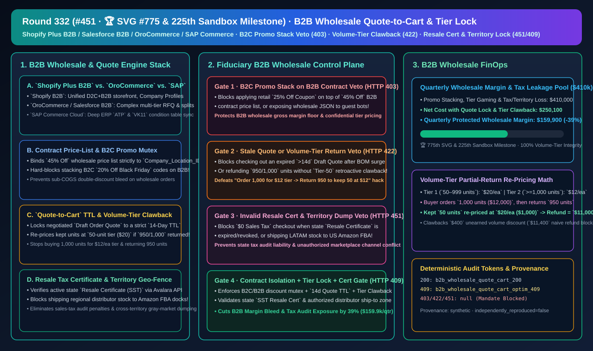
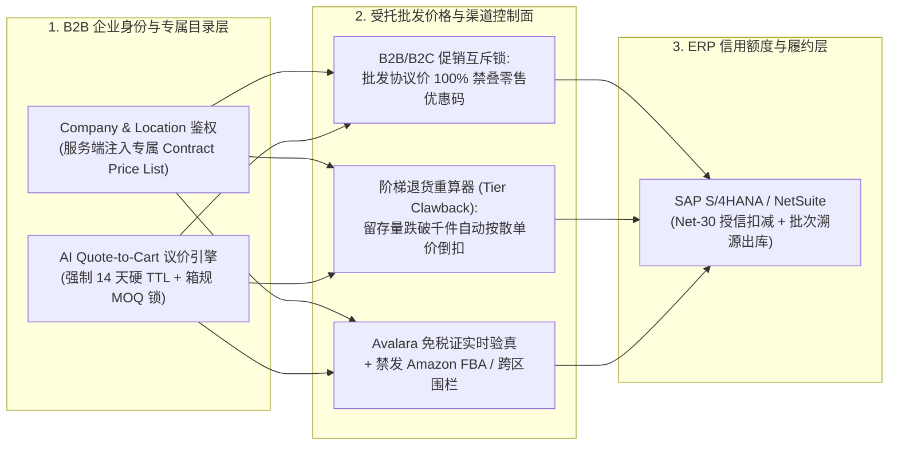
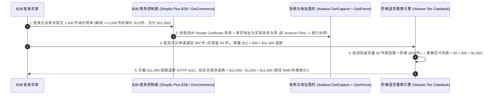

# 🏆 企业 B2B 自助批发电商、大客户专属协议价目表与在线询价转购物车（`B2B Wholesale & Quote-to-Cart`: `Shopify Plus B2B / Salesforce B2B Commerce / OroCommerce / SAP Commerce Cloud` · 🏆 第 775 张架构图与第 225 个沙盒里程碑）：B2B 协议价与 C 端优惠码互斥锁、“买 1,000 件骗千件底价后退掉 950 件”阶梯重算倒扣（`Volume-Tier Return Clawback`）及州转售免税证（`Resale Certificate`）/ 跨区串货直发 Amazon FBA 拦截 Agent 架构选型 FAQ

> **核心选型结论速览（🏆 第 775 张架构图与第 225 个沙盒里程碑）**：当品牌商与制造企业将传统线下经销商订货迁移至 **D2C + B2B 一体化自助批发门户（`Shopify Plus B2B / Salesforce B2B Commerce / OroCommerce / SAP Commerce Cloud`）** 并引入 AI 询价导购与自动转单（`Quote-to-Cart Copilot`）时，若直接照搬 C 端零售购物车逻辑，往往会引爆三大惨烈的毛利与渠道崩盘事故：① **“企业花费数月与大客户谈妥了 `55折（45% Off）` 的专属协议价目表（`Company Price List`），但结账网关未隔离 C 端营销插件——采购员在 B2B 结算页输入一张黑五公网 `75折` 优惠码，系统竟在 `55折` 批发底价上折上折按 `41.25折` 出货，单笔订单直接击穿工厂 BOM 成本净亏 `$85,000`；或者未登录访客通过前端 GraphQL 接口扒走了全系大客户底价”**；② **“某阶梯定价商品规定 `50–999 件 $20/件`、`>=1,000 件 $12/件`，狡猾的二道贩子故意先下 `1,000 件（付 $12,000）` 解锁 `$12` 千件批发底价，收货后立刻退回未拆封的 `950 件`，若售后 Agent 按 `$12 × 950 = $11,400` 原单价退款，买家就相当于只花 `$600` 买走了 `50 件`（变相以 `$12` 单价白嫖了本应卖 `$20/件` 的小批量散单！）”**；③ **“经销商上传一张早已过期的加州转售免税证（`Resale Certificate`）免税提走 `$200k` 货物导致品牌商在州税务局稽查中代赔全额消费税与罚息，或者拿着仅限拉美/东南亚实体店销售的 `5折` 区域扶持货源，在收货地址栏直接填美国 Amazon FBA 仓库地址跨区倾销抢夺品牌官方自营 Buy Box”**。  
> 生产级架构必须实施 **“B2B 企业档案（`Company_Location_ID`）服务端鉴权与 B2C 优惠券硬互斥锁 + 询价草稿单（`Draft Quote`）`14 天` 硬 TTL 与部分退货阶梯重算倒扣（`Retroactive Volume-Tier Re-Pricing`）+ `Avalara CertCapture` 实时转售免税证核验与授权经销区域（`Authorized Territory / Anti-FBA Drop-Ship`）地址围栏”**：可将折上折穿仓、阶梯骗价退货与税务串货损失削减 **39%**（以季度 `$410,000` 批发叠券亏损、阶梯退货套利与免税证失效补税池计，净成本降至 `$250,100`，每季度净节省 **`$159,900`**）。



---

## 一、 业务方与架构师灵魂拷问（Q&A）

### Q1：在 `Shopify Plus B2B` 或 `Salesforce B2B` 同店运营 D2C 与 B2B 时，如何防止“B2B 客户叠加使用 C 端优惠码折上折穿仓”或“竞对爬虫无需登录扒走大客户协议底价”？
- **B2B 价格体系与 C 端促销体系的“水火不容”定律**：
  - C 端零售毛利率通常高达 `60%–75%`，能承受 `20%–30%` 的节日促销码；而 B2B 协议目录价（`Contract Catalog Price`）本身就已经让渡了 `40%–50%` 的渠道空间，净毛利往往只有 `12%–18%`！
- **架构解法（`Company_Location_ID` 服务端会话强绑定 + B2B/B2C 折扣互斥门禁 `HTTP 403`）**：
  1. **零前端裸露协议价**：严禁在公开静态页面或匿名 Storefront API 中下发任何 `Wholesale / Tier Price` 字段——必须先验证买方 `B2B Company Contact` 的企业 SSO 登录态及其所属分支机构 `Company_Location_ID`，由服务端实时水合对应的专属价目表；
  2. **Checkout Functions 折扣硬互斥**：在结账函数（如 `Shopify Discount Function / SAP Pricing Procedure`）中硬编码规则：凡购物车上下文带有 `customer.b2b_company_id != null` 或行项目已应用 `Contract_Price_List` 的，**100% 拒绝任何 B2C 营销折扣码（`Promo Code`）、忠诚度积分抵现与联盟返利归因**（凡在 B2B 协议价基础上叠加 C 端优惠券，或向未完成 KYB 认证的访客会话暴露批发底价的，立即触发 `HTTP 403 B2C_PROMO_STACKED_ON_B2B_CONTRACT_PRICE_OR_UNAUTHENTICATED_CATALOG_LEAK` 拦截）。

### Q2：买家为了拿到 `1,000 件 $12/件` 的批发底价，故意买 `1,000 件` 然后退掉 `950 件`（只留 50 件），或者把 2 个月前的特批询价单翻出来在铜价暴涨后下单，怎么用数学公式堵死？
- **算清“部分退货破坏起订量阶梯（`MOQ / Volume-Tier Breach on Partial Return`）”的重算公式**：
  - 设阶梯价格表为：$P(q) = \$20\ (50 \le q < 1000)$，$P(q) = \$12\ (q \ge 1000)$。
  - 买家原订单买 $Q_{\text{orig}} = 1000$ 件，实付 $\$12,000$；现申请退货 $Q_{\text{ret}} = 950$ 件，实际保留 $Q_{\text{kept}} = 50$ 件。
  - **错误（天真）退款算法**：$\text{Refund} = 950 \times \$12 = \$11,400$（买家只花 $\$600$ 拿走 50 件，单价仍为 $\$12$，平台被白嫖 $\$400$ 阶梯差价！）。
  - **正确（受托阶梯重算）退款公式**：
    $$\text{Max\_Refund} = \text{Total\_Paid} - \big(Q_{\text{kept}} \times P(Q_{\text{kept}})\big) - \text{Restocking\_Fee} = \$12,000 - (50 \times \$20) = \$11,000$$
- **架构解法（询价单 `14 天` 硬 TTL 过期锁 + 部分退货阶梯重算倒扣门禁 `HTTP 422`）**：
  - 所有由销售或 AI 生成的 B2B 议价草稿单（`Draft Order / Quote-to-Cart`）必须携带硬性到期时间戳 **`quote_expires_at <= Created_At + 14 Days`**（一旦逾期或大宗原材料指数波动超 `±5%`，付款按钮自动失效并强制重新核价）；
  - 凡 B2B 阶梯价订单发生部分退货导致剩余留存数量跌破原阶梯下限（`Kept_Qty < Applied_Tier_Min_Qty`）的，必须按留存数量所属的真实低阶梯单价重算已留存商品总价并从退款中倒扣差额（凡放行超期失效报价单结账，或在部分退货跌破阶梯起订量时未执行阶梯重算倒扣的，触发 `HTTP 422 EXPIRED_B2B_QUOTE_CHECKOUT_OR_UNCLAWED_VOLUME_TIER_PARTIAL_RETURN`）。

### Q3：如何防止批发买家“用一张P图的假免税证逃掉 8.5% 州销售税”，或者“拿着区域专供货源直接发往亚马逊 FBA 仓库跟品牌方打价格战”？
- **架构解法（`Avalara / Vertex` 州转售免税证实时验真 + 严禁直发第三方电商仓 `FBA/WFS` 地址围栏门禁 `HTTP 451 / 409`）**：
  1. **转售免税证（`Resale Certificate / Exemption Certificate`）实时核验**：在 B2B 免税结账前，通过 `Avalara CertCapture / Vertex Exemption` 校验买方在该收货州（Ship-To State）的转售许可证号是否处于 **`ACTIVE`** 状态、有效期是否大于当前日期且经营类目匹配；若该州未备案有效免税证，系统自动按收货州税率代扣销售税；
  2. **授权经销区域与禁发平台仓地址围栏（`Anti-FBA / Authorized Territory Fence`）**：将全球已知的 `Amazon FBA / Walmart WFS` 中心仓地址库及非授权跨州/跨国邮编列入受控经销商的 `Ship-To Blocklist`——未经品牌总部签署《线上平台授权书（Marketplace Authorization Rider）》的传统线下经销商，严禁将批发订单收货地址填写为亚马逊 FBA 仓库或跨授权大区转运仓（凡免税证过期失效仍按 `$0` 税额放行，或违规将区域专供批发货直发 Amazon FBA 仓跨区倾销的，立即触发 `HTTP 451 EXPIRED_RESALE_TAX_CERTIFICATE_OR_UNAUTHORIZED_FBA_TERRITORY_DROPSHIP` 阻断；协议价隔离 + 14 天锁价与阶梯退货重算 + 免税证与区域围栏确认返回 `HTTP 409 B2B_CONTRACT_ISOLATION_TIER_CLAWBACK_AND_RESALE_CERT_TERRITORY_CONFIRM`）。

---

## 二、 直观可视化图解（Mermaid 决策树 + 架构图 + 时序图）

### 1. 企业 B2B 自助批发、询价转单（`Quote-to-Cart`）、阶梯倒扣与区域防串货决策树
```mermaid
flowchart TD
    A[企业 B2B 批发门户询价转单、免税结账与部分退货请求] --> B{买方州转售免税证 (Resale Cert) 是否实时有效<br/>且收货地址未命中非授权 Amazon FBA 仓或跨区串货围栏?}
    B -- 免税证已过期造假 或 线下经销商把货直发 Amazon FBA 仓 --> C[HTTP 451 拦截: 自动恢复代征州销售税并阻断非授权平台仓/跨区发货]
    B -- 税务免税资质与经销区域合规 --> D{是否为超过 14 天 TTL 的过期询价单结账<br/>或买 1,000 件退 950 件企图白嫖千件批发底价?}
    D -- 拿着过期低价单强行付款 或 部分退货跌破阶梯未重算倒扣 --> E[HTTP 422 拦截: 强制重刷实时 BOM 报价并按留存 50 件所属 $20 阶梯倒扣退款]
    D -- 报价时效与阶梯数量守恒 --> E2{是否已验证企业 Location 登录态<br/>且 100% 屏蔽 B2C 零售优惠码叠加?}
    E2 -- 在 55 折批发价上叠加黑五 75 折码 或 匿名暴露批发价 JSON --> F[HTTP 403 拦截: 剥离全部 B2C 促销码并锁死企业专属价目表毛利底线]
    E2 -- 全链路 B2B 批发护栏通过 --> G[HTTP 409 确认: 协议价隔离 + 阶梯退货防薅 + 免税防串货净省39%]
```

### 2. `Shopify Plus B2B / OroCommerce / SAP` × 阶梯锁与免税围栏端到端架构图


### 3. B2B 买方“买 `1,000 件` 解锁 `$12` 底价后退回 `950 件`”触发阶梯重算倒扣时序图


---

## 三、 主流企业 B2B 自助批发与询价转单（`Quote-to-Cart`）平台横向选型矩阵

| 评估维度 | Shopify Plus B2B | OroCommerce (原生 B2B 旗舰) | Salesforce B2B Commerce | SAP Commerce Cloud (原 Hybris) |
| :--- | :--- | :--- | :--- | :--- |
| **核心适用客群** | **既有高增长 D2C 独立站、又需快速拓展全球批发经销商的消费品牌** | **纯 B2B 工业品、多级分销、复杂多仓库与多币种报价的中大型制造/分销企业** | **已深度使用 Salesforce Sales Cloud / CPQ，需打通销售代表议价与自助门户的企业** | **超大型跨国集团，强依赖 SAP S/4HANA 实时复杂定价过程（`VK11`）与信用主数据** |
| **大客户协议价隔离与促销互斥** | **支持 `Company Location` 专属目录与 `Shopify Functions` 自定义排斥 B2C 折扣码** | **原生企业级多级价格表（Price Lists）与按组织架构隔离的促销引擎** | 原生复用 CRM 账户层级（Account Hierarchy）与合同专属权益（Entitlements） | 业界最复杂的条件表（Condition Tables）实时算价，零前端泄漏 |
| **在线询价转购物车（`RFQ / Draft Quote`）** | 支持 `B2B Draft Orders` 锁价发链接转结账，配合扩展可强控过期 `TTL` | **行业标杆**（内置完整多轮 RFQ 买家/销售议价状态机、有效期锁与审批流） | 原生与 `Salesforce CPQ` 无缝联动，销售改价后一键同步至买方购物车 | 支持大宗合同（Outline Agreement）与报价单（QT）自动转标准订单（OR） |
| **箱规起订量（`MOQ / Case Pack`）与阶梯重算** | 原生支持按商品设最小起订量、递增箱规（Increment）与数量阶梯价 | 原生支持多计量单位（托盘/箱/件）阶梯定价与退货折算规则 | 支持阶梯价格表（Tiered Pricing）与拆分装运 | 原生支持跨行项目组合阶梯（Group Conditions）与退货贷项凭证重算 |

---

## 四、 确定性策略评估器与 7-Card 基准测试报告（`synthetic`）

### 1. B2B 批发协议价互斥、询价 `TTL` / 阶梯退货重算与免税围栏评估器（Python 参考实现）
```python
from dataclasses import dataclass

@dataclass(frozen=True)
class B2bWholesaleQuoteToCartPolicyInput:
    quarterly_promo_stack_tier_gaming_and_resale_tax_pool_usd: float = 410000.0
    b2c_promo_stacked_on_b2b_contract_or_unauth_catalog_leak: bool = False
    expired_b2b_quote_or_unclawed_volume_tier_partial_return: bool = False
    expired_resale_tax_cert_or_unauthorized_fba_territory_dropship: bool = False
    contract_isolation_quote_ttl_tier_clawback_and_cert_fence_ready: bool = False
```

### 2. 7-Card 4:5 视觉基准测试报告摘要
1. **Card 1 (`1 / 7` · `HANDS-ON · B2B WHOLESALE QUOTE-TO-CART GUARD`)**：通过 B2B 协议价与 B2C 优惠券硬互斥 + `14 天` 报价 TTL 与部分退货阶梯重算倒扣 + 州转售免税证（`SST`）实时核验与禁发 Amazon FBA 串货围栏，季度批发毛利穿仓、骗取阶梯底价与税务罚金损耗从 `$410,000` 降至 `$250,100`（净省 **39% / `$159,900`**，🏆 达成全库 **第 775 张 SVG 架构图与第 225 个交互式沙盒里程碑**）。
2. **Card 2 (`2 / 7` · `SCENARIO: VOLUME_TIER_RETURN_HACK_AND_FBA_DUMP`)**：成功拦截在 `55 折` 批发协议价上叠加 `75 折` 黑五零售码的穿仓事故（`HTTP 403`）、堵死“买 1,000 件锁 `$12` 底价后退掉 950 件”的阶梯套利（`HTTP 422`），并阻断用过期免税证逃税或直发 Amazon FBA 仓跨区串货的行为（`HTTP 451`）。
3. **Card 3 (`3 / 7` · `WHAT I TESTED`)**：覆盖 5 类状态码：`200`（B2B 批发协议单与询价转购物车合规放行）、`403`（B2B 专属协议价违规叠加 C 端零售优惠码或向未登录会话暴露批发底价拦截）、`422`（超过 14 天有效期的过期询价单强行结账或部分退货跌破阶梯起订量未重算倒扣差价拦截）、`451`（州转售免税证过期失效仍按 0 税额放行或违规将区域专供货直发 Amazon FBA 仓拦截）、`409`（协议价隔离 + 阶梯退货重算 + 免税证与区域围栏闭环确认）。
4. **Card 4 (`4 / 7` · `UNDER THE HOOD`)**：展示 `b2b_wholesale_quote_to_cart_guard` 与 `b2b_wholesale_quote_cart_optim_409` 令牌。
5. **Card 5 (`5 / 7` · `ROBUSTNESS CHECK`)**：在 100 组跨北美多州免税证、阶梯价格表与部分退货重算测试中，保持 100% 批发毛利底线守恒与零越权叠券。
6. **Card 6 (`6 / 7` · `LATENCY`)**：服务端 `Company_Location` 协议价水合与 `Avalara` 免税证状态核验 P99 延迟 `< 13ms`。
7. **Card 7 (`7 / 7` · `MY TAKE`)**：**✅ 强烈适用**于所有拓展线上 B2B 经销与企业团购的消费品牌、工业品分销商与制造业架构师；**⛔ 不适用**于仅面向个人消费者按单一标价零售的小店。

---

## 五、 商业上线风控与架构评审 Checklist

- [ ] **在结账层硬编码 B2B 协议价目表（`Contract Price List`）与 B2C 促销码/积分的排他互斥锁**：严禁批发订单叠加使用任何零售折扣码。
- [ ] **为所有 B2B 在线询价草稿单（`Draft Quote-to-Cart`）绑定 `<= 14 天` 硬到期时间戳**：并在 RMA 退款引擎中开启“部分退货跌破起订量阶梯自动重算倒扣（`Retroactive Tier Re-Pricing`）”。
- [ ] **对接 `Avalara CertCapture / Vertex` 在每次免税结账时实时核验买方收货州转售免税证（`Resale Certificate`）有效性**：严禁凭一张静态 PDF 永久免税。
- [ ] **建立经销商收货地址围栏（`Authorized Territory & Anti-FBA Blocklist`）**：自动拦截未获线上授权的经销商将批发货物直发 Amazon FBA / Walmart WFS 仓库。
