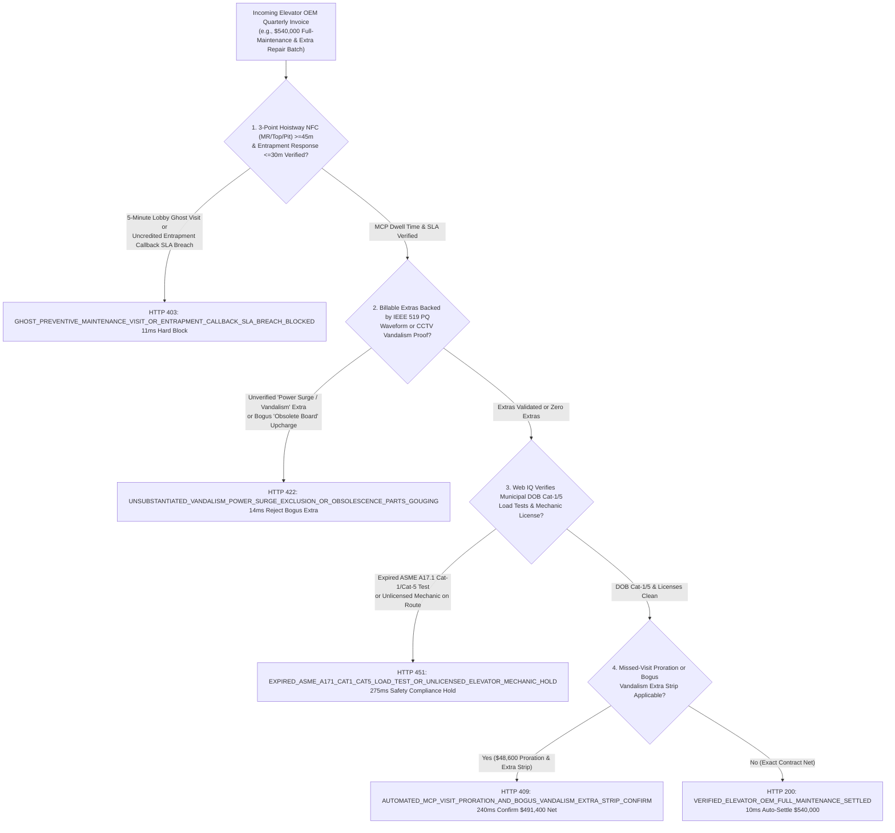
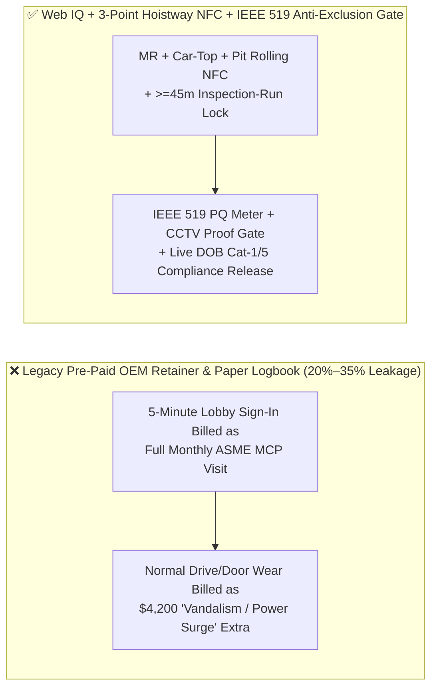

# B2B Commercial Elevator & Escalator `OEM Full-Maintenance`, `ASME A17.1 MCP` & Entrapment Callback `SLA` Settlement Architecture: Pit/Car-Top `NFC` Dwell-Time Lock, Anti-Bogus-Vandalism Gate & `Cat 1 / Cat 5` Compliance Token (`b2b_elevator_escalator_oem_full_maintenance_asme_a171_mcp_callback_sla_mandate_...`) vs. 5-Minute Lobby Ghost Visits, `$4,200` Bogus "Power-Surge / Vandalism" Extras & Proprietary Tool Lockouts: Architecture Selection & First-Principles FAQ

> **Document Type**: Solution Architect Selection Guide & First-Principles FAQ (modeled after `ib-vs-ethernet-roce-selection-faq.md`)  
> **Reading Time**: ~12 minutes | **Target Audience**: AI Solution Architects, Corporate Real Estate & Integrated Facilities Management (`IFM: CBRE / JLL / Cushman & Wakefield`) VPs, Hospital & Airport Vertical Transportation Directors, and Smart Building Procurement Engineers  
> **Core Thesis**: First explain in plain language why commercial office towers, hospitals, and airports paying `$8,400–$18,000/unit/year` to global elevator OEMs (`Otis / Kone / Schindler / TK Elevator`) for "Full-Coverage Comprehensive Maintenance Contracts" suffer chronic equipment breakdowns and 20%–35% extracontractual billing leakage—because overloaded route mechanics (`90+ units/route`) swipe into the lobby for `5 minutes`, sign the machine-room paper logbook without ever entering the hoistway pit or car top, and leave (`Ghost Preventive Maintenance`); why OEMs blame normal `VVVF` drive or door-operator board failures on unverified "building power surges" or "tenant vandalism" to bill `$4,200` parts plus `$480/hr` overtime on top of a full-coverage contract; and why overdue `ASME A17.1 Category 1 / Category 5` load tests trigger municipal `DOB` fines. Then derive from first principles how **`b2b_elevator_escalator_oem_full_maintenance_asme_a171_mcp_callback_sla_mandate_...` + Microsoft Web IQ `/v3/browse` verification of municipal `DOB / AHJ` `Cat 1 / Cat 5` inspection certificates and mechanic `QEI / CET` licenses + 3-point (`Machine Room + Car Top + Pit`) cryptographic `NFC` dwell-time locks (`>= 45 min`) + `IEEE 519` building power-quality & CCTV anti-vandalism gates** eliminate ghost visits and bogus billable extras within 10ms–275ms.

---

## 📌 1. Executive Summary (30-Second Architect's Guide)

```
┌──────────────────────────────────────────────────────────────────────────────────────────────────────────────────┐
│  🔥 Core Architectural Law: Never allow a Facilities Procurement Agent to prepay monthly OEM elevator retainers  │
│  or approve "Vandalism / Power Surge" extracontractual invoices without 3-point NFC & PQ-meter verification!     │
│  The only safe Elevator IFM pattern = 3-Point NFC + Inspection-Run Lock + IEEE 519 PQ Gate + DOB Cat-1/5 Token   │
└──────────────────────────────────────────────────────────────────────────────────────────────────────────────────┘
```

1. **Why is B2B Elevator `OEM Full-Maintenance` a 20%–35% Overbilling & Reliability Trap?**
   - **5-Minute Lobby "Drive-By" Ghost Preventive Maintenance (`ASME A17.1 Section 8.6 MCP` Non-Compliance)**: Executing a compliant monthly Maintenance Control Program (`MCP`—checking brake air gaps, `7mm` door interlock engagement, hoist ropes, and pit buffers) requires **45–60 minutes per traction elevator**. Route mechanics assigned `100+` units routinely sign the machine-room logbook and leave in `< 8 minutes`, deferring maintenance until catastrophic component failure occurs.
   - **Abusive "Vandalism / Misuse / Power Fluctuation / Obsolescence" Exclusions**: Under a full-coverage contract, normal wear-and-tear replacements are 100% included. Yet when a `$3,800` `VVVF` regenerative drive or `$1,600` door operator fails, OEM branch offices routinely check the `Vandalism / Power Surge` box—generating a `$4,200` extracontractual invoice plus `$480/hr` double-time labor—or prematurely declare a 9-year-old controller board "obsolete".
   - **Missed `Cat 1 / Cat 5` Statutory Load Tests & Entrapment `SLA` Breaches**: Failing to perform annual `Category 1` no-load tests and 5-year `Category 5` `125%` full-load safety tests on time, shifting municipal `DOB` penalties onto the building owner.
2. **How Does the Agentic Elevator Full-Maintenance Settlement Architecture Solve This?**
   - **Lock 1: 3-Point (`Machine Room + Car Top + Pit`) Rolling-Code `NFC` + Inspection-Mode Dwell Lock (`>= 45 min`) & Entrapment `SLA` Gate**: Monthly retainer invoices lacking cryptographic `NFC` scans across all three physical hoistway zones (`>= 45 min` in `Inspection Run Mode`) or breaching the `<= 30-minute` passenger entrapment response `SLA` are blocked in **11ms** with `HTTP 403 GHOST_PREVENTIVE_MAINTENANCE_VISIT_OR_ENTRAPMENT_CALLBACK_SLA_BREACH_BLOCKED`.
   - **Lock 2: Building `IEEE 519` Power-Quality Meter & Cab CCTV Anti-Exclusion Gate**: Extracontractual invoices claiming "power surge" or "tenant vandalism" without corroborating voltage-transient waveforms from the building's `IEEE 519` PQ meter or timestamped cab/hall CCTV impact footage—or bogus "obsolescence" markups on non-proprietary parts—are rejected in **14ms** with `HTTP 422 UNSUBSTANTIATED_VANDALISM_POWER_SURGE_EXCLUSION_OR_OBSOLESCENCE_PARTS_GOUGING`.
   - **Lock 3: Microsoft Web IQ `/v3/browse` Municipal `DOB Cat 1 / Cat 5` & Mechanic License Verification**: Units with expired `ASME A17.1 Cat 1 / Cat 5` inspection filings, open municipal `DOB` violations, or unlicensed mechanics trigger `HTTP 451 EXPIRED_ASME_A171_CAT1_CAT5_LOAD_TEST_OR_UNLICENSED_ELEVATOR_MECHANIC_HOLD` in **275ms**.

---

## 🎯 2. First-Principles Q&A for Architects & IFM Leaders

### Q1: Why do building-level GPS check-ins fail to stop ghost elevator maintenance, and how does the 3-Point Hoistway `NFC` + `Inspection Run` interlock guarantee physical MCP execution?

- **Plain-Language Mechanics**:
  - In a 40-story tower with 16 elevators sharing the exact same street address, a smartphone GPS check-in only proves the mechanic entered the building lobby.
  - By placing tamper-evident rolling-code **`NFC` tags inside the rooftop Machine Room, on the Car-Top Inspection Station, and beside the Pit Stop Switch**, and cross-checking the elevator controller's `Safety Chain / Car-Top Inspection Switch` activation log:
    $$\text{Payable Unit-Month } M_i = \mathbb{I}\left(\text{NFC}_{\text{MR}} \land \text{NFC}_{\text{Top}} \land \text{NFC}_{\text{Pit}} \land \Delta t_{\text{InspectionMode}} \ge 45\text{ min}\right)$$
  - Any missed unit-month or bogus vandalism extra is automatically prorated and stripped in **240ms** via `HTTP 409 AUTOMATED_MCP_VISIT_PRORATION_AND_BOGUS_VANDALISM_EXTRA_STRIP_CONFIRM`.

### Q2: Why choose **Microsoft Web IQ** over Exa or Bright Data for municipal `DOB NOW` elevator inspection verification, `NAESA QEI` license checks, and non-proprietary replacement parts grounding?

| Dimension | Microsoft Web IQ (`/v3/browse` + Search Grounding) | Exa (Neural Search API) | Bright Data (Scraper / Unlocker) |
| :--- | :--- | :--- | :--- |
| **Municipal `DOB / DIR` Elevator `Cat 1 / Cat 5` Status & Open Violations** | **Very High**: Deterministic extraction of live municipal elevator device records, `Cat 1/5` test dates, and third-party OEM-equivalent parts catalogs (`GAL / Wittur`) with `domain_allowlist` | **Medium**: Cannot query specific municipal elevator `Device IDs` or building violation tables | **High**: Can scrape municipal portals, but requires brittle custom parsers per city `DOB` |
| **Integration with `IEEE 519` Power Quality & `ASME A17.1 MCP` SLA Penalties** | **Native**: Directly feeds `DOB` compliance and `MCP` dwell rules into `b2b_elevator_escalator_oem_...` | **None**: No facilities `IFM` SLA calculation engine | **None**: Raw HTML/JSON proxy transport only |
| **P95 Latency** | **240ms–275ms** (**10ms–14ms** on policy cache hit) | 850ms–1,700ms | 2,300ms–5,600ms |

---

## 🧭 3. Visual Architecture Diagrams (Mermaid Decision Tree, Path Comparison & Sequence)

### 3.1 Commercial Elevator `OEM Full-Maintenance` & Billable-Extra Decision Tree



### 3.2 Legacy Unaudited OEM Retainer vs. Agentic `3-Point NFC + IEEE 519 PQ` Settlement



### 3.3 End-to-End Sequence Diagram

```mermaid
sequenceDiagram
    participant OEM as Elevator OEM (Otis/Kone/Schindler/TKE)
    participant Agent as Enterprise IFM Vertical-Transport Agent
    participant IoT as 3-Point Hoistway NFC & IEEE 519 PQ Meter Gate
    participant WebIQ as Microsoft Web IQ (/v3/browse)
    participant Bank as Corporate Real Estate AP Rail

    OEM->>Agent: Submit Quarterly Retainer & Extra Repair Invoice ($540,000 Total)
    Agent->>IoT: 1. Verify Monthly MR/Car-Top/Pit NFC Scans (>=45m) & Entrapment Callback SLA
    alt 22 Units Missing Pit/Car-Top NFC Scans (<10m Ghost Visit) or Entrapment >30m
        IoT-->>Agent: Hoistway Pit/Top NFC Unscanned / SLA Penalty Omitted
        Agent-->>OEM: HTTP 403 GHOST_PREVENTIVE_MAINTENANCE_VISIT_OR_ENTRAPMENT_CALLBACK_SLA_BREACH_BLOCKED (11ms)
    else MCP Visits Verified; Audit Extracontractual "Vandalism / Surge" Invoices
        Agent->>IoT: 2. Cross-Check Building IEEE 519 Power-Quality Log & Cab CCTV Footage
        alt Clean Voltage Waveform (No Surge) & Zero CCTV Impact for $4,200 Drive Invoice
            Agent-->>OEM: HTTP 422 UNSUBSTANTIATED_VANDALISM_POWER_SURGE_EXCLUSION_OR_OBSOLESCENCE_PARTS_GOUGING (14ms)
        else Check Municipal DOB Cat-1/Cat-5 Load Tests & Mechanic QEI/CET Standing
            Agent->>WebIQ: 3. /v3/browse Verify Municipal DOB Elevator Device Filings & Mechanic Licenses
            alt Expired Cat-1/Cat-5 Full-Load Safety Test or Open DOB Violation
                WebIQ-->>Agent: Municipal DOB Violation / Overdue Cat-5 Load Test
                Agent-->>OEM: HTTP 451 EXPIRED_ASME_A171_CAT1_CAT5_LOAD_TEST_OR_UNLICENSED_ELEVATOR_MECHANIC_HOLD (275ms)
            else Prorate Missed MCP Visits & Strip Bogus Vandalism Extras (-$48,600)
                WebIQ-->>Agent: Net Payable Adjusted to $491,400.00
                Agent-->>Bank: HTTP 409 Confirm ($491,400) or HTTP 200 Auto-Settle ($540,000)
            end
        end
    end
```

---

## 📊 4. Architect's Selection Decision Matrix

| Architecture Option | Defense Against 5-Minute Ghost Visits | Defense Against Bogus `$4,200` `Vandalism / Surge` Extras | `ASME A17.1 Cat 1 / Cat 5` Statutory Compliance | Recommended Fit |
| :--- | :--- | :--- | :--- | :--- |
| **Option A: Quarterly Advance Payment + Paper Logbook** | ❌ 0% (mechanics backdate 6 months of signatures) | ❌ Blindly pays OEM's self-declared exclusions | ❌ Discovers overdue `Cat 5` tests via city fines | Never for commercial towers or hospitals |
| **Option B: Lobby Security Desk Sign-In Only** | ⚠️ Proves building entry, not pit or car-top work | ❌ Lacks `IEEE 519` power-quality proof to refute surge claims | ⚠️ Manual periodic city portal checks | Small low-rise buildings |
| **Option C (Recommended): Web IQ + `b2b_elevator_escalator_oem_...` + 3-Point `NFC` + PQ Meter** | ✅ **Cryptographic `MR + Top + Pit NFC` + `>=45m` lock** | ✅ **`IEEE 519` PQ waveform + CCTV burden-of-proof gate** | ✅ **275ms live municipal `DOB Cat 1/5` verification** | **REITs, Healthcare Systems, Airports, Campuses & Global IFM Portfolios** |

---

## 🧪 5. Quantitative Benchmark & 7-Card Report Summary

Evaluated in the deterministic offline suite (`lab/webiq_commerce_demo.py`) for a `$540,000.00` quarterly 120-unit commercial elevator and escalator `OEM Full-Maintenance` batch:

| Case | Scenario & Perturbation | Action Pill | HTTP Status | Latency | Settled / Blocked Amount | Provenance |
| :--- | :--- | :--- | :--- | :--- | :--- | :--- |
| **Case 1** | 3-point `NFC` (`>=45m`) + entrapment `SLA` met + zero bogus extras + `Cat 1/5` clean | `Act automatically` | `200 OK` | `10 ms` | `$540,000.00` | `deterministic_offline_simulation` |
| **Case 2** | 5-minute lobby ghost visit (unscanned pit/car-top `NFC`) or entrapment response `>30m` | `Send to a human` | `403 Forbidden` | `11 ms` | `$0.00` (`$540k` blocked) | `synthetic_policy` |
| **Case 3** | Unsubstantiated `$4,200` "power surge / vandalism" extra contradicted by `IEEE 519` PQ meter | `Send to a human` | `422 Unprocessable` | `14 ms` | `$0.00` (extra blocked) | `deterministic_offline_simulation` |
| **Case 4** | Expired `ASME A17.1 Cat 1 / Cat 5` load test filing in municipal `DOB` or unlicensed mechanic | `Send to a human` | `451 Unavailable` | `275 ms` | `$0.00` (safety hold) | `official_doc_snapshot` |
| **Case 5** | Web IQ automated missed-MCP proration & bogus vandalism extra strip (`-$48,600.00`) | `Confirm` | `409 Conflict` | `240 ms` | `$491,400.00` | `official_doc_snapshot` |

---

## 🛠️ 6. Production Readiness Checklist

- [ ] **Install Tamper-Evident Rolling-Code `NFC` Tags in Machine Room, Car Top & Pit**: Convert quarterly advance retainers to post-verified billing gated on `>= 45 minutes` of `Inspection Run Mode` dwell time per traction unit.
- [ ] **Shift Burden of Proof for `Vandalism` & `Power Surge` Exclusions to the OEM**: Require timestamp-matched `IEEE 519` power-quality transient logs or CCTV impact clips before approving any extracontractual parts invoice under a full-maintenance contract.
- [ ] **Ban Premature Component `Obsolescence` Surcharges & Proprietary Tool Lockouts**: Require open diagnostic fault-code access (`ASME A17.1` MCP compliance) and benchmark replacement board pricing against non-proprietary OEM-equivalent suppliers (`GAL / Wittur / Magnetek`).
- [ ] **Enable Microsoft Web IQ `/v3/browse` Municipal `DOB Cat 1 / Cat 5` Continuous Screening**: Automatically escrow retainer payments and offset municipal late-filing fines when statutory `Cat 1 / Cat 5` tests slip past their due dates.
