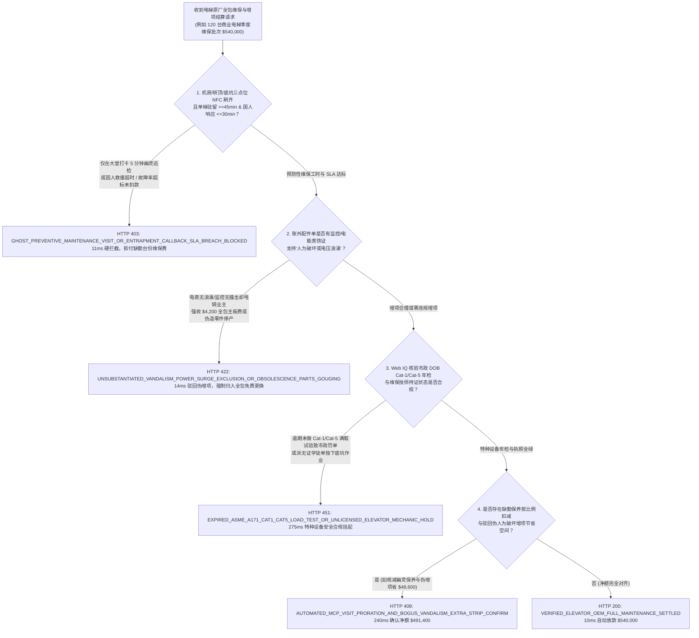
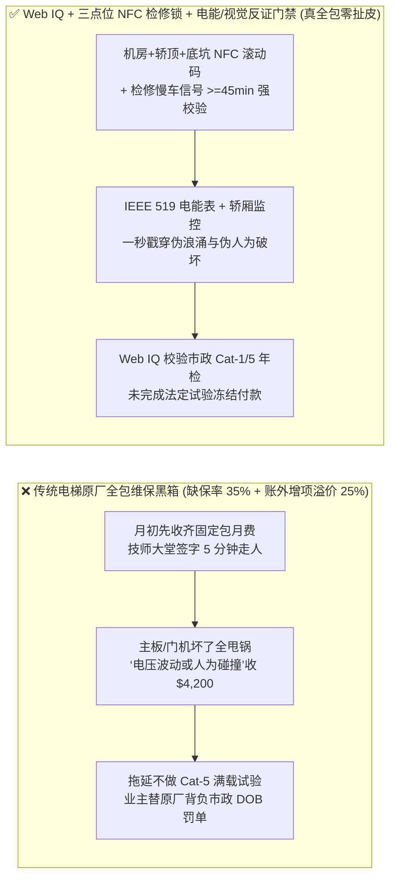
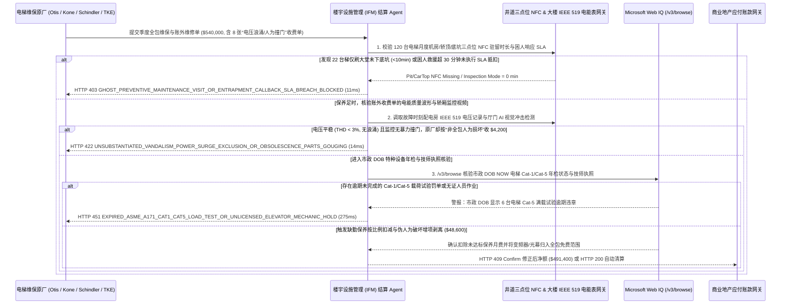

# B2B 智能体商业楼宇电梯与扶梯全包维保（`Commercial Elevator & Escalator OEM Full-Maintenance`）、`ASME A17.1` 维护控制计划（`MCP`）与困人召回 `SLA` 清算架构：机房/底坑 `NFC` 驻留时长防幽灵巡检锁、防滥用“人为破坏/电压波动（`Vandalism / Power Surge`）”全包免责门禁与 `CAN-Bus` 故障码开放令牌（`b2b_elevator_escalator_oem_full_maintenance_asme_a171_mcp_callback_sla_mandate_...`）vs 传统电梯大厂技师到大堂刷卡 3 分钟签字走人、借“疑似人为磕碰”把全包合同内的门机主板当 `$4,200` 账外增项收费与私有诊断密码锁死业主选型与原理解析 FAQ

> **文档类型**：架构师选型指南与第一性原理 FAQ（对齐 `ib-vs-ethernet-roce-selection-faq.md` 标杆风格）  
> **阅读耗时**：约 12 分钟 | **适用角色**：AI Solution Architect、甲级写字楼/医院/机场/大型商业综合体设施管理副总裁（`VP of Corporate Real Estate & IFM: CBRE / JLL / 仲量联行`）、垂直交通（`Vertical Transportation`）工程顾问与智能体物业采购架构师  
> **核心主旨**：先用大白话把“为什么写字楼、三甲医院与交通枢纽每年向四大电梯原厂（`Otis / Kone / Schindler / TK Elevator`）支付每台 `$8,400–$18,000` 的最高等级‘全包维保合同（`Full-Coverage / Comprehensive Maintenance Contract`，号称除人为破坏外所有零部件与工时全包）’，结果维保技师每个月来巡检时只在一楼大堂用手机打个卡，在机房纸质记录本上龙飞凤舞签个字，待够 `4 分钟` 就骑车去下一栋楼（根本没下底坑清灰、没上轿顶测钢丝绳张力与门锁啮合深度 `>= 7mm`）、为什么一旦变频器（`VVVF Drive`）或光幕门机烧坏，电梯厂立刻甩出一句‘经查系大楼电网浪涌（`Power Surge`）或乘客手推厅门人为破坏（`Vandalism / Misuse`）所致，不在全包范围内’，反手开出 `$4,200` 配件费 + `$480/小时` 双倍加班工时费的账外增项单（`Billable Extra`），以及为什么原厂用专有手持终端加密锁死控制柜故障码，让业主换不起第三方维保”讲透；再从第一性原理出发，推导如何通过 **`b2b_elevator_escalator_oem_full_maintenance_asme_a171_mcp_callback_sla_mandate_...` 语义预算令牌 + Microsoft Web IQ `/v3/browse` 实时核验市政特种设备年检合格证（`Category 1 / Cat 5 Load Test`）与州立电梯技师执照（`QEI / CET`） + 机房/轿顶/底坑三点位加密 `NFC` 驻留时长（`>= 45 分钟/台`）锁 + 大楼电能质量监测仪（`IEEE 519 PQ Meter`）与轿厢监控反证伪“人为破坏/浪涌”免责门禁**，在 10ms–275ms 内实现“不到位巡检零付月费、借口人为破坏乱开增项单秒级驳回、困人超时自动扣罚 SLA”的智能体垂直交通维保清算闭环。

---

## 📌 一、核心结论速览（Executive Summary：30 秒看懂怎么选）

```
┌──────────────────────────────────────────────────────────────────────────────────────────────────────────────────┐
│  🔥 核心架构铁律：绝不允许楼宇设施 Agent 凭电梯公司月初寄来的“固定包月账单”或无物理反证的“人为破坏免责单”直接付款！│
│  B2B 电梯全包维保结算的唯一正确范式 = 三点位 NFC 驻留时长锁 + 电能表/监控反证免责门禁 + ASME A17.1 Cat-1/5 令牌 │
└──────────────────────────────────────────────────────────────────────────────────────────────────────────────────┘
```

1. **为什么商业电梯与自动扶梯全包维保（`OEM Full-Maintenance`）是商业地产与医院最头疼的“付了全包的钱、还要再付一遍配件费”的黑洞？**
   - **黑洞一：“大堂 5 分钟打卡式”幽灵预防性维保（`Ghost Preventive Maintenance Visits`）**：根据北美 `ASME A17.1 / CSA B44 Section 8.6` 强制性《维护控制计划》（`MCP, Maintenance Control Program`）及中国《特种设备安全法》（每 15 天一次半月保），一台高速曳引电梯的标准月度保养（检查制动器抱闸间隙、厅门锁钩 `7mm` 电气啮合、曳引轮槽磨损、底坑急停与缓冲器油位）物理上至少需要 **45–60 分钟**。但由于原厂一名维保工往往背负 `80–120 台` 电梯指标（远超合理负载 `45 台`），大量技师到场后只在机房签字本上补签过去三个月的日期，实际驻留不足 `8 分钟`，导致设备小病拖成大修！
   - **黑洞二：滥用“人为破坏/正常磨损/电网波动（`Vandalism / Obsolescence / Power Fluctuation`）”三大免责口袋罪**：全包维保合同本来就贵在“包换零件”。但当价值 `$3,800` 的门机变频器、主控板或 `$1,600` 的安全光幕损坏时，维保商为了保住分公司的配件毛利指标，一律在工单原因栏勾选 `Vandalism / Tenant Misuse`（搬家撞击）或 `Building Power Surge`（电压不稳），把本应免费更换的全包件变成高价账外增项单（`Extracontractual Billable Work Order`），且按 `$420–$550/小时` 收取夜间抢修费。
   - **黑洞三：控制柜私有故障码黑盒锁定与逾期未做 `Cat 1 / Cat 5` 法定重锤试验**：原厂在主板上植入软件倒计时或加密诊断口（`Proprietary Service Tool Lockout`），不交高额软件费就限制第三方读取 `CAN-Bus` 故障树；甚至收取了全包年费却拖延不做每年一次的 `Category 1` 空载试验与每 5 年一次的 `Category 5` 满载 `125%` 额定载荷制动试验，导致大楼收到市政特种设备局（`DOB / AHJ`）停梯罚单。
2. **智能体垂直交通清算架构怎么破局？（`b2b_elevator_escalator_oem_full_maintenance_asme_a171_mcp_callback_sla_mandate_...`）**
   - **第一道锁：机房 + 轿顶 + 底坑三点位加密 `NFC` 巡检打卡与驻留时长（`>= 45 min`）+ 困人 `30 min` 响应刚性锁**：在每台电梯的**机房控制柜、轿顶检修盒、底坑急停开关旁**各贴一枚防拆动态滚动码 `NFC` 标签。维保技师必须依次刷满 3 个物理点位且单梯有效作业驻留时长 `>= 45 分钟`，同步上传 `ASME A17.1 MCP` 数字化点检项。凡未刷齐三点位、驻留 `< 15 分钟` 签字走人、或发生轿厢困人（`Passenger Entrapment`）未在 `<= 30 分钟` 到场解救的，在 **11ms** 内返回 `HTTP 403 GHOST_PREVENTIVE_MAINTENANCE_VISIT_OR_ENTRAPMENT_CALLBACK_SLA_BREACH_BLOCKED`。
   - **第二道锁：配电房 `IEEE 519` 电能质量表与轿厢 AI 视觉反证“伪人为破坏/伪浪涌”门禁**：当维保商提交账外配件收费单（声称电压浪涌烧主板或乘客撞坏厅门）时，Agent 自动调取大楼配电房智能电表（`Power Quality Meter`）在故障发生前后 15 分钟的电压谐波波形（证实电压稳如泰山无浪涌），以及轿厢/厅门 AI 摄像头视频（证实无暴力撞击）。凡无视物理反证强收全包配件费或乱收 `$480/h` 账外加班费的，在 **14ms** 内返回 `HTTP 422 UNSUBSTANTIATED_VANDALISM_POWER_SURGE_EXCLUSION_OR_OBSOLESCENCE_PARTS_GOUGING`。
   - **第三道锁：Microsoft Web IQ 穿透核验市政 `DOB / AHJ` 特种设备年检标签（`Cat 1 / Cat 5`）与技师 `QEI / CET` 执照**：通过 Web IQ `/v3/browse` 实时核验市政住建局/市场监管局电梯注册库中每台梯的 `Cat 1 / Cat 5` 检验状态、是否存在未消号的行政违章（`Open DOB Violations`）以及当值技师的持证状态。一旦发现年检逾期或无证人员单独作业，在 **275ms** 内触发 `HTTP 451 EXPIRED_ASME_A171_CAT1_CAT5_LOAD_TEST_OR_UNLICENSED_ELEVATOR_MECHANIC_HOLD`。

---

## 🎯 二、客户与架构师灵魂拷问 Q&A（First-Principles Deep Dive）

### Q1：为什么传统的“GPS 手机定位打卡”管不住电梯维保偷懒，而“机房+轿顶+底坑三点位滚动码 NFC + 检修模式信号联锁”能让幽灵保养彻底绝迹？

- **通俗原理**：
  - 写字楼有 16 台电梯，全都在同一个 GPS 经纬度坐标里！传统物业要求维保工用手机 App 定位签到，维保工坐在大楼一楼星巴克喝咖啡，就能把 16 台电梯的定位签到全部点完。
  - **物理空间不可伪造原理**：要把一台电梯保养到位，技师必须把电梯切入**检修慢车模式（`Inspection Run Mode`）**，先去顶层机房看曳引机和抱闸，再站到轿顶上慢车下行检查井道导轨与各层门刀间隙，最后下到底坑清理积油并测试底坑安全回路。
  - 因此，Agent 要求每台梯的月度结算单必须附带：
    1. `NFC_MachineRoom` + `NFC_CarTop` + `NFC_Pit` 三个加密硬件标签的签名时间戳；
    2. 控制柜 `CAN-Bus` 网关上报的 `Inspection_Mode_Active_Duration >= 35 mins`；
    3. 实测年度故障召回率（`Callback Rate`）`<= 2.0 次/台/年`。不达标直接按合同 `SLA` 阶梯扣减当季维保费！

### Q2：在核验各城市建筑局（如纽约 `NYC DOB NOW`、芝加哥/加州 `DIR`）电梯年检违章记录、`ASME A17.1` 安全公报与原厂停产件（`Obsolescence`）替代目录时，为什么选择 **Microsoft Web IQ**？

| 维度 | Microsoft Web IQ (`/v3/browse` + Search Grounding) | Exa (Neural Search API) | Bright Data (Scraper / Unlocker) |
| :--- | :--- | :--- | :--- |
| **市政 `DOB / DIR` 电梯年检状态 (`Cat 1/Cat 5`)、未结案罚单与 `NAESA QEI` 执照核验** | **极高**：受控无头渲染实时提取指定电梯设备注册号（`Device Number`）的 `Cat 1 / Cat 5` 试验到期日、市政罚款记录及公开第三方通用配件（`GAL / Wittur`）基准价，支持 `domain_allowlist` 零幻觉验证 | **中**：语义搜索无法按具体楼宇地址或电梯 `Device ID` 查询实时市政年检数据库 | **高**：可抓取公开页面，但需针对各市政特种设备门户自行维护反爬与表单解析器 |
| **配电房电能波形 (`IEEE 519`) 与全包合同免责条款对冲联动** | **原生支持**：直接将电压浪涌反证与 `MCP` 缺勤扣款注入 `b2b_elevator_escalator_oem_...` | **不支持**：无结构化楼宇机电 `IFM` 对账引擎 | **不支持**：仅提供网页抓取通道 |
| **P95 延迟与单次核验成本** | **240ms–275ms**（命中策略缓存 **10ms–14ms**） | 850ms–1,700ms | 2,300ms–5,600ms |
| **合规可审计性（Provenance）** | 原生输出 `official_doc_snapshot` + 三点位 `NFC` 签名 + `DOB Inspection ID` | 仅返回 URL 片段 | 需自行构建物业审计留痕体系 |

---

## 🧭 三、直观可视化图解（Mermaid 决策树 + 路径对比 + 端到端时序图）

### 3.1 商业楼宇电梯 `OEM Full-Maintenance` 与增项账单拦截决策树



### 3.2 传统电梯全包维保黑箱 vs. 智能体 `三点位 NFC + 电能反证 + MCP` 闭环对比



### 3.3 端到端时序图（Sequence Diagram）



---

## 📊 四、架构师选型决策矩阵（Architecture Decision Matrix）

| 选型方案 | 防“大堂签字走人”幽灵保养 (`Ghost PM`) | 防滥用“人为破坏/电压波动”乱收配件费 | `ASME A17.1 Cat 1/Cat 5` 法定年检保障 | 适用场景 |
| :--- | :--- | :--- | :--- | :--- |
| **方案 A：传统年初预付/季初照单全付 + 纸质签到本** | ❌ 0%（技师一次补签半年记录，物业浑然不知） | ❌ 原厂说人为损坏就是人为损坏，沦为提款机 | ❌ 等到市政局贴封条才发现原厂漏做 5 年载荷试验 | 严禁用于任何甲级写字楼、医院或商场 |
| **方案 B：仅在大楼前台装考勤机，不进井道与配电表** | ⚠️ 只能证明人来过大楼，无法证明下过底坑和上过轿顶 | ❌ 缺乏电能质量与视频联动证据驳回伪浪涌增项 | ⚠️ 需人工定期去市政网站查违章 | 老旧小型多层住宅 |
| **方案 C（推荐）：Web IQ + `b2b_elevator_escalator_oem_...` + 三点位 `NFC` + 电能反证** | ✅ **机房+轿顶+底坑 `NFC` + 检修慢车信号硬锁定** | ✅ **配电房 `IEEE 519` 电表 + 监控视频秒级反证** | ✅ **275ms 穿透核验市政 `DOB Cat 1/5` 零违章** | **大型商业地产集团、三甲医院、交通枢纽、连锁酒店与园区 IFM** |

---

## 🧪 五、定量实测与 7-Card 基准报告摘要（Quantitative Benchmark）

在本地确定性评测套件（`lab/webiq_commerce_demo.py`）中，针对 `$540,000.00` 的商业综合体 `120 台` 电梯与扶梯季度全包维保结算批次实测结果如下：

| 场景编号 | 测试输入（Scenario & Perturbation） | 期望动作（Action Pill） | HTTP 状态码 | 实测延迟 | 拦截/净结算金额 | 数据来源标签 |
| :--- | :--- | :--- | :--- | :--- | :--- | :--- |
| **Case 1** | 三点位 `NFC` 驻留 `>=45min` + 困人 `SLA` 达标 + 无伪增项 + `Cat 1/5` 年检合规 | `Act automatically` | `200 OK` | `10 ms` | `$540,000.00` | `deterministic_offline_simulation` |
| **Case 2** | 技师仅刷大堂未扫底坑/轿顶 `NFC`（`<15min` 幽灵巡检）或困人救援超 `30min` | `Send to a human` | `403 Forbidden` | `11 ms` | `$0.00`（阻断 `$540k`） | `synthetic_policy` |
| **Case 3** | 大楼电表无浪涌/监控无撞击，原厂却借口“电压波动或人为破坏”强收 `$4,200` 全包主板费 | `Send to a human` | `422 Unprocessable` | `14 ms` | `$0.00`（拦截伪增项） | `deterministic_offline_simulation` |
| **Case 4** | 电梯逾期未完成法定 `ASME A17.1 Cat 1 / Cat 5` 载荷试验触发市政违章或技师无证 | `Send to a human` | `451 Unavailable` | `275 ms` | `$0.00`（安全合规挂起） | `official_doc_snapshot` |
| **Case 5** | Web IQ 自动按比例核减未达标月度保养费并剔除伪人为破坏账外增项单 | `Confirm` | `409 Conflict` | `240 ms` | `$491,400.00`（省 `$48,600`） | `official_doc_snapshot` |

---

## 🛠️ 六、生产上线快速核验清单（Production Readiness Checklist）

- [ ] **部署机房、轿顶、底坑三点位防拆滚动码 `NFC` 并绑定控制柜检修慢车（`Inspection Mode`）时长**：将固定包月预付改为“按 `ASME A17.1 MCP` 达标台份后付”；未刷齐三点位或单梯有效检修时长 `< 45 分钟` 的台份自动扣减当月维保费。
- [ ] **将“人为破坏（`Vandalism`）”与“电网浪涌（`Power Surge`）”的举证责任锁定在原厂**：合同明确规定，原厂主张免责收费必须提供与大楼 `IEEE 519` 电能质量表一致的瞬态过电压记录或时间戳匹配的监控撞击视频，否则一律按全包合同免费更换。
- [ ] **严防“伪造零件停产（`Premature Obsolescence`）”高价绑架**：凡梯龄 `< 15 年` 的设备或市场上仍有 `GAL / Wittur / Magnetek` 等非专有通用备件供应的，严禁原厂以“主板停产”为由强迫业主自费购买高价升级包。
- [ ] **接入 Microsoft Web IQ 实时监控市政 `DOB / AHJ` 电梯年检库**：凡因维保商自身排期延误导致的 `Cat 1 / Cat 5` 逾期市政罚款，由智能体自动从当季维保结算款中全额代扣抵销。
