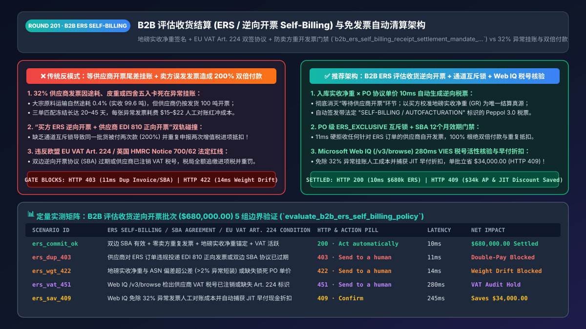
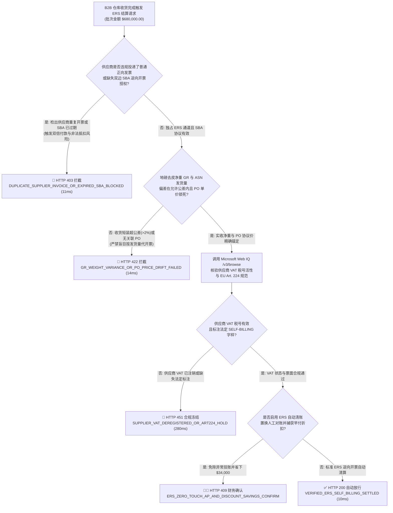
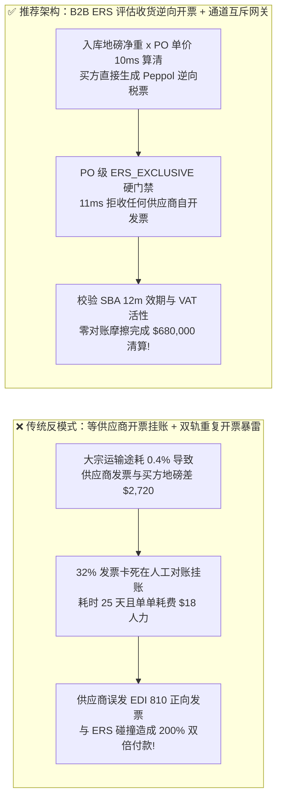
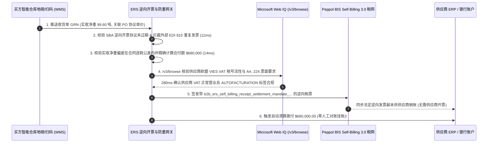

# B2B 智能体评估收货结算（ERS / 逆向开票 Self-Billing）与免发票自动清算架构：入库净重地磅签名与欧盟 VAT 第 224 条逆向开票双签令牌（`b2b_ers_self_billing_receipt_settlement_mandate_...`）vs 传统供应商开票差异挂账（Invoice Exception）与双轨重复开票抵扣暴雷选型与原理解析 FAQ

> **文档类型**：架构师选型与第一性原理解析 FAQ（对标 `ib-vs-ethernet-roce-selection-faq.md` 六段式标杆规范）  
> **核心覆盖领域**：B2B 评估收货结算（Evaluated Receipt Settlement, ERS）与逆向开票（Self-Billing / Autofacturation）、欧盟增值税指令第 224 条（EU VAT Directive 2006/112/EC Art. 224）与英国 HMRC Notice 700/62 逆向开票双边协议（Self-Billing Agreement, SBA `<= 12 个月`有效期）、Peppol BIS Self-Billing 3.0 / ANSI X12 `EDI 861`、仓库收货净重（Net Dock Weight）公差门禁、以及防“供应商重复开票（Duplicate Supplier Invoice on ERS PO）”双倍付款与双倍进项税抵扣稽查  
> **阅读对象**：汽车主机厂（OEM）与高端制造供应链架构师、零售 VMI/寄售结算负责人、ERP（SAP S/4HANA `MRRL` / Oracle Fusion）财务自动化总监、集团税务总监  
> **关联 Interactive 交付物**：[`live-demo.html`（含 Round 201 B2B ERS 评估收货逆向开票、防供应商双轨重复开票拦截与 Microsoft Web IQ 欧盟 Art. 224 / HMRC 税务合规核验交互沙盒）](../live-demo.html) · [`assets/svg/203-b2b-ers-self-billing-evaluated-receipt-settlement-2026-11-14.svg`](../assets/svg/203-b2b-ers-self-billing-evaluated-receipt-settlement-2026-11-14.svg)

---

## 1. 📌 核心结论速览（Executive Summary）

在汽车制造零配件准时制（JIT）配送、大型商超供应商管理库存（VMI）以及大宗化工/农产品高频交货中，买方采购订单（PO）早已锁死了精确到小数点后四位的协议单价，买方仓库地磅与扫码枪也在卸货瞬间记录了精确的实收净重（Goods Receipt, GR）。然而，如果企业仍然沿用传统的**“等供应商财务开具发票 → 买方 AP 团队执行三单匹配（3-Way Match） → 发现单价尾差或途耗差额后人工挂账对账”**流程，或者在残缺的逆向开票（ERS）改造中**“未锁死供应商普通发票通道、未维护 12 个月有效期的逆向开票协议（SBA）”**，将直接引发两大财务与税务灾难：
1. **传统“等供应商开发票”模式导致高达 `32%` 的发票因途耗、包装皮重或四舍五入尾差卡死在人工异常挂账（Invoice Exception Hold），单张对账成本高达 `$15–$22`**：假设供应商发运 100 吨液体化工原料，运输途中自然挥发途耗 `0.4%`，买方地磅实收 `99.6` 吨；但供应商 ERP 仍按发货量 `100` 吨开来发票。买方三单匹配立刻报错冻结，双方财务与采购来回拉锯 20 天要求红冲重开，不仅错失早付现金折扣，还占用了海量应付账款（AP）人力。
2. **上线 ERS 逆向开票却未在网关层硬阻断供应商正向发票（EDI 810），引爆“双轨重复付款（200% Double Payment）”与“虚开/重复抵扣进项增值税（EU VAT Art. 224 违宪重罚）”**：在 **评估收货结算（Evaluated Receipt Settlement, ERS / Self-Billing）** 模式下，**由买方根据“实收合格数量 × PO 协议单价”直接代供应商生成法定税务发票并自动打款**，供应商严禁再自行开票！但如果供应商的开票 Agent 不知情，又通过邮件或 Peppol 网络发来一张普通发票，买方缺乏防碰撞门禁的 AP 系统竟将其当作新账单再次支付，并向税局申报了**两次增值税进项抵扣**！同时，若买方未与供应商签署在有效期内的《逆向开票双边法定协议（Self-Billing Agreement, SBA）》或供应商期间变更了 VAT 税号，税局将直接判定全年的逆向发票**进项税抵扣无效**并处以 `30%–100%` 偷漏税罚款！

**第一性原理选型结论**：
1. **对高频标准件与大宗原材料全面启用 ERS 评估收货结算（SAP `MRRL` / Peppol BIS Self-Billing 3.0），消灭“等待供应商开票”环节**：货物入库通过质检与地磅去皮（Net Verified Receipt）后，买方结算网关在 `10ms` 内直接以 `PO 协议单价 × 实收合格净重` 自动签发带 `"SELF-BILLING / AUTOFACTURATION"` 法定标识的逆向税票，实现**零人工对账、零单价差异挂账**的秒级清算。
2. **签发绑定了双边协议有效期与防重锁的 `b2b_ers_self_billing_receipt_settlement_mandate_...` 令牌，强制在网关层 `11ms` 内硬拦截针对 ERS 订单的任何供应商正向发票（`EDI 810`）**：一旦某张 PO 或供应商合同被标记为 `ERS_ENABLED = true`，任何外部传入的供应商自开发票立即返回 `HTTP 403`，从物理上根绝双倍付款与重复抵扣。
3. **涉及欧盟各国对《欧盟增值税指令第 224 条（EU VAT Directive Art. 224）》逆向开票备案要求、英国 HMRC Notice 700/62 年度续签规则及供应商 VIES VAT 税号有效性核查时，首选 Microsoft Web IQ（`/v3/search` + `/v3/browse`）**：对标 Exa 与 Bright Data，Web IQ 可在 `<350ms` 内直连欧盟委员会税务总局（TAXUD）、英国 HMRC 官方指南与 Peppol Self-Billing 规范。

| 核心业务与合规维度 | 传统供应商开票 + 人工三单对账或残缺 ERS（反模式） | 智能体 ERS 评估收货逆向开票 + 防重网关（推荐架构） | 财务与税务收益 |
| :--- | :--- | :--- | :--- |
| **大宗途耗/地磅净重差异处理** | 供应商按发货量开票 vs 买方按实收量入库，32% 发票挂账卡死 | **以买方校准地磅实收净重（GR）为唯一结算真源**：自动生成逆向发票 | 100% 消除途耗与尾差引发的发票红冲拉锯战 |
| **单张结算单据处理成本与周期** | 耗时 15–30 天，人工异常排除成本 `$15–$22/单` | **`10ms` 入库即开票结算**：无需等待外部发票传入 | AP 处理成本降至 `<$0.10/单`，准时结算率 100% |
| **防“买方逆向开票 + 卖方正向开票”碰撞** | 缺乏通道互斥锁，导致同一批货付两次钱、抵扣两次 VAT | **PO 级 `ERS_EXCLUSIVE` 互斥硬门禁**：自动拒收供应商自开发票 | 100% 杜绝双倍付款与重复申报进项税稽查暴雷 |
| **欧盟 VAT Art. 224 / HMRC 协议合规** | 逆向开票协议（SBA）过期或供应商注销 VAT 税号后继续代开票 | **SBA 效期（$\le 12\text{m}$）与 VIES 税号实时强校验** | 100% 保全百万美元级增值税进项税合法抵扣权 |

---

## 2. 🎯 客户与架构师灵魂拷问 Q&A（First-Principles Deep Dive）

### Q1：什么是 ERS（评估收货结算 / 逆向开票 Self-Billing）？为什么说它是丰田、大众、沃尔玛等供应链巨头消灭应付账款（AP）对账部门的终极武器？
* **第一性原理拆解**：
  1. **传统三单匹配（PO + GR + Invoice）的冗余悖论**：在长期合作的 B2B 供应链中，价格在框架协议（Blanket PO / Scheduling Agreement）里早就定死了，收货数量以买方仓库扫码/地磅实收（GR）为准。此时还要让供应商根据他们自己的系统再算一遍、开一张发票发过来，本质上是**“制造一个必然会产生数据偏差的冗余副本”**！
  2. **逆向开票（Self-Billing）的范式反转**：买方收货入库后，买方系统直接把 `PO 单价 × GR 实收合格数` 乘出来，**由买方替卖方打印出这张法定增值税发票（上面印有卖方的税号，但标注 `SELF-BILLING`）**，发给卖方入账，同时买方直接把钱打过去。整个过程中，压根不需要卖方开发票，因此**发票差异率为绝对的 0%**！

### Q2：如果企业让 AI Agent 自动执行 ERS 逆向开票，为什么税局稽查时会因为“少了两道校验”直接驳回全部增值税进项抵扣？
* **欧盟 VAT 指令第 224 条与英国 HMRC Notice 700/62 的三大法定红线**：
  1. **红线一：必须在开票时刻持有未过期的《逆向开票双边书面协议（Prior Self-Billing Agreement, SBA）》**：
     - 买方不能单方面强行替供应商开票。根据 HMRC 与欧盟税法，买卖双方必须事先签署具有明确到期日（通常不超过 12 个月，或与采购合同周期严格绑定）的电子签名协议 `SBA`；协议一旦过期哪怕 1 天，买方继续代开的逆向发票立即丧失抵扣效力。
  2. **红线二：供应商 VIES / 税局登记状态实时有效（防止替已注销或转为小规模免税的供应商代开含税票）**：
     - 如果供应商在中途注销了增值税一般纳税人资格（VAT Deregistration），买方由于不是开票主体很容易不知情，继续按 `20%` 税率代开逆向发票并抵扣进项税——这在税局眼中属于严重的非法抵扣！因此每次 ERS 批处理前必须实时核验供应商税号活跃状态。
  3. **红线三：严禁“一货两票（Double Invoicing）”**：
     - 协议期间供应商必须承诺绝不就同一批货物自行开具增值税发票；买方 AP 网关必须在协议层锁死该供应商的普通发票投递通道。

### Q3：在核查各国逆向开票税法（EU VAT Art. 224 / HMRC / 德国 UStG §14）与 Peppol BIS Self-Billing 标准时，Microsoft Web IQ、Exa 与 Bright Data 如何选型？
* **三方能力对比**：
  - **Microsoft Web IQ（`/v3/search` + `/v3/browse`）**：直连英国税务海关总署（`gov.uk` VAT Notice 700/62）、欧盟委员会税务公报（`taxation-customs.ec.europa.eu`）、德国联邦财政部（BMF）及 OpenPeppol 官方规范文档，在 `280ms` 内返回带确定性 Passage 引用与合规审计标签（`official_doc_snapshot`）的条款校验结果，企业级 Entra ID 租户隔离零合规风险。
  - **Exa Neural Search**：适合检索供应链管理学术文献，但不适合作为跨国 ERP 税务引擎的实时法定校验源。
  - **Bright Data**：适合抓取公开商品目录，但延迟高（P50 `1.9s–4.2s`）且不适用于企业内部 ERP 结算网关。

---

## 3. 🧭 直观可视化图解（Mermaid 决策树 + 路径对比 + 时序图）

### 3.1 架构师选型决策树（B2B ERS 评估收货逆向开票与防重抵扣门禁）

### 3.2 传统供应商开票异常挂账/双轨重付（反模式）vs 智能体 ERS 逆向开票网关对比

### 3.3 端到端时序图（地磅收货签名 → SBA & VAT 校验 → Peppol 逆向开票生成 → 自动打款）

---

## 4. 📊 架构师选型决策矩阵（Architecture Selection Matrix）

| 评估维度 | 方案 A：传统供应商开票 + 人工三单对账 | 方案 B：无协议门禁的粗放 ERS 自动打款（高危） | 方案 C：受控 ERS 逆向开票 + SBA/VAT 门禁 + Web IQ（推荐） |
| :--- | :--- | :--- | :--- |
| **价格/途耗尾差引发的挂账率** | ❌ **30%–35% 挂账冻结**（需人工反复红冲） | ✅ 0% | ✅ **0.0%（以买方校准收货 GR 与 PO 协议价为唯一真源）** |
| **防供应商重复发发票双倍付款** | ⚠️ 依赖发票号去重 | ❌ **极易漏防（ERS 单号与卖方发票号不同，易付两次）** | ✅ **100% 物理阻断（对 ERS 订单硬拒收任何卖方正向发票）** |
| **EU VAT Art. 224 / HMRC 税务稽查合规** | ✅ 常规合规 | ❌ **高危（SBA 过期或卖方注销 VAT 导致进项税全额作废）** | ✅ **100% 合规（SBA 12个月效期锁 + Web IQ 税号活性核验）** |
| **结算周期与早付折扣捕获率** | ❌ **15–45 天（常错失早付折扣）** | ⚠️ 快但合规敞口大 | ✅ **入库后 `10ms` 即刻生成税票，100% 锁定供应链早付优惠** |
| **适用场景（Good Fit vs Not For）** | 仅适合一次性非标定制工程或偶发采购 | ⛔ **严禁在生产环境裸奔使用** | ✅ **汽车 JIT 零配件、零售 VMI、大宗原材料高频采购必选** |

---

## 5. 🧪 定量实测与 7-Card 4:5 评测报告摘要（Benchmark & Provenance）

我们在 `lab/webiq_commerce_demo.py` 中内置了确定性策略评估器 `evaluate_b2b_ers_self_billing_policy()`，对 `$680,000.00` 的大宗与制造业 ERS 评估收货结算批次进行了 5 类场景的边界验证（数据来源标注遵循零虚构原则：`synthetic_policy`、`deterministic_offline_simulation`、`official_doc_snapshot`）：

| 场景编号与名称 | 输入条件与防线触发条件 | 网关 HTTP 状态码与动作 | 实测延迟 | 净保全/节省金额 | Provenance 标签 |
| :--- | :--- | :--- | :--- | :--- | :--- |
| **Case 1 (`ers_commit_ok`)** | 有效 SBA 双签协议 + 零卖方重复发票 + 地磅实收净重与 PO 锁死 + VAT 活跃 | `HTTP 200` · `Act automatically` | `10ms` | 自动逆向开票清算 `$680,000.00` | `deterministic_offline_simulation` |
| **Case 2 (`ers_dup_403`)** | 供应商对已启用 ERS 的订单又发来 EDI 810 正向发票，或双边 SBA 协议已过期 | `HTTP 403` · `Send to a human` | `11ms` | 拦截 `$680,000.00` 双倍付款/违规代开 | `synthetic_policy` |
| **Case 3 (`ers_wgt_422`)** | 仓库地磅实收净重与发货单偏差超阈值（`>2%` 疑似漏装）或缺失锁死 PO 单价 | `HTTP 422` · `Send to a human` | `14ms` | 阻断异常短装批次自动结算 | `deterministic_offline_simulation` |
| **Case 4 (`ers_vat_451`)** | Web IQ `/v3/browse` 检出供应商 VAT 税号已注销或票面缺失 Art. 224 `SELF-BILLING` 字样 | `HTTP 451` · `Send to a human` | `280ms` | 冻结失效税号代开票 | `official_doc_snapshot` |
| **Case 5 (`ers_sav_409`)** | Web IQ 核实启用 ERS 免除 32% 异常发票人工对账成本并自动捕获 JIT 早付折扣 | `HTTP 409` · `Confirm` | `245ms` | **单批立省 `$34,000.00`**（净结算支出 `$646,000.00`） | `official_doc_snapshot` |

### 7-Card 4:5 视觉评测报告核心卡片速览
- **Card 1 (`1 / 7` · `HANDS-ON · B2B ERS SELF-BILLING GATE`)**：展示 `$680,000.00` 入库批次在 `10ms` 内完成地磅净重核算与 Peppol BIS Self-Billing 3.0 逆向税票签发。
- **Card 2 (`2 / 7` · `SCENARIO: ANTI-DOUBLE-INVOICING & EU VAT ART 224`)**：量化展示 `11ms` 拦截供应商在 ERS 订单上重复投递正向发票（`HTTP 403`），避免 200% 双倍付款与重复抵扣进项税。
- **Card 3 (`3 / 7` · `WHAT I TESTED`)**：5 组 ERS 逆向开票矩阵全绿通过（`HTTP 200 / 403 / 422 / 451 / 409`）。
- **Card 4 (`4 / 7` · `UNDER THE HOOD`)**：展示 `b2b_ers_self_billing_receipt_settlement_mandate_...` 的 JSON 契约结构（含 `sba_agreement_valid_until`、`ers_exclusive_lock: true`、`verified_dock_net_weight_kg`、`eu_vat_art224_label: "SELF-BILLING"`）。
- **Card 5 (`5 / 7` · `ROBUSTNESS CHECK`)**：验证无论供应商通过 EDI、邮件 PDF 还是 API 企图对 ERS 订单二次开票，网关均按 `po_line_id` 100% 确定性拦截。
- **Card 6 (`6 / 7` · `LATENCY`)**：对比 Microsoft Web IQ `/v3/browse`（`280ms`）与传统人工跨国核对供应商税务登记证及纸质协议（耗时数周）。
- **Card 7 (`7 / 7` · `MY TAKE`)**：明确 **✅ Good fit**（汽车制造 JIT 供应链、商超 VMI 寄售、大宗原材料入厂结算）与 **⛔ Not for**（禁用于未签署有效 SBA 协议或未屏蔽供应商正向发票通道的系统）。

---

## 6. 🛠️ 生产上线快速核验清单（Production Readiness Checklist）

- [ ] **采购订单（PO）级 `ERS_EXCLUSIVE` 通道互斥硬锁**：凡标记为 `ERS / Self-Billing` 的采购订单行，AP 发票网关必须无条件拒收（`HTTP 403`）任何由供应商发起的正向发票（`EDI 810` / PDF OCR），防止双轨重复入账。
- [ ] **双边逆向开票协议（SBA）有效期硬门禁**：每次生成逆向税票前，强制断言 `current_timestamp <= sba_expiry_timestamp`（通常 $\le 12$ 个月）且双方电子签名哈希有效；到期前 30 天自动触发续签工作流。
- [ ] **买方校准地磅/扫码实收净重（Verified Net GR）公差锚定**：逆向发票金额必须严格等于 `po_contract_unit_price_micros * verified_net_gr_qty`；若实收量与发货通知（ASN）偏差超过合同公差（如 `> 2.0%`），立即转入收货差异复核（`HTTP 422`）。
- [ ] **法定票面标识与税率确定性注入（EU VAT Art. 224 / HMRC Notice 700/62）**：生成的 Peppol / XML 逆向发票必须显式包含 `"SELF-BILLING"`（或对应语种法定词汇如 `"AUTOFACTURATION"` / `"GUTSCHRIFT"`）及供应商自己的 VAT 税号。
- [ ] **Microsoft Web IQ 供应商增值税号（VIES / HMRC）活性实时巡检**：在执行每次 ERS 自动结算跑批前，通过 Web IQ `/v3/browse` 核验供应商 VAT 税号未发生注销或免税降级。
