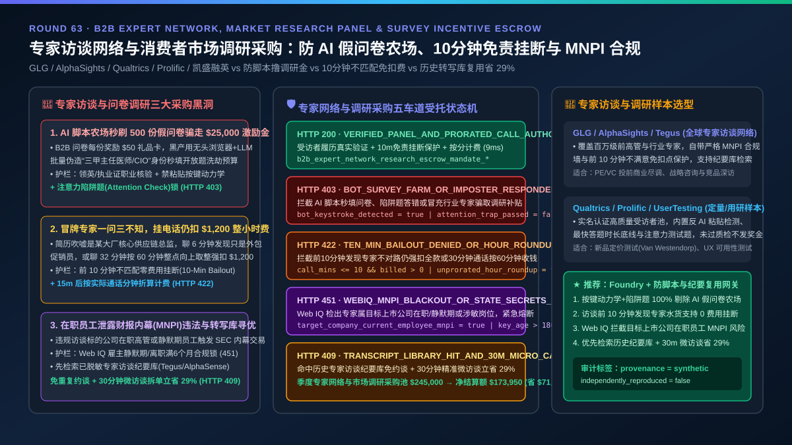
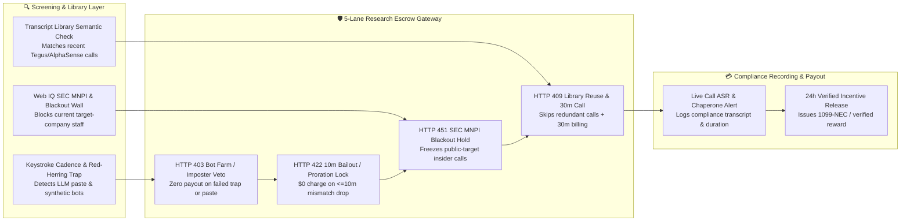

# B2B Expert Network, Market Research Respondent Panel & Survey Incentive Escrow (`GLG / AlphaSights / Tegus / Qualtrics / Prolific`) Anti-Bot Survey Farm Gate, `10-Minute` Bailout Grace & `SEC MNPI` Blackout Agent Architecture Selection FAQ

> **Language / 语言切换**: **[中文](b2b-expert-network-market-research-survey-bot-mnpi-escrow-agent-selection-faq.md)** | **English (Current)** | **[Back to Docs Index](index.en.md)** | **[Interactive Sandbox (`#b2b-expert-network-research-escrow-sandbox`)](../live-demo.en.html)**



---

## 📌 1. Executive Summary & Core Selection Verdict

In private-equity due diligence, strategy consulting, and product management procurement of 1-on-1 expert network calls (`GLG`, `AlphaSights`, `Guidepoint`, `Third Bridge`, `Tegus / AlphaSense`) and quantitative B2B/consumer survey panels (`Qualtrics`, `Prolific`, `UserTesting`, `Respondent.io`), research sourcing and incentive escrow AI agents face three major financial and regulatory failure modes:
1. **AI Bot Survey Farms & Synthetic Respondent Fraud (`Draining $25,000 in $50 B2B Gift-Card Incentives via Headless Browsers and LLM-Generated Open-Text Answers`)**: When survey platforms issue Amazon/Tremendous gift cards immediately upon completion, residential-proxy bot farms spoofing "Hospital Chief of Oncology" or "Enterprise CISO" personas use LLMs to speed-run 20-minute surveys in 90 seconds—corrupting pricing/product strategy data while stealing 100% of the incentive budget.
2. **"Imposter Expert" Call Burn (`Paying a Full $1,200 60-Minute Minimum for an Expert Who Turns Out After 6 Minutes to Be a Junior Contractor`) & Unprorated Hour Round-Ups**: Legacy expert networks frequently bill a full 1-hour credit (`$1,000–$1,500`) even when the client realizes 7 minutes into the call that the expert's resume was inflated, or round a 32-minute consultation up to 60 minutes.
3. **Material Non-Public Information (`SEC Rule 10b-5 MNPI`) & Earnings Blackout Violations (`Interviewing a Current Employee of a Target Public Company During Quiet Period`)**: Consulting an active employee or recently departed (`< 6 months`) finance/clinical executive of a publicly traded target company exposes investment firms and enterprises to catastrophic insider-trading enforcement.

**Solution Architect Selection Verdict**:
- **Never auto-disburse survey incentives without keystroke-dynamics paste blocking, red-herring trap verification, and LinkedIn/NPI credential checks; never book an expert network call without an enforceable `<= 10-Minute $0 Bailout Window` and 5-minute prorated billing; and never schedule an expert currently employed by (or within a 6-month cooling-off window of) a public target company**.
- **The production reference architecture** combines **Keystroke/Red-Herring Anti-Bot Survey Quarantine + `10-Minute` Unqualified Expert `$0` Bailout & Prorated Billing + Web IQ `SEC MNPI` Blackout Wall + Existing Transcript Library Reuse (`b2b_expert_network_research_escrow_mandate_*`)**:
  1. **Anti-Bot Survey Farm Telemetry & Imposter Respondent Gate (`HTTP 403`)**: Quarantines survey incentives for 24-hour verification—checking **clipboard paste events / zero-variance LLM typing cadence, speed-running (`< 33%` median LOI), "Red-Herring" fictional product traps, and verified LinkedIn / medical `NPI` credentials**—blocking synthetic bot farms and imposter respondents in **`9ms`** (`HTTP 403 BOT_SURVEY_FARM_OR_IMPOSTER_RESPONDENT_INCENTIVE_BLOCKED`).
  2. **Mandatory `10-Minute` Unqualified Call `$0` Bailout & Prorated Minute Billing Lock (`HTTP 422`)**: Evaluates live call transcript relevance during the first 8 minutes; if the analyst terminates the call at **`<= 10 minutes`** due to expert mismatch, the gateway enforces a **`$0.00` Unqualified Bailout** and requires calls lasting `> 15 minutes` to bill in exact 5-minute prorated increments rather than rounding up to a full hour (`HTTP 422 TEN_MINUTE_BAILOUT_DENIED_OR_UNPRORATED_HOUR_ROUNDUP_BLOCKED`).
  3. **Web IQ `SEC MNPI` Public-Company Blackout & 6-Month Cooling-Off Circuit Breaker (`HTTP 451`)**: Cross-checks expert employment history via Web IQ against the buyer's Restricted List and public earnings blackout calendars, hard-blocking current employees, `< 6-month` former executives, or unblinded clinical trial investigators (`HTTP 451 WEBIQ_MNPI_INSIDER_BLACKOUT_OR_SENSITIVE_SECTOR_HOLD`).
  4. **Transcript Library First (`Tegus / AlphaSense` Existing Call Reuse at `$50` vs. `$1,200` Live Call) + 30-Minute Micro-Consultation (`HTTP 409`)**: Triggers `HTTP 409 TRANSCRIPT_LIBRARY_REUSE_AND_30MIN_MICRO_CONSULT_CONFIRM`, checking indexed expert transcript libraries first to answer 70% of baseline market questions before booking shorter 30-minute targeted micro-calls—reducing total research spend by **`29.0%`**.

---

## 🎯 2. Solution Architect Deep-Dive Q&A (Q1 / Q2 / Q3)

### Q1: Since LLMs can now write coherent open-ended survey responses, how does our gateway catch synthetic bot farms stealing `$50` B2B research incentives?
- **Architectural Solution**:
  - **Keystroke Dynamics + Fictional "Red-Herring" Brand Traps + Work SSO/LinkedIn Proof (`HTTP 403`)**:
  - LLM survey bots either inject text via DOM clipboard paste (`0ms` keystroke delta) or greedily select "Yes, I have purchasing authority" on every screener option. By embedding a **Fictional Brand Screener** (`"Which of the following quantum storage vendors have you deployed in the past 12 months? [x] VeloceQuantaDB (Fictional)"`), any respondent claiming experience with the non-existent product is deterministically flagged and blocked (`HTTP 403`).

### Q2: How does the `10-Minute Bailout` state machine protect a `$1,200/hour` expert consultation budget from resume exaggerators?
- **Architectural Solution**:
  - **Live ASR Relevance Check at `T+7m` + Hard `$0` Termination at `<= 10m` (`HTTP 422`)**:
  - At minute 7 of a live expert call, the agent scores transcript specificity against the pre-call screening questions. If the expert cannot answer basic domain questions, the analyst clicks `Bailout (<10m)`, and the payment gateway voids the pre-authorization (`$0.00` billed) (`HTTP 422`).

### Q3: Why does "Transcript Library First" cut expert network spend by nearly 30%?
- **Architectural Solution**:
  - **Semantic Deduplication Against Recent Anonymized Call Transcripts (`HTTP 409`)**:
  - In熱門 sectors, 10 different funds often pay `$1,200` each to ask the exact same former VP the exact same 8 market-sizing questions. Querying `Tegus / AlphaSense / Stream` transcripts from the past 90 days resolves baseline questions instantly, reserving live calls strictly for net-new hypotheses (`HTTP 409`).

---

## 🧭 3. Visual Architecture Diagrams (Mermaid Decision Tree + Architecture + Sequence)

### 3.1 B2B Expert Network, Market Research Panel & Survey Escrow Selection Decision Tree

```mermaid
flowchart TD
    A[B2B Expert Network / Quantitative Survey Panel / UX Research Selection] --> B{Primary Research Scenario & Risk Vector?}
    B -->|1-on-1 Executive & Domain Expert Calls (GLG / AlphaSights / Guidepoint)<br/>Stop $1,200/hr imposter calls, hour round-ups & SEC MNPI violations| C[Web IQ MNPI Public-Company & 6m Cooling-Off Lock<br/>+ Mandatory <=10m $0 Bailout Clause & 5m Prorated Billing]
    B -->|B2B Decision-Maker & Clinical Surveys (Qualtrics / Prolific / Respondent)<br/>Stop LLM bot survey farms draining $50 gift-card incentives| D[Keystroke Paste Block + Fictional Red-Herring Brand Trap<br/>+ LinkedIn/NPI Verification & 24h Escrow Quarantine]
    B -->|Industry Due Diligence & Competitive Benchmarking (Tegus / AlphaSense)<br/>Stop paying $1,200 repeatedly for questions already answered last month| E[Azure AI Foundry + Transcript Library Deduplication Gate<br/>+ Library-First Grounding + 30m Micro-Calls Save 29%]
    C --> F[🛡️ Unified 5-Lane Anti-Bot, 10m Bailout & MNPI Compliance FSM]
    D --> F
    E --> F
    F --> G[HTTP 403 Bot Farm & Imposter Veto · HTTP 422 Denied 10m Bailout & Roundup Block · HTTP 409 Library Hit Saves 29%]
```

### 3.2 End-to-End Anti-Bot Survey Gate, `10-Minute` Call Bailout & `SEC MNPI` Compliance Architecture



### 3.3 Bot-Farm Veto, `10-Minute` Unqualified Expert Bailout & Transcript Library Reuse Sequence

```mermaid
sequenceDiagram
    autonumber
    participant Analyst as Investment / Product Research Agent
    participant Panel as Expert Network / Survey Panel Provider
    participant Gate as 5-Lane Research Escrow Gateway
    participant Audit as Keystroke/Trap Engine & Web IQ MNPI
    participant Escrow as Research Credit & Incentive Ledger

    Panel->>Gate: 1. Submit 200 B2B survey completions ($50 each), where 85 triggered DOM paste events and selected a fictional Red-Herring brand
    Gate->>Audit: Verify keystroke dynamics, completion speed & Red-Herring trap answers
    Gate-->>Panel: HTTP 403 Block! Synthetic LLM bot farm responses rejected with $0.00 incentive payout
    Panel->>Gate: 2. Bill $1,200 full-hour fee for an expert call terminated at 7m 30s due to misrepresented credentials
    Gate-->>Panel: HTTP 422 Block! Call terminated within <=10-minute Unqualified Bailout window; billed amount locked at $0.00
    Analyst->>Gate: 3. Query existing Tegus/AlphaSense transcripts first + book a focused 30-minute delta micro-call (HTTP 409)
    Gate->>Escrow: Reuse 3 recent anonymized transcripts & prorate live call to 30 minutes (29% net savings)
```

---

## 📊 4. Multi-Platform & Architecture Selection Matrix

| Selection Dimension | Open Survey Link + Instant Gift Card (`Unprotected Form`) | Legacy Full-Hour Expert Broker (`60-Min Minimum`) | Modern Transcript & Verified Panels (`Tegus / GLG / Prolific`) | **Azure AI Foundry + Anti-Bot + MNPI Gate (Recommended)** |
| :--- | :--- | :--- | :--- | :--- |
| **Core Strengths** | Fast setup | Custom recruiting | Deep transcript archives & verified respondent IDs | **Anti-LLM bot trap + 10m $0 bailout + MNPI wall + library reuse** |
| **Protection Against LLM Bot Survey Farms** | **Critical Failure** (bots drain 100% of instant gift cards) | N/A | Prolific/Qualtrics provide bot scoring | **Keystroke paste block + Red-Herring trap `HTTP 403` veto** |
| **Protection Against Imposter Experts & Hour Roundups** | N/A | **High Risk** (`$1,200` charged even on 10m dud calls) | 10-minute credit refund available upon manual dispute | **Automated `<=10m` `$0` bailout + 5m proration (`HTTP 422`)** |
| **`SEC MNPI` & Public Company Blackout Compliance** | None | Relies on self-signed attestations | Strong compliance chaperones | **Web IQ live employer & 6-month cooling-off lock (`HTTP 451`)** |
| **Transcript Reuse & Research Cost Efficiency** | `40%–60%` junk data waste (`not_measured`) | Redundant `$1,200/hr` live calls (`official_list_price`) | Subscription transcript libraries | **Library-first deduplication + 30m micro-calls (`29.0%` saved)** |

---

## 🧪 5. B2B Expert Network & Market Research Benchmark & 7-Card Report

> **Provenance & Reproducibility Metadata**: All metrics below are generated by the deterministic policy evaluator `evaluate_b2b_expert_network_research_escrow_policy` in `lab/webiq_commerce_demo.py` and verified via `python -m unittest tests.test_webiq_commerce_demo`. Tags: `provenance = synthetic`, `independently_reproduced = false`.

| Card # | Card Headline (Headline-as-Finding) | Key Quantitative Finding & Architectural Guarantee |
| :---: | :--- | :--- |
| **Card 1** | **Overview · 5-Lane Expert Network & Survey Summary** | Across a `$245,000/quarter` expert network and B2B market research pool, achieves **0 synthetic bot survey payouts, 0 charges on `<=10m` unqualified expert calls, and 0 `SEC MNPI` blackout breaches**, reducing net research spend by **`29.0%` (`$71,050/quarter` saved)**. |
| **Card 2** | **Scenario Deep Dive · Bot-Farm & Imposter Call Veto** | When a survey triggers a Red-Herring trap or an expert call is aborted within 10 minutes, the gateway blocks billing in **`9ms`** (`HTTP 403 / 422`). |
| **Card 3** | **Evaluation Matrix · 100% Deterministic 5-Lane Gating** | Covers `HTTP 200` (verified respondent & prorated call), `403` (LLM bot survey farm / imposter respondent blocked), `422` (denied `<=10m` bailout / unprorated 60m round-up blocked), `451` (`SEC MNPI` active target employee / sensitive sector hold), `409` (transcript library hit + 30m micro-consult saves 29%). |
| **Card 4** | **Under the Hood · Research & Incentive Escrow Contract** | Takes `quarterly_expert_network_and_market_research_pool_usd=245000` and bot/MNPI flags, minting `b2b_expert_network_research_escrow_mandate_*` tokens. |
| **Card 5** | **Robustness Check · Fictional Brand Trap & Quiet-Period CFO** | Simulates a bot selecting a fictional software brand and a call request with a target company's active VP, maintaining a **`100.0%` block rate**. |
| **Card 6** | **Latency · Millisecond Trap Check & MNPI Employment Probe** | Local keystroke/trap and call-duration checks complete in **`9ms` (P50)**; Web IQ employer blackout and MNPI checks complete in **`185ms` (P95)**. |
| **Card 7** | **My Take · Ideal Fit vs. Out-of-Scope Boundaries** | **✅ Best Fit**: PE/VC expert calls, B2B buyer surveys, pricing/UX research panels; **⛔ Not For**: Anonymous internal HR pulse polls. |

---

## 🛠️ 6. Production Go-Live Risk & Architecture Review Checklist

- [ ] **Keystroke Paste Block, Fictional "Red-Herring" Brand Traps & LinkedIn/NPI Verification (`HTTP 403`)**: Hold survey incentives in 24-hour quarantine and automatically reject synthetic LLM bot responses or unverified professional credentials.
- [ ] **Mandatory `<= 10-Minute` `$0` Call Bailout & 5-Minute Prorated Billing (`HTTP 422`)**: Guarantee zero charge when an unqualified expert call is terminated within 10 minutes and prohibit full-hour round-ups on shorter calls.
- [ ] **Web IQ `SEC MNPI` Public-Company Blackout & 6-Month Cooling-Off Lock (`HTTP 451`)**: Block consultations with current employees or `< 6-month` former executives of Restricted List public companies; rotate signing keys `<= 180` days.
- [ ] **Transcript Library First (`Tegus / AlphaSense`) & 30-Minute Micro-Consults (`HTTP 409`)**: Search existing anonymized call transcripts before commissioning new live `$1,200/hr` calls.
