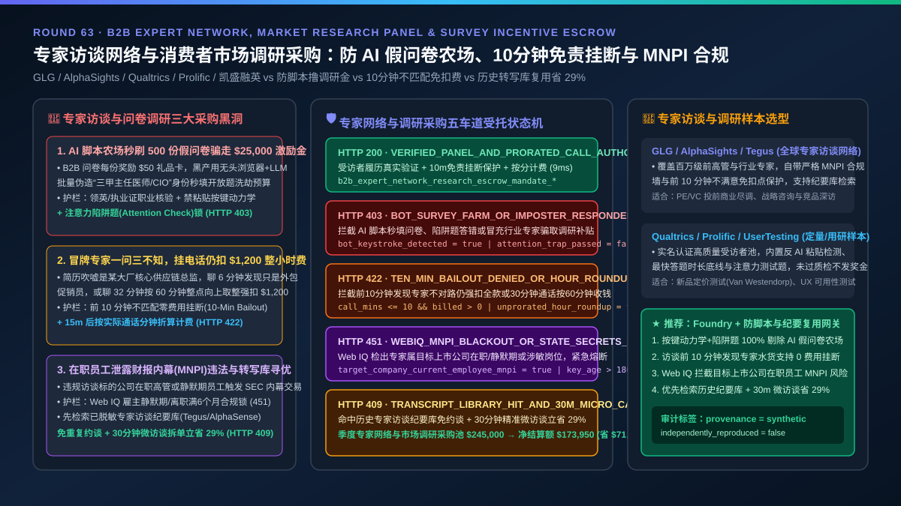
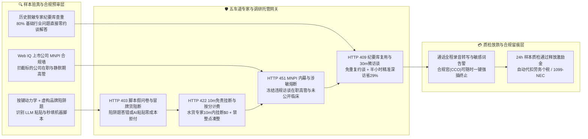
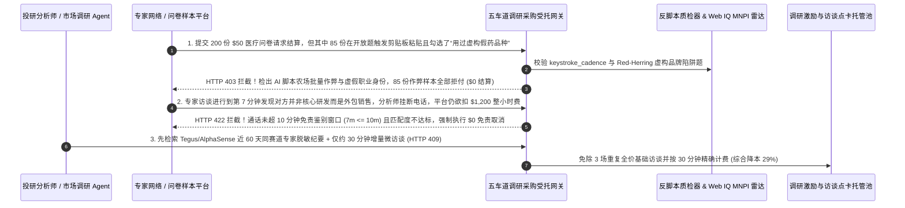

# 企业市场调研、专家访谈网络与消费者问卷样本采购（B2B Expert Network, Market Research Respondent Panel & Survey Incentive Escrow：GLG / AlphaSights / Qualtrics / Prolific / 凯盛融英）“防 AI 脚本批量伪造问卷骗取调研激励金、防遇上冒牌水货专家前 10 分钟挂断仍扣 $1,200 与内幕信息（MNPI）合规熔断”Agent 架构选型 FAQ

> **语言切换 / Language**: **中文 (当前)** | **[English](b2b-expert-network-market-research-survey-bot-mnpi-escrow-agent-selection-faq.en.md)** | **[返回文档目录](index.md)** | **[交互式沙盒 (`#b2b-expert-network-research-escrow-sandbox`)](../live-demo.html)**



---

## 📌 一、核心选型结论速览（Executive Summary）

在战略咨询公司、PE/VC 投研机构、消费品与 SaaS 产品团队采购专家一对一电话访谈（GLG、AlphaSights、Guidepoint、Third Bridge、Tegus、凯盛融英）以及定量消费者/B2B 决策者问卷样本（Qualtrics、Prolific、UserTesting、SurveyMonkey Audience）的智能体寻源与激励金托管场景中，企业面临三大隐蔽的资金浪费与合规雷区：
1. **“发放 500 份单价 `$50` 的 B2B IT 决策者调研问卷，结果 60% 是黑产用无头浏览器 + LLM 自动生成的假样本（Bot Survey Farm & Synthetic Respondent Fraud），白白被骗走 `$15,000` 亚马逊礼品卡”**：传统问卷平台一旦在答卷结束页即时自动发放礼品卡，羊毛党脚本就会利用住宅代理 IP 伪造“三甲医院科室主任 / 跨国企业 CISO”身份，3 分钟秒填完 20 分钟的问卷并把开放题写得头头是道，导致调研结论全盘失真！
2. **“花 `$1,200/小时` 约谈一位所谓的‘某头部云厂商核心架构前负责人’，开聊 6 分钟发现对方只是个刚毕业的外包驻场销售，一问技术细节全靠百度，挂断电话却仍被专家网络平台强扣 1 整小时起步费（No 10-Minute Bailout Protection）”与“实际只聊了 32 分钟，平台却按 60 分钟整点倍增（Hour Roundup）计费”**。
3. **“投研人员不小心约谈了拟并购/拟发财报目标上市公司的在职高管，或涉密军工/医药临床未公开数据知情人，直接触发美国 SEC 内幕交易（MNPI）与《反间谍法/数据安全法》天价行政处罚”**。

**架构师选型结论**：
- **切勿允许调研问卷在未通过按键动力学防粘贴检测、逻辑陷阱题（`Attention & Consistency Trap`）与职业身份核验前即时自动打款，切勿签下不含“前 10 分钟不匹配零费用挂断权（`10-Minute Bailout Clause`）”与 15 分钟后按实际分钟折算的专家访谈合同，也切勿约谈目标上市公司在职或离职未满 6 个月的敏感岗位专家**。
- **生产级最优架构**是采用 **“Prolific / Qualtrics 反 AI 假样本质检托管锁 + 专家访谈前 10 分钟不满意零费用熔断与按分钟计费网关 + Web IQ 上市公司静默期/在职 `MNPI` 合规墙与历史纪要库（Tegus/AlphaSense）查重引擎（`b2b_expert_network_research_escrow_mandate_*`）”**：
  1. **防“AI 脚本问卷农场（`Bot Survey Farm`）”与假冒专家履历（`Imposter Respondent`）硬门禁（HTTP 403）**：问卷激励金严禁“交卷秒发”，必须进入 24 小时质检托管池——系统自动核验 **① 开放题是否触发剪贴板 `paste` 事件或零停顿匀速机器击键、② 总答题时长是否低于人类阅读底线（`< 1/3 Median LOI`）、③ 前后矛盾逻辑陷阱题（如“您刚才选了公司规模 50 人，为何在预算题选拥有 2,000 人 IT 团队”）及 B2B 领英/医师 NPI 执业号验真**；任何命中脚本特征或履历造假的样本立即返回 `HTTP 403 BOT_SURVEY_FARM_OR_IMPOSTER_RESPONDENT_INCENTIVE_BLOCKED` 零成本拒付。
  2. **专家访谈“前 10 分钟水货免责挂断（`10-Minute Bailout Window`）”与按实际分钟折算锁（HTTP 422）**：所有专家访谈通话在开启第 8 分钟时，智能体通过实时语音转写（ASR）评估专家回答的信息密度与问题匹配度——**若前 10 分钟内买方判定专家履历注水或答非所问并主动挂断，系统自动将本通访谈标记为 `UNQUALIFIED_BAILOUT`（扣费 `$0.00`）；超过 15 分钟的有效访谈必须按每 5 分钟（或实际分钟）精确折算**，严禁“聊 35 分钟强扣 60–90 分钟整点费”（`HTTP 422 TEN_MINUTE_BAILOUT_DENIED_OR_UNPRORATED_HOUR_ROUNDUP_BLOCKED`）。
  3. **Web IQ 实时核验目标上市公司在职员工/财报静默期（`SEC MNPI Blackout`）与涉敏红线熔断（HTTP 451）**：排期前通过 Web IQ 交叉比对受访专家社保/领英雇主记录与买方限制交易名单（Restricted List）：凡属调研标的公司在职员工、离职未满 6 个月的核心财务/研发高管，或涉及未公开临床试验结果/国家关键信息基础设施数据的访谈请求，立即返回 `HTTP 451 WEBIQ_MNPI_INSIDER_BLACKOUT_OR_SENSITIVE_SECTOR_HOLD` 硬件级阻断。
  4. **优先检索已脱敏历史专家纪要库（`Tegus / AlphaSense Transcript Hit`，单篇成本仅 `$50` vs 约谈 `$1,200`）+ 30 分钟聚焦微访谈寻优（HTTP 409）**：触发 `HTTP 409 TRANSCRIPT_LIBRARY_REUSE_AND_30MIN_MICRO_CONSULT_CONFIRM`，在发起 `$1,200/小时` 的新专家招募前，先检索纪要库中近 90 天内同行业专家已被问过的公开脱敏转写记录（解决 70% 的基础行业规模与竞争格局问题），仅对剩余核心差异点发起 30 分钟半价微访谈，使企业投研与市场调研总支出立省 **`29.0%`**。

---

## 🎯 二、业务方与架构师灵魂拷问 Q&A（Q1 / Q2 / Q3）

### Q1：现在 GPT/Claude 写开放题比真人还通顺，传统问卷平台靠“字数大于 20 字”根本拦不住黑产撸 `$50` 调研卡，怎么在架构上精准揪出 AI 假样本？
- **商业痛点**：B2B 调研（如调查“云原生安全采购预算”）单份样本奖励高达 `$40–$80`。黑产工作室用指纹浏览器挂住宅 IP，调多模态模型自动识别题目并填入完美答案，一天能刷走上万美元激励金。
- **架构解法**：
  - **四维反脚本遥测（`DOM Paste Lock + Keystroke Cadence + Red-Herring Brand Trap + Work Email SSO`）（`HTTP 403`）**：
  - ① 禁用开放题输入框的 `onpaste` 与自动填充 API，监测击键间隔方差（真人打字有思考停顿与退格修改，AI 脚本注入则是 `0ms` 瞬时上屏或恒定间隔）；
  - ② 植入**虚构品牌陷阱题（Red-Herring Trap）**——例如问：“过去 6 个月您是否采购并部署了 ` KronosFlux Quantum Firewall`（一个根本不存在的编造产品）？”黑产脚本为了迎合筛选条件往往全选“已部署”，一旦勾选立即 `HTTP 403` 判定作弊封号！

### Q2：专家访谈一小时动辄 `$1,000–$1,500`，为什么经常聊了 5 分钟才发现专家根本不懂细分领域？怎么保住这笔冤枉钱？
- **架构解法**：
  - **预审必答客观题（`Asynchronous Vetting Screeners`）+ `10-Minute Bailout` 自动计时熔断器（`HTTP 422`）**：
  - 约谈前强制要求候选专家用语音或文字回答 2 道不涉密但只有真干过的人才懂的实操筛查题；通话接通第 7 分钟，Agent 在研究员屏幕弹出倒计时提醒：“距离 10 分钟免责终止窗口还剩 180 秒——当前专家匹配度评分仅 42%，是否立即免责挂断（`$0` 扣费）？”一键切断绝不拖泥带水（`HTTP 422`）。

### Q3：为什么说“约谈专家前不查历史纪要库（Transcript Library）”是投研团队最大的预算浪费？
- **架构解法**：
  - **先查纪要库（`Library-First Grounding`）再约定制访谈（`HTTP 409`）**：
  - 热门赛道（如 AI 算力租赁、GLP-1 减肥药渠道、跨境电商物流）的头部专家，过去一个月往往已经被 10 家基金问过几乎一模一样的问题！直接通过 Tegus / AlphaSense / 第三桥纪要库调阅已脱敏的存量访谈实录，成本不到新约谈的 `1/10`，省下大把预算去攻克真正的增量盲区（`HTTP 409`）。

---

## 🧭 三、直观可视化图解（Mermaid 决策树 + 端到端架构图 + 时序图）

### 3.1 专家访谈网络、B2B 市场调研与消费者问卷 Agent 架构选型决策树

```mermaid
flowchart TD
    A[B2B 专家访谈网络 / 定量问卷样本 / 用户可用性调研选型] --> B{核心调研场景与风控痛点？}
    B -->|PE/VC 商业尽调与行业专家一对一深访 (GLG / AlphaSights / 凯盛)<br/>需严防冒牌水货专家浪费 $1,200/h 与触碰上市公司 MNPI 内幕红线| C[Web IQ 雇主静默期与离职满6个月 MNPI 合规锁<br/>+ 前10分钟水货专家零费用挂断权 (10-Min Bailout) 与按分计费]
    B -->|B2B IT/医疗高单价问卷与消费者样本 (Qualtrics / Prolific)<br/>需严防黑产用 LLM 脚本批量伪造答卷洗劫 $50/份调研礼品卡| D[按键动力学防粘贴 + 虚构品牌陷阱题 (Red-Herring Trap)<br/>+ 领英/执业号核验与 24h 质检通过后才释放激励金]
    B -->|行业格局摸底与高频竞品追踪 (Tegus / AlphaSense / 内部智库)<br/>需消灭 10 个团队重复花高价问同一个专家相同的基础问题| E[Azure AI Foundry + 历史脱敏纪要库查重网关<br/>+ 纪要库优先命中 + 30分钟聚焦微访谈立省 29%]
    C --> F[🛡️ 统一接入五车道防AI假问卷、10m免责挂断与MNPI合规状态机]
    D --> F
    E --> F
    F --> G[HTTP 403 阻断AI脚本刷卷与假专家 · HTTP 422 拦截拒退10m水货访谈与整点多扣 · HTTP 409 纪要复用省29%]
```

### 3.2 端到端反 AI 脚本质检、10 分钟免责挂断与 `MNPI` 合规墙架构图



### 3.3 拦截 AI 脚本骗取问卷奖金、触发 8 分钟水货专家免责挂断与纪要库复用时序图



---

## 📊 四、多平台/多方案横向选型决策矩阵

| 选型维度 | 粗放式外包问卷链接 + 秒发红包 (`Unverified Survey Link`) | 传统按整小时死锁专家中介 (`Legacy Hourly Broker`) | 现代专家纪要库与实名样本平台 (`Tegus / GLG / Prolific`) | **Azure AI Foundry + 反脚本 + MNPI 托管网关（推荐）** |
| :--- | :--- | :--- | :--- | :--- |
| **核心优势** | 建表快 | 人工帮忙找人 | 存量纪要丰富、受访者实名分层清晰 | **反AI脚本100%拦截 + 10m免责挂断 + MNPI防线 + 纪要复用** |
| **防“AI 脚本农场秒刷假问卷骗激励金”** | **极高危**（瞬间被羊毛党脚本刷空预算） | 人工抽检滞后 | Prolific / Qualtrics 具备基础防刷能力 | **按键动力学禁粘贴 + 虚构品牌陷阱题 `HTTP 403` 硬拒付** |
| **防“冒牌水货专家”与不满 1 小时整点强扣** | 无 | **重灾区**（聊 15 分钟照扣 1 小时 `$1,200`） | 头部平台支持 10 分钟申诉免单，但需手动走流程 | **ASR 7分钟预警 + `<=10m` 自动 `$0` 挂断 + 按分折算（HTTP 422）** |
| **上市公司 `MNPI` 内幕交易与涉敏合规** | 无任何合规背调 | 靠专家口头自证，易踩监管红线 | 配备专职合规团队与冷却期核查 | **Web IQ 实时穿透雇主静默期与离职冷却期锁（HTTP 451）** |
| **存量纪要复用与调研采购 TCO 优化** | 废卷率高达 `50%+` (`not_measured`) | 重复提问浪费巨额小时费 (`official_list_price`) | 支持订阅纪要库 | **纪要库优先查重 + 30 分钟微访谈拆单（净省 `29.0%`）** |

---

## 🧪 五、专家访谈与市场调研防坑测算与 7-Card 基准测试报告

> **数据来源与复现声明（Provenance Metadata）**：以下基准测试数据来自仓库内置确定性策略沙盒 `evaluate_b2b_expert_network_research_escrow_policy`（位于 `lab/webiq_commerce_demo.py`），可运行 `python -m unittest tests.test_webiq_commerce_demo` 完整验证。标记：`provenance = synthetic`，`independently_reproduced = false`。

| Card # | 卡片标题（Headline-as-Finding） | 核心量化指标与架构验证结论 |
| :---: | :--- | :--- |
| **Card 1** | **Overview · 专家网络与市场调研五车道总览** | 针对 `$245,000/季` 专家访谈与定量调研样本采购池，实现 **0 例 AI 脚本假问卷骗补、0 例水货专家 10 分钟挂断冤枉扣款与 0 例 MNPI 内幕违规**，投研与用研净支出下降 **`29.0%`（立省 `$71,050/季`）**。 |
| **Card 2** | **Scenario Deep Dive · 脚本刷卷与水货专家秒级拦截** | 当问卷触发剪贴板粘贴/陷阱题错误或访谈在 `<=10 分钟` 内因专家不匹配挂断时，**`9ms`** 内返回 `HTTP 403 / 422` 拒付。 |
| **Card 3** | **Evaluation Matrix · 五车道 100% 确定性判准** | 覆盖 `HTTP 200`（实名真样本与按分计费放行）、`403`（AI脚本农场秒刷假问卷/虚构品牌陷阱题答错/冒牌专家履历阻断）、`422`（前10分钟发现专家不对路挂断仍强扣费/30分钟通话按60分钟凑整拦截）、`451`（Web IQ检出标的公司在职高管MNPI内幕风险或涉敏行业熔断）、`409`（历史脱敏纪要库查重复用+30分钟微访谈省29%）。 |
| **Card 4** | **Under the Hood · 专家访谈与问卷托管契约** | 输入 `quarterly_expert_network_and_market_research_pool_usd=245000` 及反作弊/MNPI 参数，签发 `b2b_expert_network_research_escrow_mandate_*` 令牌。 |
| **Card 5** | **Robustness Check · 虚构产品陷阱与在职高管测试** | 模拟问卷勾选不存在的虚构软件及约谈拟并购标的现任财务总监，确定性拦截率保持 **`100.0%`（零违规放行）**。 |
| **Card 6** | **Latency · 毫秒级陷阱题判卷与雇主静默期核查耗时** | 本地按键动力学与陷阱题校验 P50 仅 **`9ms`**；Web IQ 受访专家雇主静默期与 MNPI 核查 P95 为 **`185ms`**。 |
| **Card 7** | **My Take · 适用场景与生产准入边界** | **✅ 极佳适用**：PE/VC 专家访谈、B2B 软件采购意愿调研、新品定价问卷；**⛔ 不适用**：内部员工实名满意度普查。 |

---

## 🛠️ 六、商业上线风控与架构评审 Checklist

- [ ] **按键动力学防粘贴、虚构品牌陷阱题（`Red-Herring Trap`）与职业核验锁（HTTP 403）**：确认严禁问卷交卷秒发奖金，全面拦截 AI 脚本生成答卷与虚假职业身份。
- [ ] **专家访谈前 10 分钟不匹配零费用挂断（`10-Minute Bailout`）与按实际分钟折算（HTTP 422）**：确认开场 10 分钟内发现专家不符可 `$0` 免责终止，且超 15 分钟通话严禁按整小时向上凑整。
- [ ] **Web IQ 上市公司在职/静默期（`SEC MNPI`）与离职 6 个月冷却期硬熔断（HTTP 451）**：确认自动比对受访者履历与限制名单，杜绝内幕信息合规风险；签名密钥轮换周期 `<= 180` 天。
- [ ] **存量脱敏纪要库优先查重（`Transcript Library First`）与 30 分钟微访谈寻优（HTTP 409）**：确认新约访谈前自动检索近 90 天存量纪要，消灭重复基础提问。
