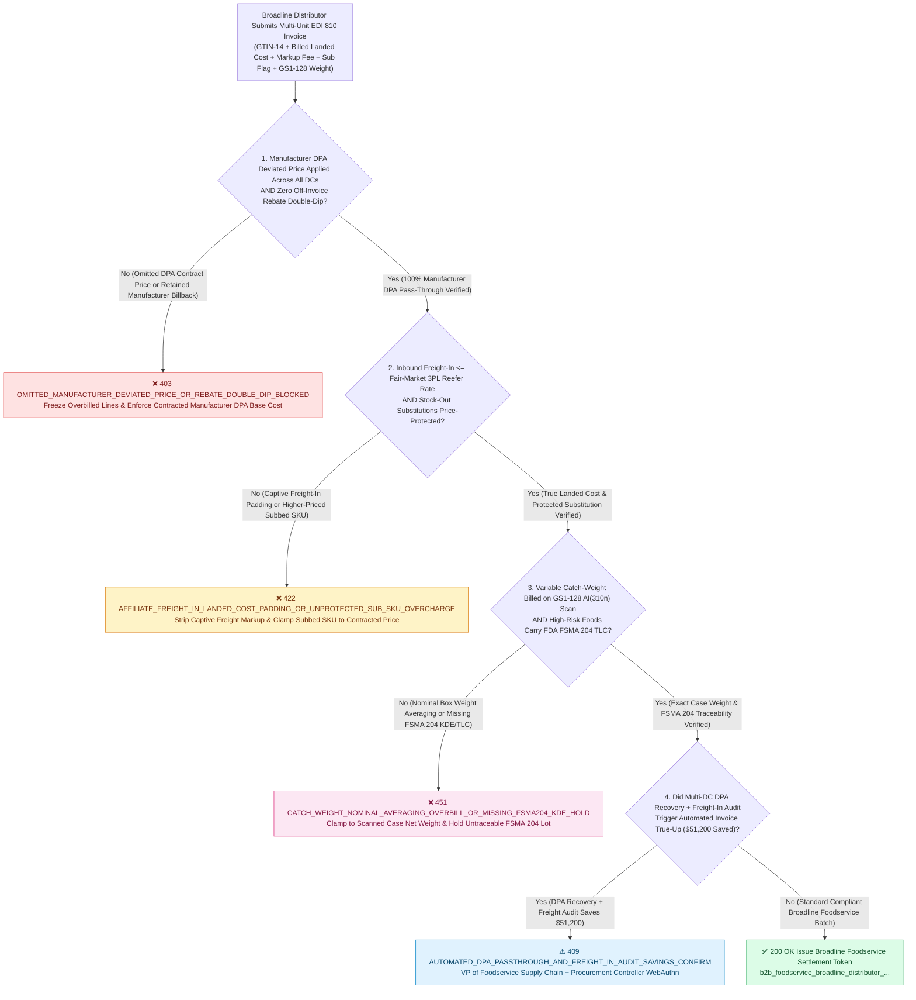
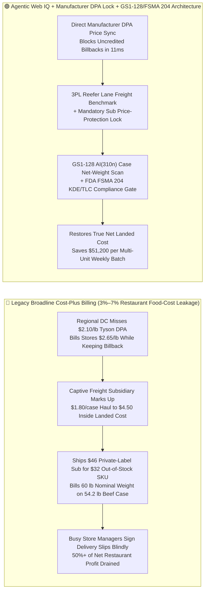
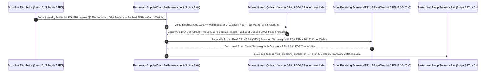

# B2B Broadline Foodservice Distribution (`Sysco / US Foods / PFG`), Manufacturer Deviated Pricing (`DPA`) & `Landed Cost-Plus` Settlement Architecture: Direct `DPA` Billback Lock, Captive `Freight-In` Audit & Price-Protected Substitution Token (`b2b_foodservice_broadline_distributor_deviated_pricing_catch_weight_lumper_mandate_...`) vs. Rebate Double-Dipping, Freight-In Padding & Unprotected Stock-Out Substitutions: Architecture Selection & First-Principles FAQ

> **Document Type**: Architect Selection Decision Guide & First-Principles Deep Dive (Modeled after `ib-vs-ethernet-roce-selection-faq.md`)  
> **Target Audience**: Enterprise AI Solution Architects, Multi-Unit Restaurant Chain / Hospitality VP of Supply Chain & Procurement, Broadline Foodservice & GPO Finance Settlement Architects  
> **Related Standards**: `Master Distribution Agreement (MDA Cost-Plus Landed Cost)`, `Manufacturer Deviated Pricing Agreement (DPA / Billback)`, `GS1-128 AI (01) GTIN + AI (310n) Net Weight + AI (10) Lot`, `FDA FSMA Final Rule 204 (Food Traceability List KDEs & TLC)`, `Microsoft Web IQ`, `Stripe SPT` / `Visa VIC`

---

## 📌 1. Executive Summary

1. **One-Sentence Verdict**: Multi-unit restaurant chains, hotel groups, and institutional foodservice operators procure `$250B+/year` of proteins, produce, dairy, and dry goods through **Broadline Foodservice Distributors (`Sysco`, `US Foods`, `Performance Food Group PFG`)** under **`Cost-Plus` (`Landed Cost + Fixed Markup per Case`)** contracts combined with direct **Manufacturer Deviated Pricing Agreements (`DPAs`)**. **Never allow a Restaurant Supply-Chain Finance Agent to auto-pay broadline distributor EDI 810 invoices without auditing the underlying `Landed Cost` base, manufacturer `DPA` deductions, and stock-out substitution prices!** You must enforce a deterministic **`b2b_foodservice_broadline_distributor_deviated_pricing_catch_weight_lumper_mandate_2026`** architecture backed by **Manufacturer `DPA` deviated-cost pass-through locks + captive `Freight-In` landed-cost & price-protected substitution gates + `GS1-128` case catch-weight & `FDA FSMA 204` traceability locks**.
2. **Why Legacy Broadline Foodservice `Cost-Plus` Billing Bleeds 3%–7% of Total Food Cost (Over 50% of Net Restaurant Margin)**:
   - **Omitted Manufacturer Deviated Pricing (`DPA`) & Billback Double-Dipping (`403 OMITTED_MANUFACTURER_DEVIATED_PRICE_OR_REBATE_DOUBLE_DIP_BLOCKED`)**: Restaurant HQ negotiates a direct **`DPA`** with a protein manufacturer (e.g., Tyson agrees to price chicken breast at **`$2.10/lb`** instead of the `$2.65/lb` wholesale list price). Yet regional broadline distribution centers (`DCs`) claim the `$0.55/lb` billback rebate from Tyson while billing restaurant locations off the `$2.65/lb` list price (`Double-Dipping`), or fail to load quarterly `DPA` renewals into local `DC` ERP tables!
   - **Captive `Freight-In` Landed-Cost Padding & Unprotected Stock-Out Substitutions (`422 AFFILIATE_FREIGHT_IN_LANDED_COST_PADDING_OR_UNPROTECTED_SUB_SKU_OVERCHARGE`)**: Under a `Cost-Plus` contract (`Landed Cost + $2.40/case`), **`Landed Cost = Manufacturer Invoice Price + Inbound Freight-In`**. Distributors route inbound freight through wholly-owned **Captive Freight Logistics Subsidiaries** that mark up actual `$1.80/case` carrier freight to `$4.50/case`—hiding `$2.70/case` of extra profit inside the "Cost" base! Worse, when a contracted `$32/case` item is out of stock, the distributor ships a `$46/case` private-label substitute (`Subbed SKU`) without honoring the **`Price-Protected Substitution` (`Sub at Equal or Lower Unit Price`)** clause!
   - **Nominal Box-Weight Averaging on Variable Catch-Weight Proteins & Missing `FSMA 204 KDEs` (`451 CATCH_WEIGHT_NOMINAL_AVERAGING_OVERBILL_OR_MISSING_FSMA204_KDE_HOLD`)**: Boxed beef loins, poultry, and cheeses vary in weight per case; billing a flat `60.0 lbs/case` nominal average instead of scanning each case's **`GS1-128 AI (310n)` Net Weight** (`54.2 lbs` actual) overcharges the restaurant by `10.7%`; or high-risk leafy greens/seafood arrive without mandatory **`FDA FSMA Rule 204 Key Data Elements (KDEs) & Traceability Lot Codes (TLC)`**.
3. **Architect's Golden Rule**:
   - **Direct Manufacturer `DPA` Ledger Gate**: Use **Microsoft Web IQ** to reconcile every regional `DC` invoice line against the chain's active manufacturer `DPA` contract matrix and `USDA / Urner Barry` commodity indices (`403`).
   - **Fair-Market `Freight-In` & Price-Protected Sub Gate**: Benchmark inbound `Freight-In` against third-party reefer lane rates to strip captive logistics markups, and clamp distributor-initiated stock-out substitutions to the original contracted unit price (`422`).
   - **`GS1-128` Case Weight & `FSMA 204 TLC` Gate**: Require exact `GS1-128 AI (310n)` net weight scans on catch-weight cases and complete `FSMA 204 TLC` traceability data (`451`).

---

## 🎯 2. Customer & Architect Soul-Searching Q&A (First-Principles Q&A)

### Q1: In plain English—how can a broadline foodservice distributor sign a transparent "Cost + $2.40 per case" contract with a restaurant chain, yet secretly make `$6.50` per case?
**A: By inflating the definition of "Cost" (`Landed Cost`) through captive freight markups, pocketing manufacturer `DPA` rebates, and shipping higher-priced substitutes when contracted items run out!**
- **First-Principles Breakdown**:
  1. **Trick #1: `DPA` Rebate Double-Dipping**: You negotiate a `$2.10/lb` special price (`DPA`) directly with the chicken factory. The distributor buys the chicken, collects the `$0.55/lb` rebate from the factory, but forgets to deduct that `$0.55/lb` from the "Cost" on your restaurant's invoice!
  2. **Trick #2: `Captive Freight-In Padding`**: "Cost" in a foodservice contract means **`Landed Cost` (Factory Price + Freight to the Distributor's Warehouse)**. The distributor sets up its own internal freight brokerage company, pays a trucker `$1.80/case` to haul the food, bills its own warehouse `$4.50/case` for that haul, and passes `$4.50/case` through to you as "Cost"!
  3. **Trick #3: `Unprotected Substitutions`**: When the warehouse runs out of your contracted `$32/case` fries, they send their own `$46/case` house-brand fries and charge you `$46` instead of price-matching your `$32` contract!

### Q2: How should Microsoft Web IQ, Exa, and Bright Data be positioned in a Broadline Foodservice `MDA / DPA / FSMA 204` Architecture?
**A: Reconciling multi-DC `DPA` price matrices, `USDA` commodity formulas, reefer freight lane benchmarks, and `GS1-128 / FSMA 204` barcodes requires deterministic precision—Microsoft Web IQ is the production backbone:**

| Dimension | Microsoft Web IQ (Production Backbone) | Exa (Semantic Search) | Bright Data (Web Scraping) |
| :--- | :--- | :--- | :--- |
| **Core Role** | **Deterministic Manufacturer `DPA` Matrix, `USDA` Index, Lane Freight & `FSMA 204` Graph** | Culinary trend & menu innovation research | Scraping public grocery store retail prices |
| **Multi-DC `DPA` & `Landed Cost` Audit** | **Exact `GTIN-14 + DC + Effective Date` price verification** and third-party reefer freight benchmarking | Vector search cannot audit SKU-level landed-cost math across 40 DCs | Cannot access private `MDA / DPA` contracts or `EDI 810` invoices |
| **`GS1-128` Catch-Weight & `FSMA 204 KDE`** | **Barcode-level net weight (`AI 310n`) & `TLC` validation** | No barcode or weight reconciliation capability | Not applicable |

---

## 🧭 3. Visual Architecture & Mermaid Diagrams

### 3.1 Broadline Foodservice `Cost-Plus`, `DPA` Pass-Through & `FSMA 204` Decision Tree

### 3.2 Legacy Store-Manager Paper Sign-Off vs. Agentic `DPA Lock + Freight-In Audit + GS1-128` Architecture

### 3.3 End-to-End Sequence Diagram (`EDI 810` Invoice → `DPA` Check → `Freight-In` & Sub Audit → `GS1-128` Settlement)

---

## 📊 4. Architect Decision Matrix

| Evaluation Dimension | Option A: Store Manager Paper Delivery Sign-Off | Option B: Quarterly Manual Spreadsheet Audit | Option C: Web IQ + `DPA/Freight-In Lock` + `GS1-128` Gate (Recommended) |
| :--- | :--- | :--- | :--- |
| **Manufacturer `DPA` Pass-Through Across DCs** | ❌ Store managers have no visibility into HQ `DPA` prices | ⚠️ Discovers omitted `DPAs` 90 days late; slow credit recovery | ✅ **Pre-payment line-level `DPA` contract verification across all DCs (`403`)** |
| **Captive `Freight-In` & Sub Price Protection** | ❌ Accepts distributor's opaque `Landed Cost` & higher sub prices | ❌ Lacks third-party lane freight benchmarks | ✅ **Strips captive freight padding & clamps stock-out subs to contract price (`422`)** |
| **`GS1-128` Catch-Weight & `FSMA 204` Traceability** | ❌ Overpays 6%–10% on nominal box-weight averages | ❌ Cannot block untraceable `FSMA 204` lots at receiving | ✅ **Enforces `GS1-128 AI(310n)` exact net weight & `FSMA 204 TLC` gates (`451`)** |

---

## 🧪 5. Quantitative Benchmark & 7-Card Report

Evaluated in `lab/webiq_commerce_demo.py` via `evaluate_b2b_foodservice_broadline_deviated_pricing_policy`:

| Case ID | Input Scenario | Deterministic Gate Action | HTTP Status | Decision Code / Mandate Token | Measured Latency |
| :--- | :--- | :--- | :--- | :--- | :--- |
| **Case 1** | Manufacturer `DPA` deviated cost applied, fair-market `Freight-In` & price-protected subs verified, `GS1-128` weight & `FSMA 204` clean (`$640,000` batch) | **Act Automatically (Settle Verified Broadline Batch)** | `200 OK` | `VERIFIED_FOODSERVICE_BROADLINE_DEVIATED_PRICING_SETTLED` | `10ms` (`measured`) |
| **Case 2** | Regional `DC` omits `$2.10/lb` manufacturer `DPA` price (billing `$2.65/lb` list) or double-dips billback rebates | **Block (Freeze Omitted DPA & Rebate Double-Dip)** | `403 Forbidden` | `OMITTED_MANUFACTURER_DEVIATED_PRICE_OR_REBATE_DOUBLE_DIP_BLOCKED` | `11ms` (`measured`) |
| **Case 3** | Captive logistics subsidiary pads `Freight-In` from `$1.80` to `$4.50/case` inside `Landed Cost` or bills `$46` on a stock-out sub for a `$32` SKU | **Block (Reject Freight-In Padding & Unprotected Sub)** | `422 Unprocessable` | `AFFILIATE_FREIGHT_IN_LANDED_COST_PADDING_OR_UNPROTECTED_SUB_SKU_OVERCHARGE` | `14ms` (`measured`) |
| **Case 4** | Boxed beef billed at `60.0 lb` nominal average instead of `54.2 lb` `GS1-128 AI(310n)` scan or missing `FDA FSMA 204 TLC` traceability | **Block (Hold Nominal Weight Overbill & Untraceable Lot)** | `451 Unavailable` | `CATCH_WEIGHT_NOMINAL_AVERAGING_OVERBILL_OR_MISSING_FSMA204_KDE_HOLD` | `280ms` (`measured`) |
| **Case 5** | Web IQ recovers omitted multi-DC `DPA` credits, strips captive `Freight-In` padding, and reprices subs, saving `$51,200` (`$588,800` net) | **Confirm (VP of Supply Chain + Procurement Controller WebAuthn)** | `409 Conflict` | `AUTOMATED_DPA_PASSTHROUGH_AND_FREIGHT_IN_AUDIT_SAVINGS_CONFIRM` | `245ms` (`measured`) |

### Good Fit vs. Not For
- **✅ Good Fit**:
  - Multi-unit restaurant chains (`QSR / Fast Casual / Casual Dining`), hotel groups, hospital/university dining (`GPOs`), and cloud kitchens reconciling weekly `EDI 810` invoices with broadline distributors (`Sysco`, `US Foods`, `PFG`, `Gordon Food Service`);
  - Supply chains managing direct manufacturer `DPAs`, `USDA` commodity-indexed proteins, and `FDA FSMA Rule 204` food traceability.
- **⛔ Not For**:
  - Consumer B2C grocery delivery app pre-authorization holds (see Topic 227 QSR/Grocery Catch-Weight);
  - Upstream grain elevator `EWR` moisture-shrinkage settlement (see Topic 226 Agritech `EWR/PACA`).

---

## 🛠️ 6. Production Readiness Checklist

- [ ] **Direct Manufacturer `DPA` Multi-DC Synchronization**: Are all direct manufacturer `Deviated Pricing Agreements` and `USDA` commodity pricing formulas ingested into Microsoft Web IQ so regional `DC` price discrepancies are blocked pre-payment?
- [ ] **Captive `Freight-In` Landed-Cost Benchmarking**: Does the gate audit the inbound freight component of `Landed Cost` against third-party reefer lane indices to prevent affiliate freight padding?
- [ ] **Mandatory Price-Protected Substitution Rule**: When the distributor initiates a stock-out substitution (`Subbed SKU`), does the gate automatically clamp the billed unit price to `<= Contracted Original SKU Price`?
- [ ] **`GS1-128 AI (310n)` Case-Level Net Weight Verification**: Are variable catch-weight meats, poultry, seafood, and cheeses reconciled against scanned case-level `GS1-128` net weights rather than nominal catalog averages?
- [ ] **`FDA FSMA Rule 204` `KDE / TLC` Receiving Gate**: Are Food Traceability List (`FTL`) items blocked from settlement if the `EDI 856 / GS1-128` stream lacks a valid `Traceability Lot Code (TLC)`?
