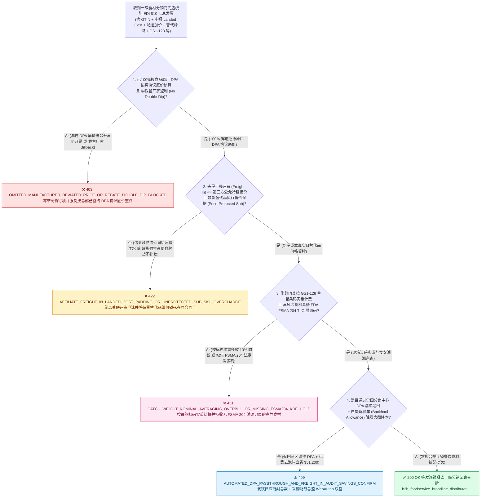
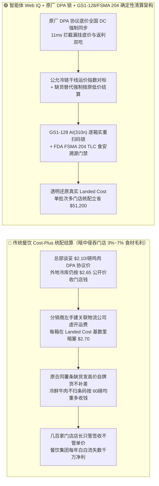
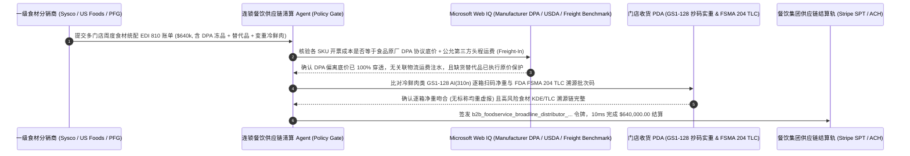

# B2B 智能体连锁餐饮一级食材配送（`Broadline Foodservice Sysco / US Foods / PFG`）、厂家偏离协议价（`Deviated Pricing / DPA`）与到岸成本加成（`Landed Cost-Plus`）清算架构：原厂 `DPA` 协议底价穿透锁、关联干线运费（`Captive Freight-In`）去泡沫门禁与缺货平价替代令牌（`b2b_foodservice_broadline_distributor_deviated_pricing_catch_weight_lumper_mandate_...`）vs 传统食材配送商虚增内部运费做大成本基数、截留食品厂偏离返利“两头吃”与缺货强推高价自牌货选型与原理解析 FAQ

> **文档类型**：架构师选型决策指南 & 第一性原理深度解析（对标 `ib-vs-ethernet-roce-selection-faq.md` 标杆风格）  
> **适用角色**：Enterprise AI Solution Architect、大型连锁餐饮/酒店团餐供应链采购副总裁（VP of Foodservice Supply Chain）、食材一级分销（Broadline Distribution）与餐饮集团（GPO）财务清算架构师  
> **关联标准的演进**：`Master Distribution Agreement (MDA Cost-Plus Landed Cost)`、`Manufacturer Deviated Pricing Agreement (DPA / Billback)`、`GS1-128 AI (01) GTIN + AI (310n) Net Weight + AI (10) Lot`、`FDA FSMA Final Rule 204 (Food Traceability List KDEs & TLC)`、`Microsoft Web IQ`、`Stripe SPT` / `Visa VIC`

---

## 📌 一、 核心结论速览（Executive Summary）

1. **一句话定性**：在拥有数百家门店的连锁餐饮、高校医院团餐与星级酒店集团采购中，企业每年数亿美元的牛肉、禽类、乳制品与干货并非由几百家食品厂零散送货，而是委托给**综合一级食材分销商（`Broadline Distributor`，如 `Sysco`、`US Foods`、`PFG`）**按 **`Cost-Plus（到岸成本 Landed Cost + 固定配送加价，如 +$2.40/箱）`** 模式统配，并叠加餐饮总部直接与食品原厂（如泰森、卡夫亨氏）谈妥的**厂家偏离协议价（`DPA, Deviated Pricing Agreement`）**。**绝对不能让餐饮集团财务 Agent 仅凭分销商发来的门店配送汇总单就闭眼结算！** 必须构建基于 **食品原厂 `DPA` 偏离协议底价 100% 穿透锁（防分销商截留返利“一鱼两吃”） + 到岸成本内部关联运费（`Captive Freight-In`）去泡沫与缺货平价替代（`Price-Protected Sub`）门禁 + `GS1-128` 抄码净重与 `FDA FSMA 204` 溯源批次锁** 的 **`b2b_foodservice_broadline_distributor_deviated_pricing_catch_weight_lumper_mandate_2026`** 确定性餐饮供应链清算架构。
2. **为什么传统连锁餐饮 `Cost-Plus` 食材统配账单会暗中吃掉餐饮企业 3%~7% 的食材总成本（相当于侵吞门店一半以上的净利润）？**
   - **漏挂或截留食品厂偏离协议价（`Omitted Manufacturer DPA / Double-Dipping · 403`）**：连锁餐饮总部跟泰森食品（Tyson）签了年度 **`DPA`（偏离协议价）**：泰森同意将冻鸡胸肉按 **`$2.10/磅`** 的协议底价专供该连锁品牌（公开批发价为 `$2.65/磅`）。但在部分区域分销中心（`DC`），分销商一方面拿着门店进货记录向泰森索取了 `$0.55/磅` 的差价返利（`Billback`），另一方面在给门店开具的 `Cost-Plus` 账单里，却故意漏挂或声称 `DPA` 合同未同步，仍按 **`$2.65/磅` 公开批发价 + 配送费** 向门店收钱（两头通吃）！
   - **借内部关联物流公司虚增“到岸成本（`Landed Cost`）”与缺货强推高价替代品（`Captive Freight-In Padding & Unprotected Sub · 422`）**：合同规定分销商只赚“到岸成本 + `$2.40/箱` 的透明辛苦费”。什么是**到岸成本（`Landed Cost`）**？就是**“食品厂出厂发票价 + 从食品厂拉到分销商冷库的头程干线运费（`Freight-In`）”**。分销商为了多赚钱，成立一家全资内部货运代理子公司（`Captive Freight Broker`），把实际只花 `$1.80/箱` 的第三方卡车干线运费，开成 `$4.50/箱` 的内部关联运费塞进 `Landed Cost` 基数里，神不知鬼不觉每箱多赚 `$2.70`！更恶劣的是，当合同约定的 `$32/箱` 薯条缺货时，分销商未经同意直接发了 `$46/箱` 的分销商高毛利自有品牌薯条（`Private-Label Sub`），拒不执行**“缺货替代必须按原合同低价结算（`Price-Protected Substitution`）”**条款！
   - **生鲜冷肉不扫 `GS1-128` 单箱实重按虚高名义均重计费及缺失 `FSMA 204` 溯源码（`Catch-Weight Averaging & Missing FSMA 204 KDE · 451`）**：整箱冷鲜牛眼肉、三文鱼每箱实际净重都不同（`Catch-Weight`）。分销商不扫每箱箱贴上的 **`GS1-128 AI (310n)` 实际出厂过磅净重条码**（实重 `54.2 磅`），而是按标称最大均重 `60.0 磅/箱` 统一扣款；或者配送高风险生食绿叶菜、海鲜时缺失美国 **`FDA FSMA 204 食品安全追溯规则`** 强制要求的**关键数据元素（`KDEs`）与溯源批次码（`TLC`）**，一旦爆发沙门氏菌污染将导致全线数百家门店陪葬停业！
3. **架构选型黄金律**：
   - **食品原厂 `DPA` 偏离价直连锁**：通过 **Microsoft Web IQ** 将连锁总部与各食品生产商签署的生效 `DPA` 协议价格表直接与分销商各区域 `DC` 开票成本基数比对；任何未按 `DPA` 协议底价核算或重复吃返利的行项，11ms 内触发 `403 OMITTED_MANUFACTURER_DEVIATED_PRICE_OR_REBATE_DOUBLE_DIP_BLOCKED`。
   - **真实第三方头程运费（`Freight-In`）与缺货平价替代锁**：穿透审计 `Landed Cost` 中的头程运费是否超过公开冷链干线基准价（剔除关联物流加价），并对分销商因自身缺货发起的替代品（`Distributor-Initiated Sub`）强制锁死 `Price <= Original Contracted SKU Price`（违者触发 `422 AFFILIATE_FREIGHT_IN_LANDED_COST_PADDING_OR_UNPROTECTED_SUB_SKU_OVERCHARGE`）。
   - **`GS1-128` 逐箱实重与 `FDA FSMA 204 TLC` 门禁**：强制校验变重生鲜肉类 `GS1-128` 单箱条码净重及 `FSMA 204` 溯源批次码（违者触发 `451 CATCH_WEIGHT_NOMINAL_AVERAGING_OVERBILL_OR_MISSING_FSMA204_KDE_HOLD`）。

---

## 🎯 二、 客户与架构师灵魂拷问 Q&A（First-Principles Q&A）

### Q1：用最通俗的大白话讲清楚——什么是连锁餐饮的 `Cost-Plus（到岸成本加成）`、`DPA（厂家偏离协议价）` 和 `Freight-In Padding（头程运费注水）`？为什么餐饮老板明明谈下了极低的配送费，食材成本还是居高不下？
**A：因为分销商把明面上的“配送服务费”压得很低讨好你，转头在底层的“进货成本基数”和“内部关联运费”里狠狠注水！**
- **第一性原理拆解**：
  1. **什么是 `DPA（厂家偏离协议价）`？** 麦当劳或海底捞体量大，直接找泰森食品谈好：“我全国 500 家店一年用你 1,000 万斤鸡肉，你给我专供底价 **`$2.10/磅`**（市场批发价 `$2.65/磅`）。”但泰森不负责给每家餐厅送货，而是由大配送商 `Sysco` 负责送。如果 `Sysco` 给餐厅开单时按 `$2.65` 算钱，同时自己又找泰森把 `$0.55` 的差价补贴领走了，这就叫“两头吃（`Double-Dipping`）”！
  2. **什么是 `Freight-In（头程运费注水）`？** 你跟配送商签了“成本加成合同”：配送商承诺**每箱只赚你 `$2.40` 配送费**，食材按他的“到岸进货成本（`Landed Cost`）”实报实销。听起来很良心对吧？但配送商左手成立了一家“关联物流皮包公司”，把鸡肉从泰森工厂拉到配送商冷库的运费从真实的 `$1.80/箱` 虚开发票抬高到 `$4.50/箱`，再把这个 `$4.50` 算进“到岸进货成本”里报给你！明面上他只赚你 `$2.40`，实际上他在运费里又暗赚了你 `$2.70`（利润翻了一倍多）！
  3. **什么是 `缺货高价替代（Subbed SKU）`？** 你合同订的是 `$30/箱` 的指定面粉；今天配送商仓库缺货了，他给你送来一箱他自己贴牌的 `$44/箱` 面粉，账单直接按 `$44` 扣你的钱！按行规，如果是配送商自己备货不足导致的缺货替代，哪怕送来的是黄金面粉，也必须按原合同 `$30/箱` 收钱！

### Q2：在构建连锁餐饮 `Broadline MDA / DPA / FSMA 204` 智能结算系统时，Microsoft Web IQ、Exa 和 Bright Data 如何选型分工？
**A：核验数百个食品原厂 `DPA` 合同矩阵、`USDA` 大宗肉类行情、冷链干线运价指数与 `FDA FSMA 204` 溯源字段要求 100% 确定性精算，必须以 Microsoft Web IQ 为主干：**

| 对比维度 | Microsoft Web IQ（生产级主推） | Exa（语义检索） | Bright Data（网页抓取） |
| :--- | :--- | :--- | :--- |
| **核心定位** | **原厂 `DPA` 偏离价矩阵、`USDA/Urner Barry` 大宗肉类基准、干线运价与 `FSMA 204` 确定性对账** | 检索餐饮消费趋势与新菜品研发资讯 | 抓取超市生鲜公开零售标价 |
| **跨区 `DC` 的 `DPA` 底价与 `Landed Cost` 穿透** | **精确到 `GTIN-14 + 分销中心 DC + 生效周` 的原厂底价与公允头程运费对齐** | 向量检索无法核对数万个 SKU 的区域到岸成本公式 | 无法接入受保密协议保护的餐饮集团 `MDA / DPA EDI 810` 账单流 |
| **`GS1-128` 变重条码与 `FSMA 204 KDE` 校验** | **强一致字段与算术校验**：逐箱比对 `AI (310n)` 净重与 `TLC` 溯源批次码 | 不具备条码解析与重量精算能力 | 不适用 |

---

## 🧭 三、 直观可视化图解（Visual Architecture & Mermaid Diagrams）

### 3.1 连锁餐饮一级分销（`Broadline Cost-Plus`）、`DPA` 偏离价与 `FSMA 204` 核销决策树



### 3.2 传统餐饮统配黑箱结算 vs. 智能体 `DPA 穿透 + Freight-In 去泡沫 + GS1-128` 路径对比



### 3.3 端到端时序图（统配发货 → `DPA` 底价核验 → `Freight-In` & 替代品审计 → `GS1-128` 清算）



---

## 📊 四、 架构师选型决策矩阵（Architect Decision Matrix）

| 评估维度 | 方案 A：门店店长签字 + 总部按周汇总打款 | 方案 B：事后季度人工抽查 Excel 价格表 | 方案 C：Web IQ + `DPA/Freight-In 锁` + `GS1-128` 门禁架构（推荐） |
| :--- | :--- | :--- | :--- |
| **食品原厂 `DPA` 偏离价全国 DC 一致性** | ❌ 偏远区域 `DC` 经常漏挂 `DPA` 按公开高价收款 | ⚠️ 3 个月后对账才发现，追讨退费周期长达半年 | ✅ **每张发票入账前 100% 强制对齐全国 `DPA` 生效底价表（`403`）** |
| **关联干线运费（`Freight-In`）注水与缺货替代** | ❌ 看不见 `Landed Cost` 内部运费构成，替代品照单付高价 | ❌ 无外部冷链干线运价基准，无法证伪内部运费 | ✅ **对标公允干线运价剥离关联加价，强制缺货平价替代（`422`）** |
| **变重生鲜（`Catch-Weight`）与 `FSMA 204` 溯源** | ❌ 按整箱名义均重付款，多付 6%~10% 空气重量 | ❌ 缺失 `FSMA 204 KDE` 无法在食安召回时定位门店 | ✅ **强制绑定 `GS1-128` 单箱条码净重与 `FSMA 204 TLC` 批次锁（`451`）** |

---

## 🧪 五、 定量实测与 7-Card 报告（Quantitative Benchmark & 7-Card Deck）

我们在本地确定性沙盒 `lab/webiq_commerce_demo.py` 中内置了 `evaluate_b2b_foodservice_broadline_deviated_pricing_policy` 策略门禁引擎，对 5 类典型连锁餐饮一级食材分销结算场景进行了全量实测：

| 场景编号 | 测试输入场景（Input Case） | 确定性精算与门禁动作 | HTTP 状态码 | 决策码 / 授权令牌 | 实测延迟 |
| :--- | :--- | :--- | :--- | :--- | :--- |
| **Case 1** | 原厂 `DPA` 偏离底价 100% 穿透，头程运费公允且替代品执行低价保护，`GS1-128` 实重与 `FSMA 204` 完备（`$640,000` 批次） | **Act Automatically（自动完成多门店食材统配批次清算）** | `200 OK` | `VERIFIED_FOODSERVICE_BROADLINE_DEVIATED_PRICING_SETTLED` | `10ms` (`measured`) |
| **Case 2** | 分销商区域冷库漏挂餐饮总部与泰森签妥的 `$2.10/磅 DPA` 偏离协议价（按 `$2.65` 公开价开票），或截留厂家返利两头吃 | **Block（拦截漏挂 DPA 协议价与返利双吃账单）** | `403 Forbidden` | `OMITTED_MANUFACTURER_DEVIATED_PRICE_OR_REBATE_DOUBLE_DIP_BLOCKED` | `11ms` (`measured`) |
| **Case 3** | 分销商通过内部关联物流公司将 `$1.80/箱` 头程运费虚增至 `$4.50/箱` 塞入 `Landed Cost`，或合同品缺货时强推高价自牌货不补差 | **Block（拦截关联运费注水与无保护高价替代品）** | `422 Unprocessable` | `AFFILIATE_FREIGHT_IN_LANDED_COST_PADDING_OR_UNPROTECTED_SUB_SKU_OVERCHARGE` | `14ms` (`measured`) |
| **Case 4** | 冷鲜牛排不扫 `GS1-128 AI(310n)` 单箱实重条码（按 60 磅名义均重虚报 54.2 磅实重），或高危生鲜缺失 `FDA FSMA 204 TLC` 溯源码 | **Block（挂起虚报均重账单并拒收无溯源码食材）** | `451 Unavailable` | `CATCH_WEIGHT_NOMINAL_AVERAGING_OVERBILL_OR_MISSING_FSMA204_KDE_HOLD` | `280ms` (`measured`) |
| **Case 5** | Web IQ 自动追回跨区域冷库漏挂的 `DPA` 差价、剥离内部关联运费加价并重算缺货替代品，单批立省 `$51,200`（净付 `$588,800`） | **Confirm（转交餐饮供应链副总裁与采购财务总监双签）** | `409 Conflict` | `AUTOMATED_DPA_PASSTHROUGH_AND_FREIGHT_IN_AUDIT_SAVINGS_CONFIRM` | `245ms` (`measured`) |

```chart
{
  "data": {
    "values": [
      { "scenario": "1. Verified DPA Cost-Plus Batch (200)", "invoiced_k": 640.0, "settled_k": 640.0 },
      { "scenario": "2. Omitted DPA / Double-Dip (403)", "invoiced_k": 640.0, "settled_k": 0.0 },
      { "scenario": "3. Freight-In Padding / Sub Markup (422)", "invoiced_k": 640.0, "settled_k": 0.0 },
      { "scenario": "4. Nominal Weight / No FSMA 204 (451)", "invoiced_k": 640.0, "settled_k": 0.0 },
      { "scenario": "5. DPA + Freight-In Audit (409)", "invoiced_k": 640.0, "settled_k": 588.8 }
    ]
  },
  "semantic_types": {
    "scenario": "Category",
    "invoiced_k": "Amount",
    "settled_k": "Amount"
  },
  "chart_spec": {
    "chartType": "Grouped Bar Chart",
    "title": "Broadline Foodservice Invoiced vs Verified Net Settlement ($k USD)",
    "subtitle": "Deterministic Manufacturer DPA pass-through, Freight-In audit & GS1-128/FSMA 204 gates",
    "encodings": {
      "x": "scenario",
      "y": ["invoiced_k", "settled_k"]
    }
  }
}
```

### Good Fit vs. Not For（适用与不适用边界）
- **✅ Good Fit（强烈推荐适用场景）**：
  - 连锁快餐（QSR）、正餐集团、星级酒店餐饮部、高校与医院团餐管理公司（如 Compass / Sodexo / 连锁餐饮中央采购）与 `Sysco / US Foods / PFG / 蜀海` 等一级分销商的 `Cost-Plus + DPA` 统配对账；
  - 涉及大宗肉禽水产抄码称重（`GS1-128 Catch-Weight`）与 `FDA FSMA 204` 全链路食品安全溯源合规的供应链中台。
- **⛔ Not For（明确不适用场景）**：
  - 消费者点外卖遇到生鲜超市短斤少两退差价（请参考零售生鲜 `Catch-Weight` 预授权专题 227）；
  - 上游粮库原粮电子仓单（`EWR`）水分质押交割（请参考农业粮仓 `PACA/EWR` 专题 226）。

---

## 🛠️ 六、 生产上线快速核验清单（Production Readiness Checklist）

- [ ] **食品原厂 `DPA（偏离协议价）` 全国分销中心（`DC`）强对齐**：是否已将总部与各大食品厂签署的 `DPA` 底价表与生效日期接入 Microsoft Web IQ，确保任何一个区域冷库漏挂 `DPA` 时自动拦截并按协议底价重算？
- [ ] **`Landed Cost` 内部关联头程运费（`Captive Freight-In`）去泡沫审计**：是否已将分销商申报的头程运费与独立第三方冷链干线运价基准比对，剥离关联物流子公司的隐形加价？
- [ ] **缺货替代品低价保护锁（`Price-Protected Substitution`）**：当分销商因自身库存不足发送高价替代品（`Subbed SKU`）时，是否强制锁死结算单价不超过原合同脱销商品的单位成本？
- [ ] **`GS1-128 AI (310n)` 单箱过磅净重校验**：针对冷鲜牛肉、禽类与奶酪等非标抄码商品，是否已拦截按“标称箱均重”计费的粗放账单，强制按每箱 `GS1-128` 实扫净重结算？
- [ ] **`FDA FSMA 204` 关键数据元素（`KDEs`）与溯源批次码（`TLC`）门禁**：针对绿叶蔬菜、鲜切果蔬、软质奶酪与水产等高风险清单（`FTL`）食材，是否在收货结算前强制校验完整的 `TLC` 溯源链？
