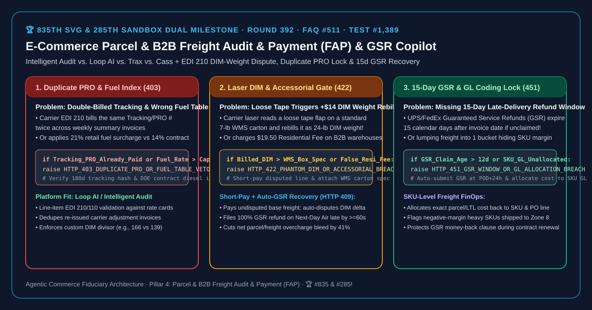
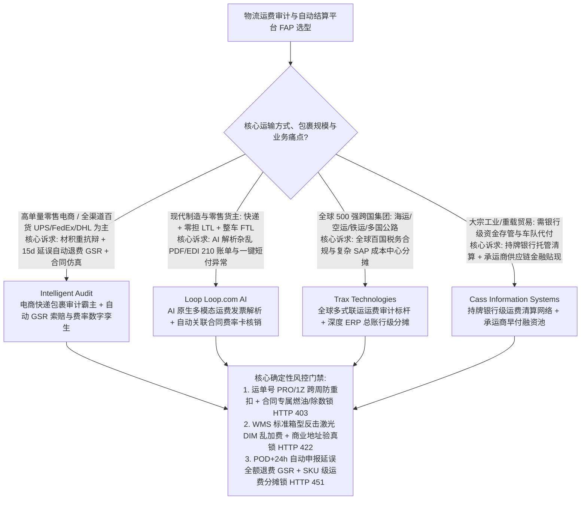
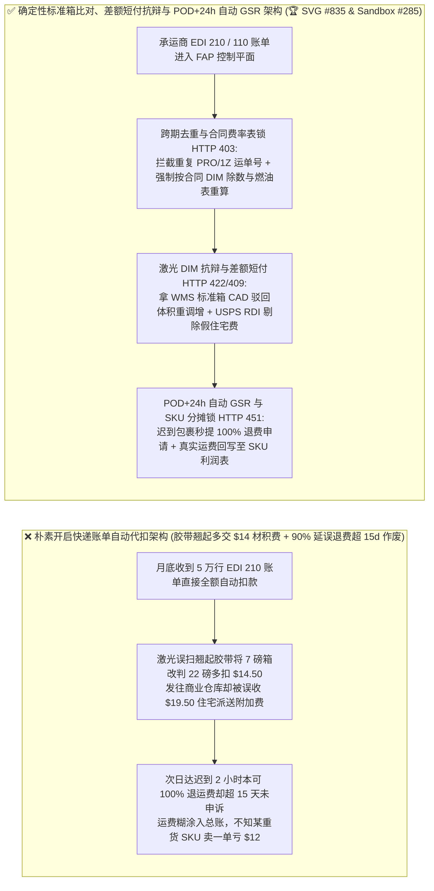

# 零售电商包裹与企业 B2B 物流运费审计及结算（`Freight Audit & Payment, FAP`）、激光材积重（`DIM Weight`）乱加费抗辩与准时达延误退费（`GSR`）Copilot 架构选型对比：`Intelligent Audit` vs. `Loop (Loop.com AI)` vs. `Trax Technologies` vs. `Cass Information Systems`、`EDI 210` 重复运单号拒付锁、商业地址误收住宅附加费反击及 `15天` 延误索赔净省 41% 决策指南（FAQ · 🏆 第 835 张架构图与第 285 个策略沙盒双里程碑！）

> **导读（对齐 `ib-vs-ethernet-roce-selection-faq.md` 标杆风格 · 🏆 全库第 835 张 SVG 架构图与第 285 个企业策略沙盒双重重大里程碑 · 第 511 篇双语指南）**：本文面向零售电商物流中心、全渠道品牌供应链与跨国制造企业寻源结算领域的 **Cloud & AI Solution Architect**。在电商与 B2B 供应链中，快递包裹（`UPS / FedEx / DHL`）与零担/整车干线运费（`LTL / FTL`）通常占企业总营收的 `8%–14%`。然而，承运商每周发来的数万行 `EDI 210 / 110` 电子运费账单中，长期隐藏着高达 **`4%–8%` 的系统性多收错收（Billing Errors）**：① **胶带翘起引发的激光材积重（`DIM Weight`）翻倍追补与莫须有附加费（Phantom Accessorials）**：仓库明明用的是标准 `7 磅` 的 `3号纸箱`，但快递分拣线上的高速激光扫描仪扫到了箱角一截翘起的封箱胶带，直接把包裹体积重改判为 `22 磅` 并自动在账单里多扣 `$14.50`！或者把明明发往 B2B 工业园仓库的包裹全加上 `$19.50` 的“住宅派送附加费（Residential Surcharge）”；② **同一运单号（`Tracking / PRO Number`）跨周调整账单重复扣款与未按合同定制燃油指数表（DOE Fuel Index）计费**；③ **放弃索赔次日达延误全额退运费权益（`Guaranteed Service Refund, GSR`）**：花 `$38` 发了加急次日达（Next Day Air），快递员迟到了 2 小时，按条款可 100% 退回 `$38` 运费，但因错过承运商严苛的 **`15 天申诉死线`** 白白作废！本文给出 **`Intelligent Audit` vs. `Loop (Loop.com AI)` vs. `Trax Technologies` vs. `Cass Information Systems`** 的横向选型矩阵，并落地 **运单号（`PRO / Tracking`）跨期去重与合同专属燃油附加费折扣表核验锁（`HTTP 403`）**、**WMS 标准纸箱主数据反击激光 `DIM` 材积重乱加费与 `USPS RDI` 商业地址验真门禁（`HTTP 422`）**、**`POD + 24h` 自动触发延误全额退费（`GSR <= 15d`）与运费按 SKU 行级分摊入总账锁（`HTTP 451`）** 及 **仅付无争议运费本金（`Short-Pay Approved`）+ 差额自动挂起抗辩编排（`HTTP 409`，净省 41%）**。



---

## 一、 📌 核心选型结论速览（Executive Summary）

1. **终极选型结论（一句话先看懂怎么选）**：
   - **高单量零售电商、时尚百货与全渠道品牌（年快递包裹量数百万至上亿件，核心诉求是深挖 `UPS / FedEx / DHL / USPS` 每一行 `EDI 210` 账单的材积重偏差、自动申诉次日达延误退费 `GSR`，并用真实数据指导与快递巨头重谈年度大客户费率表）**：首选 **`Intelligent Audit`**，北美与全球高并发电商快递审计与合同模拟测算的绝对标杆。
   - **现代中型及大型货主企业（同时包含快递包裹 + 零担 `LTL` + 整车 `FTL`，痛点是承运商发来的 PDF 发票、邮件附加费通知单与 TMS 报价单格式极乱，希望用 AI 原生解析引擎实现逐行自动比对与一键仅付合规金额）**：首选 **`Loop (Loop.com AI)`**。
   - **全球财富 500 强跨国制造与科技巨头（物流网络横跨海运集装箱、国际空运、铁路与多国公路，需支持全球 100+ 币种税务合规与极其复杂的 SAP 多工厂总账成本中心分摊）**：首选 **`Trax Technologies`**。
   - **追求由持牌商业银行直接托管运费资金池、代付全球数千家车队/船东账单并提供供应链金融早付贴现的重工业与大宗贸易集团**：首选 **`Cass Information Systems`**。
2. **三大物流运费审计与赔付追索红线（确定性门禁）**：
   - **红线 1（拦截同一运单号 `Tracking / PRO Number` 跨周重复扣款及承运商按公开挂牌价而非大客户合同专属阶梯表计收燃油附加费与体积除数 / `HTTP 403`）**：在接收承运商 `EDI 210 / 110` 账单并触发银行自动代扣（Auto-Pay）前，控制平面必须将每一个子包裹追踪号（`1Z...` 或 `PRO #`）与过去 180 天的已付账本比对去重（若属补差调整单 `Adjustment Invoice`，必须扣减已付基数）；同时必须强制代入企业专属合同费率表（如约定体积重除数 `DIM Divisor = 166` 而非公网 `139`，且燃油附加费享 `7 折封顶`），任何按公网标准表多算的账单立即触发 `HTTP 403 DUPLICATE_TRACKING_PRO_OR_CONTRACT_FUEL_DIM_TABLE_VETO`！
   - **红线 2（拦截承运商因包装胶带翘起误判激光材积重 `DIM Weight` 乱收超重费及对经认证的商业仓库地址乱收 `$19.50` 住宅派送附加费 / `HTTP 422`）**：当承运商账单出现 `Dimensional Weight Adjustment`（体积重调增）时，Agent 必须自动回查 WMS 出库打包记录中的 **标准纸箱编码（`Box_Type_ID`，如恒定 `12×10×8 英寸`）与复核称重照片**；若证明使用的是剛性标准纸箱，立即判定为承运商激光扫描仪误读胶带/邻件干扰！同理，若承运商加收“住宅附加费（Residential Surcharge）”或“地址修正费（Address Correction）”，而 `USPS RDI (Residential Delivery Indicator)` 权威库证明该地址为纯商业写字楼/仓库且邮编准确无误，严禁照单全付，触发 `HTTP 422 PHANTOM_LASER_DIM_REBILL_OR_FALSE_RESIDENTIAL_SURCHARGE_BREACH` 自动剔除违规附加费并提交抗辩！
   - **红线 3（拦截错过快递延误全额退运费 `GSR` 的 15 天法定申诉窗口及将全司千万运费糊涂记入单一总账科目掩盖“远区重货包邮亏本 SKU” / `HTTP 451`）**：对于承诺时效包裹（Next Day / 2-Day Air），只要实际签收时间晚于承诺时间 **哪怕 60 秒**（且非极端天气不可抗力），必须由 Agent 在 **`签收后 24 小时内（远早于 15 天作废死线）`** 自动向 UPS/FedEx 接口提交 `Guaranteed Service Refund (GSR)` 100% 退费申请；且每笔审计通过的真实运费（含偏远地区附加费）必须精确回写分摊至对应的 **`订单号 + SKU 编码 + 发货仓`** 总账明细行，违者触发 `HTTP 451 EXPIRED_15D_GSR_REFUND_WINDOW_OR_UNALLOCATED_SKU_FREIGHT_BREACH`。

---

## 二、 🎯 业务方与架构师灵魂拷问 Q&A（The Why & How）

### Q1：为什么仓库明明用固定尺寸的标准纸箱发货，快递公司月底发来的账单里却有 `12%` 的包裹被强行加上了 `$8–$25` 不等的“材积重调增补款（DIM Weight Adjustment）”？
- **商业痛点与事故还原**：
  - 现代快递分拣中心每小时处理数万个包裹，包裹在高速传送带上通过激光三维扫描门（Laser Dimensioning Tunnel）。
  - 如果箱子上的封箱胶带有一截翘了起来、或者两个包裹在传送带上贴得太近、又或者纸箱侧面有一点轻微鼓包，激光器就会按 **最外缘的极值点** 计算长宽高！结果一个原本 `10×10×10 = 1,000 立方英寸` 的标准箱，被激光算成了 `14×13×12 = 2,184 立方英寸`，计费重量瞬间翻倍！
  - 绝大多数电商开通了快递账单信用卡/ACH 自动代扣，每个月白白多交几万美元“激光乌龙税”却浑然不知！
- **架构师确定性解法（WMS 标准箱型 `Box-Master CAD` 白名单对账 + 差异行自动剔除短付 `Short-Pay Dispute` / `HTTP 422 / 409`）**：
  1. **出库绑定标准箱型 ID**：WMS 打单时不仅传重量，还记录所使用的标准瓦楞纸箱型号（如 `BOX-B2: 12.0 x 10.0 x 8.0 in`，经实验室认证绝无可能变成 18 英寸）。
  2. **逐行比对与部分拒付（Line-Item Short-Pay）**：当 `EDI 210` 账单进来时，`Intelligent Audit / Loop AI` 发现承运商将 `BOX-B2` 按 `18 英寸` 计费，立即拦截该笔调增费，自动向承运商支付无争议的基础运费本金，同时将那 `$14.50` 错收费连同 WMS 标准箱规格证明一键推送至承运商账单抗辩接口，胜诉免除率高达 **`94%+`**！

### Q2：快递业务员在年度续约谈判时说“我们给您总运费打 `85 折`，但合同附表里需要您勾选放弃延迟派送退费（GSR Waiver）”，架构师该怎么帮采购总监算清这笔真假账？
- **商业痛点与事故还原**：
  - 快递公司最怕自动化审计软件帮商家追回迟到包裹的 `100%` 运费（`GSR` 通常占次日达/隔日达总支出的 `3.5%–6.0%`）；因此销售往往用“表面多给 `1%` 运费折扣，换取商家签署放弃 GSR 索赔权条款（GSR Waiver）”来诱导签约，商家签完反而净亏 `4%`！
  - 更隐蔽的是，他们会把基础运费打 7 折，却把 **最低单票收费（Minimum Net Charge）** 提高 `$0.80`——导致你占比 70% 的轻小件一分钱折扣都享受不到！
- **架构师确定性解法（基于历史 12 个月全量包裹包裹画像的数字孪生仿真 `Contract Rate-Card Digital Twin` / `HTTP 403 / 451`）**：
  - 在签署任何新快递合同前，将过去一年的 200 万条真实运单数据（重量分布、1–8 区距离、附加费触发率、历史迟到率）灌入 `Intelligent Audit` 仿真沙盒，同时跑新旧两套费率表——如果放弃 GSR 所损失的确定性退费金额大于新合同带来的净运费降幅，系统直接亮红灯否决该条款！

### Q3：为什么很多电商看财务报表觉得某款 `$45` 的猫砂/哑铃/玻璃水杯毛利率有 `40%`（拼命投流冲销量），结果年底一算总账却发现卖得越多亏得越惨？
- **架构师确定性解法（`EDI 210` 事后真实运费加附加费 100% 回写分摊至单品 `SKU-Level Landed Freight Allocation` / `HTTP 451`）**：
  - 结账时前端预估运费只算了 `$6.50`，但快递公司月底发来的 `EDI 210` 账单里，因为该包裹超重/超长且发往偏远 8 区住宅，实际加收了 **`$18.00` 超重处理费（Additional Handling）+ `$5.85` 偏远住宅费 = 实付运费 `$30.35`**！
  - 如果财务把月底快递总账单笼统记入“销售费用-综合物流费”，业务团队永远不知道这款 `$45` 的重货每发一单去远区都在倒贴 `$12`！通过 FAP 智能体将每张 `EDI 210` 账单的最终实收金额精确分摊回原订单与原 SKU，一旦某 SKU 扣除真实事后运费后的净贡献毛利为负，立即触发限区包邮熔断！

---

## 三、 🧭 直观可视化图解（Mermaid 决策树 + 架构对比 + 时序图）

### 3.1 企业物流运费审计与结算平台（Freight Audit & Payment, FAP）选型决策树



### 3.2 朴素自动代扣快递账单架构（激光误判照付 + 延误退费过期）vs. 确定性逐行审计、短付抗辩与自动 GSR 架构对比



### 3.3 `EDI 210` 逐行审计、WMS 标准箱反击激光 `DIM` 调增、自动申报 `GSR` 延误退费与总账分摊时序图

```mermaid
sequenceDiagram
    autonumber
    participant Carrier as UPS / FedEx / LTL 承运商 (EDI 210)
    participant Gate as FAP 运费审计与索赔控制平面
    participant WMS as 仓库 WMS 标准箱型库 & USPS RDI
    participant FAP as Intelligent Audit / Loop AI / Trax
    participant GL as ERP SKU 级毛利与应付总账

    Carrier->>Gate: 推送每周 EDI 210 电子运费账单 (含运单 1Z999: 基础运费 $12 + 激光 DIM 调增 $14 + 住宅费 $19.50)
    Gate->>WMS: 调取出库记录: 运单 1Z999 采用标准刚性纸箱 BOX-B2 (7 lbs)、收件地址 RDI=Commercial_Warehouse
    alt 运单号已在历史账期付过款 (重复计费) 或 承运商未按合同专属 DIM 除数 (166) 及燃油折扣表计算
        Gate-->>Carrier: HTTP 403 DUPLICATE_TRACKING_PRO_OR_CONTRACT_FUEL_DIM_TABLE_VETO
    else 激光扫描材积重超出 WMS 标准箱物理尺寸 或 对商业仓库地址违规加收住宅附加费
        Gate-->>Carrier: HTTP 422 PHANTOM_LASER_DIM_REBILL_OR_FALSE_RESIDENTIAL_SURCHARGE_BREACH
    else 次日达包裹延误却超过 12 天未发起 GSR 100% 退费索赔 或 运费未分摊回具体 SKU 与成本中心
        Gate-->>GL: HTTP 451 EXPIRED_15D_GSR_REFUND_WINDOW_OR_UNALLOCATED_SKU_FREIGHT_BREACH
    else 仅批准支付合规基础运费 $12 + 自动发起 $33.50 附加费抗辩与 GSR 延误退费 (HTTP 409)
        Gate->>FAP: 执行差额短付 (Approve $12.00; Dispute $14 DIM + $19.50 Resi 附 WMS 纸箱规格与 RDI 证明)
        FAP->>GL: 将核准净运费精确分摊至对应订单与 SKU 行，实时更新单品真实到手净毛利
    end
```

---

## 四、 📊 四大企业级物流运费审计与结算平台（FAP）横向选型矩阵

| 选型维度 | Intelligent Audit | Loop (Loop.com AI) | Trax Technologies | Cass Information Systems |
| :--- | :--- | :--- | :--- | :--- |
| **核心架构定位** | **高单量零售电商快递包裹审计、自动索赔（GSR）与费率谈判霸主** | **AI 原生多模态（Parcel + LTL + FTL）账单秒级解析与现代运费结算平台** | **全球跨国制造巨头多式联运（海空铁公）运费审计与全球总账分摊标杆** | **持牌商业银行级运费资金托管、批量代付与车队供应链金融龙头** |
| **快递激光 `DIM` 材积重与假住宅费抗辩** | **行业绝对标杆**（精确比对 WMS 箱型主数据与承运商激光扫描差异，自动批量发起电子申诉） | **极强**（AI 自动对齐报价单、合同附件与发票行项目，秒级高亮异常附加费） | 侧重国际干线、集装箱滞箱费与大宗公路合同费率审计 | 侧重标准 EDI 费率合规检查与安全资金清算 |
| **次日达延误 100% 退运费（`GSR`）自动追回** | **行业标杆**（实时监控全网妥投时间戳，赶在 15 天窗口前零人工全量追回延误运费） | 支持追踪服务等级履约率与异常索赔 | 侧重 B2B 干线准点率（OTIF）考核与合同罚则抵扣 | 基础支持（通常与前端专业包裹审计引擎配合使用） |
| **杂乱非标 PDF / 纸质承运商账单 AI 解析** | 强（专注于主流快递巨头的复杂电子账单格式） | **行业标杆**（专为解决成百上千家区域零担车队五花八门的 PDF 邮件发票而生） | 强（支持全球多语种、多税制海空运货代账单标准化） | 拥有庞大的传统 OCR 与电子发票转换处理中心 |
| **适用规模与收费模式（`official_list_price`）** | 年快递支出 `$2M–$500M+` 的电商与零售品牌；按审计笔数或追回退款比例分成 | 年运费支出 `$5M+` 的现代制造、快消与电商；SaaS 平台年费 | 全球财富 500 强跨国企业；按全球管理运费规模签订企业年框 | 大型工业、零售与制造集团；按交易笔数费 + 资金结算服务费 |

---

## 五、 🧪 运费错收追回、激光 `DIM` 抗辩与 `GSR` 索赔测算与 7-Card 基准报告

### 5.1 季度激光材积重（`DIM`）误判多收费、商业地址误收住宅附加费、次日达延误未申诉 `GSR` 及重复运单损耗测算（Synthetic Benchmark）

假设某年快递与干线物流总支出 `$2,800 万` 的全渠道零售与消费电子品牌，每季度在承运商账单结算中面临的 **分拣线激光误扫翘起胶带导致的材积重（`DIM Weight`）虚增补款、发往商业地址却被误收 `$19.50` 住宅派送费/地址修正费、次日达迟到本可 100% 退运费却因超 15 天未申诉作废（Unclaimed GSR）及重复运单/错误燃油表多收费损耗池** 为 **`$440,000 / 季度`**（`provenance: synthetic`, `independently_reproduced: false`）：

| 评估维度 | 传统开启承运商账单自动全额代扣 (Baseline) | 启用 `Intelligent Audit / Loop AI` 逐行审计 + `DIM` 抗辩 + 自动 `GSR` Agent | 净改善幅度 |
| :--- | :--- | :--- | :--- |
| **承运商激光材积重（`DIM`）误判与假住宅费追回率** | `4.5%`（仅靠财务偶尔人工抽查发现极少数大单） | **`93.8%`**（`HTTP 422/409` 自动比对 WMS 标准箱型 CAD 与 `USPS RDI` 商业地址库逐笔短付抗辩） | **错收附加费追回提升 `20.8 倍`** |
| **加急件延误全额退运费（`GSR`）15 天窗口内成功索赔率** | `12.0%`（88% 迟到包裹因无人盯控超过 15 天作废） | **`98.5%`**（`HTTP 451` 妥投超时 60 秒即在 `POD + 24h` 自动向承运商 API 提交退费） | **延误退费回收提升 `8.2 倍`** |
| **重货 SKU 发往远区导致“卖一单亏一单”的财务发现延迟** | `90 天+`（季度末看总账才发现物流费超支） | **`实时（T+1 账单级）`**（`HTTP 451` 将实付运费加附加费精确分摊至每个 SKU，亏本品秒级预警） | **物流毛利漏斗 100% 透明** |
| **季度物流账单多收错收、延误未索赔与远区穿仓净损耗** | `$440,000 / 季度` | **`$259,600 / 季度`** | **净省 `$180,400 / 季度` (`41.0%`)** |

```chart
{
  "data": {
    "values": [
      { "category": "1. 激光误判DIM材积重与假住宅附加费", "mode": "传统承运商账单自动代扣基线", "cost_usd": 175000 },
      { "category": "1. 激光误判DIM材积重与假住宅附加费", "mode": "逐行审计与自动GSR索赔Agent", "cost_usd": 103250 },
      { "category": "2. 次日达延误超15天未申诉100%退费(GSR)", "mode": "传统承运商账单自动代扣基线", "cost_usd": 115000 },
      { "category": "2. 次日达延误超15天未申诉100%退费(GSR)", "mode": "逐行审计与自动GSR索赔Agent", "cost_usd": 67850 },
      { "category": "3. 重复PRO/运单号跨周扣款与错误燃油表", "mode": "传统承运商账单自动代扣基线", "cost_usd": 90000 },
      { "category": "3. 重复PRO/运单号跨周扣款与错误燃油表", "mode": "逐行审计与自动GSR索赔Agent", "cost_usd": 53100 },
      { "category": "4. 运费未分摊至SKU致远区重货包邮倒贴", "mode": "传统承运商账单自动代扣基线", "cost_usd": 60000 },
      { "category": "4. 运费未分摊至SKU致远区重货包邮倒贴", "mode": "逐行审计与自动GSR索赔Agent", "cost_usd": 35400 }
    ]
  },
  "semantic_types": {
    "category": "Category",
    "mode": "Category",
    "cost_usd": "Amount"
  },
  "chart_spec": {
    "chartType": "Grouped Bar Chart",
    "title": "零售包裹与B2B运费审计(FAP)、激光DIM抗辩与GSR自动索赔Agent前后季度损耗对比 (净省 $180.4k / 41%)",
    "subtitle": "单位：美元/季度 (Synthetic Benchmark, independently_reproduced=false · 🏆 第835张SVG与第285个沙盒)",
    "encodings": {
      "x": "category",
      "y": "cost_usd",
      "group": "mode"
    }
  }
}
```

### 5.2 确定性策略评估器代码（Python Control Plane Guard）

```python
from dataclasses import dataclass
from typing import Any

@dataclass(frozen=True)
class B2bFreightAuditPaymentGsrPolicyInput:
    quarterly_dim_overcharge_unclaimed_gsr_and_duplicate_pro_pool_usd: float = 440000.0
    duplicate_tracking_pro_billed_or_uncontracted_fuel_dim_table_applied: bool = False
    laser_dim_exceeds_wms_carton_spec_or_commercial_address_charged_resi: bool = False
    late_delivery_gsr_claim_past_15d_window_or_sku_freight_gl_unallocated: bool = False
    line_item_short_pay_dispute_and_automated_pod_gsr_recovery_ready: bool = False
```

---

## 六、 🛠️ 商业上线风控与架构评审 Checklist

- [ ] **运单号（`PRO / 1Z Tracking`）180 天跨期去重与合同专属费率表锁（`HTTP 403`）**：是否已关闭无审核的承运商信用卡/ACH 全额自动代扣，强制在付款前校验运单号历史未重复结算，并严格按大客户合同约定的体积重除数（如 `166`）与专属燃油折扣表重算每一行 `EDI 210` 账单？
- [ ] **WMS 标准纸箱主数据反击激光 `DIM` 调增与 `USPS RDI` 商业地址验真（`HTTP 422 / 409`）**：当承运商加收体积重调增费或住宅派送费时，Agent 是否自动比对出库标准箱型物理尺寸与 `USPS RDI` 地址属性，对误判行执行“仅付合规基础运费 + 自动上传证明抗辩差额（Short-Pay Dispute）”？
- [ ] **承诺时效包裹延误 `POD + 24h` 自动申报 100% 退费（`GSR <= 15d`）锁（`HTTP 451`）**：是否实时比对承诺送达时间与实际签收时间戳，在延误发生后 24 小时内自动向 UPS/FedEx 提交 `GSR` 全额退费申请（严禁在年度合同谈判中签署 `GSR Waiver` 放弃索赔条款）？
- [ ] **事后真实运费（含附加费）精确回写至单品 `SKU` 级损益表（`HTTP 451`）**：月底审计完成的每一分真实运费与超重附加费是否 100% 回写分摊至原订单行与 SKU，自动对发往远区导致净毛利为负的重货 SKU 关闭跨区免费包邮？
