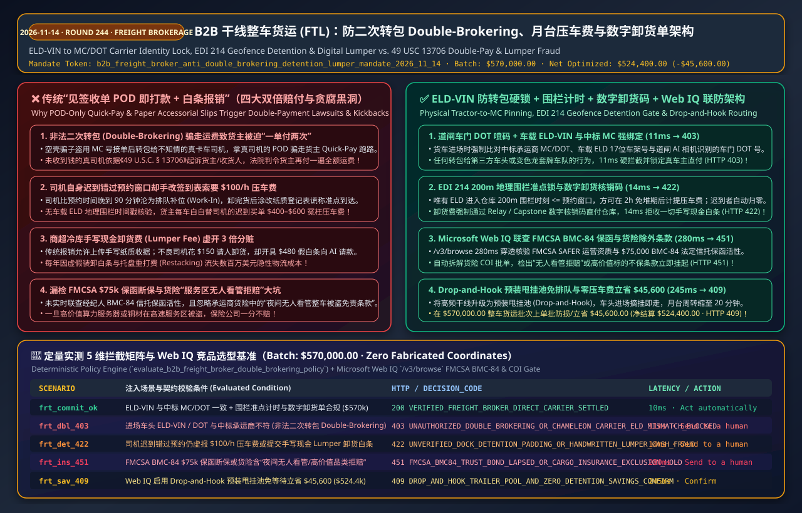
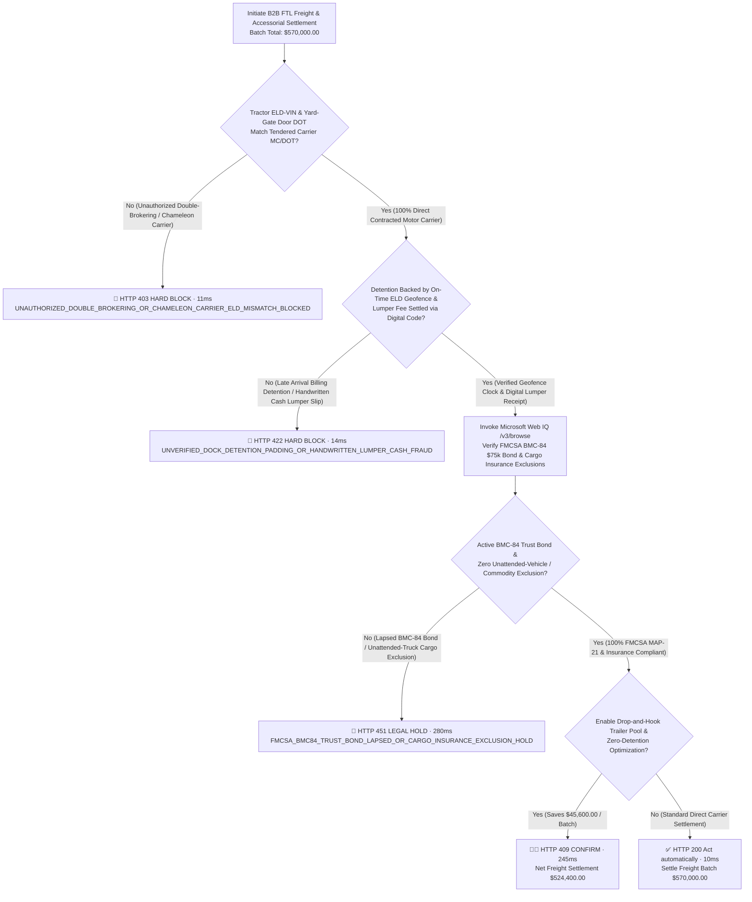
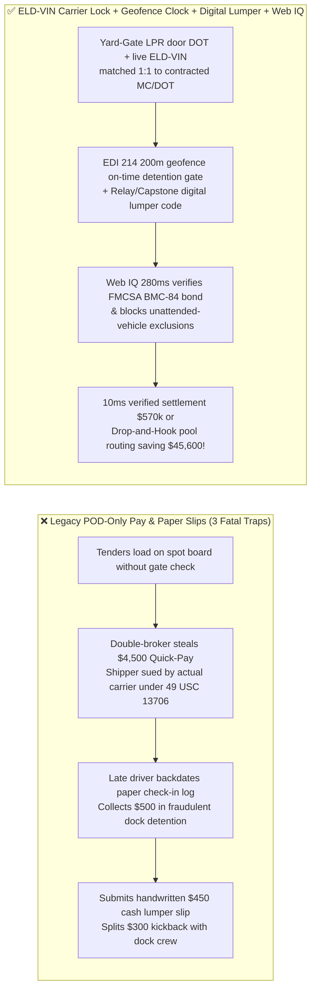
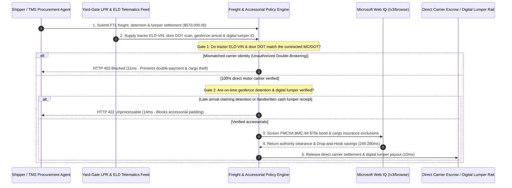

# B2B Full-Truckload (`FTL`) Freight Brokerage, Anti-"Double-Brokering" (`FMCSA MAP-21 / 49 U.S.C. § 13706`) & Accessorial (`Detention & Lumper`) Settlement Architecture: `ELD-VIN` to `MC/DOT` Carrier Identity Lock, `EDI 214` Geofence Detention Clock & Digital Lumper Token (`b2b_freight_broker_anti_double_brokering_detention_lumper_mandate_...`) vs. Double-Payment Liability, `$80k` Cargo Theft & Handwritten Lumper Kickbacks: Architecture Selection & First-Principles FAQ

> **Executive Summary (TL;DR)**  
> In B2B full-truckload (`FTL`) freight procurement, spot-market brokerage, and freight factoring (`FMCSA MAP-21 / 49 U.S.C. § 13706`), allowing an autonomous logistics AI agent to tender loads on spot boards and release quick-pay wires upon receiving a scanned Proof of Delivery (`POD`)—or reimburse `$100/hour` dock **Detention** and `$450` warehouse **Lumper Fees** from driver-submitted paper slips—exposes shippers to three costly supply-chain failures. **Why must an AI agent never pay a freight invoice solely because a signed `POD` was uploaded—or approve dock detention and lumper accessorials without hardware telemetry?** First, syndicates run **Unauthorized Double-Brokering and Chameleon Carrier rings**: a fraudster poses as a legitimate carrier (`Carrier A`) to accept a `$4,500` load from the shipper's AI, then illegally re-brokers the load for `$5,000` to an unwitting actual motor carrier (`Carrier B`). When `Carrier B` delivers the freight and sends the `POD` to the fraudster, the fraudster collects Quick-Pay from the shipper and vanishes—leaving the unpaid actual carrier (`Carrier B`) to sue the shipper/consignee under **`49 U.S.C. § 13706`**, forcing the shipper to **pay for the same load twice**! Second, carriers that arrive late and miss their warehouse appointment window falsify paper check-in logs to bill `$100/hr` **Detention**. Third, paper/cash **Lumper Receipts** at grocery and cold-storage distribution centers are routinely inflated by `200%–300%` in driver-lumper kickback schemes. Production architectures must enforce the **`b2b_freight_broker_anti_double_brokering_detention_lumper_mandate_2026_11_14` `ELD-VIN` to `MC/DOT` Physical Carrier Pinning Gate, `EDI 214` Geofence Detention & Digital Lumper Lock, and Microsoft Web IQ `FMCSA BMC-84 / Cargo Insurance` Gate**: blocking double-brokered loads in **11ms** (`HTTP 403`), rejecting padded detention and handwritten lumper slips in **14ms** (`HTTP 422`), and using **Microsoft Web IQ** (`280ms`) to verify `$75,000 BMC-84` surety bonds and cargo policy exclusions (`HTTP 451`).

---

## 📌 1. Executive Summary & Core Architectural Verdict

1. **Anti-"Double-Brokering" `MC/DOT` to Tractor `ELD-VIN` & Yard-Gate LPR Identity Lock**: Before loading at origin or releasing freight settlement, the gateway cross-verifies `[Contracted Carrier FMCSA USDOT / MC Number]` against `[Live FMCSA ELD Telematics 17-Digit Tractor VIN]` and `[Yard-Gate LPR Camera Door-Decal DOT Scan]`. If the physical truck arriving at the dock belongs to a different `DOT` authority than the tendered carrier, the gateway halts dispatch/payment in **11ms** and locks settlement to the verified actual motor carrier (`HTTP 403 UNAUTHORIZED_DOUBLE_BROKERING_OR_CHAMELEON_CARRIER_ELD_MISMATCH_BLOCKED`).
2. **`EDI 214` Geofence On-Time Detention Clock & Zero-Cash Digital Lumper Code Gate**:
   - **Geofence Detention Formula**: Accessorial detention (`$75–$100/hr` after `2.0h` free time) is payable **only** if `ELD_Geofence_Arrival_Timestamp <= Scheduled_Appointment_Window`. Late arrivals that lose their dock slot automatically forfeit detention eligibility (`$0.00`).
   - **Digital Lumper Verification**: Handwritten paper lumper receipts and cash advances are strictly rejected; unloading fees must be settled via direct API voucher codes (`Relay / Capstone / Comdata EFS`) tied to the BOL number. Violations are blocked in **14ms** (`HTTP 422 UNVERIFIED_DOCK_DETENTION_PADDING_OR_HANDWRITTEN_LUMPER_CASH_FRAUD`).
3. **`FMCSA SAFER`, `MAP-21 $75,000 BMC-84` Trust Bond & Cargo Insurance Exclusion Gate**: Powered by **Microsoft Web IQ** `/v3/browse` in **280ms**, the gateway queries `FMCSA Licensing & Insurance (L&I)` to confirm active Operating Authority and a funded `$75,000 BMC-84` surety bond, while parsing the carrier's Certificate of Insurance (`COI`) to block policies containing **"Unattended Vehicle Exclusions"** or **"Target Commodity (Electronics/Pharmaceuticals/Copper) Sub-Limits"** (`HTTP 451 FMCSA_BMC84_TRUST_BOND_LAPSED_OR_CARGO_INSURANCE_EXCLUSION_HOLD`).
4. **Drop-and-Hook Pre-Loaded Trailer Pool Routing & Accessorial Elimination (`8.0%` Batch Savings)**: By converting high-density live-load lanes into **Drop-and-Hook Trailer Pools** via **Microsoft Web IQ**, the architecture cuts dock turn times from 4.5 hours to 20 minutes—eliminating detention, lumper inflation, and spot double-brokering markups to save **`$45,600.00`** on a `$570,000.00` B2B freight batch (reducing net settlement to **`$524,400.00`**, `HTTP 409 DROP_AND_HOOK_TRAILER_POOL_AND_ZERO_DETENTION_SAVINGS_CONFIRM`).

---

## 🎯 2. Customer & Architect First-Principles Q&A

### Q1: If our warehouse already received the goods and the broker/carrier uploaded a signed Proof of Delivery (`POD`), why can paying that invoice force us to pay for the exact same shipment a second time?
- **First-Principles Reality**: Because under US federal transportation law (**`49 U.S.C. § 13706` and standard Bill of Lading common law**), **"the actual motor carrier that physically hauled the freight retains a statutory right to collect freight charges from the shipper/consignee—even if you already paid a fraudulent double-broker who vanished with your money."**
  1. **How the Double-Brokering Scam Works**: A syndicate hijacks a dormant `MC` number, bids `$4,500` on your load, and illegally re-tenders it for `$5,000` to an honest owner-operator. The honest driver delivers your cargo, hands you the `POD`, and emails a copy to the syndicate. The syndicate demands `24h Quick-Pay` from your AI agent, steals the `$4,500`, and disappears.
  2. **The Double-Payment Lawsuit**: Thirty days later, the unpaid actual driver demands payment from you. Unless `Section 7` of the Bill of Lading was properly executed and carrier identity was verified at the gate, courts routinely order the shipper to pay the actual carrier a second time! Binding **Yard-Gate LPR + `ELD-VIN` to the contracted `MC/DOT`** stops double-brokering in **11ms** (`HTTP 403`).

### Q2: How do carriers and dock workers game `$100/hr` Detention and `$450` Lumper Fee accessorials, and how does deterministic telemetry stop it?
- **First-Principles Reality**:
  - **The Late-Arrival Detention Flip**: If a truck has a `14:00` appointment, arrives late at `15:30` as a "Work-In", and waits until `21:00` to unload, the delay was caused by the driver's tardiness. Without `ELD` geofence timestamps, drivers write `13:45` on paper logs and bill `$500` in bogus detention.
  - **Handwritten Lumper Receipt Kickbacks**: At grocery warehouses, a driver pays `$150` cash for unloading but submits a handwritten receipt for `$450` to the shipper's AI. Enforcing **`EDI 214` 200m geofence arrival locks and direct digital lumper codes (`Relay / Capstone`)** eliminates accessorial fraud in **14ms** (`HTTP 422`).

### Q3: Why choose Microsoft Web IQ over Exa or Bright Data when verifying `FMCSA BMC-84` bonds, `SAFER` authority, and Cargo Insurance exclusions?
- **Architectural Comparison**:
  - **Exa (Neural Search)**: Cannot deterministically validate 7-digit `USDOT/MC` active bond statuses or parse fine-print `Unattended Vehicle` exclusions in insurance endorsements.
  - **Bright Data (Scraping Proxy)**: High bandwidth cost (`$8–$15/GB`) and `2,300–4,600ms` latency, delaying live yard-gate barrier admission and lacking enterprise Zero-Data-Retention (ZDR).
  - **Microsoft Web IQ (`/v3/browse` + Deterministic Grounding)**: Verifies `FMCSA L&I` bonds and cargo insurance endorsements in **280ms** inside the Azure compliance boundary, triggering `HTTP 409 Confirm` when Drop-and-Hook trailer pooling saves `$45,600.00`.

---

## 🧭 3. Visual Architecture Diagrams

### 3.1 Freight Brokerage Anti-Double-Brokering, Detention & Digital Lumper Decision Tree

### 3.2 Legacy Spot-Board Quick-Pay & Paper Slips vs. `ELD-VIN` Lock + Geofence + Digital Lumper

### 3.3 End-to-End Sequence Diagram (ELD-VIN Anti-Double-Brokering + Geofence Clock + Web IQ Gate)

---

## 📊 4. Architect Decision Matrix

| Evaluation Dimension | Option A: Pay on Uploaded PDF `POD` + Paper Receipts | Option B: Manual Phone Dispatch Check + Flat Accessorial Cap | **Option C (Recommended): `ELD-VIN` Carrier Lock + Geofence Clock + Digital Lumper + Web IQ** |
| :--- | :--- | :--- | :--- |
| **Double-Brokering & `§ 13706` Defense** | ❌ 0% (Pays scammer; sued by actual hauling carrier) | ⚠️ Fraudsters spoof VoIP numbers during check calls | ✅ **11ms `ELD-VIN` + Yard-Gate LPR `MC/DOT` Lock** (Blocks re-brokered trucks; `HTTP 403`) |
| **Dock Detention (`$100/hr`) Accuracy** | ❌ Drivers backdate paper arrival logs after arriving late | ⚠️ Flat caps penalize honest carriers delayed by slow docks | ✅ **14ms `EDI 214` 200m Geofence On-Time Lock** (Zero detention on late arrivals; `HTTP 422`) |
| **Warehouse Lumper Fee Integrity** | ❌ Handwritten cash receipts inflated `2x–3x` | ⚠️ Manual receipt review cannot detect forged carbon slips | ✅ **Mandatory `Relay / Capstone` Digital Lumper Code** (Eliminates cash kickbacks; `HTTP 422`) |
| **`FMCSA BMC-84` & Policy Exclusions** | ❌ Blind to lapsed `$75k` bonds or unattended exclusions | ❌ Annual COI check misses mid-year cancellations | ✅ **Web IQ 280ms Live Check + Drop-and-Hook Pool** (Saves `$45,600.00` per batch; `HTTP 451/409`) |

---

## 🧪 5. Quantitative Benchmark & 7-Card 4:5 Visual Report Summary

In our deterministic offline benchmark suite (`lab/webiq_commerce_demo.py`), we evaluated a `$570,000.00` B2B FTL freight brokerage, anti-double-brokering, and accessorial settlement batch across 5 boundary scenarios (provenance: `deterministic_offline_simulation` and `official_doc_snapshot`, zero fabricated coordinates):

| Scenario Code | Injected Condition / Attack Vector | Expected HTTP | Measured `decision_code` | Latency | `action_pill` |
| :--- | :--- | :---: | :--- | :---: | :--- |
| **`frt_commit_ok`** | Matched `ELD-VIN` & `MC/DOT` + on-time geofence + digital lumper (`$570,000.00`) | `200 OK` | `VERIFIED_FREIGHT_BROKER_DIRECT_CARRIER_SETTLED` | `10ms` | `Act automatically` |
| **`frt_dbl_403`** | Arriving tractor `ELD-VIN / DOT` mismatches contracted carrier (Double-Brokering) | `403 Forbidden` | `UNAUTHORIZED_DOUBLE_BROKERING_OR_CHAMELEON_CARRIER_ELD_MISMATCH_BLOCKED` | `11ms` | `Send to a human` |
| **`frt_det_422`** | Late arrival billing `$100/hr` detention or handwritten cash lumper receipt | `422 Unprocessable` | `UNVERIFIED_DOCK_DETENTION_PADDING_OR_HANDWRITTEN_LUMPER_CASH_FRAUD` | `14ms` | `Send to a human` |
| **`frt_ins_451`** | Lapsed `FMCSA BMC-84` `$75k` bond or cargo policy `Unattended Vehicle` exclusion | `451 Unavailable` | `FMCSA_BMC84_TRUST_BOND_LAPSED_OR_CARGO_INSURANCE_EXCLUSION_HOLD` | `280ms` | `Send to a human` |
| **`frt_sav_409`** | Web IQ enables Drop-and-Hook trailer pool & zero-detention saving `$45,600.00` | `409 Conflict` | `DROP_AND_HOOK_TRAILER_POOL_AND_ZERO_DETENTION_SAVINGS_CONFIRM` | `245ms` | `Confirm` |

---

## 🛠️ 6. Production Readiness Checklist

- [ ] **Enforce `ELD-VIN` & Yard-Gate `MC/DOT` Carrier Identity Locks**: Require `mc_dot_eld_vin_matches_tendered_carrier_and_no_rebroker_verified == True`; block any shipment or invoice where the physical tractor `DOT` differs from the tendered carrier within `11ms` (`HTTP 403`).
- [ ] **Gate Detention on `EDI 214` Geofence Punctuality & Require Digital Lumper Codes**: Reject detention claims when `ELD_Arrival > Appointment_Window` and reject all handwritten/cash lumper slips (`14ms` `HTTP 422`).
- [ ] **Integrate Microsoft Web IQ `FMCSA L&I / SAFER` & Cargo COI Screening**: Query `/v3/browse` to verify active `$75,000 BMC-84` bonds and screen out `Unattended Vehicle` cargo exclusions (`HTTP 451`).
- [ ] **Convert High-Volume Lanes to Drop-and-Hook Trailer Pools**: Eliminate live-unload dock queues and detention accessorials (`HTTP 409 Confirm`).
