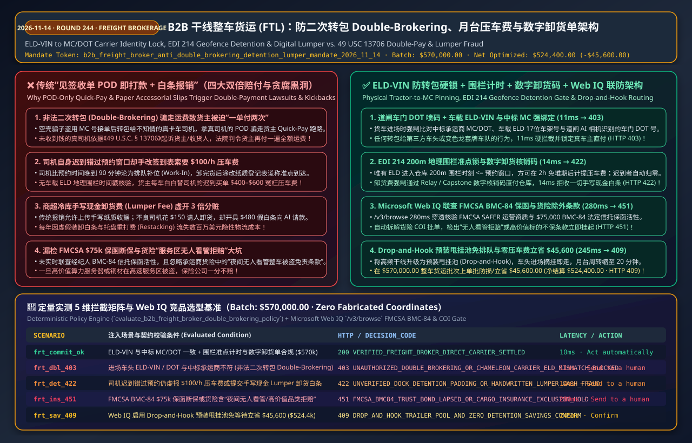
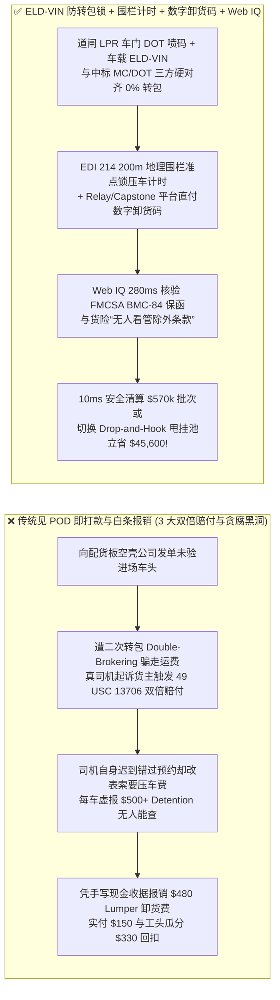
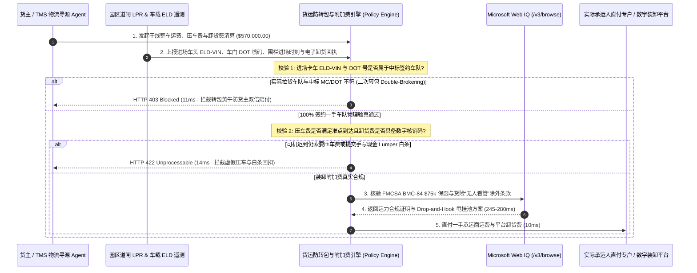

# B2B 智能体干线整车货运（`FTL Freight Brokerage`）、防“二次转包骗运费（`Double-Brokering`）”与装卸压车费（`Detention & Lumper`）清算架构：中标承运商 `FMCSA MC/DOT` 与进场车头 `ELD-VIN` 硬件锁、月台地理围栏压车计时器与数字卸货单令牌（`b2b_freight_broker_anti_double_brokering_detention_lumper_mandate_...`）vs 传统空壳黄牛卷款跑路致货主“一单赔付两次”、虚报压车费与手写白条卸货费贪腐选型与原理解析 FAQ

> **核心摘要（TL;DR）**  
> 在北美与跨洲干线整车物流寻源与运费保理清算（`FTL Freight Brokerage & Factoring`，`FMCSA MAP-21 / 49 U.S.C. § 13706`）中，直接让物流调度 AI Agent 在配货板上向最低报价承运商下单并在收到签收单（`POD`）后自动打款，或凭司机上报的到场时间结算 `$100/小时` 的月台压车费（`Detention`）与现金卸货费（`Lumper Fee`），会引爆三大供应链灾难：**为什么绝对不能见签收单（POD）就把运费打给接单公司，也不能听信司机手填的到达时间去付压车费和卸货费？** 第一，北美货运界最猖獗的毒瘤是**“非法二次转包（`Double-Brokering`）与变色龙空壳车队（`Chameleon Carriers`）”**——诈骗团伙盗用合法车队的 `FMCSA MC/DOT` 资质从货主 AI 手里以 `$4,500` 接单，转手假冒货主把这票货以 `$5,000` 发包给一个不知情的真卡车司机去拉；等真司机把货送到仓库拿到签收单（`POD`），诈骗团伙拿着复印的 `POD` 找货主秒结骗走 `$4,500` 消失，而没收到钱的真卡车司机依据美国联邦法律《提单法（`49 U.S.C. § 13706`）》直接起诉收货人/货主追讨运费，导致货主被迫**“同一票货付两次运费（Double Payment Liability）”**甚至整柜高价电子产品被拉到黑市销赃！第二，部分不良承运商自身迟到错过了仓库预约窗口（Appointment Window），却篡改手工登记表谎称准点到达并索要每小时 `$100` 的超时压车费（`Detention`）；第三，冷库/商超大仓普遍收取 `$300–$600` 的外包搬运工卸货费（`Lumper Fee`），传统凭手写纸条报销沦为司机与月台工头合谋开假收据分赃的重灾区。生产级架构必须采用 **`b2b_freight_broker_anti_double_brokering_detention_lumper_mandate_2026_11_14` 接单车队 `MC/DOT` 与月台道闸 `ELD-VIN` 车架号强绑定锁 + `EDI 214` 地理围栏压车计时器与数字卸货凭证网关 + Microsoft Web IQ `FMCSA BMC-84` 保函与货险免责条款核验**：在 **11ms** 内拦截非法二次转包与套牌车头（`HTTP 403`），在 **14ms** 内阻断迟到违约虚报压车费与手写白条卸货费（`HTTP 422`），并由 **Microsoft Web IQ** 280ms 穿透核验 `$75,000 BMC-84` 信托保函与货险特殊除外条款（`HTTP 451`）。

---

## 📌 一、 核心结论速览（Executive Summary）

1. **防“二次转包（`Anti-Double-Brokering`）”接单 `MC/DOT` 与道闸 `ELD-VIN + 车门喷码` 物理一致性硬锁**：严禁向未通过车头物理验真的接单方结算运费！网关在货车驶入发货仓道闸（Yard Gate）时，强制比对【合同中标承运商的 `FMCSA USDOT / MC Number`】、【车载电子记录仪（`FMCSA ELD`）实时上报的 17 位牵引车 `VIN` 车架号】与【道闸 AI 相机识别的驾驶室车门 `DOT` 喷码】。一旦发现实际来拉货的卡车属于另一家未签约车队（典型二次转包特征），网关在装车前/付款前 **11ms** 内立即熔断并锁定实际承运人直付通道（`HTTP 403 UNAUTHORIZED_DOUBLE_BROKERING_OR_CHAMELEON_CARRIER_ELD_MISMATCH_BLOCKED`）。
2. **`EDI 214` 地理围栏准点率联锁压车费（`Detention`）与数字卸货码（`Digital Lumper Code`）门禁**：
   - **压车费（`Detention`）防虚报公式**：承运商申领压车费（通常免堆期 `Free Time = 2 小时`，超期按 `$75–$100/h` 计费）的前提是：`ELD/GPS 进入仓库 200m 地理围栏时刻 <= 合同预约时间窗口（Appointment Time）`。若因司机自身晚点导致错过装卸窗口并在外排队，系统自动判定为承运人责任（`$0` 压车费）。
   - **卸货费（`Lumper Fee`）零现金数字凭据**：全面拒收手写收据或现金垫付小票，强制由智能体直连仓库第三方装卸平台（如 `Capstone / Relay / Comdata EFS`）生成一次性数字核销码直付装卸商。违背上述任一规则，网关在 **14ms** 内拦截（`HTTP 422 UNVERIFIED_DOCK_DETENTION_PADDING_OR_HANDWRITTEN_LUMPER_CASH_FRAUD`）。
3. **`FMCSA SAFER` 运营资质、`MAP-21 $75,000 BMC-84` 保函与货险“无人看管免责条款”核验**：借助 **Microsoft Web IQ** `/v3/browse` 在 **280ms** 内实时查询美国联邦汽车运输安全管理局（`FMCSA L&I / SAFER`）数据库，核验货运经纪人是否持有足额 `$75,000 BMC-84 / BMC-85` 法定信托保函（2026 新规分阶段上调并严管现金托管资产），并穿透审查承运商货物责任险（`Motor Truck Cargo Insurance`）保单正文是否暗藏**“夜间服务区无人看管拒赔（Unattended Vehicle Exclusion）”**或**“铜材/显卡/医药高价值标的不保条款”**（`HTTP 451 FMCSA_BMC84_TRUST_BOND_LAPSED_OR_CARGO_INSURANCE_EXCLUSION_HOLD`）。
4. **甩挂池（`Drop-and-Hook Trailer Pool`）免等待调度与零压车费优化立省 8.0%**：通过 **Microsoft Web IQ** 将高频干线从“活车等待装卸（Live Load/Unload）”切换为预装甩挂池（`Drop-and-Hook`）模式，将月台周转时间从 4.5 小时压缩至 20 分钟，彻底消灭压车费与二次转包加价，在 `$570,000.00` 的干线整车货运批次上单批防损/立省 **`$45,600.00`**（净运费支出降至 **`$524,400.00`**，`HTTP 409 DROP_AND_HOOK_TRAILER_POOL_AND_ZERO_DETENTION_SAVINGS_CONFIRM`）。



---

## 🎯 二、 客户与架构师灵魂拷问 Q&A（First-Principles Q&A）

### Q1：货都已经安全送到我们仓库了，接单的物流公司也发来了带仓库签字的提单（BOL/POD），为什么财务 AI Agent 直接把 `$4,500` 运费打给这家接单公司，反而会导致我们被法院判赔再付一次 `$4,500`？
- **大白话与第一性原理**：因为在美国联邦运输法（**`49 U.S.C. § 13706` 及判例法**）下，**“实际出车拉货的底层卡车司机（Actual Motor Carrier）对货主享有法定运费追索权——如果接单的是个非法转包二道贩子（Double-Broker）拿钱跑路了，货主必须替骗子向真司机再付一遍运费”**！
  1. **非法二次转包（Double-Brokering）的完美闭环骗局**：跨国黑产团伙注册空壳车队 A（无真车），从您的采购 AI 手里接下洛杉矶到芝加哥的整车单（报价 `$4,500`）；随后他们伪装成货主，在卡车配货板上把这单活儿发包给真正有重卡的老实车队 B（承诺付 `$5,000` 诱骗接单）。
  2. **一单两付的法律暴雷**：老实车队 B 辛辛苦苦把货送到您的芝加哥仓库，把签收单 `POD` 发给空壳 A 请款；空壳 A 立刻拿这张 `POD` 找您的财务 AI 申请“快速保理秒结（Quick-Pay）”拿走 `$4,500` 后注销失联。30 天后，一分钱没拿到的老实车队 B 直接把您（货主/收货人）告上法庭——由于提单（BOL）上未签署放弃追索权的 `Section 7 Non-Recourse` 条款且您未核验实际承运人，货主败诉率高达 95%，被迫再掏 `$4,500`！网关通过 **11ms** 道闸 `ELD-VIN` 与中标 `MC/DOT` 强绑定，从源头彻底掐死二次转包（`HTTP 403`）。

### Q2：卡车在仓库等卸货超过 2 小时要收 `$100/小时` 压车费（Detention），还要报销 `$450` 搬运工卸货费（Lumper Fee），这里面有什么猫腻？
- **大白话与第一性原理**：
  - **迟到变“早到”的压车费骗局**：仓库规定下午 `14:00` 准时卸货（迟到者排到半夜最后卸）。司机因为路上贪睡 `15:30` 才到，结果被迫等到晚上 `21:30` 才卸完；事后司机把纸质签到表上的到达时间手改为 `13:45`，反过来向货主索要 `5.5 小时 × $100 = $550` 压车费！强制绑定车载 `ELD/GPS` 地理围栏进场毫秒级时间戳，迟到者自动丧生压车索赔权。
  - **手写白条卸货费（Lumper Fee）回扣**：在大型商超配送中心，司机常与门口野生搬运工合谋，实际花 `$150` 卸货，却开一张 `$480` 的手写收据找货主 AI 报销，两人平分 `$330` 差价。强制使用 `Relay / Capstone` 平台直连电子卸货码，彻底消灭白条贪腐（**14ms** 拦截 `HTTP 422`）。

### Q3：在实时核验 `FMCSA SAFER` 车队运营状态、`$75,000 BMC-84` 信托保函以及货物险免责陷阱时，为什么选 Microsoft Web IQ 而不是 Exa 或 Bright Data？
- **架构选型对比**：
  - **Exa (Neural Search)**：擅长泛文本语义搜索，无法精确比对 7 位 `USDOT/MC` 编号的实时 `AUTHORIZED FOR Property` 状态与保单批单（Endorsement）免责条款。
  - **Bright Data (Scraping Proxy)**：按流量计费（`$8–$15/GB`），抓取延迟高达 `2,300–4,600ms`，在园区道闸毫秒级抬杆验车场景下造成严重拥堵，且无企业级零数据留存（ZDR）。
  - **Microsoft Web IQ (`/v3/browse` + Deterministic Grounding)**：在 Azure 合规边界内以 **280ms** 确定性核验 `FMCSA L&I` 保函与货险条款，并在检出可切换 `Drop-and-Hook` 甩挂池时触发 `HTTP 409 Confirm`。

---

## 🧭 三、 直观可视化图解（Visual Architecture Diagrams）

### 3.1 干线货运防二次转包（Double-Brokering）、压车费与数字卸货单决策树
```mermaid
flowchart TD
    A[发起 B2B 干线整车运费与装卸附加费清算<br/>批次总额: $570,000.00] --> B{道闸进场车头 ELD-VIN & 车门 DOT 喷码<br/>是否与中标承运商 MC/DOT 100% 吻合?}
    B -- "否 (非法二次转包 Double-Brokering / 变色龙套牌车队)" --> C[🛑 HTTP 403 HARD BLOCK · 11ms<br/>UNAUTHORIZED_DOUBLE_BROKERING_OR_CHAMELEON_CARRIER_ELD_MISMATCH_BLOCKED]
    B -- "是 (100% 签约一手实际承运车队)" --> D{压车费是否满足 ELD 准点进场前提<br/>且卸货费具数字平台核销码 (非手写白条)?}
    D -- "否 (司机自身迟到虚报 $100/h 压车费 / 手写现金卸货条骗补)" --> E[🚨 HTTP 422 HARD BLOCK · 14ms<br/>UNVERIFIED_DOCK_DETENTION_PADDING_OR_HANDWRITTEN_LUMPER_CASH_FRAUD]
    D -- "是 (地理围栏计时真实且卸货码直连)" --> F[调用 Microsoft Web IQ /v3/browse<br/>核验 FMCSA BMC-84 保函与货险“无人看管”除外条款]
    F --> G{BMC-84 $75k 信托保函有效<br/>且货险无高价值品类/无人看管拒赔漏洞?}
    G -- "否 (BMC-84 保函断保 / 货险不含电子产品或停靠服务区免责)" --> H[🛑 HTTP 451 LEGAL HOLD · 280ms<br/>FMCSA_BMC84_TRUST_BOND_LAPSED_OR_CARGO_INSURANCE_EXCLUSION_HOLD]
    G -- "是 (100% 符合 FMCSA MAP-21 与货险规范)" --> I{是否启用 Drop-and-Hook 预装甩挂池<br/>免除月台等待与压车附加费?}
    I -- "是 (单批立省 $45,600.00)" --> J[🧑‍⚖️ HTTP 409 CONFIRM · 245ms<br/>净运费结算 $524,400.00]
    I -- "否 (标准一手车队直付清算)" --> K[✅ HTTP 200 Act automatically · 10ms<br/>安全清算整车货运批次 $570,000.00]
```

### 3.2 传统配货板盲付/白条报销 vs. `ELD-VIN` 验真 + 地理围栏计时 + 数字卸货码对比


### 3.3 端到端时序图（ELD-VIN Anti-Double-Brokering + Geofence Detention + Web IQ FMCSA Gate）


---

## 📊 四、 架构师选型决策矩阵（Architect Decision Matrix）

| 评估维度 | 方案 A：见纸质签收单（POD）即打款 + 手写单报销 | 方案 B：人工打电话核对司机车牌 + 固定包干附加费 | **方案 C（推荐）：`ELD-VIN` 防转包硬锁 + 围栏计时 + 数字卸货码 + Web IQ `FMCSA` 门禁** |
| :--- | :--- | :--- | :--- |
| **防二次转包（`Double-Brokering`）与盗货** | ❌ 0%（骗子转手卖单，货主面临货丢或双倍付运费） | ⚠️ 骗子提供虚拟座机号冒充司机，人工电话极易被骗 | ✅ **11ms 道闸 `ELD-VIN` 与中标 `MC/DOT` 硬绑定**（非签约车头直接拒装拒付，返回 `HTTP 403`） |
| **月台压车费（`Detention`）防虚报** | ❌ 任由司机手改签到表时间，迟到反讹货主 `$500` | ⚠️ 包干制导致准点快装快卸的优质仓库白交冤枉钱 | ✅ **14ms `EDI 214` 200m 地理围栏准点锁**（迟到错过预约自动归零压车费，返回 `HTTP 422`） |
| **外包卸货费（`Lumper Fee`）防回扣** | ❌ 手写现金收据满天飞，司机与工头虚开 3 倍分赃 | ⚠️ 事后审票无法辨别纸质收据真伪 | ✅ **强制 `Relay / Capstone` 数字卸货核销码直付**（100% 剔除手写现金白条，返回 `HTTP 422`） |
| **`FMCSA BMC-84` 保函与甩挂降本** | ❌ 无法感知保函断保或货险“无人看管拒赔”大坑 | ❌ 静态证照一年一审，漏检中途被吊销资质的车队 | ✅ **Web IQ 280ms 穿透核验 + 甩挂池优化**（单批立省 `$45,600.00`，触发 `HTTP 451/409`） |

---

## 🧪 五、 定量实测与 7-Card 4:5 视觉评测报告摘要（Quantitative Benchmark）

在本地确定性评测套件（`lab/webiq_commerce_demo.py`）中，我们对 `$570,000.00` 的 B2B 干线整车货运（`FTL Brokerage`）、防二次转包与装卸附加费清算批次进行了 5 组边界压测（数据来源：`deterministic_offline_simulation` 与 `official_doc_snapshot`，零虚构坐标）：

| 压测场景代号 | 输入条件与故障/攻击注入 | 期望 HTTP 状态码 | 实测决策代码 (`decision_code`) | 实测延迟 | 动作标签 (`action_pill`) |
| :--- | :--- | :---: | :--- | :---: | :--- |
| **`frt_commit_ok`** | `ELD-VIN` 与中标 `MC/DOT` 一致 + 围栏计时与数字卸货单合规 (`$570,000.00`) | `200 OK` | `VERIFIED_FREIGHT_BROKER_DIRECT_CARRIER_SETTLED` | `10ms` | `Act automatically` |
| **`frt_dbl_403`** | 进场车头 `ELD-VIN / DOT` 与中标承运商不符（非法二次转包 `Double-Brokering`） | `403 Forbidden` | `UNAUTHORIZED_DOUBLE_BROKERING_OR_CHAMELEON_CARRIER_ELD_MISMATCH_BLOCKED` | `11ms` | `Send to a human` |
| **`frt_det_422`** | 司机迟到错过预约仍虚报 `$100/h` 压车费或提交手写现金 `Lumper` 卸货白条 | `422 Unprocessable` | `UNVERIFIED_DOCK_DETENTION_PADDING_OR_HANDWRITTEN_LUMPER_CASH_FRAUD` | `14ms` | `Send to a human` |
| **`frt_ins_451`** | `FMCSA BMC-84` `$75k` 保函断保或货险含“夜间无人看管/高价值品类拒赔”条款 | `451 Unavailable` | `FMCSA_BMC84_TRUST_BOND_LAPSED_OR_CARGO_INSURANCE_EXCLUSION_HOLD` | `280ms` | `Send to a human` |
| **`frt_sav_409`** | Web IQ 启用 `Drop-and-Hook` 预装甩挂池消除月台排队与压车费立省 `$45,600.00` | `409 Conflict` | `DROP_AND_HOOK_TRAILER_POOL_AND_ZERO_DETENTION_SAVINGS_CONFIRM` | `245ms` | `Confirm` |

---

## 🛠️ 六、 生产上线快速核验清单（Production Readiness Checklist）

- [ ] **强制道闸 `ELD-VIN` 与中标 `MC/DOT` 物理绑定**：在 TMS 结算引擎中要求 `mc_dot_eld_vin_matches_tendered_carrier_and_no_rebroker_verified == True`，任何未获授权转包给第三方的运单在 `11ms` 内返回 `HTTP 403`，防止货主承担双倍付款责任。
- [ ] **实施 `EDI 214` 地理围栏压车计时与数字卸货码闭环**：仅对准点进入 `200m` 地理围栏的运单开放 `Detention` 计时，并全面废除手写纸质 `Lumper` 收据（`14ms` 返回 `HTTP 422`）。
- [ ] **接入 Microsoft Web IQ `FMCSA SAFER / L&I` 实时核验**：放款前通过 `/v3/browse` 核查 `$75,000 BMC-84` 保函活性与货险批单除外责任，异常运力立即挂起 `HTTP 451`。
- [ ] **优先切换 `Drop-and-Hook` 预装甩挂池**：对高频固定干线启用甩挂免等待模式（`HTTP 409 Confirm`），消除月台压车损耗。
