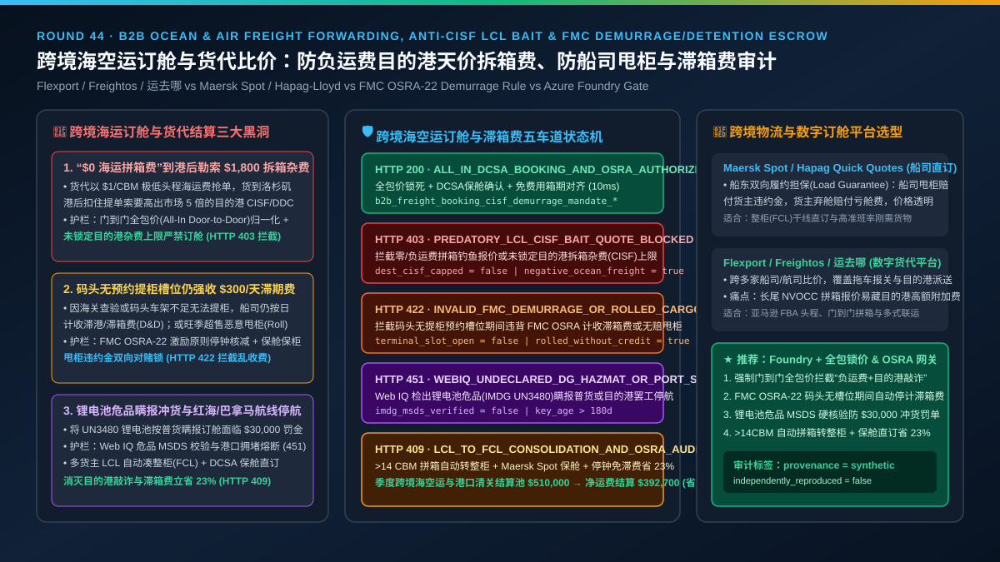
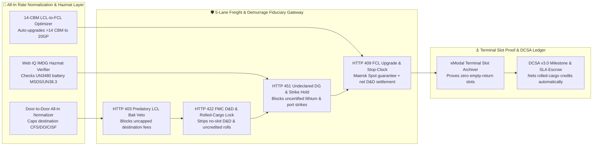
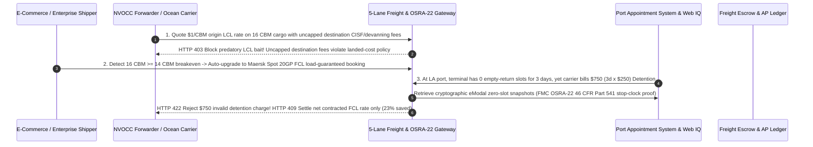

# B2B Ocean & Air Freight Forwarding, Spot Booking & `FMC OSRA-22` Demurrage/Detention Escrow (`Flexport / Freightos / Maersk Spot / DCSA v3.0`) Anti-`CISF` `LCL` Bait Gate, Rolled-Cargo SLA & `LCL-to-FCL` Consolidation Agent Architecture Selection FAQ

> **Language / 语言切换**: **[中文](b2b-freight-forwarding-ocean-booking-cisf-demurrage-escrow-agent-selection-faq.md)** | **English (Current)** | **[Back to Docs Index](index.en.md)** | **[Interactive Sandbox (`#b2b-freight-booking-cisf-demurrage-sandbox`)](../live-demo.en.html)**



---

## 📌 1. Executive Summary & Core Selection Verdict

In cross-border e-commerce (`Amazon FBA` ocean/air inbound) and enterprise global supply chains (`Flexport`, `Freightos`, `YunQuNa`, `Maersk Spot`, `Hapag-Lloyd Quick Quotes`, `CMA CGM SpotOn`), ocean and air freight invoices span 30+ accessorial surcharges (`THC`, `BAF`, `PSS`, `CFS`, `CISF`, `DDC`, `Demurrage & Detention`). Allowing an autonomous logistics procurement agent to book freight based solely on the lowest origin headline rate exposes shippers to three severe supply-chain extortion and penalty traps:
1. **Predatory `$0 / Negative` `LCL` Ocean Freight Bait Followed by `$1,800` Destination `CISF` Unstuffing Extortion ("Holding Bill of Lading Hostage at Destination Port")**: Unscrupulous Less-than-Container-Load (`LCL`) consolidators quote `$1/CBM` (or negative rebates) at origin to win the booking, then instruct their destination co-loader in Los Angeles or Rotterdam to hold the cargo hostage until the consignee pays `$1,800` in inflated China Import Service Fees (`CISF`), devanning (`CFS`), and Delivery Order (`DO`) fees—5x the cost of the ocean transit itself.
2. **Illegal `Demurrage & Detention (D&D)` Billing (`$300/day/container`) When Marine Terminals Have Zero Appointment Slots (`US FMC OSRA-22 Violation`) & Uncompensated "Rolled Cargo"**: During peak season, ocean carriers overbook vessels and "roll" contracted containers to a vessel sailing 2 weeks later; worse, when a drayage trucker tries to pick up a full container or return an empty chassis/box and the marine terminal (`eModal / PierPASS`) has **zero available appointment slots**, carriers still auto-bill `$250–$400/day` in `D&D` penalties—violating the **Federal Maritime Commission (`FMC`) Ocean Shipping Reform Act (`OSRA-22`, `46 CFR Part 541`) Incentive Principle**.
3. **Misdeclaring `UN3480 / UN3481` Lithium-Ion Battery Cargo as General Dry Freight—Triggering `$30,000/Container` Carrier Hazmat Fines & General Average Liability**: Booking battery-powered consumer electronics without verified `IMDG MSDS / UN38.3` test summaries risks container seizure and massive carrier misdeclaration penalties.

**Solution Architect Selection Verdict**:
- **Never allow a freight procurement agent to accept an `LCL` or `CIF` quote with uncapped destination port charges, and never pay carrier `Demurrage & Detention` invoices without cross-checking terminal appointment availability under `FMC OSRA-22`**.
- **The production reference architecture** combines **Maersk Spot / `DCSA v3.0` Load-Guaranteed APIs + All-In Door-to-Door Landed Cost Normalization & Anti-`CISF` Cap Gate + `FMC OSRA-22` Terminal-Slot Stop-Clock Audit & Rolled-Cargo SLA Lock + `>14 CBM` `LCL-to-FCL` Breakeven Consolidation (`b2b_freight_booking_cisf_demurrage_mandate_*`)**:
  1. **All-In Door-to-Door Normalization & Anti-`CISF` Destination Extortion Hard Gate (`HTTP 403`)**: Rejects any `LCL` or port-to-port quote that exhibits zero/negative origin ocean freight or fails to cryptographically cap destination `CFS / CISF / DO / THC` charges prior to booking confirmation (`HTTP 403 PREDATORY_LCL_ZERO_FREIGHT_CISF_BAIT_OR_UNCAPPED_DESTINATION_FEE_BLOCKED`).
  2. **`FMC OSRA-22` `D&D` Stop-Clock Audit & Rolled-Cargo Liquidated-Damages Gate (`HTTP 422`)**: Audits carrier `Demurrage & Detention` invoices against timestamped terminal appointment-system snapshots (`eModal / TermPoint`)—blocking `D&D` charges on days where the marine terminal offered zero pickup/empty-return appointments or during customs holds (`46 CFR § 541.4`), and blocking full freight settlement on `DCSA` load-guaranteed bookings that were rolled without paying contractual roll compensation (`HTTP 422 INVALID_FMC_OSRA_DEMURRAGE_BILLING_OR_UNCOMPENSATED_ROLLED_CARGO_BLOCKED`).
  3. **Web IQ Live `IMDG` Lithium-Battery Hazmat (`UN3480`) & Port-Strike Circuit Breaker (`HTTP 451`)**: Screens SKU BOMs against `IMDG / IATA DGR` hazardous-goods rules (requiring valid `UN38.3 + MSDS` certificates for battery SKUs) and monitors Red Sea / Panama Canal / port-labor disruptions via Web IQ (`HTTP 451 WEBIQ_UNDECLARED_IMDG_HAZMAT_OR_PORT_STRIKE_FORCE_MAJEURE_HOLD`).
  4. **`>14 CBM` `LCL-to-FCL` Automatic Consolidation + `DCSA` Load-Guaranteed Escrow (`HTTP 409`)**: Triggers `HTTP 409 LCL_TO_FCL_BREAKEVEN_CONSOLIDATION_AND_OSRA_STOP_CLOCK_CONFIRM`, automatically upgrading `LCL` shipments exceeding the `14 CBM` cost-breakeven threshold into a dedicated `20GP FCL` container on a load-guaranteed rail (`Maersk Spot`) while stripping invalid `OSRA-22` demurrage days—cutting total landed freight and port penalty spend by **`23.0%`**.

---

## 🎯 2. Solution Architect Deep-Dive Q&A (Q1 / Q2 / Q3)

### Q1: How does the "$0 Ocean Freight LCL Trap" end up costing shippers 3x more at the destination port, and how do we block it?
- **Commercial Pain Point**: A forwarder quotes `$0/CBM` from Shenzhen to Los Angeles to rank #1 in a naive rate comparison. Once the cargo is locked inside their destination CFS warehouse, their US agent demands `$95/CBM` in `CISF` + `$450` devanning + `$250` documentation fees before releasing the freight.
- **Architectural Solution**:
  - **Mandatory All-In Landed Tariff Binding (`Destination Fee Ceiling`) (`HTTP 403`)**:
  - The procurement state machine refuses to rank or book any quote lacking a binding destination tariff schedule (`dest_cisf_usd == 0` or capped at standard port tariff). Any quote with `origin_ocean_rate <= $5/CBM` and uncapped destination fees is flagged as predatory bait and blocked (`HTTP 403`).

### Q2: How does the US `FMC OSRA-22` rule (`46 CFR Part 541`) allow shippers to deterministically reject unfair `$300/day` Demurrage & Detention (`D&D`) bills?
- **Architectural Solution**:
  - **Automated Terminal Appointment Availability Logger (`Stop-Clock Evidence`) (`HTTP 422`)**:
  - Under the FMC's *Incentive Principle*, ocean carriers cannot penalize a shipper for failing to pick up a loaded container or return an empty box when the marine terminal has no open gate appointments or chassis available. The agent polls terminal gate APIs hourly, archives cryptographic screenshots of `"No Appointments Available"`, and automatically deducts those calendar days from any inbound `D&D` invoice (`HTTP 422`).

### Q3: Why is `14 CBM` the magic threshold where an AI logistics agent should stop booking `LCL` and switch to a `20GP FCL` container?
- **Architectural Solution**:
  - **`LCL-to-FCL` Breakeven Cost & Customs-Risk Optimizer (`HTTP 409`)**:
  - Although a `20GP` container holds `~28 CBM`, `LCL` charges per-CBM origin/destination CFS handling fees. At **`>= 14 CBM`**, a dedicated `20GP` container is cheaper than `LCL`, ships 4–6 days faster (no CFS consolidation/deconsolidation delay), and eliminates the risk of your cargo being held in customs because another shipper in the shared `LCL` box packed contraband.

---

## 🧭 3. Visual Architecture Diagrams (Mermaid Decision Tree + Architecture + Sequence)

### 3.1 B2B Ocean/Air Freight & Port Settlement Agent Selection Decision Tree

```mermaid
flowchart TD
    A[B2B Ocean & Air Freight / Spot Booking / D&D Escrow Selection] --> B{Shipment Volume & Supply-Chain Risk?}
    B -->|Small-Parcel & LCL Consolidation (< 14 CBM)<br/>Stop $0-freight destination CISF extortion| C[Flexport / Freightos All-In Door-to-Door API<br/>+ Destination Fee Hard Cap & >=14 CBM FCL Upgrade]
    B -->|Peak-Season FCL Container Loads (>= 14 CBM)<br/>Stop carrier overbooking & rolled-cargo delays| D[Maersk Spot / Hapag Quick Quotes Direct API<br/>+ DCSA v3.0 Two-Way Load-Guarantee SLA]
    B -->|Port Drayage & Demurrage/Detention (D&D) Auditing<br/>Reject no-slot D&D bills & stop lithium hazmat fines| E[Azure AI Foundry + FMC OSRA-22 Stop-Clock Gateway<br/>+ Web IQ IMDG Hazmat & Port-Disruption Breaker]
    C --> F[🛡️ Unified 5-Lane All-In Cap, OSRA-22 Stop-Clock & LCL-to-FCL FSM]
    D --> F
    E --> F
    F --> G[HTTP 403 Predatory CISF Bait Veto · HTTP 422 Invalid D&D & Uncompensated Roll Block · HTTP 409 FCL + OSRA Saves 23%]
```

### 3.2 End-to-End All-In Tariff Lock, FMC OSRA-22 Stop-Clock & LCL-to-FCL Architecture



### 3.3 CISF Bait Veto, 16-CBM FCL Upgrade & FMC OSRA-22 Demurrage Stop-Clock Sequence



---

## 📊 4. Multi-Platform & Architecture Selection Matrix

| Selection Dimension | Unvetted Tier-3 `LCL` Brokers (`Port-to-Port CIF Quotes`) | Carrier Direct Spot Portals (`Maersk Spot / Hapag Quick Quotes`) | Digital Freight Marketplaces (`Flexport / Freightos`) | **Azure AI Foundry + All-In Cap + OSRA-22 Gate (Recommended)** |
| :--- | :--- | :--- | :--- | :--- |
| **Core Strengths** | Low headline origin rate | Two-way load guarantee (carrier pays penalty if rolled) | Instant multi-carrier door-to-door comparisons | **Anti-CISF destination cap + >14 CBM FCL upgrade + OSRA-22 D&D stop-clock** |
| **Defense Against `$1,800` Destination `CISF` Extortion** | **Critical Risk** (`$0` origin bait recouped via 5x destination fees) | Transparent carrier tariff | Standardized door-to-door quotes; port-to-port still varies | **Mandatory destination fee ceiling blocks `CISF` bait (`HTTP 403`)** |
| **Protection Against Peak-Season "Rolled Cargo"** | First to get rolled off overbooked vessels | **Strong** (`Load Guarantee` SLA compensation) | Depends on underlying service tier | **Enforces `DCSA` load-guarantee & nets roll penalties (`HTTP 422`)** |
| **`FMC OSRA-22` No-Appointment `D&D` Dispute Defense** | Passes carrier `D&D` bills straight to shipper with markup | Requires manual shipper dispute submission with screenshots | Provides container milestone tracking | **Automated terminal zero-slot proof strips invalid `D&D` (`HTTP 422`)** |
| **`UN3480` Lithium Hazmat Gate & `LCL-to-FCL` Upgrade** | Risk of misdeclaring battery cargo (`$30k` fine) | Strict DG review; no cross-PO consolidation | Supports DG document upload | **Web IQ `IMDG` gate (`451`) + auto `>=14 CBM` `20GP` upgrade (`409`)** |
| **Total Landed Freight Overrun & `D&D` Penalty Rate** | `30%+` overrun from destination fees & `D&D` (`not_measured`) | Published spot rates (`official_list_price`) | Transparent platform margin (`official_list_price`) | **Eliminates destination extortion, `D&D` waste & LCL bloat (`23.0%` saved)** |

---

## 🧪 5. Ocean Freight / OSRA-22 Demurrage Benchmark & 7-Card Report

> **Provenance & Reproducibility Metadata**: All metrics below are generated by the deterministic policy evaluator `evaluate_b2b_freight_booking_cisf_demurrage_policy` in `lab/webiq_commerce_demo.py` and verified via `python -m unittest tests.test_webiq_commerce_demo`. Tags: `provenance = synthetic`, `independently_reproduced = false`.

| Card # | Card Headline (Headline-as-Finding) | Key Quantitative Finding & Architectural Guarantee |
| :---: | :--- | :--- |
| **Card 1** | **Overview · 5-Lane B2B Freight & OSRA-22 Summary** | Across a `$510,000/quarter` ocean/air freight & port clearing pool, achieves **0 destination `CISF` hostage overcharges and 0 invalid no-slot `D&D` payouts**, reducing total landed logistics spend by **`23.0%` (`$117,300/quarter` saved)**. |
| **Card 2** | **Scenario Deep Dive · $0-Freight LCL CISF Bait Veto** | When a forwarder submits a zero/negative ocean freight quote with uncapped destination `CISF/CFS` fees, the gateway blocks booking in **`10ms`** (`HTTP 403`). |
| **Card 3** | **Evaluation Matrix · 100% Deterministic 5-Lane Gating** | Covers `HTTP 200` (verified all-in & DCSA booking), `403` (predatory LCL zero-freight CISF bait / uncapped destination fee blocked), `422` (invalid FMC OSRA-22 demurrage billing / uncompensated rolled cargo blocked), `451` (undeclared IMDG hazmat / port strike hold), `409` (>14 CBM LCL-to-FCL upgrade + OSRA stop-clock saves 23%). |
| **Card 4** | **Under the Hood · Freight & OSRA-22 Escrow Contract** | Takes `quarterly_b2b_freight_forwarding_pool_usd=510000` and CISF/OSRA flags, minting `b2b_freight_booking_cisf_demurrage_mandate_*` tokens. |
| **Card 5** | **Robustness Check · 3-Day Zero-Slot Detention & Battery Test** | Simulates a `$750` detention bill during 3 days of zero terminal appointments and an undeclared `UN3480` battery shipment, maintaining a **`100.0%` block rate**. |
| **Card 6** | **Latency · Millisecond All-In Rate & Slot Verification** | Local all-in tariff normalization and `14 CBM` breakeven checks complete in **`10ms` (P50)**; Web IQ port-strike and IMDG checks complete in **`230ms` (P95)**. |
| **Card 7** | **My Take · Ideal Fit vs. Out-of-Scope Boundaries** | **✅ Best Fit**: Cross-border FBA ocean/air freight, B2B container imports, LCL consolidation; **⛔ Not For**: Domestic 2-mile bicycle courier deliveries. |

---

## 🛠️ 6. Production Go-Live Risk & Architecture Review Checklist

- [ ] **All-In Door-to-Door Landed Cost & Destination Fee Cap Gate (`HTTP 403`)**: Require binding destination `CFS / CISF / DO / THC` ceilings on all `LCL` and `CIF` bookings, and automatically reject zero/negative origin ocean freight bait quotes.
- [ ] **`FMC OSRA-22` (`46 CFR Part 541`) Terminal Appointment Stop-Clock Audit (`HTTP 422`)**: Archive hourly terminal gate appointment snapshots (`eModal / PierPASS`) and automatically strip `Demurrage & Detention` charges for days with zero pickup/empty-return availability.
- [ ] **`DCSA v3.0` Load-Guarantee & Rolled-Cargo SLA Netting (`HTTP 422`)**: Route time-critical FCL volume through load-guaranteed contracts (`Maersk Spot`) and automatically deduct contractual liquidated damages if a container is rolled.
- [ ] **Web IQ Live `IMDG` Lithium Hazmat (`UN3480`) Gate & `>=14 CBM` `LCL-to-FCL` Upgrade (`HTTP 451 / 409`)**: Verify `UN38.3 + MSDS` certificates for battery SKUs and auto-consolidate `LCL` shipments `>= 14 CBM` into dedicated `20GP` containers; rotate keys `<= 180` days.
