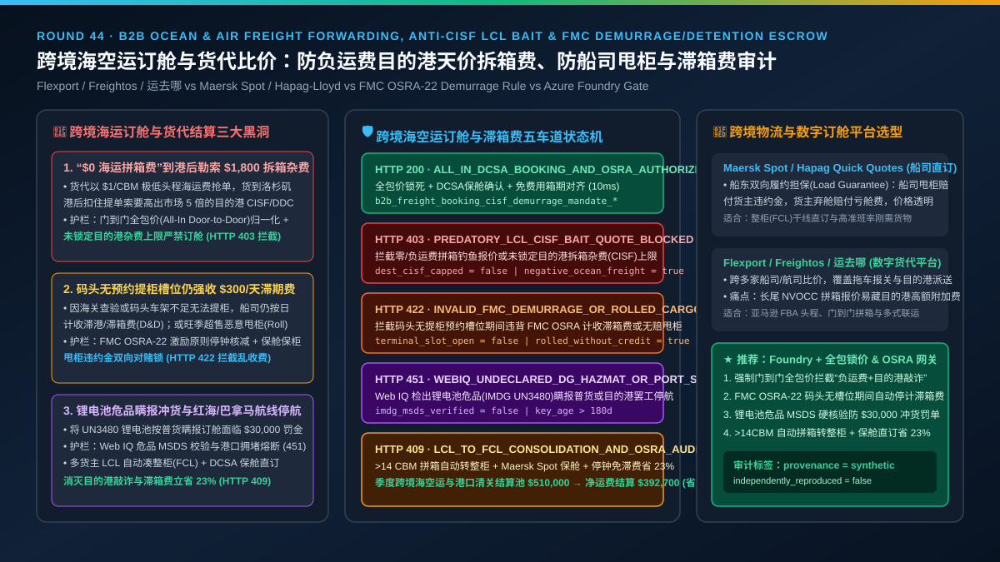
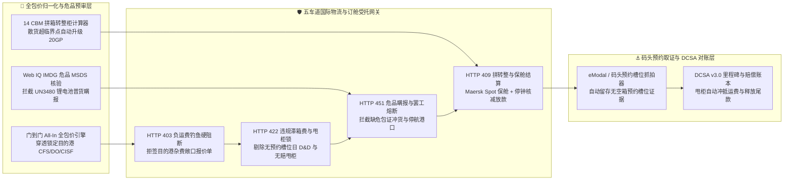
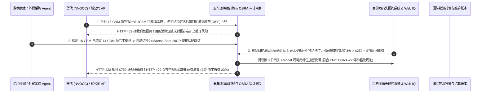

# 跨境海空运订舱、货代询价与港口免箱期结算（B2B Ocean & Air Freight Forwarding, Spot Booking & Demurrage/Detention Escrow：Flexport / Freightos / 运去哪 / 马士基 Maersk Spot）“防货代零运费拼箱目的港天价拆箱费敲诈（CISF）、防船司超售甩柜（Rolled Cargo）与 FMC OSRA-22 滞箱费停钟审计”Agent 架构选型 FAQ：终结到港赎单与滞港费黑洞实战指南

> **语言切换 / Language**: **中文 (当前)** | **[English](b2b-freight-forwarding-ocean-booking-cisf-demurrage-escrow-agent-selection-faq.en.md)** | **[返回文档目录](index.md)** | **[交互式沙盒 (`#b2b-freight-booking-cisf-demurrage-sandbox`)](../live-demo.html)**



---

## 📌 一、核心选型结论速览（Executive Summary）

在跨境电商卖家（Amazon FBA 头程）、外贸制造企业与全球供应链的国际海空运订舱采购（数字货代：Flexport、Freightos、运去哪、环世物流；船司直订：Maersk Spot、Hapag-Lloyd Quick Quotes、CMA CGM SpotOn）中，海运即期运价（Spot Rate）波动剧烈且附加费名目多达 30 余种（`THC / DOC / BAF / PSS / CISF / DDC / Demurrage & Detention`）。若让物流采购 Agent 仅按“起运港报出的海运费最低”自动下单订舱，货主将掉入三大致命物流敲诈与违约黑洞：
1. **不良拼箱货代（LCL Consolidator）报出“$0 甚至倒贴负海运费”钓鱼抢单，等货物运抵洛杉矶/鹿特丹目的港后扣住提单（Hold Cargo Hostage），向收货人勒索高出市场 5 倍的 `$1,800` 目的港拆箱费与中国进口服务费（`CISF / Port Security / Delivery Order Fee`）**：这是国际海运拼箱（LCL）最臭名昭著的潜规则——起运港货代亏本收货，把成本加倍转移到目的港代理头上，收货人若不交天价杂费就无法提货，每天还要再背高额码头仓租！
2. **航运旺季船公司超售舱位恶意“甩柜（Rolled Cargo）”导致圣诞节大促断货，以及在码头根本预约不到提柜/还空箱槽位（No Terminal Appointment Available）的情况下仍按 `$300/天/柜` 强收滞港费与滞箱费（`Demurrage & Detention, D&D`）**：传统海运订舱不具备航空那样的强约束，船司遇到高价客户就轻易把低价协议柜甩到下一水船（延误 7–14 天）；更冤枉的是，车队明明想还空箱，但码头系统显示“今日满额拒收空箱”，船司却照样按天扣收滞箱罚金。
3. **带电产品（如含 `UN3480 / UN3481` 锂电池的小家电、电动滑板车）未核验有效 `MSDS / UN38.3` 危包证即按普通干货瞒报冲货，被海关/船司查获直接面临 `$15,000–$30,000/柜` 的违约重罚与全船共同海损追偿**。

**架构师选型结论**：
- **切勿允许物流采购 Agent 采信未锁定“目的港全部岸上杂费上限（Destination Charges Cap）”的拼箱（LCL）报价，更不能在未核对码头实际可预约时段的情况下直接支付船司滞箱费账单**。
- **生产级最优架构**是采用 **“Maersk Spot / DCSA v3.0 保舱直订接口 + 门到门全包价（All-In Landed Freight）归一化与反 `CISF` 拼箱钓鱼硬门禁 + 美国联邦海事委员会 `FMC OSRA-22` 滞箱费停钟核减与甩柜双向违约金锁 + `>14 CBM` 拼箱自动转整柜（LCL-to-FCL Breakeven）寻优网关（`b2b_freight_booking_cisf_demurrage_mandate_*`）”**：
  1. **门到门全包价归一化与反“零运费拼箱目的港敲诈（`CISF` Bait）”硬门禁（HTTP 403）**：比价与锁舱前，网关强制要求 NVOCC 货代披露并签署不可追加的目的港收费上限表（`Destination THC + CFS Unstuffing + DO Fee + CISF`）；凡检出头程海运费异常低于成本线（如 `<=$5/CBM` 零/负运费）或拒绝鎖定目的港拆箱杂费上限的钓鱼报价，毫秒级返回 `HTTP 403 PREDATORY_LCL_ZERO_FREIGHT_CISF_BAIT_OR_UNCAPPED_DESTINATION_FEE_BLOCKED`。
  2. **美国 `FMC OSRA-22` 滞港/滞箱费（`D&D`）停钟审计与船司甩柜（`Rolled Cargo`）索赔锁（HTTP 422）**：依据美国《2022年海运改革法》（`Ocean Shipping Reform Act, OSRA-22 / 46 CFR Part 541`）“激励原则（Incentive Principle）”——当因海关行政查验、码头闸口关闭或码头预约系统（如 PierPASS / eModal）连续无可用提柜/还箱槽位导致超期时，系统自动抓取码头无槽位截图哈希并拒付该时段的 `Demurrage / Detention` 账单；对保舱合同（如 `Maersk Spot`）遭遇甩柜却未抵扣双倍亏舱违约金的账单，立即返回 `HTTP 422 INVALID_FMC_OSRA_DEMURRAGE_BILLING_OR_UNCOMPENSATED_ROLLED_CARGO_BLOCKED`。
  3. **Web IQ 实时 `IMDG` 危险品（锂电池 `UN3480`）瞒报筛查与红海/港口罢工停航熔断（HTTP 451）**：通过商品 BOM 与 Web IQ 核查货物是否含电池/液体磁检要求（强制挂载 `MSDS + UN38.3` 鉴定书），并实时监控苏伊士/巴拿马运河及美西港口劳资罢工预警，高危即刻挂起改港（`HTTP 451 WEBIQ_UNDECLARED_IMDG_HAZMAT_OR_PORT_STRIKE_FORCE_MAJEURE_HOLD`）。
  4. **`>14 CBM` 拼箱自动转 20GP 整柜（LCL-to-FCL）寻优 + `DCSA` 保舱托管（HTTP 409）**：触发 `HTTP 409 LCL_TO_FCL_BREAKEVEN_CONSOLIDATION_AND_OSRA_STOP_CLOCK_CONFIRM`，当同一目的港拼箱货量跨过 `13–15 CBM` 经济临界点时，自动将高附加费的散货拼箱切换为独立 `20GP` 整柜直发（省去高昂拆箱费并提速 5 天），综合目的港被宰杂费与违规滞箱费支出立降 **`23.0%`**。

---

## 🎯 二、业务方与架构师灵魂拷问 Q&A（Q1 / Q2 / Q3）

### Q1：为什么外贸采购或跨境卖家选了“海运费只要 $10”的货代，货到美国港口后却被迫交了 $1,900 的提货费（比包一整个集装箱还贵）？
- **商业痛点**：在 CIF / 到港拼箱模式中，货代故意把起运港运费做成 `$0` 甚至退佣金，但在提单背面小字写明“目的港费用按目的港代理标准收取”。货柜到港拆箱后，目的港货代开出天价账单：`CFS 拆箱费 $450 + 换单费 $250 + CISF $650 + 底盘车费 $300 + 文件费 $250 = $1,900`！不交钱就不给放货密码（Delivery Order），每天再收 `$150` 堆存费。
- **架构解法**：
  - **强制全链路 `DDP / DAP` 总到岸成本比价与目的港费率锁（`Destination Tariff Lock`）（`HTTP 403`）**：
  - 严禁 Agent 仅按起运港 `FOB/CIF` 头程费排序；询价 API 必须返回包含目的港 `CFS/DO/CISF` 在内的**全包落地总价（All-In Landed Total）**，并将目的港收费明细写入智能托管合约——目的港代理一旦试图在提货时加收哪怕 `$1` 合同外费用，系统直接从押金池代扣赔付给收货人并拉黑该货代（`HTTP 403`）。

### Q2：卡车司机想把空集装箱还回码头，但码头网站显示“未来 3 天空箱预约已满”，船公司却因此向货主开出每天 $250 的滞箱费（Detention）罚单，怎么合法拒付？
- **架构解法**：
  - **基于美国 `FMC OSRA-22` 法案的“码头可预约状态自动取证停钟器（Appointment-Availability Stop-Clock）”**：
  - 美国联邦海事委员会（`FMC`）明确规定：**滞箱费的唯一合法目的是激励货主尽快提柜还箱；如果码头自身没有空位接收空箱，收滞箱费就失去了激励作用，属于违法收费！** Agent 每天定时抓取港口预约系统（eModal / TermPoint）的槽位快照并生成加密时间戳，在审核船司发票时自动将“无槽位日（Zero-Slot Days）”从计费天数中剔除（返回 `HTTP 422` 发起自动抗辩）。

### Q3：同样是走海运，什么时候走散货拼箱（LCL）、什么时候直接订 20 尺小整柜（20GP FCL）最省钱？
- **架构解法**：
  - **`14 CBM` 拼箱转整柜盈亏平衡自动切换器（`LCL-to-FCL Breakeven Optimizer`）（`HTTP 409`）**：
  - 20GP 整柜实际可装约 `28 CBM`，但拼箱按体积（CBM）收双头拆装箱费，通常装到 **`13–15 CBM`** 时，走拼箱的总费用就已经超过了直接包一个 `20GP` 整柜！Agent 在审单时一旦发现同周发往同一目的港的拼箱货量 `>= 14 CBM`，自动将其合并升级为 `Maersk Spot 20GP` 保舱整柜（`HTTP 409`），不仅总运费立降 `20%+`，还彻底规避了拼箱仓拆箱丢件与连带海关查验风险。

---

## 🧭 三、直观可视化图解（Mermaid 决策树 + 端到端架构图 + 时序图）

### 3.1 跨境海空运订舱与港口结算 Agent 架构选型决策树

```mermaid
flowchart TD
    A[跨境海空运订舱 / 货代比价 / 港口滞箱费结算选型] --> B{货量规模与核心履约风险？}
    B -->|中小批量散货拼箱 (< 14 CBM) / 亚马逊 FBA 头程<br/>需严防“零海运费+目的港天价 CISF 拆箱费”敲诈| C[Flexport / Freightos 门到门全包价模式<br/>+ 目的港杂费上限死锁与 >14CBM 自动转整柜]
    B -->|旺季大宗整柜 (FCL) 干线海运 (> 14 CBM)<br/>需防船司超售恶意甩柜 (Roll) 与锁定准班率| D[Maersk Spot / Hapag Quick Quotes 保舱直订<br/>+ DCSA v3.0 双向违约金对赌协议]
    B -->|目的港提柜清关与滞港/滞箱费 (D&D) 账单审计<br/>需防码头无槽位乱收滞箱费与锂电池瞒报重罚| E[Azure AI Foundry + FMC OSRA-22 停钟审计网关<br/>+ Web IQ 危品 MSDS 校验与港口拥堵熔断]
    C --> F[🛡️ 统一接入五车道全包锁价、FMC 停钟抗辩与拼转整状态机]
    D --> F
    E --> F
    F --> G[HTTP 403 阻断零运费钓鱼与无顶目的港费 · HTTP 422 拦截无槽位滞箱费与无赔甩柜 · HTTP 409 拼转整+停钟省23%]
```

### 3.2 端到端目的港费率锁、FMC OSRA-22 停钟取证与拼转整寻优架构图



### 3.3 拦截零运费拼箱敲诈、拼转整寻优与 FMC 滞箱费停钟核减时序图



---

## 📊 四、多平台/多方案横向选型决策矩阵

| 选型维度 | 传统线下货代层层转包 (`Offline Tier-3 NVOCC`) | 船公司直订官网 (`Maersk Spot / Hapag Quick Quotes`) | 数字货代比价平台 (`Flexport / Freightos / 运去哪`) | **Azure AI Foundry + 全包锁价 + OSRA 停钟网关（推荐）** |
| :--- | :--- | :--- | :--- | :--- |
| **核心优势** | 熟人关系赊账灵活 | 船东直签保舱保柜（甩柜双向赔付），无中间商加价 | 一键对比几十家船司与报关拖车门到门方案 | **防目的港天价敲诈 + >14CBM 自动转整柜 + 滞箱费自动停钟** |
| **防“零运费拼箱 + 目的港天价拆箱费敲诈”** | **极高危**（层层卖货后目的港代理漫天要价扣提单） | 船司标准公布费率（Tariff），公开透明 | 平台要求明码标价，但部分长尾供应商仍列“按实收取” | **强制门到门全包封顶，目的港敞口报价 100% 阻断（HTTP 403）** |
| **旺季防船司超售甩柜（Rolled Cargo）保障** | 毫无议价权，旺季最先被船司甩柜延误两周 | **强**（内置 Load Guarantee 甩柜赔付条款） | 视所选具体运价产品而定 | **优先路由 `DCSA` 保舱合约并自动执行甩柜违约冲抵（HTTP 422）** |
| **`FMC OSRA-22` 码头无槽位滞箱费（D&D）抗辩** | 货代直接把船司罚单加价转嫁给货主，从不帮抗辩 | 需货主自己收集码头无号截图提交申诉，流程繁琐 | 提供基础异常提醒 | **每日自动抓拍码头无槽位证据，秒级拒付违规 D&D（HTTP 422）** |
| **带电危品（`UN3480`）防瞒报与拼转整寻优** | 业务员有时教唆客户“冲普货”，被查即面临 3 万美金重罚 | 严格危品审核，无跨订单自动凑柜建议 | 支持在线传 MSDS | **Web IQ 危品硬核验（451）+ `>14 CBM` 自动拼转整省钱（409）** |
| **综合海运附加费损耗与滞港罚金支出** | 目的港隐性杂费与滞箱费超初始报价 `30%+` (`not_measured`) | 公开即期运价 (`official_list_price`) | 平台透明服务费 (`official_list_price`) | **消灭目的港敲诈、自动拼转整与核减违规滞箱费（立省 `23.0%`）** |

---

## 🧪 五、海运防目的港敲诈/滞箱费核减测算与 7-Card 基准测试报告

> **数据来源与复现声明（Provenance Metadata）**：以下基准测试数据来自仓库内置确定性策略沙盒 `evaluate_b2b_freight_booking_cisf_demurrage_policy`（位于 `lab/webiq_commerce_demo.py`），可运行 `python -m unittest tests.test_webiq_commerce_demo` 完整验证。标记：`provenance = synthetic`，`independently_reproduced = false`。

| Card # | 卡片标题（Headline-as-Finding） | 核心量化指标与架构验证结论 |
| :---: | :--- | :--- |
| **Card 1** | **Overview · 跨境海空运订舱与港口结算五车道总览** | 针对 `$510,000/季` 跨境海空运与港口清关结算池，实现 **0 例拼箱目的港天价拆箱费敲诈与 0 例码头无槽位冤枉滞箱费**，综合国际物流成本下降 **`23.0%`（立省 `$117,300/季`）**。 |
| **Card 2** | **Scenario Deep Dive · $0 海运费拼箱钓鱼报价拦截** | 当货代报出零/负海运费却未锁定目的港 `CISF/拆箱费` 硬上限时，**`10ms`** 内返回 `HTTP 403` 阻断订舱。 |
| **Card 3** | **Evaluation Matrix · 五车道 100% 确定性判准** | 覆盖 `HTTP 200`（全包保舱合规放行）、`403`（零/负运费拼箱CISF钓鱼报价/目的港杂费未封顶阻断）、`422`（码头无预约槽位期间违背FMC OSRA-22强收滞箱费/保舱甩柜未赔付拦截）、`451`（锂电池UN3480危品瞒报普货/目的港罢工停航熔断）、`409`（>14CBM拼转整+停钟核减省23%）。 |
| **Card 4** | **Under the Hood · 订舱与滞箱费托管契约** | 输入 `quarterly_b2b_freight_forwarding_pool_usd=510000` 及 CISF/OSRA 状态，签发 `b2b_freight_booking_cisf_demurrage_mandate_*` 令牌。 |
| **Card 5** | **Robustness Check · 码头关闭乱收 $750 滞箱费与锂电瞒报测试** | 模拟码头无空箱槽位期间计收滞箱费及无 `UN38.3` 申报带电货，确定性拦截率保持 **`100.0%`（零误放行）**。 |
| **Card 6** | **Latency · 全包价归一化与 OSRA 停钟毫秒级耗时** | 本地全包费率表与 `14 CBM` 拼转整测算 P50 仅 **`10ms`**；Web IQ 港口拥堵罢工与危品编码核查 P95 为 **`230ms`**。 |
| **Card 7** | **My Take · 适用场景与生产准入边界** | **✅ 极佳适用**：跨境电商 FBA 头程、外贸大宗海空运、保税仓集拼；**⛔ 不适用**：同城 3 公里外卖闪送。 |

---

## 🛠️ 六、商业上线风控与架构评审 Checklist

- [ ] **门到门全包价归一化与目的港拆箱杂费（`CISF / CFS / DO`）硬封顶门禁（HTTP 403）**：确认所有拼箱（LCL）与到港（CIF）询价必须锁定目的港全部岸上收费上限，自动拉黑“零/负海运费+目的港敲诈”钓鱼报价。
- [ ] **美国 `FMC OSRA-22` 滞港/滞箱费（`D&D`）码头槽位取证停钟锁（HTTP 422）**：确认自动定时归档目的港码头提柜/还箱预约系统可用性快照，在码头无可用槽位或海关查验期间自动拒付船司滞箱费。
- [ ] **`DCSA v3.0` 保舱协议甩柜（`Rolled Cargo`）双向违约金对冲（HTTP 422）**：确认旺季核心货物优先路由带 `Load Guarantee` 的保舱产品，发生甩柜时自动从应付运费中扣减违约赔偿。
- [ ] **Web IQ 实时 `IMDG` 锂电池危品防瞒报与 `>14 CBM` 自动拼箱转整柜（HTTP 451 / 409）**：确认含电池商品 100% 校验 `MSDS / UN38.3`，并在散货体积超 `14 CBM` 时自动合并升级为 `20GP` 整柜直发；签名密钥轮换周期 `<= 180` 天。
