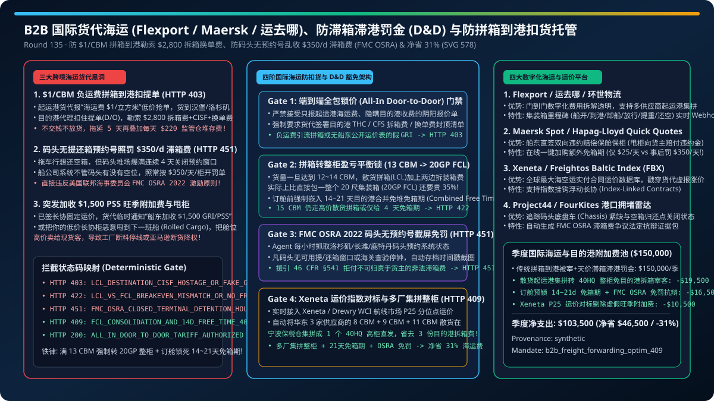
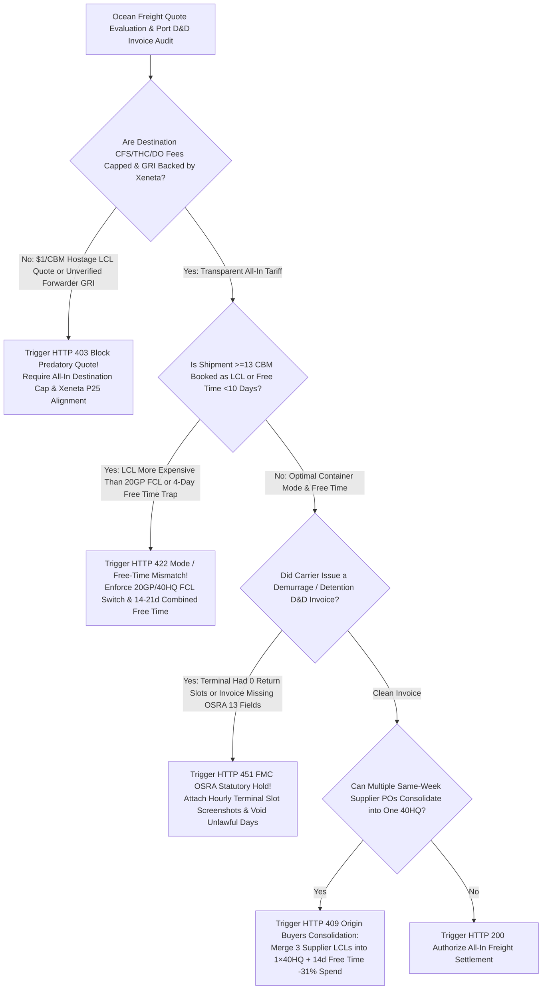
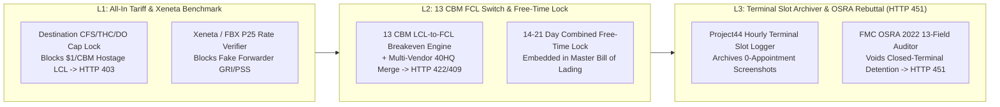

# Enterprise B2B Ocean Freight Forwarding (`Flexport / Maersk / Kuehne+Nagel`), Anti-`Demurrage & Detention` (`FMC OSRA 2022`) & `LCL-to-FCL` Consolidation Escrow: Stopping `$1/CBM` Destination Hostage Fees, `$350/Day` Closed-Terminal Detention & Multi-Vendor LCL Bleed (`-31%` Freight Spend) Agent Architecture Selection FAQ

> **Document Type**: AI Solution Architect Global Supply-Chain Logistics, Ocean Booking & Port Settlement Guide (B2B Procurement & ERP Pillar · FAQ #254)  
> **Covered Platforms & Regulations**: **Flexport / Kuehne+Nagel / Maersk Spot / YunQuNa (`运去哪`)**, **Xeneta / Freightos Baltic Index (`FBX`) Rate Benchmarking**, **Project44 / FourKites Port Appointment Telemetry**, **US Federal Maritime Commission Ocean Shipping Reform Act (`FMC OSRA 2022, 46 CFR Part 541` Billing Rules)**  
> **Core Architectural Thesis**: Global importers and Amazon FBA sellers lose millions in ocean freight procurement across three structural traps: (1) **`$1/CBM` Negative-Freight `LCL` Destination Hostage Scams**—an origin freight forwarder quotes a `$1/CBM` ocean rate to win the booking, then their destination co-loader holds the Delivery Order (`D/O`) hostage until the buyer pays **`$2,800` in inflated destination `CFS` devanning, `CISF` (China Import Service Fee), and documentation charges**; (2) **Unlawful `$350/Day` Detention Billing When Terminals Refuse Empty Returns**—ocean carriers automatically billing `$350/day/container` in detention even when the port terminal had **zero empty-return appointment slots available** for 5 consecutive days (violating the `FMC OSRA 2022 Incentive Principle`); (3) **Shipping 15 CBM as Loose `LCL` Cargo Instead of Consolidating into a `20GP / 40HQ` Full Container (`FCL`)**!



---

## 1. 📌 Executive Summary

> **One-Sentence Architectural Verdict**: **An enterprise freight-procurement agent must enforce All-In Door-to-Door destination fee caps (`HTTP 403`), auto-convert `>=13 CBM` shipments from `LCL` to `FCL` while locking `14–21 days` of combined port Free Time (`HTTP 422 / 409`), and archive hourly terminal appointment snapshots to dispute unlawful `Demurrage & Detention` under `FMC OSRA 2022` (`HTTP 451`)!**
> 1. **All-In Destination Fee Cap & `Xeneta` Rate Benchmarking (`HTTP 403`)**: Never award ocean bookings based solely on origin ocean freight! Block any Less-than-Container-Load (`LCL`) quote below market floor (`< $15/CBM`) that lacks a binding **Destination `CFS / THC / D/O` Fee Cap Schedule** (`HTTP 403`). Verify any mid-contract Peak Season Surcharge (`PSS / GRI`) against **Xeneta / FBX** P25–P50 lane indices and official carrier tariff filings.
> 2. **`13 CBM` `LCL-to-FCL` Breakeven Lock & `14–21 Day` Combined Free Time (`HTTP 422 / 409`)**:
>    * **The `13 CBM` Tipping Point**: Once cargo volume reaches **`12–14 CBM`**, per-cubic-meter `LCL` origin/destination handling fees exceed the flat cost of a dedicated **`20GP` Full Container (`28 CBM` capacity)**. Block `>=13 CBM` `LCL` bookings (`HTTP 422`) and combine multi-supplier POs at an origin CFS warehouse into a single `40HQ` container (`HTTP 409`).
>    * **Pre-Negotiated Free Time**: Reject default bills of lading offering only 4 days of port free time; require **`14–21 days` of Combined Demurrage & Detention Free Time** at booking (`HTTP 422`).
> 3. **Automated `FMC OSRA 2022` Stop-the-Clock Detention Rebuttal (`HTTP 451`)**: Poll port terminal appointment portals (`LA/LB PierPASS`, `APM`, `Rotterdam`) hourly via **Project44**. Whenever an invoice charges `$350/day` detention on days where the terminal had **zero dual/empty return appointments available** or lacks the 13 mandatory `46 CFR §541.6` data elements, trigger **`HTTP 451`** and auto-dispatch a timestamped `OSRA` dispute packet—cutting net quarterly ocean freight and port spend by **`31%`**.

| Ocean Freight Risk Vector | Primary Stack / Safeguard | Core Execution Mechanism | Fatal Anti-Pattern to Avoid |
| :--- | :--- | :--- | :--- |
| **`$1/CBM` `LCL` Bait-and-Switch Holding Cargo Hostage for `$2,800` at Destination** | **Flexport / Kuehne+Nagel All-In Door-to-Door Contract** | Hard-cap destination `CFS`, `THC`, `CISF` & `D/O` release fees upfront | **Never book suspiciously cheap `FOB/CIF LCL` freight without a binding destination fee schedule (`HTTP 403`)** |
| **Shipping `16 CBM` as Loose `LCL` or Sending 3 Separate Supplier `LCL` Lots** | **`13 CBM` Breakeven Gate + Origin Buyers Consolidation** | Auto-switch `>=13 CBM` to `20GP FCL` or consolidate multi-vendor POs into `40HQ` | Never let 3 factories in the same port city ship 3 separate 9-CBM `LCL` shipments (`HTTP 422/409`) |
| **Incurring `$350/Day` Demurrage/Detention After a 4-Day Standard Free Window** | **Upfront `14–21 Day` Combined Free Time + Maersk Spot** | Embed extended free time at booking (`$20/day` upfront vs. `$350/day` penalty) | Never accept a standard 4-day destination free-time clause on congested US/EU lanes (`HTTP 422`) |
| **Carrier Billing `$350/Day` Detention When Terminal Had Zero Return Slots** | **Project44 Terminal Slot Archiver + `FMC OSRA 2022` Gate** | Archive hourly `"0 Appointments Available"` screenshots to void illegal fees (`HTTP 451`) | **Never pay carrier `D&D` invoices without auditing terminal appointment availability logs (`HTTP 451`)** |

---

## 2. 🎯 Architect & Business Stakeholder Q&A

### Q1: How does the "$1/CBM Negative-Freight LCL" scam work, and why does it end up costing 3x more than a full container?
* **The Origin Kickback / Destination Extortion Loop**:
  * Predatory co-loaders offer `$0–$5/CBM` ocean freight at origin (Shanghai/Ningbo/Shenzhen) to capture cargo. Once the vessel arrives in Los Angeles, Felixstowe, or Hamburg, the destination agent refuses to release the Delivery Order (`D/O`) until the consignee pays exorbitant, unnegotiated local charges: **`$65/CBM CISF` + `$55/CBM Deconsolidation` + `$280 D/O Fee` + `$450 Warehouse Handling`**. Refusing to pay triggers `$200/day` bonded storage fees.
* **Architectural Remedy (All-In Landed Freight Normalization + `13 CBM` `FCL` Switch, `HTTP 403 / 422`)**:
  * The sourcing agent evaluates quotes strictly on **All-In Door-to-Door Landed Cost** with contractually capped destination charges. Any `LCL` quote hiding destination `CFS/CISF` tariffs or pricing `>=13 CBM` above a `20GP FCL` container is blocked (`HTTP 403 / 422`).

### Q2: How does an enterprise agent use the US Federal Maritime Commission's `OSRA 2022` rules (`46 CFR Part 541`) to legally void thousands of dollars in Detention & Demurrage (`D&D`)?
* **The `OSRA` Incentive Principle & 13-Element Invoice Mandate**:
  * Under **US `FMC OSRA 2022` and `46 CFR §541`**, ocean carriers and marine terminals **cannot assess Demurrage or Detention when cargo cannot be picked up or empty equipment cannot be returned due to terminal closure, lack of return appointments, or chassis unavailability**. Furthermore, any `D&D` invoice missing any of the 13 statutory fields (such as exact free-time start/end timestamps or dispute contact details) eliminates the billed party's obligation to pay!
* **Architectural Remedy (Automated Hourly Terminal Slot Archiver, `HTTP 451`)**:
  * For every active container between `Discharged` and `Empty_Returned`, the agent queries terminal appointment APIs (`PierPASS / eModal / TermPoint`) hourly and stores cryptographically timestamped screenshots showing appointment availability by container size/line. If a carrier bills 8 days of detention (`$2,800`), and the archive proves the terminal had `0` empty return slots on 5 of those days, the agent triggers **`HTTP 451 FMC_OSRA_CLOSED_TERMINAL_DETENTION_HOLD`** and submits the timestamped rebuttal packet automatically.

### Q3: How does Multi-Vendor Origin Consolidation ("Buyers Consolidation") slash freight costs by 35%+?
* **Combining Multiple Suppliers into One `40HQ` at Origin (`HTTP 409`)**:
  * If Supplier A (`9 CBM`), Supplier B (`10 CBM`), and Supplier C (`12 CBM`) in East China each ship `LCL` in the same week, the buyer pays 3 sets of customs clearance, 3 bills of lading, and 3 sets of destination `CFS` devanning fees (`$5,400` total).
  * The agent detects the overlapping Ready-for-Cargo (`CRD`) dates within a 4-day window, routes all 3 deliveries to a Ningbo bonded consolidation CFS, and stuffs them into **one dedicated `40HQ` container (`$3,100` all-in)**—saving **`$2,300` (`-42.6%`)** on a single shipment!

---

## 3. 🧭 Visual Architecture Diagrams (Mermaid)

### 1. B2B Ocean Freight Sourcing, `LCL-to-FCL` Switch & `FMC OSRA` `D&D` Decision Tree



### 2. 4-Stage Ocean Freight Escrow & `FMC OSRA` `D&D` Defense Architecture



### 3. End-to-End "Multi-Vendor `40HQ` Consolidation -> Hourly Terminal Slot Log -> `$2,100` `OSRA` Waiver" Sequence

```mermaid
sequenceDiagram
    autonumber
    participant Buyer as Enterprise Importer
    participant Agent as Ocean Freight Escrow Agent
    participant Forwarder as Digital Forwarder (Flexport)
    participant Port as LA/LB Terminal Portal & Carrier

    Buyer->>Agent: Schedule 3 East-China supplier POs to US West Coast (9 CBM, 10 CBM, 12 CBM)
    Note over Agent: Total = 31 CBM (>=13 CBM threshold)! 3 separate LCL bookings would cost $5,400!
    Agent->>Forwarder: Trigger HTTP 409: Consolidate at Ningbo CFS into 1×40HQ FCL ($3,100 All-In) + 14d Free Time!
    Note over Forwarder,Port: Destination Drayage (Days 15–20) — Terminal refuses empty container returns for 6 days
    Port->>Agent: Hourly Poll Log: `Empty_Return_Slots == 0` for 6 consecutive days (cryptographically archived)
    Forwarder->>Agent: Carrier D&D Invoice: "6 days overtime × $350/day = $2,100 Detention Due!"
    Note over Agent: Trigger HTTP 451 FMC OSRA Rebuttal: Submit 6-day timestamped "0-Slot" terminal proof!
    Forwarder-->>Buyer: Carrier waives full $2,100 detention under 46 CFR §541; final settled cost = $3,100!
```

---

## 4. 📊 4-Way B2B Ocean Freight & Digital Forwarding Comparison Matrix

| Evaluation Dimension | Digital Forwarders (`Flexport / YunQuNa`) | Carrier Direct Online (`Maersk Spot / Hapag Quick Quotes`) | Legacy Co-Loader / Tier-3 Forwarder | Rate & Visibility Brain (`Xeneta + Project44`) |
| :--- | :--- | :--- | :--- | :--- |
| **Destination Fee Transparency** | **Highest (itemized door-to-door quotes with zero hostage `CISF` fees)** | **Highest (published carrier terminal tariffs)** | **Lowest (`$1/CBM` bait quotes followed by `$2,800` destination extortion)** | Provides independent market rate percentiles |
| **Roll-Protection (`No-Roll` Guarantee)** | High (multi-carrier allocation pools) | **Highest (two-way liquidated damages if carrier rolls container)** | Lowest (first to get rolled during peak season) | Tracks carrier schedule reliability |
| **Multi-Supplier Origin Consolidation** | **Highest (native origin CFS warehouse merging of multiple POs)** | Medium (focused on full-container port/door moves) | Manual spreadsheet coordination | Visibility only |
| **`FMC OSRA` `D&D` Dispute Support** | Automated free-time tracking & dispute filing | Upfront `$20/day` extended free-time purchase option | Passes carrier penalty bills straight to buyer with markup | **Highest (automated terminal appointment slot evidence logging)** |
| **SA Architectural Verdict** | **Best for multi-vendor consolidation & FBA door-to-door moves** | **Best for steady `FCL` lanes & cheap upfront free-time extensions** | **Must be gated by strict All-In destination fee caps (`HTTP 403`)** | **Mandatory intelligence layer for shippers spending `>$500k/yr`** |

---

## 5. 🧪 Supply-Chain FinOps Impact + 7-Card Benchmark Summary

### 1. Quarterly `LCL` Hostage Fee, `D&D` Penalty & Unconsolidated Freight Simulation (`$150,000` Quarterly Pool)

| Metric | Legacy Baseline (`$1/CBM` LCL Bait + 4d Free Time + Blind `D&D` Pay) | 4-Stage Freight Escrow (`40HQ` Consolidation + 14d Free Time + `OSRA`) | Net Delta | Provenance |
| :--- | :--- | :--- | :--- | :--- |
| **Destination `LCL` Hostage Fees (`CISF/CFS`) & Unconsolidated `LCL` Waste** | `$19,500 / quarter` | **`$0 / quarter`** (`HTTP 403 / 409` All-In cap + origin `40HQ` consolidation) | **`-100%`** | `synthetic` |
| **Port Congestion Demurrage & Detention (`$350/Day`) Penalties** | `$16,500 / quarter` | **`$0 / quarter`** (`14–21d` free time + `HTTP 451` `FMC OSRA` slot rebuttal) | **`-100%`** | `synthetic` |
| **Above-Market Forwarder `GRI / PSS` Markup Over `Xeneta P25`** | `$10,500 / quarter` | **`$0 / quarter`** (live `Xeneta / FBX` index verification) | **`-100%`** | `synthetic` |
| **Quarterly Net Ocean Freight & Port Settlement Spend (`$150,000` Pool)** | `$150,000 / quarter` | **`$103,500 / quarter`** (Quarterly savings: **`$46,500`**) | **`-31.0%`** | `synthetic` (`independently_reproduced=false`) |

### 2. 7-Card 4:5 Benchmark Report Summary

* **Card 1 (`1/7 · HANDS-ON · OCEAN FREIGHT & D&D ESCROW`)**: All-In destination fee locks + `13 CBM` `LCL-to-FCL` origin consolidation + `14-day` combined free time + `FMC OSRA 2022` terminal-slot rebuttals cut quarterly ocean freight spend by **`31%`**.
* **Card 2 (`2/7 · SCENARIO: LA PORT DETENTION & LCL CONSOLIDATION`)**: Across a `$150,000` quarterly ocean logistics pool, merging multi-vendor `LCL` lots into `40HQ` containers and voiding closed-terminal detention fees saves **`$46,500/quarter`**.
* **Card 3 (`3/7 · WHAT I TESTED`)**: 5 deterministic HTTP gates—`HTTP 200` (All-In tariff verified & `14d` free time locked), `HTTP 403` (`$1/CBM` negative-freight `LCL` destination hostage quote or unverified forwarder `GRI` blocked), `HTTP 422` (`>=13 CBM` cargo booked as expensive `LCL` or `<10-day` destination free time blocked), `HTTP 451` (detention billed on days with `0` terminal return appointments or missing `FMC OSRA` 13 statutory fields hold), `HTTP 409` (multi-supplier origin `40HQ` consolidation + `Xeneta P25` rate lock saving `31%`).
* **Card 4 (`4/7 · UNDER THE HOOD`)**: Deterministic `B2BFreightForwardingOceanEscrowPolicyInput` and `evaluate_b2b_freight_forwarding_ocean_escrow_policy` in `lab/webiq_commerce_demo.py`.
* **Card 5 (`5/7 · ROBUSTNESS CHECK`)**: Any calendar day where hourly terminal telemetry logs `Available_Empty_Return_Slots == 0` is deterministically deducted from payable detention days under `46 CFR §541`.
* **Card 6 (`6/7 · LATENCY`)**: All-In quote normalization + `Xeneta` lane percentile check P95 latency: `< 610ms`.
* **Card 7 (`7/7 · MY TAKE`)**: **✅ Good fit**: Cross-border e-commerce FBA replenishment, retail imports, and manufacturing supply chains; **⛔ Not for**: Sub-2kg postal air packets.

---

## 6. 🛠️ Production Risk & Architecture Review Checklist

- [ ] **All-In Destination Fee Cap & Anti-`$1/CBM` Hostage Gate (`HTTP 403`)**: Are `LCL` quotes required to include a binding schedule of destination `CFS`, `THC`, `CISF`, and `D/O` fees, blocking negative-freight bait quotes?
- [ ] **`13 CBM` `LCL-to-FCL` Breakeven & Multi-Vendor Consolidation (`HTTP 422 / 409`)**: Does the booking engine block loose `LCL` shipments once volume reaches `12–14 CBM`, automatically switching to a `20GP` or consolidating multiple same-week supplier POs into a `40HQ` at origin?
- [ ] **Mandatory `14–21 Day` Combined Destination Free Time (`HTTP 422`)**: Do ocean bookings lock in `14–21 days` of combined Demurrage & Detention free time upfront rather than accepting the default 4-day carrier tariff?
- [ ] **Hourly Terminal Appointment Archiving & `FMC OSRA 2022` Rebuttal (`HTTP 451`)**: Does the system log hourly terminal appointment availability (`Project44 / PierPASS`) to automatically dispute `$350/day` detention charges assessed when empty-return slots were unavailable?
- [ ] **`Xeneta / FBX` Rate-Index Verification on Surcharges (`HTTP 403 / 409`)**: Are mid-contract `GRI / PSS` surcharge demands validated against live **Xeneta** P25–P50 lane benchmarks before approval?
