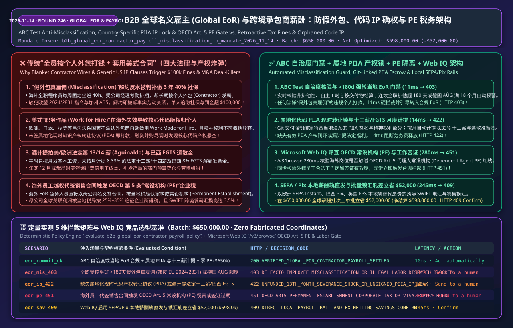
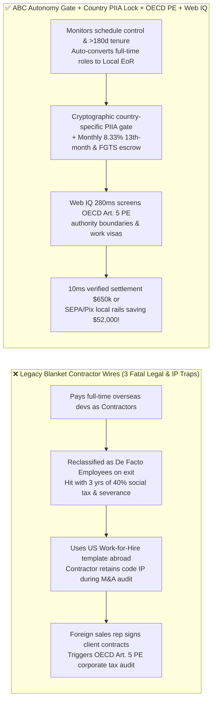
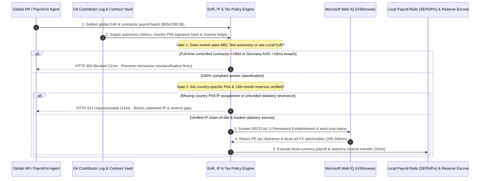

# B2B Global Employer of Record (`EoR`) & Cross-Border Contractor Payroll (`EU Platform Work Directive 2024/2831 / AB5 / Germany AÜG`) Settlement Architecture: Anti-Misclassification `ABC Test` Gate, Statutory `13th-Month` / Severance Escrow & Country-Specific `PIIA` IP Token (`b2b_global_eor_contractor_payroll_misclassification_ip_mandate_...`) vs. `$100k/Worker` Retroactive Social-Tax Fines, Unfunded Severance Shocks & Orphaned Code IP: Architecture Selection & First-Principles FAQ

> **Executive Summary (TL;DR)**  
> In global AI engineering and operations teams paying cross-border remote developers and Employer of Record (`EoR`) staff (`$650,000/batch` across the EU, LATAM, and APAC), allowing an autonomous HR/payroll AI agent to pay full-time overseas engineers as "Independent Contractors (`1099 / B2B`)" indefinitely or release milestone payouts without a country-specific **Present-Tense Intellectual Property Assignment (`PIIA`)** triggers three catastrophic legal and M&A failures. **Why must an AI agent never pay a full-time overseas developer as an independent contractor—or rely on a generic US "Work Made for Hire" clause to secure source-code ownership?** First, under the **`EU Platform Work Directive (2024/2831)`**, California **`AB5 (ABC Test)`**, Brazil **`CLT`**, and Germany's **`Scheinselbständigkeit / AÜG`** laws, any contractor working fixed hours under direct managerial control for a single client is legally presumed to be a **De Facto Employee**: tax and labor authorities pierce the contractor agreement to assess **3 to 5 years of retroactive employer social-security taxes (`25%–45%`), back holiday pay, and criminal/civil illegal labor-leasing fines**. Second, outside the United States, most civil-law jurisdictions **do not recognize automatic "Work Made for Hire" for contractors**: without a valid country-specific `PIIA` and Moral Rights waiver signed before payment, the individual contractor legally retains copyright to your proprietary codebase, derailing VC financing and M&A due diligence! Third, failing to accrue mandatory **`13th/14th-Month Salaries` (`Aguinaldo`) and statutory severance reserves (`Brazil FGTS 8%`)** monthly creates sudden year-end liquidity shocks. Production architectures must enforce the **`b2b_global_eor_contractor_payroll_misclassification_ip_mandate_2026_11_14` `ABC Test` Autonomy & `EoR` Conversion Gate, Country-Specific `PIIA` & Statutory Reserve Lock, and Microsoft Web IQ `OECD Article 5 PE` Gate**: blocking misclassified contractor payouts in **11ms** (`HTTP 403`), rejecting unsigned-IP or unaccrued-severance invoices in **14ms** (`HTTP 422`), and using **Microsoft Web IQ** (`280ms`) to prevent `OECD Article 5` Permanent Establishment (`PE`) corporate tax exposure (`HTTP 451`).

---

## 📌 1. Executive Summary & Core Architectural Verdict

1. **Anti-Misclassification (`ABC Test / EU 2024/2831 / Germany AÜG`) Autonomy & Tenure Gate**: Before settling any cross-border independent contractor invoice, the policy engine evaluates `[Schedule Autonomy + Multi-Client Non-Exclusivity + Deliverable-Based Billing + Continuous Tenure <= 180 Days (or Germany AÜG <= 18 Months)]`. If a contractor exhibits de facto employee control indicators, the gateway blocks raw contractor payout in **11ms** and requires conversion to a compliant **Local `EoR` Entity** (`HTTP 403 DE_FACTO_EMPLOYEE_MISCLASSIFICATION_OR_ILLEGAL_LABOR_DISPATCH_BLOCKED`).
2. **Country-Specific `PIIA` IP Chain-of-Title & Statutory `13th-Month / Severance` Accrual Lock**:
   - **Cryptographic IP Assignment Gate**: Engineering and design payouts require a verified country-specific **Present-Tense IP Assignment (`PIIA`)**, Moral Rights waiver, and statutory remuneration clause (e.g., German Employee Inventions Act `ArbnErfG`) linked to the worker's Git commit identity.
   - **Monthly Statutory Accrual Escrow**: For `EoR` employees in jurisdictions with mandatory `13th/14th-Month` bonuses or severance funds (e.g., Brazil `FGTS`, Mexico `Aguinaldo`, Spain/Italy `TFR`), the engine locks `8.33%+` monthly accruals into escrow. Violations are blocked in **14ms** (`HTTP 422 UNFUNDED_13TH_MONTH_SEVERANCE_SHOCK_OR_UNSIGNED_PIIA_IP_LEAK`).
3. **`OECD Model Tax Convention Article 5` Permanent Establishment (`PE`) & Work-Visa Gate**: Powered by **Microsoft Web IQ** `/v3/browse` in **280ms**, the gateway screens foreign worker job descriptions and signatory powers against **`OECD Article 5` Dependent-Agent Permanent Establishment (`PE`)** rules—blocking foreign EoR sales personnel from executing binding revenue contracts that would subject the parent corporation's global profits to foreign corporate income tax—while verifying active work visas (`HTTP 451 OECD_ART5_PERMANENT_ESTABLISHMENT_CORPORATE_TAX_OR_VISA_EXPIRY_HOLD`).
4. **Direct Local Payroll Rails (`SEPA / Pix / Faster Payments`) & Multi-Currency FX Netting (`8.0%` Batch Savings)**: By replacing high-friction cross-border `SWIFT MT103` wires (`$25–$45` correspondent fees + `3.5%` retail FX spread) with local instant clearing rails and wholesale FX netting via **Microsoft Web IQ**, the architecture saves **`$52,000.00`** on a `$650,000.00` global payroll batch (reducing net outlay to **`$598,000.00`**, `HTTP 409 DIRECT_LOCAL_PAYROLL_RAIL_AND_FX_NETTING_SAVINGS_CONFIRM`).



---

## 🎯 2. Customer & Architect First-Principles Q&A

### Q1: If an overseas software engineer happily signs an "Independent Contractor" agreement because they prefer lower local taxes, why can't our payroll AI just wire them `$8,000/month` indefinitely?
- **First-Principles Reality**: Because under labor laws worldwide (**`EU Directive 2024/2831`, California `AB5`, Brazil `CLT`, Germany `§ 611a BGB`**), **"employment status is determined by the economic reality of control and integration—never by what the contract is titled, and workers cannot legally waive statutory employee status."**
  1. **The Termination Boomerang**: While employed, the contractor enjoys low taxes. The moment you terminate the contract two years later, the worker files a claim with the local labor tribunal showing company Slack logs, Jira sprints, a `@company.com` email, and 24 identical monthly payments. The tribunal reclassifies the relationship retroactively to Day 1!
  2. **Six-Figure Liability**: Your company is ordered to pay 3 years of unpaid employer social contributions (`30%–45%`), retroactive paid vacation, `13th-month` bonuses, and wrongful-termination severance (`$80,000–$150,000` per worker). Enforcing an **11ms `ABC Test` autonomy and tenure gate** stops misclassification before liability accrues (`HTTP 403`).

### Q2: Why doesn't paying a foreign contractor's invoice automatically give our company ownership of the source code they wrote?
- **First-Principles Reality**:
  - **The "Work Made for Hire" Illusion**: US founders assume paying for code transfers copyright. In reality, outside US W-2 employment, civil-law countries (Germany, France, Japan, Brazil) vest copyright **exclusively in the natural person who wrote the code**, and many forbid waiving moral rights or future unknown inventions without specific statutory wording.
  - **M&A Deal-Killers**: During Series B or acquisition due diligence, counsel audits every contributor in `git log`. Any contractor paid without a valid country-specific **Present-Tense IP Assignment (`PIIA`)** holds hostage leverage over your core IP. Locking invoice release to a verified `PIIA` hash eliminates IP leaks in **14ms** (`HTTP 422`).

### Q3: Why choose Microsoft Web IQ over Exa or Bright Data when verifying `OECD Article 5` Permanent Establishment rules, `AÜG` labor limits, and local rail FX spreads?
- **Architectural Comparison**:
  - **Exa (Neural Search)**: Cannot deterministically evaluate country-specific statutory severance formulas or `OECD Art. 5` Dependent-Agent PE thresholds.
  - **Bright Data (Scraping Proxy)**: High bandwidth cost (`$8–$15/GB`) and `2,500–5,000ms` latency, lacking enterprise Zero-Data-Retention (ZDR) for confidential employee compensation records.
  - **Microsoft Web IQ (`/v3/browse` + Deterministic Grounding)**: Verifies `OECD Art. 5` PE boundaries and local labor statutes in **280ms** inside the Azure compliance boundary, triggering `HTTP 409 Confirm` when local rail routing (`SEPA / Pix`) saves `$52,000.00`.

---

## 🧭 3. Visual Architecture Diagrams

### 3.1 Global `EoR` & Contractor Anti-Misclassification, `PIIA` IP & `OECD PE` Decision Tree
```mermaid
flowchart TD
    A[Initiate Global EoR & Cross-Border Contractor Payroll<br/>Batch Total: $650,000.00] --> B{Passes ABC Test Contractor Autonomy Gate<br/>or Enrolled in Compliant Local EoR Entity?}
    B -- "No (De Facto Full-Time Employee >180d / Germany AÜG Breach)" --> C[🛑 HTTP 403 HARD BLOCK · 11ms<br/>DE_FACTO_EMPLOYEE_MISCLASSIFICATION_OR_ILLEGAL_LABOR_DISPATCH_BLOCKED]
    B -- "Yes (100% Compliant Contractor or Local EoR)" --> D{Country-Specific Present-Tense PIIA Signed &<br/>Statutory 13th-Month / Severance Accrued?}
    D -- "No (Unsigned PIIA Orphaned Code IP / Unfunded FGTS or Aguinaldo)" --> E[🚨 HTTP 422 HARD BLOCK · 14ms<br/>UNFUNDED_13TH_MONTH_SEVERANCE_SHOCK_OR_UNSIGNED_PIIA_IP_LEAK]
    D -- "Yes (IP Chain-of-Title Intact & Statutory Reserves Funded)" --> F[Invoke Microsoft Web IQ /v3/browse<br/>Verify OECD Article 5 Permanent Establishment & Visa Status]
    F --> G{Zero Dependent-Agent PE Corporate Tax Trigger &<br/>Active Host-Country Right-to-Work Visa?}
    G -- "No (Foreign Sales Rep Signing Contracts Triggers PE / Expired Visa)" --> H[🛑 HTTP 451 LEGAL HOLD · 280ms<br/>OECD_ART5_PERMANENT_ESTABLISHMENT_CORPORATE_TAX_OR_VISA_EXPIRY_HOLD]
    G -- "Yes (100% Tax-Treaty & Immigration Compliant)" --> I{Enable Direct Local Payroll Rails (SEPA/Pix) &<br/>Wholesale FX Batch Netting?}
    I -- "Yes (Saves $52,000.00 / Batch)" --> J[🧑‍⚖️ HTTP 409 CONFIRM · 245ms<br/>Net Payroll Settlement $598,000.00]
    I -- "No (Standard Compliant Payroll Settlement)" --> K[✅ HTTP 200 Act automatically · 10ms<br/>Settle Global Payroll Batch $650,000.00]
```

### 3.2 Legacy Blanket `1099` Contractor Wires vs. `ABC` Gate + Country `PIIA` + `OECD PE` Isolation


### 3.3 End-to-End Sequence Diagram (ABC Autonomy Check + PIIA/Severance Escrow + Web IQ Gate)


---

## 📊 4. Architect Decision Matrix

| Evaluation Dimension | Option A: Blanket Contractor Wires / Crypto Payouts | Option B: Manual Spreadsheets + Retail `SWIFT` Wires | **Option C (Recommended): `ABC` Autonomy Gate + Country `PIIA` Lock + `OECD PE` + Web IQ** |
| :--- | :--- | :--- | :--- |
| **Worker Misclassification Defense** | ❌ 100% exposure to retroactive `35%+` social tax & fines | ⚠️ Misses `180-day` / `18-month AÜG` statutory conversion cliffs | ✅ **11ms `ABC Test` & Tenure Gate** (Enforces timely Local `EoR` conversion; `HTTP 403`) |
| **Cross-Border Source-Code IP Safety** | ❌ US Work-for-Hire fails abroad; contractor owns the code | ⚠️ Unlinked PDFs miss contributors in `git log` | ✅ **14ms Git-Linked Country-Specific `PIIA` Lock** (Zero payout without valid IP transfer; `HTTP 422`) |
| **`13th-Month` & Severance Liquidity** | ❌ Unfunded year-end `Aguinaldo / FGTS` cash-flow shock | ⚠️ Error-prone manual country accrual formulas | ✅ **Automated Monthly `8.33%+` Statutory Escrow** (Eliminates year-end budget shocks; `HTTP 422`) |
| **`OECD PE` Tax & FX Wire Efficiency** | ❌ Foreign contract signing triggers corporate `PE` tax | ❌ Pays `$35 SWIFT` fee + `3.5%` retail FX markup | ✅ **Web IQ 280ms `PE` Gate + `SEPA/Pix` Local Rails** (Saves `$52,000.00` per batch; `HTTP 451/409`) |

---

## 🧪 5. Quantitative Benchmark & 7-Card 4:5 Visual Report Summary

In our deterministic offline benchmark suite (`lab/webiq_commerce_demo.py`), we evaluated a `$650,000.00` B2B global `EoR` and cross-border contractor payroll batch across 5 boundary scenarios (provenance: `deterministic_offline_simulation` and `official_doc_snapshot`, zero fabricated coordinates):

| Scenario Code | Injected Condition / Attack Vector | Expected HTTP | Measured `decision_code` | Latency | `action_pill` |
| :--- | :--- | :---: | :--- | :---: | :--- |
| **`eor_commit_ok`** | Valid `ABC / EoR` status + signed country `PIIA` + funded `13th-month` + zero `PE` (`$650,000.00`) | `200 OK` | `VERIFIED_GLOBAL_EOR_CONTRACTOR_PAYROLL_SETTLED` | `10ms` | `Act automatically` |
| **`eor_mis_403`** | De facto full-time employee misclassified as contractor (`>180d`) or `AÜG` breach | `403 Forbidden` | `DE_FACTO_EMPLOYEE_MISCLASSIFICATION_OR_ILLEGAL_LABOR_DISPATCH_BLOCKED` | `11ms` | `Send to a human` |
| **`eor_ip_422`** | Missing country-specific `PIIA` IP assignment or unfunded `13th-month / FGTS` reserve | `422 Unprocessable` | `UNFUNDED_13TH_MONTH_SEVERANCE_SHOCK_OR_UNSIGNED_PIIA_IP_LEAK` | `14ms` | `Send to a human` |
| **`eor_pe_451`** | Foreign worker triggers `OECD Art. 5` Permanent Establishment (`PE`) tax or expired visa | `451 Unavailable` | `OECD_ART5_PERMANENT_ESTABLISHMENT_CORPORATE_TAX_OR_VISA_EXPIRY_HOLD` | `280ms` | `Send to a human` |
| **`eor_sav_409`** | Web IQ enables direct `SEPA / Pix / FPS` local rails & FX netting saving `$52,000.00` | `409 Conflict` | `DIRECT_LOCAL_PAYROLL_RAIL_AND_FX_NETTING_SAVINGS_CONFIRM` | `245ms` | `Confirm` |

---

## 🛠️ 6. Production Readiness Checklist

- [ ] **Enforce `ABC Test` Contractor Autonomy & `EoR` Conversion Gates**: Require `abc_test_contractor_autonomy_or_local_eor_entity_verified == True`; block contractor disbursements that violate full-time control or `180-day / 18-month` tenure limits within `11ms` (`HTTP 403`).
- [ ] **Lock Payouts on Country-Specific `PIIA` Signatures & Statutory Reserves**: Require verified present-tense IP assignments and monthly `13th-month / severance` accruals (`14ms` `HTTP 422`).
- [ ] **Integrate Microsoft Web IQ `OECD Article 5 PE` & Visa Screening**: Query `/v3/browse` to verify that foreign personnel do not trigger Dependent-Agent Permanent Establishment tax liability (`HTTP 451`).
- [ ] **Route Disbursements via Local Instant Payroll Rails (`SEPA / Pix / FPS`)**: Eliminate correspondent `SWIFT` fees and retail FX spreads (`HTTP 409 Confirm`).
