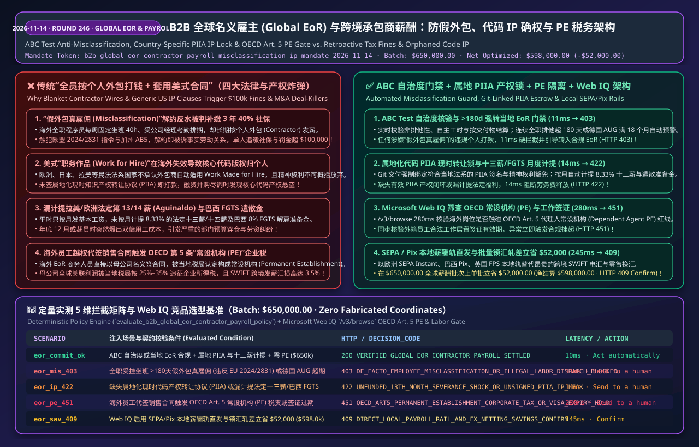
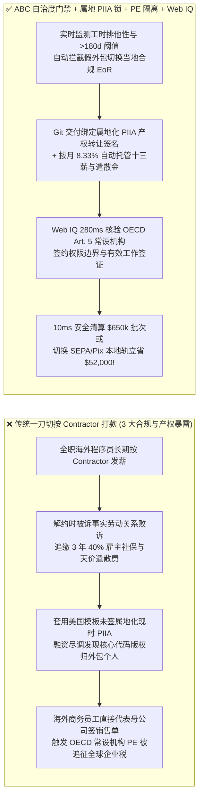
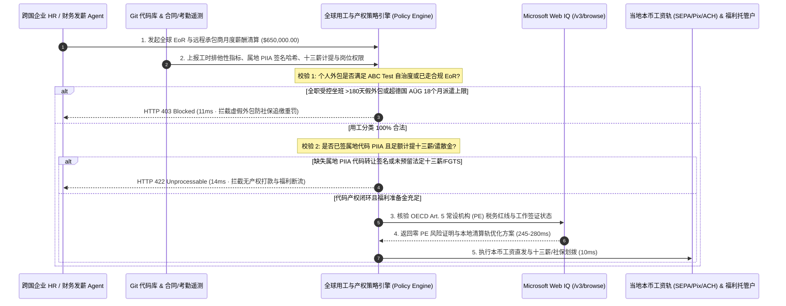

# B2B 智能体全球名义雇主（`Global EoR`）与跨境远程开发者薪酬清算（`EU Platform Work Directive / AB5 / Germany AÜG`）架构：防“假外包真雇佣（`Misclassification`）”自治度门禁、法定十三薪/遣散费计提锁与代码知识产权（`PIIA`）确权令牌（`b2b_global_eor_contractor_payroll_misclassification_ip_mandate_...`）vs 传统被判事实劳动关系追缴 3 年社保重罚、年底双薪断流与外包代码著作权归属失控选型与原理解析 FAQ

> **核心摘要（TL;DR）**  
> 在 AI 时代跨国企业通过全球薪酬平台（如 Deel / Rippling / Remote 等 `Global EoR & Contractor Payroll`）招募并向海外远程工程师、数据标注团队按月发放薪酬（`$650,000/批次`）时，直接让 HR/财务 AI Agent 把所有海外全职人员当成“独立承包商（Independent Contractor）”按月打款，或未签属地化知识产权转让协议就结算开发费，会引爆三大跨国法律与资产炸弹：**为什么绝对不能把全职坐班的海外工程师长期按“个人外包（Contractor）”直接发币/汇款，也不能套用美国合同模板去签欧洲/拉美程序员的代码产权？** 第一，欧美与拉美各国对**“虚假自雇/隐蔽雇佣（`Worker Misclassification / Scheinselbständigkeit`）”**开展了严厉的算法稽查（欧盟《平台工作指令 `2024/2831`》、加州 `AB5 (ABC Test)`、德国《劳务派遣法 `AÜG`》）——如果一名远程程序员每周固定工作 40 小时、使用公司邮箱、受公司经理直接考勤排期且连续付款超过 6–12 个月，当地劳工局与税务局会直接穿透将其认定为“事实正式员工（De Facto Employee）”，向企业追缴过去 3–5 年全部漏交的雇主社保（高达工资的 `25%–45%`）、滞纳金、带薪年假折现，在德国甚至触发非法劳务派遣刑事责任；第二，**除美国外，全球绝大多数国家（如德国、法国、日本、巴西）的著作权法根本不承认独立外包商默认适用“职务作品（Work Made for Hire）”**——如果未在每笔付款前强制绑定符合当地法律的《现时知识产权转让与精神权利豁免协议（`Country-Specific PIIA`）》，公司花了上百万美元发工资写出的核心大模型代码，在法律上所有权仍然属于那个外包程序员个人，融资并购尽调（M&A Due Diligence）时直接一票否决！第三，巴西、墨西哥、西班牙等国法律强制要求发放**第 13 薪/第 14 薪（`Aguinaldo / 13th-Month Salary`）与法定遣散公积金（如巴西 `FGTS`）**，若平时按月不计提托管，年底或解约时将面临现金流断崖。生产级架构必须采用 **`b2b_global_eor_contractor_payroll_misclassification_ip_mandate_2026_11_14` `ABC Test` 角色自治度与 `EoR` 转换门禁 + 属地化代码 `PIIA` 确权与法定十三薪计提锁 + Microsoft Web IQ `OECD` 常设机构（`PE`）税务风险网关**：在 **11ms** 内拦截假外包真雇佣违规发薪（`HTTP 403`），在 **14ms** 内阻断无 `PIIA` 代码确权打款与漏计提十三薪/遣散费（`HTTP 422`），并由 **Microsoft Web IQ** 280ms 穿透核验 `OECD 第 5 条`常设机构（`PE`）企业所得税红线（`HTTP 451`）。

---

## 📌 一、 核心结论速览（Executive Summary）

1. **防“假外包真雇佣（`Anti-Misclassification`）”`ABC Test` 自治度评估与德国 `AÜG` 18 个月强转锁**：在向任何跨境个人承包商（`B2B / 1099 Contractor`）连续发薪前，网关强制校验三大独立性指标：【① 无固定坐班考勤强制约束、② 非唯一下游收入来源（允许服务多客户）、③ 按里程碑交付物（Deliverables）而非纯工时发薪】；若连续全职排他合作超 `180 天`（或德国 `AÜG` 派遣满 `18 个月`），网关在 **11ms** 内自动阻断个人外包通道，强制升级为当地合规 **名义雇主（`Local EoR Entity`）** 代缴五险一金通道（`HTTP 403 DE_FACTO_EMPLOYEE_MISCLASSIFICATION_OR_ILLEGAL_LABOR_DISPATCH_BLOCKED`）。
2. **属地化代码知识产权现时转让（`Present-Tense PIIA`）闭环与法定十三薪/遣散准备金（`13th-Month & Severance Accrual`）锁**：
   - **代码产权（`IP Chain-of-Title`）门禁**：针对研发、设计与算法岗位，网关将 Git 提交记录/里程碑账单与受雇人签署的属地化 `PIIA`（含民法法系国家强制要求的作者精神权利放弃条款 Moral Rights Waiver 及德国《雇员发明法 ArbnErfG》对价声明）硬绑定；未完成 `PIIA` 签名验真，严禁释放任何一笔研发劳务费。
   - **法定十三薪与遣散准备金按月计提**：针对拉美/欧洲/亚太 `EoR` 员工，每月发薪时自动按 `8.33%`（1/12）锁入第 13/14 薪托管池及法定遣散准备金（如巴西 `8% FGTS` + 解雇罚金储备）。违背上述任一规则，网关在 **14ms** 内拦截（`HTTP 422 UNFUNDED_13TH_MONTH_SEVERANCE_SHOCK_OR_UNSIGNED_PIIA_IP_LEAK`）。
3. **`OECD 税收协定第 5 条`“常设机构（`Permanent Establishment, PE`）”企业税红线与工作签证核验**：借助 **Microsoft Web IQ** `/v3/browse` 在 **280ms** 内核验海外 `EoR` 员工的岗位职责是否包含**“代表母公司签署销售合同或拥有定价权（Dependent Agent PE）”**——一旦在海外形成 `OECD Art. 5` 认定的常设机构，母公司全球利润将被当地税局按 `20%–35%` 追征企业所得税！同时实时核验数字游民/外籍员工当地合法工作签证有效期（`HTTP 451 OECD_ART5_PERMANENT_ESTABLISHMENT_CORPORATE_TAX_OR_VISA_EXPIRY_HOLD`）。
4. **本地清算轨直发（`SEPA / Pix / Faster Payments`）免 `SWIFT` 落地费与批量锁汇轧差立省 8.0%**：通过 **Microsoft Web IQ** 将高磨损的跨境电汇（`SWIFT MT103` 每笔扣 `$25–$45` 中转费 + `3.5%` 汇率加点）切换为属地本币清算轨直发，在 `$650,000.00` 的全球研发薪酬与 `EoR` 清算批次上单批立省 **`$52,000.00`**（净支出优化至 **`$598,000.00`**，`HTTP 409 DIRECT_LOCAL_PAYROLL_RAIL_AND_FX_NETTING_SAVINGS_CONFIRM`）。



---

## 🎯 二、 客户与架构师灵魂拷问 Q&A（First-Principles Q&A）

### Q1：我们在欧洲和拉美招了 20 个全职远程程序员，他们自己也愿意签“独立个人外包（Contractor）”合同省个税，为什么不能让财务 AI 每月直接给他们打 USDC 或美金电汇？
- **大白话与第一性原理**：因为在全世界所有国家的劳动法里，**“是不是正式员工，看的不是合同标题写了什么，也不是员工本人签没签字同意，而是看日常管理实质（Substance over Form）”**。
  1. **“分手即反水”的劳动仲裁套路**：在合作蜜月期，远程程序员很乐意当 Contractor 少交税；但一旦 2 年后公司因为业务调整与他解约，他只需要把过去两年每天在 Slack 上向你汇报工作、用公司 Jira 排期、每周固定领 `$8,000` 的记录提交给当地劳工法庭（如巴西劳动法院或西班牙劳工监察局），法庭 100% 判决“外包合同无效，自始构成事实劳动关系”！
  2. **天价追缴账单**：公司不仅要一次性补交过去两年高达工资 `35%+` 的雇主社保和养老金、补发两年的带薪年假和十三薪，还要赔付非法解雇赔偿金（单人追偿额普遍超过 `$80,000–$150,000`）。网关通过 **11ms** 扫描工时排他性与在职时长，自动拦截超期假外包并强制转入合规 `EoR`（`HTTP 403`）。

### Q2：为什么说“给海外外包程序员付清了工资，但他写的核心代码在法律上却不属于公司”，这怎么可能？
- **大白话与第一性原理**：
  - **美式 `Work Made for Hire` 在海外失灵**：美国创业者习惯认为“我花钱雇你写的代码，版权天然归公司”。但在美国版权法下，只有正式雇员（W-2）或严格符合 9 类特定委托的书面协议才算职务作品；而在德国、法国等大陆法系国家，**著作权天然归属于自然人创作者**，甚至连正式员工在德国发明的算法专利也受《德国雇员发明法（`ArbnErfG`）》管辖！
  - **融资并购尽调（Due Diligence）的死穴**：当公司准备融资或被巨头收购时，买方律所核查 Git 提交记录发现核心代码库有 40% 是由未签署属地化《现时知识产权转让协议（`Present-Tense IP Assignment`）》的海外 Contractor 提交的，对方程序员随时可以发律师函禁止公司商用该代码。因此必须强制 **“无有效属地 `PIIA` 签名，14ms 冻结研发劳务费结算”**（`HTTP 422`）。

### Q3：在实时核验各国 `ABC Test` 劳动法判例、`OECD` 常设机构（PE）税法以及本地清算轨费率时，为什么选 Microsoft Web IQ 而不是 Exa 或 Bright Data？
- **架构选型对比**：
  - **Exa (Neural Search)**：语义向量检索难以精确核验特定国家（如巴西 `CLT`、德国 `AÜG`、欧盟 `2024/2831`）最新的法定最低十三薪发放日与社保基数上限。
  - **Bright Data (Scraping Proxy)**：按流量计费（`$8–$15/GB`），抓取多国劳工部与税局门户延迟高达 `2,500–5,000ms`，且不具备企业级零数据留存（ZDR）保障员工跨国薪酬隐私。
  - **Microsoft Web IQ (`/v3/browse` + Deterministic Grounding)**：在 Azure 合规边界内以 **280ms** 确定性核验 `OECD Art. 5` 常设机构红线与属地用工法规，并在检出可切换本地清算轨省汇损时触发 `HTTP 409 Confirm`。

---

## 🧭 三、 直观可视化图解（Visual Architecture Diagrams）

### 3.1 全球 `EoR` 与跨境承包商防假外包、代码 `IP` 确权与 `PE` 税务决策树
```mermaid
flowchart TD
    A[发起全球 EoR 与跨境远程团队薪酬清算<br/>批次总额: $650,000.00] --> B{角色是否通过 ABC Test 独立外包自治度校验<br/>或已转入当地合规 EoR 实体代缴社保?}
    B -- "否 (全职固定坐班 >180天假外包 / 违反德国 AÜG 非法劳务派遣)" --> C[🛑 HTTP 403 HARD BLOCK · 11ms<br/>DE_FACTO_EMPLOYEE_MISCLASSIFICATION_OR_ILLEGAL_LABOR_DISPATCH_BLOCKED]
    B -- "是 (100% 合规外包或已挂靠当地 EoR 实体)" --> D{是否已签署属地化现时代码 IP 转让协议 (PIIA)<br/>且已足额计提法定十三薪/遣散准备金?}
    D -- "否 (缺失 PIIA 代码产权悬空 / 漏计提巴西 FGTS 或欧洲十三薪)" --> E[🚨 HTTP 422 HARD BLOCK · 14ms<br/>UNFUNDED_13TH_MONTH_SEVERANCE_SHOCK_OR_UNSIGNED_PIIA_IP_LEAK]
    D -- "是 (代码 IP 链条完整且法定福利足额托管)" --> F[调用 Microsoft Web IQ /v3/browse<br/>核验 OECD 第 5 条常设机构 (PE) 企业税红线与工作签证]
    F --> G{海外人员未违规代签销售合同触发 PE 税责<br/>且持有有效当地合法工作签证?}
    G -- "否 (销售高管越权签单触发当地企业所得税 PE / 签证过期打黑工)" --> H[🛑 HTTP 451 LEGAL HOLD · 280ms<br/>OECD_ART5_PERMANENT_ESTABLISHMENT_CORPORATE_TAX_OR_VISA_EXPIRY_HOLD]
    G -- "是 (100% 符合国际税法与移民法规)" --> I{是否启用本地清算轨 (SEPA/Pix) 直发<br/>与多币种批量锁汇轧差?}
    I -- "是 (单批立省 $52,000.00)" --> J[🧑‍⚖️ HTTP 409 CONFIRM · 245ms<br/>净薪酬清算 $598,000.00]
    I -- "否 (标准合规跨境发薪)" --> K[✅ HTTP 200 Act automatically · 10ms<br/>安全清算全球薪酬批次 $650,000.00]
```

### 3.2 传统“一刀切按个人外包打钱” vs. `ABC Test` 护栏 + 属地 `PIIA` + `PE` 隔离架构对比


### 3.3 端到端时序图（ABC Autonomy Check + PIIA/Severance Escrow + Web IQ OECD PE Gate）


---

## 📊 四、 架构师选型决策矩阵（Architect Decision Matrix）

| 评估维度 | 方案 A：全员按个人外包（1099/B2B）电汇或发稳定币 | 方案 B：人工 Excel 管合同 + 传统跨国 SWIFT 电汇发薪 | **方案 C（推荐）：`ABC Test` 自动分流 + 属地 `PIIA` 锁 + `OECD PE` 隔离 + Web IQ 网关** |
| :--- | :--- | :--- | :--- |
| **防“假外包真雇佣”追缴社保** | ❌ 100% 踩雷（解约即被诉，补缴 3 年 `35%+` 社保与罚金） | ⚠️ 人工无法实时追踪各国 `180天 / 18个月` 强转红线 | ✅ **11ms 角色自治度与工时扫描锁**（超标自动强制转入当地 `EoR`，返回 `HTTP 403`） |
| **跨国代码知识产权（`IP`）确权** | ❌ 无属地化 `PIIA`，核心代码所有权留在外包个人手里 | ⚠️ 漏签精神权利豁免或夫妻共同财产放弃声明 | ✅ **14ms Git 关联属地化 `PIIA` 硬绑定**（未签字零放款，确保 M&A 产权干净，返回 `HTTP 422`） |
| **法定十三薪与遣散费（Severance）** | ❌ 平时不计提，年底或裁员时突然爆出数万美元账单 | ⚠️ 手工计提易算错各国阶梯工龄补偿系数 | ✅ **按月自动计提 `8.33%` 十三薪与 `FGTS` 托管**（彻底平滑现金流，返回 `HTTP 422`） |
| **`OECD PE` 税务防护与跨境汇损** | ❌ 海外商务代表母公司签单触发当地 `25%+` 企业所得税 | ❌ `SWIFT` 电汇每笔扣 `$35` 且承受 `3.5%` 汇率剥削 | ✅ **Web IQ 280ms `PE` 门禁 + 本地轨直发**（单批立省 `$52,000.00`，触发 `HTTP 451/409`） |

---

## 🧪 五、 定量实测与 7-Card 4:5 视觉评测报告摘要（Quantitative Benchmark）

在本地确定性评测套件（`lab/webiq_commerce_demo.py`）中，我们对 `$650,000.00` 的 B2B 全球 `EoR` 与跨境远程承包商薪酬清算批次进行了 5 组边界压测（数据来源：`deterministic_offline_simulation` 与 `official_doc_snapshot`，零虚构坐标）：

| 压测场景代号 | 输入条件与故障/攻击注入 | 期望 HTTP 状态码 | 实测决策代码 (`decision_code`) | 实测延迟 | 动作标签 (`action_pill`) |
| :--- | :--- | :---: | :--- | :---: | :--- |
| **`eor_commit_ok`** | `ABC Test / EoR` 合规 + 属地 `PIIA` 与十三薪计提 + 零 `PE` 风险 (`$650,000.00`) | `200 OK` | `VERIFIED_GLOBAL_EOR_CONTRACTOR_PAYROLL_SETTLED` | `10ms` | `Act automatically` |
| **`eor_mis_403`** | 全职受控坐班 `>180天` 假外包真雇佣（违反 `EU 2024/2831` / `AB5`）或德国 `AÜG` 超期 | `403 Forbidden` | `DE_FACTO_EMPLOYEE_MISCLASSIFICATION_OR_ILLEGAL_LABOR_DISPATCH_BLOCKED` | `11ms` | `Send to a human` |
| **`eor_ip_422`** | 缺失属地化现时代码产权转让协议（`PIIA`）或漏计提法定十三薪/巴西 `FGTS` 遣散金 | `422 Unprocessable` | `UNFUNDED_13TH_MONTH_SEVERANCE_SHOCK_OR_UNSIGNED_PIIA_IP_LEAK` | `14ms` | `Send to a human` |
| **`eor_pe_451`** | 海外员工代签销售合同触发 `OECD Art. 5` 常设机构（`PE`）企业税风险或工作签证过期 | `451 Unavailable` | `OECD_ART5_PERMANENT_ESTABLISHMENT_CORPORATE_TAX_OR_VISA_EXPIRY_HOLD` | `280ms` | `Send to a human` |
| **`eor_sav_409`** | Web IQ 启用 `SEPA / Pix / FPS` 本地薪酬轨直发与批量锁汇轧差立省 `$52,000.00` | `409 Conflict` | `DIRECT_LOCAL_PAYROLL_RAIL_AND_FX_NETTING_SAVINGS_CONFIRM` | `245ms` | `Confirm` |

---

## 🛠️ 六、 生产上线快速核验清单（Production Readiness Checklist）

- [ ] **强制 `ABC Test` 承包商自治度与 `EoR` 自动升级门禁**：在薪酬结算引擎中要求 `abc_test_contractor_autonomy_or_local_eor_entity_verified == True`，对全职受控排他工作超 `180 天` 的个人外包在 `11ms` 内返回 `HTTP 403` 并引导转入当地 `EoR`。
- [ ] **绑定属地化代码 `PIIA` 签名与十三薪/遣散费月度计提锁**：未完成属地化知识产权转让签署或未按月预留法定十三薪/`FGTS` 的账单在 `14ms` 内返回 `HTTP 422`。
- [ ] **接入 Microsoft Web IQ `OECD Art. 5` 常设机构（PE）与签证核验**：通过 `/v3/browse` 筛查海外商务岗位签约权限边界与合法工作居留许可，异常立即挂起 `HTTP 451`。
- [ ] **切换属地本币清算轨（Local Payroll Rails）**：通过 `SEPA / Pix / Faster Payments` 替代高费率跨境 `SWIFT` 电汇（`HTTP 409 Confirm`）。
