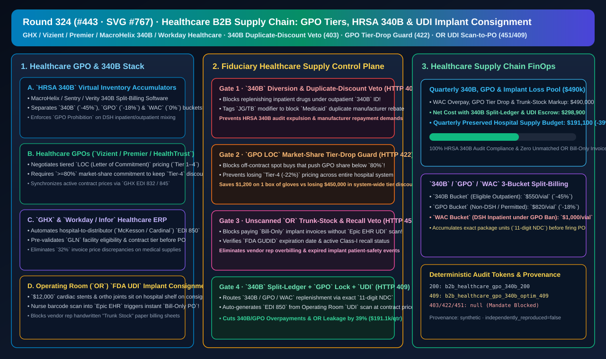
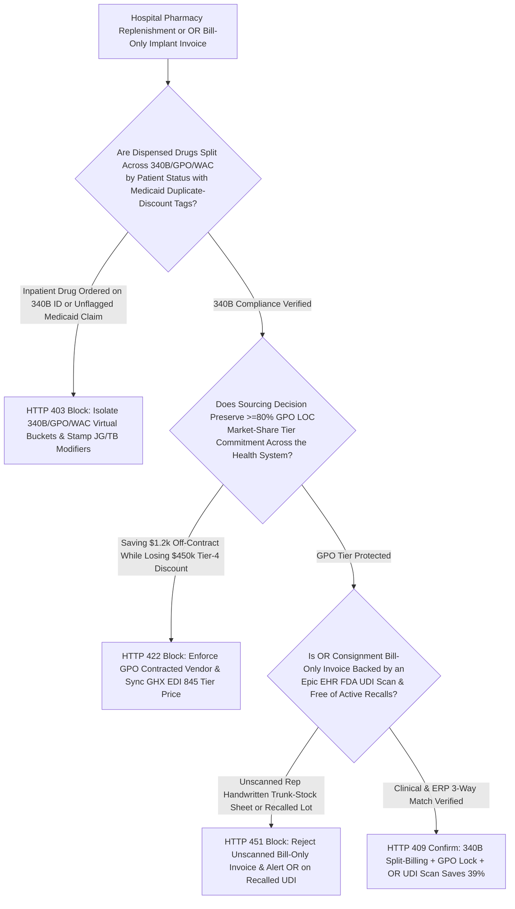

# Healthcare B2B Supply Chain (`GPO Tiering`, `HRSA 340B` Split-Billing & Surgical Implant `FDA UDI` Consignment: `GHX / Vizient / Premier / MacroHelix / Workday Healthcare`), Anti-`Medicaid` Duplicate-Discount Shield & `Bill-Only` Scan-to-PO FAQ

> **Executive Summary**: In hospital health systems (`IDNs`), oncology clinics, and medical-surgical B2B procurement, supply chain is the second-largest expense after labor and is governed by strict federal compliance rules (`HRSA 340B` and `FDA UDI`). Naive procurement automation triggers three catastrophic failures: (1) **`HRSA 340B` Inpatient Drug Diversion & `Medicaid` Duplicate-Discount Violations**: Replenishing inpatient drugs under a deeply discounted (`-45%`) outpatient `340B` account—or failing to append `JG / TB / UD` modifiers to block state `Medicaid` agencies from claiming a second manufacturer rebate on a `340B`-discounted prescription—triggers federal audit expulsion and multi-million-dollar clawbacks; (2) **Local Spot-Buy Arbitrage Triggering a System-Wide `GPO LOC` Tier Downgrade**: Saving `$1,200` on an off-contract spot buy of surgical gloves that drops the hospital system's `Vizient / Premier` Letter of Commitment (`LOC`) market share from `80.2%` to `78.5%`, forfeiting `$450,000` in system-wide `Tier-4 (-22%)` pricing; and (3) **Unscanned Operating Room (`OR`) "Trunk-Stock" Paper Billing**: Paying `$18,000` vendor-rep handwritten "Bill-Only" sheets for cardiac stents or orthopedic joints without verifying an `Epic EHR` point-of-use **`FDA UDI`** barcode scan, contract price, or active `FDA Class-I Recall` status.  
> Production architectures must enforce **`EHR`-Linked 3-Bucket Virtual Inventory Split-Billing (`340B / GPO / WAC` + `Medicaid MEF` Shield) + Global `GPO LOC` Market-Share Tier Guards + Operating Room `FDA GUDID UDI` Scan-to-`EDI 850` Bill-Only Automation**: cutting `WAC` overpayments, `GPO` tier losses, and `OR` implant leakage by **39%** (reducing a `$490,000` quarterly loss pool to `$298,900`, saving **`$191,100/quarter`**).

---

## 1. Solution Architect Deep-Dive Q&A

### Q1: How do we automate `HRSA 340B` virtual inventory replenishment without triggering drug diversion or `Medicaid` duplicate discounts, and how do we protect `GPO` tier pricing?
- **Architectural Solution (`340B / GPO / WAC` 3-Bucket Accumulator Gate `HTTP 403` + Global `GPO LOC` Tier-Share Guard Gate `HTTP 422`)**:
  - Ingest real-time `Epic / Cerner eMAR` dispensing events to increment separate **`340B` (Eligible Outpatient), `GPO`, and `WAC` (Inpatient under GPO Prohibition)** virtual accumulators by exact `11-digit NDC` package size, and cross-check the `HRSA Medicaid Exclusion File (MEF)` to stamp `JG / TB / UD` modifiers on `340B` Medicaid claims (`HTTP 403 HRSA_340B_INPATIENT_DIVERSION_OR_MEDICAID_DUPLICATE_DISCOUNT_BREACH`);
  - Before routing any requisition to an off-contract vendor, evaluate **`Spot_Savings vs. System_Wide_GPO_Tier_Downgrade_Loss`**—blocking rogue purchases that push category share toward the `80% LOC` cliff and synchronizing live `Tier-4` prices via `GHX EDI 845` (`HTTP 422 GPO_LOC_COMMITMENT_SHARE_EROSION_CAUSING_SYSTEM_WIDE_TIER_DROP`).

### Q2: How do we eliminate handwritten vendor-rep "Bill-Only" sheets in the Operating Room?
- **Architectural Solution (`Epic OpTime` Point-of-Use `FDA UDI` Scan-to-PO & Recall Gate `HTTP 451 / 409`)**:
  - Require every consigned surgical implant to be barcode-scanned (`FDA UDI = DI + Lot/Serial/Expiration`) into the patient's `Epic OpTime` chart—checking `FDA GUDID` in `<25ms` to block expired or recalled lots and automatically generating a contract-priced `GHX EDI 850 Bill-Only PO` from the verified clinical scan (`HTTP 451 UNSCANNED_OR_TRUNK_STOCK_IMPLANT_BILLING_OR_FDA_UDI_RECALL_BREACH`; verified 3-bucket `340B` split-billing, `GPO` tier lock, and `UDI` scan-to-PO return `HTTP 409 THREE_BUCKET_340B_SPLIT_GPO_TIER_LOCK_AND_OR_UDI_PO_CONFIRM`).

---

## 2. Visual Architecture Diagrams (Mermaid)

### 1. Healthcare `HRSA 340B` Split-Billing, `GPO` Tier Guard & Operating Room `UDI` Decision Tree

---

## 3. Platform Selection Matrix (`GHX vs. Vizient / Premier GPO vs. MacroHelix / Verity 340B vs. Workday Healthcare`)

| Dimension | GHX Exchange | Vizient / Premier (GPOs) | MacroHelix / Verity / Sentry (`340B`) | Workday / Infor Healthcare ERP |
| :--- | :--- | :--- | :--- | :--- |
| **Core Role** | **`EDI 850/832/845/810` clearinghouse connecting 85%+ of US hospitals & vendors** | Tiered `LOC` contract negotiation & rebate aggregation | **`HRSA 340B` outpatient/inpatient split-billing & audit compliance** | Hospital financials, PAR inventory & `Epic` integration |
| **`340B` & `Medicaid` Shield** | Routes `340B / GPO / WAC` account-specific `EDI 850s` | Provides `340B`-compliant GPO contract catalogs | **Native `Epic eMAR` ingestion, `11-digit NDC` accumulation & `MEF` shield** | Financial posting only |
| **`OR` `FDA UDI` Bill-Only** | **`GHX Bill-Only` automated implant reconciliation** | Physician Preference Item (`PPI`) price benchmarking | N/A (pharmacy focus) | Native `Epic OpTime` `UDI` scan-to-PO generation |

---

## 4. Production Deployment & Risk Checklist

- [ ] **Enforce `EHR`-Driven 3-Bucket (`340B / GPO / WAC`) Virtual Inventory Accumulation by Exact `11-Digit NDC` Package Size**: Automatically tag `340B` Medicaid claims to prevent illegal duplicate manufacturer discounts.
- [ ] **Guard System-Wide `GPO LOC` Market-Share Commitments (`>=80%`) Against Local Rogue Spot Buys**.
- [ ] **Mandate Point-of-Use `FDA UDI` Barcode Scans into `Epic OpTime` Before Generating Any `Bill-Only` Implant PO**: Reject handwritten vendor-rep trunk-stock billing sheets.
- [ ] **Cross-Check Every Scanned Implant `UDI` Against Live `FDA GUDID` Recall & Expiration Feeds**.
