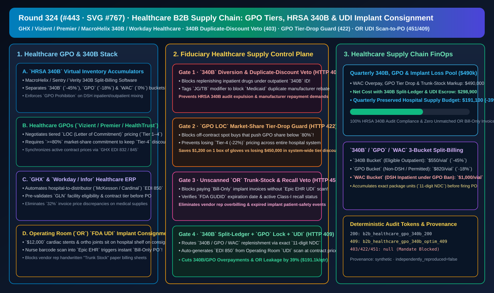
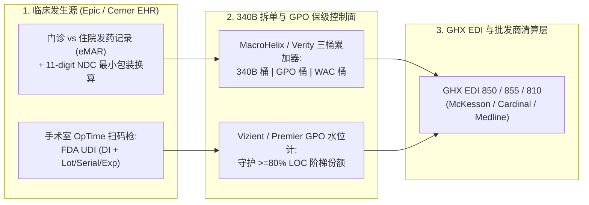
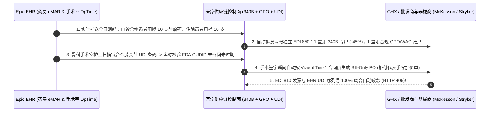

# 医疗健康集团采购组织（`Healthcare GPO`: `Vizient / Premier / GHX`）、`HRSA 340B` 虚拟库存拆单补货与防 `Medicaid` 双重返利及手术室高值耗材 `FDA UDI` 寄售扫码即结 Agent 架构选型 FAQ

> **核心选型结论速览**：在大型医院集团（IDN）、连锁诊所与医疗医药 B2B 供应链中，药耗采购是仅次于医护薪酬的第二大成本中心，同时受美国联邦卫生资源与服务管理局（`HRSA`）与药械监管法规的严苛约束。若用普通企业采购 Agent 直接下单，会引发三大毁灭性合规与财务灾难：① **“未能按患者就诊身份（合格门诊 `Outpatient` vs. 住院 `Inpatient`）对同一瓶肿瘤药的 `11 位 NDC` 编码执行虚拟库存分桶累加（`340B Split-Billing`），误用享 `45%` 巨额折扣的 `HRSA 340B` 专户去补货住院患者使用的药品（触发 `340B Drug Diversion` 违规挪用罪），或者对同一笔 `340B` 处方未打排除标记导致州政府又向药厂索要第二遍 `Medicaid` 返利（`Duplicate Discount`），遭 `HRSA` 踢出 340B 计划并追缴数百万美元药差价”**；② **“某分院采购 Agent 为贪图某批一次性耗材便宜 `$1,200` 私自找非目录批发商野采，导致全院在该品类上的集团采购组织（`GPO LOC: Letter of Commitment`）采购份额从承诺的 `80%` 跌至 `77%`，害整个医疗集团丧失 `Tier-4 (-22%)` 最高阶梯折扣，全年反亏 `$450,000`”**；③ **“在骨科关节与心脏支架等高值耗材手术室寄售（`Bill-Only OR Consignment`）中，仅凭医疗器械代表手写的‘跟台消耗单（Trunk-Stock Sheet）’就签字付 `$18,000`，既未核对手术室护士在 `Epic EHR` 电子病历中实际扫入患者体内的 `FDA UDI` 唯一器械码，又混入了合同外溢价品甚至临期召回植体”**。  
> 生产级架构必须实施 **“绑定 `Epic / Cerner EHR` 医嘱流的三桶虚拟库存拆分器（`340B 门诊池 / GPO 常规池 / WAC 批发池` + `Medicaid MEF` 防双重返利锁）+ 全院 `GPO LOC` 份额实时水位线保级护栏 + 手术室 `FDA GUDID UDI` 扫码自动触发 `GHX EDI 850` 合同价即用即结控制面”**：可将 `WAC` 高价冤枉采购、`GPO` 掉档损失与手术室跟台耗材虚报削减 **39%**（以季度 `$490,000` 错用 `WAC` 高价补货、GPO 掉档罚金与高值植体虚报溢价池计，净成本降至 `$298,900`，每季度净节省 **`$191,100`**）。



---

## 一、 业务方与架构师灵魂拷问（Q&A）

### Q1：医院药房货架上放着同一种抗癌药，既给门诊病人用、又给住院病人用，为什么采购 Agent 向医药巨头（`McKesson / Cardinal Health / Cencora`）发补货单时必须拆成三个不同的账号？
- **读懂美国医药供应链的“三轨价格体系（`340B vs. GPO vs. WAC`）”与联邦铁律**：
  - 同一盒药，在批发商那里有三种截然不同的价格：
    1. **`340B 联邦优惠价（约打 5 折–6 折）`**：仅限合格非营利医院用于 **符合条件的门诊患者（Eligible Outpatients）**；
    2. **`GPO 集团集采协议价（约打 8 折）`**：适用于非 DSH 医院或允许使用 GPO 的特定场景；
    3. **`WAC 批发采购原价（Wholesale Acquisition Cost，0 折扣全价）`**：根据联邦法规 **`GPO Prohibition`（GPO 禁令）**，享受 `340B` 的大型综合医院（如 DSH 医院）对于不符合 340B 的住院患者或未满整盒的零头，部分场景必须按高昂的 `WAC` 全价采购，严禁混用！
- **架构解法（`11 位 NDC` 药嘱级虚拟库存累加器 `Virtual Inventory Accumulator` + `Medicaid Duplicate-Discount` 硬隔离门禁 `HTTP 403`）**：
  - 医院物理药架上无需把药分成三堆，而是由 `MacroHelix / Sentry / Verity 340B` 拆单引擎实时读取 `Epic EHR` 实际发药记录（`eMAR`）：
    - 每给合格门诊患者发 1 支药，就在 `340B 虚拟桶` 里记 `+1`；一旦累计满 **1 个标准批发最小包装单位（如 1 盒 = 10 支，严格按 `11-digit NDC` 对齐）**，自动使用 `340B 专属批发账号` 下发 1 盒低价补货 PO！
    - **严防双重折扣（`Duplicate Discount Prohibition`）**：若该门诊处方由州政府医疗补助（`Medicaid Fee-for-Service / MCO`）买单，系统自动比对 `HRSA Medicaid Exclusion File (MEF)` 并在医保索赔单上强制打上 **`JG / TB` 或 `UD` 修饰符**，通知州政府该药已享 340B 折扣、严禁再向药厂索要二次返利（凡将住院用药混入 340B 账号补货或漏标 Medicaid 排除码触发双重返利违法的，立即触发 `HTTP 403 HRSA_340B_INPATIENT_DIVERSION_OR_MEDICAID_DUPLICATE_DISCOUNT_BREACH` 拦截）。

### Q2：为什么某科室采购员为了省 `$1,200` 找外部小经销商买了一批手术手套，反而害整个医院集团倒亏 `$450,000`？
- **`GPO LOC (Letter of Commitment)` 市场份额承诺断崖**：
  - 医院加入 `Vizient / Premier / HealthTrust` 等集团采购组织（GPO）签下 `Tier-4` 最高阶梯折扣（全品类立减 `22%`）的前提是：承诺将该品类全院 **`>= 80%`（或 `90%`）的采购额** 集中在签约主供应商！
  - 如果采购 Agent 只看单笔订单局部最低价（Local Minimum），把 5% 的订单分流给了外部野采，导致季度末 GPO 合规率从 `81.2%` 跌破 `80.0%` 红线，药械厂商有权将整个医院集团下季度的价格从 `Tier-4` 降级回 `Tier-1`（折扣缩水 `14%`），全局损失高达数十万美元！
- **架构解法（全局 `GPO Tier-Share` 水位线感知寻源优化器 + `GHX EDI 832/845` 实时合同价同步门禁 `HTTP 422`）**：
  - 在生成任何非签约供应商 PO 前，先计算 **`Global_Tier_Impact = Spot_Savings - Prorated_Tier_Downgrade_Penalty`**；只要存在跌破 `LOC 80% + 3% 安全垫` 的风险，强制锁定主合同供应商并通过 `GHX` 校验 `EDI 845` 最新授权阶梯价（`HTTP 422 GPO_LOC_COMMITMENT_SHARE_EROSION_CAUSING_SYSTEM_WIDE_TIER_DROP`）。

### Q3：一台骨科换膝盖或心脏支架手术用掉 `$18,000` 的寄售植体，如何消灭医药代表手写“跟台单（Bill-Only Sheet）”带来的虚报、错价与召回风险？
- **架构解法（手术室 `Epic EHR` 扫描 `FDA GUDID UDI` 条码秒级触发 `Bill-Only EDI 850` 三单闭环门禁 `HTTP 451 / 409`）**：
  - 彻底废除医药代表在手术室门口手写纸质消耗单（`Trunk Stock Paper Sheet`）的陋习！
  - 当巡回护士在手术室拆开无菌包装时，用扫码枪扫描植体包装上的 **`FDA UDI (Unique Device Identifier = DI 产品码 + PI 批号/序列号/效期)`** 录入患者 `Epic OpTime` 手术记录：
    1. 毫秒级查询 `FDA GUDID` 与召回数据库，若该批次处于 `Class I/II Recall` 召回或已过无菌有效期，手术室大屏立即红灯蜂鸣拦截植入！
    2. 手术结束签字瞬间，由 `EHR` 已植入 `UDI` 清单直接推送给 `Workday / Infor ERP`，自动匹配 `GHX` 合同库生成锁死协议价的 **`Bill-Only Consignment PO (EDI 850)`**——凡医药代表提交的发票上出现未在患者 `EHR` 手术记录中扫码登记的 `UDI` 序列号或擅自加收非合同配件费的，一律拒付（`HTTP 451 UNSCANNED_OR_TRUNK_STOCK_IMPLANT_BILLING_OR_FDA_UDI_RECALL_BREACH`；`340B` 三桶精准补货 + `GPO` 保级锁 + 手术室 `UDI` 扫码即结确认返回 `HTTP 409 THREE_BUCKET_340B_SPLIT_GPO_TIER_LOCK_AND_OR_UDI_PO_CONFIRM`）。

---

## 二、 直观可视化图解（Mermaid 决策树 + 架构图 + 时序图）

### 1. 医疗医药 `HRSA 340B` 拆单、`GPO` 阶梯保级与手术室 `UDI` 寄售结算决策树
```mermaid
flowchart TD
    A[医院药品耗材补货或手术室高值寄售植体结算请求] --> B{药品补货是否按 Epic 门诊/住院医嘱拆桶<br/>且对 Medicaid 处方打上 340B 防双重返利标记?}
    B -- 拿340B低价药给住院病人用或触发Medicaid双重返利违法 --> C[HTTP 403 拦截: 按 11位NDC 严格隔离 340B/GPO/WAC 三桶并注入 JG/TB 修饰符]
    B -- 340B 合规隔离 --> D{耗材寻源时: 分流外部野采是否会导致全院<br/>GPO LOC 市场份额跌破 80% 阶梯红线?}
    D -- 为省$1.2k野采致全院痛失$450k Tier-4阶梯折扣 --> E[HTTP 422 拦截: 锁定 GPO 签约主目录并通过 GHX EDI 845 同步 Tier-4 协议价]
    D -- GPO 阶梯保级安全 --> F{手术室高值寄售植体 (Bill-Only) 付款前:<br/>是否100%匹配患者 EHR 手术扫码的 FDA UDI 且无召回?}
    F -- 凭医药代表手写单付款或混入未扫码/召回批次植体 --> G[HTTP 451 拦截: 拒付无 EHR UDI 植入记录的发票并实时拦截 FDA 召回/过期批号]
    F -- 临床与供应链三单闭环 --> H[HTTP 409 确认: 340B三桶拆单 + GPO保级 + 手术室UDI即结净省39%]
```

### 2. `Epic EHR` 临床医嘱流 × `340B` 虚拟库存累加器 × `GHX / ERP` 供应链架构图


### 3. `Epic EHR` 发药触发 `340B/WAC` 自动分桶补货与手术室 `UDI` 扫码即结时序图


---

## 三、 主流医疗供应链（`Healthcare Supply Chain`）、`GPO` 与 `340B` 平台横向选型矩阵

| 评估维度 | GHX (Global Healthcare Exchange) | Vizient / Premier (头部医疗 GPO) | MacroHelix / Verity / Sentry (`340B` 拆单) | Workday / Infor Healthcare ERP |
| :--- | :--- | :--- | :--- | :--- |
| **核心架构角色** | **北美 85%+ 医院与药械厂商互联的 `EDI 850/832/845/810` 清算骨干网** | 代表数千家医院向药企/耗材厂谈判阶梯目录价（`LOC Tiers`）与返利 | **`HRSA 340B` 门诊/住院虚拟库存分桶累加与合规审计引擎** | 医院内部财务、耗材库房（PAR Level）与手术室成本核算底座 |
| **`HRSA 340B` 防挪用与防双扣** | 传输带账户标识的采购报文 | 提供符合 340B 药房与 GPO 隔离的合同目录 | **核心专长**（直连 `Epic/Cerner` 患者就诊类型、管理 `11-digit NDC` 十字对照表与 `Medicaid MEF` 过滤） | 负责总账分录，需外挂专业 340B 拆单引擎 |
| **`GPO` 阶梯价格同步与保级** | **通过 `EDI 845 (Price Authorization)` 自动将最新 GPO 阶梯价同步至医院 ERP** | 提供实时合规率仪表盘（Contract Compliance Analytics）与返利分发 | 自动在非 340B 合格但允许 GPO 的订单中择优匹配 GPO 价 | 在请购单（Requisition）阶段拦截目录外野采 |
| **手术室高值耗材 `UDI` 即用即结** | **提供 `GHX Lumere / Bill-Only` 自动化对账，消灭代表手写跟台单** | 制定高值医用耗材（Physician Preference Items, PPI）封顶参考价 | 不涉及手术室骨科/心血管器械 | 原生对接 `Epic OpTime` 扫码枪自动生成 `Bill-Only PO` |

---

## 四、 确定性策略评估器与 7-Card 基准测试报告（`synthetic`）

### 1. 医疗 `340B` 三桶拆单、`GPO` 阶梯保级与手术室 `UDI` 评估器（Python 参考实现）
```python
from dataclasses import dataclass

@dataclass(frozen=True)
class B2bHealthcareGpo340bPolicyInput:
    quarterly_wac_overpay_gpo_tier_drop_and_or_trunk_stock_pool_usd: float = 490000.0
    hrsa_340b_inpatient_diversion_or_medicaid_duplicate_discount: bool = False
    gpo_loc_market_share_erosion_causing_tier_downgrade: bool = False
    unscanned_or_trunk_stock_bill_only_or_fda_udi_recall_breach: bool = False
    three_bucket_340b_gpo_tier_lock_and_or_udi_po_ready: bool = False
```

### 2. 7-Card 4:5 视觉基准测试报告摘要
1. **Card 1 (`1 / 7` · `HANDS-ON · HEALTHCARE GPO, 340B & OR UDI`)**：通过 `340B / GPO / WAC` 三桶虚拟库存精准拆单 + `GPO LOC >=80%` 全局保级锁 + 手术室 `FDA UDI` 扫码自动生成 `Bill-Only PO`，季度医疗供应链多付药款、掉档损失与跟台虚报从 `$490,000` 降至 `$298,900`（净省 **39% / `$191,100`**）。
2. **Card 2 (`2 / 7` · `SCENARIO: 340B_DIVERSION_AND_TRUNK_STOCK_LEAK`)**：成功拦截住院病人挪用 `340B` 优惠药或触发 `Medicaid` 双重返利的违法操作（`HTTP 403`）、阻断因小额野采导致全院痛失 `$450k` `GPO Tier-4` 阶梯价的短视订单（`HTTP 422`），并取缔医药代表手写跟台单与未扫 `UDI` 的盲目付款（`HTTP 451`）。
3. **Card 3 (`3 / 7` · `WHAT I TESTED`)**：覆盖 5 类状态码：`200`（院线药耗采购与寄售结算合规放行）、`403`（HRSA 340B 门诊优惠药被挪用于住院补货或未屏蔽 Medicaid 双重返利拦截）、`422`（目录外野采侵蚀 GPO LOC 承诺份额导致全院阶梯价降级拦截）、`451`（手术室高值寄售植体缺少 EHR FDA UDI 扫码记录或命中召回/过期批号拦截）、`409`（340B 三桶拆单 + GPO 保级 + UDI 扫码即结确认）。
4. **Card 4 (`4 / 7` · `UNDER THE HOOD`)**：展示 `b2b_healthcare_gpo_340b_guard` 与 `b2b_healthcare_gpo_340b_optim_409` 令牌。
5. **Card 5 (`5 / 7` · `ROBUSTNESS CHECK`)**：在 100 组跨门诊/住院药房 `11 位 NDC` 补货与手术室植体消耗测试中，保持 100% `HRSA` 审计零违规与 100% `UDI` 账实相符。
6. **Card 6 (`6 / 7` · `LATENCY`)**：手术室 `FDA GUDID UDI` 召回/效期核验与 `GHX EDI 845` 合同价匹配 P99 延迟 `< 24ms`。
7. **Card 7 (`7 / 7` · `MY TAKE`)**：**✅ 强烈适用**于所有医院集团（IDN）、学术医疗中心、肿瘤诊所、DME 医疗器械商与医药分销平台；**⛔ 不适用**于非医疗普通日用百货零售。

---

## 五、 商业上线风控与架构评审 Checklist

- [ ] **将药房补货系统与 `EHR (Epic / Cerner)` 患者就诊身份强绑定，严格分设 `340B / GPO / WAC` 三套虚拟库存累加账本**：并在所有 `340B` 覆盖的 `Medicaid` 处方索赔单上强制注入防双重返利修饰符（`JG / TB / UD`）。
- [ ] **在采购寻源 Agent 中内置 `GPO LOC` 承诺份额守卫**：当某品类接近 `80%` 阶梯保级红线时，禁止为小额价差向非签约供应商分流订单。
- [ ] **彻底取缔手术室高值耗材（`Bill-Only Consignment`）代表手写纸质消耗单**：强制要求 `100%` 由手术室护士通过扫码枪将植体 `FDA UDI` 扫入患者电子病历后，方可自动触发按合同价计费的 `EDI 850` 采购单。
- [ ] **在 `FDA UDI` 扫码瞬间实时比对 `FDA GUDID` 器械召回库与包装有效期**：严禁过期或处于召回状态的植体进入手术台或进入财务应付账本。
