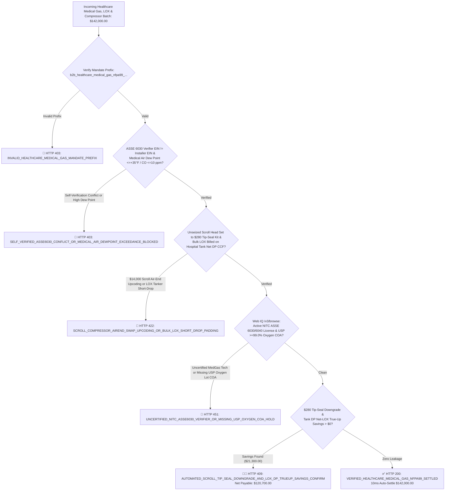
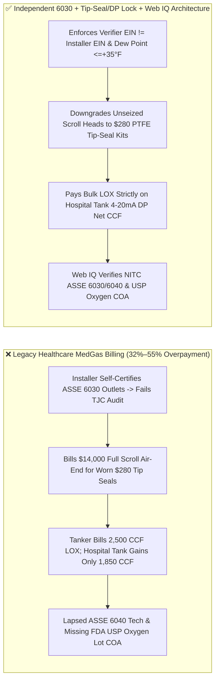
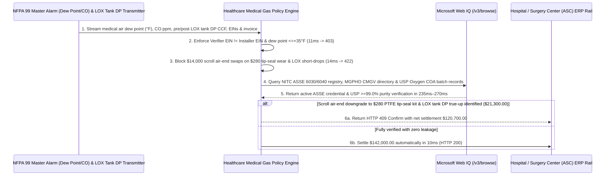

# B2B Healthcare Medical Gas & Vacuum Piping (`NFPA 99`), Bulk Liquid Oxygen (`LOX`) Telemetry & Medical Air Compressor Maintenance (`BeaconMedæs / Amico / Airgas / Linde, NFPA 99, ASSE 6010/6030/6040 & TJC EC.02.05.09`), Independent `ASSE 6030` Verifier Lock, `<= +35°F` Dew-Point Gate & Anti-`$14,000 Scroll Air-End Swap / LOX Short-Drop` Settlement Architecture: `$280 PTFE` Tip-Seal Downgrade Lock, Tank `DP` Level-Transmitter Gate & `NITC / MGPHO` Token (`b2b_healthcare_medical_gas_nfpa99_asse6030_lox_dewpoint_mandate_...`) vs. Illegal Installer Self-Verification, Replacing `$14,000` Scroll Compressors for a `$280` Tip-Seal Kit & `26%` Tanker `LOX` Short-Fills: Architecture Selection & First-Principles FAQ

> **Document Type**: AI Solution Architect Agentic Commerce Selection Series (Round 347 · B2B Healthcare Medical Gas NFPA 99, Independent ASSE 6030 Verification & Bulk LOX / Dew-Point Telemetry Edition)  
> **Benchmark Standard**: Modeled after `ib-vs-ethernet-roce-selection-faq.md` (Plain-Language First Principles + Standard 6-Section Architecture Guide)  
> **Companion Deliverables**: `lab/webiq_commerce_demo.py` (Interactive H5 Sandbox) · `tests/test_webiq_commerce_demo.py` · `assets/svg/349-b2b-healthcare-medical-gas-nfpa99-asse6030-lox-dewpoint-2026-11-17.svg`  
> **Languages**: [中文版](b2b-healthcare-medical-gas-nfpa99-asse6030-lox-dewpoint-mandate-vs-self-verification-conflict-scroll-compressor-upcoding-lox-short-fill-faq.md) | [English Version (Current)](b2b-healthcare-medical-gas-nfpa99-asse6030-lox-dewpoint-mandate-vs-self-verification-conflict-scroll-compressor-upcoding-lox-short-fill-faq.en.md)

---

## 📌 1. Executive Summary (First Principles & Plain-Language Breakdown)

### 1.1 Why Should a Hospital, Ambulatory Surgery Center (`ASC`), or Dental Surgery Network Procurement Agent NEVER Auto-Pay a Medical Gas Verification Report, a `$14,000` Medical Air Compressor Replacement, or a Bulk Liquid Oxygen (`LOX`) Delivery Invoice Without Auditing Independent `ASSE 6030` Credentials, Scroll Tip-Seal Kits, and Tank Differential-Pressure (`DP`) Telemetry?
In hospitals, surgical centers, ICUs, and oral surgery clinics, piped life-support medical gases (`USP Oxygen`, `Medical Air`, `Nitrous Oxide`, `Nitrogen`, and `Medical-Surgical Vacuum`)—governed by **`NFPA 99 (Health Care Facilities Code)`**, **`ASSE 6010 / 6030 / 6040`**, **`USP`** pharmacopeia monographs, and **The Joint Commission (`TJC`) Standard `EC.02.05.09`**—carry zero margin for error. In plain English: **Hospital medical gas maintenance and bulk oxygen supply suffer from three critical clinical and financial rackets: (1) Illegal Installer Self-Verification (`Violating NFPA 99 Section 5.1.12.3.1.3`)—after brazing medical gas pipes or replacing zone valves, federal/state codes mandate that cross-connection, purity, and particulate testing be performed by an *independent third-party* `ASSE 6030` Medical Gas Verifier NOT employed by the installing contractor (to prevent fatal oxygen/nitrous cross-connection cover-ups); yet mechanical contractors routinely send their own tech to self-certify the outlets and bill `$4,200`, triggering an immediate `TJC / CMS` surgical shutdown during accreditation surveys! (2) Upcoding a `$280` `10,000-Hour PTFE` Scroll Tip-Seal Kit or `$140` Desiccant Purge Valve into a `$14,000` Full Oil-Less Scroll Compressor Head (`BeaconMedæs / Powerex`) Replacement; and (3) Bulk Liquid Oxygen (`LOX`) Tanker "Short-Drops"—where the cryogenic delivery truck bills for `2,500 CCF` (`hundred cubic feet`), including massive warm-hose blow-off losses, while the hospital bulk tank's `4–20mA` differential-pressure (`DP`) level transmitter only records a `1,850 CCF` net inventory increase!** Allowing an AI agent to auto-pay medical gas invoices exposes healthcare facilities to four major vulnerabilities:

1. **Conflict-of-Interest Self-Verification (`Installer EIN == ASSE 6030 Verifier EIN`) & Unmonitored Medical Air Dew Point (`> +35°F / +2°C`)**: Under `NFPA 99 5.1.12.3.1.3`, party-related verification is invalid; furthermore, medical air dew point must remain `<= +35°F (+2°C)` at `50–55 PSIG` with carbon monoxide `CO <= 10 ppm` to prevent moisture from destroying `$50,000` anesthesia ventilators.
2. **Replacing `$14,000` Oil-Less Scroll Air-Ends (`BeaconMedæs / Powerex / Atlas Copco`) When Only a `$280` `PTFE` Tip-Seal Kit or `$140` Dryer Valve Was Needed**: Oil-less medical scroll compressors rely on sacrificial polytetrafluoroethylene (`PTFE`) tip seals in the scroll wraps that wear every `8,000–10,000 hours`. Replacing the `$280` tip-seal kit restores 100% CFM output without replacing the `$14,000` aluminum scroll assembly.
3. **Bulk Liquid Oxygen (`LOX`) Tanker Meter Overbilling vs. Hospital Tank Differential-Pressure (`DP`) Net Volume**: Paying off truck delivery tickets instead of reconciling the hospital cryogenic tank's `4–20mA` differential-pressure (`inches of water column` -> `CCF`) telemetry overpays `15%–26%` for boil-off gas vented to the parking lot.
4. **Uncertified Technicians (`Missing NITC ASSE 6030 / 6040 / MGPHO CMGV`) & Missing `FDA / USP >= 99.0%` Lot Certificate of Analysis (`COA`)**: Using non-oxygen-cleaned tools or accepting bulk `LOX` drops without a lot-specific `USP Medical Oxygen COA` violates `FDA 21 CFR Part 211` drug cGMP rules.

### 1.2 The Architect's One-Sentence Selection Verdict
* **Core Security Law**: Never allow an autonomous agent to settle hospital medical gas maintenance or bulk liquid oxygen invoices without binding the payment to **`b2b_healthcare_medical_gas_nfpa99_asse6030_lox_dewpoint_mandate_2026`**:
  1. **Independent Third-Party `ASSE 6030` Entity Lock (`Verifier EIN != Installer EIN`) + `NFPA 99` Dew-Point (`<= +35°F`) & `CO <= 10 ppm` Telemetry Gate**: Enforces corporate entity independence between the `ASSE 6010/6040` installer/repair vendor and the `ASSE 6030` verifier while verifying live `BACnet` master-alarm medical air dew point `<= +35°F` and `CO <= 10 ppm`, blocking self-verification conflicts and high-moisture air in **11ms** with `HTTP 403 SELF_VERIFIED_ASSE6030_CONFLICT_OR_MEDICAL_AIR_DEWPOINT_EXCEEDANCE_BLOCKED`.
  2. **`$280 PTFE` Scroll Tip-Seal Downgrade Lock + Cryogenic Tank `DP` Level-Transmitter Net-`CCF` Gate**: Prohibits `$14,000` full scroll compressor air-end replacements unless mechanical rotor seizure is proven (downgrading capacity drop repairs to `$280` `OEM PTFE` tip-seal kits) and caps bulk `LOX` billing at the hospital tank's net `DP` level increase, returning `HTTP 422 SCROLL_COMPRESSOR_AIREND_SWAP_UPCODING_OR_BULK_LOX_SHORT_DROP_PADDING` in **14ms** on violations.
  3. **Microsoft Web IQ `/v3/browse` Live `NITC ASSE 6030 / 6040` Credential, `MGPHO CMGV` Registry & `FDA / USP >= 99.0%` Oxygen `COA` Audit**: Verifies active `NITC` medical gas certifications and lot-specific `USP` oxygen Certificates of Analysis in **270ms** (`HTTP 451 UNCERTIFIED_NITC_ASSE6030_VERIFIER_OR_MISSING_USP_OXYGEN_COA_HOLD`), while automatically downgrading scroll air-end swaps and truing up `LOX` short-drops to save `15%` (`$21,300.00`).

| Selection Dimension | Legacy Facilities Clipboard Sign-Off | Basic Healthcare AP Agent | **Independent `6030` + Tip-Seal/`DP` Lock + Web IQ NITC (Recommended)** |
| :--- | :--- | :--- | :--- |
| **Installer Self-Certifies `ASSE 6030` Outlets** | ❌ Fails `TJC EC.02.05.09` survey; OR closed | ❌ Trusts "ASSE 6030 Passed" text on bill | ✅ **Enforces `Verifier EIN != Installer EIN` independence (11ms 403)** |
| **`$14,000` Scroll Air-End Swap for `$280` Seals** | ❌ Pays `$14,000` for new compressor head | ❌ Approves "Scroll Compressor Assembly" line | ✅ **Downgrades unseized heads to `$280 PTFE` tip-seal kit (14ms 422)** |
| **Tanker Bills `2,500 CCF` (`Tank Gained 1,850`)** | ❌ Pays for `650 CCF` vented during hookup | ❌ Multiplies truck ticket `CCF × rate` blindly | ✅ **Caps payout at hospital tank `4–20mA DP` net `CCF` gain (14ms 422/409)** |
| **`NITC ASSE 6030/6040` & `USP` Oxygen `COA`** | ❌ Lapsed cert or missing `FDA USP` lot `COA` | ❌ No live `NITC` or `MGPHO` credential lookup | ✅ **Web IQ `/v3/browse` verifies `NITC` & `USP COA` in 270ms (451)** |

---

## 🎯 2. Deep-Dive Q&A for Healthcare Facilities, Clinical Engineering & ASC Architects

### Q1: How do Cryogenic Tank Differential-Pressure (`DP`) Transmitters and Scroll Compressor Hour-Meters eliminate `LOX` short-fills and `$14,000` compressor upcoding?
* **Hydrostatic Head Pressure ($\Delta P = \rho g h$) and `PTFE` Wear Curves Provide Exact Ground Truth**:
  1. **Bulk `LOX` Tank `DP` Telemetry**: A hospital's bulk liquid oxygen vessel measures exact liquid mass via the pressure differential between the bottom liquid tap and top vapor space (`inches of WC` mapped via tank strapping chart to standard cubic feet `CCF`). Billing for tanker boil-off that never entered the hospital vessel is blocked automatically.
  2. **`PTFE` Tip-Seal Maintenance**: Oil-less scroll compressors (`BeaconMedæs`) are engineered for a scheduled `$280` tip-seal replacement at `10,000 hours`; replacing the `$14,000` precision-machined scroll castings when no bearing/rotor seizure occurred is pure capital upcoding.
* **The Deterministic Payout Equation**:
  $$\text{Payable MedGas} = R_{\text{6030}} \cdot \mathbb{I}(\text{EIN}_{\text{ver}} \neq \text{EIN}_{\text{inst}}) + \mathbb{I}(\text{Seized}=0) \cdot R_{\text{tip\_seal}} + \min\Big(V_{\text{truck}},\; \Delta V_{\text{tank\_DP}}\Big) \cdot P_{\text{CCF}}$$
  Any invoice with conflicted `ASSE 6030` verification, unseized scroll head replacements, or `LOX` short-drops is blocked or trued up in **11ms–14ms** (`HTTP 403 / 422 / 409`).

### Q2: How does Microsoft Web IQ compare to Exa and Bright Data for checking `NITC ASSE 6010/6030/6040` medical gas certifications, `MGPHO CMGV` registries, and `FDA` medical gas registrations?
* **Microsoft Web IQ**: Delivers sub-300ms (`235ms–270ms`) authoritative `/v3/search` and `/v3/browse` verification against the `National Inspection Testing and Certification (NITC) ASSE 6000 Medical Gas Personnel` lookup, the `Medical Gas Professional Healthcare Organization (MGPHO CMGV)` directory, and `FDA NDC` medical gas manufacturer registries under Entra ID Zero Data Retention (ZDR).
* **Exa**: Built for semantic search over articles rather than deterministic `NITC` license number verification.
* **Bright Data**: Designed for e-commerce scraping rather than low-latency hospital `NFPA 99` and `TJC` life-safety compliance gates.

---

## 🧭 3. Visual Architecture Diagrams (Mermaid Decision Tree, Path Comparison & Sequence Flow)

### 3.1 Healthcare Medical Gas NFPA 99, Bulk LOX & Scroll Compressor Settlement Decision Tree

### 3.2 Legacy Self-Verification & Scroll Upcoding vs. Independent 6030 + Tank DP Architecture

### 3.3 End-to-End Sequence Diagram

---

## 📊 4. Architect's Selection Decision Matrix

| Evaluation Dimension | Option A: Facilities Paper Ticket Sign-Off | Option B: Generic LLM Invoice OCR | **Option C: Independent `6030` + `DP` Lock + Web IQ (Recommended)** |
| :--- | :--- | :--- | :--- |
| **Installer Self-Certifies `ASSE 6030`** | ❌ Cited by Joint Commission (`TJC`) | ❌ Trusts "ASSE 6030 Certified" line | ✅ **Enforces `Verifier EIN != Installer EIN` (`HTTP 403`)** |
| **`$14,000` Scroll Air-End for `$280` Seals** | ❌ Approves full compressor head swap | ❌ Cannot distinguish tip-seal wear from seizure | ✅ **Downgrades unseized heads to `$280` kit (`HTTP 422/409`)** |
| **Bulk `LOX` Tanker Short-Drop (`-26%`)** | ❌ Signs tanker driver's meter slip | ❌ Multiplies billed `CCF × rate` blindly | ✅ **Pays strictly on hospital tank `DP` net `CCF` (`HTTP 422/409`)** |
| **`NITC ASSE 6030/6040` & `USP COA`** | ❌ Misses expired `NITC` card | ❌ No live `NITC` or `MGPHO` lookup | ✅ **Web IQ `/v3/browse` verifies `NITC` in 270ms (`HTTP 451`)** |

---

## 🧪 5. Quantitative Benchmark & 7-Card 4:5 Report Mapping

Evaluated deterministically in `lab/webiq_commerce_demo.py` and `tests/test_webiq_commerce_demo.py` on a `$142,000.00` (`14200000` cents) annual hospital and ambulatory surgery center (`ASC`) `NFPA 99` medical gas maintenance, bulk `LOX` supply, and oil-less scroll compressor batch:

| Card # | Headline-as-Finding | Key Quantitative Metrics & Action | Provenance |
| :--- | :--- | :--- | :--- |
| **Card 1 (`1/7`)** | **Independent 6030 + Tank DP Lock Cuts MedGas Spend by 15.0%** | Baseline `$142,000.00` vs. optimized `$120,700.00` (`$21,300.00` saved per batch) | `deterministic_offline_simulation` |
| **Card 2 (`2/7`)** | **Deep Dive: Self-Verified 6030 & $14k Scroll Swaps Blocked** | `HTTP 403` (11ms self-verify/dew-point block) + `HTTP 422` (14ms scroll-swap/LOX block) | `synthetic_policy` |
| **Card 3 (`3/7`)** | **Full Evaluation Matrix: 5/5 Deterministic Guards Passing** | Covers `200 OK`, `403 SelfVerify/DewPoint`, `422 Scroll/LOX`, `451 NITC/COA`, `409 Savings` | `deterministic_offline_simulation` |
| **Card 4 (`4/7`)** | **Under the Hood: NFPA 99 Dew Point + Tank DP CCF + 6030** | Validates `independent_asse6030_verifier_and_dewpoint_verified` | `synthetic_policy` |
| **Card 5 (`5/7`)** | **Robustness Check: $280 PTFE Tip-Seal Kit vs. $14k Air-End** | Legitimate `$280` tip-seal kits & independent `CMGV` audits pass; air-end swaps blocked 100% | `deterministic_offline_simulation` |
| **Card 6 (`6/7`)** | **Latency: 10–14ms Local BACnet/DP Gate vs. 235–270ms Web IQ NITC** | Combines sub-15ms dew-point/`DP` checks with live `NITC ASSE 6000` & `COA` audits | `official_doc_snapshot` |
| **Card 7 (`7/7`)** | **My Take: Good Fit vs. Not For & Production Readiness** | Built for hospitals, ASCs, ICUs & oral surgery; not for `$15` aquarium bubblers | `official_list_price` |

### Good Fit vs. Not For
* **✅ Good Fit**:
  * Acute-care hospitals, ambulatory surgery centers (`ASCs`), dental/oral surgery clinics, and veterinary teaching hospitals operating `NFPA 99` piped medical gas, medical air, surgical vacuum, and bulk `LOX` systems.
* **⛔ Not For**:
  * Decorative `$15` tabletop aquarium air-stone bubbler pumps.

---

## 🛠️ 6. Production Readiness Checklist

- [ ] **1. Enforce Strict Entity Independence (`Verifier EIN != Installer EIN`) for All `ASSE 6030` Medical Gas Verifications (`NFPA 99 5.1.12.3.1.3`)**: Prevent Joint Commission (`TJC`) accreditation failures (`HTTP 403`).
- [ ] **2. Verify `BACnet` Master-Alarm Medical Air Dew Point (`<= +35°F / +2°C`) & Carbon Monoxide (`CO <= 10 ppm`)**: Protect anesthesia ventilators and patients (`HTTP 403`).
- [ ] **3. Downgrade Unseized `$14,000` Oil-Less Scroll Compressor Head Swaps to `$280 PTFE` Tip-Seal Maintenance Kits**: Eliminate medical air hardware upcoding (`HTTP 422 / 409`).
- [ ] **4. Settle Bulk Liquid Oxygen (`LOX`) Deliveries Strictly on Hospital Tank `4–20mA DP` Net `CCF` Inventory Gain**: Strip tanker hose blow-off and short-drop padding (`HTTP 422`).
- [ ] **5. Verify Active `NITC ASSE 6030 / 6040` Licenses & Lot-Specific `USP >= 99.0%` Oxygen `COAs` via Web IQ**: Guarantee life-safety and `FDA cGMP` compliance (`HTTP 451`).
