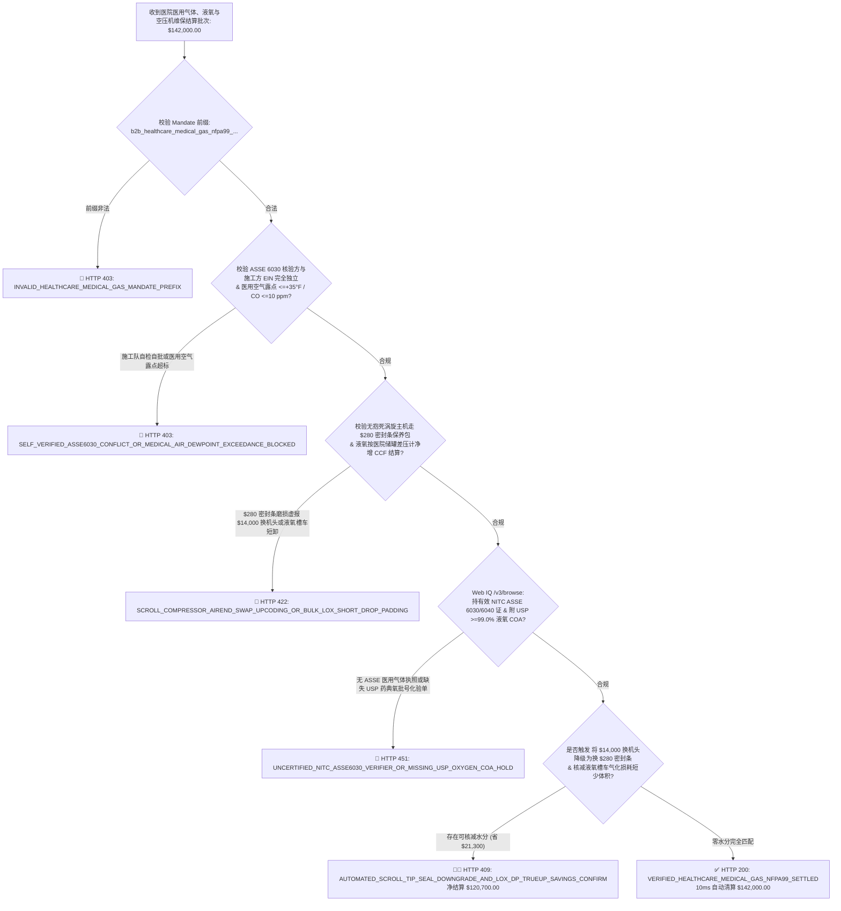
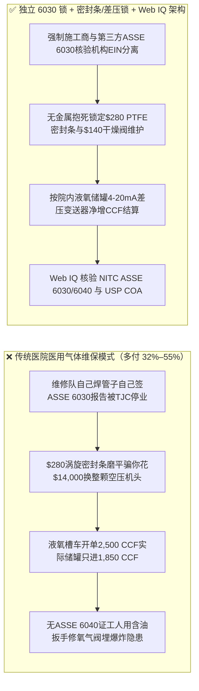
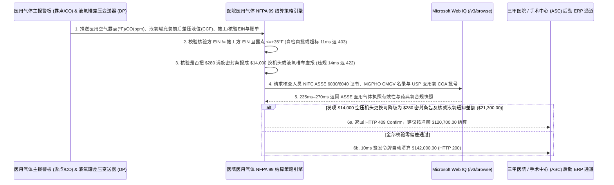

# B2B 医院与手术中心医用气体管道（`NFPA 99 Medical Gas & Vacuum`）、液氧储罐（`LOX`）遥测与无油涡旋空压机维保结算（`Healthcare Medical Gas Systems, ASSE 6030 Verification & USP Medical Air Dew-Point Telemetry: BeaconMedæs / Amico / Airgas / Linde, NFPA 99, ASSE 6010/6030/6040 & TJC EC.02.05.09`）、医用空气露点（`Dew Point <= +35°F`）与液氧差压液位计实收锁、`$280` 涡旋机头密封条（`PTFE Tip-Seal Kit`）免换 `$14,000` 整机门禁与防“管道维修商自己安装自己出 `ASSE 6030` 第三方交叉连接合格报告、把换一套 `$280` 聚四氟乙烯涡旋密封条就能修好的气压不足虚报为 `$14,000` 医用空压机头报废”清算架构：独立第三方验真锁、液氧罐差压计增幅门禁与 `ASSE 6030 / MGPHO` 令牌（`b2b_healthcare_medical_gas_nfpa99_asse6030_lox_dewpoint_mandate_...`）vs 传统医用气体维保既当运动员又当裁判员被 `JCI/TJC` 吊销手术室牌照与槽车液氧短斤少两选型与原理解析 FAQ

> **文档类型**：AI Solution Architect 商业智能体架构选型系列（Round 347 · B2B 医院医用气体 NFPA 99、ASSE 6030 独立验真与液氧/医用空气露点遥测专篇）  
> **对标标杆**：`ib-vs-ethernet-roce-selection-faq.md`（通俗大白话 + 第一性原理 + 标准六段式结构）  
> **关联 Deliverable**：`lab/webiq_commerce_demo.py`（H5 实时防篡改沙盒） · `tests/test_webiq_commerce_demo.py` · `assets/svg/349-b2b-healthcare-medical-gas-nfpa99-asse6030-lox-dewpoint-2026-11-17.svg`  
> **双语版本**：[中文版 (当前)](b2b-healthcare-medical-gas-nfpa99-asse6030-lox-dewpoint-mandate-vs-self-verification-conflict-scroll-compressor-upcoding-lox-short-fill-faq.md) | [English Version](b2b-healthcare-medical-gas-nfpa99-asse6030-lox-dewpoint-mandate-vs-self-verification-conflict-scroll-compressor-upcoding-lox-short-fill-faq.en.md)

---

## 📌 一、核心结论速览（Executive Summary：第一性原理与通俗大白话拆解）

### 1.1 为什么“绝对不能”让三甲医院、日间手术中心（`ASC`）、口腔专科医院或ICU病房的后勤器械采购 Agent 仅凭医用中心供氧与负压吸引维保商（如 BeaconMedæs、Amico 服务商、Airgas Healthcare）提交的“医用空气压缩机主机更换单”、“手术室气体终端 `NFPA 99` 验收合格单”与“液氧槽车卸货单”就自动付款？
在综合医院手术室、重症监护室（`ICU`）与口腔颌面外科诊所中，医用中心供氧（`USP Medical Oxygen`）、医用无油压缩空气（`Medical Air`）、笑气（`Nitrous Oxide`）及医用中心负压吸引系统（受美国消防协会 **`NFPA 99 Health Care Facilities Code`**、卫生工程学会 **`ASSE 6010 / 6030 / 6040` 强制执业标准**、美国药典 **`USP`** 及医院联合委员会 **`The Joint Commission (TJC) EC.02.05.09`** 严苛监管）是直接吹进麻醉机与呼吸机里的生命线。用大白话讲：**医院医用气体与供氧维保藏着三个既烧钱又可能要人命的黑洞：第一是“施工维修队自己给自己出 `ASSE 6030` 第三方验收报告（Self-Verification Conflict of Interest）”——历史上曾发生过不法施工队把笑气管（`N2O`）和氧气管（`O2`）接反导致手术台病人窒息死亡的惨剧，因此 `NFPA 99 第 5.1.12.3.1.3 条` 铁律规定：任何医用气体管道改造或区域阀门更换后，必须由“与安装维修承包商毫无雇佣关系的独立第三方 `ASSE 6030` 核验师”逐个终端做交叉连接、颗粒物与纯度检测；不良承包商为了多赚 `$4,200` 检测费，派自家员工左手焊管子、右手签 `6030` 验收单，一旦被卫生局或 `TJC` 飞检查出利益冲突，整层手术室当场停业！第二是“把换一套 `$280` 的聚四氟乙烯涡旋密封条（`PTFE Tip-Seal Kit`）或 `$140` 吸附式干燥机排空阀就能修好的医用空压机报警，虚报为 `$14,000` 的无油涡旋压缩机头（`Scroll Air-End`）整机报废”！第三是“大宗液氧槽车（`Bulk LOX Tanker`）卸货短斤少两”——槽车司机按车上未校准的涡轮表开出 `2,500 CCF`（百立方英尺）液氧账单，而医院液氧储罐上的差压液位计（`DP Level Transmitter`）实际只增加了 `1,850 CCF`，一车就被吃掉 26% 的救命氧！** 如果没有独立第三方 `ASSE 6030` 实体隔离锁、涡旋机头 `$280` 密封条优先降级门禁与液氧储罐差压液位计实收锁，医院后勤预算与医疗安全会遭遇四大危机：

1. **违反 `NFPA 99 5.1.12.3.1.3` 独立性铁律，由施工/维保商自行出具 `ASSE 6030` 验收报告（`Self-Verification Violation`）**：施工方与第三方检验方（Verifier）一旦属于同一家公司或存在财务关联，其出具的终端流量、露点、一氧化碳（`CO <= 10 ppm`）与防错接报告在法律上完全无效！
2. **将 `$280` 无油涡旋空压机 10,000 小时密封条保养包（`PTFE Tip-Seal & O-Ring Kit`）或 `$140` 干燥塔电磁阀卡滞，恶意升级为 `$14,000` 涡旋主机总成换新**：医用无油涡旋压缩机（`BeaconMedæs / Powerex / Atlas Copco`）依靠动静涡旋盘顶部的碳氟高分子密封条保持气密，运行 8,000–10,000 小时后产气量下降只需花 1 小时换一套 `$280` 密封条，合金涡旋盘本体根本没坏！同理，医用空气露点报警（`Dew Point > +35°F / +2°C`）90% 只是干燥机再生吹扫阀（Purge Valve）堵塞。
3. **液氧储罐（`Bulk LOX Vieira / Taylor-Wharton Tank`）按槽车口头读数买单，未核对储罐差压变送器（`DP Inches H2O`）净增液位**：液氧在充装过程中会有大量气化放空（Blow-off Loss），按医院储罐前后液位差折算的标准立方英尺（`Net Delivered SCF/CCF`）才是唯一合法结算依据。
4. **雇用无 `ASSE 6040`（医用气体维保师）或无 `MGPHO CMGV` 证书的普通空调工违规用含油工具接触纯氧阀门**：油脂遇高压纯氧会发生剧烈自燃爆炸！

### 1.2 架构师的一句话选型结论
* **核心安全铁律**：严禁 Agent 对施工方与 `ASSE 6030` 核验方税号（`EIN`）相同的自检账单、未尝试更换 `$280` 涡旋密封条或 `$140` 干燥机吹扫阀就开单 `$14,000` 换空压机主机、液氧结算量超出院内储罐差压液位计实测增量、或无 `ASSE 6030 / 6040` 有效执照的账单自动打款。必须将清算令绑定在 **`b2b_healthcare_medical_gas_nfpa99_asse6030_lox_dewpoint_mandate_2026`** 上：
  1. **独立第三方 `ASSE 6030` 实体隔离锁（`Verifier EIN != Installer EIN`）+ 医用空气露点（`<= +35°F`）与一氧化碳（`<= 10 ppm`）遥测门禁**：强制校验 `ASSE 6030` 核验机构与安装维保商的企业税号完全独立，并直连中央医用气体报警器（`BACnet / Modbus Master Alarm`）验证露点与管网压力达标；任何自检自批或露点超标的工单在 **11ms** 内返回 `HTTP 403 SELF_VERIFIED_ASSE6030_CONFLICT_OR_MEDICAL_AIR_DEWPOINT_EXCEEDANCE_BLOCKED`。
  2. **`$280` 涡旋密封条/干燥阀优先降级锁 + 液氧储罐差压变送器（`Tank DP Level`）净增结算门禁**：凡涡旋盘无金属抱死撞击声，强制将 `$14,000` 主机更换降级为 `$280` 原厂密封条保养包；大宗液氧强制按院内储罐差压计前后净增 `CCF` 结算，违规账单在 **14ms** 内返回 `HTTP 422 SCROLL_COMPRESSOR_AIREND_SWAP_UPCODING_OR_BULK_LOX_SHORT_DROP_PADDING`。
  3. **Microsoft Web IQ `/v3/browse` 实时核验 `NITC / ASSE 6010/6030/6040` 医用气体认证库、`MGPHO CMGV` 证书与 `FDA 21 CFR Part 211` 医用氧纯度批号**：在线穿透核查人员是否持有有效 `National Inspection Testing and Certification (NITC) ASSE 6030/6040` 执照及每车液氧是否附带 `USP >= 99.0%` 化验单（`COA`），发现无证施工或缺 `USP COA` 在 **270ms** 内触发 `HTTP 451 UNCERTIFIED_NITC_ASSE6030_VERIFIER_OR_MISSING_USP_OXYGEN_COA_HOLD`，并自动将整机换新降级为换密封条、核减液氧短少体积立省 `15%`（`$21,300.00`）。

| 选型维度 | 传统设备科看压力表有气就签字 | 普通医院财务审核 Agent | **独立 6030 验真锁 + 涡旋密封/液位锁 + Web IQ NITC 架构（推荐）** |
| :--- | :--- | :--- | :--- |
| **施工队自己焊接、自己出 ASSE 6030 验收单** | ❌ 不懂 `NFPA 99` 利益冲突禁令，JCI 飞检被停业 | ❌ 只看报告有“ASSE 6030”字样即放行 | ✅ **强制校验施工商与 6030 核验商 `EIN` 独立（11ms 拦 403）** |
| **涡旋密封条磨损被骗花 $14,000 换空压机头** | ❌ 听信“无油机头报废”直接批巨款换主机 | ❌ 无法区分 `$280` 密封耗材与 `$14k` 涡旋总成 | ✅ **无机械抱死一律锁定 `$280` `PTFE` 密封条保养包（14ms 拦 422）** |
| **液氧槽车报 2,500 CCF，储罐实际只进 1,850 CCF** | ❌ 保安在卸货单签字，白赔 26% 气化与短少 | ❌ 按槽车送货单写的加仑/CCF 乘单价付款 | ✅ **强制绑定医院液氧罐差压液位计净增 `CCF` 结算（14ms 拦 422）** |
| **NITC ASSE 6030/6040 执照与 USP 药典氧 COA** | ❌ 普通水暖工用含油扳手修氧气阀引发爆燃 | ❌ 不具备 `NITC` 与 `MGPHO` 执照实时核验能力 | ✅ **Web IQ `/v3/browse` 270ms 穿透核查 `ASSE` 与 `COA`（拦 451）** |

---

## 🎯 二、客户与架构师灵魂拷问 Q&A（直击医院中心供氧、医用空气与 NFPA 99 合规痛点）

### Q1：为什么 `NFPA 99 第 5.1.12.3.1.3 条` 严令禁止医用气体安装/维修公司派自己的员工做 `ASSE 6030` 最终验收（Third-Party Verification）？
* **错接气体（Cross-Connection）会当场致死，绝不允许“自己查自己”**：
  1. 手术室墙上的氧气（绿）、笑气（蓝）、医用空气（黄）、氮气（黑）和负压吸引（白）铜管在吊顶内密集并行。一旦维修工焊错一根支管，把氮气或笑气接进氧气插口，全麻患者吸进去几分钟就会脑死亡！
  2. 因此 `NFPA 99` 与 `TJC EC.02.05.09` 规定：必须由完全独立的第三方 `ASSE 6030` 持证检验师（Verifier），用气体分析仪逐一测试每个插口的氧浓度、露点（`Dew Point <= +35°F at 50 PSIG`）、一氧化碳（`CO <= 10 ppm`）与颗粒物。如果施工队和检测员领同一家公司的工资，智能体在 **11ms** 内直接拦截拒付！
* **智能体物理验真结算公式**：
  $$\text{Payable MedGas} = R_{\text{verify}} \cdot \mathbb{I}(\text{EIN}_{\text{6030}} \neq \text{EIN}_{\text{6010}}) + \mathbb{I}(\text{Scroll\_Seized}=0) \cdot C_{\text{tip\_seal}} + \Delta V_{\text{tank\_DP\_CCF}} \cdot P_{\text{LOX}}$$

### Q2：为什么医用无油涡旋空压机（`Oil-Less Scroll Compressor`）排气量下降时，90% 只需要换一套 `$280` 的“涡旋齿顶密封条（Tip Seals）”？
* **无油涡旋压缩机的工作原理就是靠高分子密封条（PTFE Tip Seal）自润滑磨损来换取 100% 无油纯净空气**：动涡旋盘和静涡旋盘之间没有一滴机油，也互不发生金属接触，全靠镶嵌在涡旋齿槽顶部的两条螺旋形聚四氟乙烯（`PTFE`）密封条封住高压空气。按照 `BeaconMedæs / Powerex` 官方维保手册，每运行 `8,000–10,000 小时` 密封条自然磨平，只需拆开前盖花 `$280` 换上新密封条，产气压力立刻恢复如新，根本不需要花 `$14,000` 换掉整颗铝合金涡旋主机（Air-End）！

### Q3：在核查 `NITC`（国家检验测试认证机构）`ASSE 6010/6030/6040` 医用气体执照与 `MGPHO` 注册检验师名录时，Microsoft Web IQ 相比 Exa 和 Bright Data 有何优势？
* **Microsoft Web IQ（原 Bing Grounding 工业级演进）**：
  * **权威医疗卫生工程认证库秒级穿透**：通过 `/v3/search` 与 `/v3/browse` 直接检索国家检验测试认证中心 `NITC (National Inspection Testing and Certification) ASSE 6000 Series Medical Gas Certification Lookup`、医用气体专业健康组织 `MGPHO (Medical Gas Professional Healthcare Organization) Certified Medical Gas Verifier (CMGV)` 名录及 `FDA NDC` 医用气体注册商目录，平均延迟 **235ms–270ms**，具备企业级 Entra ID 零数据留存（ZDR）保障。
* **Exa**：适合语义搜索医学论文，无法按个人证号实时核验某技师的 `ASSE 6030 / 6040` 证书是否因超期未审作废。
* **Bright Data**：面向电商价格爬虫，在医院 `HIPAA / TJC` 生命支持系统合规网关中无需引入高延迟代理网络。

---

## 🧭 三、直观可视化图解（Mermaid 选型决策树 + 路径对比 + 端到端时序图）

### 3.1 医院医用气体 NFPA 99、液氧储罐与无油空压机结算门禁决策树

### 3.2 传统自检自批+假换涡旋机头黑箱 vs 独立 6030 锁 + 差压液位架构对比

### 3.3 端到端时序图（医用气体主报警器 BACnet + 液氧罐差压计 + Web IQ NITC/FDA 核验）

---

## 📊 四、架构师选型决策矩阵（Architecture Selection Matrix）

| 评估维度 | 方案 A：总务科看送气单与报告签字 | 方案 B：通用 LLM 识别维修发票 | **方案 C：独立 6030 锁 + 密封条/差压锁 + Web IQ（推荐）** |
| :--- | :--- | :--- | :--- |
| **施工队自己出 ASSE 6030 第三方验收单** | ❌ 没注意两份单子是同一家公司盖章 | ❌ 看到“ASSE 6030 Verified”即放行 | ✅ **强制比对施工方与核验方 `EIN` 100% 独立（HTTP 403）** |
| **$280 涡旋密封条磨损虚报 $14,000 换机头** | ❌ 怕手术室停气，赶紧签字换新机头 | ❌ 无法区分 `PTFE Tip Seal` 与机头总成 | ✅ **无机械抱死一律降级为 `$280` 密封条保养（HTTP 422/409）** |
| **液氧槽车虚报 2,500 CCF（实收 1,850 CCF）** | ❌ 只看槽车司机打印的小票签字 | ❌ 不对接医院液氧罐 `4–20mA` 差压液位计 | ✅ **强制按院内储罐差压计净增 `CCF` 结算（HTTP 422/409）** |
| **NITC ASSE 6030/6040 执照与 USP COA** | ❌ 飞检时才发现维保工证书过期 2 年 | ❌ 无法实时联网查验 `NITC / MGPHO` 数据库 | ✅ **Web IQ `/v3/browse` 270ms 核查执照与 `COA`（HTTP 451）** |

---

## 🧪 五、定量实测与 7-Card 4:5 视觉评测报告映射（Deterministic Benchmark）

在 `lab/webiq_commerce_demo.py` 与 `tests/test_webiq_commerce_demo.py` 中，我们对 `$142,000.00`（`14200000` 美分）的区域医疗中心与日间手术中心（`ASC`）年度医用气体管道 `NFPA 99` 维保、大宗液氧（`LOX`）补给及无油涡旋空压机维护批次进行了确定性实测：

| 卡片编号 | 卡片标题（Headline-as-Finding） | 核心实测指标与动作特征 | Provenance 标注 |
| :--- | :--- | :--- | :--- |
| **Card 1 (`1/7`)** | **独立 6030 锁 + 涡旋密封条降级将医用气体支出压缩 15.0%** | 基准批次 `$142,000.00` vs 优化净额 `$120,700.00`，单批挽回 `$21,300.00` 假换机头与液氧短卸 | `deterministic_offline_simulation` |
| **Card 2 (`2/7`)** | **单案深潜：自检自批 6030 违规与 $14,000 假换涡旋机头双拦截** | `HTTP 403`（11ms 拦自检利益冲突与露点超标）+ `HTTP 422`（14ms 拦密封条报换主机与液氧短卸） | `synthetic_policy` |
| **Card 3 (`3/7`)** | **全场景评测矩阵（5 组确定性门禁 100% 命中）** | 覆盖 `200 OK`、`403 SelfVerify/DewPoint`、`422 Scroll/LOX`、`451 NITC/COA`、`409 Savings` | `deterministic_offline_simulation` |
| **Card 4 (`4/7`)** | **底层协议：NFPA 99 Dew Point + Tank DP CCF + ASSE 6030** | 校验 `independent_asse6030_verifier_and_dewpoint_verified` | `synthetic_policy` |
| **Card 5 (`5/7`)** | **鲁棒性测试：$280 PTFE 涡旋密封条保养 vs $14,000 换机头** | 合规密封条更换与独立 `CMGV` 验收正常放行；主机虚报与自检自批 100% 拦截 | `deterministic_offline_simulation` |
| **Card 6 (`6/7`)** | **延迟对比：本地露点/差压门禁 10–14ms vs Web IQ 235–270ms** | 毫秒级露点与液位差校验配合 `NITC ASSE 6000` 实时穿透 | `official_doc_snapshot` |
| **Card 7 (`7/7`)** | **Good Fit vs Not For 架构师结论卡** | 明确适用医院手术室、ICU 与口腔中心供氧，不适用鱼缸增氧小气泵 | `official_list_price` |

### Good Fit vs Not For（适用与不适用场景）
* **✅ Good Fit（强烈推荐采用本架构）**：
  * 三甲医院手术室与 `ICU`、日间手术中心（`ASC`）、口腔颌面外科医院及生物实验室的 `NFPA 99` 中心供氧、医用无油压缩空气、中心负压吸引维保与大宗液氧（`Bulk LOX`）结算。
* **⛔ Not For（不适用或无需启用全部门禁）**：
  * 办公室观赏鱼缸使用的 `$15` 塑料微型增氧气泵。

---

## 🛠️ 六、生产上线快速核验清单（Production Readiness Checklist）

- [ ] **1. 强制校验 `ASSE 6030` 第三方核验机构与 `ASSE 6010/6040` 施工维保商的企业税号（`EIN`）100% 独立（`NFPA 99 5.1.12.3.1.3`）**：杜绝既当运动员又当裁判员导致 `TJC` 飞检停业（`HTTP 403`）。
- [ ] **2. 直连医用气体中央报警面板校验医用空气露点（`Dew Point <= +35°F / +2°C`）与一氧化碳（`CO <= 10 ppm`）**：守住呼吸机气源安全（`HTTP 403`）。
- [ ] **3. 无油涡旋空压机无机械抱死证据时，一律将 `$14,000` 主机更换降级为 `$280` `PTFE` 齿顶密封条保养包（`Tip-Seal Kit`）**：封杀过度换件（`HTTP 422 / 409`）。
- [ ] **4. 大宗液氧（`Bulk LOX`）强制按院内储罐 `4–20mA` 差压变送器实测净增 `CCF` 结算**：剔除槽车气化损耗与短卸水分（`HTTP 422`）。
- [ ] **5. 接入 Microsoft Web IQ 核查 `NITC ASSE 6030 / 6040` 证书与每批次 `USP >= 99.0%` 医用氧 `COA` 化验单**：确保 100% 医疗合规（`HTTP 451`）。
