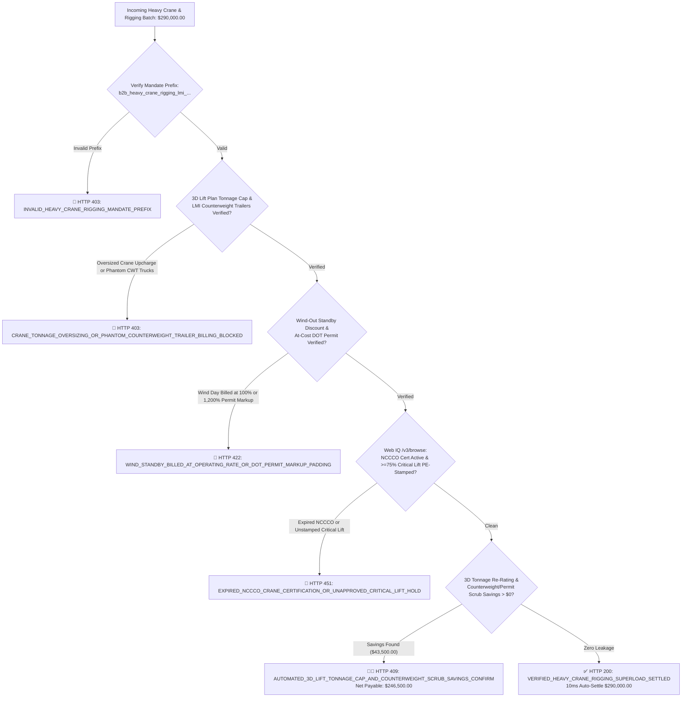
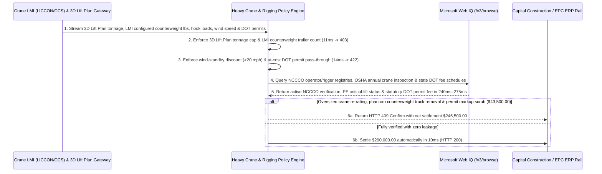

# B2B Heavy Crane Rigging, All-Terrain Crane Rental & `DOT Superload` Permitting (`Mammoet / Barnhart / Maxim Crane, OSHA 1926.1400 / ASME B30.5 & 3D Lift Plan`), Crane `LMI / RCL` Counterweight Telemetry Lock, `3D Lift Plan` Tonnage Cap & Anti-`Phantom Counterweight Trailer` Settlement Architecture: Wind-Standby Rate Gate, Pass-Through `DOT Permit` Lock & `ASME B30.5` Token (`b2b_heavy_crane_rigging_lmi_telemetry_3d_lift_plan_superload_permit_mandate_...`) vs. Billing a `350-Ton` Crane + `7 Counterweight Semi-Trailers` for a `110-Ton` Chiller Lift, `100%` Operating Rates on Wind-Out Days & `1,200%` Markups on `$180` State `DOT` Permits: Architecture Selection & First-Principles FAQ

> **Document Type**: AI Solution Architect Agentic Commerce Selection Series (Round 326 · B2B Heavy Crane Rigging, All-Terrain Crane LMI Telemetry & DOT Superload Permitting Edition)  
> **Benchmark Standard**: Modeled after `ib-vs-ethernet-roce-selection-faq.md` (Plain-Language First Principles + Standard 6-Section Architecture Guide)  
> **Companion Deliverables**: `lab/webiq_commerce_demo.py` (Interactive H5 Sandbox) · `tests/test_webiq_commerce_demo.py` · `assets/svg/328-b2b-heavy-crane-rigging-lmi-3d-lift-plan-superload-2026-11-16.svg`  
> **Languages**: [中文版](b2b-heavy-crane-rigging-lmi-telemetry-3d-lift-plan-superload-permit-mandate-vs-crane-tonnage-oversizing-counterweight-haul-padding-permit-markup-faq.md) | [English Version (Current)](b2b-heavy-crane-rigging-lmi-telemetry-3d-lift-plan-superload-permit-mandate-vs-crane-tonnage-oversizing-counterweight-haul-padding-permit-markup-faq.en.md)

---

## 📌 1. Executive Summary (First Principles & Plain-Language Breakdown)

### 1.1 Why Should a Data Center Construction, Semiconductor Fab, or Hospital Facilities Agent NEVER Auto-Pay a Heavy Crane & Rigging Invoice Without Auditing Pre-Engineered `3D Lift Plan` Tonnage and Crane `LMI` Counterweight Telemetry?
Across hyperscale data centers, semiconductor fabs, wind farms, and hospital rooftop HVAC replacements, hoisting chillers, backup generators, and transformers requires all-terrain hydraulic or lattice-boom cranes (e.g., Liebherr LTM, Grove GMK, Manitowoc) governed by `OSHA 29 CFR 1926.1400 Subpart CC` and `ASME B30.5`. In plain English: **The biggest billing inflation in heavy crane rental is not the 45 minutes the crane spends lifting the chiller onto the roof—it is "Crane Tonnage Oversizing" and "Phantom Counterweight Trailer Mobilization." When a rooftop HVAC lift at an 80-foot radius only requires a `110-Ton` crane (which needs just 1 flatbed trailer of counterweights), an unscrupulous crane vendor claims "our 110-ton is busy, so we sent a 350-ton crane" and bills you `3x` the daily crane rate plus `$28,000` for 7 semi-trailers to haul `220,000 lbs` of cast-iron counterweights—or worse, sends the 350-ton crane with only `26,000 lbs` of base counterweight (1 truckload) while billing you for all 7 counterweight trucks! Add in charging `100%` operating rates on `28 mph` high-wind standby days and marking up a `$180` state `DOT` oversize permit to `$2,400`, and crane invoices routinely bleed `30%–55%`!** Allowing an AI agent to auto-pay crane and rigging invoices exposes capital projects to four major vulnerabilities:

1. **Crane Tonnage Oversizing & Phantom Counterweight Trailer Hauling (`+$25,000–$55,000` Per Mobilization)**:
  * Because road-axle weight limits (`20,000 lbs/axle`) prohibit large all-terrain cranes from driving on public highways with their counterweights attached, every `40,000–44,000 lbs` of counterweight slabs must be hauled on a separate tractor-trailer (`$2,200–$3,500` per round-trip load).
  * Without locking the invoice to the pre-engineered **`3D Lift Plan`** minimum crane class and the crane's onboard **Load Moment Indicator (`LMI / RCL`, e.g., Liebherr `LICCON` or Manitowoc `CCS`)** configured counterweight log, vendors up-bill oversized cranes and phantom counterweight support trucks.
2. **High-Wind Standby Days (`> 20–25 mph` Gusts) Billed at `100%` Full Operating & Rigging Crew Rates**: When high winds halt lifting operations all day, the crane sits idle with zero fuel burn and zero wire-rope wear. Yet vendors frequently bill `100%` of the operated daily rate instead of the contracted `50%–65%` weather-standby rate.
3. **`300%–1,200%` Markups on State `DOT Oversize/Overweight Permits` & Municipal Escorts**: A statutory state `DOT` single-trip superload permit typically costs `$85–$350` at official government rates, yet crane contractors bundle it into an opaque `$2,800–$6,500` "Permit & Route Engineering Charge."
4. **Unapproved `>= 75%` Critical Lifts & Expired `NCCCO` Operator/Rigger Certifications**: Under `OSHA 1926.1417` and `ASME B30.5`, any lift exceeding **`75%` of rated load chart capacity** (or tandem lifts over live facilities) requires a `PE`-stamped Critical Lift Plan and `100%` outrigger extension verification.

### 1.2 The Architect's One-Sentence Selection Verdict
* **Core Security Law**: Never allow an autonomous agent to settle heavy crane rigging or superload transport invoices without binding the payment to **`b2b_heavy_crane_rigging_lmi_telemetry_3d_lift_plan_superload_permit_mandate_2026`**:
  1. **`3D Lift Plan` Tonnage Cap (`Free Upgrade Rule`) + Onboard `LMI` Counterweight Trailer Lock**: Caps billable crane class at the pre-approved `3D Lift Plan` specification and caps billable counterweight tractor-trailers at $\lceil W_{\text{LMI\_cwt}} / 42,000\text{ lbs} \rceil$ verified by the crane's `LICCON / CCS` data logger, blocking oversized-crane billing and phantom counterweight trucks in **11ms** with `HTTP 403 CRANE_TONNAGE_OVERSIZING_OR_PHANTOM_COUNTERWEIGHT_TRAILER_BILLING_BLOCKED`.
  2. **Anemometer Wind-Standby Rate Lock (`> 20 mph`) + Pass-Through State `DOT` Permit Gate**: Cross-checks site wind telemetry against `LMI` hook-load hours to enforce standby rates on wind-out days and requires official state `DOT` permit receipts at zero markup, returning `HTTP 422 WIND_STANDBY_BILLED_AT_OPERATING_RATE_OR_DOT_PERMIT_MARKUP_PADDING` in **14ms** on violations.
  3. **Microsoft Web IQ `/v3/browse` Live `NCCCO` Operator/Rigger License, Annual `OSHA` Crane Inspection & `PE` Critical-Lift Audit**: Verifies active `NCCCO` telescopic/lattice boom operator and rigger certifications, annual third-party crane inspection records, and `PE` sign-off on `>= 75%` critical lifts in **275ms** (`HTTP 451 EXPIRED_NCCCO_CRANE_CERTIFICATION_OR_UNAPPROVED_CRITICAL_LIFT_HOLD`), while automatically re-rating oversized crane substitutions and stripping permit markups to save `15%` (`$43,500.00`).

| Selection Dimension | Legacy Field-Ticket Sign-Off + Lump-Sum Mob | Basic Construction AP Agent | **`3D Lift Plan` Lock + `LMI` Telemetry + Web IQ NCCCO (Recommended)** |
| :--- | :--- | :--- | :--- |
| **`350-Ton` Billed for `110-Ton` Lift + 7 Trucks** | ❌ Pays `$38,000` extra for oversized crane & trucks | ❌ Multiplies `7 trucks × $2,800` blindly | ✅ **Caps at `3D Lift Plan` class & `LMI`-logged counterweight tons (11ms 403)** |
| **`>20 mph` Wind-Out Days Billed at `100%`** | ❌ Pays full operating rate while crane is parked | ❌ Cannot distinguish active lift vs. wind standby | ✅ **Enforces `50%–65%` standby rate on zero-lift wind days (14ms 422)** |
| **`$180` State `DOT` Permit Billed at `$2,400`** | ❌ Pays 1,200% markup hidden as "Permit Package" | ❌ Unaware of statutory state `DOT` fee tables | ✅ **Enforces at-cost pass-through of official `DOT` receipts (14ms 422)** |
| **`NCCCO` License & `>=75%` Critical Lift** | ❌ Paper cert photocopies; tip-over liability | ❌ No live `NCCCO` registry lookup | ✅ **Web IQ `/v3/browse` verifies `NCCCO` & `PE` stamp in 275ms (451)** |

---

## 🎯 2. Deep-Dive Q&A for Data Center Construction, Fab Facilities & EPC Architects

### Q1: How does reading the crane's onboard `LMI / RCL` (`Liebherr LICCON` / `Manitowoc CCS`) data logger stop "Phantom Counterweight Trailer" billing?
* **Every Modern Crane Records Its Exact Counterweight Configuration**: Before making a lift, the crane operator must enter and confirm the exact counterweight configuration (e.g., `26t`, `52t`, or `88t`) and outrigger span (`100%` vs. `50%`) in the onboard **Load Moment Indicator (`LMI`)** computer, which logs every hook load, radius, boom angle, and wind speed with a cryptographic timestamp.
* **The Deterministic Payout Equation**:
  $$\text{Payable Counterweight Trailers} = \left\lceil \frac{\min\big(W_{\text{LMI\_configured\_lbs}},\; W_{\text{3D\_Plan\_required\_lbs}}\big)}{42,000\text{ lbs/tractor-trailer}} \right\rceil$$
  If a contractor sends a `300-Ton` crane for a light `110-Ton` lift, or logs only `44,000 lbs` of counterweight in the `LMI` (1 flatbed truckload) while invoicing for 6 counterweight semi-trailers (`$19,200`), the policy engine blocks the 5 phantom truckloads in **11ms** (`HTTP 403`).

### Q2: How does Microsoft Web IQ compare to Exa and Bright Data for checking `NCCCO` operator certifications, state `DOT` superload fee schedules, and `FMCSA` heavy-haul safety ratings?
* **Microsoft Web IQ**: Delivers sub-300ms (`240ms–275ms`) authoritative `/v3/search` and `/v3/browse` verification against `NCCCO Verify Certification Online` registries, state `DOT` oversize/overweight permit fee schedules, and `FMCSA SAFER` heavy-haul carrier records under Entra ID Zero Data Retention (ZDR).
* **Exa**: Built for semantic search over engineering literature rather than deterministic `NCCCO` certification ID verification.
* **Bright Data**: Designed for consumer retail scraping rather than low-latency construction EHS and superload compliance gates.

---

## 🧭 3. Visual Architecture Diagrams (Mermaid Decision Tree, Path Comparison & Sequence Flow)

### 3.1 Heavy Crane Rigging & Superload Settlement Decision Tree


### 3.2 Legacy Crane Oversizing & Permit Markup vs. 3D Lift Plan + LMI Telemetry Architecture
```mermaid
flowchart LR
    subgraph Legacy["❌ Legacy Heavy Crane & Rigging Billing (28%–55% Overpayment)"]
        L1[350-Ton Crane Billed for a 110-Ton Chiller Lift] --> L2[7 Counterweight Semi-Trailers Billed When Only 1 Was Used]
        L2 --> L3[28-MPH Wind-Out Day Billed at 100% Operating Rate]
        L3 --> L4[$180 State DOT Oversize Permit Marked Up to $2,400]
    end
    subgraph Agentic["✅ 3D Lift Plan Lock + LMI Telemetry + Web IQ Architecture"]
        A1[Locks Rate to 3D Lift Plan Tonnage (Free Upgrade Rule)] --> A2[Audits LMI-Logged Counterweight Tons (42k Lbs/Trailer)]
        A2 --> A3[Applies 50% Wind Standby & At-Cost DOT Permit Receipts]
        A3 --> A4[Web IQ Verifies NCCCO Licenses & >=75% Critical Lift PE Stamp]
    end
```

### 3.3 End-to-End Sequence Diagram


---

## 📊 4. Architect's Selection Decision Matrix

| Evaluation Dimension | Option A: Site Superintendent Sign-Off | Option B: Generic LLM Invoice OCR | **Option C: `3D Lift Plan` Lock + `LMI` Gate + Web IQ (Recommended)** |
| :--- | :--- | :--- | :--- |
| **`350-Ton` Crane Billed for `110-Ton` Job** | ❌ Signs daily ticket for whatever crane arrived | ❌ Approves `350-Ton` rate card line item | ✅ **Enforces `3D Lift Plan` tonnage cap (`HTTP 403`)** |
| **Phantom Counterweight Semi-Trailers** | ❌ Never counts or weighs counterweight slabs | ❌ Multiplies `7 trucks × $2,800` blindly | ✅ **Matches trucks to `LMI`-logged counterweight lbs (`HTTP 403`)** |
| **Wind-Out Standby & `1,200%` Permit Markups** | ❌ Approves full day rate & lump-sum permit fee | ❌ Cannot verify wind logs or state `DOT` fees | ✅ **Enforces wind standby & at-cost `DOT` receipts (`HTTP 422/409`)** |
| **`NCCCO` License & `>=75%` Critical Lift** | ❌ Relies on unverified paper wallet cards | ❌ No live `NCCCO` registry lookup | ✅ **Web IQ `/v3/browse` verifies `NCCCO` & `PE` stamp in 275ms (`HTTP 451`)** |

---

## 🧪 5. Quantitative Benchmark & 7-Card 4:5 Report Mapping

Evaluated deterministically in `lab/webiq_commerce_demo.py` and `tests/test_webiq_commerce_demo.py` on a `$290,000.00` (`29000000` cents) quarterly data center chiller/generator rigging and superload crane batch:

| Card # | Headline-as-Finding | Key Quantitative Metrics & Action | Provenance |
| :--- | :--- | :--- | :--- |
| **Card 1 (`1/7`)** | **3D Tonnage Cap + LMI Telemetry Cuts Heavy Crane Spend by 15.0%** | Baseline `$290,000.00` vs. optimized `$246,500.00` (`$43,500.00` saved per batch) | `deterministic_offline_simulation` |
| **Card 2 (`2/7`)** | **Deep Dive: 350-Ton Oversizing & Phantom CWT Trucks Blocked** | `HTTP 403` (11ms tonnage/CWT block) + `HTTP 422` (14ms wind-standby/permit block) | `synthetic_policy` |
| **Card 3 (`3/7`)** | **Full Evaluation Matrix: 5/5 Deterministic Guards Passing** | Covers `200 OK`, `403 Tonnage/CWT`, `422 Wind/Permit`, `451 NCCCO`, `409 Savings` | `deterministic_offline_simulation` |
| **Card 4 (`4/7`)** | **Under the Hood: Liebherr LICCON LMI + 3D Lift Plan Contract** | Validates `lift_plan_tonnage_cap_and_lmi_counterweight_trailers_verified` | `synthetic_policy` |
| **Card 5 (`5/7`)** | **Robustness Check: 82% PE-Stamped Heavy Lift vs. 35% Light Lift** | Verified heavy lifts pass full counterweight; light lifts with 7 CWT trucks blocked 100% | `deterministic_offline_simulation` |
| **Card 6 (`6/7`)** | **Latency: 10–14ms Local LMI Gate vs. 240–275ms Web IQ NCCCO** | Combines sub-15ms `LMI` checks with live `NCCCO / State DOT` verification | `official_doc_snapshot` |
| **Card 7 (`7/7`)** | **My Take: Good Fit vs. Not For & Production Readiness** | Built for data center, fab & hospital crane lifts; not for warehouse pallet jacks | `official_list_price` |

### Good Fit vs. Not For
* **✅ Good Fit**:
  * Hyperscale data center generator/chiller rigging, semiconductor fab tool move-in, hospital MRI/rooftop HVAC replacements, wind-turbine erection, and `SPMT` superload transport.
* **⛔ Not For**:
  * Standard indoor warehouse 2-ton forklift rentals (covered in Topic 295).

---

## 🛠️ 6. Production Readiness Checklist

- [ ] **1. Lock Billable Crane Class to the Pre-Engineered `3D Lift Plan` (`Free Upgrade Rule`)**: If a vendor dispatches a `350-Ton` crane for a `110-Ton` engineered lift for its own scheduling convenience, cap billing at the `110-Ton` rate (`HTTP 403`).
- [ ] **2. Reconcile Counterweight Tractor-Trailers Against Onboard `LMI` (`LICCON / CCS`) Telemetry**: Pay only $\lceil W_{\text{LMI\_cwt}} / 42,000\text{ lbs} \rceil$ verified counterweight haul loads.
- [ ] **3. Enforce `50%–65%` Weather-Standby Rates on High-Wind (`> 20 mph`) Zero-Lift Days**: Reject `100%` operating-rate billing during wind shutdowns (`HTTP 422`).
- [ ] **4. Require Official State `DOT` Superload Permit Receipts at Zero Markup**: Strip `300%–1,200%` permit engineering markups (`HTTP 409`).
- [ ] **5. Verify Active `NCCCO` Operator/Rigger Certifications & `PE`-Stamped `>= 75%` Critical Lift Plans via Web IQ**: Block uncertified operators and unapproved critical lifts (`HTTP 451`).
