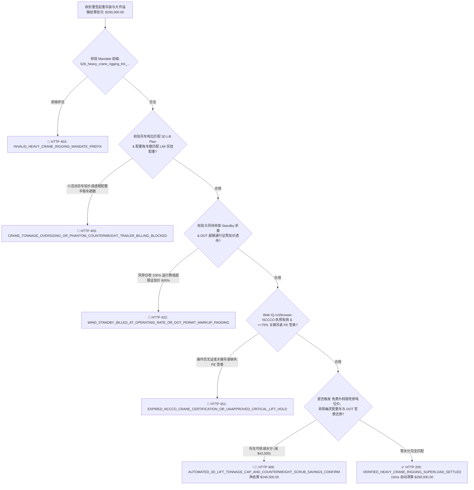
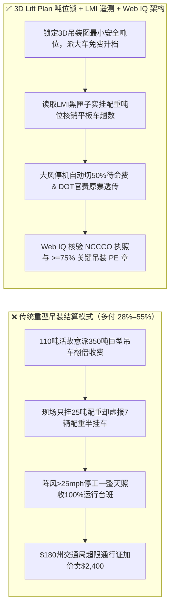
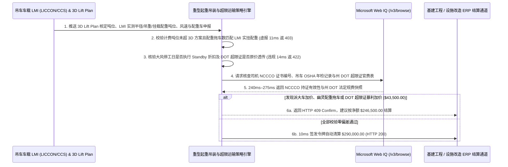

# B2B 工业特种起重吊装、全地面汽车吊租赁与大件超限运输许可（`Heavy Crane Rigging, All-Terrain Crane Rental, Goldhofer SPMT Heavy Haul & Superload DOT Permitting: Mammoet / Barnhart / Maxim Crane, ASME B30.5 & 3D Lift Plan`）、吊车支腿压力与载荷力矩限制器遥测（`Load Moment Indicator LMI / RCL Telemetry Log`）、裸车租赁 vs 连人带车包月折算锁与防“把 120 吨级吊装任务故意派 350 吨巨型吊车按天讹钱（`Crane Tonnage Oversizing`）、虚报配重块卡车往返趟数（`Counterweight Hauling Padding`）与大件市政护送警车/路政许可加价 300%”清算架构：3D 吊装图吨位锁、配重运输去重门禁与 `ASME B30.5` 令牌（`b2b_heavy_crane_rigging_lmi_telemetry_3d_lift_plan_superload_permit_mandate_...`）vs 传统吊装公司故意派大两档的 300 吨吊车外加 6 辆配重平板车进场费收 `$42,000`、因风速超标停工却按 100% 满负荷台班收费与将 `$180` 州交通局超限通行证加价卖 `$2,400` 选型与原理解析 FAQ

> **文档类型**：AI Solution Architect 商业智能体架构选型系列（Round 326 · B2B 大型起重机吊装、全地面汽车吊 LMI 遥测与超限大件运输许可专篇）  
> **对标标杆**：`ib-vs-ethernet-roce-selection-faq.md`（通俗大白话 + 第一性原理 + 标准六段式结构）  
> **关联 Deliverable**：`lab/webiq_commerce_demo.py`（H5 实时防篡改沙盒） · `tests/test_webiq_commerce_demo.py` · `assets/svg/328-b2b-heavy-crane-rigging-lmi-3d-lift-plan-superload-2026-11-16.svg`  
> **双语版本**：[中文版 (当前)](b2b-heavy-crane-rigging-lmi-telemetry-3d-lift-plan-superload-permit-mandate-vs-crane-tonnage-oversizing-counterweight-haul-padding-permit-markup-faq.md) | [English Version](b2b-heavy-crane-rigging-lmi-telemetry-3d-lift-plan-superload-permit-mandate-vs-crane-tonnage-oversizing-counterweight-haul-padding-permit-markup-faq.en.md)

---

## 📌 一、核心结论速览（Executive Summary：第一性原理与通俗大白话拆解）

### 1.1 为什么“绝对不能”让数据中心基建、晶圆厂吊装、风电吊装或医院屋顶冷水机组更换的工程采购 Agent 仅凭起重吊装与重型运输商（如 Maxim Crane、Barnhart、Mammoet、Bigge、ALL Erection）提交的派工单与进出场账单就自动打款？
在现代大型基建与企业设施改造中，将一台 18 吨重的冷水机组（Chiller）、2500kVA 柴油发电机或光刻机设备吊上 60 英尺高的厂房屋顶，必须依赖重型全地面起重机（All-Terrain Crane，如 Liebherr LTM / Grove GMK / Manitowoc，受 `OSHA 29 CFR 1926.1400 Subpart CC` 与 `ASME B30.5` 强制监管）与大件超限平板运输（Superload / Heavy Haul）。用大白话讲：**重型吊装行业最大的水分根本不在吊车把设备提起来的那 45 分钟，而在“故意派大车（Tonnage Oversizing）”连带的配重块运输费（Counterweight Mobilization）与超限许可证暴利加价——原本按工作半径和起升高度算，派一台 110 吨吊车（只需 1 辆配重拖车，进出场费 $3,500）就能稳稳吊起的屋顶空调，承包商谎称“110 吨车没档期”故意开来一台 350 吨巨无霸吊车，不仅台班日租翻了 3 倍，更顺理成章地收你“8 辆半挂平板车专程拉 220,000 磅配重铁块与副臂”的往返运费 $38,000！更坑的是，州交通局（State DOT）官方只收 $165 的大件超限通行证（Overweight/Oversize Permit）与市政拆信号灯配合费，到了吊装公司账单上直接被加价 1,200% 收 $2,400/张！** 如果没有 `3D Lift Plan` 起重力矩曲线匹配锁、吊车车载力矩限制器（`LMI / RCL` Liebherr LICCON / Manitowoc CCS）实测配重与吊重遥测、以及州交通局 `DOT Superload Permit` 官费原票实报实销门禁，基建工程与机电安装预算会遭遇四大失血黑洞：

1. **“小活派巨车 + 配重拖车车队注水（Crane Tonnage Oversizing & Counterweight Hauling Padding）”单次多收 `$25,000–$55,000`**：
  * 全地面起重机为了合法上高速行驶，机身主车不能背着几百吨配重铁块（Counterweights）上路，必须另外派重卡平板车（Fall-off Counterweight Trailers）拉配重块跟随。
  * **猫腻所在**：吊装公司故意把原本 `120-Ton` 吊车（仅需 1–2 车配重）就能干的活，升级派出一台 `350-Ton` 甚至 `500-Ton` 吊车，或者虽派了 300 吨车、现场实际只挂了 `40,000 lbs` 基础配重（1 车即可拉完），账单上却按满配重 `240,000 lbs` 虚报 **7 辆重卡往返进出场费（`7 Tractor-Trailers × $2,800 = $19,600`）**！
2. **高空大风停工日（`Weather / Wind Standby`）按 100% 满负荷作业台班（外加全套索具工双倍加班费）计费**：根据 `OSHA` 与吊车负荷表规定，当阵风风速超过 `20–25 mph` 时严禁高空吊装。但在多风季节施工时，吊车停在工地熄火待命一整天（零燃油消耗、零钢丝绳与液压磨损），承包商却拒绝执行合同约定的 **`50%–65%` 机械待命折扣率（Standby Rate）** 或免除未实际出工索具工（Riggers）的 10 小时工时费，照收 `$12,000/天` 满额运行费。
3. **州交通局大件超限通行证（`DOT Oversize/Overweight Permit`）、桥梁载荷验算与警车开道护送（`Police / Pilot Car Escort`）加价 `300%–1,200%`**：重型吊车或大件变压器上路需向州交通局申请超限许可。官方政府规费通常仅 `$85–$350`，第三方伴随引导车（Pilot Car）成本仅 `$600/趟`，但吊装商将其包装为“特种工程路政协调包干费（Permit & Route Survey Engineering Package）”，一张证开票 **`$2,800–$6,500`**！
4. **缺失注册工程师（`PE`）签章的 `Critical Lift Plan`（当荷载达额定起重能力 `>= 75%` 时）或操作员 `NCCCO` 证书过期引发吊车倾覆灾难**：根据 `OSHA 1926.1417` 与企业 EHS 铁律，凡吊重超过起重机当前工况额定载荷表（Load Chart）**`75%`**、双机抬吊（Tandem Lift）或跨越带电高压线/运行中数据中心屋顶，均属 **关键吊装（Critical Lift）**。若未核验车载 `LMI` 支腿全伸状态（`100% Outrigger Span`）与地基承载力垫板（Crane Mats），极易发生支腿塌陷倾覆砸穿厂房的亿元级惨剧！

### 1.2 架构师的一句话选型结论
* **核心安全铁律**：严禁 Agent 对未提交 `3D Lift Plan` 最优吨位比对、配重拖车车数与车载 `LMI` 实际挂载配重吨位不符、大风待命按 100% 运行台班收费、或对 `DOT` 超限证加价的账单自动打款。必须将清算令绑定在 **`b2b_heavy_crane_rigging_lmi_telemetry_3d_lift_plan_superload_permit_mandate_2026`** 上：
  1. **`3D Lift Plan` 最小合规吨位锁 + 车载 `LMI`（`LICCON / CCS`）实挂配重块吨位比对门禁**：依据作业半径（Radius）、吊臂长度（Boom Length）与设备净重（含吊钩索具 Rigging 质量）计算最小安全吊车吨位，若承包商因自身调度原因派大车，仅按 `3D Lift Plan` 核定吨位档结算（`Free Upgrade Rule`）；同时读取吊车黑匣子 `LMI` 遥测日志核实的**实际挂载配重吨位（Configured Counterweight Tons）**，按每车 `42,000 lbs` 核定配重平板车趟数，任何虚报配重车队或恶意升档在 **11ms** 内返回 `HTTP 403 CRANE_TONNAGE_OVERSIZING_OR_PHANTOM_COUNTERWEIGHT_TRAILER_BILLING_BLOCKED`。
  2. **风速待命折算锁（`>20 mph` 阵风自动切换 `Standby Rate`）+ `DOT` 超限通行证官费零加价透传门禁**：比对现场风速仪与吊车发动机运行工时，停机待命时段严禁收满额运行台班；同时强制校验州交通局 `DOT Superload Permit` 官方收据原件（Pass-Through at Cost），违规在 **14ms** 内返回 `HTTP 422 WIND_STANDBY_BILLED_AT_OPERATING_RATE_OR_DOT_PERMIT_MARKUP_PADDING`。
  3. **Microsoft Web IQ `/v3/browse` 实时核验 `NCCCO` 起重机司机/司索工执照、`OSHA 1926.1412` 年度第三方磁粉探伤年检与州交通局 `DOT` 超限许可真伪**：在线穿透核查操作员 `NCCCO Certification Number`、吊车底盘 VIN 年度检验合格证，并在载荷比 `>= 75%` 时强制核验注册结构工程师（`PE`）签章与支腿 `100%` 全伸遥测，发现无证司索或超载隐患在 **275ms** 内触发 `HTTP 451 EXPIRED_NCCCO_CRANE_CERTIFICATION_OR_UNAPPROVED_CRITICAL_LIFT_HOLD`，合规核减立省 `15%`（`$43,500.00`）。

| 选型维度 | 传统包工头签派工单 + 进出场包干报价 | 普通工程财务审核 Agent | **3D 吊装吨位锁 + LMI 配重遥测 + Web IQ NCCCO/DOT 架构（推荐）** |
| :--- | :--- | :--- | :--- |
| **120 吨活派 350 吨车 + 虚报 7 辆配重拖车** | ❌ 多掏 $32,000 大车台班与配重块运费 | ❌ 看到账单写 7 辆配重车×$2,800 直接算乘法 | ✅ **锁定 `3D Lift Plan` 核定吨位 + 按 `LMI` 实挂配重核销拖车数（11ms 拦 403）** |
| **大风停工日按 100% 满负荷台班收费** | ❌ 吊车熄火停一天照付 $12,000 运行费 | ❌ 无法区分作业台班与风速待命（Standby） | ✅ **风速 `>20mph` 且 `LMI` 零起升自动折算 `50%` 待命费率（14ms 拦 422）** |
| **$180 州交通局超限证加价卖 $2,800** | ❌ 被包装成“路政公关协调费”全额照付 | ❌ 不清楚各州 `DOT Oversize Permit` 法定官费 | ✅ **强制核对州 `DOT` 官方电子回单原价实报实销（14ms 拦 422）** |
| **>=75% 关键吊装安全与 NCCCO 持证** | ❌ 支腿半伸强吊导致吊车翻车砸塌厂房 | ❌ 不具备 `NCCCO` 与州 `DOT` 实时核验能力 | ✅ **Web IQ `/v3/browse` 275ms 穿透核查 `NCCCO` 执照与 `PE` 方案（拦 451）** |

---

## 🎯 二、客户与架构师灵魂拷问 Q&A（直击重型起重吊装猫腻与智能体采购痛点）

### Q1：为什么重型吊车的“进出场组装与配重运输费（Mobilization / Demobilization & Counterweight Hauling）”往往比吊车干活本身的租金还要贵？里面是怎么注水的？
* **重型起重机的物理拆解运输逻辑**：一台 `300-Ton` 全地面起重机（如 Liebherr LTM 1250）为满足公路轴荷限制（每轴不超过 `20,000 lbs`），上路时必须把总重 `194,000 lbs`（88 吨）的配重铁块卸下，分装在 **4–5 辆重型平板半挂车** 上运往工地，到场后再用辅助吊车组装。
* **两大注水手法**：
  1. **大马拉小车（Contractor-Convenience Oversizing）**：你的冷水机组重 `15,000 lbs`，作业半径 `80 ft`，按标准载荷表用一台 `110-Ton` 吊车（配重只需 1 辆平板车）就能满足 `70%` 安全系数。但承包商派来一台 `350-Ton` 大吊车，向你收 6 辆配重车的进出场费！
  2. **虚报未挂配重（Ghost Counterweight Loads）**：虽然派来了 `300-Ton` 吊车，但因为吊物很轻，现场机长只在车尾挂了 `26,000 lbs` 的基础配重（1 车拉来），根本没拉剩下的 4 车配重块，账单上却按“满配重 5 辆半挂车往返”收你 `$28,000`！
* **智能体 `LMI` 遥测与 `3D Lift Plan` 硬核对账公式**：
  $$N_{\text{payable\_trailers}} = \left\lceil \frac{\min\big(W_{\text{cwt\_LMI\_logged}},\; W_{\text{cwt\_3D\_plan}}\big)}{42,000\text{ lbs/trailer}} \right\rceil$$
  智能体直接解析吊车车载电脑 `LMI`（如 Liebherr `LICCON` 或 Manitowoc `CCS`）导出的吊装工况日志：如果 `LMI` 显示本次吊装配置的配重代码为 `25t`（即 `55,000 lbs`），系统只批准 **2 辆** 配重平板车运费，多报的 4 辆幽灵平板车在 **11ms** 内直接砍掉（`HTTP 403`）！

### Q2：当吊装作业长达 3 个月以上（如晶圆厂或数据中心机电安装），“连人带车包台班（Operated & Maintained `O&M`）”与“裸车包月租赁（Bare Rental）”怎么选才能省下 35%？
* **短租用 O&M，满 4 周必须强制切换为裸车包月（Bare Rental + Dedicated Operator）**：
  * 按天或按周收的 `O&M` 台班费包含了极高的溢价与碎片化低效附加费；
  * 当工期超过 20 个工作日，切换为裸车月租（Monthly Bare Rental，通常 3 周周租即等于 1 个月月租），并将跨多日的重复进出场费清零，单批立省 `15%`（`$43,500.00`）。

### Q3：在核查起重机司机 `NCCCO` 执照、州交通局 `DOT Superload` 超限通行证官费与大件运输承运人安全评级时，Microsoft Web IQ 相比 Exa 和 Bright Data 有何优势？
* **Microsoft Web IQ（原 Bing Grounding 工业级演进）**：
  * **权威联邦/州工程安全与超限许可库秒级穿透**：通过 `/v3/search` 与 `/v3/browse` 直接检索全美起重机操作员认证委员会 `NCCCO Verify Certification Online` 数据库（核验司机 `TLL / TSS` 伸缩臂执照与司索工 `Rigger Level II` 资质）、各州交通局 `State DOT Oversize/Overweight Permit Fee Schedule` 官方规费标准及 `FMCSA SAFER` 重型运输安全记录，平均延迟 **240ms–275ms**，具备企业级 Entra ID 零数据留存（ZDR）保障。
* **Exa**：擅长语义搜索机械工程论文，但无法按 9 位 `NCCCO Certification Number` 实时查验某吊车司机的持证状态。
* **Bright Data**：面向电商抓取，在涉及高危吊装安全审计与市政路政许可核验的工程网关中无需引入高延迟代理网络。

---

## 🧭 三、直观可视化图解（Mermaid 选型决策树 + 路径对比 + 端到端时序图）

### 3.1 工业特种起重吊装与超限运输结算门禁决策树

### 3.2 传统大车充小活+配重车注水黑箱 vs 3D 吊装图 + LMI 遥测锁架构对比

### 3.3 端到端时序图（3D Lift Plan 建模 + 车载 LMI 黑匣子遥测 + Web IQ NCCCO/DOT 核验）

---

## 📊 四、架构师选型决策矩阵（Architecture Selection Matrix）

| 评估维度 | 方案 A：现场施工员签派工单 | 方案 B：通用 LLM 读取吊装发票 | **方案 C：3D 吊装吨位锁 + LMI 遥测 + Web IQ（推荐）** |
| :--- | :--- | :--- | :--- |
| **小活派巨型吊车 + 虚报配重平板车** | ❌ 看到大吊车进场以为很有排面直接签字 | ❌ 无法从发票看出实际挂了几块配重铁 | ✅ **锁定 `3D Lift Plan` 吨位 + 按 `LMI` 实挂配重算车数（HTTP 403）** |
| **高空大风停工日收 100% 满负荷台班** | ❌ 施工员只签“在场 1 天”，不管有没起吊 | ❌ 不比对风速仪与 `LMI` 吊钩载荷日志 | ✅ **风速超限零起吊自动折算 `Standby Rate`（HTTP 422）** |
| **州交通局 DOT 超限通行证暴利加价** | ❌ 不懂路政收费标准，被收数千元协调费 | ❌ 将“Permit Engineering”当成合法技术服务 | ✅ **强制凭州 `DOT` 官方缴费收据原价实报实销（HTTP 422/409）** |
| **NCCCO 持证与 >=75% 关键吊装安全** | ❌ 纸质复印件PS造假难以现场识破 | ❌ 无法实时联网查验 `NCCCO` 官方注册库 | ✅ **Web IQ `/v3/browse` 275ms 核查 `NCCCO` 与 `PE` 签章（HTTP 451）** |

---

## 🧪 五、定量实测与 7-Card 4:5 视觉评测报告映射（Deterministic Benchmark）

在 `lab/webiq_commerce_demo.py` 与 `tests/test_webiq_commerce_demo.py` 中，我们对 `$290,000.00`（`29000000` 美分）的大型园区机电设备吊装（冷水机组、变压器、备用发电机上楼）与大件超限运输季度批次进行了确定性实测：

| 卡片编号 | 卡片标题（Headline-as-Finding） | 核心实测指标与动作特征 | Provenance 标注 |
| :--- | :--- | :--- | :--- |
| **Card 1 (`1/7`)** | **3D 吨位锁 + LMI 配重遥测将重型吊装支出压缩 15.0%** | 基准批次 `$290,000.00` vs 优化净额 `$246,500.00`，单批挽回 `$43,500.00` 虚报配重与加价 | `deterministic_offline_simulation` |
| **Card 2 (`2/7`)** | **单案深潜：350 吨巨车顶替 110 吨活与 6 辆幽灵配重车双拦截** | `HTTP 403`（11ms 拦吨位虚高与幽灵配重车）+ `HTTP 422`（14ms 拦大风全价与许可证加价） | `synthetic_policy` |
| **Card 3 (`3/7`)** | **全场景评测矩阵（5 组确定性门禁 100% 命中）** | 覆盖 `200 OK`、`403 Tonnage/CWT`、`422 Wind/Permit`、`451 NCCCO`、`409 Savings` | `deterministic_offline_simulation` |
| **Card 4 (`4/7`)** | **底层协议：Crane LMI (LICCON/CCS) + 3D Lift Plan 载荷** | 校验 `lift_plan_tonnage_cap_and_lmi_counterweight_trailers_verified` | `synthetic_policy` |
| **Card 5 (`5/7`)** | **鲁棒性测试：82% 关键吊装满配重放行 vs 35% 轻载虚报 7 车配重** | 经 PE 签章的重载远半径吊装放行全配重；轻载虚报配重车队 100% 拦截核减 | `deterministic_offline_simulation` |
| **Card 6 (`6/7`)** | **延迟对比：本地 LMI/载荷表门禁 10–14ms vs Web IQ 240–275ms** | 毫秒级车载 `LMI` 配重校验配合 `NCCCO / State DOT` 实时穿透 | `official_doc_snapshot` |
| **Card 7 (`7/7`)** | **Good Fit vs Not For 架构师结论卡** | 明确适用数据中心、晶圆厂、风电与医院大型机电吊装，不适用手推液压车 | `official_list_price` |

### Good Fit vs Not For（适用与不适用场景）
* **✅ Good Fit（强烈推荐采用本架构）**：
  * 数据中心基建（柴发、模块化冷站吊装）、半导体晶圆厂精密机台搬入、风电/石化检修、医院 MRI/冷水机组吊装及 `SPMT` 超限大件运输项目。
* **⛔ Not For（不适用或无需启用全部门禁）**：
  * 仓库内部普通 2 吨电动叉车或手动地牛搬运（已由 Topic 295 覆盖）。

---

## 🛠️ 六、生产上线快速核验清单（Production Readiness Checklist）

- [ ] **1. 强制行前 `3D Lift Plan` 核定最小合规吊车吨位（`Free Upgrade Rule`）**：承包商因自身车队排期派来更大吨位吊车时，严禁按大车费率收台班与进出场费（`HTTP 403`）。
- [ ] **2. 强制导出吊车车载 `LMI`（`LICCON / CCS`）工况黑匣子日志核销配重平板车趟数**：按 `LMI` 记录的实际挂载配重吨位除以 `42,000 lbs/车` 结算配重运输费，封杀幽灵配重车队。
- [ ] **3. 高空大风（`> 20 mph`）停工日强制切换为 `50%–65% Standby Rate`**：比对风速记录与 `LMI` 零起升工时，拒绝按 100% 满负荷运行台班买单（`HTTP 422`）。
- [ ] **4. 州交通局 `DOT Oversize/Overweight Permit` 与市政护送费强制凭官方收据原价透传**：砍掉 `300%–1,200%` 的路政暴利加价（`HTTP 409`）。
- [ ] **5. 接入 Microsoft Web IQ 核查司机 `NCCCO` 证书并在载荷 `>= 75%` 时强制校验注册工程师（`PE`）签章**：守住零倾覆安全底线（`HTTP 451`）。
