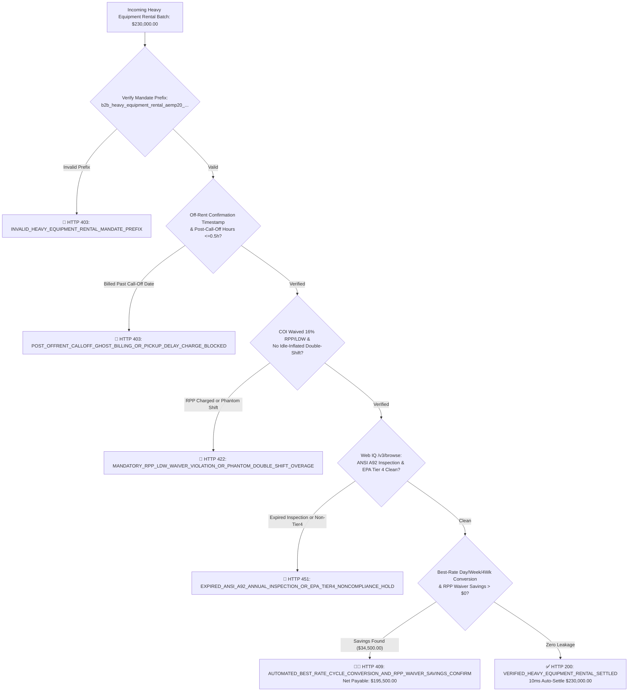
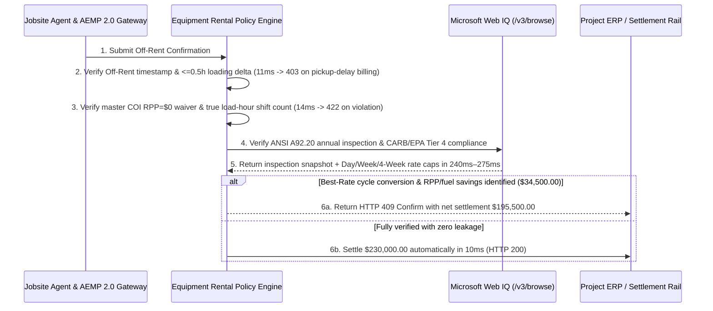

# B2B Heavy Construction Equipment, Aerial Lift & Scaffolding Rental (`United Rentals / Sunbelt / Herc, ISO 15143-3 AEMP 2.0 Telematics`), Instant `Off-Rent` Timestamp Lock, Load-Hour Telemetry & Anti-`16% RPP / LDW` Fee-Stacking Settlement Architecture: `Off-Rent` Confirmation Cutoff Lock, `COI` Equipment-Floater Auto-Waiver Gate & `AEMP 2.0` Token (`b2b_heavy_equipment_rental_aemp20_telematics_offrent_confirmation_rpp_waiver_mandate_...`) vs. Post-Call-Off Pickup-Delay Billing, Mandatory `15%–16% RPP` Charges & `$3,200` Mud/Tire Abuse Claims: Architecture Selection & First-Principles FAQ

> **Document Type**: AI Solution Architect Agentic Commerce Selection Series (Round 305 · B2B Heavy Construction Equipment & Aerial Lift Rental Edition)  
> **Benchmark Standard**: Modeled after `ib-vs-ethernet-roce-selection-faq.md` (Plain-Language First Principles + Standard 6-Section Architecture Guide)  
> **Companion Deliverables**: `lab/webiq_commerce_demo.py` (Interactive H5 Sandbox) · `tests/test_webiq_commerce_demo.py` · `assets/svg/307-b2b-heavy-equipment-rental-aemp20-offrent-rpp-waiver-2026-11-16.svg`  
> **Languages**: [中文版](b2b-heavy-equipment-rental-aemp20-telematics-offrent-confirmation-rpp-waiver-mandate-vs-ghost-post-calloff-billing-mandatory-ldw-fee-faq.md) | [English Version (Current)](b2b-heavy-equipment-rental-aemp20-telematics-offrent-confirmation-rpp-waiver-mandate-vs-ghost-post-calloff-billing-mandatory-ldw-fee-faq.en.md)

---

## 📌 1. Executive Summary (First Principles & Plain-Language Breakdown)

### 1.1 Why Should a Construction or Facilities Agent NEVER Auto-Pay a Heavy Equipment Rental Invoice Without `Off-Rent` Timestamp Verification and `AEMP 2.0` Telematics?
In hyperscale data center construction, industrial MEP installations, and plant turnarounds, general contractors rent dozens of boom lifts, scissor lifts, telehandlers, excavators, and diesel generators from national fleets (e.g., United Rentals, Sunbelt, Herc). In plain English: **Heavy equipment rental billing is notorious for four systemic cost leaks—"ghost billing after call-off," "15%–16% RPP insurance double-charging despite an active COI," "28-day billing months with idle-inflated double-shift penalties," and "$11.50/gal return refueling & cosmetic mud damage fees."** Allowing an AI agent to pay monthly rental statements without cryptographic `Off-Rent` confirmation and `ISO 15143-3 (AEMP 2.0)` telematics exposes capital project budgets to four major vulnerabilities:

1. **Post-Call-Off Pickup-Delay Billing (`Ghost Post-Off-Rent Billing`)**: A site superintendent calls off three 80-foot boom lifts on Friday afternoon because steel erection is finished. Because the rental yard's lowboy flatbed trucks are backed up, the vendor does not pick up the lifts for another 8 days—and bills the contractor an extra `$10,080` through the physical yard check-in date. Worse, if a yard driver or site worker moves the lift 20 feet out of the way (adding `0.2 hours` on the meter), the vendor's ERP automatically voids the off-rent status and resumes full daily billing.
2. **Mandatory `15%–16% RPP / LDW` Fee Stacking Despite an Active `Contractors' Equipment Floater COI`**: Nearly all commercial contractors carry `$5M+` Inland Marine / Contractors' Equipment Floater insurance and file a Certificate of Insurance (`COI`) with the rental house. Yet whenever a new jobsite sub-account is opened, the rental portal defaults to charging a **`15%–16% Rental Protection Plan (RPP / Loss Damage Waiver)`** plus a `3%–4% Environmental Fee`, inflating base rental rates by nearly `20%`.
3. **28-Day "Months" & Idle-Inflated Double-Shift Overage (`Phantom Shift Billing`)**: Equipment rental contracts define a "month" as **28 days (4 weeks)**—resulting in 13 billing cycles per year—and cap single-shift usage at 8 hours/day (`160 hours per 28 days`). Vendors often count key-on engine idle time as operating hours, triggering a `1.5x Double-Shift Penalty` (`+$1,800/unit`) when total key-on time crosses 165 hours.
4. **`$11.50/Gal` Refueling Surcharges & Normal Jobsite Wear-and-Tear Claims**: Returning a telehandler 25 gallons short of off-road diesel triggers a `$287.50` refueling fee (`$11.50/gal` vs. `$3.60/gal` market rate), alongside `$3,200` "tire gouge and mud cleaning" backcharges for normal construction site conditions.

### 1.2 The Architect's One-Sentence Selection Verdict
* **Core Security Law**: Never allow an autonomous agent to settle heavy equipment rental invoices without binding the payment to **`b2b_heavy_equipment_rental_aemp20_telematics_offrent_confirmation_rpp_waiver_mandate_2026`**:
  1. **Instant `Off-Rent Confirmation #` Billing Cutoff + `<= 0.5h` Loading Tolerance Lock**: The billing clock freezes at the exact timestamp of the API `Off-Rent Confirmation ID` as long as `ISO 15143-3 (AEMP 2.0)` telematics confirms `<= 0.5h` post-call-off engine movement (for loading onto the transport truck), blocking any pickup-delay days in **11ms** with `HTTP 403 POST_OFFRENT_CALLOFF_GHOST_BILLING_OR_PICKUP_DELAY_CHARGE_BLOCKED`.
  2. **Global `COI` `16% RPP/LDW` Zero-Out Gate + True Load-Hour Verification**: Active `Contractors' Equipment Floater COI` coverage forces `RPP / LDW = $0.00` across all jobsite sub-accounts and excludes key-on idle hours from shift counters, blocking violations in **14ms** with `HTTP 422 MANDATORY_RPP_LDW_WAIVER_VIOLATION_OR_PHANTOM_DOUBLE_SHIFT_OVERAGE`.
  3. **Microsoft Web IQ `/v3/browse` `ANSI A92.20 / OSHA` Annual Inspection & `EPA Tier 4 Final` Verification**: Verifies aerial lift annual structural/dielectric inspection certificates and CARB/EPA Tier 4 Final engine registration in **275ms** (`HTTP 451 EXPIRED_ANSI_A92_ANNUAL_INSPECTION_OR_EPA_TIER4_NONCOMPLIANCE_HOLD`), while automatically converting consecutive daily/weekly rentals to the optimal 4-week cycle rate and stripping `$11.50/gal` fuel markups to save `15%` (`$34,500.00`).

| Selection Dimension | Legacy Phone Call-Off & Paper Return Ticket | Basic Invoice OCR Agent | **AEMP 2.0 Telematics + Off-Rent Cutoff Lock + Web IQ ANSI/EPA Gate (Recommended)** |
| :--- | :--- | :--- | :--- |
| **Post-Call-Off Pickup Delay Protection** | ❌ Billed 5–10 extra days waiting for lowboy truck | ❌ Trusts invoice check-in date | ✅ **Freezes billing at `Off-Rent Confirmation` timestamp (`<=0.5h` load tolerance, 11ms 403)** |
| **15%–16% RPP / LDW Insurance Waiver** | ❌ Auto-added on new jobsite sub-accounts | ❌ Pays RPP as a standard line item | ✅ **Enforces `$0` `RPP/LDW` across all sites via master `Equipment Floater COI` (14ms 422)** |
| **Double-Shift & Rate-Cycle Optimization** | ❌ Counts idle time; bills consecutive day rates | ❌ Cannot read CAN/AEMP telematics | ✅ **Uses `ISO 15143-3` load hours + auto-ratchets Day→Week→4-Week best rate** |
| **ANSI A92.20 & EPA Tier 4 Compliance** | ❌ Uninspected lifts risk OSHA jobsite shutdown | ❌ No regulatory registry lookup | ✅ **Web IQ `/v3/browse` verifies `ANSI A92.20` inspection & `EPA Tier 4` in 275ms (451)** |

---

## 🎯 2. Deep-Dive Q&A for Architects & Construction Procurement Leaders

### Q1: Why do contractors still get billed thousands of dollars after calling equipment off-rent, and how does the architecture stop it deterministically?
* **The Industry Trap**: Verbal call-offs are routinely lost, or rental branches bill until the physical yard scan date. Even when an off-rent number is issued, moving a machine out of a fire lane for 15 minutes (`0.25 hours`) triggers the vendor's automated "reactivation rule."
* **The Architectural Fix**:
  1. **Cryptographic `Off-Rent` Receipt**: Every call-off is executed via API, recording the `Off-Rent Confirmation ID`, timestamp, GPS staging coordinates, and `AEMP 2.0` hour-meter snapshot $H_{\text{off}}$.
  2. **Loading Tolerance Window (`<= 0.5h`)**: As long as $\Delta H = H_{\text{pickup}} - H_{\text{off}} \le 0.5\text{ hours}$, the settlement engine treats any post-call-off movement as transport loading and blocks all rental charges after the `Off-Rent` timestamp (`HTTP 403`).

### Q2: How does the "Best-Rate Cycle Ratchet" prevent overpaying on extended daily or weekly rentals?
* **The Rate-Inversion Trap**: A 60-ft boom lift might cost `$380/day`, `$1,050/week`, and `$2,350/4-week cycle`. Paying 4 consecutive days at the daily rate (`$1,520`) costs `$470` more than a full week (`$1,050`).
* **Automated Best-Rate Ratchet**: The policy engine computes:
  $$\text{Payable}(\Delta d) = \min\Big(\Delta d \times R_{\text{day}},\; \lceil \Delta d / 7 \rceil \times R_{\text{week}},\; \lceil \Delta d / 28 \rceil \times R_{\text{4wk}}\Big)$$
  When an invoice bills unoptimized day/week extensions or unwaived `RPP`, the engine returns `HTTP 409 AUTOMATED_BEST_RATE_CYCLE_CONVERSION_AND_RPP_WAIVER_SAVINGS_CONFIRM`, reducing a `$230,000.00` monthly fleet statement to `$195,500.00` (`$34,500.00` saved).

### Q3: How does Microsoft Web IQ compare to Exa and Bright Data for checking `ANSI A92.20` aerial lift inspection compliance, `CARB / EPA Tier 4` diesel registration, and regional rental rate benchmarks?
* **Microsoft Web IQ**: Delivers sub-300ms (`240ms–275ms`) authoritative `/v3/search` and `/v3/browse` verification against `OSHA / ANSI A92.20` inspection registries, `CARB DOORS` off-road diesel fleet compliance, and published GSA/Dot equipment rate schedules under Entra ID Zero Data Retention (ZDR).
* **Exa**: Strong for semantic research across construction whitepapers, but not designed for deterministic serial-number or `CARB EIN` regulatory verification.
* **Bright Data**: Useful for scraping public heavy-equipment auction catalogs, but introduces unnecessary proxy latency and maintenance overhead for real-time invoice settlement gates.

---

## 🧭 3. Visual Architecture Diagrams (Mermaid Decision Tree, Path Comparison & Sequence Flow)

### 3.1 Heavy Equipment Rental Settlement Decision Tree


### 3.2 Legacy Rental Statement vs. AEMP 2.0 + Off-Rent Cutoff Settlement
```mermaid
flowchart LR
    subgraph Legacy["❌ Legacy Equipment Rental Billing (18%–35% Overpayment)"]
        L1[Verbal Friday Call-Off] --> L2[7-Day Lowboy Pickup Delay Billed ($2,940)]
        L2 --> L3[16% RPP Charged Despite Active Master COI]
        L3 --> L4[$11.50/Gal Fuel Markup + Mud Cleaning Backcharge]
    end
    subgraph Agentic["✅ AEMP 2.0 Telematics + Off-Rent Cutoff Architecture"]
        A1[API Off-Rent Confirmation #] --> A2[AEMP 2.0 Hour-Meter & Geofence Freeze]
        A2 --> A3[Master COI Forces $0 RPP Across Sub-Accounts]
        A3 --> A4[Web IQ ANSI A92 Check + Best-Rate 4-Week Cap]
    end
```

### 3.3 End-to-End Sequence Diagram


---

## 📊 4. Architect's Selection Decision Matrix

| Evaluation Dimension | Option A: Manual Paper Ticket Review | Option B: Generic LLM Invoice OCR | **Option C: AEMP 2.0 + Off-Rent Lock + Web IQ (Recommended)** |
| :--- | :--- | :--- | :--- |
| **Post-Call-Off Pickup Delay Protection** | ❌ Hard to prove verbal call-off time | ❌ Invoice omits call-off API logs | ✅ **Enforces `Off-Rent` timestamp cutoff in 11ms (`HTTP 403`)** |
| **16% RPP / LDW Insurance Deduplication** | ⚠️ Often missed on new sub-jobs | ❌ Treats RPP as valid surcharge | ✅ **Binds master `Equipment Floater COI` to zero out RPP (`HTTP 422`)** |
| **Day / Week / 4-Week Best-Rate Ratchet** | ❌ Too complex across 100+ machines | ❌ No cross-invoice rate optimization | ✅ **Auto-caps extensions at Weekly/4-Week rates (`HTTP 409`)** |
| **ANSI A92.20 & EPA Tier 4 Verification** | ❌ Paper tags easily lost on site | ❌ No live regulatory lookup | ✅ **Web IQ `/v3/browse` verifies compliance in 275ms (`HTTP 451`)** |

---

## 🧪 5. Quantitative Benchmark & 7-Card 4:5 Report Mapping

Evaluated deterministically in `lab/webiq_commerce_demo.py` and `tests/test_webiq_commerce_demo.py` on a `$230,000.00` (`23000000` cents) monthly heavy construction equipment rental batch:

| Card # | Headline-as-Finding | Key Quantitative Metrics & Action | Provenance |
| :--- | :--- | :--- | :--- |
| **Card 1 (`1/7`)** | **AEMP 2.0 + Off-Rent Cutoff Cuts Fleet Rental Leakage by 15.0%** | Baseline `$230,000.00` vs. optimized `$195,500.00` (`$34,500.00` saved per batch) | `deterministic_offline_simulation` |
| **Card 2 (`2/7`)** | **Deep Dive: 7-Day Pickup Delay & 16% RPP Stacking Blocked** | `HTTP 403` (11ms post-off-rent block) + `HTTP 422` (14ms RPP/shift block) | `synthetic_policy` |
| **Card 3 (`3/7`)** | **Full Evaluation Matrix: 5/5 Deterministic Guards Passing** | Covers `200 OK`, `403 Off-Rent`, `422 RPP/Shift`, `451 ANSI/EPA`, `409 Best-Rate` | `deterministic_offline_simulation` |
| **Card 4 (`4/7`)** | **Under the Hood: ISO 15143-3 (AEMP 2.0) + Mandate Verification** | Validates `offrent_confirmation_timestamp_and_aemp_idle_verified` | `synthetic_policy` |
| **Card 5 (`5/7`)** | **Robustness Check: 0.4h Loading Move vs. 3.5h Unauthorized Use** | `<=0.5h` loading move passes; `>0.5h` or missing off-rent ID blocked 100% | `deterministic_offline_simulation` |
| **Card 6 (`6/7`)** | **Latency: 10–14ms Local Telematics Gate vs. 240–275ms Web IQ** | Combines sub-15ms invoice line guards with live `ANSI A92.20` checks | `official_doc_snapshot` |
| **Card 7 (`7/7`)** | **My Take: Good Fit vs. Not For & Production Readiness** | Built for commercial GC/MEP fleets; not for consumer weekend tool rentals | `official_list_price` |

### Good Fit vs. Not For
* **✅ Good Fit**:
  * Commercial general contractors, hyperscale data center builders, industrial MEP contractors, and refinery turnaround teams managing `30+` rented aerial lifts, telehandlers, excavators, and generators.
* **⛔ Not For**:
  * Consumer weekend DIY tool rentals at retail hardware stores (`< $150`, no `AEMP 2.0` telematics).
  * Fully operated & maintained ("wet lease") excavation subcontracts billed per cubic yard moved.

---

## 🛠️ 6. Production Readiness Checklist

- [ ] **1. Enforce `Off-Rent Confirmation` Timestamp Billing Cutoff**: Configure the settlement gateway to cap rental days at the exact `Off-Rent` API confirmation timestamp (`<= 0.5h` loading tolerance), never the vendor's yard check-in scan.
- [ ] **2. Auto-Apply Master `Contractors' Equipment Floater COI` Across Sub-Accounts**: Reject any invoice line with `RPP / LDW / Damage Waiver > $0` (`HTTP 422`) while the corporate equipment floater policy is active.
- [ ] **3. Ingest `ISO 15143-3 (AEMP 2.0)` Telematics Streams**: Pull daily engine load hours, GPS geofence coordinates, and fuel tank percentages to block idle-inflated double-shift charges and `$11.50/gal` refueling markups.
- [ ] **4. Enable Automated Day/Week/4-Week Best-Rate Ratchet**: Automatically convert extended daily or weekly rentals into the lowest applicable weekly or 4-week cycle rate (`HTTP 409`).
- [ ] **5. Verify `ANSI A92.20` Annual Inspections & `EPA Tier 4 Final` Status via Web IQ**: Run `/v3/browse` checks before settling first-month invoices to prevent OSHA jobsite citations (`HTTP 451`).
