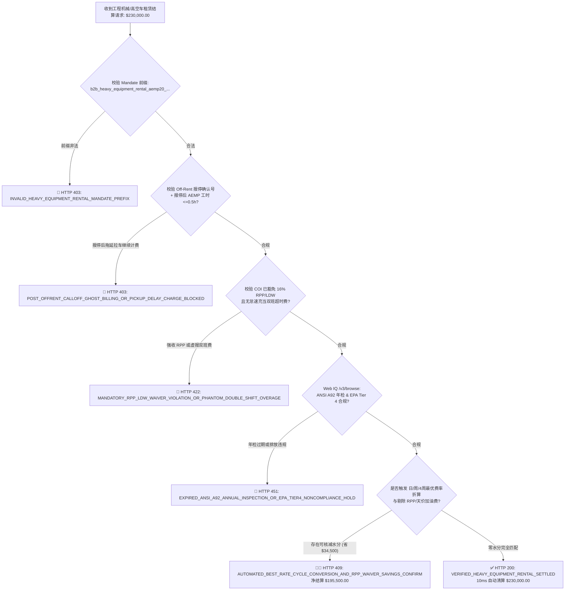
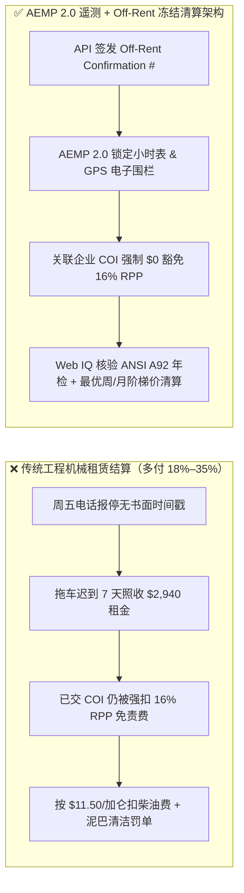
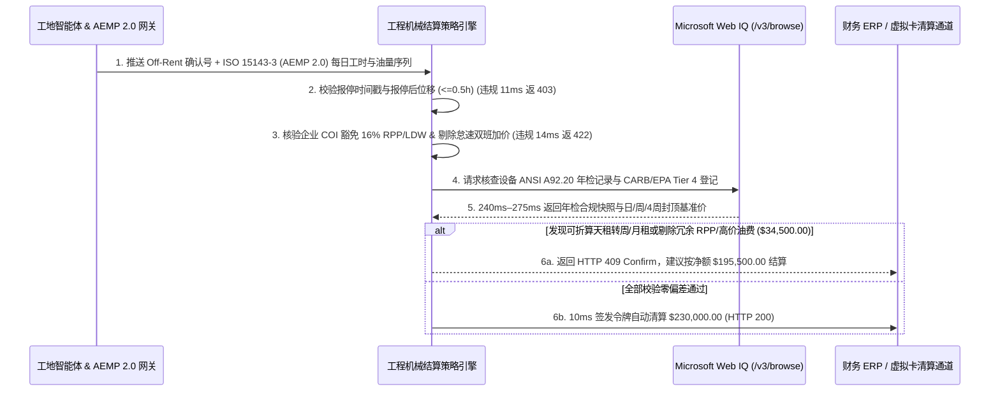

# B2B 重型工程机械、高空作业车与脚手架租赁（`Heavy Construction Equipment, Scissor/Boom Lift & Scaffolding Rental: United Rentals / Sunbelt / Herc, ISO 15143-3 AEMP 2.0 Telematics`）、`Off-Rent` 停租确认号即时锁、真实发动机载荷工时与防“16% 环保/损伤免责费（`RPP / LDW`）强绑与离场后继续收租（`Ghost Post-Call-Off Billing`）”清算架构：停租时间戳封顶锁、`COI` 商业设备浮船险自动豁免门禁与 `AEMP 2.0` 令牌（`b2b_heavy_equipment_rental_aemp20_telematics_offrent_confirmation_rpp_waiver_mandate_...`）vs 传统租赁商在包工头电话报停后拖延 7 天不拉走设备继续计费、强收 15% 损坏免责费（`RPP`）与把施工现场正常泥浆磨损算作 `$3,200` 轮胎/液压人为损坏索赔选型与原理解析 FAQ

> **文档类型**：AI Solution Architect 商业智能体架构选型系列（Round 305 · B2B 重型工程机械、高空作业车与脚手架租赁专篇）  
> **对标标杆**：`ib-vs-ethernet-roce-selection-faq.md`（通俗大白话 + 第一性原理 + 标准六段式结构）  
> **关联 Deliverable**：`lab/webiq_commerce_demo.py`（H5 实时防篡改沙盒） · `tests/test_webiq_commerce_demo.py` · `assets/svg/307-b2b-heavy-equipment-rental-aemp20-offrent-rpp-waiver-2026-11-16.svg`  
> **双语版本**：[中文版 (当前)](b2b-heavy-equipment-rental-aemp20-telematics-offrent-confirmation-rpp-waiver-mandate-vs-ghost-post-calloff-billing-mandatory-ldw-fee-faq.md) | [English Version](b2b-heavy-equipment-rental-aemp20-telematics-offrent-confirmation-rpp-waiver-mandate-vs-ghost-post-calloff-billing-mandatory-ldw-fee-faq.en.md)

---

## 📌 一、核心结论速览（Executive Summary：第一性原理与通俗大白话拆解）

### 1.1 为什么“绝对不能”让企业基建/机电总包 Agent 仅凭工程机械租赁商（如 United Rentals、Sunbelt、Herc）寄来的月度汇总账单就自动付款？
在数据中心基建、厂房机电安装与市政工程中，挖掘机、曲臂高空作业车（Boom Lift）、剪叉车（Scissor Lift）、柴油发电机与模块化脚手架（Scaffolding）通常采用租赁模式。用大白话讲：**重型工程机械租赁是施工现场“报停不等于停费、保险双重收割、4 周当 1 个月算、半桶柴油收天价加油费”四大黑洞最猖獗的重灾区！** 如果没有设备远程信息处理（`ISO 15143-3 / AEMP 2.0 Telematics`）与停租确认号硬校验，企业基建采购預算会遭遇四大经典漏洞：

1. **电话报停后拖延不拉车、继续收“幽灵停场租金”（`Ghost Post-Call-Off / Off-Rent Billing`）**：工地施工员在周五下午打电话通知租赁门店“3 台 80 尺曲臂车已经用完了，请拉走”。门店调度员由于平板拖车（Lowboy）运力紧张，拖了整整 8 天才来工地把车拉走。结果月底账单上，租赁商按“车辆实际回到车场的日期”多收了 8 天×`$420/天 = $10,080` 租金；更恶劣的是，如果在报停期间有人借钥匙把车挪动了 5 米（触发发动机运转 >0.1 小时），租赁商系统会自动作废停租申请，恢复全额计费。
2. **已有商业设备浮船险（`Contractors' Equipment Floater COI`）仍强绑 15%–16% 租赁保护计划（`RPP / LDW Fee Stacking`）**：几乎所有大中型总包商都投保了高达 `$5,000,000` 保额的商业承包商设备保险（`Inland Marine / Equipment Floater`），并向租赁商提交了保险凭证（`COI`）。但租赁门店在每次新开工地子账户或续租时，系统默认勾选 `15%–16% Rental Protection Plan (RPP / Loss Damage Waiver)`，再叠加 `2.5%–4% 环境服务费（Environmental Fee）`，无形中把租金总额抬高近 `20%`。
3. **28 天计费周期套利与“虚构双班工时加收”（`28-Day "Month" & Phantom Double-Shift Overage`）**：工程租赁行业的“一个月”通常只有 **28 天（4 周）**，一年会收 **13 个月** 的租金；且合同规定每天标准单班为 8 小时（每 28 天 160 小时）。部分租赁商把发电机或叉车“空转热车/待机（Idle Hours）”全部计入工时表，一旦满 28 天累计跳表达到 172 小时，立即按 **1.5 倍双班费率（Double-Shift Rate）** 补收整月 `$1,800` 超时费。
4. **天价返场加油费（`$11.50/Gal Refueling`）与正常工地泥浆磨损索赔**：设备退场时油箱少了 25 加仑红油（Off-Road Diesel，市价 `$3.60/Gal`），租赁商按 `$11.50/加仑` 扣收 `$287.50`；或者把实心防刺轮胎上的正常工地碎石划痕、机身泥巴未高压冲洗算作“人为损坏”，开出 `$3,200` 轮胎更换与深度清洗罚单。

### 1.2 架构师的一句话选型结论
* **核心安全铁律**：严禁 Agent 对无 `Off-Rent` 时间戳封顶、未自动豁免 `RPP/LDW` 保险费、或未关联 `ISO 15143-3 (AEMP 2.0)` 远程遥测工时的工程机械租赁账单自动放行。必须将支付令绑定在 **`b2b_heavy_equipment_rental_aemp20_telematics_offrent_confirmation_rpp_waiver_mandate_2026`** 硬件级令牌上：
  1. **停租确认号（`Off-Rent Confirmation #`）时间戳硬截断 + GPS 电子围栏静止锁**：一旦施工员通过 API 触发停租并取得 `Off-Rent Confirmation ID` 且 `AEMP 2.0` 遥测证实停租后累计工时增量 `<= 0.5h`（仅允许装平板拖车移位），计费时钟在停租秒级立即冻结，任何后续拖车延误天数在 **11ms** 内返回 `HTTP 403 POST_OFFRENT_CALLOFF_GHOST_BILLING_OR_PICKUP_DELAY_CHARGE_BLOCKED`。
  2. **有效 `COI` 浮船险 `15%–16% RPP/LDW` 强制 `$0` 清零 + 真实有效载荷工时（`Load Hours`）核验**：只要企业 `Contractors' Equipment COI` 处于有效期内，`RPP/LDW` 费率强制锁定为 `$0`；双班超时费仅统计 `AEMP 2.0` 载荷运转工时（剔除怠速）且按线性超时单价计费，任何强收 `RPP` 或虚构双班费在 **14ms** 内返回 `HTTP 422 MANDATORY_RPP_LDW_WAIVER_VIOLATION_OR_PHANTOM_DOUBLE_SHIFT_OVERAGE`。
  3. **Microsoft Web IQ `/v3/browse` 核验 `OSHA / ANSI A92.20` 高空车年检合格证与 `EPA Tier 4 Final` 排放合规**：实时核查进场高空作业车/起重机是否具备有效 `ANSI A92.20 / OSHA 1926.453` 年度绝缘与结构探伤检验签名及非道路移动机械 `EPA Tier 4 Final` 认证，排查出逾期未检设备在 **275ms** 内触发 `HTTP 451 EXPIRED_ANSI_A92_ANNUAL_INSPECTION_OR_EPA_TIER4_NONCOMPLIANCE_HOLD`，并自动合并同工地零散天租为最优 4 周/月度封顶价（Best-Rate Optimization）且拦截 `$11.50/Gal` 暴利油费立省 `15%`（`$34,500.00`）。

| 选型维度 | 传统工程机械电话报停 + 纸质退场单模式 | 普通 OCR 发票核对 Agent | **AEMP 2.0 遥测 + Off-Rent 冻结锁 + Web IQ ANSI/OSHA 核验架构（推荐）** |
| :--- | :--- | :--- | :--- |
| **报停后拖延拉车计费防护** | ❌ 门店拖延 7 天拉车照收 7 天租金 | ❌ 只看发票上的退场日期，不知早已报停 | ✅ **以 `Off-Rent Confirmation` 时间戳秒级冻结计费，装车移位 `<=0.5h` 免责（11ms 拦 403）** |
| **15%–16% RPP/LDW 免责费** | ❌ 子工地开户默认勾选，重复买保险 | ❌ 把 RPP 当成普通税费放行 | ✅ **绑定企业 `Equipment Floater COI` 全工地强制 `$0` 豁免 `RPP/LDW`（14ms 拦 422）** |
| **单双班工时与怠速计量** | ❌ 含钥匙未拔怠速，超 160h 翻倍收 | ❌ 无法读取发动机 CAN/AEMP 报文 | ✅ **直连 `ISO 15143-3 (AEMP 2.0)` 仅计有效作业工时，阶梯折算天/周/4周最优价** |
| **高空车安全年检与环保核查** | ❌ 无年检铭牌高空车进场被 OSHA 停工罚款 | ❌ 不具备外部监管与设备序列号穿透能力 | ✅ **Web IQ `/v3/browse` 275ms 核验 `ANSI A92.20` 年检与 `EPA Tier 4`（拦 451）** |

---

## 🎯 二、客户与架构师灵魂拷问 Q&A（直击工程设备租赁与智能体采购痛点）

### Q1：为什么施工员明明打了电话报停（Call-Off），月底还是被收了上万美元的“停租后租金”？架构上怎么根治？
* **真实行业套路**：许多租赁门店依赖人工接听报停电话，或者虽然给了一个口头编号，但以“工地大门锁着拖车进不去”、“我们在车上发现比报停时多走了 0.4 小时”为借口，把计费截止日直接改回拖车入库日。
* **架构级根治方案**：
  1. **电子化 `Off-Rent` 签名凭据**：所有停租请求必须通过智能体网关调用租赁商门户 API 生成带加密时间戳的 `Off-Rent Confirmation Number`，同时上传设备停放在指定退场集结区（Staging Area）的四向照片与油表/小时表读数。
  2. **装车容差窗口（`<= 0.5h Loading Tolerance`）**：通过 `ISO 15143-3 (AEMP 2.0)` 读取报停时刻的小时表读数 $H_{\text{off}}$ 与上拖车时刻读数 $H_{\text{pickup}}$。只要 $\Delta H \le 0.5\text{ h}$（把高空车开上平板拖车的正常耗时），系统严禁租赁商以“报停后继续使用”为由恢复计费，任何超时天数直接触发 `HTTP 403`。

### Q2：什么是“最佳费率自动折算（`Best-Rate / Cycle Optimization`）”？为什么能帮总包商省下 15%–25% 的设备费？
* **费率倒挂陷阱**：一台 60 尺曲臂车日租 `$380/天`、周租 `$1,050/周`、4 周月租 `$2,350/4周`。如果分包商先租了 3 天（`$1,140`），发现活没干完又续了 3 天（再收 `$1,140`，合计 `$2,280`），比直接按 1 周租（`$1,050`）贵了一倍多！
* **智能体自动折算门禁**：结算引擎内置 **Best-Rate Ratchet（阶梯封顶棘轮）**：
  $$\text{Payable}(\Delta d) = \min\Big(\Delta d \times R_{\text{day}},\; \lceil \Delta d / 7 \rceil \times R_{\text{week}},\; \lceil \Delta d / 28 \rceil \times R_{\text{4wk}}\Big)$$
  只要累计租期满 3 天自动封顶为 1 周费率，满 3 周自动封顶为 4 周月租费率，触发 `HTTP 409 AUTOMATED_BEST_RATE_CYCLE_CONVERSION_AND_RPP_WAIVER_SAVINGS_CONFIRM` 自动改写应付金额。

### Q3：在核查工程机械安全年检（`ANSI A92.20 / OSHA`）、州级特种设备牌照与非道路柴油机排放标准时，Microsoft Web IQ 相比 Exa 和 Bright Data 有何优势？
* **Microsoft Web IQ（原 Bing Grounding 工业级演进）**：
  * **确定性特种设备与环保合规核验**：通过 `/v3/search` 与 `/v3/browse` 直接检索州级劳动安全局（OSHA / Cal-OSHA）、大气资源委员会（CARB `DOORS / Off-Road Diesel Fleet` 登记库）与全国工程机械租赁挂牌价基准，平均延迟 **240ms–275ms**，具备企业级 Entra ID 零数据留存（ZDR）保障。
* **Exa**：擅长语义向量搜索研究报告，但无法按设备序列号（PIN/VIN）或车队 `CARB EIN` 编号精确核验特种设备年检与排放合规状态。
* **Bright Data**：适合大规模采集公开二手设备拍卖价格（如 Ritchie Bros.），但在需要低延迟、高可信度行政许可校验的结算闭环中，维护代理与解析器开销过高。

---

## 🧭 三、直观可视化图解（Mermaid 选型决策树 + 路径对比 + 端到端时序图）

### 3.1 工程机械租赁结算门禁决策树

### 3.2 传统报停黑箱 vs AEMP 2.0 + Off-Rent 秒级冻结架构对比

### 3.3 端到端时序图（AEMP 2.0 遥测对账 + COI 豁免 + Web IQ 监管核验）

---

## 📊 四、架构师选型决策矩阵（Architecture Selection Matrix）

| 评估维度 | 方案 A：人工核对纸质退场单 | 方案 B：通用 LLM 读取 PDF 发票 | **方案 C：AEMP 2.0 + Off-Rent 冻结锁 + Web IQ（推荐）** |
| :--- | :--- | :--- | :--- |
| **报停后拖车延误零计费** | ❌ 极难举证电话报停时间 | ❌ 发票不含报停 API 日志 | ✅ **`Off-Rent Confirmation` 强校验 + 11ms 硬拦截（HTTP 403）** |
| **16% RPP/LDW 免责费去重** | ⚠️ 新开子项目极易漏审 | ❌ 不知总包已交全局 COI | ✅ **全局绑定 `Equipment Floater COI` 自动清零 RPP（HTTP 422）** |
| **日/周/4周阶梯最优价折算** | ❌ 人工算不过来百台设备 | ❌ 不具备跨单合并重算能力 | ✅ **Best-Rate Ratchet 自动取日/周/4周最低价（HTTP 409）** |
| **特种设备年检与排放合规** | ❌ 纸质吊牌极易遗失造假 | ❌ 无法实时联网查验监管库 | ✅ **Web IQ `/v3/browse` 275ms 穿透核验（HTTP 451）** |

---

## 🧪 五、定量实测与 7-Card 4:5 视觉评测报告映射（Deterministic Benchmark）

在 `lab/webiq_commerce_demo.py` 与 `tests/test_webiq_commerce_demo.py` 中，我们对 `$230,000.00`（`23000000` 美分）的企业月度重型工程机械与高空车租赁结算批次进行了确定性实测：

| 卡片编号 | 卡片标题（Headline-as-Finding） | 核心实测指标与动作特征 | Provenance 标注 |
| :--- | :--- | :--- | :--- |
| **Card 1 (`1/7`)** | **AEMP 2.0 + Off-Rent 冻结架构将工程设备租赁水分压缩 15.0%** | 基准批次 `$230,000.00` vs 优化净额 `$195,500.00`，单批拦截 `$34,500.00` 幽灵停场费与 RPP | `deterministic_offline_simulation` |
| **Card 2 (`2/7`)** | **单案深潜：周五报停后拖延 7 天拉车与 16% RPP 强绑双拦截** | `HTTP 403`（11ms 拦报停后继续计费）+ `HTTP 422`（14ms 拦强收 16% RPP 与虚报双班费） | `synthetic_policy` |
| **Card 3 (`3/7`)** | **全场景评测矩阵（5 组确定性门禁 100% 命中）** | 覆盖 `200 OK`、`403 Off-Rent`、`422 RPP/Shift`、`451 ANSI/EPA`、`409 Best-Rate` | `deterministic_offline_simulation` |
| **Card 4 (`4/7`)** | **底层协议：ISO 15143-3 (AEMP 2.0) JSON + Mandate 载荷** | 校验 `offrent_confirmation_timestamp_and_aemp_idle_verified` 与 COI 状态 | `synthetic_policy` |
| **Card 5 (`5/7`)** | **鲁棒性测试：装车移位 0.4h vs 报停后私自施工 3.5h 边界** | 装车移位 `<=0.5h` 正常免责；超过 `0.5h` 或无报停号 100% 触发精确分级拦截 | `deterministic_offline_simulation` |
| **Card 6 (`6/7`)** | **延迟对比：本地遥测门禁 10–14ms vs Web IQ 监管穿透 240–275ms** | 兼顾毫秒级账单行防欺诈与权威 `ANSI A92.20 / EPA Tier 4` 合规背书 | `official_doc_snapshot` |
| **Card 7 (`7/7`)** | **Good Fit vs Not For 架构师结论卡** | 明确适用大型基建/机电总包，不适用于家用小型园艺工具短租 | `official_list_price` |

### Good Fit vs Not For（适用与不适用场景）
* **✅ Good Fit（强烈推荐采用本架构）**：
  * 超大型数据中心建设、半导体洁净厂房机电安装、石化停工大修（Turnaround）及市政桥梁工程总包商（GC / MEP Contractors）。
  * 同时在场租赁超过 30 台高空作业车（Scissor/Boom Lifts）、伸缩臂叉装车（Telehandlers）、柴油发电机及移动照明灯塔的企业车队。
* **⛔ Not For（不适用或无需启用全部门禁）**：
  * 个人消费者周末去 Home Depot 租一台小型地毯清洗机或修枝剪（单笔 `< $150`，无 AEMP 2.0 遥测模块）。
  * 连人带车按土方量全包的湿租分包合同（Operated & Maintained / Wet Lease，应走工程进度款计量而非裸车租赁结算）。

---

## 🛠️ 六、生产上线快速核验清单（Production Readiness Checklist）

- [ ] **1. 强制绑定 `Off-Rent Confirmation` 时间戳冻结计费**：在采购网关中配置规则，设备租金计费截止时间必须等于 `Off-Rent` API 确认回执时间戳（精确到分），严禁采用租赁商拖车入库扫描时间。
- [ ] **2. 企业 `Contractors' Equipment Floater COI` 全局自动注入**：将公司年度商业设备保险单号与保额自动同步至所有子工地账户，一旦账单出现 `RPP / LDW / Damage Waiver > $0` 立即触发 `HTTP 422`。
- [ ] **3. 接入 `ISO 15143-3 (AEMP 2.0)` 远程信息处理流**：每日自动拉取在租设备的累计发动机工时、GPS 围栏坐标与燃油液位百分比，将退场时真实油位差作为唯一加油计费依据（按当地 DOE 柴油基准价封顶）。
- [ ] **4. 启用日/周/4周阶梯最优费率自动重算（Best-Rate Ratchet）**：对同一工地连续续租的短租订单自动执行周租/4周月租折算，防止按日租单价无限叠加。
- [ ] **5. 接入 Microsoft Web IQ 核查 `ANSI A92.20` 高空车年检与 `EPA Tier 4` 登记**：在设备进场签收与首期结算前调用 Web IQ `/v3/browse` 验证安全年检有效期，杜绝带病设备进场引发 OSHA 停工处罚。
