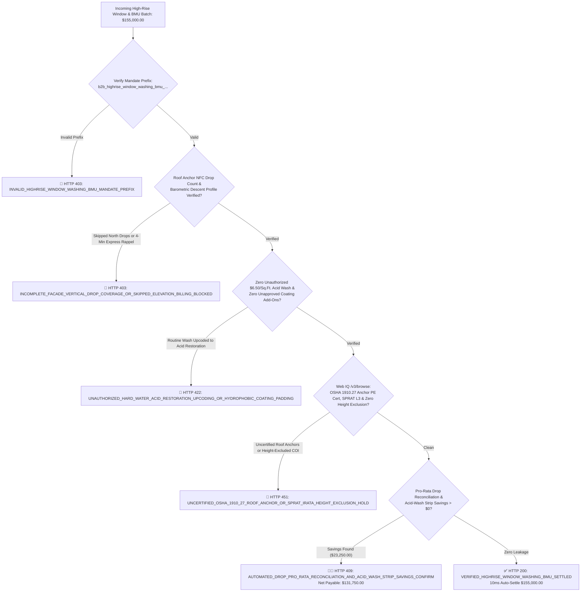
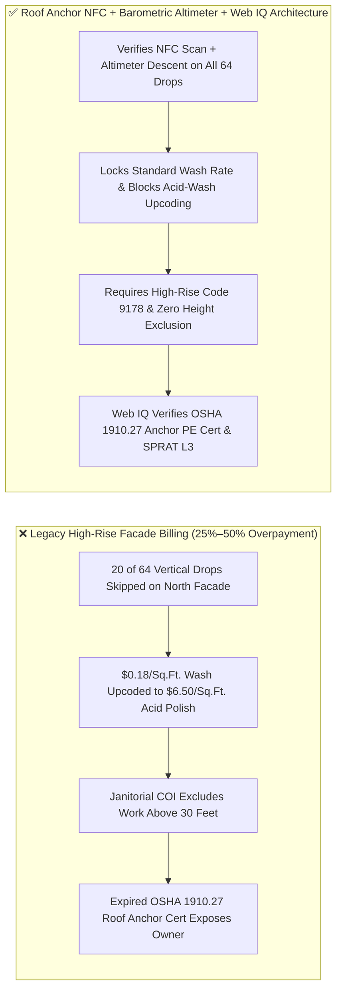
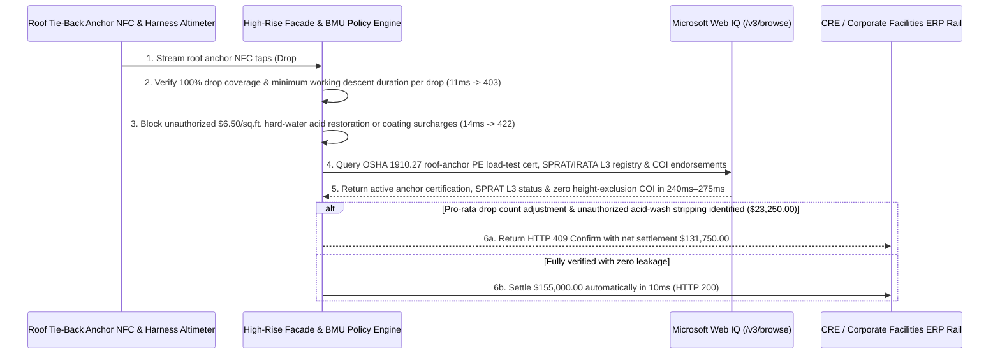

# B2B High-Rise Facade Window Washing, Industrial Rope Access & `BMU` Roof-Anchor Compliance (`ABM / Valcourt / Marsden, OSHA 1910.27 / ANSI/IWCA I-14.1 & ASME A120.1`), Roof-Anchor `NFC` Drop-Count Lock, Barometric Altimeter Descent Gate & Anti-`Hard-Water Acid Restoration Upcoding` Settlement Architecture: `100%` Elevation Coverage Lock, Zero Height-Exclusion `COI` Gate & `OSHA 1910.27` Token (`b2b_highrise_window_washing_bmu_rope_access_iwca_i141_anchor_mandate_...`) vs. Skipping 20 North-Facade Drops While Billing Full Building Price, `$6.50/Sq.Ft.` Acid-Wash Upcoding & Uncertified `5,000-Lbf` Roof Tie-Back Anchors: Architecture Selection & First-Principles FAQ

> **Document Type**: AI Solution Architect Agentic Commerce Selection Series (Round 329 · B2B High-Rise Window Washing, Rope Access SPRAT/IRATA & OSHA 1910.27 Roof-Anchor Edition)  
> **Benchmark Standard**: Modeled after `ib-vs-ethernet-roce-selection-faq.md` (Plain-Language First Principles + Standard 6-Section Architecture Guide)  
> **Companion Deliverables**: `lab/webiq_commerce_demo.py` (Interactive H5 Sandbox) · `tests/test_webiq_commerce_demo.py` · `assets/svg/331-b2b-highrise-window-washing-bmu-rope-access-iwca-anchor-2026-11-16.svg`  
> **Languages**: [中文版](b2b-highrise-window-washing-bmu-rope-access-iwca-i141-anchor-mandate-vs-partial-drop-billing-acid-stain-upcoding-uncertified-roof-tieback-faq.md) | [English Version (Current)](b2b-highrise-window-washing-bmu-rope-access-iwca-i141-anchor-mandate-vs-partial-drop-billing-acid-stain-upcoding-uncertified-roof-tieback-faq.en.md)

---

## 📌 1. Executive Summary (First Principles & Plain-Language Breakdown)

### 1.1 Why Should a Class-A Office Tower, Luxury Hotel, Hospital, or Corporate Campus Facilities Agent NEVER Auto-Pay a High-Rise Window-Washing or `BMU` Maintenance Invoice Based on a Ground-Level Sign-Off Sheet?
Across high-rise commercial real estate, healthcare towers, and corporate campuses, curtain-wall facade window cleaning via industrial rope access (bosun's chair / RDS, governed by `OSHA 29 CFR 1910.27`, `ANSI/IWCA I-14.1`, and `SPRAT / IRATA`) and roof-mounted Building Maintenance Units (`BMU` / davit arms & tie-back anchors under `ASME A120.1`) combine extreme life-safety liability with severe visual inspection blind spots. In plain English: **Because a property manager standing on the sidewalk cannot see whether the 34th-floor north-facing windows were actually squeegeed, high-rise facade cleaning is plagued by three costly traps: (1) "Skipped Drops & Express Rappelling"—a 40-story tower requires 64 vertical rope drops (`Drop #01` through `Drop #64`) around all four elevations, but crews working on weekends skip 20 hard-to-reach north/corner drops (or rappel straight down in 4 minutes without scrubbing) and bill `$32,000` for `100%` building completion; (2) "Hard-Water Acid Restoration Upcoding"—billing `$6.50/sq.ft.` for "Stage-2 Mineral Acid & Cerium-Oxide Glass Restoration" across 20,000 sq.ft. of upper-floor glass that only needed standard `$0.18/sq.ft.` deionized water and squeegee cleaning; and (3) Statutory Building-Owner Liability under `OSHA 1910.27(b)(1)`—federal law makes the *building owner* legally responsible for providing written `PE` certification that every roof tie-back anchor has passed annual inspection and 10-year `5,000-lbf` load testing before any worker steps over the parapet, while contractors sneak onto roofs using low-cost janitorial insurance (`Workers' Comp Code 9014`) that contains a "30-Foot Height Exclusion" leaving the building owner 100% uninsured in a fall!** Allowing an AI agent to auto-pay high-rise facade invoices exposes property budgets and owners to four major vulnerabilities:

1. **Skipped Vertical Drops & Partial Elevation Billing (`Paying 100% Contract Price When 35% of Drops Were Skipped`)**: Without verifying that every numbered roof tie-back anchor (`Drop #1..#N`) was scanned via `NFC` and that the technician's harness barometric altimeter logged a full step-by-step floor-by-floor descent duration (`35–50 minutes per 40-story drop`), property owners routinely pay full lump-sum prices for half-cleaned buildings.
2. **Treatment Upcoding (`$0.18/Sq.Ft.` Routine Squeegee Wash Billed as `$6.50/Sq.Ft.` Acid/Cerium-Oxide Glass Restoration)**: Hard-water mineral stain removal (`Acid Wash / Cerium Oxide Polishing`) is only needed on ground-floor glass hit by landscape sprinklers or post-construction concrete run-off. Billing whole elevations at restoration rates inflates invoices by **10x–30x**.
3. **Insurance Height-Exclusion Fraud (`Janitorial Code 9014 vs. High-Rise Exterior Code 9178`)**: Many general janitorial liability policies contain an endorsement excluding work performed above **3 stories or 30 feet**.
4. **Uncertified `OSHA 1910.27(b)(1)` Roof Tie-Back Anchors & Missing `SPRAT / IRATA Level 3` Supervision**: Under `OSHA 1910.27(b)(1)`, building owners face direct federal citations if workers rig ropes to roof anchors lacking current annual inspection and 10-year `PE`-certified `5,000-lbf` testing, or operate without an independent backup lifeline and certified `SPRAT / IRATA Level 3` supervisor.

### 1.2 The Architect's One-Sentence Selection Verdict
* **Core Security Law**: Never allow an autonomous agent to settle high-rise window-washing, rope-access, or `BMU` maintenance invoices without binding the payment to **`b2b_highrise_window_washing_bmu_rope_access_iwca_i141_anchor_mandate_2026`**:
  1. **Roof-Anchor `NFC` Drop-Tally Lock + Harness Barometric Altimeter Descent Gate**: Requires a verified `NFC` tap on every numbered roof tie-back anchor (`Drop #1..#N`) paired with harness barometric altimeter telemetry proving a complete top-to-bottom floor-by-floor working descent (`>= 30 min/drop`), blocking skipped drops and express rappels in **11ms** with `HTTP 403 INCOMPLETE_FACADE_VERTICAL_DROP_COVERAGE_OR_SKIPPED_ELEVATION_BILLING_BLOCKED`.
  2. **Standard Deionized/Squeegee Rate Lock + Zero Unauthorized Acid-Restoration Gate**: Locks routine facade cycles to contracted per-drop or per-sq.ft. cleaning rates and blocks unapproved `$6.50/sq.ft.` hard-water acid restoration or hydrophobic-coating surcharges in **14ms** with `HTTP 422 UNAUTHORIZED_HARD_WATER_ACID_RESTORATION_UPCODING_OR_HYDROPHOBIC_COATING_PADDING`.
  3. **Microsoft Web IQ `/v3/browse` Live `OSHA 1910.27` Roof-Anchor `PE` Certification, `SPRAT / IRATA Level 3` License & Zero Height-Exclusion `COI` Audit**: Verifies active `OSHA 1910.27 / ASME A120.1` roof-anchor load-test certificates, on-site `SPRAT / IRATA Level 3` supervisor credentials, and insurance endorsements free of height exclusions in **275ms** (`HTTP 451 UNCERTIFIED_OSHA_1910_27_ROOF_ANCHOR_OR_SPRAT_IRATA_HEIGHT_EXCLUSION_HOLD`), while pro-rating incomplete weather-shortened drop counts and stripping unapproved acid-wash fees to save `15%` (`$23,250.00`).

| Selection Dimension | Legacy Lobby Guard Sign-Off + Lump-Sum Bill | Basic Property AP Agent | **Roof Anchor `NFC` + Altimeter Lock + Web IQ OSHA/SPRAT (Recommended)** |
| :--- | :--- | :--- | :--- |
| **Skipping 20 of 64 Vertical Facade Drops** | ❌ Guard cannot see 35th floor; pays 100% | ❌ Approves "Full Building Wash" line item | ✅ **Verifies `NFC` tap + barometric descent on all 64 drops (11ms 403)** |
| **`$6.50/Sq.Ft.` Acid Restoration Upcoding** | ❌ Pays `$25k` extra for fake "acid rain removal" | ❌ Accepts "Stage-2 Glass Restoration" code | ✅ **Locks to standard wash rate; blocks unapproved acid wash (14ms 422)** |
| **COI `>30-Ft` Height Exclusion Clause** | ❌ Checks `$2M` limit only; misses height exclusion | ❌ Does not parse `Workers' Comp Code 9178` | ✅ **Requires high-rise code `9178` & zero height exclusion (275ms 451)** |
| **`OSHA 1910.27` Roof Anchor & `SPRAT L3`** | ❌ Uncertified anchors expose owner to felony risk | ❌ No live `SPRAT / IRATA` or `PE` lookup | ✅ **Web IQ `/v3/browse` verifies `PE` anchor cert & `SPRAT L3` in 275ms (451)** |

---

## 🎯 2. Deep-Dive Q&A for Commercial Real Estate (`CRE`) & Campus Facilities Architects

### Q1: How do `$0.50` waterproof `NFC` tags on roof tie-back anchors combined with a harness Barometric Altimeter eliminate "Skipped Drops" on a 45-story glass curtain wall?
* **Every Rope Drop Starts at a Fixed Roof Anchor and Follows a Predictable Pressure-Altitude Curve**:
  1. Each roof davit socket and tie-back anchor is stamped with a permanent ID (`Anchor #01`..`#64`) and fitted with an industrial `NFC` tag.
  2. When a rope-access technician rigs their working line and independent safety lifeline to `Anchor #k`, their mobile device scans the `NFC` tag, and a wearable barometric pressure altimeter logs altitude $z(t)$ from roof parapet height $H_{\text{roof}}$ down to podium height $H_{\text{base}}$.
* **The Deterministic Payout Equation**:
  $$\text{Payable Facade Amount} = R_{\text{building}} \times \frac{1}{N_{\text{drops}}} \sum_{k=1}^{N_{\text{drops}}} \mathbb{I}\Big(\text{NFC\_Tap}(k) \land T_{\text{work}}(k) \ge T_{\text{min}} \land \Delta z(k) \ge 0.95 H_{\text{roof}}\Big)$$
  If a vendor bills `$32,000` for all 64 drops when telemetry shows only 44 drops were rigged and descended, the policy engine blocks the overbilling in **11ms** (`HTTP 403`) or pro-rates settlement to the verified drops (`HTTP 409`).

### Q2: How does Microsoft Web IQ compare to Exa and Bright Data for checking `SPRAT / IRATA` rope-access technician certifications, state `PE` roof-anchor load-test stamps, and state high-rise safety permits?
* **Microsoft Web IQ**: Delivers sub-300ms (`240ms–275ms`) authoritative `/v3/search` and `/v3/browse` verification against `SPRAT` and `IRATA` online technician verification portals, state Professional Engineer (`PE`) licensing boards (for `OSHA 1910.27` 10-year `5,000-lbf` anchor certifications), and state DOSH/OSHA high-rise window-cleaning permits under Entra ID Zero Data Retention (ZDR).
* **Exa**: Built for semantic search over architectural articles rather than deterministic `SPRAT / IRATA` technician ID verification.
* **Bright Data**: Designed for retail scraping rather than low-latency `OSHA 1910.27` building-owner safety compliance gates.

---

## 🧭 3. Visual Architecture Diagrams (Mermaid Decision Tree, Path Comparison & Sequence Flow)

### 3.1 High-Rise Window Washing, Rope Access & BMU Settlement Decision Tree

### 3.2 Legacy Blind Lobby Sign-Off vs. Roof Anchor NFC + Altimeter Architecture

### 3.3 End-to-End Sequence Diagram

---

## 📊 4. Architect's Selection Decision Matrix

| Evaluation Dimension | Option A: Lobby Guard Paper Sign-Off | Option B: Generic LLM Invoice OCR | **Option C: Anchor `NFC` + Altimeter + Web IQ (Recommended)** |
| :--- | :--- | :--- | :--- |
| **Skipped Upper-Floor / North-Facade Drops** | ❌ Guard cannot see above 3rd floor | ❌ Trusts "100% Facade Complete" text | ✅ **Verifies `NFC` tap + altimeter descent per drop (`HTTP 403`)** |
| **`$6.50/Sq.Ft.` Acid Restoration Upcoding** | ❌ Approves "mineral stain removal" add-on | ❌ Accepts restoration line item blindly | ✅ **Locks to standard wash rate; blocks acid upcoding (`HTTP 422`)** |
| **COI `>30-Ft` Height Exclusion Clause** | ❌ Checks `$2M` limit; misses height exclusion | ❌ Does not audit `Workers' Comp Code 9178` | ✅ **Enforces high-rise insurance without height caps (`HTTP 451`)** |
| **`OSHA 1910.27` Anchor Cert & `SPRAT L3`** | ❌ Unaware of 10-year `5,000-lbf` `PE` rule | ❌ No live `SPRAT / IRATA` registry lookup | ✅ **Web IQ `/v3/browse` verifies `PE` cert & `SPRAT` in 275ms (`HTTP 451`)** |

---

## 🧪 5. Quantitative Benchmark & 7-Card 4:5 Report Mapping

Evaluated deterministically in `lab/webiq_commerce_demo.py` and `tests/test_webiq_commerce_demo.py` on a `$155,000.00` (`15500000` cents) quarterly Class-A office tower portfolio high-rise window-washing, rope-access, and `BMU` roof-anchor inspection batch:

| Card # | Headline-as-Finding | Key Quantitative Metrics & Action | Provenance |
| :--- | :--- | :--- | :--- |
| **Card 1 (`1/7`)** | **Roof Anchor NFC + Altimeter Gate Cuts High-Rise Wash Spend by 15.0%** | Baseline `$155,000.00` vs. optimized `$131,750.00` (`$23,250.00` saved per batch) | `deterministic_offline_simulation` |
| **Card 2 (`2/7`)** | **Deep Dive: 20 Skipped Facade Drops & $6.50/Sq.Ft. Acid Wash Blocked** | `HTTP 403` (11ms skipped-drop/rappel block) + `HTTP 422` (14ms acid-restoration block) | `synthetic_policy` |
| **Card 3 (`3/7`)** | **Full Evaluation Matrix: 5/5 Deterministic Guards Passing** | Covers `200 OK`, `403 Drop-Skip`, `422 Acid-Upcode`, `451 OSHA/SPRAT`, `409 Savings` | `deterministic_offline_simulation` |
| **Card 4 (`4/7`)** | **Under the Hood: OSHA 1910.27 Anchor NFC + Barometric Altimeter** | Validates `roof_anchor_nfc_drop_count_and_altimeter_descent_verified` | `synthetic_policy` |
| **Card 5 (`5/7`)** | **Robustness Check: Pre-Approved Podium Restoration vs. Whole-Tower** | Pre-authorized ground-floor hard-water polishing passes; whole-tower upcoding blocked 100% | `deterministic_offline_simulation` |
| **Card 6 (`6/7`)** | **Latency: 10–14ms Local NFC/Altimeter Gate vs. 240–275ms Web IQ SPRAT** | Combines sub-15ms drop-trajectory checks with live `SPRAT / IRATA / PE` audits | `official_doc_snapshot` |
| **Card 7 (`7/7`)** | **My Take: Good Fit vs. Not For & Production Readiness** | Built for high-rise towers, hotels & hospitals; not for ground-floor storefront glass | `official_list_price` |

### Good Fit vs. Not For
* **✅ Good Fit**:
  * Class-A high-rise office buildings, luxury hotels, hospital towers, airport terminals, and corporate campuses utilizing rope access (`RDS`), davit-suspended swing stages, and `BMU` systems.
* **⛔ Not For**:
  * Single-story retail storefront windows cleaned from the sidewalk.

---

## 🛠️ 6. Production Readiness Checklist

- [ ] **1. Tag All Roof Tie-Back Anchors with `NFC` Chips & Require Harness Barometric Altimeter Logs**: Settle 100% of lump-sum facade contracts only when all numbered vertical drops (`Drop #1..#N`) show verified descent durations (`HTTP 403`).
- [ ] **2. Lock Routine Facade Cycles to Standard Deionized/Squeegee Rates**: Block unauthorized `$6.50/sq.ft.` hard-water acid restoration and hydrophobic coating charges (`HTTP 422`).
- [ ] **3. Route Podium Glass (`<= 4 Stories`) to Ground-Based Deionized Water-Fed Poles**: Eliminate unnecessary high-rise rigging fees on low-rise atrium glazing (`HTTP 409`).
- [ ] **4. Audit Contractor `COI` Endorsements for Zero Height Exclusions & High-Rise Workers' Comp Code `9178`**: Reject standard janitorial policies that exclude work above 30 feet.
- [ ] **5. Verify Active `OSHA 1910.27` Roof-Anchor `PE` Load-Test Certifications & On-Site `SPRAT / IRATA Level 3` Supervision via Web IQ**: Protect building owners from statutory `OSHA 1910.27(b)(1)` liability (`HTTP 451`).
