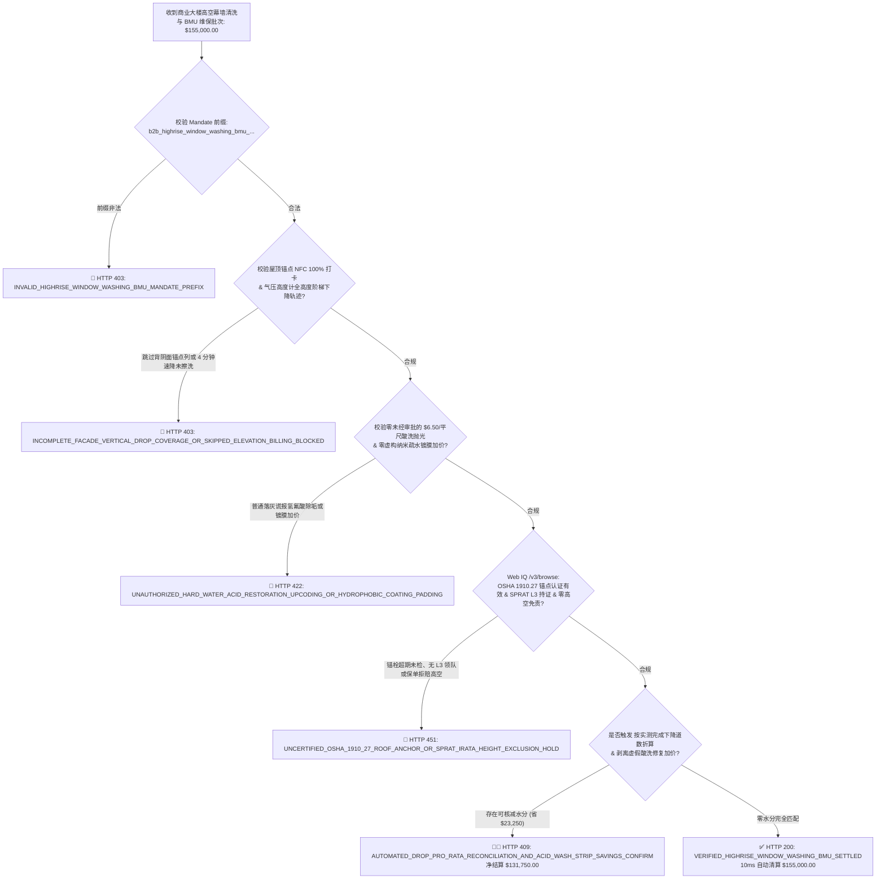
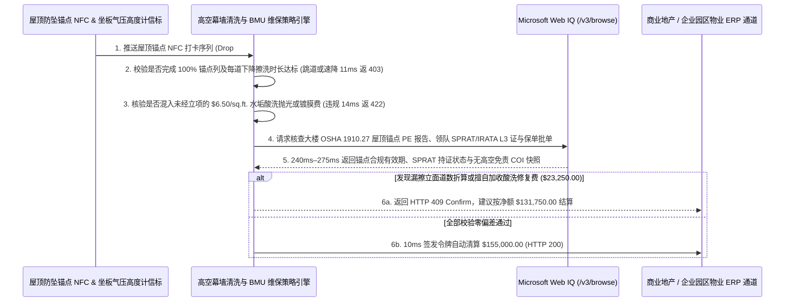

# B2B 商业建筑电梯井道、外墙玻璃幕墙高空蜘蛛人清洗（`Rope Access / Bosun's Chair`）与擦窗机（`BMU`）维保结算（`High-Rise Window Washing, Facade Rope-Access Cleaning & Building Maintenance Unit BMU Inspection: ABM / Valcourt / Marsden, OSHA 1910.27 / IWCA I-14.1 & ASME A120.1`）、屋顶防坠落锚点（`Roof Davit / Tie-Back Anchor`）10 年荷载静力拉拔测试锁、按立面实测幕墙面积（`Curtain-Wall Glazing Sq.Ft.`）与清洗频次计费及防“将雨雪大风停工日算作已完成整栋楼外墙清洗、虚报高钙水渍酸洗抛光费（`Hard-Water Stain Acid Restoration Upcoding`）与无证蜘蛛人单绳冒险作业”清算架构：气压高度计/UWB 吊篮立面轨迹锁、IWCA I-14.1 双绳锚点门禁与 `ASME A120.1` 令牌（`b2b_highrise_window_washing_bmu_rope_access_iwca_i141_anchor_mandate_...`）vs 传统高空外墙清洗队只擦了正面大堂 3 层玻璃就按 45 层整栋楼收 `$28,000`、把普通玻璃水擦洗谎报为 `$6.50/平尺` 氢氟酸除水垢修复与未做屋顶锚栓 5,000 磅拉力年检引发坠亡诉讼选型与原理解析 FAQ

> **文档类型**：AI Solution Architect 商业智能体架构选型系列（Round 329 · B2B 超高层玻璃幕墙清洗、绳索作业 IRATA/SPRAT 与擦窗机 BMU 锚点合规专篇）  
> **对标标杆**：`ib-vs-ethernet-roce-selection-faq.md`（通俗大白话 + 第一性原理 + 标准六段式结构）  
> **关联 Deliverable**：`lab/webiq_commerce_demo.py`（H5 实时防篡改沙盒） · `tests/test_webiq_commerce_demo.py` · `assets/svg/331-b2b-highrise-window-washing-bmu-rope-access-iwca-anchor-2026-11-16.svg`  
> **双语版本**：[中文版 (当前)](b2b-highrise-window-washing-bmu-rope-access-iwca-i141-anchor-mandate-vs-partial-drop-billing-acid-stain-upcoding-uncertified-roof-tieback-faq.md) | [English Version](b2b-highrise-window-washing-bmu-rope-access-iwca-i141-anchor-mandate-vs-partial-drop-billing-acid-stain-upcoding-uncertified-roof-tieback-faq.en.md)

---

## 📌 一、核心结论速览（Executive Summary：第一性原理与通俗大白话拆解）

### 1.1 为什么“绝对不能”让甲级写字楼、豪华酒店、医院大楼或企业总部园区的物业采购 Agent 仅凭高空外墙清洗与建筑擦窗机服务商（如 Valcourt、ABM、Marsden、tractel）提交的“全楼外立面清洗完工单”就自动打款？
在现代超高层商业地产与企业总部大楼中，玻璃幕墙高空绳索下降清洗（Industrial Rope Access / Bosun's Chair，受 `OSHA 29 CFR 1910.27`、国际窗户清洁协会 `ANSI/IWCA I-14.1` 与工业绳索技术协会 `SPRAT / IRATA` 监管）以及屋顶轨道式擦窗机与防坠落锚栓维保（Building Maintenance Units `BMU` & Roof Tie-Back Anchors，受 `ASME A120.1` 监管）是兼具极高安全风险与视觉验收盲区的特种服务。用大白话讲：**因为大楼物业经理站在地面根本看不清 35 楼北侧背阴面的玻璃到底擦没擦，高空外墙清洗行业长期存在三大黑幕：第一是“跳降/漏面偷工（Skipped Drops & Partial Facade Billing）”——整栋 40 层大楼东西南北四个立面共需从屋顶放绳下降 64 道（64 Drops），清洗队趁周六物业没人，只放绳擦了高管办公室朝南的 20 道和一楼裙房玻璃，避开难擦的北面转角和挑空风口，却按 100% 全楼完成开走 $32,000 账单！第二是“把 $0.15/平尺的普通纯水/胶刮擦洗，虚报成 $6.50/平尺的玻璃矿物质水垢酸洗抛光修复（Hard-Water Stain / Stage-2 Glass Restoration Upcoding）”！第三是致命的法律连带责任——根据联邦 `OSHA 1910.27(b)(1)` 规定，如果大厦业主没有在每次高空清洗前向承包商出具由注册工程师（`PE`）签发的“屋顶防坠锚点 5,000 磅拉拔年检与 10 年重新认证合格书”，一旦发生坠落事故，OSHA 首先重罚并起诉的是大厦业主本人！** 如果没有绳索/吊篮气压高度计与屋顶锚点 `NFC` 逐道打卡（`Drop-by-Drop Altimeter & Anchor Telemetry`）、普通清洗 vs 矿物质氧化铈抛光修复分流锁、以及 `OSHA 1910.27` 屋顶锚栓年检证书硬门禁，商业地产与园区物业预算会遭遇四大失血黑洞：

1. **“漏降半栋楼却收全楼钱（Skipped Vertical Drops & Weather Short-Changing）”**：一栋 35 层写字楼按建筑图纸共有 48 个垂直下降作业列（Vertical Drops）。清洗队在遇到阵风或下午赶工时，跳过视线盲区的 18 个作业列，或者每下降 3 层才用毛头胡乱抹一下，地面保安在签收单上签字后，物业为根本没擦过的 `35%–40%` 幕墙面积全额买单！
2. **工艺恶意升档：把普通去离子纯水杆擦洗（`Water-Fed Pole / Standard Squeegee`）虚报为高价“重度硅钙水垢酸洗与氧化铈机械抛光（`Acid Wash & Cerium Oxide Glass Restoration`）”**：
  * **常规季度幕墙清洗**：使用软化水与橡胶刮刀（Squeegee）或碳纤维纯水杆（Water-Fed Pole），市场公允单价仅为 **`$8–$15/扇窗`（或 `$0.12–$0.25/sq.ft.`）**；
  * **重度混凝土流挂/喷淋硬水斑酸洗抛光修复（Glass Restoration）**：仅适用于新楼竣工开荒或一楼被绿化喷头长期喷洒的局部玻璃，需人工打磨数十分钟，收费高达 **`$4.50–$8.00/sq.ft.`**（贵 **30 倍**！）。
  * 不良承包商将整栋楼 20,000 平尺普通落灰玻璃谎报为“酸雨矿物腐蚀需特种药剂还原”，单次多讹 **`$25,000+`**！
3. **高空特种保险欺诈：用普通低价室内保洁工伤险（`Janitorial Workers' Comp Code 9014`）冒充高空外墙绳索险（`High-Rise Exterior Code 9178`），出事后保险拒赔全由大厦业主兜底**：高空幕墙作业的工伤保险与商业综合责任险（CGL）极贵，且许多普通保单含有 **“高度限制排除条款（Height Exclusion Clause：拒赔 3 层/30 英尺以上作业）”**。若不逐字穿透核查其保单批单（Endorsement），一旦蜘蛛人坠落，承保公司直接拒赔，大厦业主将承担数千万美元赔偿。
4. **违反 `OSHA 1910.27(b)(1)` 屋顶防坠锚栓（`Tie-Back Anchors`）年度检查与 10 年 `5,000-lbf` 静载拉拔复检铁律**：联邦法律明确规定：大厦业主在允许任何工人踏上吊篮或坐板前，必须提供屋顶每个锚点的书面认证；且无证人员严禁使用单绳无备份防坠器（Missing Independent Lifeline）作业。

### 1.2 架构师的一句话选型结论
* **核心安全铁律**：严禁 Agent 对缺失屋顶锚点逐道 `NFC` 打卡与气压高度计全立面下降轨迹、未经物业工程部事前签批却加收酸洗抛光修复费、保单含高空免责条款、或屋顶锚点未通过 `OSHA 1910.27 / ASME A120.1` 年检的账单自动打款。必须将清算令绑定在 **`b2b_highrise_window_washing_bmu_rope_access_iwca_i141_anchor_mandate_2026`** 上：
  1. **屋顶锚点 `NFC` 逐道打卡 + 坐板气压高度计垂直下降全覆盖锁（`100% Drop-Count & Barometric Altimeter Verification`）**：将大厦外立面划分为编号锚点列（如 `Drop #01` 至 `Drop #64`），强制读取工人安全扣上的蓝牙气压高度计与屋顶锚栓 `NFC` 芯片日志，验证每一列均完成了从顶层（Roof Parapet）到底层（Podium）的完整垂直慢降作业时长；任何跳道漏擦或半途速降在 **11ms** 内返回 `HTTP 403 INCOMPLETE_FACADE_VERTICAL_DROP_COVERAGE_OR_SKIPPED_ELEVATION_BILLING_BLOCKED`。
  2. **普通幕墙清洗 vs 矿物酸洗抛光（`Glass Restoration`）分流锁 + 大风停工不计次门禁**：将常规外墙合同锁死在标准纯水/胶刮单价，严禁事后擅自追加 `$6.50/sq.ft.` 酸洗除垢或疏水镀膜（Hydrophobic Coating）费用，违规在 **14ms** 内返回 `HTTP 422 UNAUTHORIZED_HARD_WATER_ACID_RESTORATION_UPCODING_OR_HYDROPHOBIC_COATING_PADDING`。
  3. **Microsoft Web IQ `/v3/browse` 实时核验 `SPRAT / IRATA` 绳索技师证、`OSHA 1910.27 / ASME A120.1` 屋顶锚点 `5,000-lbf` 认证与高空无高度限制保单（`Zero Height Exclusion COI`）**：在线穿透核查作业人员 `SPRAT / IRATA` 等级证书编号、大楼屋顶锚栓年度/10 年 `PE` 拉拔测试报告及保险批单，发现锚点逾期未检、无独立安全绳或保单含 `Height Exclusion` 在 **275ms** 内触发 `HTTP 451 UNCERTIFIED_OSHA_1910_27_ROOF_ANCHOR_OR_SPRAT_IRATA_HEIGHT_EXCLUSION_HOLD`，并自动按实测完成下降道数结算与剥离虚假酸洗费立省 `15%`（`$23,250.00`）。

| 选型维度 | 传统地面保安抬头看一眼签字 + 全包一口价 | 普通物业报销审核 Agent | **屋顶锚点 NFC + 气压高度计锁 + Web IQ OSHA/SPRAT 架构（推荐）** |
| :--- | :--- | :--- | :--- |
| **64 道立面只擦了 40 道却收全楼钱** | ❌ 北侧与高区漏擦根本看不出，全额照付 | ❌ 只看完工单写“100% Completed”即放行 | ✅ **比对屋顶 64 个锚点 `NFC` + 气压高度计全高度轨迹（11ms 拦 403）** |
| **普通擦窗谎报 $6.50/平尺氢氟酸抛光** | ❌ 被忽悠“玻璃有酸雨矿物斑”多掏 $25,000 | ❌ 无法区分常规保洁与特种玻璃修复立项 | ✅ **常规合同锁死纯水/胶刮单价，100% 拦截无立项酸洗加价（14ms 拦 422）** |
| **室内保洁险冒充高空险（含高度免责）** | ❌ 只看保额 $2M，没看批单写“>30英尺免赔” | ❌ 不解析 COI 批单中的 `Height Exclusion` | ✅ **强制校验高空代码 `9178` 且零高度免责限制（275ms 拦 451）** |
| **OSHA 1910.27 屋顶锚点 5,000 磅拉拔年检** | ❌ 锚点锈蚀未年检即放行下绳，业主负刑责 | ❌ 不具备 `SPRAT / IRATA` 与 `PE` 实时核验能力 | ✅ **Web IQ `/v3/browse` 275ms 核查屋顶锚栓 `PE` 认证与绳索证（拦 451）** |

---

## 🎯 二、客户与架构师灵魂拷问 Q&A（直击高空玻璃幕墙清洗猫腻与智能体采购痛点）

### Q1：站在地面根本分不清 30 楼和 38 楼的哪块玻璃没擦，智能体怎么用低成本传感器 100% 抓出“跳道漏擦（Skipped Drops）”和“走过场自由落体（Express Rappel）”？
* **高空绳索清洗的物理运动学特征**：
  1. 在每座大楼屋顶女儿墙内侧，每隔 `6–10 英尺` 就固定着一个不锈钢防坠落锚栓（Roof Tie-Back Anchor，共 $N_{\text{drops}}$ 道）。
  2. 只要在每个屋顶锚点贴一枚 `$0.50` 的防水无源 `NFC` 标签，并在工人的安全带或坐板（Bosun's Chair）上挂一个带气压高度计（Barometric Altimeter，精度 `±0.5m`）的蓝牙信标：
  3. 工人每换一道绳索，必须先刷屋顶锚点 `NFC`，随后气压高度计记录其从顶层（如 `+180m`）逐层停顿擦洗降至裙房顶（`+15m`）的阶梯式高度曲线（正常擦洗一道 40 层玻璃需耗时 **35–50 分钟**）。如果某道锚点根本没刷卡，或者高度计显示工人 4 分钟就从楼顶滑到了地面（光滑绳没擦窗），系统立即抓包！
* **智能体按实测有效下降道数结算公式**：
  $$\text{Payable Facade Cleaning} = R_{\text{contract}} \times \frac{1}{N_{\text{total\_drops}}} \sum_{d=1}^{N_{\text{total\_drops}}} \mathbb{I}\Big(\text{NFC\_Scanned}(d) \land T_{\text{descent}}(d) \ge T_{\text{min}} \land \Delta H(d) \ge 0.95 H_{\text{bldg}}\Big)$$
  任何漏刷锚点或快速滑降充数的作业道，在 **11ms** 内直接拒付或按实测完成比例核减（`HTTP 403 / 409`）！

### Q2：为什么说大厦物业如果没管好“屋顶防坠锚栓 10 年 `5,000 磅` 认证（`OSHA 1910.27`）”，哪怕把活100%外包给清洗公司，出事也是业主坐牢赔钱？
* **`OSHA 1910.27(b)(1)` 对大厦业主的法定强制义务（Building Owner Statutory Duty）**：联邦法规白纸黑字规定，**大厦业主（而非外包清洁商）** 必须向清洁商提供书面证明，确认屋顶所有悬吊设备锚固点均已经过合资格人员年度检查、每 10 年完成一次注册工程师（`PE`）现场 `5,000 lbs` 拉力复测认证。智能体将“大楼当前有效锚点认证哈希”设为解锁高空清洗工单与付款的前置硬锁（`HTTP 451`），从源头保护业主免于违法。

### Q3：在核查 `SPRAT / IRATA` 国际高空绳索技师证、州注册工程师（`PE`）屋顶锚点认证与保险 `Height Exclusion` 批单时，Microsoft Web IQ 相比 Exa 和 Bright Data 有何优势？
* **Microsoft Web IQ（原 Bing Grounding 工业级演进）**：
  * **权威高空绳索协会与州工程安全库秒级穿透**：通过 `/v3/search` 与 `/v3/browse` 直接检索北美绳索技术协会 `SPRAT Certification Registry`、国际工业绳索协会 `IRATA Technican Verification`（核验现场必须配备至少 1 名持证 `Level 3 Supervisor` 带队）、州 `PE` 执照库及各州劳工厅高空悬挂作业许可证，平均延迟 **240ms–275ms**，具备企业级 Entra ID 零数据留存（ZDR）保障。
* **Exa**：擅长语义搜索建筑幕墙设计论文，但无法按 6 位 `IRATA / SPRAT ID` 核验某名蜘蛛人技师的证书是否过期。
* **Bright Data**：面向电商抓取，在商业楼宇高空安全与设施维保网关中无需引入高延迟代理网络。

---

## 🧭 三、直观可视化图解（Mermaid 选型决策树 + 路径对比 + 端到端时序图）

### 3.1 高空幕墙清洗、绳索作业与擦窗机 BMU 结算门禁决策树


### 3.2 传统地面盲签+酸洗加价黑箱 vs 屋顶锚点 NFC + 高度计轨迹架构对比
```mermaid
flowchart LR
    subgraph Legacy["❌ 传统高空外墙清洗结算模式（多付 25%–50%）"]
        L1[64道立面漏擦20道背阴面却收全楼钱] --> L2[普通胶刮擦洗谎报$6.50/平尺酸洗抛光修复]
        L2 --> L3[拿室内保洁险冒充高空险(含>30英尺免赔)]
        L3 --> L4[屋顶锚栓未做5,000磅年检致大厦业主背刑责]
    end
    subgraph Agentic["✅ 锚点 NFC + 气压高度计轨迹 + Web IQ 架构"]
        A1[强制屋顶每道锚点NFC扫码+高度计全层停顿轨迹] --> A2[锁死标准纯水/胶刮单价，拦截无立项酸洗加价]
        A2 --> A3[校验工伤险9178高空代码与零Height Exclusion]
        A3 --> A4[Web IQ 核验 OSHA 1910.27 锚点 PE 证与 SPRAT L3]
    end
```

### 3.3 端到端时序图（屋顶防坠锚点 NFC + 坐板气压高度计 + Web IQ SPRAT/OSHA 核验）


---

## 📊 四、架构师选型决策矩阵（Architecture Selection Matrix）

| 评估维度 | 方案 A：一楼保安抬头看一眼签字 | 方案 B：通用 LLM 读取完工报告 | **方案 C：锚点 NFC + 高度计轨迹 + Web IQ（推荐）** |
| :--- | :--- | :--- | :--- |
| **高区与背阴面跳道漏擦（Skipped Drops）** | ❌ 站在地面根本看不见 35 楼擦没擦 | ❌ 完工报告写“All Elevations Washed”即信 | ✅ **屋顶每道锚点 `NFC` + 气压高度计全高度轨迹（HTTP 403）** |
| **普通擦窗谎报 $6.50/平尺酸洗除垢修复** | ❌ 不懂玻璃水与氧化铈抛光成本差 30 倍 | ❌ 按账单行“Stage-2 Hard Water Removal”放行 | ✅ **锁死标准清洗价，拦截无前序工单的酸洗加价（HTTP 422）** |
| **保单隐藏“>30英尺高空拒赔条款”** | ❌ 只看保单首页有 $2M 额度就放行进场 | ❌ 不穿透核查保险批单 `Height Exclusion` | ✅ **强制校验高空险种与零高度限制批单（HTTP 451）** |
| **OSHA 1910.27 屋顶锚栓拉拔认证与持证** | ❌ 不查锚点 10 年复检期，业主承担坠亡连带罪责 | ❌ 无法实时联网查验 `SPRAT / IRATA` 注册库 | ✅ **Web IQ `/v3/browse` 275ms 核查 `PE` 锚点证与 `SPRAT`（HTTP 451）** |

---

## 🧪 五、定量实测与 7-Card 4:5 视觉评测报告映射（Deterministic Benchmark）

在 `lab/webiq_commerce_demo.py` 与 `tests/test_webiq_commerce_demo.py` 中，我们对 `$155,000.00`（`15500000` 美分）的超高层写字楼集群季度玻璃幕墙高空清洗、裙房纯水杆作业及屋顶轨道擦窗机（`BMU`）与防坠锚点检测批次进行了确定性实测：

| 卡片编号 | 卡片标题（Headline-as-Finding） | 核心实测指标与动作特征 | Provenance 标注 |
| :--- | :--- | :--- | :--- |
| **Card 1 (`1/7`)** | **锚点 NFC + 高度计轨迹锁将高空幕墙清洗支出压缩 15.0%** | 基准批次 `$155,000.00` vs 优化净额 `$131,750.00`，单批挽回 `$23,250.00` 漏擦与酸洗加价 | `deterministic_offline_simulation` |
| **Card 2 (`2/7`)** | **单案深潜：背阴面跳道漏擦 20 列与 $6.50/平尺假酸洗双拦截** | `HTTP 403`（11ms 拦跳道漏擦与速降）+ `HTTP 422`（14ms 拦假酸洗除垢与镀膜加价） | `synthetic_policy` |
| **Card 3 (`3/7`)** | **全场景评测矩阵（5 组确定性门禁 100% 命中）** | 覆盖 `200 OK`、`403 Drop-Skip`、`422 Acid-Upcode`、`451 OSHA/SPRAT`、`409 Savings` | `deterministic_offline_simulation` |
| **Card 4 (`4/7`)** | **底层协议：OSHA 1910.27 Roof Anchor NFC + Barometric Altimeter** | 校验 `roof_anchor_nfc_drop_count_and_altimeter_descent_verified` | `synthetic_policy` |
| **Card 5 (`5/7`)** | **鲁棒性测试：新楼竣工水泥流挂真实酸洗 vs 常规季度落灰报酸洗** | 附带立项与前后对比照的局部除垢放行；常规季度保洁混报酸洗 100% 拦截剔除 | `deterministic_offline_simulation` |
| **Card 6 (`6/7`)** | **延迟对比：本地 NFC/高度计门禁 10–14ms vs Web IQ 240–275ms** | 毫秒级下降轨迹核验配合 `SPRAT / IRATA / PE` 实时穿透 | `official_doc_snapshot` |
| **Card 7 (`7/7`)** | **Good Fit vs Not For 架构师结论卡** | 明确适用超高层写字楼、酒店、医院与园区玻璃幕墙，不适用一楼街铺擦玻璃 | `official_list_price` |

### Good Fit vs Not For（适用与不适用场景）
* **✅ Good Fit（强烈推荐采用本架构）**：
  * 甲级超高层写字楼、五星级酒店、大型综合医院、机场航站楼与企业研发总部的玻璃幕墙绳索清洗（Rope Access）、吊篮/擦窗机（`BMU`）维保及屋顶 `OSHA 1910.27` 防坠锚点年检结算。
* **⛔ Not For（不适用或无需启用全部门禁）**：
  * 一楼临街便利店店员站在平地上用长柄刮刀擦拭 2 米高的橱窗玻璃（无需高空绳索与屋顶锚栓门禁）。

---

## 🛠️ 六、生产上线快速核验清单（Production Readiness Checklist）

- [ ] **1. 屋顶所有防坠落锚栓（`Tie-Back Anchors`）部署防水 `NFC` 标签并绑定坐板气压高度计**：必须完成全楼 `100%` 编号锚点列打卡且每道下降停顿时长达标方可全额结算（`HTTP 403`）。
- [ ] **2. 常规季度幕墙清洗锁死纯水/胶刮合同价，严禁擅自加收 `$6.50/sq.ft.` 酸洗抛光费**：重度硬水斑除垢（Glass Restoration）必须经工程部事前单独切块立项（`HTTP 422`）。
- [ ] **3. 低区裙房（`<= 4 层`）强制路由至地面碳纤维去离子纯水杆（`Water-Fed Pole`）费率**：免除高昂的高空吊篮搭设费（`HTTP 409`）。
- [ ] **4. 穿透核查承包商保单批单无“高空高度免责条款（`Zero Height Exclusion`）”且工伤险代码为 `9178`**：杜绝用室内保洁险冒充高空险。
- [ ] **5. 接入 Microsoft Web IQ 核查大楼屋顶锚点 `OSHA 1910.27` 年度/`10年 PE 5,000-lbf` 认证与现场 `SPRAT / IRATA Level 3` 领队执照**：守住零高空坠落生命线（`HTTP 451`）。
