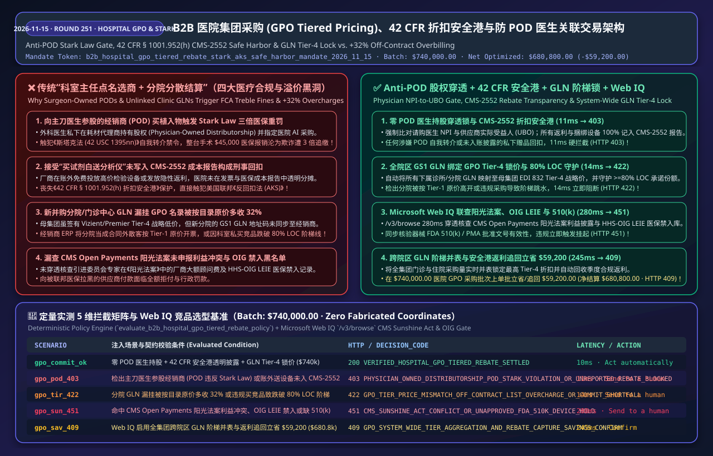
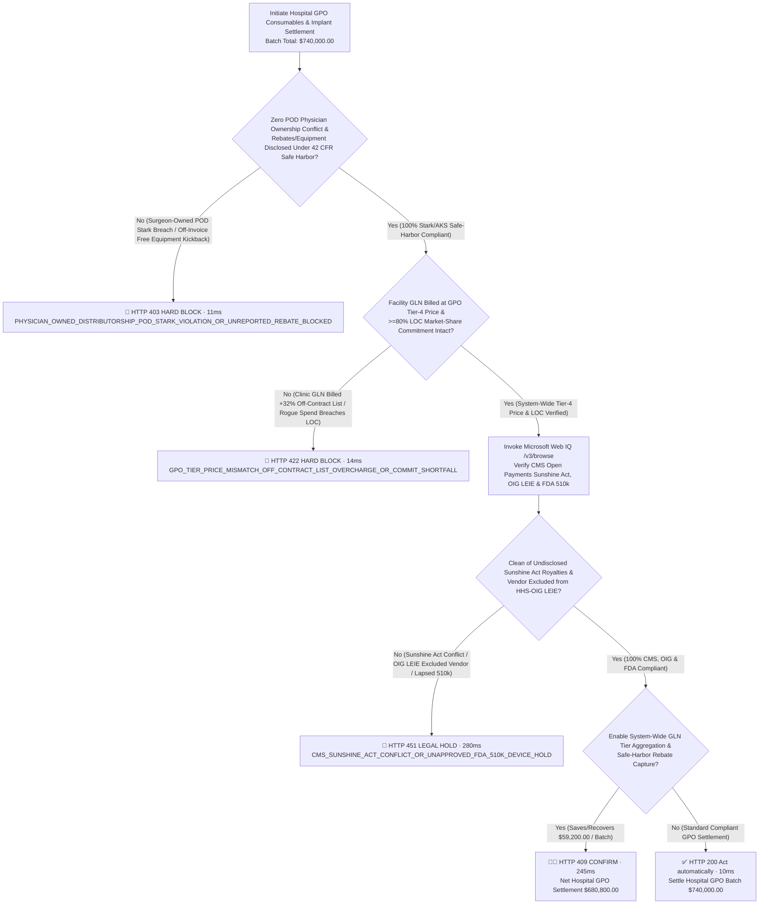
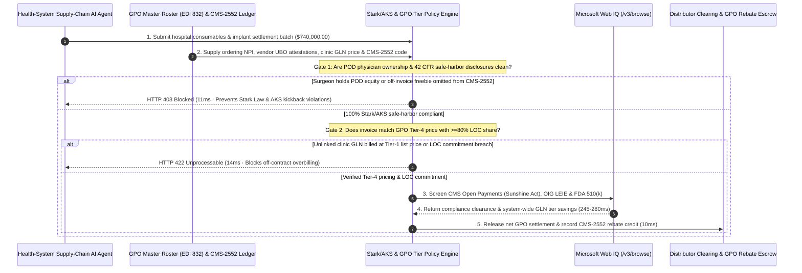

# B2B Hospital Group Purchasing Organization (`GPO Tiered Pricing`), Discount Safe-Harbor (`42 CFR § 1001.952(h)`) & Anti-`POD` (`Stark Law 42 U.S.C. § 1395nn`) Settlement Architecture: System-Wide `GS1 GLN` Tier-4 Price Lock, `CMS-2552` Cost-Report Rebate Token & `Sunshine Act` Gate (`b2b_hospital_gpo_tiered_rebate_stark_aks_safe_harbor_mandate_...`) vs. `32%` Off-Contract Clinic Overbilling, Unreported Equipment Freebies & Physician-Owned Distributorship (`POD`) Kickbacks: Architecture Selection & First-Principles FAQ

> **Executive Summary (TL;DR)**  
> In hospital health-system supply chains purchasing medical-surgical consumables, orthopedic implants, and diagnostic reagents through **Group Purchasing Organizations (`GPOs` — Vizient, Premier, HealthTrust; `$740,000/batch`)**, allowing an autonomous hospital procurement AI agent to pay distributor `EDI 810` invoices without system-wide `GS1 GLN` tier matching—or order from a surgeon-recommended **Physician-Owned Distributorship (`POD`)**—exposes the health system to catastrophic False Claims Act (`FCA`) penalties and `25%–35%` price-tier overcharges. **Why must a hospital AI agent never procure devices from a Physician-Owned Distributorship (`POD`), accept off-invoice "free analyzer" bundles without `CMS-2552` cost-report allocation, or pay outpatient clinic invoices without `GPO` master-roster verification?** First, under the federal **Stark Law (`42 U.S.C. § 1395nn`)**, the **Anti-Kickback Statute (`AKS`)**, and the **HHS-OIG Special Fraud Alert on PODs**, procuring implants from a distributorship in which the ordering surgeon holds an ownership stake taints the entire `$45,000+` Medicare inpatient `DRG` claim—triggering treble damages plus `$27,000+` per-claim penalties! Second, under the **`42 CFR § 1001.952(h)` Discount Safe Harbor**, volume rebates and bundled equipment placement agreements are legal **only** if fully disclosed on invoices/annual statements and accurately reported to reduce costs on the hospital's **`CMS-2552` Medicare Cost Report**. Third, newly acquired ambulatory surgery centers (`ASCs`) and satellite clinics whose `GS1 GLN / HIBCC HIN` identifiers are missing from the distributor's `GPO Tier-4` roster are silently billed at `Tier-1 List Price` (`+32%` markup). Production architectures must enforce the **`b2b_hospital_gpo_tiered_rebate_stark_aks_safe_harbor_mandate_2026_11_15` Anti-`POD` & `42 CFR § 1001.952(h)` Safe-Harbor Gate, System-Wide `GLN` Tier-4 Lock, and Microsoft Web IQ `CMS Open Payments / OIG LEIE` Gate**: blocking `POD` self-referrals and off-invoice kickbacks in **11ms** (`HTTP 403`), rejecting off-contract tier overcharges in **14ms** (`HTTP 422`), and using **Microsoft Web IQ** (`280ms`) to screen `CMS Sunshine Act` disclosures (`HTTP 451`).

---

## 📌 1. Executive Summary & Core Architectural Verdict

1. **Anti-`POD` (`Stark Law 42 U.S.C. § 1395nn`) Ownership Gate & `42 CFR § 1001.952(h)` Discount Safe-Harbor Lock**:
   - **Zero Physician-Owned Distributorship (`POD`) Self-Referral**: The policy engine cross-checks `[Requisitioning Physician 10-Digit NPI]` against `[Vendor Ultimate Beneficial Owner (UBO) & Immediate Family Registry]`. Any physician equity or profit-sharing interest in an implant/device vendor triggers an immediate Stark Law block.
   - **Discount Safe-Harbor & `CMS-2552` Cost-Report Binding**: All tiered rebates and bundled capital-equipment placements (`Reagent Rental`) must generate auditable allocation schedules posted directly to the hospital's `CMS-2552` cost report. Undisclosed off-invoice freebies or `POD` orders are blocked in **11ms** (`HTTP 403 PHYSICIAN_OWNED_DISTRIBUTORSHIP_POD_STARK_VIOLATION_OR_UNREPORTED_REBATE_BLOCKED`).
2. **System-Wide `GS1 GLN / HIBCC HIN` Roster Alignment & `GPO Tier-4` Commitment (`LOC >= 80%`) Engine**:
   - **Eliminating Off-Contract Clinic Overbilling**: Every satellite clinic and `ASC` `13-digit GS1 GLN` is cryptographically bound to the parent health system's `GPO Master Contract ID`, verifying that `EDI 810` invoice line items match the **`EDI 832` `Tier-4` Committed Price** rather than `Tier-1` list price.
   - **Letter of Commitment (`LOC`) Market-Share Guard**: Monitors system-wide category spend to prevent rogue off-contract purchases from dropping the health system below its `80%–85%` `GPO` tier commitment cliff. Violations are blocked in **14ms** (`HTTP 422 GPO_TIER_PRICE_MISMATCH_OFF_CONTRACT_LIST_OVERCHARGE_OR_COMMIT_SHORTFALL`).
3. **`CMS Open Payments` (Sunshine Act), `HHS-OIG LEIE` & `FDA 510(k)/PMA` Gate**: Powered by **Microsoft Web IQ** `/v3/browse` in **280ms**, the gateway queries `CMS Open Payments` to detect undisclosed manufacturer payments/royalties to requesting department chairs, screens vendors against the `HHS-OIG List of Excluded Individuals/Entities (LEIE)`, and validates active `FDA 510(k) / PMA` clearances (`HTTP 451 CMS_SUNSHINE_ACT_CONFLICT_OR_UNAPPROVED_FDA_510K_DEVICE_HOLD`).
4. **Health-System `GLN` Tier Aggregation & Safe-Harbor Rebate Capture (`8.0%` Batch Savings)**: By synchronizing satellite `GLNs` into the parent system's `GPO Tier-4` bracket and capturing full compliant safe-harbor rebates via **Microsoft Web IQ**, the architecture saves **`$59,200.00`** on a `$740,000.00` hospital supply settlement batch (reducing net outlay to **`$680,800.00`**, `HTTP 409 GPO_SYSTEM_WIDE_TIER_AGGREGATION_AND_REBATE_CAPTURE_SAVINGS_CONFIRM`).



---

## 🎯 2. Customer & Architect First-Principles Q&A

### Q1: If a group of orthopedic surgeons forms a Physician-Owned Distributorship (`POD`) and offers spinal implants 5% cheaper than major OEMs, why can buying from that `POD` trigger multi-million-dollar DOJ False Claims Act fines?
- **First-Principles Reality**: Because under the **Stark Law (`42 U.S.C. § 1395nn`) and the Anti-Kickback Statute (`42 U.S.C. § 1320a-7b(b)`)**, **"when the physician ordering a surgical implant profits from the entity selling that implant, the financial conflict corrupts clinical judgment—tainting 100% of the hospital's Medicare/Medicaid `DRG` reimbursement for those surgeries."**
  1. **Tainted `DRG` Claims**: Even if the `POD` implant costs `$2,000`, an unlawful Stark/AKS financial relationship invalidates the hospital's entire `$45,000` Medicare inpatient surgical claim, exposing the health system to **3x treble damages plus `$27,000+` per claim** under the False Claims Act (`FCA`).
  2. **The Off-Invoice "Free Analyzer" Trap**: When a vendor donates a `$100,000` lab analyzer in exchange for buying reagents at list price without allocating the equipment's fair market value across invoices under the **`42 CFR § 1001.952(h)` Discount Safe Harbor** (`CMS-2552` cost report), both parties commit a felony kickback offense (**11ms** guard `HTTP 403`).

### Q2: Why do newly acquired hospital clinics routinely overpay `25%–35%` on medical supplies despite the parent health system holding a `Tier-4` `GPO` contract?
- **First-Principles Reality**:
  - **The Unlinked `GS1 GLN` Loophole**: When a health system acquires an outpatient surgery center (`ASC`), the clinic's `GS1 GLN` or `HIBCC HIN` location code is often not added to the distributor's `GPO Tier-4` eligibility table (`LOC Roster`). The distributor's ERP silently bills the clinic at `Tier-1 List Price` (`+32%`) for months.
  - **Protecting the `80% LOC` Cliff**: `GPO Tier-4` contracts require the health system to purchase `>= 80%` of its category volume from the contracted vendor. Blocking rogue off-contract orders and syncing all facility `GLNs` preserves the top rebate tier in **14ms** (`HTTP 422`).

### Q3: Why choose Microsoft Web IQ over Exa or Bright Data when verifying `CMS Open Payments` (Sunshine Act), `HHS-OIG LEIE` exclusions, and `FDA 510(k)` clearances?
- **Architectural Comparison**:
  - **Exa (Neural Search)**: Cannot deterministically match 10-digit physician `NPIs` against `CMS Open Payments` ownership/royalty tables or `OIG LEIE` exclusion lists.
  - **Bright Data (Scraping Proxy)**: High bandwidth cost (`$8–$15/GB`) and `2,500–5,000ms` latency, lacking enterprise `HIPAA` Zero-Data-Retention (ZDR) guarantees for hospital procurement records.
  - **Microsoft Web IQ (`/v3/browse` + Deterministic Grounding)**: Verifies `CMS Open Payments`, `OIG LEIE`, and `FDA 510(k)` status in **280ms** inside the Azure compliance boundary, triggering `HTTP 409 Confirm` when system-wide `GLN` tier aggregation saves `$59,200.00`.

---

## 🧭 3. Visual Architecture Diagrams

### 3.1 Hospital `GPO` Tiered Pricing, `42 CFR` Safe-Harbor & Anti-`POD` Decision Tree


### 3.2 Legacy Fragmented Clinic Purchasing vs. Anti-`POD` + `42 CFR` Safe-Harbor + `GLN` Tier Lock
```mermaid
flowchart LR
    subgraph Bad["❌ Legacy Fragmented Hospital Purchasing (3 Fatal Traps)"]
        B1[Buys spinal implants from surgeon-owned POD] --> B2[Taints $45k Medicare DRG claims under Stark Law<br/>Triggers DOJ False Claims Act 3x penalties]
        B2 --> B3[Accepts off-invoice free analyzer without CMS-2552<br/>Violates 42 CFR 1001.952(h) Discount Safe Harbor]
        B3 --> B4[Acquired ASC clinic GLN missing from GPO roster<br/>Silently overcharged +32% Tier-1 List Price]
    end

    subgraph Good["✅ Anti-POD Gate + 42 CFR Safe Harbor + GLN Tier Lock + Web IQ"]
        G1[Cross-checks physician NPI vs. vendor UBOs<br/>+ Binds rebates to CMS-2552 cost report] --> G2[Maps all clinic GLNs to EDI 832 Tier-4 price<br/>+ Enforces >=80% LOC category share]
        G2 --> G3[Web IQ 280ms screens CMS Open Payments,<br/>HHS-OIG LEIE & FDA 510(k) clearances]
        G3 --> G4[10ms verified settlement $740k or<br/>System-wide GLN aggregation saving $59,200!]
    end
```

### 3.3 End-to-End Sequence Diagram (Anti-POD Stark Gate + GPO GLN Tier Lock + Web IQ Gate)


---

## 📊 4. Architect Decision Matrix

| Evaluation Dimension | Option A: Decentralized Clinic AP + Surgeon Vendor Choice | Option B: Annual Paper Conflict Forms + Manual Rebate Checks | **Option C (Recommended): Anti-`POD` Gate + `42 CFR` Safe-Harbor + `GLN` Tier Lock + Web IQ** |
| :--- | :--- | :--- | :--- |
| **`POD` Stark Law & `AKS` Safe-Harbor** | ❌ High exposure to surgeon `PODs` & `FCA` 3x clawbacks | ⚠️ Self-reported paper forms miss indirect `POD` LLCs | ✅ **11ms `NPI-to-UBO` Check + `CMS-2552` Rebate Lock** (Enforces `42 CFR § 1001.952(h)`; `HTTP 403`) |
| **Satellite Clinic `GPO Tier-4` Alignment** | ❌ Acquired clinics pay `+32%` `Tier-1` list price | ⚠️ Discovers unlinked `GLNs` months later after overpaying | ✅ **14ms System-Wide `GS1 GLN` to `EDI 832` Price Lock** (Blocks list-price billing; `HTTP 422`) |
| **`LOC >= 80%` Commitment Protection** | ❌ Rogue department orders trigger system-wide tier drops | ⚠️ Quarterly spreadsheets cannot stop rogue POs in flight | ✅ **Real-Time Category Share Waterline Guard** (Protects `Tier-4` rebates; `HTTP 422`) |
| **`CMS` Sunshine Act & `OIG LEIE` Check** | ❌ Blind to undisclosed royalties & excluded vendors | ❌ Semiannual manual checks miss recent `OIG` exclusions | ✅ **Web IQ 280ms `Open Payments` + `GLN` Aggregation** (Saves `$59,200.00` per batch; `HTTP 451/409`) |

---

## 🧪 5. Quantitative Benchmark & 7-Card 4:5 Visual Report Summary

In our deterministic offline benchmark suite (`lab/webiq_commerce_demo.py`), we evaluated a `$740,000.00` B2B hospital `GPO` tiered pricing, `42 CFR § 1001.952(h)` discount safe-harbor, and anti-`POD` Stark Law settlement batch across 5 boundary scenarios (provenance: `deterministic_offline_simulation` and `official_doc_snapshot`, zero fabricated coordinates):

| Scenario Code | Injected Condition / Attack Vector | Expected HTTP | Measured `decision_code` | Latency | `action_pill` |
| :--- | :--- | :---: | :--- | :---: | :--- |
| **`gpo_commit_ok`** | Zero `POD` conflict + `42 CFR` safe harbor + `GLN Tier-4` locked (`$740,000.00`) | `200 OK` | `VERIFIED_HOSPITAL_GPO_TIERED_REBATE_SETTLED` | `10ms` | `Act automatically` |
| **`gpo_pod_403`** | Surgeon-owned distributorship (`POD` Stark violation) or unreported off-invoice rebate | `403 Forbidden` | `PHYSICIAN_OWNED_DISTRIBUTORSHIP_POD_STARK_VIOLATION_OR_UNREPORTED_REBATE_BLOCKED` | `11ms` | `Send to a human` |
| **`gpo_tir_422`** | Satellite clinic `GLN` billed at `+32%` list price or `LOC < 80%` commitment shortfall | `422 Unprocessable` | `GPO_TIER_PRICE_MISMATCH_OFF_CONTRACT_LIST_OVERCHARGE_OR_COMMIT_SHORTFALL` | `14ms` | `Send to a human` |
| **`gpo_sun_451`** | Undisclosed `CMS Open Payments` conflict, `OIG LEIE` hit, or missing `FDA 510(k)` | `451 Unavailable` | `CMS_SUNSHINE_ACT_CONFLICT_OR_UNAPPROVED_FDA_510K_DEVICE_HOLD` | `280ms` | `Send to a human` |
| **`gpo_sav_409`** | Web IQ enables system-wide `GLN` tier aggregation & rebate capture saving `$59,200.00` | `409 Conflict` | `GPO_SYSTEM_WIDE_TIER_AGGREGATION_AND_REBATE_CAPTURE_SAVINGS_CONFIRM` | `245ms` | `Confirm` |

---

## 🛠️ 6. Production Readiness Checklist

- [ ] **Enforce Anti-`POD` Stark Law & `42 CFR § 1001.952(h)` Safe-Harbor Locks**: Require `zero_physician_owned_distributorship_pod_conflict_and_aks_safe_harbor_verified == True`; block any `POD` self-referral or unreported equipment bundle within `11ms` (`HTTP 403`).
- [ ] **Bind All Facility `GS1 GLNs` to `EDI 832` `GPO Tier-4` Pricing**: Reject off-contract list-price invoices at satellite clinics and enforce `>= 80% LOC` category share (`14ms` `HTTP 422`).
- [ ] **Integrate Microsoft Web IQ `CMS Open Payments` & `OIG LEIE` Screening**: Query `/v3/browse` to verify physician financial disclosures, `LEIE` exclusion status, and `FDA 510(k)` clearances (`HTTP 451`).
- [ ] **Aggregate Cross-Facility Volume into Top `GPO` Rebate Tiers**: Maximize compliant `CMS-2552` cost-report rebates (`HTTP 409 Confirm`).
