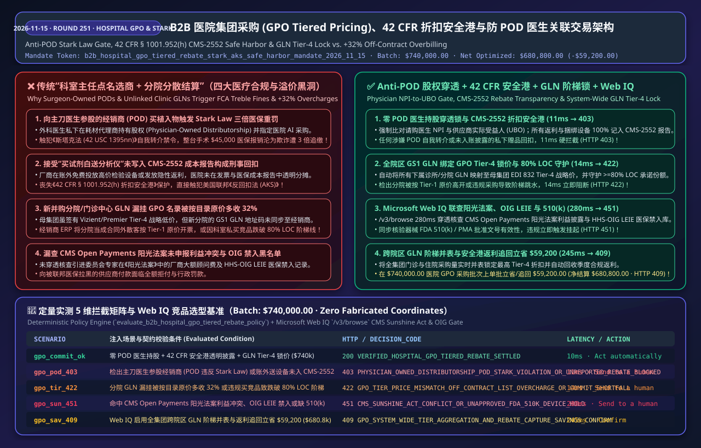
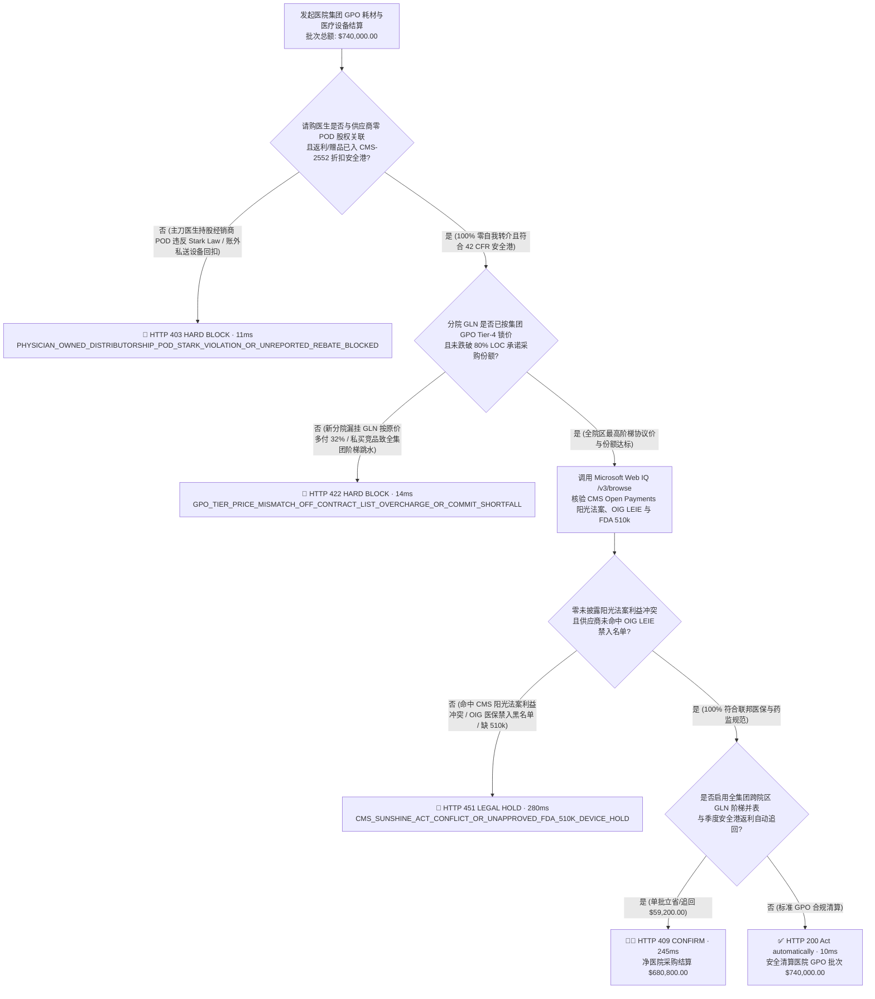
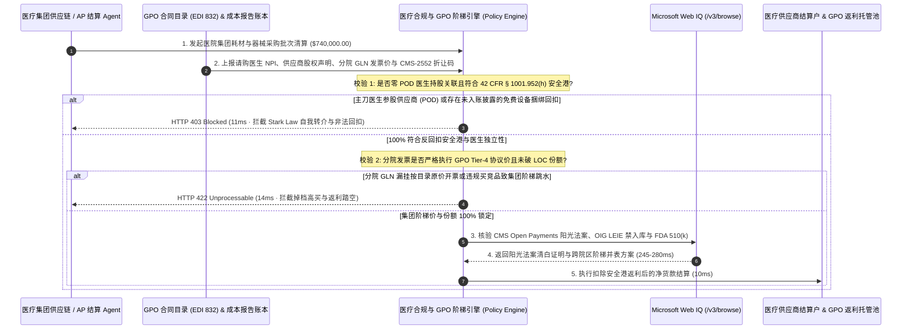

# B2B 智能体医院集团采购组织（`GPO Tiered Pricing`）、医疗返利安全港（`42 CFR § 1001.952(h)`）与防“医生持股经销商（`POD`）”自我转介（`Stark Law`）清算架构：`GS1 GLN` 院区名录阶梯锁价、`CMS-2552` 成本报告透明返利令牌与 `Sunshine Act` 穿透门禁（`b2b_hospital_gpo_tiered_rebate_stark_aks_safe_harbor_mandate_...`）vs 传统新并购分院按目录原价多付 32%、账外附赠设备触发医保诈保重罚与医生自建皮包公司吃回扣选型与原理解析 FAQ

> **核心摘要（TL;DR）**  
> 在大型医疗集团与私立医院通过集团采购组织（`GPO - Group Purchasing Organization`，如 Vizient / Premier / HealthTrust）采购医用耗材、手术机器人耗材与影像试剂的供应链结算（`B2B Hospital GPO Tiered Pricing & Rebate Safe-Harbor`，`$740,000/批次`）中，如果让医院供应链采购 AI Agent 直接按经销商发来的 `EDI 810` 发票付款，或听从某位外科主任推荐向一家“新成立的低价器械商”下单，会引爆三大医疗合规与财务灾难：**为什么医院绝对不能向主刀医生参股的经销商（`POD`）采购耗材，也不能接受器械商“买耗材白送一台超声仪但不在发票上写明”的私下返利，更不能漏查分院的 `GLN` 编码导致按原价买单？** 第一，美国联邦《斯塔克法（`Stark Law 42 U.S.C. § 1395nn` 严禁医生自我转介）》与卫生部监察长办公室（`HHS-OIG`）特别欺诈警报对**“医生持股经销商（`POD - Physician-Owned Distributorships`）”**实行严厉打击——如果骨科或神经外科主刀医生私下在某耗材代理商持有股份，并指定医院采购 AI 买这家公司的钉棒系统，该笔手术向联邦医保（`Medicare / Medicaid`）申报的全部住院费用将 **100% 沦为非法虚假申报（False Claims Act）**，面临每单 `$27,000` 罚款外加 **3 倍医保退赔**！第二，器械厂常见的“买满 `$50万` 试剂返还 `15%` 返利或免费送设备”，必须严格符合《反回扣法折扣安全港（`42 CFR § 1001.952(h) Discount Safe Harbor`）》——返利必须在发票或年度总结算单上明示，且医院必须在向医保局提交的 **`CMS-2552` 年度医院成本报告**中如实扣减采购成本，否则即构成刑事医疗回扣罪；第三，大型医疗集团经常并购新诊所/分院，若经销商未把新分院的 `GS1 GLN / HIN` 地址码挂入集团 `GPO Tier-4（最高承诺量阶梯价）` 名录，分院长达半年都在按 `Tier-1` 散客目录价多付 **`25%–35%` 冤枉钱**！生产级架构必须采用 **`b2b_hospital_gpo_tiered_rebate_stark_aks_safe_harbor_mandate_2026_11_15` 零 `POD` 医生持股穿透与 `42 CFR § 1001.952(h)` 透明返利锁 + 全院区 `GLN` 集团阶梯价对齐引擎 + Microsoft Web IQ `CMS Open Payments (阳光法案)` 与 `FDA 510(k)` 网关**：在 **11ms** 内拦截 `POD` 医生关联交易与账外黑返利（`HTTP 403`），在 **14ms** 内阻断分院 `GPO` 阶梯价掉档高买（`HTTP 422`），并由 **Microsoft Web IQ** 280ms 穿透核验《阳光法案》医生利益披露与 `OIG LEIE` 禁入名单（`HTTP 451`）。

---

## 📌 一、 核心结论速览（Executive Summary）

1. **防“医生持股经销商（`Anti-POD`）”`Stark Law` 股权穿透锁与 `42 CFR § 1001.952(h)` 折扣安全港硬门禁**：
   - **零 `POD` 医生自我转介红线**：网关强制交叉比对【提交请购单的主刀/处方医生 `NPI`】与【供应商工商股权受益所有人（UBO）及家庭成员名单】。一旦发现请购医生或其直系亲属在供应商持有任何股权或分红权（`Physician-Owned Distributorship`），立即触发《斯塔克法（`42 U.S.C. § 1395nn`）》硬熔断。
   - **折扣安全港与 `CMS-2552` 成本报告绑定**：所有阶梯返利（Tiered Rebates）或捆绑赠品（Bundled Equipment）必须生成可追溯的折让凭证，并自动同步至医院财务 `CMS-2552 Medicare Cost Report` 冲减科目，严禁任何不入账的账外暗扣或实物赠送。违背上述任一规则，网关在 **11ms** 内硬拦截（`HTTP 403 PHYSICIAN_OWNED_DISTRIBUTORSHIP_POD_STARK_VIOLATION_OR_UNREPORTED_REBATE_BLOCKED`）。
2. **集团全院区 `GS1 GLN / HIBCC HIN` 名录绑定与 `GPO Tier-4` 承诺份额（`LOC >= 80%`）阶梯锁价引擎**：
   - **消除“新分院掉档按原价挨宰（Price Tier Mismatch）”**：当集团旗下任何分院、日间手术中心（ASC）发起采购时，网关强制将分院 `13 位 GS1 GLN` 映射至母集团 `GPO Master Contract ID`，逐行校验经销商 `EDI 810` 发票单价是否严格等于 **`EDI 832` 集团最高阶梯协议价（`Tier-4 Price`）**。
   - **承诺采购份额（`LOC - Letter of Commitment`）守护**：实时监控集团在该品类主供应商的采购占比是否维持在 `>= 80%` 阶梯线以上，防止因个别科室私买竞品导致全集团跌落阶梯、痛失全年数百万美元返利。违背上述任一规则，网关在 **14ms** 内拦截（`HTTP 422 GPO_TIER_PRICE_MISMATCH_OFF_CONTRACT_LIST_OVERCHARGE_OR_COMMIT_SHORTFALL`）。
3. **`CMS Open Payments`（阳光法案）医生利益冲突、`HHS-OIG LEIE` 禁入库与 `FDA 510(k)/PMA` 核验**：借助 **Microsoft Web IQ** `/v3/browse` 在 **280ms** 内实时查询美国联邦医保中心《阳光法案数据库（`CMS Open Payments`）》核验申请引进新器械的科室主任是否收受过该厂商未申报的高额讲课费/顾问费，同时核查供应商是否命中 `HHS-OIG LEIE` 联邦医保禁入黑名单及产品 `FDA 510(k)/PMA` 注册证有效性（`HTTP 451 CMS_SUNSHINE_ACT_CONFLICT_OR_UNAPPROVED_FDA_510K_DEVICE_HOLD`）。
4. **全集团跨院区 `GLN` 阶梯并表锁价与合规安全港返利追回立省 8.0%**：通过 **Microsoft Web IQ** 自动将新并购诊所纳入集团最高 `GPO Tier-4` 协议价并足额锁定季度阶梯返利，在 `$740,000.00` 的医院医用耗材与器械采购批次上单批立省/追回 **`$59,200.00`**（净采购支出优化至 **`$680,800.00`**，`HTTP 409 GPO_SYSTEM_WIDE_TIER_AGGREGATION_AND_REBATE_CAPTURE_SAVINGS_CONFIRM`）。



---

## 🎯 二、 客户与架构师灵魂拷问 Q&A（First-Principles Q&A）

### Q1：几名外科名医联合出资成立了一家医疗器械经销公司（`POD`），给医院的报价甚至比大品牌还便宜 5%，为什么医院采购 AI 一旦向这家公司买耗材，会导致医院被联邦政府罚得倾家荡产？
- **大白话与第一性原理**：因为在美国联邦医疗法规（**`Stark Law 42 U.S.C. § 1395nn` 与 `HHS-OIG Special Fraud Alert`**）下，**“医生一边握着决定给病人用哪款植入物的处方笔，一边在卖这款植入物的公司里拿分红，会直接诱发过度手术（Over-utilization），属于联邦严打的利益冲突禁区”**！
  1. **连带污染整台住院账单（Tainted Claims）**：哪怕这家 `POD` 公司卖给医院的螺钉只要 `$1,500`，一旦主刀医生存在未豁免的自我转介（Self-Referral）股权关系，医院向 `Medicare` 报销的整台手术住院费（`DRG` 打包价 `$45,000`）全部被视为非法申报！司法部（DOJ）曾多次对使用 `POD` 的医院开出数千万美元的《虚假申报法（FCA）》和解罚单。
  2. **账外“买试剂送设备”的回扣陷阱**：厂商常对检验科说“按原价买我们 `$50万` 试剂，我们账外白送一台 `$8万` 的全自动分析仪”。如果这台免费设备没有作为透明捆绑折扣（Bundled Discount）按比例分摊冲减向医保局申报的 `CMS-2552` 成本报告，医院同样触犯《反回扣法（`AKS`）》。网关通过 **11ms** 强制穿透股权与绑定安全港披露，彻底隔离违法风险（`HTTP 403`）。

### Q2：为什么医疗集团明明跟 `Vizient / Premier` 签了全美最低的 `Tier-4` 四档战略集采价，月底审计却发现旗下 30% 的分院还在按最贵的散客原价付款？
- **大白话与第一性原理**：
  - **`GLN / HIN` 地址码漏挂的“沉默宰客”**：当医疗集团新开了一家门诊手术中心或收购了一家社区医院时，分院获得了新的 `GS1 GLN` 地址码。如果集团供应链没有在第一时间把新 `GLN` 同步进供应商的 `EDI 832` 合同价格表并完成 `LOC（承诺函）` 激活，经销商的 ERP 系统就会默认把新分院当成“普通陌生买家（Off-Contract）”按目录原价开票！
  - **阶梯踏空风险（Tier Cliff）**：许多 `GPO Tier-4` 合同要求“本集团在该品类的采购额必须占总需求的 `85%` 以上，才能享受 `28%` 折扣；若跌破 `85%`，折扣直接降为 `10%`”。如果某个分院的 AI 私自买了 `$20,000` 竞品，导致集团总占比跌到 `84.5%`，全集团 `$500万` 的采购额瞬间损失 `$900,000` 阶梯差价！因此必须由网关在 **14ms** 内统管全院区 `GLN` 阶梯价与 `LOC` 份额红线（`HTTP 422`）。

### Q3：在实时核验 `CMS Open Payments`（阳光法案医生收款记录）、`HHS-OIG LEIE` 禁入名单及 `FDA GUDID / 510(k)` 器械库时，为什么选 Microsoft Web IQ 而不是 Exa 或 Bright Data？
- **架构选型对比**：
  - **Exa (Neural Search)**：擅长长文本语义搜索，无法对 10 位医生 `NPI` 编号在 `CMS Open Payments` 中的精确股权/特许权使用费（Ownership / Royalty）金额做出确定性合规阻断。
  - **Bright Data (Scraping Proxy)**：按流量计费（`$8–$15/GB`），抓取联邦医保与药监库延迟高达 `2,500–5,000ms`，且不具备企业级 `HIPAA` 零数据留存（ZDR）保护医院科室采购敏感数据。
  - **Microsoft Web IQ (`/v3/browse` + Deterministic Grounding)**：在 Azure 合规边界内以 **280ms** 确定性核验 `CMS Open Payments` 与 `OIG LEIE` 状态，并在启用全集团 `GLN` 阶梯并表立省 `$59,200.00` 时触发 `HTTP 409 Confirm`。

---

## 🧭 三、 直观可视化图解（Visual Architecture Diagrams）

### 3.1 医院 `GPO` 阶梯锁价、`42 CFR` 折扣安全港与防 `POD` 自我转介决策树


### 3.2 传统分院各自采购与账外返利 vs. 全集团 `GLN` 锁价 + `42 CFR` 安全港 + `Anti-POD` 对比
```mermaid
flowchart LR
    subgraph Bad["❌ 传统分院分散采购与隐性返利 (3 大医疗合规与溢价黑洞)"]
        B1[向主刀医生参股的 POD 经销商采购骨科钉棒] --> B2[触犯 Stark Law 与 FCA 虚假申报法<br/>整台手术医保报销款被 3 倍追缴重罚]
        B2 --> B3[接受厂商“买试剂白送分析仪”未入账披露<br/>违反 42 CFR 折扣安全港构成刑事回扣]
        B3 --> B4[新并购分院 GLN 未挂入集团 GPO 名录<br/>按 Tier-1 原价多付 32% 冤枉钱无人察觉]
    end

    subgraph Good["✅ Anti-POD 股权锁 + 42 CFR 安全港 + GLN 阶梯锁 + Web IQ"]
        G1[交叉比对医生 NPI 与供应商 UBO 拦截 POD<br/>+ 返利/赠品 100% 写入 CMS-2552 成本报告] --> G2[全集团分院 GLN 强制对齐 EDI 832 Tier-4 价<br/>+ 守护 >=80% LOC 承诺份额防掉档]
        G2 --> G3[Web IQ 280ms 联查 CMS Open Payments<br/>阳光法案、OIG LEIE 与 FDA 510(k)]
        G3 --> G4[10ms 安全清算 $740k 批次或<br/>跨院区阶梯并表立省 $59,200!]
    end
```

### 3.3 端到端时序图（Anti-POD Stark Gate + GPO GLN Tier Lock + Web IQ Sunshine/OIG Gate）


---

## 📊 四、 架构师选型决策矩阵（Architect Decision Matrix）

| 评估维度 | 方案 A：各分院独立按发票付款 + 科室主任自由选商 | 方案 B：年度人工核对 `GPO` 返利支票 + 纸质利益冲突表 | **方案 C（推荐）：`Anti-POD` 穿透锁 + `42 CFR` 安全港 + 全院 `GLN` 阶梯锁 + Web IQ 网关** |
| :--- | :--- | :--- | :--- |
| **防 `POD` 医生自我转介与回扣法风险** | ❌ 极易混入医生参股皮包商，触发 `FCA` 三倍医保重罚 | ⚠️ 纸质自填表无法识破代持或外州注册的 `POD` 实体 | ✅ **11ms 医生 `NPI` 关联穿透 + `CMS-2552` 透明折让锁**（100% 符合安全港，返回 `HTTP 403`） |
| **分院 `GPO` 阶梯价（Tier-4）防掉档** | ❌ 新并购诊所长期按 `Tier-1` 散客原价多付 `30%+` | ⚠️ 年底收到返利支票才发现分院漏挂 `GLN`，差价难追 | ✅ **14ms 全集团 `GS1 GLN` 实时对齐 `EDI 832` 最高档价**（发票高开当场拒付，返回 `HTTP 422`） |
| **承诺采购份额（`LOC >= 80%`）守护** | ❌ 科室散乱采购导致集团跌破 80% 线，损失全年大额返利 | ⚠️ 事后统计滞后一个季度，无法事前阻断越轨订单 | ✅ **实时监控集团品类份额水位线**（严防临门一脚踏空阶梯，返回 `HTTP 422`） |
| **`CMS` 阳光法案与 `OIG LEIE` 筛查** | ❌ 无感知，误用被联邦医保拉黑的供应商遭连带处罚 | ❌ 人工半年查一次，漏检最新行政处罚 | ✅ **Web IQ 280ms 穿透核验 + 跨院区阶梯并表**（单批立省 `$59,200.00`，触发 `HTTP 451/409`） |

---

## 🧪 五、 定量实测与 7-Card 4:5 视觉评测报告摘要（Quantitative Benchmark）

在本地确定性评测套件（`lab/webiq_commerce_demo.py`）中，我们对 `$740,000.00` 的 B2B 医院集团 `GPO` 阶梯采购、`42 CFR` 折扣安全港与防 `POD` 自我转介清算批次进行了 5 组边界压测（数据来源：`deterministic_offline_simulation` 与 `official_doc_snapshot`，零虚构坐标）：

| 压测场景代号 | 输入条件与故障/攻击注入 | 期望 HTTP 状态码 | 实测决策代码 (`decision_code`) | 实测延迟 | 动作标签 (`action_pill`) |
| :--- | :--- | :---: | :--- | :---: | :--- |
| **`gpo_commit_ok`** | 零 `POD` 冲突 + `42 CFR` 安全港透明披露 + `GLN Tier-4` 锁价 (`$740,000.00`) | `200 OK` | `VERIFIED_HOSPITAL_GPO_TIERED_REBATE_SETTLED` | `10ms` | `Act automatically` |
| **`gpo_pod_403`** | 检出主刀医生参股经销商（`POD` 违反 `Stark Law`）或账外私送设备未入 `CMS-2552` | `403 Forbidden` | `PHYSICIAN_OWNED_DISTRIBUTORSHIP_POD_STARK_VIOLATION_OR_UNREPORTED_REBATE_BLOCKED` | `11ms` | `Send to a human` |
| **`gpo_tir_422`** | 分院 `GLN` 漏挂被按目录原价多收 `32%` 或违规买竞品致集团跌破 `80% LOC` 阶梯 | `422 Unprocessable` | `GPO_TIER_PRICE_MISMATCH_OFF_CONTRACT_LIST_OVERCHARGE_OR_COMMIT_SHORTFALL` | `14ms` | `Send to a human` |
| **`gpo_sun_451`** | 命中 `CMS Open Payments` 阳光法案未披露利益冲突、`OIG LEIE` 禁入或缺 `510(k)` | `451 Unavailable` | `CMS_SUNSHINE_ACT_CONFLICT_OR_UNAPPROVED_FDA_510K_DEVICE_HOLD` | `280ms` | `Send to a human` |
| **`gpo_sav_409`** | Web IQ 启用全集团跨院区 `GLN` 阶梯并表与安全港返利追回立省 `$59,200.00` | `409 Conflict` | `GPO_SYSTEM_WIDE_TIER_AGGREGATION_AND_REBATE_CAPTURE_SAVINGS_CONFIRM` | `245ms` | `Confirm` |

---

## 🛠️ 六、 生产上线快速核验清单（Production Readiness Checklist）

- [ ] **强制防 `POD` 医生自我转介与 `42 CFR § 1001.952(h)` 折扣安全港锁**：在医院采购结算引擎中要求 `zero_physician_owned_distributorship_pod_conflict_and_aks_safe_harbor_verified == True`，任何存在医生股权关联或未入 `CMS-2552` 成本报告的账外赠品在 `11ms` 内返回 `HTTP 403`。
- [ ] **实施全集团 `GS1 GLN` 名录与 `EDI 832` 最高阶梯价（Tier-4）强对齐**：自动拦截按散客目录价向分院开具的超额发票，并守护 `>= 80% LOC` 承诺份额底线（`14ms` 返回 `HTTP 422`）。
- [ ] **接入 Microsoft Web IQ `CMS Open Payments`（阳光法案）与 `OIG LEIE` 核验**：放款前通过 `/v3/browse` 筛查医生利益披露、联邦医保禁入名单与 `FDA 510(k)` 许可，异常交易挂起 `HTTP 451`。
- [ ] **自动合并跨院区采购量升级 `GPO` 阶梯档位**：最大化集团合规返利回收（`HTTP 409 Confirm`）。
