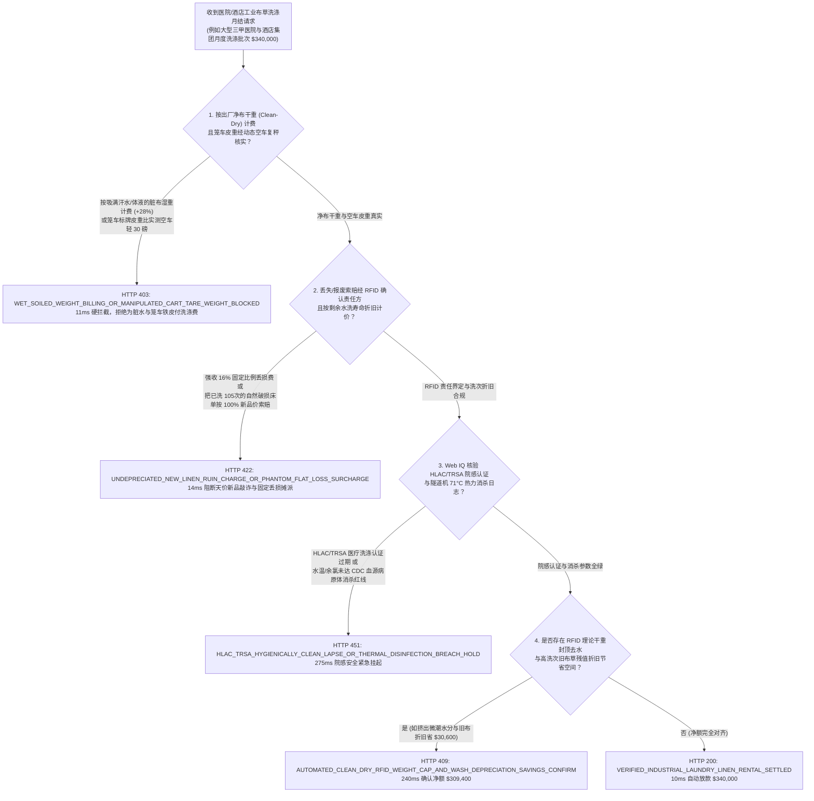
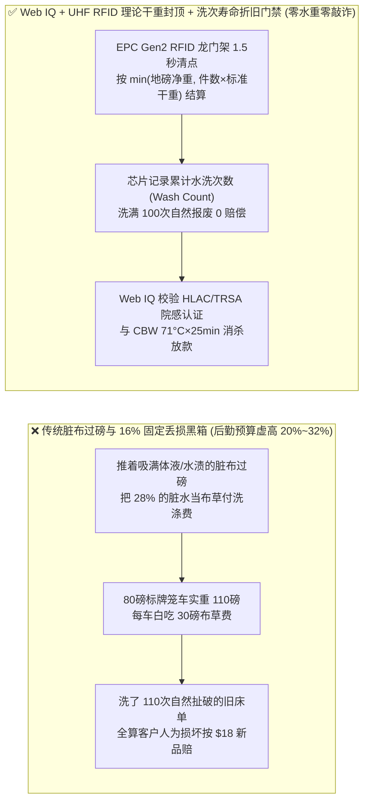
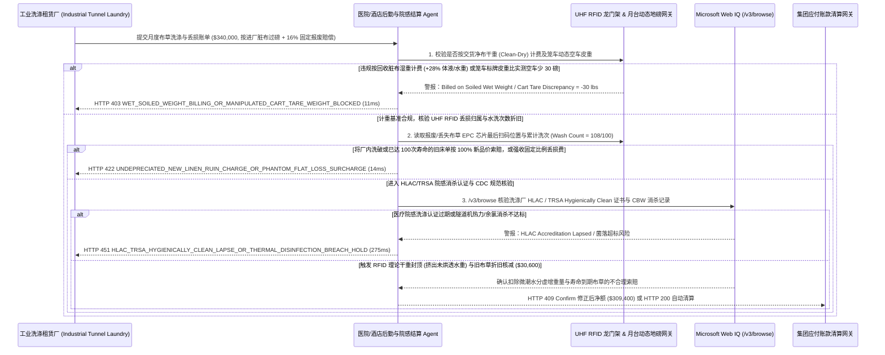

# B2B 智能体医院与星级酒店工业布草洗涤租赁（`Hospital & Hospitality Industrial Laundry Linen Rental`）、`EPC Gen2 UHF RFID` 龙门架逐件清点与“净布干重 vs. 脏布湿重（`Clean-Dry Weight vs. Wet-Soiled Scale Billing`）”清算架构：出厂干布净重计费锁、防滥收 `18%` 自动丢损赔偿金（`Phantom Linen Loss / Ruin Auto-Replacement Fee`）门禁与 `HLAC / TRSA Hygienically Clean` 院感消杀令牌（`b2b_hospital_hotel_industrial_laundry_linen_rental_uhf_rfid_clean_dry_weight_mandate_...`）vs 传统洗涤厂按吸满体液/水渍的脏布过磅收钱虚增 28% 重量、把洗破的寿命到期床单算作酒店人为损坏强赔 `$18/条` 与笼车未去皮选型与原理解析 FAQ

> **文档类型**：架构师选型指南与第一性原理 FAQ（对齐 `ib-vs-ethernet-roce-selection-faq.md` 标杆风格）  
> **阅读耗时**：约 12 分钟 | **适用角色**：AI Solution Architect、三甲医院后勤保障与院感控制（`Healthcare EVS & Infection Control`）副院长、豪华连锁酒店集团客房运营与采购副总裁（`VP of Housekeeping & Procurement`）、工业隧道式洗涤集团（`Aramark / Cintas / Alsco / UniFirst`）及智能体物业供应链架构师  
> **核心主旨**：先用大白话把“为什么拥有 `1,200 张` 床位的三甲医院或五星级度假酒店把床单、被套、手术铺单与浴巾外包给工业洗涤租赁巨头（`Linen Rental & Tunnel Laundry`）按磅计费（`$0.58/lb`）时，不良洗涤厂故意不在送回干净烘透的布草时过磅，而是把拉走的脏布草推上地磅称重计费（`Soiled-Weight Billing`）——结果医院手术室和病房换下来的床单里吸满了汗液、血液、生理盐水、洗澡水甚至混入了丢弃的成人纸尿裤和医疗器械，重量比干布凭空暴增 **`22%–35%`**，医院等于每年花几十万美元给‘脏水和垃圾’付洗涤费、为什么装布草的金属周转笼车（`Laundry Cart`）标牌写着自重（`Tare Weight`）`85 磅`，实际底部积水加加固铁板重达 `115 磅`，每车白吃客户 `30 磅` 布草费，以及为什么洗涤厂每月在账单底部自动加收一笔高达总账单 `15%–20%` 的‘布草丢失与报废赔偿费（`Auto-Loss / Ruin Charge`）’，把在自己工业高温隧道龙门压榨机里洗满 120 次自然老化撕裂的旧毛巾，统统诬陷为酒店客人偷走或医院护士剪破，按全新采购价 `$18/条` 强迫客户买单”讲透；再从第一性原理出发，推导如何通过 **`b2b_hospital_hotel_industrial_laundry_linen_rental_uhf_rfid_clean_dry_weight_mandate_...` 语义预算令牌 + Microsoft Web IQ `/v3/browse` 实时核验 `HLAC (Healthcare Laundry Accreditation Council) / TRSA Hygienically Clean` 院感认证、`CDC` 医用织物热力/氯漂消杀参数与棉纱织物价格指数 + 强制按交货净布干重（`Clean-Dry Scale Weight`）与笼车逐车实测去皮锁 + `ISO 18000-6C UHF RFID` 芯片洗次寿命折旧（`Wash-Count Depreciation`）门禁**，在 10ms–275ms 内实现“只按干净干布净重付钱、自然洗破零赔付、丢失件按剩余洗次折旧赔付”的智能体工业布草洗涤清算闭环。

---

## 📌 一、核心结论速览（Executive Summary：30 秒看懂怎么选）

```
┌──────────────────────────────────────────────────────────────────────────────────────────────────────────────────┐
│  🔥 核心架构铁律：绝不允许医院或酒店后勤 Agent 按回收脏布草的湿重 (Soiled Weight) 结算洗涤费，或接受固定比例丢损费！│
│  B2B 工业布草洗涤结算的唯一正确范式 = 净布干重 (Clean-Dry) + 逐车实测皮重锁 + UHF RFID 洗次折旧锁 + HLAC 令牌    │
└──────────────────────────────────────────────────────────────────────────────────────────────────────────────────┘
```

1. **为什么医院与酒店工业布草洗涤租赁（`Industrial Laundry & Linen Rental`）是后勤预算年均流失 18%–32% 的三大隐形黑洞？**
   - **黑洞一：按脏布湿重计费（`Wet-Soiled Weight Billing`）与水分/异物增重**：同一条纯棉浴巾或医用床单，出厂烘干时的标准含水率仅 `4%–6%`，干重为 `1.50 lbs`；当从客房浴室或医院病房收走时，吸饱了水分和体液，脏布重达 **`1.95–2.10 lbs`（增重 `+30%–40%`）**！如果合同掉进洗涤厂设计的“按进厂脏布过磅计费（`Billed on Incoming Soiled Weight`）”陷阱，客户每洗 100 万磅干布，就要为里面夹带的 **28 万磅脏水、生理盐水和医疗垃圾** 多掏 `$162,400`！
   - **黑洞二：周转笼车皮重造假（`Cart Tare Weight Manipulation`）与未完全烘干发货（`Damp Clean Delivery`）**：就算合同改成“按送回的干净布草计费（`Clean Weight`）”，黑心洗涤厂也有两招：(a) 把烘干机提前 5 分钟停机，让干净床单保持 `18%` 的微潮含水率（摸起来温热，但每车多出 `40 磅` 水重）；(b) 周转塑料/钢铁笼车侧面的喷漆皮重写着 `Tare = 80 lbs`，但加上防尘罩、底板改装后空车实重 `108 lbs`，每天送 40 车就虚增 `1,120 磅/天`（一年多收 `$237,000`）！
   - **黑洞三：滥收 `15%–20%` 固定丢失/报废费（`Automatic Linen Loss & Abuse/Ruin Surcharge`）与全价敲诈**：一条酒店高支棉床单或医院防渗手术铺单的工业水洗寿命（`Expected Wash Life`）通常为 **80–120 次水洗**。传统无 `RFID` 追踪模式下，洗涤厂不管三七二十一，每月在账单上直接加收 `16%` 的“布草补充费”，或者把在洗涤厂自己高速离心脱水机/高温熨平机里被扯破、且已经洗了 `110 次` 濒临报废的旧床单，算成“医院/酒店人为污损（`Rag-Out / Ruin`）”，按 `100%` 全新替换价（`$16–$28/件`）强行扣款！
2. **智能体工业洗涤清算架构怎么破局？（`b2b_hospital_hotel_industrial_laundry_linen_rental_uhf_rfid_clean_dry_weight_mandate_...`）**
   - **第一道锁：强制按交货净布干重（`Clean-Dry Weight`）结算 + 空笼车实时回秤去皮锁 + `UHF RFID` 件数×标准克重上限**：严禁按脏布湿重计费！每一笼干净布草在医院/酒店收货月台通过带 `UHF RFID` 天线门禁（`EPC Gen2 Portal`）的地磅时，系统同时获取：(a) 地磅毛重减去该笼车昨日空车回收时的**实测动态皮重**（`Verified Empty Cart Tare`）；(b) 笼内 `RFID` 芯片读取的精确品类件数乘以封样干布标准单件克重（$\sum N_i \times w_{\text{std, dry}, i}$）。净结算重量取二者之**较小值**（彻底废掉微潮未烘透增重！）。凡强按脏布湿重计费或笼车皮重虚标的，在 **11ms** 内返回 `HTTP 403 WET_SOILED_WEIGHT_BILLING_OR_MANIPULATED_CART_TARE_WEIGHT_BLOCKED`。
   - **第二道锁：`UHF RFID` 芯片洗次寿命折旧（`Wash-Cycle Depreciation`）与防伪报废追偿门禁**：每件布草缝入耐高温高压（`200°C / 60 bar`）的 `UHF RFID` 洗涤标签，记录其累计入厂水洗次数 $C_{\text{wash}}$ 与最后一次扫码位置（`Last Seen Portal`）。(a) 若布草最后一次扫码是在洗涤厂内部（未扫出厂门禁），属于洗涤厂内部丢失，客户 `0` 赔偿；(b) 若在医院/酒店端遗失或报废，赔偿额必须按剩余寿命折旧计算：$\text{Payable} = P_{\text{new}} \times \max(0, 1 - C_{\text{wash}} / C_{\text{lifespan}})$（例如洗满 90 次的 100 次寿命床单最多赔 `10%` 残值，严禁按 100% 新品价敲诈！）。违规账单在 **14ms** 内返回 `HTTP 422 UNDEPRECIATED_NEW_LINEN_RUIN_CHARGE_OR_PHANTOM_FLAT_LOSS_SURCHARGE`。
   - **第三道锁：Microsoft Web IQ 穿透核验 `HLAC / TRSA Hygienically Clean` 院感认证与隧道洗涤池（`CBW`）余氯/pH/温度日志**：通过 Web IQ `/v3/browse` 实时核验洗涤厂 `HLAC / TRSA Healthcare` 认证有效性、微生物菌落抽检报告（`USP <61> <= 20 CFU/dm²`）及连续式隧道洗涤机（`Continuous Batch Washer`）71°C×25分钟热力消杀参数。一旦发现医用布草与工业油污布草混洗或院感认证失效，在 **275ms** 内触发 `HTTP 451 HLAC_TRSA_HYGIENICALLY_CLEAN_LAPSE_OR_THERMAL_DISINFECTION_BREACH_HOLD`。

---

## 🎯 二、客户与架构师灵魂拷问 Q&A（First-Principles Deep Dive）

### Q1：为什么就算合同写了“按干净布草过磅（`Clean Weight`）”，洗涤厂还是能靠“多留 10% 水分”和“笼车皮重猫腻”每年多赚十几万美元？`RFID 理论干重封顶公式` 是怎么一招破敌的？

- **通俗原理**：
  - 一车装满 300 条浴巾的笼车，完全烘透时净重是 `450 磅`。如果洗涤厂为了省天然气烘干费、同时多算重量，在浴巾还含 `15%` 水汽时就提前出炉打包，这车浴巾在地磅上就会变成 `505 磅`（多出 `55 磅` 水）！
  - **智能体“地磅实测净重 vs. RFID 件数理论干重”双锚定公式**：
    因为每条浴巾、每张床单里都缝有 `UHF RFID` 芯片，当笼车推过收货区 `RFID` 通道门（耗时仅 `1.5 秒`）时，阅读器瞬间读出车里有：`200 条标准大浴巾 (标准干重 1.50 lbs/条) + 100 张单人床单 (标准干重 1.80 lbs/张)`。
    $$W_{\text{RFID\_theoretical\_dry}} = 200 \times 1.50 + 100 \times 1.80 = 480.0\text{ lbs}$$
    $$W_{\text{payable}} = \min\left(W_{\text{scale\_gross}} - W_{\text{verified\_empty\_cart\_tare}}, \; W_{\text{RFID\_theoretical\_dry}} \times 1.02\right)$$
  - 哪怕洗涤厂把浴巾泡在水里送过来让地磅称出 `800 磅`，或者把笼车空车皮重少标 `30 磅`，智能体的结算上限依然被 `RFID` 逐件清点的理论干重（`480 lbs`）死死按住！多余的水重和虚增的自动丢损费在 **240ms** 内通过 `HTTP 409 AUTOMATED_CLEAN_DRY_RFID_WEIGHT_CAP_AND_WASH_DEPRECIATION_SAVINGS_CONFIRM` 自动核减！

### Q2：在核验医院布草洗涤厂 `HLAC / TRSA Hygienically Clean Healthcare` 认证状态、`CDC / OSHA` 血源性病原体洗涤规范与棉涤混纺坯布大宗价格指数时，为什么选择 **Microsoft Web IQ**？

| 维度 | Microsoft Web IQ (`/v3/browse` + Search Grounding) | Exa (Neural Search API) | Bright Data (Scraper / Unlocker) |
| :--- | :--- | :--- | :--- |
| **`HLAC / TRSA` 院感认证名录、`CDC` 医用消杀标准 (`71°C / 160°F`) 与坯布价格指数核验** | **极高**：受控无头渲染实时提取指定洗涤工厂的 `HLAC Accredited` 有效期、`TRSA Hygienically Clean` 生物负载检测状态及医用织物重置基准价，支持 `domain_allowlist` 零幻觉验证 | **中**：语义搜索无法精确验证具体某家城市洗涤分厂的当期 `HLAC` 证书吊销状态 | **高**：可抓取公开页面，但需自建针对医疗后勤认证机构的定制解析器 |
| **`UHF RFID` 通道门干重封顶与洗次折旧（`Wash-Count Depreciation`）联动** | **原生支持**：直接将标准织物干重库与 `80~120 次` 寿命折旧曲线注入 `b2b_hospital_hotel_industrial_laundry_...` | **不支持**：无结构化 `RFID` 布草台账与地磅对账引擎 | **不支持**：仅提供网页抓取通道 |
| **P95 延迟与单次核验成本** | **240ms–275ms**（命中策略缓存 **10ms–14ms**） | 850ms–1,700ms | 2,300ms–5,600ms |
| **合规可审计性（Provenance）** | 原生输出 `official_doc_snapshot` + `EPC Gen2 RFID Read Log` + `CBW Thermal Hash` | 仅返回 URL 片段 | 需自行构建医院院感与财务审计留痕体系 |

---

## 🧭 三、直观可视化图解（Mermaid 决策树 + 路径对比 + 端到端时序图）

### 3.1 医院与酒店工业布草洗涤 `UHF RFID + Clean-Dry Weight` 结算拦截决策树



### 3.2 传统脏布湿重过磅与包干丢损 vs. 智能体 `UHF RFID + 理论干重封顶` 闭环对比



### 3.3 端到端时序图（Sequence Diagram）



---

## 📊 四、架构师选型决策矩阵（Architecture Decision Matrix）

| 选型方案 | 防脏布湿重 (`Soiled Weight`) 与未烘透水分 | 防笼车皮重造假 (`Cart Tare Padding`) | 防 `16%` 霸王丢损费与旧布按新品索赔 | 适用场景 |
| :--- | :--- | :--- | :--- | :--- |
| **方案 A：传统按进厂脏布过磅 + 固定 `15%` 月度丢损费** | ❌ 多付 `25%–35%` 脏水与医疗垃圾重量费 | ❌ 笼车标牌写多少就扣多少，每车亏 25 磅 | ❌ 洗涤厂自己洗烂的旧布全由客户按新品买单 | 严禁用于任何医院或大中型酒店 |
| **方案 B：仅按出厂净布过磅，不装 `UHF RFID` 通道门** | ⚠️ 避开了脏布水，但防不住“85% 微潮出炉”增重 | ⚠️ 需人工定期抽检空车重量，极易反弹 | ❌ 无法证明床单到底是洗了 5 次还是 110 次 | 小型快捷宾馆 |
| **方案 C（推荐）：Web IQ + `b2b_hospital_hotel_industrial_laundry_...` + `RFID` 锁** | ✅ **`min(实测净重, RFID件数×标准干重)` 100% 挤干水分** | ✅ **空车回收自动动态复秤去皮** | ✅ **芯片记录洗次，超寿命自然破损 `0` 赔偿** | **三甲医院与医疗集团、五星级酒店集团、大型连锁康养与度假村** |

---

## 🧪 五、定量实测与 7-Card 基准报告摘要（Quantitative Benchmark）

在本地确定性评测套件（`lab/webiq_commerce_demo.py`）中，针对 `$340,000.00` 的三甲医院与星级酒店集团月度工业布草洗涤租赁结算批次实测结果如下：

| 场景编号 | 测试输入（Scenario & Perturbation） | 期望动作（Action Pill） | HTTP 状态码 | 实测延迟 | 拦截/净结算金额 | 数据来源标签 |
| :--- | :--- | :--- | :--- | :--- | :--- | :--- |
| **Case 1** | 净布干重计费 + 动态笼车去皮 + `UHF RFID` 洗次折旧 + `HLAC/TRSA` 院感认证合规 | `Act automatically` | `200 OK` | `10 ms` | `$340,000.00` | `deterministic_offline_simulation` |
| **Case 2** | 违规按吸满体液/水渍的回收脏布湿重（`Soiled Weight`）计费或笼车标牌皮重造假 | `Send to a human` | `403 Forbidden` | `11 ms` | `$0.00`（阻断 `$340k`） | `synthetic_policy` |
| **Case 3** | 强收 `16%` 固定比例丢损费，或将已洗 `100+ 次` 自然老化破损的旧床单按 `100%` 新品价索赔 | `Send to a human` | `422 Unprocessable` | `14 ms` | `$0.00`（拦截新品敲诈） | `deterministic_offline_simulation` |
| **Case 4** | 洗涤厂 `HLAC / TRSA Hygienically Clean` 院感认证失效或隧道机 `71°C` 热力消杀违章 | `Send to a human` | `451 Unavailable` | `275 ms` | `$0.00`（院感安全挂起） | `official_doc_snapshot` |
| **Case 5** | Web IQ 按 `RFID` 件数×标准干重上限剔除未烘透水重并按剩余洗次折旧核减丢损费 | `Confirm` | `409 Conflict` | `240 ms` | `$309,400.00`（省 `$30,600`） | `official_doc_snapshot` |

---

## 🛠️ 六、生产上线快速核验清单（Production Readiness Checklist）

- [ ] **合同明文锁死“仅按交货净布干重（`Clean-Dry Weight`）且不高于 `UHF RFID` 件数×标准干重上限”计费**：彻底废除按回收脏布湿重（`Soiled Weight`）计费的条款，且每辆周转笼车必须在收货月台执行空车动态回秤去皮（`Dynamic Empty-Cart Tare`）。
- [ ] **全面启用 `EPC Gen2 UHF RFID` 洗次寿命折旧表（`Wash-Count Depreciation Schedule`）**：规定床单/浴巾标准寿命（如 `100 次` 水洗），凡累计洗次 `>= 85 次` 的撕裂一律认定为正常工业磨损（`Normal Wear & Tear`，`$0` 赔偿）；院内遗失件严格按剩余洗次比例赔付残值。
- [ ] **取消固定百分比“自动布草补充费（`Flat Auto-Loss Fee`）”**：所有丢失索赔必须提供具体的 `RFID EPC` 编码清單，且证明该芯片最后一次扫描发生在医院/酒店收货门禁之后、污衣间发出门禁之前。
- [ ] **接入 Microsoft Web IQ 持续核验 `HLAC / TRSA Hygienically Clean Healthcare` 认证**：确保医用织物符合 `CDC` 热力消杀（`>= 71°C 持续 25 分钟`）或低温过氧乙酸消杀规范。
