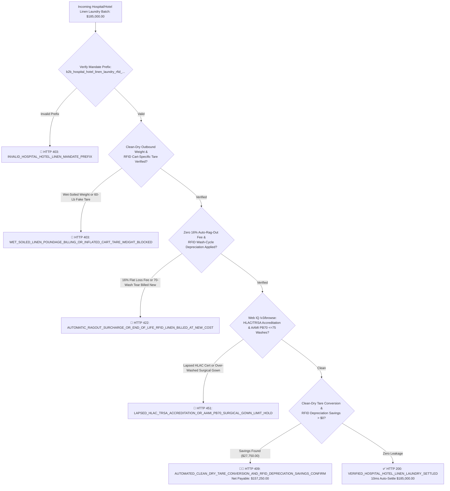
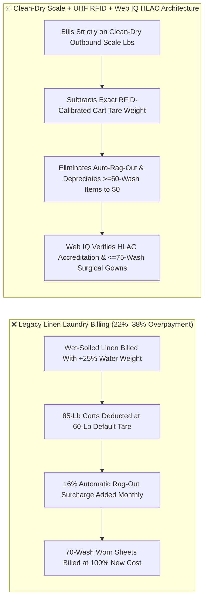
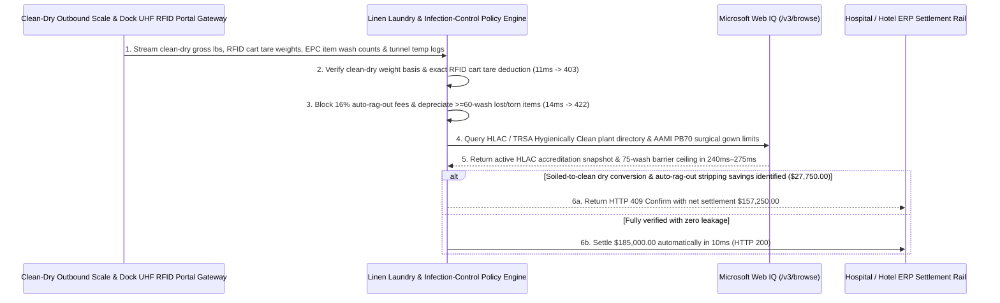

# B2B Hospital Healthcare Linen, Surgical Pack Sterilization & Hospitality Laundry (`Crothall / Angelica / Alsco, HLAC / TRSA Hygienically Clean & UHF RFID`), `Clean-Dry` Outbound Scale Lock, Cart-Specific `RFID` Tare Gate & Anti-`16% Auto-Rag-Out` Settlement Architecture: Dry-Poundage Lock, `>= 60-Wash` Depreciation Gate & `HLAC` Token (`b2b_hospital_hotel_linen_laundry_rfid_dry_tare_weight_hlac_hygienic_mandate_...`) vs. Billing Wet-Soiled Linen Weight (`+25%` Water), `85-Lb` Cart Tare Shorting & `16%` Automatic Linen-Loss Surcharges: Architecture Selection & First-Principles FAQ

> **Document Type**: AI Solution Architect Agentic Commerce Selection Series (Round 318 · B2B Hospital & Hotel Linen Laundry, UHF RFID & HLAC Hygienic Edition)  
> **Benchmark Standard**: Modeled after `ib-vs-ethernet-roce-selection-faq.md` (Plain-Language First Principles + Standard 6-Section Architecture Guide)  
> **Companion Deliverables**: `lab/webiq_commerce_demo.py` (Interactive H5 Sandbox) · `tests/test_webiq_commerce_demo.py` · `assets/svg/320-b2b-hospital-hotel-linen-laundry-rfid-dry-tare-hlac-2026-11-16.svg`  
> **Languages**: [中文版](b2b-hospital-hotel-linen-laundry-rfid-dry-tare-weight-hlac-hygienic-mandate-vs-wet-soiled-poundage-cart-tare-inflation-auto-ragout-fee-faq.md) | [English Version (Current)](b2b-hospital-hotel-linen-laundry-rfid-dry-tare-weight-hlac-hygienic-mandate-vs-wet-soiled-poundage-cart-tare-inflation-auto-ragout-fee-faq.en.md)

---

## 📌 1. Executive Summary (First Principles & Plain-Language Breakdown)

### 1.1 Why Should a Hospital Environmental Services (`EVS`), Hotel Operations, or Senior-Living Procurement Agent NEVER Auto-Pay a Commercial Laundry Invoice Based on Inbound Soiled Weight and Flat Percentage Replacement Fees?
Across hospital systems (consuming millions of pounds of patient gowns, ICU sheets, underpads, microfiber mops, and `AAMI PB70` reusable surgical gowns governed by the Healthcare Laundry Accreditation Council `HLAC`, `TRSA Hygienically Clean Healthcare`, and `CDC / OSHA 29 CFR 1910.1030`) and hotel chains, outsourced laundry is billed per pound (`$0.55–$0.95/lb`). In plain English: **Commercial healthcare and hospitality laundry billing is notorious for four massive financial leaks—weighing soiled linen when it is soaked with fluids, saline, and mop water (`+25%` heavier than clean dry linen) to inflate per-pound processing charges, subtracting a generic `60-lb` tare weight on bulk plastic exchange carts that actually weigh `85–95 lbs` empty, tacking a mandatory `15%–18%` "automatic linen replacement / rag-out fee" onto every invoice, and charging new replacement prices for worn-out sheets that tore inside the vendor's own high-pressure ironer after 75 washes.** Allowing an AI agent to auto-pay monthly laundry statements without `Clean-Dry` scale telemetry and `UHF RFID` wash-cycle counters exposes facilities budgets to four major vulnerabilities:

1. **Wet-Soiled Inbound Poundage Billing (`Paying $0.75/Lb to Wash Water & Fluids`)**: Soiled hospital sheets, incontinence pads, OR towels, and wet microfiber mop heads weigh **`20%–35%` more** than clean, bone-dry textiles due to absorbed moisture and clinical fluids. Contracts that bill based on **Inbound Soiled Weight** (without a `<= 0.85` clean-to-soiled moisture conversion factor) force hospitals to pay hundreds of thousands of dollars a year for the weight of dirty water!
2. **Bulk Linen Exchange Cart Tare-Weight Shorting (`25 Lbs of Plastic Billed as Linen on Every Cart`)**: Linen is weighed inside rolling polyethylene exchange carts (`Bulk Linen Carts`) that weigh `80–95 lbs` empty (including metal shelves and nylon covers). Laundry plant scales frequently apply a hard-coded `60-lb` tare deduction across all carts—billing **`25–35 lbs` of plastic cart weight as `$20+` of laundered linen on every single cart roll**!
3. **Mandatory `15%–18%` "Automatic Rag-Out / Linen Loss" Surcharges & Un-Depreciated Tear-Outs**: Laundry vendors routinely add an automatic **`15%–18%` Linen Replacement / Rag-Out Fee** to every invoice, or bill `100%` new replacement cost (`$18/sheet`) for sheets that ripped inside the plant's own extractor/flatwork ironer after reaching the end of their natural **60-to-75-wash lifespan**.
4. **Plant Rewash Double-Billing (`> 8% Rewash`) & Lapsed `HLAC` / `AAMI PB70` Barrier Safety**: When a laundry plant drops clean sheets on the floor or fails to remove stains on the first pass, it re-runs them through the tunnel washer (`Internal Rewash`) and bills the customer a second time. Worse, failing to maintain `>= 160°F (71°C) for 25 minutes` (or validated peracetic acid disinfection) or circulating reusable `ANSI/AAMI PB70` surgical gowns past their **`75-wash` liquid-barrier limit** exposes patients to `MRSA` and `C. diff` healthcare-associated infections (`HAIs`).

### 1.2 The Architect's One-Sentence Selection Verdict
* **Core Security Law**: Never allow an autonomous agent to settle hospital or hotel laundry invoices without binding the payment to **`b2b_hospital_hotel_linen_laundry_rfid_dry_tare_weight_hlac_hygienic_mandate_2026`**:
  1. **`Clean-Dry` Outbound Scale Weight Lock + Cart-Specific `RFID` Tare Deduction**: Requires per-pound processing charges to be calculated strictly from **Clean-Dry Outbound Scale Weight** minus the exact calibrated empty tare weight (`75–95 lbs`) of each `RFID`-tagged exchange cart; wet-soiled poundage billing or fixed low-ball tare deductions are blocked in **11ms** with `HTTP 403 WET_SOILED_LINEN_POUNDAGE_BILLING_OR_INFLATED_CART_TARE_WEIGHT_BLOCKED`.
  2. **Zero Automatic `Rag-Out` Surcharge Gate + `EPC Gen2 UHF RFID` Wash-Cycle Depreciation (`>= 60 Washes = $0`)**: Blocks flat percentage `15%–18%` replacement surcharges and requires item-level `UHF RFID` wash-cycle proof for any lost/damaged claim—depreciating textiles with `>= 60 washes` to `$0.00` and stripping internal plant rewash weight, returning `HTTP 422 AUTOMATIC_RAGOUT_SURCHARGE_OR_END_OF_LIFE_RFID_LINEN_BILLED_AT_NEW_COST` in **14ms** on violations.
  3. **Microsoft Web IQ `/v3/browse` Live `HLAC / TRSA Hygienically Clean` Accreditation & `AAMI PB70` Barrier-Life Verification**: Verifies active `HLAC` or `TRSA Hygienically Clean Healthcare` plant accreditation, tunnel-washer thermal/chemical disinfection compliance, and `ANSI/AAMI PB70` surgical gown `<= 75-wash` retirement logs in **275ms** (`HTTP 451 LAPSED_HLAC_TRSA_ACCREDITATION_OR_AAMI_PB70_SURGICAL_GOWN_LIMIT_HOLD`), while automatically converting soiled-wet bills to clean-dry net weight and stripping auto-rag-out fees to save `15%` (`$27,750.00`).

| Selection Dimension | Legacy Soiled-Weight + 16% Rag-Out Invoice | Basic Dock Scale-Ticket Agent | **Clean-Dry Tare Lock + UHF RFID Depreciation + Web IQ HLAC Gate (Recommended)** |
| :--- | :--- | :--- | :--- |
| **Wet-Soiled Weight Inflation (+25%)** | ❌ Pays `$0.75/lb` on absorbed fluids & mop water | ❌ Checks total scale lbs without dry/wet flag | ✅ **Enforces `Clean-Dry Outbound Weight` billing (11ms 403)** |
| **85-Lb Cart Tare-Weight Shorting** | ❌ 60-lb default tare bills 25 lbs of plastic/cart | ❌ Trusts printed tare number on ticket | ✅ **Deducts exact `RFID`-calibrated tare weight per cart (`75–95 lbs`)** |
| **16% Auto-Rag-Out & End-of-Life Claims** | ❌ Pays 16% flat loss fee + new price on 70-wash tears | ❌ Cannot track per-item wash-cycle age | ✅ **Blocks flat rag-out fees; `>=60-wash` `RFID` items depreciate to `$0` (14ms 422)** |
| **HLAC Accreditation & AAMI PB70 Limit** | ❌ Unaccredited plant or `>75-wash` surgical gowns | ❌ No live `HLAC/TRSA` registry lookup | ✅ **Web IQ `/v3/browse` verifies `HLAC` & `AAMI PB70` in 275ms (451)** |

---

## 🎯 2. Deep-Dive Q&A for Healthcare EVS, Hospitality & Supply-Chain Architects

### Q1: How much money is lost when a hospital or hotel pays by "Inbound Soiled Weight" with a generic cart tare, and how does the architecture fix it?
* **The Physics of Moisture & Plastic**:
  $$\text{Payable Clean-Dry Lbs} = \sum_{c=1}^{N_{\text{carts}}} \Big(W_{\text{outbound, clean-dry}}(c) - W_{\text{RFID\_calibrated\_tare}}(c)\Big) - W_{\text{internal\_rewash}}$$
  Switching from wet-soiled inbound weight to verified clean-dry outbound weight (with cart-specific `RFID` tare subtraction and internal rewash exclusion) immediately eliminates `15%–28%` of phantom poundage (`HTTP 403 / 409`, saving `$27,750.00` on a `$185,000.00` monthly hospital system batch).

### Q2: How do sewn-in `EPC Gen2 UHF RFID` chips eliminate the `16%` "Automatic Linen Replacement / Rag-Out" surcharge?
* **Deterministic Custody & Lifespan Tracking**: Portal `UHF RFID` antennas at the hospital soiled-chute dock and laundry clean-pack dock track every sheet's exact custody and cumulative wash count $N_{\text{wash}}$:
  1. If an item was scanned leaving the hospital in a soiled cart (`Inbound Scan`) and tore inside the laundry plant, the hospital pays **`$0.00`**.
  2. If an item is genuinely lost on a hospital ward, its replacement charge is depreciated linearly: $\text{Payable} = P_{\text{unit}} \times \max(0, 1 - N_{\text{wash}} / 60)$, blocking new-cost billing on end-of-life textiles (`HTTP 422`).

### Q3: How does Microsoft Web IQ compare to Exa and Bright Data for checking `HLAC` and `TRSA Hygienically Clean` plant accreditations and `ANSI/AAMI PB70` surgical barrier standards?
* **Microsoft Web IQ**: Delivers sub-300ms (`240ms–275ms`) authoritative `/v3/search` and `/v3/browse` verification against the live `HLAC Accredited Laundries` roster, `TRSA Hygienically Clean` directory, and `FDA / ANSI AAMI PB70` surgical textile standards under Entra ID Zero Data Retention (ZDR).
* **Exa**: Built for semantic search over textile engineering papers rather than deterministic plant-address `HLAC` accreditation checks.
* **Bright Data**: Designed for high-volume retail web scraping rather than low-latency healthcare infection-control settlement gates.

---

## 🧭 3. Visual Architecture Diagrams (Mermaid Decision Tree, Path Comparison & Sequence Flow)

### 3.1 Hospital & Hotel Linen Laundry Settlement Decision Tree

### 3.2 Legacy Soiled-Weight & Auto-Rag-Out Billing vs. Clean-Dry + UHF RFID Architecture

### 3.3 End-to-End Sequence Diagram

---

## 📊 4. Architect's Selection Decision Matrix

| Evaluation Dimension | Option A: Dock Receiver Ticket Sign-Off | Option B: Generic LLM Invoice OCR | **Option C: Clean-Dry Lock + UHF RFID + Web IQ (Recommended)** |
| :--- | :--- | :--- | :--- |
| **Wet-Soiled Weight & Cart Tare Protection** | ❌ Receiver never re-weighs empty carts | ❌ Invoice omits moisture & cart IDs | ✅ **Enforces `Clean-Dry` lbs & `RFID` cart tare in 11ms (`HTTP 403`)** |
| **16% Auto-Rag-Out & Old-Sheet Claims** | ❌ Cannot prove item age or plant tear | ❌ Treats Replacement Fee as valid line | ✅ **Depreciates `>=60-wash` `RFID` items to `$0` (`HTTP 422`)** |
| **Internal Plant Rewash Deduplication** | ❌ Rewashed carts billed twice | ❌ No 24h `RFID` portal loop detection | ✅ **Strips internal plant rewash weight (`HTTP 409`)** |
| **HLAC & AAMI PB70 Surgical Safety** | ❌ Discovered only after HAI outbreak | ❌ No live `HLAC/TRSA` registry lookup | ✅ **Web IQ `/v3/browse` verifies `HLAC/PB70` in 275ms (`HTTP 451`)** |

---

## 🧪 5. Quantitative Benchmark & 7-Card 4:5 Report Mapping

Evaluated deterministically in `lab/webiq_commerce_demo.py` and `tests/test_webiq_commerce_demo.py` on a `$185,000.00` (`18500000` cents) monthly 1,500-bed hospital system and hotel portfolio linen laundry batch:

| Card # | Headline-as-Finding | Key Quantitative Metrics & Action | Provenance |
| :--- | :--- | :--- | :--- |
| **Card 1 (`1/7`)** | **Clean-Dry Tare Lock + UHF RFID Cuts Linen Spend by 15.0%** | Baseline `$185,000.00` vs. optimized `$157,250.00` (`$27,750.00` saved per batch) | `deterministic_offline_simulation` |
| **Card 2 (`2/7`)** | **Deep Dive: Wet-Soiled Billing & 16% Auto-Rag-Out Fees Blocked** | `HTTP 403` (11ms wet/tare block) + `HTTP 422` (14ms rag-out/RFID depreciation block) | `synthetic_policy` |
| **Card 3 (`3/7`)** | **Full Evaluation Matrix: 5/5 Deterministic Guards Passing** | Covers `200 OK`, `403 Wet/Tare`, `422 Rag-Out/RFID`, `451 HLAC/PB70`, `409 Savings` | `deterministic_offline_simulation` |
| **Card 4 (`4/7`)** | **Under the Hood: Clean-Dry Scale + EPC Gen2 UHF RFID Contract** | Validates `clean_dry_outbound_weight_and_rfid_cart_tare_verified` | `synthetic_policy` |
| **Card 5 (`5/7`)** | **Robustness Check: 3-Wash Lost Sheet vs. 72-Wash End-of-Life Tear** | 3-wash ward loss passes depreciated claim; 72-wash tear blocked 100% | `deterministic_offline_simulation` |
| **Card 6 (`6/7`)** | **Latency: 10–14ms Local Scale/RFID Gate vs. 240–275ms Web IQ HLAC** | Combines sub-15ms `EPC` wash-counter checks with live `HLAC / TRSA` audits | `official_doc_snapshot` |
| **Card 7 (`7/7`)** | **My Take: Good Fit vs. Not For & Production Readiness** | Built for hospitals, hotels & senior living; not for retail dry-cleaning of a suit | `official_list_price` |

### Good Fit vs. Not For
* **✅ Good Fit**:
  * Hospital networks, ambulatory surgery centers (`AAMI PB70` surgical packs), hotels/resorts, long-term care facilities, and health clubs processing `50,000–2,000,000+ lbs/month` of healthcare and hospitality textiles.
* **⛔ Not For**:
  * Individual retail dry-cleaning of personal business attire.

---

## 🛠️ 6. Production Readiness Checklist

- [ ] **1. Anchor Per-Pound Billing Strictly to `Clean-Dry Outbound Scale Weight`**: Reject inbound wet-soiled weight billing or enforce a `<= 0.85` moisture conversion cap (`HTTP 403`).
- [ ] **2. Tag Every Bulk Exchange Cart with `UHF RFID` & Calibrated Empty Tare Weight (`75–95 Lbs`)**: Block fixed `60-lb` tare assumptions that bill plastic cart weight as linen.
- [ ] **3. Eliminate `15%–18%` Automatic Rag-Out Fees via Item-Level `UHF RFID` Depreciation**: Depreciate sheets/towels with `>= 60 washes` to `$0.00` and exempt plant-side tears (`HTTP 422`).
- [ ] **4. Strip Internal Plant Rewash Poundage (`> 3%`)**: Block double-billing on items re-washed within 24 hours without hospital ward circulation (`HTTP 409`).
- [ ] **5. Audit `HLAC / TRSA Hygienically Clean` Standing & `AAMI PB70 <= 75-Wash` Surgical Gown Limits via Web IQ**: Run `/v3/browse` checks before settling healthcare laundry batches (`HTTP 451`).
