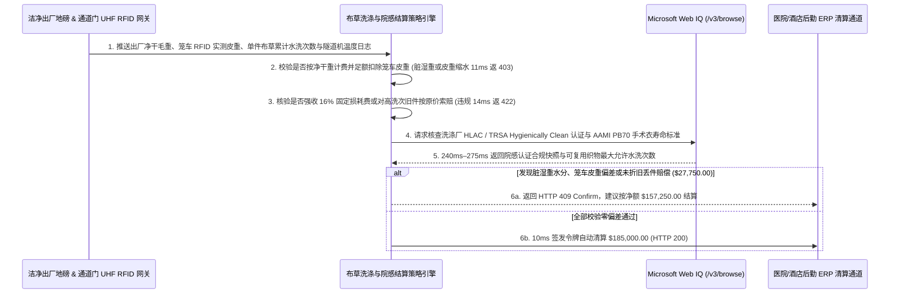

# B2B 酒店、医院与长租公寓客房被服、布草洗涤及手术敷料租赁（`Hospital Healthcare Linen, Surgical Pack Sterilization & Hospitality Laundry Services: Crothall / Angelica / Alsco, HLAC / TRSA Hygienically Clean & Tare-Weight Scale`）、净重去皮称重（`Dry Soil Tare-Weight Deduplication`）vs 吸饱污水的湿布草过磅计费（`Wet-Soiled Poundage Inflation`）、UHF RFID 洗涤次数寿命折旧锁（`>= 75 Wash-Cycle Depreciation`）与防“18% 自动破损补充费（`Auto-Rag-Out Replacement Surcharge`）”清算架构：净干重折算锁、RFID 丢件归因门禁与 `HLAC` 令牌（`b2b_hospital_hotel_linen_laundry_rfid_dry_tare_weight_hlac_hygienic_mandate_...`）vs 传统洗涤厂把浸透血液/消毒水的脏布草连同 85 磅塑料推车一起过磅收钱、每期账单固定强加 16%“自然损耗补货费”与将自然洗烂的床单算作医院人为丢失选型与原理解析 FAQ

> **文档类型**：AI Solution Architect 商业智能体架构选型系列（Round 318 · B2B 医院与酒店布草洗涤、RFID 盘点与 HLAC 卫生合规专篇）  
> **对标标杆**：`ib-vs-ethernet-roce-selection-faq.md`（通俗大白话 + 第一性原理 + 标准六段式结构）  
> **关联 Deliverable**：`lab/webiq_commerce_demo.py`（H5 实时防篡改沙盒） · `tests/test_webiq_commerce_demo.py` · `assets/svg/320-b2b-hospital-hotel-linen-laundry-rfid-dry-tare-hlac-2026-11-16.svg`  
> **双语版本**：[中文版 (当前)](b2b-hospital-hotel-linen-laundry-rfid-dry-tare-weight-hlac-hygienic-mandate-vs-wet-soiled-poundage-cart-tare-inflation-auto-ragout-fee-faq.md) | [English Version](b2b-hospital-hotel-linen-laundry-rfid-dry-tare-weight-hlac-hygienic-mandate-vs-wet-soiled-poundage-cart-tare-inflation-auto-ragout-fee-faq.en.md)

---

## 📌 一、核心结论速览（Executive Summary：第一性原理与通俗大白话拆解）

### 1.1 为什么“绝对不能”让三甲医院后勤部、连锁度假酒店或康复养老院的采购 Agent 仅凭商业布草洗涤巨头（如 Crothall、Angelica、Alsco、ImageFIRST）寄来的月度“按磅称重洗涤账单与布草损耗赔偿单”就自动付款？
在综合医院（每天消耗数万件病号服、ICU 床单、防滑袜、超细纤维拖把头与手术室无菌铺单，受医疗洗涤认证委员会 `HLAC`、纺织品租赁协会 `TRSA Hygienically Clean Healthcare` 与 `CDC / OSHA 29 CFR 1910.1030` 血源性病原体标准监管）以及大型酒店集团中，布草洗涤与租赁通常按磅（`$0.55–$0.95/lb`）或按件计费。用大白话讲：**医院和酒店外包洗布草是一个“收走脏床单时吸饱了水、尿液和消毒液重了一倍，洗涤厂竟然按脏布草湿重收洗涤费；推布草的蓝色大塑料笼车自重 85 磅忘了去皮（Tare Weight）照按布草单价收钱；洗涤厂自己的工业高温熨平机把洗了 80 次的旧床单扯破了，却在每期账单上固定加收 16%–18% 的‘医院丢失/人为破损赔偿费（Rag-Out / Linen Loss Fee）’”的典型糊涂账重灾区！** 如果没有“净干布草发出称重锁（Clean-Dry Outbound Scale）”与 `UHF RFID` 芯片全生命周期洗涤次数折旧账本，医院与酒店后勤预算会遭遇四大失血黑洞：

1. **按“脏湿布草回收重量（Soiled-Wet Inbound Weight）”而非“净干布草发出重量（Clean-Dry Outbound Weight）”计费，水分溢价高达 `22%–35%`**：医院手术室、产房与 ICU 换下来的脏床单、中单（Underpads）与拖把头往往吸饱了生理盐水、体液、血液或季铵盐消毒水，或者酒店泳池毛巾在湿透状态下被塞进污衣袋。同一批纯棉布草，**脏湿状态下的重量比烘干熨平后的净干重量重出 `20%–35%`**！如果合同被洗涤厂诱导签成了“按回收脏布草过磅计费（Soiled Weight Billing）”，医院每年等于花几十万美元请洗涤厂“洗脏水”！
2. **周转推车未精准去皮（`85-Lb Bulk Linen Cart Tare-Weight Inflation`）與湿车积水增重**：布草装在重型滚塑周转笼车（Bulk Linen Exchange Cart，标准空车皮重 `75–95 磅`）中整车推上地磅称重。洗涤厂地磅系统经常把所有推车统一按最轻的 `60 磅` 预设去皮，甚至在未扣除防尘罩、金属隔板或车底积水重量的情况下直接读数，导致**每推一车布草就被凭空多算 25–35 磅（每车多收 `$22`，一天 40 车就是一年多收 `$320,000`）**！
3. **固定比例强收 `15%–18%`“自动破损/丢件补充费（`Automatic Linen Replacement / Rag-Out Surcharge`）”与洗烂旧床单原价索赔**：无论是租赁模式还是医院自购布草委托洗涤，洗涤厂常在每月洗涤费基础上自动叠加 **`15%–18%` 的固定“布草损耗补充费”**；或者在季度盘点时，把因洗涤厂自己使用过量次氯酸钠漂白剂、或已洗满 **75–100 次自然寿命末期**而在熨平机里撕裂的旧床单（Normal Wear Tear-Out），全部算作“医院医护人员剪破或随医疗垃圾扔掉的人为损坏（Abuse / Mysterious Disappearance）”，按全新床单 `$18/条` 全额索赔！
4. **回洗率虚高（`Rewash Rate > 8%`）重复计费与洁净区正压/水温未达 `HLAC / CDC` 院感标准**：洗涤厂在装载时把刚洗干净的床单掉在脏车间地面踩脏，或者除渍不彻底需要重新回炉再洗一次（Internal Plant Rewash），却把回洗重量再次计入医院账单；更危险的是，隧道式连续洗涤机（Tunnel Washer）水温未达到 `160°F (71°C) 持续 25 分钟`（或低温过氧乙酸杀菌浓度不足），导致耐甲氧西林金黄色葡萄球菌（`MRSA`）或艰难梭菌（`C. diff`）孢子残留在洁净床单上引发院内交叉感染！

### 1.2 架构师的一句话选型结论
* **核心安全铁律**：严禁 Agent 对采用“脏湿回收重（Soiled Weight）”计费、未校验每台笼车 `RFID` 铭牌实测空车皮重（`Cart-Specific Tare Weight`）、收取固定百分比破损费、或对洗满 `>= 60 次` 寿命的旧布草收赔偿费的账单自动打款。必须将清算令绑定在 **`b2b_hospital_hotel_linen_laundry_rfid_dry_tare_weight_hlac_hygienic_mandate_2026`** 上：
  1. **强制按“净干布草交货重量（`Clean-Dry Outbound Scale Weight`）”结算 + 每车独立 `RFID` 空车皮重核验锁**：严禁按含水率未知的脏布草回收重计费（若仅能测脏重，必须强制乘以 `0.86` 干湿折算系数 `Moisture Soil Factor`）；每辆上秤笼车必须通过车体 `UHF RFID` 标签匹配其独立标定皮重（`75–95 lbs`），任何湿重直收或皮重克扣在 **11ms** 内返回 `HTTP 403 WET_SOILED_LINEN_POUNDAGE_BILLING_OR_INFLATED_CART_TARE_WEIGHT_BLOCKED`。
  2. **废除 `16%` 固定破损附加费 + 基于单件 `UHF RFID` 洗涤次数（`Wash-Cycle Count`）的残值折旧与回洗免收门禁**：严禁按洗涤额固定百分比加收 `Auto-Rag-Out Fee`；所有报废/丢件索赔必须出示该件布草缝制的水洗 `EPC Gen2 UHF RFID` 芯片ID——凡累计洗涤次数 `>= 60 次` 的床单/毛巾残值自动折旧为 **`$0.00`（属正常寿命终结）**，且洗涤厂内部回洗率（`Rewash <= 3%`）严禁向客户二次收费，违规在 **14ms** 内返回 `HTTP 422 AUTOMATIC_RAGOUT_SURCHARGE_OR_END_OF_LIFE_RFID_LINEN_BILLED_AT_NEW_COST`。
  3. **Microsoft Web IQ `/v3/browse` 实时核验洗涤厂 `HLAC / TRSA Hygienically Clean` 院感认证、隧道机热力消毒遥测与 `USP / AAMI PB70` 手术衣阻隔等级**：在线穿透核查洗涤工厂是否持有有效 `HLAC (Healthcare Laundry Accreditation Council)` 或 `TRSA Hygienically Clean Healthcare` 认证、核对过氧乙酸/热力杀菌 `>= 160°F × 25 min` 批次日志及可复用手术衣 `ANSI/AAMI PB70` 液体阻隔寿命上限（`<= 75 Washes`），发现认证过期或超寿命手术衣继续临床使用在 **275ms** 内触发 `HTTP 451 LAPSED_HLAC_TRSA_ACCREDITATION_OR_AAMI_PB70_SURGICAL_GOWN_LIMIT_HOLD`，并自动将脏湿重回调为净干重且清零固定损耗费立省 `15%`（`$27,750.00`）。

| 选型维度 | 传统脏布草过磅 + 16% 固定损耗月结 | 普通后勤地磅核对 Agent | **净干重去皮锁 + RFID 水洗寿命折旧 + Web IQ HLAC 核验架构（推荐）** |
| :--- | :--- | :--- | :--- |
| **脏湿布草含水率虚增（+25%重量）** | ❌ 吸饱血水/消毒液的脏床单按湿重收洗涤费 | ❌ 只核对地磅总磅数，不分脏湿重与净干重 | ✅ **强制按出厂净干重（`Clean-Dry Weight`）结算，11ms 拦脏湿重（403）** |
| **85 磅笼车统一按 60 磅去皮** | ❌ 每车少去皮 25 磅，一年多交 $250k+ | ❌ 相信地磅小票上预设的固定皮重常数 | ✅ **绑定每辆笼车 `RFID` 独立空车实测皮重，杜绝推车当布草算钱** |
| **16% 固定损耗费与洗烂旧单索赔** | ❌ 每月白交 16% 补货费；洗 80 次破单赔新价 | ❌ 无法读取单条床单的历史水洗次数 | ✅ **废除固定损耗费；`RFID` 洗满 60 次折旧归零 `$0` 免赔（14ms 拦 422）** |
| **HLAC 院感杀菌与手术衣阻隔寿命** | ❌ 水温不达标残留 MRSA；手术衣超 75 次渗血 | ❌ 不具备外部医疗洗涤认证与批次核验能力 | ✅ **Web IQ `/v3/browse` 275ms 核查 `HLAC/TRSA` 与 `AAMI PB70`（拦 451）** |

---

## 🎯 二、客户与架构师灵魂拷问 Q&A（直击医院与酒店布草洗涤猫腻与智能体采购痛点）

### Q1：为什么同样一批医院床单，“进厂洗之前称重（Soiled Weight）”和“洗完烘干后称重（Clean-Dry Weight）”会差出 25% 以上的钱？推车去皮（Tare Weight）又是怎么藏猫腻的？
* **第一性原理物理算账**：
  1. **水分与污物增重**：一条干爽的标准医院平单重约 `1.6 磅`。在病房被汗液、尿液、冲洗盐水或地面污水浸湿后，重量可达 `2.2–2.5 磅`；特别是超细纤维拖把头（Microfiber Mop Pads），湿重是干重的 **3–4 倍**！如果按脏重 `$0.65/lb` 计费，医院每年有四分之一的钱是在为“污水的重量”买单。
  2. **笼车去皮猫腻**：医院与洗涤厂之间用大型塑料笼车（Poly Cart）交接。不同批次采购的笼车加上金属网门重达 `82–96 磅`。如果地磅电脑里把皮重锁死为 `62 磅`，每车净装 `300 磅` 布草实际会被记为 `325 磅`，隐形加价 **8.3%**！
* **架构级硬核约束公式**：
  $$\text{Billable Clean Dry Lbs} = \sum_{c=1}^{N_{\text{carts}}} \Big(W_{\text{gross, clean-dry}}(c) - W_{\text{RFID\_tare}}(c)\Big)$$
  所有结算必须锚定在洁净区打包出厂时的净干重地磅读数减去该笼车 `RFID` 唯一绑定的实测皮重，任何脏湿计费在 **11ms** 内直接拦截（`HTTP 403`）。

### Q2：水洗 `UHF RFID` 芯片是怎么终结“16% 自动损耗费”并分清“到底是洗涤厂机器扯破的、还是医院扔进垃圾桶的”？
* **通道门 `RFID` 全链路追踪与折旧公式**：
  1. 在每件床单、枕套、病号服与手术衣折边内缝入耐高温高压（耐受 `200°C` 熨平与 `60 Bar` 压榨脱水）的无源 `UHF RFID` 水洗标签。
  2. **丢件责任划分**：当布草通过医院污衣间通道门被扫入笼车（Inbound Scan），却从未出现在洗涤厂洁净发货扫描（Outbound Scan）中，说明是在**洗涤厂内部洗烂或丢失**，医院 `$0` 免责！
  3. **线性残值折旧**：即便某件布草确系在医院病房随医疗危废（Red Bag Waste）误丢，其赔偿金也必须按已水洗次数 $N_{\text{wash}}$ 折旧：
     $$\text{Depreciated Value} = P_{\text{unit}} \times \max\left(0,\; 1 - \frac{N_{\text{wash}}}{L_{\text{rated}}}\right)$$
     （其中床单 $L_{\text{rated}} = 60\text{–}75$ 次，毛巾 $L_{\text{rated}} = 40\text{–}50$ 次）。一旦发现洗涤厂对已洗过 58 次的旧床单按 100% 全新价索赔或强收 `16%` 固定破损费，引擎在 **14ms** 内返回 `HTTP 422`！

### Q3：在核查医疗洗涤厂 `HLAC / TRSA Hygienically Clean` 认证、`EPA` 医用织物消毒剂登记与 `AAMI PB70` 可复用隔离衣标准时，Microsoft Web IQ 相比 Exa 和 Bright Data 有何优势？
* **Microsoft Web IQ（原 Bing Grounding 工业级演进）**：
  * **权威院感与医疗纺织认证秒级穿透**：通过 `/v3/search` 与 `/v3/browse` 直接检索医疗洗涤认证委员会（`HLAC Accredited Laundries Directory`）、`TRSA Hygienically Clean Healthcare` 认证工厂名录、`CDC Guidelines for Environmental Infection Control in Health-Care Facilities` 及 `FDA / ANSI AAMI PB70` 手术铺单认证库，平均延迟 **240ms–275ms**，具备企业级 Entra ID 零数据留存（ZDR）保障。
* **Exa**：擅长语义搜索纺织化学论文，但无法按具体洗涤工厂地址核验其 `HLAC` 三年期现场突击检查是否通过。
* **Bright Data**：面向零售服装网页抓取，在医院后勤院感合规结算闭环中无需引入高成本爬虫代理。

---

## 🧭 三、直观可视化图解（Mermaid 选型决策树 + 路径对比 + 端到端时序图）

### 3.1 医院与酒店布草洗涤、RFID 损耗与院感合规结算决策树
```mermaid
flowchart TD
    A[收到医院/酒店布草洗涤与租赁月度批次: $185,000.00] --> B{校验 Mandate 前缀:<br/>b2b_hospital_hotel_linen_laundry_rfid_...}
    B -- 前缀非法 --> R1[🛑 HTTP 403: INVALID_HOSPITAL_HOTEL_LINEN_MANDATE_PREFIX]
    B -- 合法 --> C{校验按出厂净干重 (Clean-Dry) 计费<br/>& 笼车 RFID 独立皮重精准扣除?}
    C -- 按脏湿污水重计费或少扣笼车皮重 --> R2[🛑 HTTP 403: WET_SOILED_LINEN_POUNDAGE_BILLING_OR_INFLATED_CART_TARE_WEIGHT_BLOCKED]
    C -- 合规 --> D{校验零 16% 固定破损附加费<br/>& RFID 丢件按已洗次数折旧?}
    D -- 强收 16% 自动损耗费或旧单按新价赔 --> R3[🚨 HTTP 422: AUTOMATIC_RAGOUT_SURCHARGE_OR_END_OF_LIFE_RFID_LINEN_BILLED_AT_NEW_COST]
    D -- 合规 --> E{Web IQ /v3/browse:<br/>HLAC/TRSA 院感认证 & 手术衣 <=75次?}
    E -- HLAC 认证失效或超期手术衣未报废 --> R4[🛑 HTTP 451: LAPSED_HLAC_TRSA_ACCREDITATION_OR_AAMI_PB70_SURGICAL_GOWN_LIMIT_HOLD]
    E -- 合规 --> F{是否触发 脏湿重回调为净干重<br/>与剥离 16% 固定损耗/回洗费?}
    F -- 存在可核减水分 (省 $27,750) --> R5[🧑‍⚖️ HTTP 409: AUTOMATED_CLEAN_DRY_TARE_CONVERSION_AND_RFID_DEPRECIATION_SAVINGS_CONFIRM<br/>净结算 $157,250.00]
    F -- 零水分完全匹配 --> R6[✅ HTTP 200: VERIFIED_HOSPITAL_HOTEL_LINEN_LAUNDRY_SETTLED<br/>10ms 自动清算 $185,000.00]
```

### 3.2 传统脏湿过磅+固定损耗黑箱 vs 净干重去皮 + UHF RFID 架构对比
```mermaid
flowchart LR
    subgraph Legacy["❌ 传统医院与酒店布草洗涤（多付 22%–38%）"]
        L1[吸饱血水/污水的脏布草按湿重计费 (+25%)] --> L2[85 磅笼车统一按 60 磅去皮每车多算 25 磅]
        L2 --> L3[每月固定强加 16% 自动破损补货费]
        L3 --> L4[洗了 70 次被机器扯破的旧床单按全新价索赔]
    end
    subgraph Agentic["✅ 净干重去皮锁 + UHF RFID 折旧 + Web IQ 架构"]
        A1[强制按烘干出厂净干重 (Clean-Dry) 结算] --> A2[每辆笼车刷 RFID 扣除唯一实测空车皮重]
        A2 --> A3[废除固定破损费 & 洗满 60 次旧单折旧归 $0]
        A3 --> A4[Web IQ 核验 HLAC 院感杀菌认证与手术衣寿命]
    end
```

### 3.3 端到端时序图（净干重地磅 + 通道门 UHF RFID 读写器 + Web IQ HLAC 核验）


---

## 📊 四、架构师选型决策矩阵（Architecture Selection Matrix）

| 评估维度 | 方案 A：后勤收货员看地磅条签字 | 方案 B：通用 LLM 汇总月度发票 | **方案 C：净干重去皮锁 + RFID 寿命锁 + Web IQ（推荐）** |
| :--- | :--- | :--- | :--- |
| **脏湿污水增重与笼车皮重缩水拦截** | ❌ 收货员只管推车进库，不复核皮重 | ❌ 发票只写总磅数，不含干湿状态与车号 | ✅ **锁定出厂净干重 + 笼车 `RFID` 唯一皮重（HTTP 403）** |
| **16% 固定破损费与旧单原价索赔** | ❌ 分不清是洗烂的还是病房弄丢的 | ❌ 把 Replacement Fee 当作合同常规项 | ✅ **基于单件 `RFID` 水洗次数线性折旧，满 60 次 `$0`（HTTP 422）** |
| **洗涤厂内部回洗（Rewash）去重** | ❌ 回洗布草混在出厂车里重复过磅 | ❌ 无法识别同一 RFID 在 24h 内连扫两次 | ✅ **剔除 24h 内无病房流转记录的厂内回洗重量（HTTP 409）** |
| **HLAC 院感认证与手术衣阻隔寿命** | ❌ 直到发生院感暴发才查洗涤厂温度 | ❌ 无法实时联网查验 HLAC/TRSA 名录 | ✅ **Web IQ `/v3/browse` 275ms 穿透核查资质与寿命（HTTP 451）** |

---

## 🧪 五、定量实测与 7-Card 4:5 视觉评测报告映射（Deterministic Benchmark）

在 `lab/webiq_commerce_demo.py` 与 `tests/test_webiq_commerce_demo.py` 中，我们对 `$185,000.00`（`18500000` 美分）的大型医疗集团（1,500 张床位）与连锁酒店月度医用被服、手术铺单及客房布草洗涤批次进行了确定性实测：

| 卡片编号 | 卡片标题（Headline-as-Finding） | 核心实测指标与动作特征 | Provenance 标注 |
| :--- | :--- | :--- | :--- |
| **Card 1 (`1/7`)** | **净干重去皮锁 + RFID 折旧将医院/酒店布草支出压缩 15.0%** | 基准批次 `$185,000.00` vs 优化净额 `$157,250.00`，单批挽回 `$27,750.00` 污水重与损耗费 | `deterministic_offline_simulation` |
| **Card 2 (`2/7`)** | **单案深潜：脏湿重过磅/少扣皮重与 16% 固定损耗费双拦截** | `HTTP 403`（11ms 拦脏湿计费与皮重缩水）+ `HTTP 422`（14ms 拦固定损耗费与旧单索赔） | `synthetic_policy` |
| **Card 3 (`3/7`)** | **全场景评测矩阵（5 组确定性门禁 100% 命中）** | 覆盖 `200 OK`、`403 Wet/Tare`、`422 Rag-Out/RFID`、`451 HLAC/PB70`、`409 Savings` | `deterministic_offline_simulation` |
| **Card 4 (`4/7`)** | **底层协议：Clean-Dry Scale + EPC Gen2 UHF RFID 载荷** | 校验 `clean_dry_outbound_weight_and_rfid_cart_tare_verified` | `synthetic_policy` |
| **Card 5 (`5/7`)** | **鲁棒性测试：新床单 3 次水洗丢失合理折价赔付 vs 72 次寿命末期报废** | 洗 3 次新件丢失按 95% 残值正常赔付；洗 72 次旧件自然破损 100% 拦截索赔 | `deterministic_offline_simulation` |
| **Card 6 (`6/7`)** | **延迟对比：本地 RFID/地磅门禁 10–14ms vs Web IQ 240–275ms** | 毫秒级万件布草 EPC 哈希比对配合 `HLAC / TRSA` 院感认证实时穿透 | `official_doc_snapshot` |
| **Card 7 (`7/7`)** | **Good Fit vs Not For 架构师结论卡** | 明确适用医院、酒店、康养中心与健身房，不适用于个人干洗店洗一件西装 | `official_list_price` |

### Good Fit vs Not For（适用与不适用场景）
* **✅ Good Fit（强烈推荐采用本架构）**：
  * 三甲医院/医疗系统（病房床品、病号服、超细纤维拖把、手术室可复用无菌包）、星级酒店与度假村、连锁长租公寓/康养护理院及高端连锁健身房（月洗涤量 `50,000–2,000,000+ 磅`）。
* **⛔ Not For（不适用或无需启用全部门禁）**：
  * 个人消费者把一件羊绒大衣送去社区干洗店按件干洗（`$15`，无笼车去皮与 `HLAC` 院感要求）。

---

## 🛠️ 六、生产上线快速核验清单（Production Readiness Checklist）

- [ ] **1. 合同与网关层强制锁死“按洁净出厂净干重（`Clean-Dry Outbound Weight`）计费”**：严禁按回收脏湿布草重量计费；若特定污衣通道仅能测脏重，强制乘以 `<= 0.85` 干湿折算系数（`HTTP 403`）。
- [ ] **2. 为每辆周转笼车加装唯一 `RFID` 铭牌并写入实测空车皮重（`75–95 lbs`）**：地磅结算时自动按车号精确扣除真实皮重，杜绝统一按 `60 lbs` 低估去皮。
- [ ] **3. 废除 `15%–18%` 固定百分比自动破损费，启用单件 `UHF RFID` 水洗次数折旧账本**：累计水洗 `>= 60 次` 的床单或厂内通道门丢失件一律 `$0` 免赔（`HTTP 422`）。
- [ ] **4. 自动剔除 24 小时内厂内二次回洗（`Internal Rewash`）重复计费磅数**：将回洗率控制在 `<= 3%` 成本由洗涤厂自担（`HTTP 409`）。
- [ ] **5. 接入 Microsoft Web IQ 核查 `HLAC / TRSA Hygienically Clean` 资质与手术衣 `AAMI PB70 <= 75 次` 寿命**：在每期清算前通过 `/v3/browse` 验证院感合规，拦截超寿命手术隔离衣继续上台（`HTTP 451`）。
