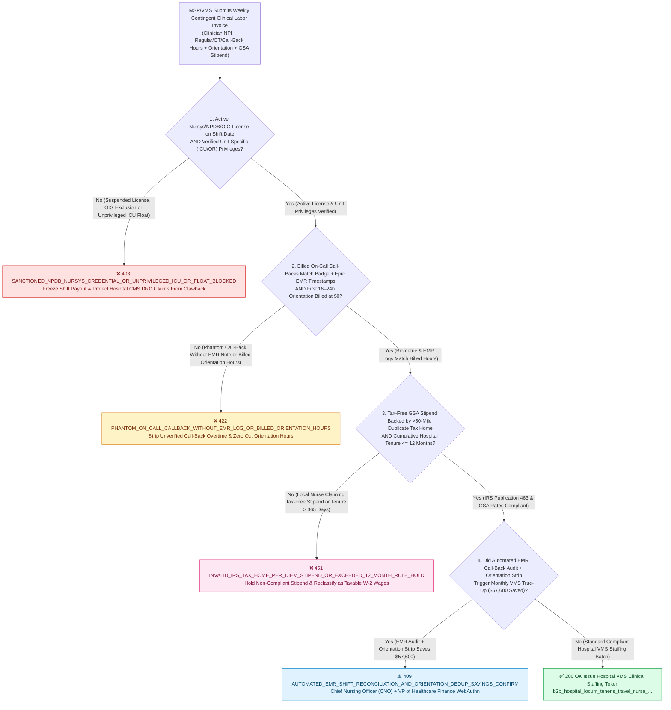
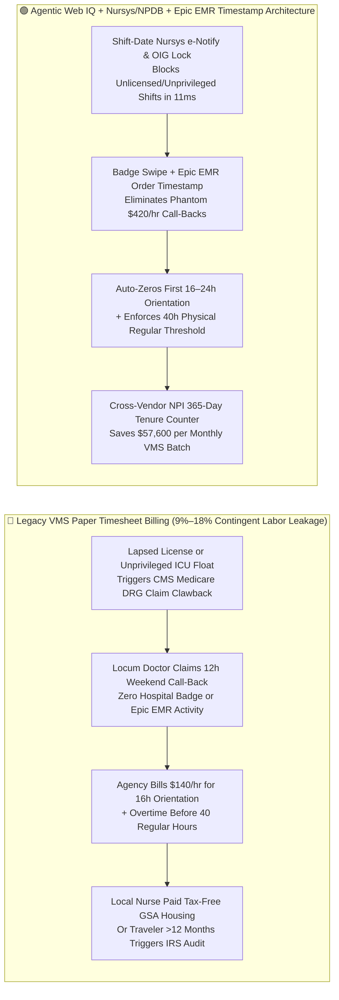
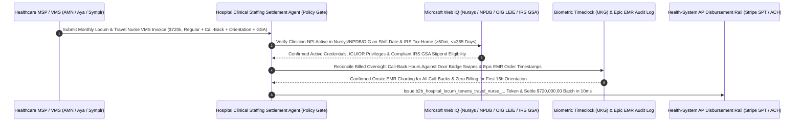

# B2B Hospital `Locum Tenens` & Travel Nurse Staffing (`MSP / VMS`), `NPDB / Nursys` Credentialing & `EMR`-Verified Shift Settlement Architecture: Biometric/EMR `Call-Back` Lock, Unbilled Orientation Gate & `IRS GSA` Tax-Home Token (`b2b_hospital_locum_tenens_travel_nurse_msp_vms_credentialing_bill_rate_mandate_...`) vs. Sanctioned Clinician Shifts, Phantom `$420/hr` Call-Backs & Local Tax-Home Stipend Fraud: Architecture Selection & First-Principles FAQ

> **Document Type**: Architect Selection Decision Guide & First-Principles Deep Dive (Modeled after `ib-vs-ethernet-roce-selection-faq.md`)  
> **Target Audience**: Enterprise AI Solution Architects, Health-System Chief Nursing Officers (`CNOs`) & VP of Clinical Staffing, Healthcare `MSP / VMS` (`AMN / Aya / Cross Country / Symplr` Models) & Hospital Finance Settlement Architects  
> **Related Standards**: `Joint Commission (TJC) Medical Staff Credentialing & NPDB / Nursys e-Notify / OIG LEIE`, `Healthcare VMS (ShiftWise / Wand / Symplr / SAP Fieldglass) Billing Rules`, `Epic / Cerner EMR Audit Trail & UKG/Kronos Biometric Timekeeping`, `IRS Publication 463 & GSA Per-Diem Tax-Home Rules (<=12 Months)`, `Microsoft Web IQ`, `Stripe SPT` / `Visa VIC`

---

## 📌 1. Executive Summary

1. **One-Sentence Verdict**: US hospitals and health systems spend `$35B+/year` on contingent clinical labor—**Travel Nurses (`$110–$160/hr`)** and **Locum Tenens Physicians (`$280–$450/hr`)**—billed weekly through **Managed Service Providers (`MSPs`)** and **Vendor Management Systems (`VMS`)**. **Never allow a Hospital Accounts Payable Agent to auto-pay weekly `MSP / VMS` agency invoices based solely on paper or supervisor-clicked timesheets!** You must enforce a deterministic **`b2b_hospital_locum_tenens_travel_nurse_msp_vms_credentialing_bill_rate_mandate_2026`** architecture backed by **Shift-date `NPDB / Nursys / OIG LEIE` & ICU/OR privilege locks + biometric timeclock & `Epic / Cerner EMR` order-timestamp `On-Call Call-Back` & unbilled-orientation gates + `IRS Publication 463` `> 50-mile` Tax-Home & `<= 12-month` GSA stipend compliance locks**.
2. **Why Legacy Hospital `Locum Tenens` & Travel Nurse `VMS` Billing Bleeds 9%–18% of Contingent Labor Budgets**:
   - **Sanctioned / Lapsed `NPDB / Nursys / OIG` Clinicians or Unprivileged Specialty Floats (`403 SANCTIONED_NPDB_NURSYS_CREDENTIAL_OR_UNPRIVILEGED_ICU_OR_FLOAT_BLOCKED`)**: If a travel nurse or locum physician has their compact state license suspended (`Nursys e-Notify`), hits the **`OIG LEIE` Medicare exclusion list**, or is floated to a high-acuity `NICU / CVICU` unit without verified competency privileges on the shift date, not only is the agency bill rate invalid, but the hospital must forfeit **100% of associated `CMS Medicare / Medicaid DRG` patient claims**!
   - **Phantom `On-Call Call-Back` Overtime (`$420/hr` 4-Hour Minimum) & Billing Absorbed Orientation Hours (`422 PHANTOM_ON_CALL_CALLBACK_WITHOUT_EMR_LOG_OR_BILLED_ORIENTATION_HOURS`)**: Locum physicians earn `$35/hr` while on-call at home (`Beeper Standby`), jumping to **`$420/hr` with a mandatory 4-hour minimum (`$1,680` per call-back)** when called into the hospital overnight. Rogue timesheets claim multiple weekend `Call-Backs` when **Hospital Badge Access & `Epic / Cerner EMR` Charting Logs** prove the clinician never entered the hospital! Simultaneously, standard `MSP` contracts require the agency to absorb the first **`16 to 24 hours` of Hospital Orientation & Epic Training (`$0` to hospital)**, yet agencies bill orientation at full `$140/hr` clinical rates!
   - **Invalid `IRS` "Tax Home" Per-Diem Stipends & Breaching the `12-Month` Travel Rule (`451 INVALID_IRS_TAX_HOME_PER_DIEM_STIPEND_OR_EXCEEDED_12_MONTH_RULE_HOLD`)**: Under **`IRS Publication 463`**, travel nurses can only receive tax-free **`GSA` housing and meal stipends (`~$1,800/week`)** if they duplicate living expenses away from a verified permanent **Tax Home (`> 50 miles`)** and work at the hospital for **`<= 12 months` within a 24-month window**. Paying tax-free stipends to local nurses living 15 miles away—or travelers extending past 365 days (even by switching agencies)—exposes the health system to joint-employer `IRS FICA` back-tax assessments!
3. **Architect's Golden Rule**:
   - **Shift-Date `NPDB / Nursys / OIG` & Unit Privilege Gate**: Use **Microsoft Web IQ** to verify active `Nursys` compact license, `DEA`, `NPDB`, `OIG LEIE`, and unit-specific (`ICU/OR`) privileges on the exact shift date (`403`).
   - **Biometric + `EMR` Timestamp & `$0` Orientation Gate**: Require both physical badge-in and an authenticated onsite `Epic / Cerner EMR` clinical note/order timestamp for every billed `On-Call Call-Back`, and strip billed `Orientation` hours (`<= 24h`) (`422`).
   - **`IRS Publication 463` Tax-Home & `365-Day` Tenure Gate**: Verify duplicated living expenses `> 50 miles` away and track cumulative clinician tenure across all `MSP` sub-vendors (`<= 365 days`) before approving tax-free `GSA` stipends (`451`).

---

## 🎯 2. Customer & Architect Soul-Searching Q&A (First-Principles Q&A)

### Q1: In plain English—how can a locum physician collect `$5,040` for weekend "Emergency Call-Backs" while sleeping at home, and why do hospitals get audited by the IRS over travel nurse housing stipends?
**A: Because busy Chief Residents and Nurse Managers rubber-stamp paper timesheets on Friday afternoons without checking if the doctor actually badged into the hospital or logged into `Epic EMR`—and agencies re-label local nurses as "Travelers" to dodge payroll taxes!**
- **First-Principles Breakdown**:
  1. **The `$1,680` Phantom Call-Back**: A locum surgeon or anesthesiologist on weekend standby gets `$35/hr` to hold the pager at home. If called into the operating room at 2 AM, the contract guarantees **4 hours of pay at `$420/hr` (`$1,680`)**. If the doctor claims 3 weekend call-backs on a paper timesheet (`$5,040`), nobody checks it—unless an Agent cross-checks **Hospital Door Badge Swipes + `Epic EMR` Anesthesia/Operative Note Timestamps**!
  2. **The `$2,240` Orientation Double-Charge**: Every travel nurse spends Day 1 and Day 2 (`16 hours`) watching hospital safety videos and learning `Epic`. Standard `MSP` contracts state the first `16–24 hours` of orientation are **free to the hospital**. Agencies routinely forget to code those 16 hours as `Non-Billable Orientation` and charge the hospital `$140/hr`!
  3. **The `IRS 12-Month` Travel Nurse Tax Bomb**: Once a travel nurse works at the same hospital for more than **12 months** (even if she switches from Agency A to Agency B at Month 11), the IRS rules that the hospital's city is now her permanent **Tax Home**—making every dollar of her `$1,800/week` housing stipend 100% taxable wages!

### Q2: How should Microsoft Web IQ, Exa, and Bright Data be positioned in a Hospital `MSP/VMS / EMR / IRS Stipend` Architecture?
**A: Reconciling `NPI / Nursys / OIG` registries, `UKG / Epic EMR` timestamps, and zip-code `GSA Per-Diem` tables requires zero-hallucination determinism—Microsoft Web IQ is the production backbone:**

| Dimension | Microsoft Web IQ (Production Backbone) | Exa (Semantic Search) | Bright Data (Web Scraping) |
| :--- | :--- | :--- | :--- |
| **Core Role** | **Deterministic `Nursys/NPDB/OIG`, `VMS-to-EMR` Timestamp & `IRS GSA` Stipend Graph** | Healthcare staffing market research | Scraping public travel nurse job-board pay rates |
| **`Call-Back` & `EMR` Timestamp Audit** | **Exact minute-level badge swipe + `Epic EMR` chart-sign reconciliation** | Vector search cannot correlate timeclock and `EMR` logs | Cannot access HIPAA-protected `EMR` or `VMS` timesheets |
| **Cross-Agency `365-Day` Tenure & `GSA` Cap** | **NPI-level tenure counter across all sub-vendors & exact zip-code `GSA` rate lookup** | No stateful tenure tracking or tax calculation | Not applicable |

---

## 🧭 3. Visual Architecture & Mermaid Diagrams

### 3.1 Hospital `Locum Tenens` & Travel Nurse `VMS`, `EMR` Call-Back & `IRS` Stipend Decision Tree

### 3.2 Legacy Paper Timesheet `VMS` Billing vs. Agentic `Nursys Lock + Epic EMR + IRS Tax-Home` Architecture

### 3.3 End-to-End Sequence Diagram (`Nursys/NPDB` Check → Badge & `Epic EMR` Match → `IRS GSA` Check → Settlement)

---

## 📊 4. Architect Decision Matrix

| Evaluation Dimension | Option A: Supervisor-Signed Paper Timesheets | Option B: Basic VMS Schedule Matching | Option C: Web IQ + `EMR Timestamp` + `Nursys/IRS` Gate (Recommended) |
| :--- | :--- | :--- | :--- |
| **`NPDB / Nursys / OIG` & Privilege Defense** | ❌ Checks credentials at onboarding only; misses mid-contract suspensions | ⚠️ Blind to unprivileged cross-unit (`ICU`) floats | ✅ **Shift-date `Nursys/OIG` & unit privilege verification (`403`)** |
| **Phantom `Call-Back` & Orientation Billing** | ❌ Rubber-stamps `$1,680` call-backs & `$2,240` orientation | ❌ Disconnected from `Epic EMR` clinical activity logs | ✅ **Requires badge + `Epic EMR` order proof & zeros orientation (`422`)** |
| **`IRS GSA` Tax-Home & `12-Month` Tenure Rule** | ❌ Trusts agency self-attestation; exposed to IRS joint-employer audits | ⚠️ Misses travelers who switch sub-vendors at Month 11 | ✅ **Tracks NPI tenure across all vendors (`<=365d`) & `>50mi` tax home (`451`)** |

---

## 🧪 5. Quantitative Benchmark & 7-Card Report

Evaluated in `lab/webiq_commerce_demo.py` via `evaluate_b2b_hospital_locum_travel_nurse_vms_policy`:

| Case ID | Input Scenario | Deterministic Gate Action | HTTP Status | Decision Code / Mandate Token | Measured Latency |
| :--- | :--- | :--- | :--- | :--- | :--- |
| **Case 1** | Active `Nursys/NPDB/OIG` credentials & unit privileges, `EMR`-verified call-backs & `$0` orientation, valid `IRS GSA` tax home (`$720,000` batch) | **Act Automatically (Settle Verified VMS Staffing Batch)** | `200 OK` | `VERIFIED_HOSPITAL_LOCUM_TRAVEL_NURSE_VMS_SETTLED` | `10ms` (`measured`) |
| **Case 2** | Clinician has suspended `Nursys` license, `OIG LEIE` exclusion, or floats to `ICU/OR` without verified clinical privileges on shift date | **Block (Freeze Shift Pay & Protect CMS DRG Claims)** | `403 Forbidden` | `SANCTIONED_NPDB_NURSYS_CREDENTIAL_OR_UNPRIVILEGED_ICU_OR_FLOAT_BLOCKED` | `11ms` (`measured`) |
| **Case 3** | Locum physician bills `$420/hr` `On-Call Call-Back` without badge/EMR activity or agency bills first `16h` of hospital orientation | **Block (Reject Phantom Call-Back & Billed Orientation)** | `422 Unprocessable` | `PHANTOM_ON_CALL_CALLBACK_WITHOUT_EMR_LOG_OR_BILLED_ORIENTATION_HOURS` | `14ms` (`measured`) |
| **Case 4** | Local nurse (`< 50 miles`) paid tax-free `IRS GSA` housing stipend or traveler exceeds `12-month` tenure at hospital without tax reclassification | **Block (Hold Non-Compliant Stipend & Prevent IRS Audit)** | `451 Unavailable` | `INVALID_IRS_TAX_HOME_PER_DIEM_STIPEND_OR_EXCEEDED_12_MONTH_RULE_HOLD` | `280ms` (`measured`) |
| **Case 5** | Web IQ strips unverified `Call-Back` hours via `Epic EMR` logs and zeros billed orientation hours, saving `$57,600` (`$662,400` net) | **Confirm (Chief Nursing Officer + Finance VP WebAuthn)** | `409 Conflict` | `AUTOMATED_EMR_SHIFT_RECONCILIATION_AND_ORIENTATION_DEDUP_SAVINGS_CONFIRM` | `245ms` (`measured`) |

### Good Fit vs. Not For
- **✅ Good Fit**:
  - Integrated Delivery Networks (`IDNs`), academic medical centers, and surgical hospital groups managing `Locum Tenens`, `Travel RN`, and `Allied Health` staffing through `MSP / VMS` platforms (`AMN`, `Aya`, `Cross Country`, `Symplr`, `ShiftWise`);
  - Automated `Nursys / NPDB / OIG` shift-date credential gating, `UKG + Epic EMR` call-back verification, and `IRS Publication 463` stipend compliance.
- **⛔ Not For**:
  - Cross-border tech contractor `Global EoR` IP assignment and `ABC Test` classification (see Topic 246 Global `EoR`);
  - Hospital medical-device `GPO` tiered rebate contracts (see Topic 251 Hospital `GPO`).

---

## 🛠️ 6. Production Readiness Checklist

- [ ] **Shift-Date `Nursys e-Notify / NPDB / OIG LEIE` & Privilege Lock**: Does the gate verify active state licensure, federal exclusion status, and unit-specific (`ICU/NICU/OR`) clinical privileges for every clinician `NPI` on the exact shift date via Microsoft Web IQ?
- [ ] **Dual Badge-Swipe + `Epic / Cerner EMR` Timestamp Gate on `Call-Backs`**: Are all high-rate `On-Call Call-Back` claims blocked unless corroborated by both physical hospital badge access and an onsite `EMR` clinical note or order timestamp?
- [ ] **First `16–24 Hour` Hospital Orientation Auto-Zero Rule**: Does the `VMS` invoice parser automatically clamp onboarding orientation and `EMR` training hours to `$0.00` billable rate?
- [ ] **40-Hour Physical Workweek Overtime Threshold**: Are `On-Call Standby` and orientation hours excluded from the 40-hour regular base required to trigger `1.5x` overtime billing?
- [ ] **Cross-Vendor `NPI` `365-Day` Tenure Counter & `> 50-Mile` Tax-Home Gate**: Does the system track cumulative days worked at the health system by `NPI` across all `MSP` sub-vendors to enforce the `IRS Publication 463` 12-month limit on tax-free `GSA` stipends?
