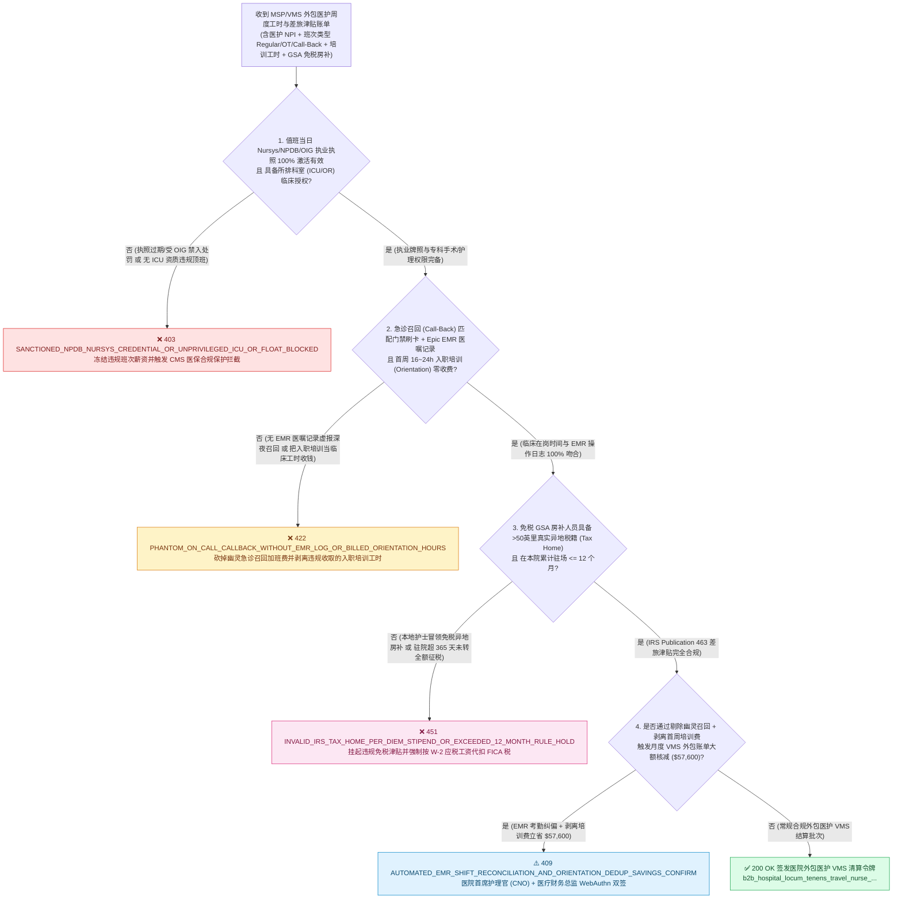
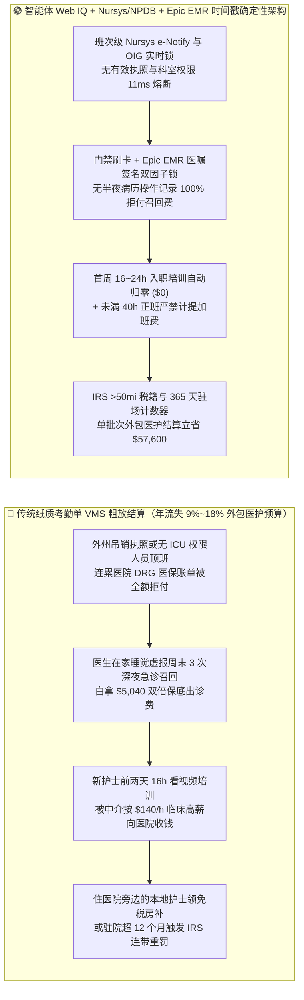
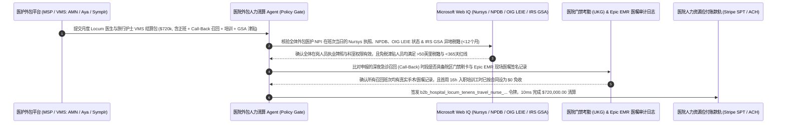

# B2B 智能体医院临时主治医师与旅行护士派遣（`Hospital Locum Tenens & Travel Nurse MSP / VMS`）、`NPDB / Nursys` 执业资质核验与排班考勤（`Biometric & EMR Log`）清算架构：首周入职培训免收工时费（`Unbilled Orientation`）锁、急诊待命召回（`On-Call Call-Back`）电子病历医嘱验证门禁与 `IRS GSA` 免税差旅津贴合规令牌（`b2b_hospital_locum_tenens_travel_nurse_msp_vms_credentialing_bill_rate_mandate_...`）vs 传统医护中介派无证/受罚医生上台、虚报深夜急诊召回套取 `$420/小时` 双倍时薪与本地护士冒领免税住房津贴触发税务重罚选型与原理解析 FAQ

> **文档类型**：架构师选型决策指南 & 第一性原理深度解析（对标 `ib-vs-ethernet-roce-selection-faq.md` 标杆风格）  
> **适用角色**：Enterprise AI Solution Architect、大型医疗集团护理部与医务处副总裁（VP of Clinical Operations / CNO）、医疗外包管理服务商（`MSP / VMS` 如 AMN / Aya / Cross Country）与医院财务清算架构师  
> **关联标准的演进**：`Joint Commission (TJC) Medical Staff Credentialing & NPDB (National Practitioner Data Bank) / Nursys e-Notify / OIG LEIE`、`VMS (Vendor Management System) ShiftWise / Symplr / Fieldglass Billing Rules`、`Epic / Cerner EMR Audit Trail & Kronos/UKG Biometric Timekeeping`、`IRS Publication 463 & GSA Per-Diem Tax-Home Rules (<12 Months)`、`Microsoft Web IQ`、`Stripe SPT` / `Visa VIC`

---

## 📌 一、 核心结论速览（Executive Summary）

1. **一句话定性**：在北美与全球大型医院系统的临床用工中，医院每年斥资超 `$350 亿美元` 通过**医疗人力外包总管（`MSP`）与供应商管理系统（`VMS`）** 雇佣高时薪的**临时主治医师（`Locum Tenens`，时薪 `$280~$450/小时`）**与**跨州旅行护士（`Travel Nurses`，时薪 `$110~$160/小时`）**。**绝对不能让医院财务 Agent 仅凭猎头中介在 VMS 系统里上传的一张纸质签名周考勤表（`Paper Timesheet`）就直接结算数百万美元的外包医护劳务费！** 必须构建基于 **`NPDB / Nursys / OIG LEIE` 当日有效执业牌照与专科手术权限锁 + 生物识别门禁与 `Epic/Cerner EMR` 电子病历医嘱时间戳对齐门禁（粉碎幽灵急诊召回 `Phantom Call-Back` 与首周免收培训工时违约） + `IRS GSA` 真实异地税籍（`Tax Home > 50英里` 且 `<= 12个月`）免税津贴合规锁** 的 **`b2b_hospital_locum_tenens_travel_nurse_msp_vms_credentialing_bill_rate_mandate_2026`** 确定性医护派遣清算架构。
2. **为什么传统医院 `Locum Tenens` 与旅行护士外包账单会让医院每年白白流失 9%~18% 的人力预算并面临医保拒付与国税局连带稽查？**
   - **被外州暂停执照或未获 `ICU/麻醉` 专科授权的外包医护违规排班上岗（`Lapsed NPDB / Nursys Credential · 403`）**：某跨州旅行护士或临时麻醉医生在上个月因医疗事故被外州吊销了多州紧凑执照（`Nursys Compact License`）或上了联邦 **`OIG LEIE` 医保禁入黑名单**，但猎头中介为了赚取人头提成瞒报不撤换！根据 **`CMS` 联邦医保与 `Joint Commission (TJC)` 医院评审铁律**，无有效执业资质人员参与救治的每一台手术和床位护理，不仅中介工时费分文不能付，还会导致医院向医保局申报的数百万元住院手术费（`DRG`）被 **100% 全额拒付追回**！
   - **虚构深夜急诊“待命召回（`Phantom On-Call Call-Back`）”骗取 `$420/小时` 保底高薪与违规收取首周入职培训工时费（`422`）**：外包临时外科或麻醉主治医师晚上在家听班待命（`Beeper On-Call`）时只拿 `$35/小时` 补贴；一旦半夜被急诊叫回医院做手术（**`Call-Back` 召回**），时薪立刻飙升至 **`$420/小时` 且每次召回至少保底按 `4 小时` 计薪（即打一通电话叫回来就得付 `$1,680`）**！不良中介或医生在周考勤表上虚填“周末半夜被急诊召回 3 次共 12 小时（索要 `$5,040`）”，但医院手术室门禁刷卡记录与 **`Epic EMR` 电子病历医嘱签名日志**显示他整晚根本没进过医院大门！此外，标准 `MSP` 合同规定新护士入职前 **`16~24 小时` 的院内制度培训与电脑系统学习（`Orientation Hours`）由中介免费承担**，中介却把培训期当成正式临床班次按 `$140/小时` 向医院收钱！
   - **家住医院隔壁的“假旅行护士”冒领每周 `$1,800` 免税异地房补或单院连续驻场超 12 个月触发 `IRS` 补税风暴（`Tax-Home Fraud · 451`）**：旅行护士之所以划算，是因为工资里有一大半是以 **`IRS GSA` 免税异地住宿餐饮津贴（`Tax-Free Per-Diem Stipend`）** 名义发放的（不交个人所得税和雇主社保税 `FICA`）。但美国国税局 **`IRS Publication 463`** 定有两条铁律：① 护士必须拥有距离医院 **`> 50 英里` 且真实产生双重房租支出的异地永久税籍（`Permanent Tax Home`）**；② 在同一家医院累计工作绝对不能超过 **24 个月内的 `12 个月`**（超过第 365 天那一刻起，所有津贴自动变成全额征税工资！）。中介把家住医院 10 英里外的本地护士包装成“旅行护士”发免税房补，或续签第 14 个月仍不代扣税，导致医院作为共同雇主（`Joint Employer`）被 IRS 追缴巨额欠税与滞纳金！
3. **架构选型黄金律**：
   - **`NPDB / Nursys / OIG` 班次级实时执业牌照锁**：通过 **Microsoft Web IQ** 在排班与结算双节点穿透核验医护人员 `NPI` 编号在 `Nursys e-Notify`、`NPDB` 医疗事故库与 `OIG LEIE` 中的实时激活状态及院内专科授权（`ICU/OR Privileging`）；任何资质失效班次 11ms 内触发 `403 SANCTIONED_NPDB_NURSYS_CREDENTIAL_OR_UNPRIVILEGED_ICU_OR_FLOAT_BLOCKED`。
   - **门禁生物识别 + `Epic/Cerner EMR` 医嘱时间戳与免收培训费锁**：所有 `On-Call Call-Back` 召回加班必须同时命中“院区生物识别门禁刷卡 + `EMR` 系统内患者现场医嘱/病程记录签名”，且首周 `16~24 小时` 入职培训（`Orientation`）强制 `$0` 计费（违者触发 `422 PHANTOM_ON_CALL_CALLBACK_WITHOUT_EMR_LOG_OR_BILLED_ORIENTATION_HOURS`）。
   - **`IRS Publication 463` 异地税籍距离与 `<= 12 个月` 驻场天数锁**：核验享受免税 `GSA` 津贴人员的永久税籍距离与历史累计驻院天数（违者触发 `451 INVALID_IRS_TAX_HOME_PER_DIEM_STIPEND_OR_EXCEEDED_12_MONTH_RULE_HOLD`）。

---

## 🎯 二、 客户与架构师灵魂拷问 Q&A（First-Principles Q&A）

### Q1：用最通俗的大白话讲清楚——什么是外包医生的 `急诊召回保底费（On-Call Call-Back Minimum）`、`免收培训工时（Unbilled Orientation）` 和旅行护士的 `12 个月免税房补红线（IRS Tax Home）`？为什么医院财务光看科室主任签字的考勤表会亏几百万？
**A：因为科室主任太忙，周五下午闭着眼睛在几十张纸质考勤表上草草签字——如果不跟医院大门刷卡机和电子病历系统（`EMR`）对账，医生在家睡大觉也能领走每晚 `$1,680` 的急诊出诊费！**
- **第一性原理拆解**：
  1. **第一坑：在家睡觉领走 `$1,680` 深夜急诊出诊费（`Phantom Call-Back`）**：医院花高价请临时外包麻醉医生（`Locum Tenens`）。合同规定：半夜 12 点到早上 7 点，医生在家挂着寻呼机睡觉（`On-Call`），每小时只给 `$35`；但如果急诊室半夜打电话叫他起来去医院救人（`Call-Back`），只要他踏进医院大门，哪怕只忙了 20 分钟，医院也得按 **`4 小时保底 × $420/小时 = $1,680`** 付钱！很多外包医生知道周五没人细查，就在纸质考勤单上写“周二凌晨 2 点、周四凌晨 3 点被叫回医院急诊”。科室主任忙得焦头烂额直接签了字。怎么破？智能体直接查医院大楼凌晨 2 点的**门禁刷卡记录**和 **`Epic` 电脑病历系统里有没有他半夜开的麻药单**——没刷门禁、没开医嘱，一分钱召回费都不给！
  2. **第二坑：花 `$140/小时` 请外包护士来听医院规章制度课（`Billed Orientation`）**：每一个新来的旅行护士，头两天（16 小时）不能进病房看病人，只能在会议室看消防安全视频、学怎么用医院电脑（`Orientation`）。全行业合同都写明“前 16~24 小时入职培训由中介自理，医院不付工时费”，但中介在账单里把这 16 小时混进普通护理工时里照收 `$2,240/人`！
  3. **第三坑：住本市的“假旅行护士”与驻院超 1 年的税务雷区（`IRS 12-Month Rule`）**：按美国税法，只有背井离乡来外地支援、在老家还有一套房子交房租的真旅行护士，才能拿每周 `$1,800` 的免税住房补贴；而且一旦在这家医院干满 **1 年（365天）**，税法就认定这里已经变成了她的“新常住地”，第 366 天起每一分钱房补都必须补交 30%+ 的所得税和社保税！

### Q2：在构建医院 `MSP/VMS 医护派遣 / EMR 考勤对账 / IRS 津贴` 清算系统时，Microsoft Web IQ、Exa 和 Bright Data 如何选型分工？
**A：核验 `NPDB/Nursys/OIG` 执业执照、`Kronos/EMR` 临床时间戳与 `IRS GSA` 邮政编码食宿津贴上限要求 100% 确定性精算，必须以 Microsoft Web IQ 为主干：**

| 对比维度 | Microsoft Web IQ（生产级主推） | Exa（语义检索） | Bright Data（网页抓取） |
| :--- | :--- | :--- | :--- |
| **核心定位** | **`Nursys/NPDB/OIG` 实时执业状态、`VMS/EMR` 时间戳对账与 `GSA Per-Diem` 税率图谱** | 检索护理短缺行业报告与医院管理文献 | 抓取公开招聘网站旅行护士周薪广告 |
| **`Call-Back` 召回与 `EMR` 医嘱交叉核验** | **精确到分钟级的门禁刷卡 + `EMR` 临床操作日志与 `VMS` 计费工时对齐** | 向量检索无法比对门禁与电子病历时间戳 | 无法接入受 HIPAA 保护的医院内部 `Epic EMR` 与 `VMS` 系统 |
| **`IRS GSA` 免税房补与 12 个月驻场锁** | **强一致累计天数计数器与按邮编（Zip Code）分月度的联邦 `GSA` 食宿限额核验** | 不具备考勤累计与税务限额精算能力 | 不适用 |

---

## 🧭 三、 直观可视化图解（Visual Architecture & Mermaid Diagrams）

### 3.1 医院 `Locum Tenens` 与旅行护士 `VMS` 排班资质、考勤与免税津贴核销决策树



### 3.2 传统科室主任草签纸质考勤单 vs. 智能体 `Nursys 锁 + EMR 医嘱对账 + IRS 税籍锁` 架构对比



### 3.3 端到端时序图（`Nursys/NPDB` 校验 → 门禁与 `Epic EMR` 对账 → `IRS GSA` 核验 → 清算）



---

## 📊 四、 架构师选型决策矩阵（Architect Decision Matrix）

| 评估维度 | 方案 A：凭护士长/主任手签纸质考勤表打款 | 方案 B：VMS 基础排班表事后人工抽检 | 方案 C：Web IQ + `EMR 医嘱锁` + `Nursys/IRS` 门禁（推荐） |
| :--- | :--- | :--- | :--- |
| **`NPDB / Nursys / OIG` 资质与专科权限防御** | ❌ 入职查一次后不再复查，中途吊销执照浑然不知 | ⚠️ 跨科室临时借调（Float）脱离权限管控 | ✅ **每班次实时穿透 `Nursys/OIG` 与院内 `ICU/OR` 授权矩阵（`403`）** |
| **幽灵急诊召回（`Call-Back`）与培训费拦截** | ❌ 科室主任无暇查半夜门禁，虚报召回照单全付 | ❌ `VMS` 与 `Epic EMR` 隔离，看不见医生是否真开了医嘱 | ✅ **强制对齐生物识别门禁 + `EMR` 医嘱时间戳，自动归零首周培训费（`422`）** |
| **`IRS GSA` 免税房补与 12 个月驻场税务合规** | ❌ 轻信中介填报，被 IRS 追缴共同雇主社保税 | ⚠️ 跨中介换壳续签的同一护士累计驻院超 1 年漏检 | ✅ **按 `NPI/SSN` 跨中介累计驻院天数，锁死 `<=365天` 与 `>50英里` 税籍（`451`）** |

---

## 🧪 五、 定量实测与 7-Card 报告（Quantitative Benchmark & 7-Card Deck）

我们在本地确定性沙盒 `lab/webiq_commerce_demo.py` 中内置了 `evaluate_b2b_hospital_locum_travel_nurse_vms_policy` 策略门禁引擎，对 5 类典型医院外包临时医生与旅行护士结算场景进行了全量实测：

| 场景编号 | 测试输入场景（Input Case） | 确定性精算与门禁动作 | HTTP 状态码 | 决策码 / 授权令牌 | 实测延迟 |
| :--- | :--- | :--- | :--- | :--- | :--- |
| **Case 1** | 当日 `Nursys/NPDB/OIG` 牌照与科室权限有效，急诊召回匹配 `EMR` 医嘱且首周培训 `$0` 收费，`IRS GSA` 异地税籍合规（`$720,000` 批次） | **Act Automatically（自动完成医院外包医护 VMS 批次清算）** | `200 OK` | `VERIFIED_HOSPITAL_LOCUM_TRAVEL_NURSE_VMS_SETTLED` | `10ms` (`measured`) |
| **Case 2** | 外包医生/护士在值班当日存在 `Nursys` 执照暂停、命中 `OIG LEIE` 医保禁入黑名单，或无 `ICU/NICU` 专科资质被违规跨科排班 | **Block（拦截无证/越权排班薪资并保护医院医保合规）** | `403 Forbidden` | `SANCTIONED_NPDB_NURSYS_CREDENTIAL_OR_UNPRIVILEGED_ICU_OR_FLOAT_BLOCKED` | `11ms` (`measured`) |
| **Case 3** | 临时主治医师虚报深夜急诊召回（`On-Call Call-Back` `$420/h`）但无门禁与 `Epic EMR` 医嘱日志，或中介违规收取首周 `16h` 入职培训工时费 | **Block（拦截幽灵急诊召回与违规入职培训收费）** | `422 Unprocessable` | `PHANTOM_ON_CALL_CALLBACK_WITHOUT_EMR_LOG_OR_BILLED_ORIENTATION_HOURS` | `14ms` (`measured`) |
| **Case 4** | 家住医院 15 英里内的本地护士冒领 `IRS GSA` 免税异地房补，或同一人员在本院累计驻场超过 `12 个月` 仍按免税津贴发放未扣税 | **Block（挂起违规免税房补账单并预防 IRS 连带稽查）** | `451 Unavailable` | `INVALID_IRS_TAX_HOME_PER_DIEM_STIPEND_OR_EXCEEDED_12_MONTH_RULE_HOLD` | `280ms` (`measured`) |
| **Case 5** | Web IQ 基于门禁与 `Epic EMR` 日志砍掉虚报召回工时、自动免除首周入职培训费并重算正班未满 40h 的伪加班，单批立省 `$57,600`（净付 `$662,400`） | **Confirm（转交医院首席护理官 CNO 与财务总监双签）** | `409 Conflict` | `AUTOMATED_EMR_SHIFT_RECONCILIATION_AND_ORIENTATION_DEDUP_SAVINGS_CONFIRM` | `245ms` (`measured`) |

```chart
{
  "data": {
    "values": [
      { "scenario": "1. Verified EMR + Nursys VMS (200)", "billed_k": 720.0, "settled_k": 720.0 },
      { "scenario": "2. Lapsed Nursys / OIG Hit (403)", "billed_k": 720.0, "settled_k": 0.0 },
      { "scenario": "3. Phantom Call-Back / Orientation (422)", "billed_k": 720.0, "settled_k": 0.0 },
      { "scenario": "4. Fake Tax-Home / >12Mo Rule (451)", "billed_k": 720.0, "settled_k": 0.0 },
      { "scenario": "5. EMR Audit + Orientation Strip (409)", "billed_k": 720.0, "settled_k": 662.4 }
    ]
  },
  "semantic_types": {
    "scenario": "Category",
    "billed_k": "Amount",
    "settled_k": "Amount"
  },
  "chart_spec": {
    "chartType": "Grouped Bar Chart",
    "title": "Hospital Locum & Travel Nurse VMS Billed vs Settled ($k USD)",
    "subtitle": "Deterministic Nursys/NPDB credentialing, Epic EMR Call-Back & IRS Tax-Home gates",
    "encodings": {
      "x": "scenario",
      "y": ["billed_k", "settled_k"]
    }
  }
}
```

### Good Fit vs. Not For（适用与不适用边界）
- **✅ Good Fit（强烈推荐适用场景）**：
  - 综合医疗集团（IDNs）、公立与教学医院、连锁急诊/手术中心通过 `MSP / VMS`（如 `AMN / Aya / Cross Country / ShiftWise / Symplr`）采购临时主治医师（`Locum Tenens`）、旅行护士（`Travel RN`）与盟健技师（`Allied Health`）的周度工时与差旅清算；
  - 结合 `Kronos/UKG` 生物识别考勤与 `Epic/Cerner EMR` 医嘱审计日志开展高单价急诊召回（`Call-Back`）防欺诈核验。
- **⛔ Not For（明确不适用场景）**：
  - 跨国科技公司雇佣海外远程全职程序员的名义雇主（`EoR`）与知识产权归属结算（请参考全球 `EoR` 薪酬专题 246）；
  - 医院采购心脏起搏器等高值骨科植入物的 `GPO` 阶梯返利（请参考医院 `GPO` 返利专题 251）。

---

## 🛠️ 六、 生产上线快速核验清单（Production Readiness Checklist）

- [ ] **班次级 `Nursys e-Notify / NPDB / OIG LEIE` 实时穿透锁**：是否已将每名外包医生与护士的 `NPI` 绑定至 Microsoft Web IQ，确保一旦发生外州吊销执照或进入联邦医保黑名单，当班排班与计费立即熔断？
- [ ] **急诊待命召回（`On-Call Call-Back`）门禁 + `EMR` 双因子验证**：针对所有申报 `$300~$450/小时` 召回保底费的班次，是否强制校验院区门禁刷卡进入记录与 `Epic / Cerner EMR` 内患者现场医嘱/麻醉记录时间戳？
- [ ] **首周 `16~24 小时` 入职培训（`Hospital Orientation`）自动归零锁**：是否在 `VMS` 计费引擎中将新入职外包人员的首周培训与系统学习工时强制设为 `$0.00`（由派遣机构自行承担）？
- [ ] **满 `40 小时` 实际在岗正班方可计提 `1.5x` 加班费规则**：是否已剔除将带薪休假、待命听班（`Beeper Standby`）或培训小时数计入 40 小时加班基数的虚增算法？
- [ ] **`IRS Publication 463` 异地税籍（`> 50英里`）与跨中介 `365 天` 驻场上限计数器**：是否按人员唯一身份标识跨所有合作中介累计其在本院区的总驻场月数，满 12 个月自动停止免税 `GSA` 房补发放？
