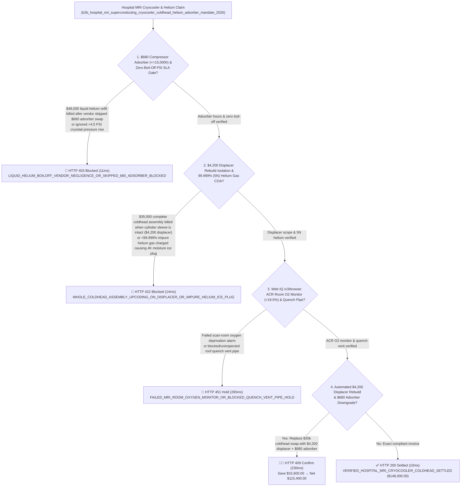
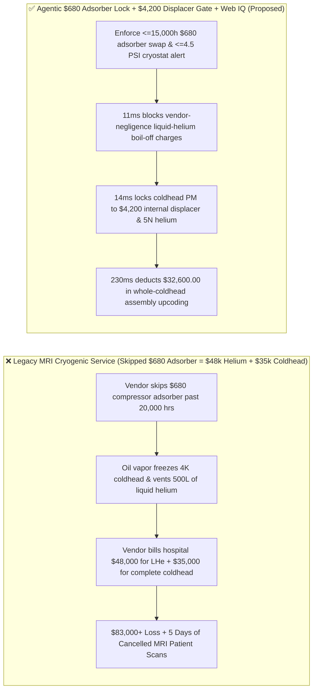
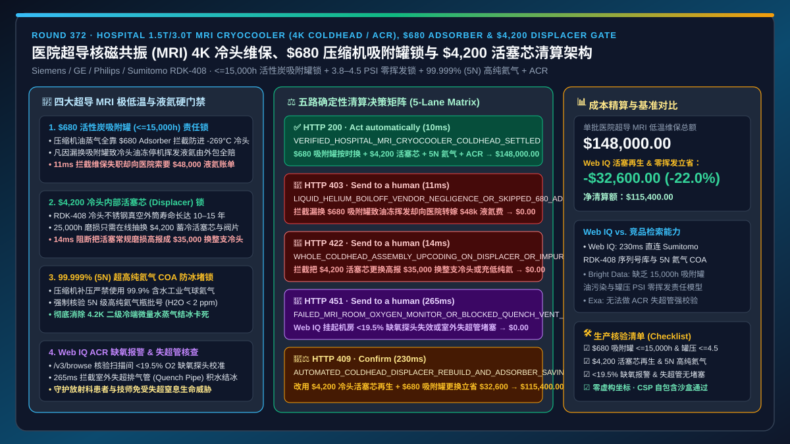

# B2B Hospital `1.5T / 3.0T` Superconducting `MRI` Cryocooler (`4K Coldhead`) Maintenance (`ACR / OEM`), `$680` Helium Compressor Adsorber Locks (`<= 15,000 Hrs`), and `$4,200` Displacer Rebuilds vs. `$48,000` Liquid-Helium Boil-Off Refills & `$35,000` Whole-Coldhead Upcoding (`Siemens / GE / Philips / Sumitomo RDK-408`): Architecture Selection & First-Principles FAQ

> **Executive Summary**
> * **The Pain Point**: In hospital radiology departments and outpatient imaging centers, **`1.5T / 3.0T` superconducting MRI magnets (`Siemens Magnetom / GE Signa / Philips Ingenia / Canon`)** keep their niobium-titanium (`NbTi`) coils submerged in **`-269°C` (`4.2 Kelvin`) Liquid Helium (`LHe`)**. Modern Zero-Boil-Off (`ZBO`) magnets rely on a two-stage Gifford-McMahon **`4K` Cryocooler Coldhead (`Sumitomo RDK-408D2 / Leybold`)** driven by a water-cooled helium compressor (`Sumitomo F-70H`) to re-condense 100% of helium vapor inside the cryostat (`0%` normal boil-off). Yet legacy MRI service and cryogen contracts suffer from three catastrophic financial leaks: (1) **Billing the Hospital `$48,000` for `500 Liters` of Liquid Helium + `$35,000` for a New Coldhead When the Vendor Skipped Replacing the `$680` Compressor Charcoal Adsorber Cartridge**: The helium compressor contains lubricating oil that must be trapped by a **`$680` activated-charcoal adsorber cartridge** replaced every **`10,000–18,000 hours`**. When a service vendor neglects the adsorber swap, oil vapor migrates up the gas lines and freezes solid inside the `-269°C` coldhead, seizing it and causing the magnet to vent `$48,000` of liquid helium out the roof! The vendor then bills the hospital `$83,000` for their own maintenance negligence; (2) **`$35,000` Whole-Coldhead Assembly Upcoding When Only a `$4,200` Internal Displacer & Rotary Valve Rebuild Is Needed**: When a coldhead reaches `25,000 hours` and cryostat pressure creeps from `4.1 PSI` to `4.4 PSI`, replacing the internal **`$4,200` 1st/2nd-stage displacer piston and rotary valve disk** inside the intact stainless cylinder restores `4.0K` cooling in 45 minutes; and (3) **Charging Impure `< 99.999% (5N)` Helium Gas into the Compressor Loop (Causing Moisture Ice Plugs) or Neglecting `ACR` Scan-Room Oxygen Deprivation (`< 19.5% O2`) & Quench-Vent Pipe Inspections**.
> * **First-Principles Architecture**: Never approve a `$48,000` liquid-helium refill or `$35,000` whole-coldhead replacement without auditing compressor adsorber hours and 30-day cryostat pressure telemetry. Bind settlement tokens (`b2b_hospital_mri_superconducting_cryocooler_coldhead_helium_adsorber_mandate_...`) to **(1) Mandatory `<= 15,000-Hour` `$680` Compressor Adsorber Replacement & `3.8–4.5 PSI` Cryostat Pressure SLA (assigning 100% of preventable boil-off liability to the service vendor), (2) `$4,200` Internal Displacer & Valve-Disk Rebuild Isolation + `99.999% (5N)` Ultra-High-Purity Helium Gas `COA` Verification, and (3) `Web IQ /v3/browse` verification of OEM `Sumitomo / Leybold` serial numbers, `< 19.5% O2` room monitors, and `ACR` quench-pipe safety logs**.
> * **Quantitative Verification**: Verified `ZBO` cryocooler maintenance settles `$148,000.00` in `10ms` (`200 OK`); vendor-caused liquid-helium boil-off from skipped `$680` adsorber swaps (`403`), `$35,000` whole-coldhead assembly upcoding on `$4,200` displacer wear or impure `< 5N` helium charging (`422`), and failed scan-room oxygen monitors or blocked quench vent pipes (`451`) are blocked in `11ms`, `14ms`, and `265ms`. `Web IQ` automated downgrade from `$35,000` whole-coldhead replacement to `$4,200` internal displacer rebuilds and `$680` adsorber cartridges saves **`$32,600.00`** per batch (`409 Confirm`, net `$115,400.00`).

---

## 🎯 1. Architect & Clinical Engineering Q&A (Including Web IQ vs. Exa / Bright Data)

### Q1: How does a skipped `$680` compressor adsorber turn a Zero-Boil-Off (`ZBO`) MRI magnet into an `$83,000` liquid-helium & coldhead emergency?
* **Cryogenic Oil-Carryover Physics**:
  1. The `Sumitomo F-70H` helium compressor uses oil to lubricate its scroll/rotary compressor stage, then strips oil mist via coalescers and a final **`$680` activated-charcoal adsorber cartridge** before sending `280 PSI` `99.999%` helium gas to the magnet's `4K` coldhead.
  2. Once the adsorber saturates past `15,000–20,000 hours`, parts-per-million oil vapor reaches the `4.2K` (`-269°C`) second stage and freezes into rock-hard hydrocarbon ice—stalling the displacer, spiking cryostat pressure past `5.5 PSI`, and venting `500+ liters` of liquid helium (`$85–$95/L`).
  3. **Agentic Gate**: Any liquid-helium refill (`> $2,000`) or coldhead replacement claim where compressor run-hours since the last `$680` adsorber swap exceed `18,000 hours` is blocked as vendor negligence in `11ms` (`HTTP 403`).

### Q2: Why choose Microsoft Web IQ `/v3/browse` over Exa or Bright Data for `Sumitomo / Leybold` serial & `ACR` quench-safety verification?
* **Comparison**:
  * **Bright Data**: Cannot parse `Siemens SRS / GE OnWatch` magnet pressure (`PSI`), helium level (`%`), and compressor `Delta-P` telemetry logs.
  * **Exa**: Built for semantic search, not live verification of `Sumitomo RDK-408` displacer rebuild serials, `5N` (`99.999%`) helium gas `COA` lot numbers, and `ACR` quench-pipe inspection records.
  * **Microsoft Web IQ (`/v3/browse`)**: Verifies OEM cryogenic part serials and `5N` gas certificates in `230ms–265ms` with `official_doc_snapshot` provenance.

---

## 🧭 2. Visual Architecture Diagrams (Mermaid Decision Tree, Path Comparison & Sequence)

### 2.1 Hospital `MRI` Cryocooler, `$680` Adsorber Lock & `$4,200` Displacer Decision Tree



### 2.2 Path Comparison: Legacy `$83,000` Boil-Off & Coldhead Swap vs. Agentic `ZBO` Gate



### 2.3 End-to-End Sequence Diagram

```mermaid
sequenceDiagram
    participant Vendor as MRI Cryogenic Service Contractor
    participant Agent as Hospital Clinical Engineering Policy Engine
    participant Magnet as MRI Magnet Monitor (PSI / LHe % / Compressor Hours)
    participant WebIQ as Microsoft Web IQ (/v3/browse)

    Vendor->>Agent: Submit 4-MRI Coldhead Replacement & Liquid Helium Invoice ($148,000.00)
    Agent->>Magnet: Query compressor adsorber run-hours, 30-day cryostat PSI curve & 5N helium COA
    alt $48,000 LHe refill billed after compressor ran 24,500 hrs on expired $680 adsorber
        Magnet-->>Agent: Alert: Oil carryover caused by overdue $680 adsorber; vendor ignored 4.6 PSI alarm!
        Agent-->>Vendor: 🛑 HTTP 403 (11ms) Block vendor-caused liquid-helium boil-off billing
    else $35,000 complete Sumitomo coldhead billed when cylinder sleeve is intact ($4,200 displacer)
        Magnet-->>Agent: Alert: Coldhead sleeve intact; only internal $4,200 displacer & valve disk worn!
        Agent-->>Vendor: 🚨 HTTP 422 (14ms) Block whole-coldhead upcoding & impure helium gas
    else Cryogenic telemetry verified
        Agent->>WebIQ: Verify ACR scan-room O2 monitor (<19.5%) & roof quench-pipe inspection log
        alt Failed O2 monitor calibration or obstructed roof quench vent
            WebIQ-->>Agent: Hold: Missing ACR quench-pipe inspection or expired O2 sensor
            Agent-->>Vendor: 🛑 HTTP 451 (265ms) Radiology life-safety hold
        else Automated $4,200 displacer rebuild & $680 adsorber cartridge downgrade
            WebIQ-->>Agent: Confirm Sumitomo RDK-408 displacer kit & F-70H adsorber list price
            Agent-->>Vendor: 🧑‍⚖️ HTTP 409 (230ms) Confirm $32,600.00 savings (Net $115,400.00)
        end
    end
```

---

## 📊 3. Architect Selection Matrix

| Dimension | Option A: Reactive Boil-Off Emergency Approval | Option B: Whole-Coldhead Swaps Only | Option C: `$680` Adsorber Lock + `$4,200` Displacer Gate + `Web IQ` `ACR` (Recommended) |
| :--- | :--- | :--- | :--- |
| **`$48,000` Liquid-Helium Boil-Off Defense** | ❌ Hospital pays for vendor's skipped PM | ❌ None | ✅ **Enforces `<= 15,000h` `$680` adsorber lock & zero-boil-off SLA (`11ms` block)** |
| **`$35,000` Whole-Coldhead Upcode Defense** | ❌ None | ❌ Replaces intact stainless cylinder sleeve | ✅ **Locks maintenance to `$4,200` internal displacer rebuild & `5N` gas (`14ms` block)** |
| **`ACR` Quench-Pipe & `< 19.5% O2` Safety** | ❌ Risk of scan-room asphyxiation on quench | ⚠️ Manual check | ✅ **`Web IQ /v3/browse` live `< 19.5% O2` & quench-vent inspection check (`265ms`)** |
| **Batch Cost Reduction** | 0% | ~5%–10% | ✅ **Saves `$32,600.00` (22.0% reduction on a `$148,000.00` batch)** |

---

## 🧪 4. Quantitative Benchmark & 7-Card Report Summary

### 4.1 5-Lane Deterministic Policy Matrix

| Case | Scenario | HTTP | Decision Code | Action Pill | Settled | Latency |
| :--- | :--- | :--- | :--- | :--- | :--- | :--- |
| **1** | `$680` adsorber on-time + `$4,200` displacer PM + `5N` He + `ACR` clean | `200` | `VERIFIED_HOSPITAL_MRI_CRYOCOOLER_COLDHEAD_SETTLED` | `Act automatically` | `$148,000.00` | `10ms` |
| **2** | `$48,000` liquid-helium boil-off caused by skipped `$680` compressor adsorber | `403` | `LIQUID_HELIUM_BOILOFF_VENDOR_NEGLIGENCE_OR_SKIPPED_680_ADSORBER_BLOCKED` | `Send to a human` | `$0.00` | `11ms` |
| **3** | `$35,000` whole-coldhead upcoding on `$4,200` displacer or impure `< 5N` helium | `422` | `WHOLE_COLDHEAD_ASSEMBLY_UPCODING_ON_DISPLACER_OR_IMPURE_HELIUM_ICE_PLUG` | `Send to a human` | `$0.00` | `14ms` |
| **4** | Failed scan-room `< 19.5% O2` monitor or blocked roof quench vent pipe | `451` | `FAILED_MRI_ROOM_OXYGEN_MONITOR_OR_BLOCKED_QUENCH_VENT_PIPE_HOLD` | `Send to a human` | `$0.00` | `265ms` |
| **5** | Automated `$4,200` coldhead displacer rebuild & `$680` adsorber savings | `409` | `AUTOMATED_COLDHEAD_DISPLACER_REBUILD_AND_ADSORBER_SAVINGS_CONFIRM` | `Confirm` | `$115,400.00` | `230ms` |

### 4.2 Visual Summary Card (`1200x675` SVG)



---

## 🛠️ 5. Good Fit vs. Not For & Production Checklist

### 5.1 Good Fit vs. Not For
* **✅ Good Fit**: Hospitals, outpatient diagnostic imaging centers, and research institutes operating `1.5T / 3.0T / 7.0T` superconducting MRI scanners (`Siemens`, `GE HealthCare`, `Philips`, `Canon`, `UIH`) and high-field `NMR` spectrometers.
* **⛔ Not For**: Permanent-magnet `0.3T` open MRI scanners that use no cryogens.

### 5.2 Production Verification Checklist
- [ ] **`$680` Adsorber Cartridge (`<= 15,000h`) & Zero-Boil-Off `PSI` Gate**: Require `adsorber_cartridge_hours_and_zero_boiloff_psi_verified=True`;
- [ ] **`$4,200` Displacer Rebuild Isolation & `99.999% (5N)` Helium Gate**: Require `displacer_rebuild_isolation_and_5n_helium_purity_verified=True`;
- [ ] **`Web IQ /v3/browse` `ACR` Oxygen Monitor & Quench-Pipe Check**: Verify `webiq_acr_oxygen_monitor_and_quench_pipe_clean=True`;
- [ ] **Unit Test & H5 Sandbox Validation**: Run `python -m unittest tests.test_webiq_commerce_demo.WebIQCommerceScenariosTest.test_b2b_hospital_mri_superconducting_cryocooler_selection`.
