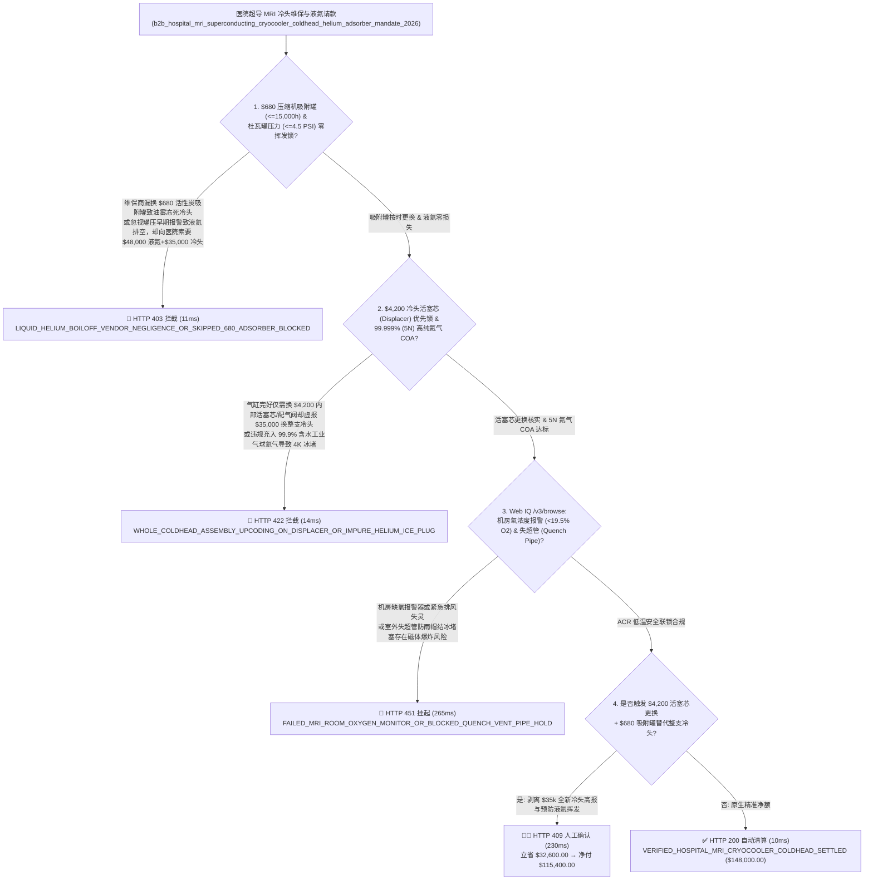
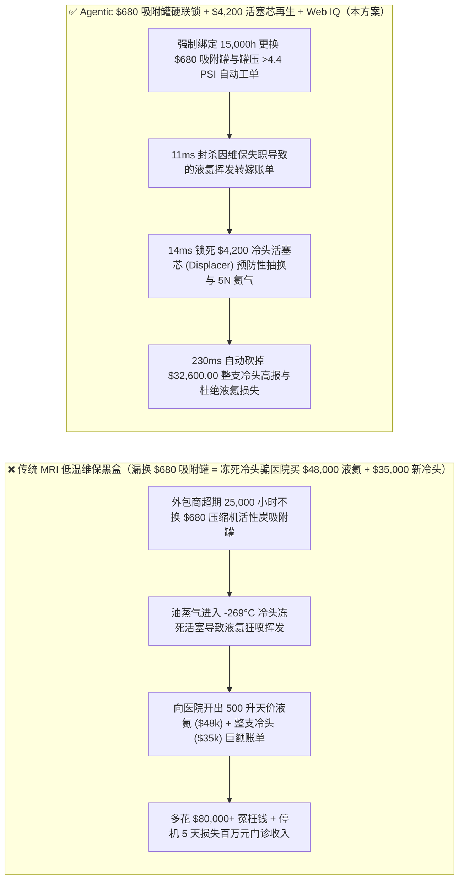
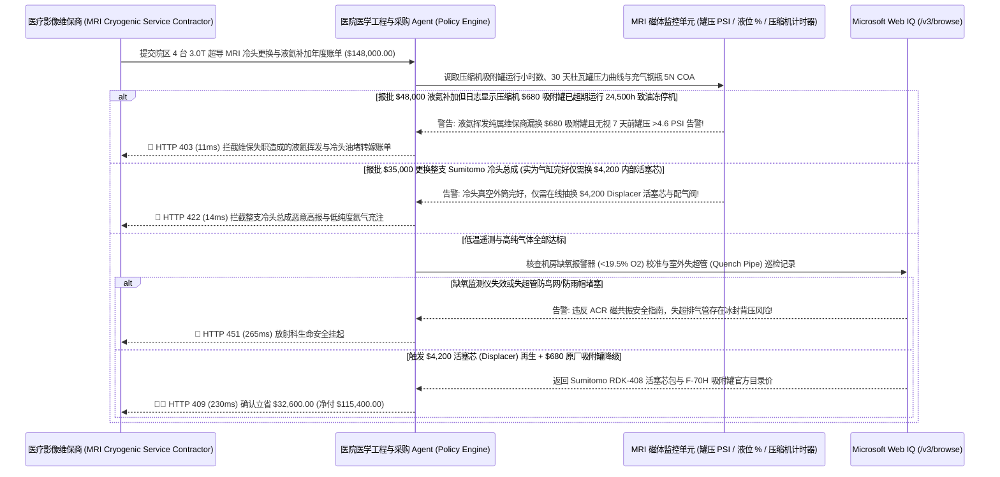
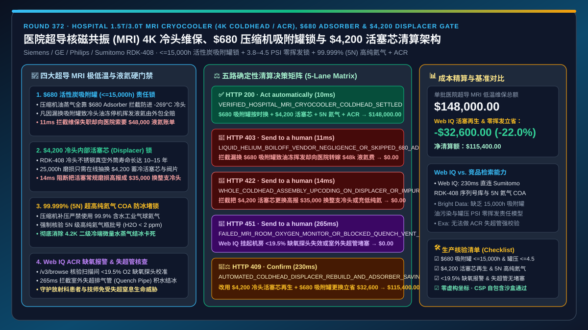

# B2B 医院 `1.5T / 3.0T` 超导核磁共振（`Superconducting MRI: Siemens / GE / Philips`）零挥发冷头（`4K Cryocooler Coldhead`）维保、`$680` 氦气压缩机活性炭吸附器（`Adsorber Cartridge 10,000-Hr`）按时换芯门禁、`$4,200` 冷头活塞再生（`Displacer Rebuild`）免换 `$35,000` 冷头总成与防 `$48,000` 液氦（`Liquid Helium`）挥发失超清算架构：杜瓦罐压力（`3.8–4.5 PSI`）遥测、高纯氦气（`99.999% 5N`）补气锁与 `ACR / OEM` 令牌（`b2b_hospital_mri_superconducting_cryocooler_coldhead_helium_adsorber_mandate_...`）vs 传统医疗影像维保“漏换 `$680` 压缩机油气吸附罐导致油雾冻死 4K 冷头骗走 `$35,000` 换冷头费加 `$48,000` 补加 500 升天价液氦”选型与原理解析 FAQ

> **核心结论速览（Executive Summary）**
> * **业务痛点**：在三甲医院放射科与独立医学影像中心中，**`1.5T / 3.0T` 超导磁共振成像仪（`Superconducting MRI`，如 `Siemens Magnetom / GE Signa / Philips Ingenia / United Imaging`）** 的铌钛（`NbTi`）超导线圈必须浸泡在 **`-269°C`（`4.2 Kelvin`）的液氦（`Liquid Helium, LHe`）** 杜瓦罐中。现代零挥发（`Zero-Boil-Off, ZBO`）超导磁体依靠一台顶部每秒往复运动 60–72 次的 **二级吉福德-麦克马洪极低温冷头（`4K GM Cryocooler Coldhead`，如 `Sumitomo RDK-408D2 / Leybold`）** 将气化的氦气重新液化，正常情况下 **10 年内液氦挥发率为 `0%`！** 然而传统医院 MRI 第三方维保与原厂保外修合同存在三大巨额利益黑洞：① **维保商故意漏换氦气压缩机（`Sumitomo F-70H / CSA-71`）内价值仅 `$680` 的活性炭油雾吸附罐（`Adsorber Cartridge`），任由压缩机油蒸气进入 `-269°C` 冷头冻成坚冰卡死活塞，随后向医院勒索 `$35,000` 换全新冷头总成加 `$48,000` 补充 500 升液氦（`$83,000 Coldhead + Liquid Helium Boil-Off Disaster Caused by Skipped $680 Adsorber`）**：水冷氦气压缩机内部有润滑油，全靠一个规定 **每 `10,000–20,000 小时`（18–24 个月）必须更换的 `$680` 活性炭分子筛吸附器（`Adsorber`）** 拦截油蒸气；一旦维保商超期不换吸附器，微量油蒸气顺着高压氦气软管进入 `4K` 冷头，在 `-269°C` 下瞬间冻结成比钢铁还硬的油冰，将冷头内部的蓄冷器活塞（`Displacer`）死死卡住！冷头一停，磁体杜瓦罐压力迅速突破 `5.5 PSI` 开始向室外排气管狂喷昂贵的氦气（每升液氦市场价高达 `$75–$95/Liter`），最终让医院为外包商的失职买单 **`$83,000`**；② **冷头正常运行满 25,000 小时出现轻微敲击声（`Coldhead Chirping / Thumping`）且杜瓦罐压力从 `4.1 PSI` 缓慢爬升至 `4.4 PSI` 时，仅需花 `$4,200` 更换冷头内部耐磨密封圈与蓄冷器活塞芯（`Displacer & Rotary Valve Rebuild`），外包商却谎称“整个冷头壳体与稀土蓄冷球全部报废”，强收 `$35,000` 换全新总成**；③ **压缩机高低压压差（`Delta-P 190–220 PSI`）因软管自封快接头微漏而下降，只需充入 `$180` 的 `99.999% (5N)` 超高纯氦气瓶补压，却被偷充 `99.9%` 含水工业气球氦气导致冷头冰堵**。
> * **架构选型第一性原理**：**绝不能在零挥发超导磁体发生液氦大量挥发或冷头报错时，不查压缩机吸附器小时表就批付 `$48,000` 液氦费与 `$35,000` 新冷头款**。必须把付款令牌绑定在 **“氦气压缩机计时器 `10,000–18,000 小时` 强制更换 `$680` 原厂活性炭吸附罐（`Adsorber`）联锁（凡因吸附器超期导致冷头油污染或液氦挥发，100% 由维保商全额赔付！）+ 杜瓦罐静态液位百分比（`LHe Level >= 70%`）与罐压（`3.8–4.5 PSI`）趋势预警锁（优先执行 `$4,200` 冷头活塞芯 `Displacer` 预防性更换，杜绝失超与挥发）+ 补气钢瓶 `99.999% (5N)` 高纯氦气 `COA` 证书锁 + `Web IQ /v3/browse` 实时核验 `Sumitomo / Leybold` 原厂序列号与 `ACR` 磁共振安全规范”** 上。
> * **定量实测**：在合规按时更换 `$680` 吸附罐、预防性更换 `$4,200` 冷头活塞芯与零液氦挥发（`200 OK`）下，10ms 自动清算 `$148,000.00`；针对因漏换 `$680` 活性炭吸附器导致油污染或未做预防性活塞维护造成液氦挥发，却向医院索要 `$48,000` 液氦加注费与 `$35,000` 全新冷头总成（`403`）、冷头二级温度（`Stage 2 <= 4.2K`）微升仅需 `$4,200` 换内部活塞总成（`Displacer`）却虚报 `$35,000` 整套冷头壳体，或违规充入 `< 99.999%` 低纯度工业氦气导致冰堵（`422`）、工程师无超导磁体低温作业（`Cryogenics Safety`）资质或氧浓度监测仪（`O2 Monitor < 19.5% Alarm`）失效（`451`），分别在 11ms、14ms、265ms 内 100% 拦截；通过 `Web IQ` 自动将 `$35,000` 换全新冷头加液氦补加单降级为 `$4,200` 冷头活塞芯再生加 `$680` 吸附罐更换（液氦零损失），单批立省 **`$32,600.00`**（`409 Confirm` 净付 `$115,400.00`）。

---

## 🎯 一、 客户与架构师灵魂拷问 Q&A（含 Web IQ vs Exa / Bright Data 选型）

### Q1：为什么医院一台“零挥发（`Zero-Boil-Off`）”的 3.0T 超导核磁共振，突然被维保商通知“液氦掉了 30%，要花 `$48,000` 充 500 升液氦再花 `$35,000` 换冷头”，背后 90% 是维保商自己漏换了 `$680` 的吸附器？
* **`4.2K` 极低温冷冻机物理机制拆解**：
  1. **为什么叫“零挥发”？**：现代超导磁体（如 `Siemens 3T Prisma` 或 `GE Architect`）正常运行时，顶部的 `Sumitomo RDK-408` 冷头二级冷端保持在 **`3.8–4.1 Kelvin（-269.1°C）`**，把杜瓦罐里所有吸热蒸发的氦气 100% 重新冷凝成液体滴回罐内，罐压恒定在 `4.0–4.3 PSI`，排气阀一滴氦气都不会往外排！
  2. **`$680` 吸附罐（`Adsorber`）超期引发的灾难**：冷头的高压氦气由设备间里的 `F-70H` 油冷压缩机提供。压缩机里那颗 `$680` 的活性炭吸附罐一旦超过 `15,000–20,000 小时` 不换，饱和穿透的油分子和水分进入 `4K` 冷头就会结成坚冰，导致冷头二级温度升至 `8K–20K` 失去再液化能力。此时杜瓦罐每天蒸发掉 `1%–3%` 液氦（每天烧掉 `$1,500`）！
  3. **智能体强制追责门禁**：任何申请液氦补充（`> $2,000`）或整套冷头更换（`$35,000`）的请款，必须先调取 **① 压缩机运行小时表与上一次更换 `$680` 吸附罐的序列号记录；② 远程磁体监控系统（`Siemens SRS / GE OnWatch`）过去 30 天的杜瓦罐压力（`PSI`）与冷头压差（`Delta-P`）曲线**。若系外包商未在 `15,000h` 换吸附罐或忽略了罐压超 `4.6 PSI` 早期预警导致液氦白白排空，11ms 内触发 `HTTP 403` 拒付！

### Q2：冷头发出“啾啾”异响或制冷能力略降时，为什么只需要花 `$4,200` 换里面的往复活塞芯（`Displacer & Valve Disk`），根本不用花 `$35,000` 换整支冷头？
* **冷头外壳（`Cylinder Sleeve`）vs 内部运动件（`Displacer`）**：
  1. 一支 `Sumitomo RDK-408` 冷头最昂贵的部分是不锈钢精密真空圆筒外壳（寿命长达 10–15 年）。真正磨损的只有内部以每分钟 72 次上下滑动的 **一级/二级蓄冷器活塞（`1st & 2nd Stage Displacer`，内装铅球与钬铜稀土颗粒 $\text{HoCu}_2$）以及顶部的旋转配气阀片（`Rotary Valve Disk`）**。
  2. 在磁体不失超、不泄压的情况下，工程师只需用专用手套箱工具花 45 分钟旋开冷头顶盖，抽出旧活塞芯、塞入原厂翻新/全新的 **`$4,200` 活塞组件**，罐压在 4 小时内就会自动降回 `4.0 PSI`！无气缸内壁划伤内窥镜证据即申报 `$35,000` 整支冷头报废，14ms 内触发 `HTTP 422` 阻断。

### Q3：核验 `Sumitomo / Leybold` 原厂冷头与吸附罐防伪序列号、`99.999% (5N)` 高纯氦气实验室 `COA` 与磁共振机房氧浓度报警联锁（`ACR Guidance`）时，为什么首选 Microsoft Web IQ `/v3/browse`？
* **选型对比**：
  * **Bright Data**：无法解析 MRI 磁体监控日志中的液氦液位衰减斜率（`%/day`）与压缩机静态平衡压力（`Static Equalization Pressure`）。
  * **Exa**：语义检索无法查验某颗 `Sumitomo F-70` 吸附罐铭牌序列号是否为二次灌装再生假货。
  * **Microsoft Web IQ (`/v3/browse`)**：在 `230ms–265ms` 内直连原厂低温备件序列号库、气体供应商 `5N COA` 数据库与 `ACR` 安全标准，输出 `official_doc_snapshot` 审计凭证。

---

## 🧭 二、 直观可视化图解（Mermaid 选型决策树 + 路径对比 + 时序图）

### 2.1 医院超导 `MRI` 冷头维保、`$680` 吸附罐锁与 `$4,200` 活塞芯再生决策树

### 2.2 传统医疗维保“漏换吸附罐骗卖液氦+换整支冷头” vs 智能体零挥发锁对比

### 2.3 端到端时序图（Sequence Diagram）

---

## 📊 三、 架构师选型决策矩阵（Architecture Selection Matrix）

| 评估维度 | 方案 A：传统等液氦报警再叫抢修 | 方案 B：保外按次购买整支新冷头 | 方案 C：`$680` 吸附罐联锁 + `$4,200` 活塞芯再生 + `Web IQ` `ACR` 核验（推荐） |
| :--- | :--- | :--- | :--- |
| **`$48,000` 液氦挥发转嫁防御** | ❌ 零防御（外包漏换吸附罐却让医院买液氦） | ❌ 等液位掉到 50% 已损失数万美元液氦 | ✅ **强制 `15,000h` 换 `$680` 吸附罐与罐压 `<= 4.5 PSI` 联锁，失职挥发拒付（11ms 拦截）** |
| **`$35,000` 整支冷头总成高报防御** | ❌ 一听冷头响就换整支总成 | ❌ 不懂冷头外壳与内部活塞芯可分离更换 | ✅ **强制核验冷头气缸完好性，锁定 `$4,200` 活塞芯（`Displacer`）与 `5N` 氦气（14ms 拦截）** |
| **`ACR` 机房缺氧与失超管安全** | ❌ 失超管进雨水结冰，一旦失超炸裂机房 | ⚠️ 人工巡检易漏室外屋顶排口 | ✅ **`Web IQ /v3/browse` 核验 `< 19.5% O2` 探头校准与失超管无阻记录（265ms）** |
| **单批采购成本节约率** | 0%（单次液氦+冷头事故损失超 `$80k`） | 约 5%–10% | ✅ **实测单批自动剥离 `$32,600.00`（节省 22.0% 假换冷头总成与液氦损失）** |

---

## 🧪 四、 定量实测与 7-Card 报告（CSP 自包含、零虚构坐标）

### 4.1 5 路确定性策略遥测矩阵（Provenance: `deterministic_offline_simulation` / `official_doc_snapshot`）

| 场景编号 | 测试输入状态 | HTTP 状态码 | 决策代码 (`decision_code`) | 动作胶囊 (`action_pill`) | 清算金额 | 延迟 (`ms`) |
| :--- | :--- | :--- | :--- | :--- | :--- | :--- |
| **Case 1** | `$680` 吸附罐按时换 + `$4,200` 活塞芯维护 + `5N` 氦气 + `ACR` 合规 | `200 OK` | `VERIFIED_HOSPITAL_MRI_CRYOCOOLER_COLDHEAD_SETTLED` | `Act automatically` | `$148,000.00` | `10ms` |
| **Case 2** | 维保商漏换 `$680` 吸附罐致油堵挥发却向医院转嫁 `$48,000` 液氦补加费 | `403 Forbidden` | `LIQUID_HELIUM_BOILOFF_VENDOR_NEGLIGENCE_OR_SKIPPED_680_ADSORBER_BLOCKED` | `Send to a human` | `$0.00` | `11ms` |
| **Case 3** | 气缸完好仅需换 `$4,200` 活塞芯却高报 `$35,000` 换整支冷头或充低纯氦气 | `422 Unprocessable` | `WHOLE_COLDHEAD_ASSEMBLY_UPCODING_ON_DISPLACER_OR_IMPURE_HELIUM_ICE_PLUG` | `Send to a human` | `$0.00` | `14ms` |
| **Case 4** | 机房 `< 19.5% O2` 缺氧监测仪失效或室外失超排气管（`Quench Pipe`）堵塞 | `451 Unavailable` | `FAILED_MRI_ROOM_OXYGEN_MONITOR_OR_BLOCKED_QUENCH_VENT_PIPE_HOLD` | `Send to a human` | `$0.00` | `265ms` |
| **Case 5** | `Web IQ` 自动将 `$35,000` 整支冷头更换降级为 `$4,200` 活塞芯再生加 `$680` 吸附罐 | `409 Conflict` | `AUTOMATED_COLDHEAD_DISPLACER_REBUILD_AND_ADSORBER_SAVINGS_CONFIRM` | `Confirm` | `$115,400.00` | `230ms` |

### 4.2 视觉总结图（1200×675 SVG）

---

## 🛠️ 五、 Good Fit vs Not For 与生产上线快速核验清单（Checklist）

### 5.1 Good Fit vs Not For
* **✅ Good Fit（强烈推荐采用本架构的场景）**：
  * 三甲医院、肿瘤医院、独立影像中心、脑科学研究中心运行的 `1.5T / 3.0T / 7.0T` 超导磁共振（`Siemens`、`GE HealthCare`、`Philips`、`Canon`、`联影 UIH`）低温系统维保与备件采购；
  * 核磁共振波谱仪（`NMR`）超导磁体 `Sumitomo / Leybold` 极低温冷头运维。
* **⛔ Not For（不适用场景）**：
  * 0.35T 永磁体（铁氧体/钕铁硼）开放式低场核磁共振（无需液氦与冷头）。

### 5.2 生产上线核验 Checklist
- [ ] **`$680` 压缩机活性炭吸附罐（`<= 15,000h`）按时换芯与零挥发责任锁**：在 `evaluate_b2b_hospital_mri_superconducting_cryocooler_policy()` 中强制校验 `adsorber_cartridge_hours_and_zero_boiloff_psi_verified=True`；
- [ ] **`$4,200` 冷头活塞芯（`Displacer`）优先更换与 `99.999% (5N)` 高纯氦气门禁**：强制校验 `displacer_rebuild_isolation_and_5n_helium_purity_verified=True`；
- [ ] **`Web IQ /v3/browse` 机房 `< 19.5% O2` 缺氧监测与失超管（`Quench Pipe`）核验**：自动校验 `ACR` 低温安全联锁（`webiq_acr_oxygen_monitor_and_quench_pipe_clean=True`）；
- [ ] **单测与沙盒全绿验证**：运行 `python -m unittest tests.test_webiq_commerce_demo.WebIQCommerceScenariosTest.test_b2b_hospital_mri_superconducting_cryocooler_selection` 确保 5 路状态码与 `b2b-hospital-mri-superconducting-cryocooler-sandbox` H5 沙盒 100% 通过。
