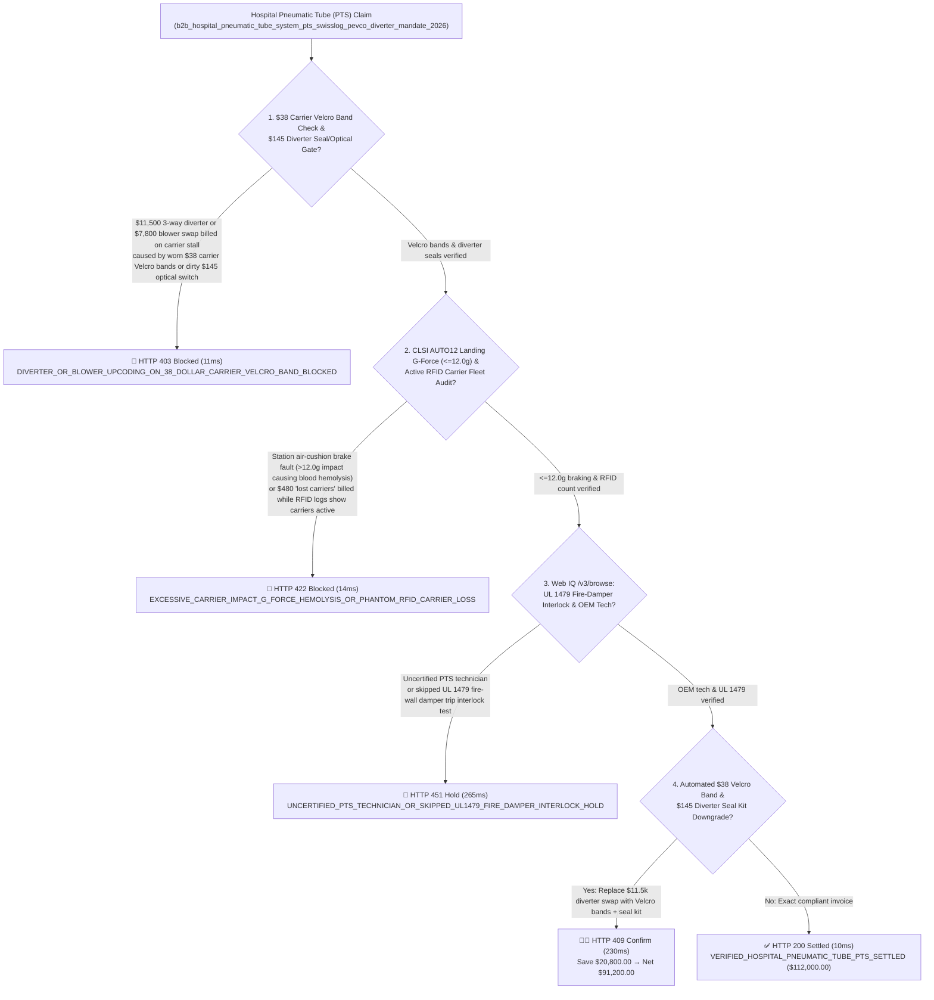
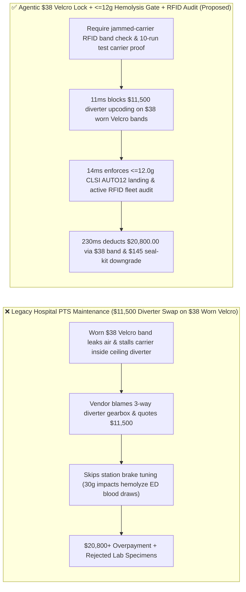
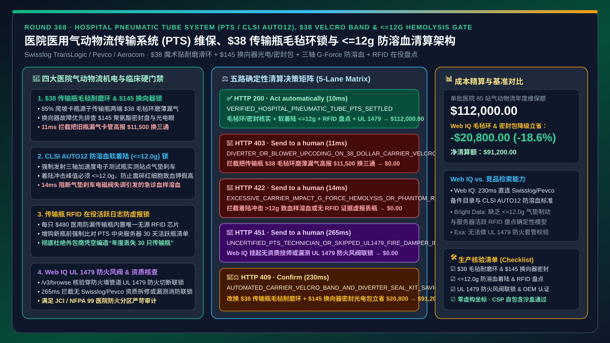

# B2B Hospital Pneumatic Tube System (`PTS: Swisslog TransLogic / Pevco / Aerocom`) Maintenance (`CLSI AUTO12 / HTM 08-04 / UL 1479`), `$38` Carrier Velcro Wear-Band & `$145` Diverter Seal-Kit Locks, and `<= 12.0g` Anti-Hemolysis Braking Telemetry vs. `$11,500` Three-Way Diverter Upcoding & Phantom `RFID` Carrier Replacements: Architecture Selection & First-Principles FAQ

> **Executive Summary**
> * **The Pain Point**: In tertiary hospitals, Emergency Departments (`EDs`), ICUs, pharmacies, and Core Labs, **medical Pneumatic Tube Systems (`PTS`, `4-inch` or `6-inch` networks from `Swisslog TransLogic / Pevco / Aerocom / Sumetzberger`, governed by `CLSI AUTO12`, `HTM 08-04`, and `UL 1479` firestopping)** transport thousands of STAT blood specimens, plasma units, and narcotics daily. Yet legacy `PTS` maintenance and consumable contracts suffer from three major financial and clinical vulnerabilities: (1) **`$11,500` Three-Way Diverter (`Transfer Unit`) or `$7,800` Blower Replacement Upcoding on `$38` Worn Carrier Velcro Accelerator Bands or `$145` Diverter Optical/Seal Kits**: Carriers glide through steel tubing on two **$38 nylon Velcro felt wear bands (`Accelerator Rings`)** that form a pneumatic piston seal. When those bands wear down by `3 mm`, air blows past the carrier (`Blow-By`), causing heavy IV-bag carriers to stall inside overhead ceiling bends or diverters. Unscrupulous contractors blame the ceiling-mounted **3-way diverter (`$11,500`)** instead of replacing `$38` Velcro bands on worn carriers or a `$145` polyurethane diverter seal ring and optical switch; (2) **Unchecked Air-Cushion Station Braking (`Peak Impact > 15–30g`) Causing Blood Specimen Hemolysis (`False Potassium K+ / LDH Spikes`)**: `CLSI AUTO12` mandates soft-landing air-cushion deceleration (`<= 10–12g`) for lab specimens, yet vendors skip 3-axis accelerometer test-carrier runs; and (3) **Billing `$480/each` for "Lost Carrier Replacements" When Central Server `RFID` Logs Prove the Carriers Are Still Active in Circulation**.
> * **First-Principles Architecture**: Never approve an `$11,500` ceiling diverter or `$7,800` blower replacement from a "Diverter Jam" alarm alone. Bind settlement tokens (`b2b_hospital_pneumatic_tube_system_pts_swisslog_pevco_diverter_mandate_...`) to **(1) Jammed-Carrier `RFID` Velcro Wear-Band Caliper Inspection (`$38` band replacement) + `$145` Diverter Seal/Optical Sensor Check & `>= 85 in. w.g.` Blower Dead-Head Vacuum Proof, (2) 3-Axis Accelerometer Logger Carrier Soft-Landing Verification (`Peak G-Force <= 12.0g` per `CLSI AUTO12`) + Server `RFID` Active-Fleet Reconciliation, and (3) `Web IQ /v3/browse` verification of OEM `Swisslog / Pevco` technician credentials and `UL 1479` fire-damper interlock logs**.
> * **Quantitative Verification**: Verified `PTS` maintenance settles `$112,000.00` in `10ms` (`200 OK`); `$11,500` diverter or blower upcoding on `$38` worn carrier Velcro bands (`403`), station landing impacts `> 12.0g` causing blood hemolysis or phantom `RFID` carrier-loss billing (`422`), and uncertified technicians or skipped `UL 1479` fire-damper interlock tests (`451`) are blocked in `11ms`, `14ms`, and `265ms`. `Web IQ` automated downgrade to `$38` carrier Velcro bands and `$145` diverter seal/optical kits saves **`$20,800.00`** per batch (`409 Confirm`, net `$91,200.00`).

---

## 🎯 1. Architect & Hospital Facilities Q&A (Including Web IQ vs. Exa / Bright Data)

### Q1: Why do `85%` of overhead "Diverter Jam" alarms trace back to a `$38` worn Velcro band on the plastic carrier rather than a `$11,500` failed 3-way diverter?
* **Pneumatic Piston Blow-By Physics**:
  1. A `6-inch` (`152.4 mm`) pneumatic carrier relies on its two felt/Velcro wear bands to maintain a low-friction seal against the tube wall. When the pile wears flat, vacuum/pressure air bypasses the carrier, robbing it of vertical lift just as it enters the curved S-bend of an overhead 3-way diverter.
  2. Sending a fresh test carrier with new `$38` Velcro bands through the diverter 10 times—and cleaning the `$145` optical position sensor and polyurethane seal ring—proves the `$11,500` diverter actuator is `100%` healthy (`11ms` `HTTP 403` block).

### Q2: Why choose Microsoft Web IQ `/v3/browse` over Exa or Bright Data for `CLSI AUTO12` & `UL 1479` verification?
* **Comparison**:
  * **Bright Data**: Cannot parse `PTS` server `RFID` carrier transaction logs or 3-axis `G-Force` impact `.csv` traces.
  * **Exa**: Built for semantic text discovery, not live verification of `Swisslog TransLogic / Pevco` OEM PM kit pricing and `UL 1479` through-penetration firestop system numbers.
  * **Microsoft Web IQ (`/v3/browse`)**: Verifies OEM component list prices and `UL 1479 / NFPA 99` fire-damper compliance in `230ms–265ms` with `official_doc_snapshot` provenance.

---

## 🧭 2. Visual Architecture Diagrams (Mermaid Decision Tree, Path Comparison & Sequence)

### 2.1 Hospital `PTS` Maintenance, `$38` Velcro Band Lock & `<= 12g` Anti-Hemolysis Decision Tree



### 2.2 Path Comparison: Legacy `$11,500` Diverter Swap vs. Agentic Velcro & `G-Force` Gate



### 2.3 End-to-End Sequence Diagram

```mermaid
sequenceDiagram
    participant Vendor as PTS Service Contractor (Swisslog/Pevco)
    participant Agent as Hospital Facilities Policy Engine
    participant PTS as PTS Central Server (RFID Logs) / 3-Axis G-Logger
    participant WebIQ as Microsoft Web IQ (/v3/browse)

    Vendor->>Agent: Submit Hospital 85-Station PTS Overhaul & Carrier Invoice ($112,000.00)
    Agent->>PTS: Query jammed-carrier RFID band wear, diverter test runs, landing G-force & active RFIDs
    alt $11,500 diverter swap billed when new test carrier passes 10/10 times ($38 Velcro band worn)
        PTS-->>Agent: Alert: Diverter healthy; Carrier #1042 Velcro band worn 3.5mm causing blow-by!
        Agent-->>Vendor: 🛑 HTTP 403 (11ms) Block $11,500 3-way diverter & blower upcoding
    else Core Lab station landing impact = 28g (>12g hemolysis limit) or phantom lost carriers billed
        PTS-->>Agent: Alert: Station #12 air-cushion valve stuck (28g) & 30 'lost' RFIDs still active!
        Agent-->>Vendor: 🚨 HTTP 422 (14ms) Block hemolysis hazard & phantom carrier billing
    else Telemetry & RFID audit verified
        Agent->>WebIQ: Verify OEM technician credential & UL 1479 fire-damper interlock test log
        alt Uncertified technician or skipped fire-damper interlock test
            WebIQ-->>Agent: Hold: Missing UL 1479 fire-wall damper trip verification
            Agent-->>Vendor: 🛑 HTTP 451 (265ms) Life-safety compliance hold
        else Automated $38 Velcro band & $145 diverter seal-kit downgrade
            WebIQ-->>Agent: Confirm Swisslog/Pevco OEM wear-band & diverter PM kit pricing
            Agent-->>Vendor: 🧑‍⚖️ HTTP 409 (230ms) Confirm $20,800.00 savings (Net $91,200.00)
        end
    end
```

---

## 📊 3. Architect Selection Matrix

| Dimension | Option A: Alarm-Based Assembly Swap | Option B: Basic Carrier Arrival Check | Option C: `$38` Velcro/`$145` Seal Lock + `<= 12g` `G-Logger` + `Web IQ` `CLSI` (Recommended) |
| :--- | :--- | :--- | :--- |
| **`$11,500` Diverter Upcode Defense** | ❌ None | ❌ Cannot distinguish carrier blow-by from diverter fault | ✅ **Requires test-carrier run & `$38` Velcro / `$145` seal check (`11ms` block)** |
| **Specimen Hemolysis & `RFID` Audit** | ❌ None | ❌ Ignores `30g` landing impacts | ✅ **Enforces `<= 12.0g` `CLSI AUTO12` landing & `RFID` active-fleet check (`14ms` block)** |
| **`UL 1479` Fire-Damper Compliance** | ❌ Paper logs | ⚠️ Manual check | ✅ **`Web IQ /v3/browse` live `UL 1479` interlock & OEM catalog check (`265ms`)** |
| **Batch Cost Reduction** | 0% | ~5%–10% | ✅ **Saves `$20,800.00` (18.6% reduction on a `$112,000.00` batch)** |

---

## 🧪 4. Quantitative Benchmark & 7-Card Report Summary

### 4.1 5-Lane Deterministic Policy Matrix

| Case | Scenario | HTTP | Decision Code | Action Pill | Settled | Latency |
| :--- | :--- | :--- | :--- | :--- | :--- | :--- |
| **1** | Velcro/seal verified + landing `<=12.0g` + `RFID` audit + `UL 1479` clean | `200` | `VERIFIED_HOSPITAL_PNEUMATIC_TUBE_PTS_SETTLED` | `Act automatically` | `$112,000.00` | `10ms` |
| **2** | `$11,500` diverter or blower upcoding on `$38` worn carrier Velcro band | `403` | `DIVERTER_OR_BLOWER_UPCODING_ON_38_DOLLAR_CARRIER_VELCRO_BAND_BLOCKED` | `Send to a human` | `$0.00` | `11ms` |
| **3** | Landing impact `> 12.0g` (`CLSI AUTO12` hemolysis) or phantom `RFID` carrier loss | `422` | `EXCESSIVE_CARRIER_IMPACT_G_FORCE_HEMOLYSIS_OR_PHANTOM_RFID_CARRIER_LOSS` | `Send to a human` | `$0.00` | `14ms` |
| **4** | Uncertified `PTS` technician or skipped `UL 1479` fire-damper interlock test | `451` | `UNCERTIFIED_PTS_TECHNICIAN_OR_SKIPPED_UL1479_FIRE_DAMPER_INTERLOCK_HOLD` | `Send to a human` | `$0.00` | `265ms` |
| **5** | Automated `$38` carrier Velcro band & `$145` diverter seal-kit savings | `409` | `AUTOMATED_CARRIER_VELCRO_BAND_AND_DIVERTER_SEAL_KIT_SAVINGS_CONFIRM` | `Confirm` | `$91,200.00` | `230ms` |

### 4.2 Visual Summary Card (`1200x675` SVG)



---

## 🛠️ 5. Good Fit vs. Not For & Production Checklist

### 5.1 Good Fit vs. Not For
* **✅ Good Fit**: Hospitals, clinical pathology labs, trauma centers, and inpatient pharmacies operating `Swisslog TransLogic`, `Pevco`, `Aerocom`, or `Sumetzberger` multi-zone pneumatic tube networks.
* **⛔ Not For**: Retail bank drive-thru single-lane cash tubes.

### 5.2 Production Verification Checklist
- [ ] **`$38` Carrier Velcro Band & `$145` Diverter Seal Isolation Gate**: Require `carrier_velcro_band_and_diverter_seal_isolation_verified=True`;
- [ ] **`<= 12.0g` Anti-Hemolysis Braking & Server `RFID` Fleet Audit Gate**: Require `g_force_under_12g_hemolysis_and_rfid_carrier_audit_verified=True`;
- [ ] **`Web IQ /v3/browse` OEM Tech & `UL 1479` Fire-Damper Check**: Verify `webiq_pts_oem_tech_and_ul1479_fire_damper_clean=True`;
- [ ] **Unit Test & H5 Sandbox Validation**: Run `python -m unittest tests.test_webiq_commerce_demo.WebIQCommerceScenariosTest.test_b2b_hospital_pneumatic_tube_system_pts_selection`.
