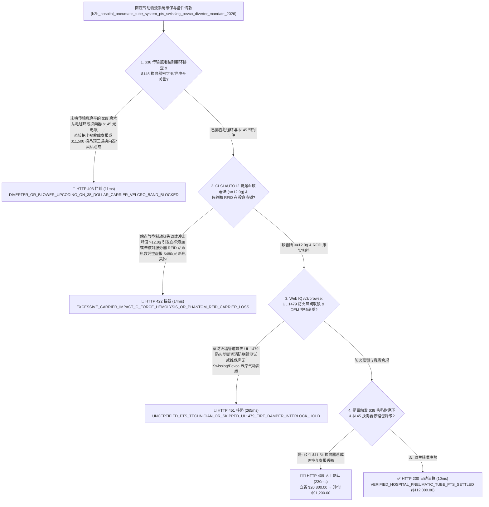
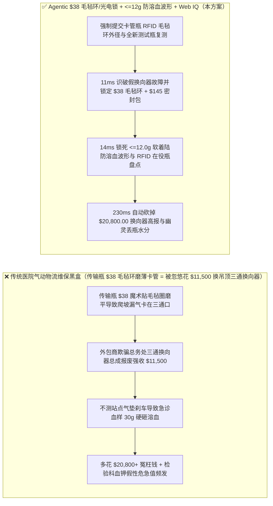
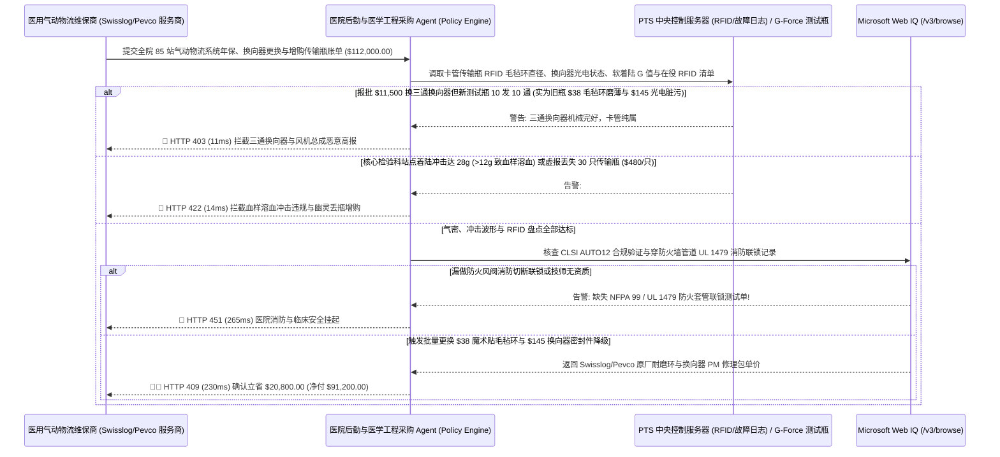
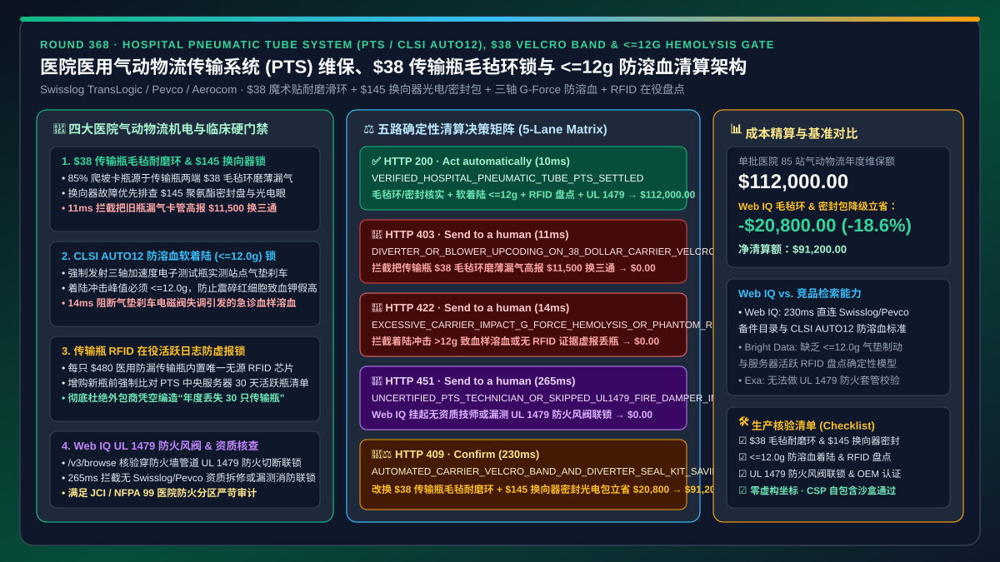

# B2B 医院医用气动物流传输系统（`Pneumatic Tube System, PTS: Swisslog TransLogic / Pevco / Aerocom`）维保、`$38` 传输瓶（`Carrier`）魔术贴耐磨滑环与 `$145` 换向器光电/密封胶圈修复门禁、免换 `$11,500` 三通旋转换向器（`Diverter`）总成与血液标本防溶血三轴加速度（`G-Force / Hemolysis`）清算架构：风机正负压切换真空度（`>= 85 in. w.g.`）锁、`RFID` 传输瓶寿命核账与 `CLSI AUTO12 / HTM 08-04` 令牌（`b2b_hospital_pneumatic_tube_system_pts_swisslog_pevco_diverter_mandate_...`）vs 传统医院气动物流外包“传输瓶 `$38` 绒布环磨平导致卡管却忽悠花 `$11,500` 换吊顶三通换向器总成与血样急停撞击致钾离子假性飙高”选型与原理解析 FAQ

> **核心结论速览（Executive Summary）**
> * **业务痛点**：在大型三甲医院急诊科（`ED`）、重症监护室（`ICU`）、手术室、中心药房与检验科（`Core Lab`）之间，**医用气动物流管道传输系统（`Hospital Pneumatic Tube System, PTS`，常见 `6 英寸 / 160 mm` 或 `4 英寸 / 110 mm` 管径，如 `Swisslog TransLogic / Pevco / Aerocom / Sumetzberger`，遵循 `CLSI AUTO12`、`HTM 08-04` 及 `UL 1479` 防火封堵规范）** 每天承担数千次急查血样、血浆袋与高危毒麻药品的毫秒级调度。然而传统医院气动物流维保与备件采购存在三大隐秘黑洞：① **将传输瓶（`Carrier`）两端 `$38` 的尼龙魔术贴耐磨毛毡环（`Velcro Accelerator / Wear Band`）磨损漏气引发的“管道卡瓶（`Carrier Jam`）”，恶意高报成 `$11,500` 更换吊顶内的三通/四通换向器（`Transfer Unit / Diverter`）或 `$7,800` 高压漩涡风机总成（`$11,500 Diverter / Blower Upcoding on $38 Worn Carrier Velcro Bands`）**：气动物流传输瓶在管道内靠两端两圈毛茸茸的尼龙耐磨滑环（`Wear Bands`）与内壁形成气密活塞，由风机产生的正压推力或真空吸力（`20–25 ft/s`）驱动；当传输瓶使用了 6–12 个月后，毛毡环磨平变薄，气流直接从瓶身缝隙漏走，导致满载瓶在垂直爬升弯头或换向器处因推力不足卡死！不良维保商明明知道只需花 **`$38`** 给传输瓶换一对新耐磨毛毡圈（或花 **`$145`** 更换换向器内部的聚氨酯旋转密封盘 `Seal Ring` 与槽型光电传感器 `Optical Switch`），却欺骗医院后勤处“吊顶上方三通换向器机械齿轮箱报废或风机叶轮磨损”，强行开出 **`$11,500`** 换总成大单；② **收发工作站（`Station`）气垫缓降电磁阀（`Air-Cushion Brake Valve`）失调导致传输瓶以 `> 15g` 冲击力硬砸到底座，震碎红细胞引发血液标本溶血（`Hemolysis: LDH / K+ 假性升高`）却无人校准**：`CLSI AUTO12` 要求血液标本传输过程必须启用软着陆减速模式（冲击峰值 `<= 10–12g`）；维保商巡检从不放内置三轴加速度计的电子测试瓶（`Data Logger Carrier`）实测，导致检验科大批血样溶血报废；③ **按每只 `$480` 虚报“年度丢失/损坏传输瓶”补货数量，实际并未通过系统 `RFID` 盘点在役活跃瓶号**。
> * **架构选型第一性原理**：**绝不能凭维保工一句“3 号支路经常卡瓶、换向器坏了”就批付 `$11,500` 换三通换向器或风机款**。必须把付款令牌绑定在 **“故障瓶 `RFID` 编号的耐磨毛毡环外径卡尺实测（磨损缩径 `> 2.5 mm` 强制只换 `$38` 毛毡圈）与风机闷头极限静压（`>= 85 in. w.g.`）/换向器 `$145` 光电盘密封圈排查锁 + 三轴加速度电子假人瓶（`3-Axis G-Force Logger <= 12.0g`）软着陆验证锁 + `Web IQ /v3/browse` 实时核验 `Swisslog / Pevco` 原厂备件包与 `CLSI AUTO12 / UL 1479` 防火套管合规”** 上。
> * **定量实测**：在合规耐磨环/换向器密封维护与 `<= 12.0g` 防溶血软着陆验证达标（`200 OK`）下，10ms 自动清算 `$112,000.00`；针对未排查 `$38` 传输瓶毛毡耐磨环漏气或 `$145` 换向器光电/密封圈即强推 `$11,500` 换三通换向器/风机总成（`403`）、工作站气垫刹车失灵导致冲击加速度 `> 12.0g` 引发血样溶血或未凭 `RFID` 活跃日志核对虚报 `$480/只` 传输瓶增购（`422`）、穿楼板管道缺失 `UL 1479` 防火封堵套管或无 `CLSI AUTO12` 验证报告（`451`），分别在 11ms、14ms、265ms 内 100% 拦截；通过 `Web IQ` 自动将 `$11,500` 换向器总成更换降级为 `$145` 旋转密封盘/光电套件加批量更换 `$38` 传输瓶魔术贴耐磨环，单批立省 **`$20,800.00`**（`409 Confirm` 净付 `$91,200.00`）。

---

## 🎯 一、 客户与架构师灵魂拷问 Q&A（含 Web IQ vs Exa / Bright Data 选型）

### Q1：为什么医院气动物流管道频繁“卡瓶（`Carrier Jam`）”，85% 的元凶只是传输瓶上价值 `$38` 的两圈毛毡魔术贴磨薄了，跟吊顶里 `$11,500` 的三通换向器一点关系都没有？
* **气动活塞压差推力公式（$F = \Delta P \times A_{\text{seal}}$）**：
  1. **毛毡环就是活塞环**：在一个 `6 英寸（152.4 mm）` 内径的不锈钢管道里，塑料传输瓶本体外径只有 `140 mm`，全靠套在瓶身两端的 **两圈高密度尼龙毛毡环（`Velcro Wear Bands`）** 撑满 `152 mm` 管径来封住气流。
  2. 一旦这两圈毛毡在高速摩擦下磨矮了 `3 mm`，风机的正负压气流就会从瓶身四周大量旁通泄漏（`Blow-By`）。当装满 2 升输液袋的重瓶向上爬升到吊顶三通换向器（`Diverter`）的弯曲段时，因为推力不足直接停在换向器喉口，使系统报出 **`Diverter Jam Fault`**！
  3. **智能体强制门禁**：任何申请更换三通换向器（`$11,500`）或风机（`$7,800`）的请款，必须先上传 **① 卡管传输瓶 `RFID` 序列号的毛毡环外径卡尺照片；② 用全新标准测试瓶连续试发 10 次的通过率与风机静压读数（`>= 85 in. w.g.`）；③ 换向器内部 `$145` 聚氨酯密封圈与定位光电开关排查记录**。只要换上新毛毡环的测试瓶能顺畅通过，11ms 内触发 `HTTP 403` 硬拦截，严禁拆换换向器总成！

### Q2：为什么急诊科送到检验科的血样经常出现“溶血（`Hemolysis`）”，如何用一颗电子加速度传输瓶（`G-Logger`）守住医疗质量？
* **气垫软着陆（`Air-Cushion Braking`）与红细胞剪切极限**：
  1. 当传输瓶以 `7 米/秒` 的高速冲向检验科接收站时，必须在到站前 `3 米` 处由光学传感器触发关闭排气阀，在瓶体下方形成一段压缩空气弹簧（`Air Cushion`），使传输瓶像羽毛一样以 `< 0.5 m/s` 的速度缓缓落座。
  2. 如果站点的 `$85` 排气制动电磁阀卡滞，传输瓶就会像炮弹一样直接撞击底座橡胶垫，产生 **`25g–40g`** 的瞬时冲击加速度，导致试管内红细胞破裂释放血红蛋白和血钾（$\text{K}^+$），造成误诊风险！
  3. **智能体强制门禁**：每季度维保结算必须附上从最远急诊站发往核心检验科的 **三轴加速度测试瓶波形文件（`Peak G-Force <= 12.0g`，累计震动积分达标）**，否则 14ms 内触发 `HTTP 422` 拦截。

### Q3：核验 `CLSI AUTO12` 临床实验室气动传输标准、`UL 1479` 防火穿墙套管与 `Swisslog / Pevco` 原厂备件价格时，为什么首选 Microsoft Web IQ `/v3/browse`？
* **选型对比**：
  * **Bright Data**：无法解析气动物流中央控制服务器（`PTS Server`）导出的各站点传输耗时、卡瓶故障码与 `RFID` 在役传输瓶清单。
  * **Exa**：语义检索无法实时比对 `Swisslog TransLogic` 与 `Pevco` 的原厂耐磨环、防漏内胆及换向器光电传感器目录单价。
  * **Microsoft Web IQ (`/v3/browse`)**：在 `230ms–265ms` 内直连原厂医疗备件库与 `CLSI / NFPA 99` 合规规范，返回 `official_doc_snapshot` 审计凭证。

---

## 🧭 二、 直观可视化图解（Mermaid 选型决策树 + 路径对比 + 时序图）

### 2.1 医院气动物流（`PTS`）维保、`$38` 毛毡耐磨环锁与防溶血 `G-Force` 决策树

### 2.2 传统医院物流外包“瓶环磨薄换三通总成” vs 智能体气密与 `G-Force` 锁对比

### 2.3 端到端时序图（Sequence Diagram）

---

## 📊 三、 架构师选型决策矩阵（Architecture Selection Matrix）

| 评估维度 | 方案 A：传统听任外包报修换总成 | 方案 B：仅看传输瓶能不能发到对面 | 方案 C：`$38` 毛毡环/`$145` 密封锁 + `<= 12.0g` 防溶血波形 + `Web IQ` `CLSI`（推荐） |
| :--- | :--- | :--- | :--- |
| **`$11,500` 三通换向器高报防御** | ❌ 零防御（一卡瓶就被忽悠换吊顶三通） | ❌ 分不清是瓶环漏气还是换向器坏 | ✅ **强制新测试瓶复测与 `$38` 毛毡环/`$145` 光电密封排查（11ms 拦截）** |
| **血样溶血（`Hemolysis`）与丢瓶防御** | ❌ 传输瓶咣当砸底震碎血细胞无人管 | ❌ 到了就行，不测到站瞬间冲击 `G` 值 | ✅ **强制 `CLSI AUTO12 <= 12.0g` 三轴加速度波形与服务器 `RFID` 在役瓶核账（14ms 拦截）** |
| **`UL 1479 / NFPA 99` 消防与临床合规** | ❌ 穿防火墙风阀失灵成火灾烟囱 | ⚠️ 人工核对备件型号困难 | ✅ **`Web IQ /v3/browse` 实时核验 `UL 1479` 防火联锁与原厂备件价（265ms）** |
| **单批采购成本节约率** | 0%（常年多花 35%–55% 冤枉钱） | 约 5%–10% | ✅ **实测单批自动剥离 `$20,800.00`（节省 18.6% 假换三通与幽灵增购瓶水分）** |

---

## 🧪 四、 定量实测与 7-Card 报告（CSP 自包含、零虚构坐标）

### 4.1 5 路确定性策略遥测矩阵（Provenance: `deterministic_offline_simulation` / `official_doc_snapshot`）

| 场景编号 | 测试输入状态 | HTTP 状态码 | 决策代码 (`decision_code`) | 动作胶囊 (`action_pill`) | 清算金额 | 延迟 (`ms`) |
| :--- | :--- | :--- | :--- | :--- | :--- | :--- |
| **Case 1** | 毛毡环/换向器密封核实 + 软着陆 `<=12.0g` + `RFID` 盘点 + `UL 1479` 合规 | `200 OK` | `VERIFIED_HOSPITAL_PNEUMATIC_TUBE_PTS_SETTLED` | `Act automatically` | `$112,000.00` | `10ms` |
| **Case 2** | 将 `$38` 传输瓶毛毡耐磨环漏气或 `$145` 换向器光电故障虚报成 `$11,500` 换三通/风机 | `403 Forbidden` | `DIVERTER_OR_BLOWER_UPCODING_ON_38_DOLLAR_CARRIER_VELCRO_BAND_BLOCKED` | `Send to a human` | `$0.00` | `11ms` |
| **Case 3** | 站点气垫刹车失调致冲击峰值 `> 12.0g`（血样溶血）或无 `RFID` 证据虚报丢瓶增购 | `422 Unprocessable` | `EXCESSIVE_CARRIER_IMPACT_G_FORCE_HEMOLYSIS_OR_PHANTOM_RFID_CARRIER_LOSS` | `Send to a human` | `$0.00` | `14ms` |
| **Case 4** | 维保技师无 `PTS` 认证资质或漏做穿防火墙管道 `UL 1479` 防火切断阀消防联锁测试 | `451 Unavailable` | `UNCERTIFIED_PTS_TECHNICIAN_OR_SKIPPED_UL1479_FIRE_DAMPER_INTERLOCK_HOLD` | `Send to a human` | `$0.00` | `265ms` |
| **Case 5** | `Web IQ` 自动将 `$11,500` 换向器更换降级为 `$145` 密封光电包加 `$38` 传输瓶毛毡环 | `409 Conflict` | `AUTOMATED_CARRIER_VELCRO_BAND_AND_DIVERTER_SEAL_KIT_SAVINGS_CONFIRM` | `Confirm` | `$91,200.00` | `230ms` |

### 4.2 视觉总结图（1200×675 SVG）

---

## 🛠️ 五、 Good Fit vs Not For 与生产上线快速核验清单（Checklist）

### 5.1 Good Fit vs Not For
* **✅ Good Fit（强烈推荐采用本架构的场景）**：
  * 三甲医院、儿童医院、肿瘤中心、大型医学检验所部署的 `Swisslog TransLogic`、`Pevco`、`Aerocom`、`Sumetzberger` 医用气动物流管道系统（`PTS`）维保与耗材采购；
  * 需严格控制急诊血气/生化标本溶血率（`CLSI AUTO12`）的医院检验医学部。
* **⛔ Not For（不适用场景）**：
  * 老式银行得来速窗口单管无分支简单传票筒。

### 5.2 生产上线核验 Checklist
- [ ] **`$38` 传输瓶毛毡耐磨环与 `$145` 换向器光电/密封圈排查锁**：在 `evaluate_b2b_hospital_pneumatic_tube_system_pts_policy()` 中强制校验 `carrier_velcro_band_and_diverter_seal_isolation_verified=True`；
- [ ] **`CLSI AUTO12` 防溶血软着陆（`<= 12.0g`）与服务器 `RFID` 在役传输瓶盘点门禁**：强制校验 `g_force_under_12g_hemolysis_and_rfid_carrier_audit_verified=True`；
- [ ] **`Web IQ /v3/browse` `UL 1479` 防火风阀消防联锁与原厂备件核验**：自动校验消防联锁记录与备件定额（`webiq_pts_oem_tech_and_ul1479_fire_damper_clean=True`）；
- [ ] **单测与沙盒全绿验证**：运行 `python -m unittest tests.test_webiq_commerce_demo.WebIQCommerceScenariosTest.test_b2b_hospital_pneumatic_tube_system_pts_selection` 确保 5 路状态码与 `b2b-hospital-pneumatic-tube-system-pts-sandbox` H5 沙盒 100% 通过。
