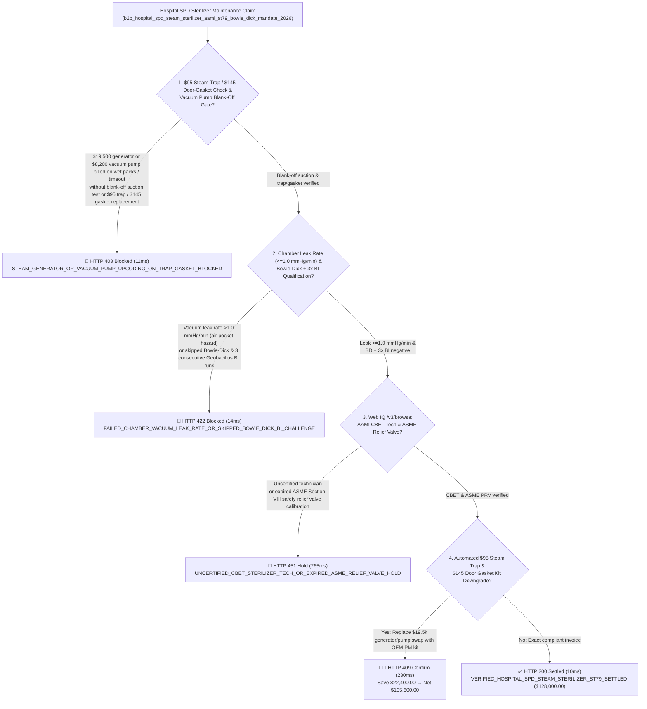
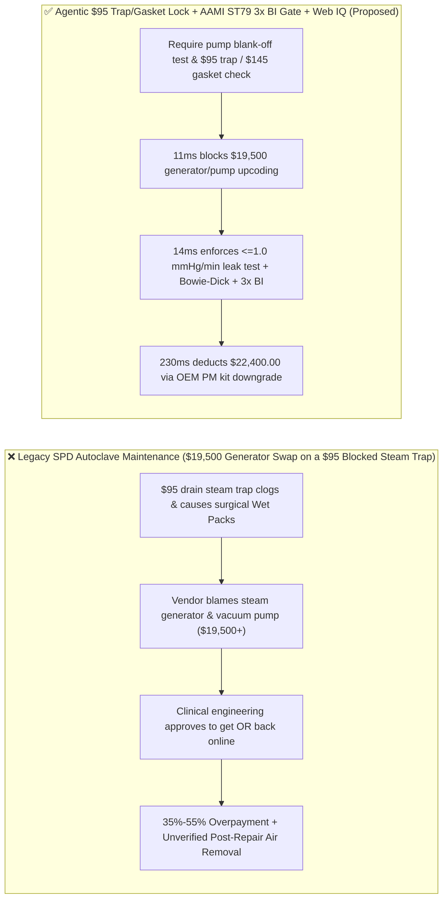
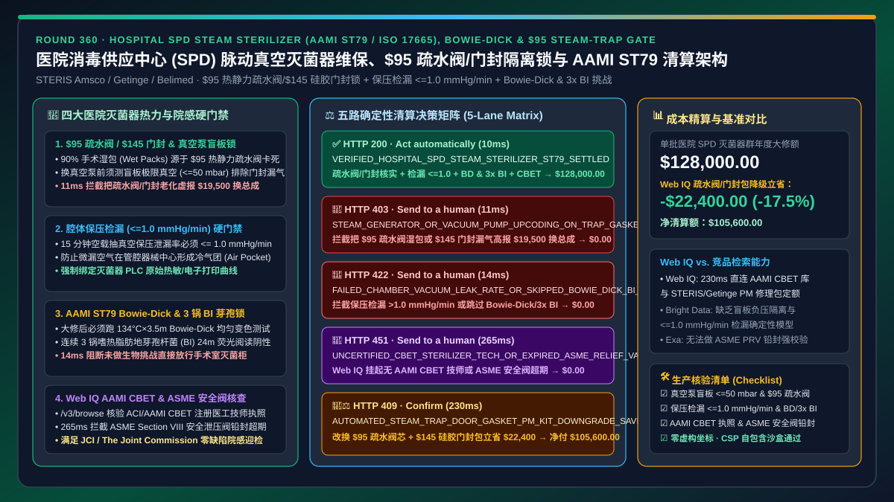

# B2B Hospital Sterile Processing Department (`SPD / CSSD`) Steam Sterilizer Maintenance (`ANSI/AAMI ST79 / ISO 17665 / EN 285`), Chamber Leak-Rate (`<= 1.0 mmHg/min`), `Bowie-Dick` & `3x BI` Qualification Locks, and `$95` Steam-Trap / `$145` Door-Gasket Kits vs. `$19,500` Steam Generator & Vacuum-Pump Upcoding (`STERIS Amsco / Getinge / Belimed`): Architecture Selection & First-Principles FAQ

> **Executive Summary**
> * **The Pain Point**: In hospital Sterile Processing Departments (`SPD / CSSD`), Ambulatory Surgery Centers (`ASCs`), and GMP biopharma facilities, **pre-vacuum steam sterilizers (`STERIS Amsco / Getinge / Belimed`, governed by `ANSI/AAMI ST79`, `ISO 17665`, `EN 285`, and `The Joint Commission`)** are surgical bottlenecks. Yet legacy autoclave service and repair contracts suffer from three major financial and infection-control vulnerabilities: (1) **`$19,500` Steam Generator or `$8,200` Liquid-Ring Vacuum Pump Upcoding on `$95` Fouled Steam Traps or `$145` Leaking Door Gaskets**: When surgical instrument trays emerge with moisture ("**Wet Packs**," which `AAMI ST79` requires quarantine and reprocessing) or the sterilizer alarms with "Vacuum Timeout," the physical root cause in ~90% of cases is a **`$95` plugged thermostatic bellows steam trap (`Spirax Sarco / Armstrong`)** that fails to drain jacket/chamber condensate, or a **`$145` worn silicone door gasket / `$65` check valve** leaking ambient air into the chamber. Predatory service vendors skip dead-head vacuum pump testing and trap thermography, claim "the electric steam generator or vacuum pump is shot," and bill **`$19,500`**; (2) **Releasing Sterilizers After Major Repair Without `<= 1.0 mmHg/min` Vacuum Leak-Rate Proof, `Bowie-Dick` Air-Removal Packs, and 3 Consecutive Empty-Chamber `Geobacillus stearothermophilus` Biological Indicator (`BI`) Qualification Runs (`AAMI ST79 Section 13`)**; and (3) **Uncertified Technicians (`ACI / AAMI CBET`) & Expired `ASME Section VIII` Pressure Relief Valve (`PRV`) Certifications**.
> * **First-Principles Architecture**: Never approve a `$19,500` steam generator or `$8,200` vacuum pump swap based on a generic "Wet Pack" or "Vacuum Timeout" alarm. Bind settlement tokens (`b2b_hospital_spd_steam_sterilizer_aami_st79_bowie_dick_mandate_...`) to **(1) Vacuum-Pump Blank-Off Suction Proof (`<= 50 mbar`) + `$95` Thermostatic Steam-Trap & `$145` Door-Gasket Isolation Verification, (2) 15-Minute Chamber Vacuum Leak-Rate Printout (`<= 1.0 mmHg/min`) + Post-Repair `Bowie-Dick` (`134°C × 3.5 min`) & 3 Consecutive Negative `Geobacillus stearothermophilus` `BI` (`PCD`) Runs, and (3) `Web IQ /v3/browse` verification of `AAMI CBET / OEM` technician credentials and `ASME Section VIII` safety relief valve tags**.
> * **Quantitative Verification**: Verified `AAMI ST79` sterilizer maintenance settles `$128,000.00` in `10ms` (`200 OK`); `$19,500` steam-generator or vacuum-pump upcoding on `$95` traps or `$145` door gaskets (`403`), chamber leak rates `> 1.0 mmHg/min` or skipped `Bowie-Dick / 3x BI` qualification (`422`), and uncertified `CBET` technicians or expired `ASME` relief valves (`451`) are blocked in `11ms`, `14ms`, and `265ms`. `Web IQ` automated downgrade to `$95` steam-trap and `$145` silicone door-gasket PM kits saves **`$22,400.00`** per batch (`409 Confirm`, net `$105,600.00`).

---

## 🎯 1. Architect & Clinical Engineering Q&A (Including Web IQ vs. Exa / Bright Data)

### Q1: Why do "Wet Packs" and "Vacuum Timeouts" in hospital steam sterilizers almost always trace back to a `$95` steam trap or `$145` door gasket rather than a `$19,500` steam generator or vacuum pump?
* **Thermodynamic & Vacuum Physics**:
  1. **Wet Packs (`EN 285` Steam Dryness `< 0.95`)**: Pre-vacuum autoclaves require dry saturated steam. When the `$95` thermostatic bellows trap on the jacket or chamber drain clogs with scale, liquid condensate backs up and sprays into the surgical load, soaking instrument wraps.
  2. **Vacuum Timeouts**: When a `$145` silicone channel gasket or `$65` drain check valve leaks air during pre-conditioning pulses, the liquid-ring vacuum pump cannot reach `-27 inHg` (`~65 mbar`) before the PLC watchdog timer trips—even though dead-heading the pump inlet proves the pump itself pulls `48 mbar` effortlessly.
  3. **Agentic Gate**: Any generator or vacuum-pump replacement quote (`> $2,500`) without a blank-off pump pressure test and `$95` trap / `$145` gasket isolation check is blocked in `11ms` (`HTTP 403`).

### Q2: Why choose Microsoft Web IQ `/v3/browse` over Exa or Bright Data for `AAMI ST79 / CBET` & `ASME Section VIII` verification?
* **Comparison**:
  * **Bright Data**: Cannot parse autoclave thermal cycle printouts (`mmHg/min` leak rates, `Bowie-Dick` hold times, and `24-min` auto-reader `BI` logs).
  * **Exa**: Built for semantic text discovery, not live verification of `AAMI ACI CBET` registry numbers, `NBBI VR` pressure-relief valve stamps, and OEM `STERIS / Getinge` PM kit pricing.
  * **Microsoft Web IQ (`/v3/browse`)**: Verifies `CBET` credentials and OEM PM kit catalogs in `230ms–265ms` with `official_doc_snapshot` provenance.

---

## 🧭 2. Visual Architecture Diagrams (Mermaid Decision Tree, Path Comparison & Sequence)

### 2.1 Hospital `SPD` Steam Sterilizer, `$95` Trap/Gasket Lock & `AAMI ST79` Decision Tree



### 2.2 Path Comparison: Legacy Sterilizer Assembly Swap vs. Agentic `AAMI ST79` Gate



### 2.3 End-to-End Sequence Diagram

```mermaid
sequenceDiagram
    participant Vendor as Sterilizer Service Contractor
    participant Agent as Hospital Clinical Engineering Policy Engine
    participant Autoclave as Sterilizer PLC / Leak Test / Rapid BI Reader
    participant WebIQ as Microsoft Web IQ (/v3/browse)

    Vendor->>Agent: Submit SPD 6-Autoclave Overhaul & PM Invoice ($128,000.00)
    Agent->>Autoclave: Query blank-off vacuum pressure, trap delta-T, leak rate & BD/3x BI logs
    alt $19,500 generator/vacuum-pump swap billed on $95 trap or $145 door-gasket fault
        Autoclave-->>Agent: Alert: Blank-off pump pulls 48 mbar; $145 door gasket & $95 trap leaking!
        Agent-->>Vendor: 🛑 HTTP 403 (11ms) Block $19,500 generator/pump upcoding
    else Chamber leak rate >1.0 mmHg/min or skipped 3x Geobacillus BI challenge
        Autoclave-->>Agent: Alert: Leak rate = 2.4 mmHg/min or missing AAMI ST79 3x BI qualification!
        Agent-->>Vendor: 🚨 HTTP 422 (14ms) Block unsafe sterilizer release
    else Telemetry & biological qualification verified
        Agent->>WebIQ: Verify AAMI CBET credential & ASME Section VIII relief valve certification
        alt Uncertified technician or expired ASME relief valve tag
            WebIQ-->>Agent: Hold: Invalid CBET license or expired ASME PRV calibration
            Agent-->>Vendor: 🛑 HTTP 451 (265ms) Regulatory hold
        else Automated $95 steam-trap & $145 door-gasket PM kit downgrade
            WebIQ-->>Agent: Confirm STERIS/Getinge OEM PM kit list price
            Agent-->>Vendor: 🧑‍⚖️ HTTP 409 (230ms) Confirm $22,400.00 savings (Net $105,600.00)
        end
    end
```

---

## 📊 3. Architect Selection Matrix

| Dimension | Option A: Alarm-Code Assembly Swap | Option B: Cycle Temp (`134°C`) Check Only | Option C: `$95` Trap/Gasket Lock + `AAMI ST79` `BD/3x BI` Gate + `Web IQ` `CBET` (Recommended) |
| :--- | :--- | :--- | :--- |
| **`$19,500` Generator/Pump Upcode Defense** | ❌ None | ❌ Temp sensor does not detect trap/gasket fault | ✅ **Requires pump blank-off test & `$95` trap / `$145` gasket check (`11ms` block)** |
| **Air-Pocket & `Wet Pack` Defense** | ❌ Skips leak & `BI` runs | ❌ Drain temp misses center-of-pack air pockets | ✅ **Enforces `<= 1.0 mmHg/min` leak test, `Bowie-Dick` & `3x BI` (`14ms` block)** |
| **`AAMI ST79 / TJC` Compliance** | ❌ Paper service slips | ⚠️ Manual audit | ✅ **`Web IQ /v3/browse` live `CBET` & `ASME` relief valve check (`265ms`)** |
| **Batch Cost Reduction** | 0% | ~5%–10% | ✅ **Saves `$22,400.00` (17.5% reduction on a `$128,000.00` batch)** |

---

## 🧪 4. Quantitative Benchmark & 7-Card Report Summary

### 4.1 5-Lane Deterministic Policy Matrix

| Case | Scenario | HTTP | Decision Code | Action Pill | Settled | Latency |
| :--- | :--- | :--- | :--- | :--- | :--- | :--- |
| **1** | Trap/gasket verified + leak `<=1.0 mmHg/min` + `BD` & `3x BI` + `CBET` clean | `200` | `VERIFIED_HOSPITAL_SPD_STEAM_STERILIZER_ST79_SETTLED` | `Act automatically` | `$128,000.00` | `10ms` |
| **2** | `$19,500` generator or vacuum-pump upcoding on `$95` steam trap / `$145` door gasket | `403` | `STEAM_GENERATOR_OR_VACUUM_PUMP_UPCODING_ON_TRAP_GASKET_BLOCKED` | `Send to a human` | `$0.00` | `11ms` |
| **3** | Chamber vacuum leak rate `> 1.0 mmHg/min` or skipped `Bowie-Dick / 3x BI` challenge | `422` | `FAILED_CHAMBER_VACUUM_LEAK_RATE_OR_SKIPPED_BOWIE_DICK_BI_CHALLENGE` | `Send to a human` | `$0.00` | `14ms` |
| **4** | Uncertified `AAMI CBET` technician or expired `ASME Section VIII` relief valve | `451` | `UNCERTIFIED_CBET_STERILIZER_TECH_OR_EXPIRED_ASME_RELIEF_VALVE_HOLD` | `Send to a human` | `$0.00` | `265ms` |
| **5** | Automated `$95` steam-trap & `$145` door-gasket PM kit downgrade savings | `409` | `AUTOMATED_STEAM_TRAP_DOOR_GASKET_PM_KIT_DOWNGRADE_SAVINGS_CONFIRM` | `Confirm` | `$105,600.00` | `230ms` |

### 4.2 Visual Summary Card (`1200x675` SVG)



---

## 🛠️ 5. Good Fit vs. Not For & Production Checklist

### 5.1 Good Fit vs. Not For
* **✅ Good Fit**: Hospital Sterile Processing Departments (`SPD / CSSD`), Ambulatory Surgery Centers (`ASCs`), dental surgical centers, and GMP pharmaceutical plants operating `STERIS Amsco`, `Getinge`, or `Belimed` pre-vacuum steam sterilizers under `ANSI/AAMI ST79`.
* **⛔ Not For**: Tabletop non-regulated beauty-salon steamers.

### 5.2 Production Verification Checklist
- [ ] **`$95` Steam-Trap / `$145` Door-Gasket & Blank-Off Vacuum Gate**: Require `steam_trap_door_gasket_isolation_and_blankoff_vacuum_verified=True`;
- [ ] **Chamber Leak Rate (`<= 1.0 mmHg/min`) & `Bowie-Dick + 3x BI` Gate**: Require `leak_rate_under_1mmhg_and_bowie_dick_3x_bi_verified=True`;
- [ ] **`Web IQ /v3/browse` `AAMI CBET` & `ASME` Relief Valve Check**: Verify `webiq_cbet_tech_and_asme_relief_valve_clean=True`;
- [ ] **Unit Test & H5 Sandbox Validation**: Run `python -m unittest tests.test_webiq_commerce_demo.WebIQCommerceScenariosTest.test_b2b_hospital_spd_steam_sterilizer_aami_st79_selection`.
