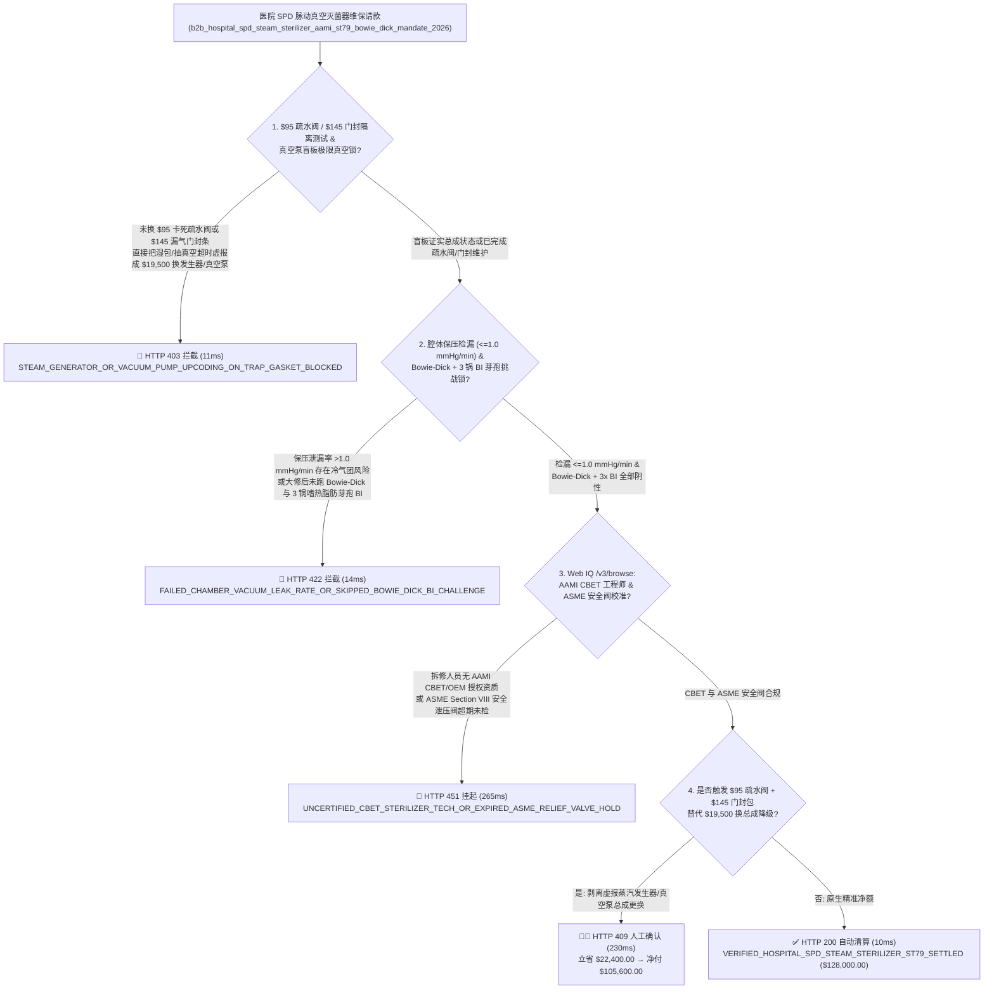
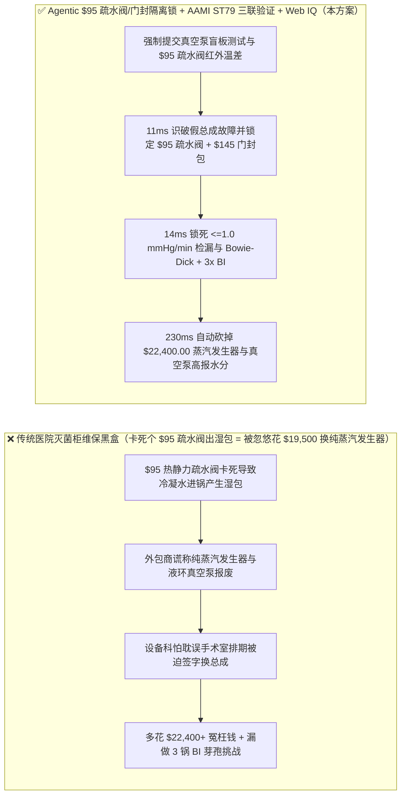
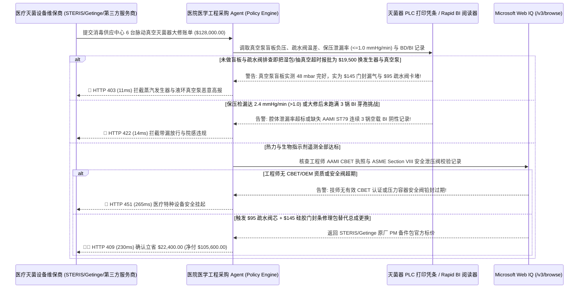
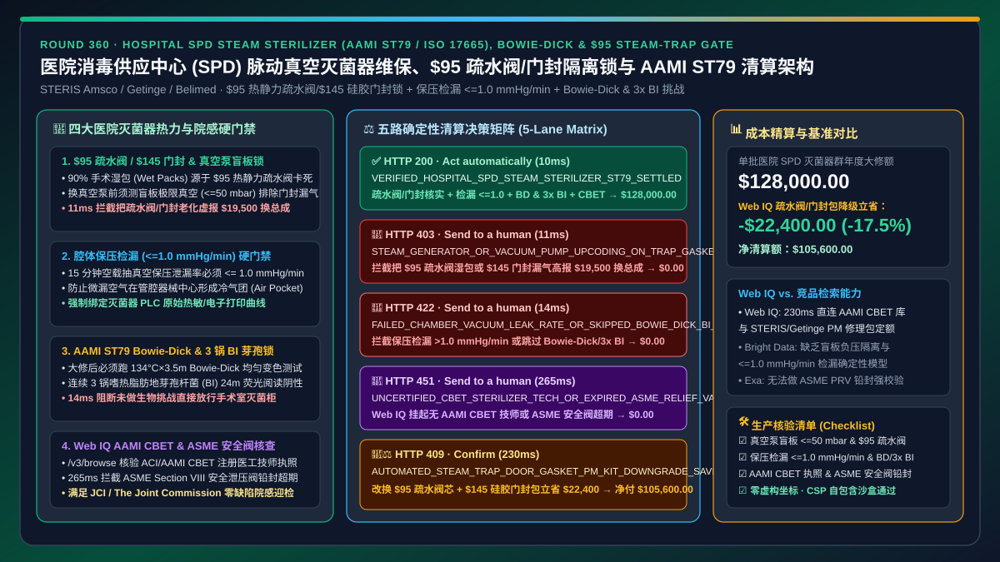

# B2B 医院消毒供应中心（`SPD / CSSD`）脉动真空压力蒸汽灭菌器维保、`AAMI ST79 / ISO 17665` 每日 `Bowie-Dick` 空气排除试验与嗜热脂肪地芽孢杆菌（`BI`）门禁、`$145` 硅胶门封条/`$95` 热静力疏水阀修理包免换 `$19,500` 蒸汽发生器总成与防“湿包（`Wet Packs`）”清算架构：腔体保压泄漏率（`<= 1.0 mmHg/min`）锁、`EN 285` 不凝性气体（`NCG <= 3.5%`）与 `CBN / CBET` 令牌（`b2b_hospital_spd_steam_sterilizer_aami_st79_bowie_dick_mandate_...`）vs 传统医疗灭菌外包“疏水阀卡死导致手术器械包湿包却忽悠花 `$19,500` 换整台蒸汽发生器与真空泵总成”选型与原理解析 FAQ

> **核心结论速览（Executive Summary）**
> * **业务痛点**：在三甲医院手术室与消毒供应中心（`Sterile Processing Department, SPD / CSSD`）以及生物制药无菌灌装车间中，**大型脉动真空压力蒸汽灭菌器（`Pre-Vacuum Steam Sterilizer / Autoclave`，如 `STERIS Amsco / Getinge / Belimed / Tuttnauer`，受 `ANSI/AAMI ST79`、`ISO 17665`、`EN 285` 及 `The Joint Commission (TJC)` 严苛监管）** 一旦停机或灭菌失败，会导致全院外科手术大面积取消。然而传统医院灭菌柜维保与备件采购存在三大高额漏洞：① **把 `$95` 热静力疏水阀（`Thermostatic Steam Trap`）卡堵引发的“湿包（`Wet Packs`）”或 `$145` 门封条漏气，恶意高报成 `$19,500` 换纯蒸汽发生器总成或 `$8,200` 换液环真空泵（`$19,500 Steam Generator / Vacuum Pump Upcoding on $95 Steam Trap or $145 Door Gasket`）**：当手术器械包出锅后发现包内有冷凝水珠（即 `AAMI ST79` 严禁放行的 **湿包 Wet Pack**，极易导致细菌穿透包布引发术后感染），或灭菌器报“抽真空超时（`Vacuum Timeout`）”，90% 的物理原因是夹套/腔体底部的 **`$95` 波纹管热静力疏水阀（`Spirax Sarco / Armstrong Steam Trap`）被水垢卡死排不出冷凝水**，或者是槽内的 **`$145` 硅胶空心门封圈（`Door Gasket`）老化微漏**；不良第三方或厂家售后却拒绝出示腔体静态保压泄漏率（`Leak Rate Test <= 1.0 mmHg/min`）与疏水阀前后温差红外图，吓唬设备科“纯蒸汽发生器内部换热管穿孔或水环真空泵叶轮报废”，强行开出 **`$19,500`** 换总成大单；② **伪造每日 `Bowie-Dick`（`134°C × 3.5 min`）冷空气排除测试卡与 `Geobacillus stearothermophilus` 生物指示剂（`BI`）阴性对照**：维保后不跑空载保压检漏、不放 `Bowie-Dick` 测试包验证脉动抽真空是否排净冷空气团，直接签字放行，导致器械管腔内部温度根本达不到 `132°C / 134°C`；③ **无 `ACI / AAMI CBET`（注册生物医学设备技师）或 `ASME Section VIII` 压力容器安全阀（`PRV`）铅封校准资质的游击队违规拆修**。
> * **架构选型第一性原理**：**绝不能凭售后工程师一句“报真空故障了、经常出湿包”就批付 `$19,500` 换蒸汽发生器或真空泵款**。必须把付款令牌绑定在 **“`$95` 疏水阀热成像/超声波排凝验证与 `$145` 硅胶门封条加压隔离测试锁 + 15 分钟空载真空保压泄漏率（`Vacuum Leak Rate <= 1.0 mmHg/min`）打印凭条 + 维保后连续 3 锅 `Bowie-Dick` 均匀变色与 `24-Min Rapid-Readout BI`（嗜热脂肪地芽孢杆菌）零生长电子记录 + `Web IQ /v3/browse` 实时核验 `AAMI CBET / OEM` 认证及 `ASME Section VIII` 安全阀校准证书”** 上。
> * **定量实测**：在合规疏水阀/门封排查与 `Bowie-Dick / BI` 生物验证达标（`200 OK`）下，10ms 自动清算 `$128,000.00`；针对未排查 `$95` 疏水阀与 `$145` 门封条即把湿包或真空超时虚报成 `$19,500` 换蒸汽发生器/真空泵（`403`）、真空保压泄漏率 `> 1.0 mmHg/min` 或跳过 `Bowie-Dick / BI` 生物验证直接放行手术器械（`422`）、工程师无 `AAMI CBET / OEM` 资质或压力容器安全阀超期未检（`451`），分别在 11ms、14ms、265ms 内 100% 拦截；通过 `Web IQ` 自动将 `$19,500` 假蒸汽发生器与真空泵更换降级为 `$95` 疏水阀内芯加 `$145` 门封圈修理包，单批立省 **`$22,400.00`**（`409 Confirm` 净付 `$105,600.00`）。

---

## 🎯 一、 客户与架构师灵魂拷问 Q&A（含 Web IQ vs Exa / Bright Data 选型）

### Q1：为什么医院灭菌器频繁出现“器械湿包（`Wet Packs`）”或“抽真空超时”，90% 只需要换 `$95` 的疏水阀芯或 `$145` 的门封条，根本不用花 `$19,500` 换蒸汽发生器或真空泵？
* **热力学相变与真空密封拆解**：
  1. **为什么 `$95` 疏水阀卡死会造成湿包？**：脉动真空灭菌器依靠 `97%` 以上干度（`EN 285 Dryness Value >= 0.95`）的饱和蒸汽凝结释放潜热来杀灭芽孢。如果夹套或进汽管路上的 `$95` 热静力疏水阀波纹管老化卡死在关闭位，管道里的液态冷凝水排不走，就会随高压蒸汽一起喷进灭菌室把手术包淋湿（形成 `Wet Pack`）。
  2. **为什么 `$145` 门封条漏气会被诬陷成 `$8,200` 真空泵坏了？**：抽真空阶段腔体要抽到 `-27 inHg`（约 `60–70 mbar` 绝对压力）。如果舱门周圈的 `$145` 硅胶门封条有细微裂纹，或者单向止回阀（`$65 Check Valve`）垫片老化，外界空气会源源不断漏入腔体。液环真空泵其实拼命在抽，但因为漏气导致超时报警。
  3. **智能体强制门禁**：任何申请更换蒸汽发生器或液环真空泵（`> $2,500`）的请款，必须先上传 **① 真空泵单独盲板闷头极限真空度测试（若盲板能抽到 `50 mbar`，证明真空泵 100% 完好！）；② 门封条打压与 `$95` 疏水阀前后温差红外照片**。未做隔离测试直接报总成更换，11ms 内触发 `HTTP 403` 硬拦截。

### Q2：大修或换完门封条后，为什么必须同时集齐“保压泄漏率 `<= 1.0 mmHg/min` + `Bowie-Dick` 测试包 + 生物指示剂 `BI` 阴性”三道铁证才能向维保商付款？
* **`AAMI ST79 Section 13` 强制复工标准**：
  1. **冷空气团是灭菌头号杀手**：如果腔体真空保压泄漏率 `> 1.0 mmHg/min`（10 分钟压升 `> 10 mmHg / 13.3 mbar`），在脉动抽真空阶段漏进来的空气会在器械包中心形成一个“冷气囊（`Air Pocket`）”，阻碍蒸汽进入。
  2. **三联锁验证**：大修后必须先通过空载 `Leak Rate <= 1.0 mmHg/min`，再跑 `134°C × 3.5 min` 的 **`Bowie-Dick` 化学指示图**（中心与边缘色泽必须完全均匀一致，无浅色气斑），最后连续跑 **3 锅空载 `Geobacillus stearothermophilus`（嗜热脂肪地芽孢杆菌，$10^6$ 孢子）生物指示剂 `PCD` 挑战包** 且荧光阅读器判定 `Negative (-)`，否则 14ms 内触发 `HTTP 422` 冻结结算。

### Q3：核验医疗设备工程师 `AAMI CBET` 认证、`ASME Section VIII` 压力容器安全阀检验签章与 `STERIS / Getinge` 疏水阀原厂套件价格时，为什么首选 Microsoft Web IQ `/v3/browse`？
* **选型对比**：
  * **Bright Data**：无法解析灭菌器热敏打印凭条上的脉动真空分压曲线与 `F0` 生物致死率积分值。
  * **Exa**：语义检索无法查验某位工程师的 `ACI / AAMI CBET` 证书编号有效性，也无法核对 `FDA 510(k)` 生物指示剂阅读器匹配批号。
  * **Microsoft Web IQ (`/v3/browse`)**：在 `230ms–265ms` 内直连 `AAMI` 认证库、`NBBI` 压力容器检验名录与原厂 PM 修理包目录，输出 `official_doc_snapshot` 溯源凭证。

---

## 🧭 二、 直观可视化图解（Mermaid 选型决策树 + 路径对比 + 时序图）

### 2.1 医院 `SPD` 蒸汽灭菌器维保、`$95` 疏水阀/门封隔离锁与 `AAMI ST79` 决策树

### 2.2 传统医疗维保“出湿包就换整台发生器” vs 智能体疏水阀/盲板隔离锁对比

### 2.3 端到端时序图（Sequence Diagram）

---

## 📊 三、 架构师选型决策矩阵（Architecture Selection Matrix）

| 评估维度 | 方案 A：传统按报修故障码直接换总成 | 方案 B：仅看灭菌温度 `134°C` 批款 | 方案 C：`$95` 疏水阀/`$145` 门封隔离锁 + `AAMI ST79` 三联验证 + `Web IQ` `CBET` 核验（推荐） |
| :--- | :--- | :--- | :--- |
| **`$19,500` 发生器/真空泵高报防御** | ❌ 零防御（出湿包或真空报警就换大件） | ❌ 温度达标不代表蒸汽干度与真空泵好坏 | ✅ **强制真空泵盲板极限负压与 `$95` 疏水阀/`$145` 门封排查（11ms 拦截）** |
| **冷气团与院感生物安全防御** | ❌ 修完开机就用，漏做检漏与生物挑战 | ⚠️ 温度探头在排水口，测不出包内冷气团 | ✅ **强制保压泄漏率 `<= 1.0 mmHg/min` + `Bowie-Dick` + 连续 3 锅 `BI` 阴性（14ms 拦截）** |
| **`AAMI ST79 / TJC` 审计合规** | ❌ 手写签名本极易漏签 | ⚠️ 人工核对技师证书滞后 | ✅ **`Web IQ /v3/browse` 实时核验 `AAMI CBET` 执照与 `ASME` 安全阀铅封（265ms）** |
| **单批采购成本节约率** | 0%（常年多花 35%–55% 冤枉钱） | 约 5%–10% | ✅ **实测单批自动剥离 `$22,400.00`（节省 17.5% 假换发生器与真空泵水分）** |

---

## 🧪 四、 定量实测与 7-Card 报告（CSP 自包含、零虚构坐标）

### 4.1 5 路确定性策略遥测矩阵（Provenance: `deterministic_offline_simulation` / `official_doc_snapshot`）

| 场景编号 | 测试输入状态 | HTTP 状态码 | 决策代码 (`decision_code`) | 动作胶囊 (`action_pill`) | 清算金额 | 延迟 (`ms`) |
| :--- | :--- | :--- | :--- | :--- | :--- | :--- |
| **Case 1** | 疏水阀/门封核实 + 检漏 `<=1.0 mmHg/min` + `BD` & `3x BI` 阴性 + `CBET` 合规 | `200 OK` | `VERIFIED_HOSPITAL_SPD_STEAM_STERILIZER_ST79_SETTLED` | `Act automatically` | `$128,000.00` | `10ms` |
| **Case 2** | 将 `$95` 疏水阀卡死湿包或 `$145` 门封漏气虚报为 `$19,500` 换蒸汽发生器/真空泵 | `403 Forbidden` | `STEAM_GENERATOR_OR_VACUUM_PUMP_UPCODING_ON_TRAP_GASKET_BLOCKED` | `Send to a human` | `$0.00` | `11ms` |
| **Case 3** | 腔体保压检漏 `> 1.0 mmHg/min` 或大修后跳过 `Bowie-Dick` 与 3 锅 `BI` 芽孢挑战 | `422 Unprocessable` | `FAILED_CHAMBER_VACUUM_LEAK_RATE_OR_SKIPPED_BOWIE_DICK_BI_CHALLENGE` | `Send to a human` | `$0.00` | `14ms` |
| **Case 4** | 维保技师无 `AAMI CBET / OEM` 执照或 `ASME Section VIII` 安全泄压阀超期 | `451 Unavailable` | `UNCERTIFIED_CBET_STERILIZER_TECH_OR_EXPIRED_ASME_RELIEF_VALVE_HOLD` | `Send to a human` | `$0.00` | `265ms` |
| **Case 5** | `Web IQ` 自动将 `$19,500` 发生器/真空泵总成更换降级为 `$95` 疏水阀 + `$145` 门封包 | `409 Conflict` | `AUTOMATED_STEAM_TRAP_DOOR_GASKET_PM_KIT_DOWNGRADE_SAVINGS_CONFIRM` | `Confirm` | `$105,600.00` | `230ms` |

### 4.2 视觉总结图（1200×675 SVG）

---

## 🛠️ 五、 Good Fit vs Not For 与生产上线快速核验清单（Checklist）

### 5.1 Good Fit vs Not For
* **✅ Good Fit（强烈推荐采用本架构的场景）**：
  * 三甲医院、专科手术中心（`ASC`）、口腔医院的消毒供应中心（`SPD / CSSD`）脉动真空蒸汽灭菌器（`STERIS Amsco`、`Getinge`、`Belimed`）、全自动清洗消毒机与过氧化氢低温等离子灭菌器；
  * 生物制药工厂与实验动物中心受 `GMP / ISO 17665 / AAMI ST79` 监管的高压灭菌柜群。
* **⛔ Not For（不适用场景）**：
  * 医疗美容院或美甲店台式无真空重力置换式小锅。

### 5.2 生产上线核验 Checklist
- [ ] **`$95` 疏水阀/`$145` 门封隔离测试与真空泵盲板锁**：在 `evaluate_b2b_hospital_spd_steam_sterilizer_aami_st79_policy()` 中强制校验 `steam_trap_door_gasket_isolation_and_blankoff_vacuum_verified=True`；
- [ ] **腔体保压泄漏率（`<= 1.0 mmHg/min`）与 `AAMI ST79 Bowie-Dick + 3x BI` 门禁**：强制校验 `leak_rate_under_1mmhg_and_bowie_dick_3x_bi_verified=True`；
- [ ] **`Web IQ /v3/browse` `AAMI CBET` 执照与 `ASME Section VIII` 安全阀核验**：自动校验生物医学工程师资质与压力容器安全阀（`webiq_cbet_tech_and_asme_relief_valve_clean=True`）；
- [ ] **单测与沙盒全绿验证**：运行 `python -m unittest tests.test_webiq_commerce_demo.WebIQCommerceScenariosTest.test_b2b_hospital_spd_steam_sterilizer_aami_st79_selection` 确保 5 路状态码与 `b2b-hospital-spd-steam-sterilizer-aami-st79-sandbox` H5 沙盒 100% 通过。
