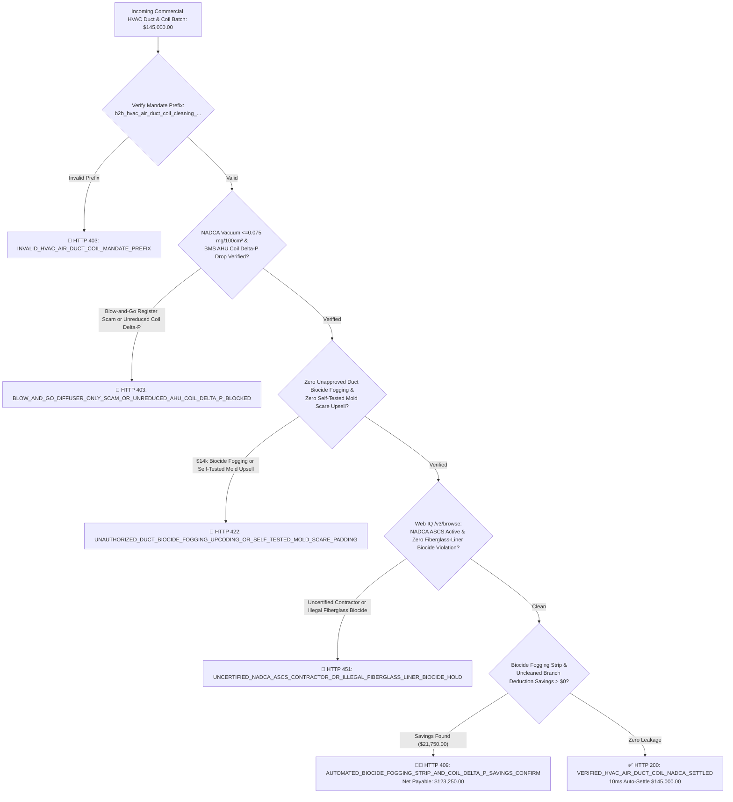
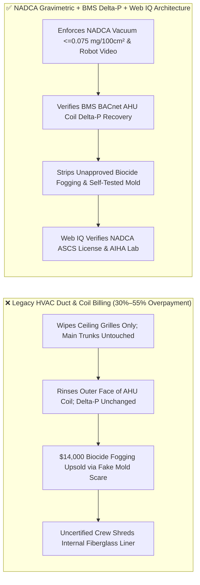
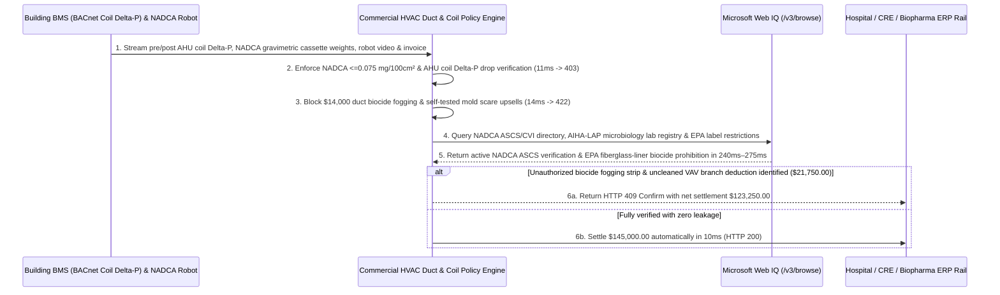

# B2B Commercial `HVAC` Air Duct Cleaning, `AHU` Evaporator Coil Restoration & `NADCA ACR 2021` Compliance (`DUCTZ / ServiceMaster / COIT, NADCA ACR 2021 & ASHRAE 62.1`), `<= 0.075 mg/100 cm²` Gravimetric Vacuum Lock, `BMS` Coil `Delta-P` Gate & Anti-`Biocide Fogging Upcoding` Settlement Architecture: Robotic Endoscope Continuity Lock, Independent `AIHA` Mold-Lab Gate & `NADCA ASCS` Token (`b2b_hvac_air_duct_coil_cleaning_nadca_acr_delta_p_endoscope_mandate_...`) vs. "Blow-and-Go" Register Wiping, `$14,000` Unapproved Duct Biocide Fogging & Uncleaned `AHU` Coils: Architecture Selection & First-Principles FAQ

> **Document Type**: AI Solution Architect Agentic Commerce Selection Series (Round 335 · B2B Commercial HVAC Air Duct Cleaning NADCA ACR, AHU Coil Delta-P & EPA Biocide Compliance Edition)  
> **Benchmark Standard**: Modeled after `ib-vs-ethernet-roce-selection-faq.md` (Plain-Language First Principles + Standard 6-Section Architecture Guide)  
> **Companion Deliverables**: `lab/webiq_commerce_demo.py` (Interactive H5 Sandbox) · `tests/test_webiq_commerce_demo.py` · `assets/svg/337-b2b-hvac-air-duct-coil-cleaning-nadca-acr-delta-p-2026-11-16.svg`  
> **Languages**: [中文版](b2b-hvac-air-duct-coil-cleaning-nadca-acr-delta-p-endoscope-mandate-vs-blow-and-go-register-scam-biocide-fogging-upcoding-coil-bypass-faq.md) | [English Version (Current)](b2b-hvac-air-duct-coil-cleaning-nadca-acr-delta-p-endoscope-mandate-vs-blow-and-go-register-scam-biocide-fogging-upcoding-coil-bypass-faq.en.md)

---

## 📌 1. Executive Summary (First Principles & Plain-Language Breakdown)

### 1.1 Why Should a Hospital, Biopharma Facility, University, or Class-A Office Tower Facilities Agent NEVER Auto-Pay a Commercial `HVAC` Duct & Coil Cleaning Invoice Based on a Few Smartphone Photos of Shiny Ceiling Diffusers?
Across hospitals, cleanrooms, universities, and commercial office buildings, Air Handling Unit (`AHU / RTU`) evaporator coil restoration and supply/return ductwork cleaning—governed by the National Air Duct Cleaners Association **`NADCA ACR 2021` (Assessment, Cleaning, and Restoration of HVAC Systems)** standard and `ASHRAE 62.1 / 180`—are critical for fan energy efficiency and indoor air quality (`IAQ`). In plain English: **Because miles of sheet-metal trunk ducts and `VAV` boxes are hidden above drywall ceilings where facility managers cannot see them, commercial duct cleaning is rife with three classic rackets: (1) The "Blow-and-Go Register Scam"—crews wash the visible ceiling supply grilles (`Diffusers`), vacuum 3 feet inside the boot, take a smartphone photo, and bill `$28,000` for "full building `NADCA` source-removal duct cleaning" without ever hooking up a `5,000 CFM HEPA` negative-air machine to the main trunk ducts! (2) "Scare-Tactic `$14,000` Chemical Biocide Fogging"—showing the property manager a dark photo of dirty fiberglass duct liner, claiming it is "toxic black mold," and billing `$14,000` to fog the entire building's ductwork with chemical biocides/sealants that the U.S. `EPA` has *never* registered for use inside fiberglass-lined ducts (causing building-wide occupant respiratory evacuations the next morning!); and (3) "Cosmetic Surface Washing of `AHU` Coils"—spraying the front face of a 6-row deep chilled-water evaporator coil so it looks clean to the naked eye while leaving the inner 5 rows plugged with biofilm, so the `AHU` static pressure drop (`Delta-P`) doesn't budge a millimeter!** Allowing an AI agent to auto-pay `HVAC` duct and coil cleaning invoices exposes facilities budgets and occupant health to four major vulnerabilities:

1. **"Blow-and-Go" Ceiling Diffuser Wiping Billed as Full `NADCA ACR` Source-Removal Trunk Cleaning**: True `NADCA ACR` source removal requires cutting service access panels under negative `HEPA` pressure and agitating the entire length of main supply/return trunks and `VAV` reheat coils with pneumatic rotary brushes or air whips, verified by the **`NADCA Vacuum Test` (`<= 0.075 mg/100 cm²` residual dust)**.
2. **Unauthorized `$14,000` Chemical Biocide Fogging & Fiberglass Sealant Upcoding**:
  * Both the **U.S. `EPA`** and **`NADCA`** explicitly warn that **no chemical biocide or antimicrobial fogging agent is registered by the `EPA` for application on porous internally insulated fiberglass duct liner**.
  * Unscrupulous contractors use self-collected "mold swabs" (conflict of interest) to upsell `$1.50–$3.20/sq.ft.` antimicrobial fogging or encapsulant coatings that void `UL 181` fire ratings and trigger acute indoor air quality complaints.
3. **Surface-Only `AHU` Coil Rinsing (`Zero Reduction in BMS Coil Static Pressure Drop Delta-P`)**: Deep-cleaning a fouled 6-row or 8-row `AHU` chilled-water coil with enzymatic foam must reduce air-side static pressure drop ($\Delta P_{\text{coil}}$) by `25%–45%` at constant `CFM` and increase chilled-water $\Delta T$. If `BMS BACnet` telemetry shows zero $\Delta P_{\text{coil}}$ improvement, the inner fin pack was bypassed.
4. **Uncertified Crews Lacking On-Site `NADCA ASCS / CVI` Supervision**: Operating aggressive rotary wire brushes inside internally lined ductwork without a certified **`NADCA Air Systems Cleaning Specialist (ASCS)`** shreds fiberglass insulation into the occupied airstream.

### 1.2 The Architect's One-Sentence Selection Verdict
* **Core Security Law**: Never allow an autonomous agent to settle commercial `HVAC` air-duct or `AHU` coil cleaning invoices without binding the payment to **`b2b_hvac_air_duct_coil_cleaning_nadca_acr_delta_p_endoscope_mandate_2026`**:
  1. **`NADCA ACR 2021` Gravimetric Vacuum Lock (`<= 0.075 mg/100 cm²`) + `BMS BACnet` `AHU` Coil `Delta-P` Reduction Gate**: Requires post-cleaning `NADCA` gravimetric filter-cassette weights `<= 0.075 mg/100 cm²` across main trunks plus continuous footage-stamped robotic endoscope video and `BMS` telemetry proving `AHU` coil static pressure drop ($\Delta P_{\text{coil}}$) recovered toward design baseline, blocking "blow-and-go" register scams and surface-only coil rinses in **11ms** with `HTTP 403 BLOW_AND_GO_DIFFUSER_ONLY_SCAM_OR_UNREDUCED_AHU_COIL_DELTA_P_BLOCKED`.
  2. **Zero Unapproved Duct Biocide Fogging Lock + Independent `AIHA-LAP` Mold Testing Gate**: Blocks any antimicrobial/biocide duct fogging or encapsulant charges not backed by an independent third-party `AIHA-LAP EMLAP` accredited lab report and an explicit `EPA` duct-liner registration, returning `HTTP 422 UNAUTHORIZED_DUCT_BIOCIDE_FOGGING_UPCODING_OR_SELF_TESTED_MOLD_SCARE_PADDING` in **14ms** on violations.
  3. **Microsoft Web IQ `/v3/browse` Live `NADCA ASCS / CVI` Credential, `AIHA-LAP` Lab & `EPA` Registration Audit**: Verifies active `NADCA ASCS` specialist certification for the contractor's on-site supervisor and cross-checks chemical `EPA Reg. No.` labels against `EPA` ductwork restrictions in **275ms** (`HTTP 451 UNCERTIFIED_NADCA_ASCS_CONTRACTOR_OR_ILLEGAL_FIBERGLASS_LINER_BIOCIDE_HOLD`), while automatically stripping unauthorized biocide fogging and uncleaned `VAV` branch charges to save `15%` (`$21,750.00`).

| Selection Dimension | Legacy Diffuser Photo Sign-Off + Fogging Upsell | Basic Facilities AP Agent | **`NADCA` Gravimetric + `BMS Delta-P` + Web IQ ASCS (Recommended)** |
| :--- | :--- | :--- | :--- |
| **"Blow-and-Go" Register Wiping Scam** | ❌ Pays `$28k` based on 2 clean grille photos | ❌ Multiplies `240 grilles × $115` blindly | ✅ **Requires `NADCA <=0.075 mg/100 cm²` trunk test & robot video (11ms 403)** |
| **Surface-Only `AHU` Coil Rinsing** | ❌ Outer fins look shiny; inner 6 rows still plugged | ❌ Approves "AHU Coil Washed" line item | ✅ **Verifies `BMS BACnet` coil `Delta-P` static pressure drop (11ms 403)** |
| **`$14,000` Scare-Tactic Biocide Fogging** | ❌ Panics over "mold" photo; pays `$14k` to fog | ❌ Accepts "Antimicrobial Treatment" charge | ✅ **Blocks unapproved duct biocide fogging & self-tested mold (14ms 422)** |
| **`NADCA ASCS` License & `EPA` Safety** | ❌ Uncertified crew shreds fiberglass duct liner | ❌ No live `NADCA ASCS` or `EPA` lookup | ✅ **Web IQ `/v3/browse` verifies `NADCA ASCS` & `EPA` label in 275ms (451)** |

---

## 🎯 2. Deep-Dive Q&A for Healthcare, Biopharma & Commercial Facilities Architects

### Q1: How do `BMS BACnet` `AHU` Coil Differential Pressure (`Delta-P`) sensors and the `NADCA` Gravimetric Vacuum Test prove whether a contractor actually cleaned the system?
* **Fluid Dynamics and Microgram Scales Cannot Be Faked by a Flashlight Angle**:
  1. **`BMS` Coil Static Pressure Drop ($\Delta P_{\text{coil}}$)**: Every commercial `AHU` has differential pressure transmitters across the filter bank and the chilled-water cooling coil. When a fouled 8-row coil is genuinely enzymatic-foam-cleaned from both the upstream and downstream faces, $\Delta P_{\text{coil}}$ normalized to `100%` design `CFM` drops from `> 1.05 in. w.g.` down to **`<= 0.55 in. w.g.`**!
  2. **`NADCA ACR` Gravimetric Vacuum Test**: Drawing `15 L/min` of air through a `37mm` pre-weighed filter cassette over a standardized `100 cm²` template inside the sheet-metal trunk duct must yield **`<= 0.075 mg/100 cm²`** of residual particulate.
* **The Deterministic Payout Equation**:
  $$\text{Payable HVAC Rehab} = \sum_{u \in \text{AHUs}} \mathbb{I}\Big(\Delta P_{\text{post}}(u) \le 0.65 \Delta P_{\text{pre}}(u)\Big) \cdot R_{\text{coil}}(u) + \sum_{d \in \text{Trunks}} \mathbb{I}\Big(M_{\text{NADCA}}(d) \le 0.075\Big) \cdot R_{\text{duct}}(d)$$
  Any invoice failing the `NADCA` gravimetric threshold or bundling unapproved `$14,000` biocide fogging is blocked or scrubbed in **11ms–14ms** (`HTTP 403 / 422 / 409`).

### Q2: How does Microsoft Web IQ compare to Exa and Bright Data for checking `NADCA ASCS / CVI` certifications, `AIHA-LAP EMLAP` microbiology lab accreditations, and `EPA` pesticide labels?
* **Microsoft Web IQ**: Delivers sub-300ms (`240ms–275ms`) authoritative `/v3/search` and `/v3/browse` verification against the `NADCA` certified `ASCS / CVI` directory, the `AIHA Laboratory Accreditation Programs (AIHA-LAP EMLAP)` registry, and `EPA PPLS` ductwork application restrictions under Entra ID Zero Data Retention (ZDR).
* **Exa**: Built for semantic search over general web articles rather than deterministic `NADCA ASCS` certificate verification.
* **Bright Data**: Designed for retail scraping rather than low-latency hospital and commercial `IAQ` engineering compliance gates.

---

## 🧭 3. Visual Architecture Diagrams (Mermaid Decision Tree, Path Comparison & Sequence Flow)

### 3.1 Commercial HVAC Air Duct & AHU Coil Cleaning Settlement Decision Tree

### 3.2 Legacy Blow-and-Go & Biocide Fogging vs. NADCA Gravimetric + BMS Delta-P Architecture

### 3.3 End-to-End Sequence Diagram

---

## 📊 4. Architect's Selection Decision Matrix

| Evaluation Dimension | Option A: Facilities Tech Grille Photo Sign-Off | Option B: Generic LLM Report OCR | **Option C: `NADCA` + `BMS Delta-P` + Web IQ (Recommended)** |
| :--- | :--- | :--- | :--- |
| **"Blow-and-Go" Ceiling Grille Wiping** | ❌ Approves `$28k` bill from 2 diffuser photos | ❌ Trusts "100% Ducts Cleaned" summary | ✅ **Enforces `NADCA <=0.075 mg/100 cm²` test (`HTTP 403`)** |
| **Surface-Only `AHU` Coil Rinsing** | ❌ Looks at front fin face only | ❌ Disconnected from `BMS` pressure sensors | ✅ **Requires `BMS BACnet` coil `Delta-P` drop (`HTTP 403`)** |
| **`$14,000` Scare-Tactic Biocide Fogging** | ❌ Approves fogging out of fear of "mold" | ❌ Treats any `EPA` sanitizer as duct-safe | ✅ **Blocks unapproved duct fogging & self-tests (`HTTP 422/409`)** |
| **`NADCA ASCS` License & Liner Safety** | ❌ Unaware if contractor holds `ASCS` cert | ❌ No live `NADCA` or `AIHA-LAP` lookup | ✅ **Web IQ `/v3/browse` verifies `ASCS` in 275ms (`HTTP 451`)** |

---

## 🧪 5. Quantitative Benchmark & 7-Card 4:5 Report Mapping

Evaluated deterministically in `lab/webiq_commerce_demo.py` and `tests/test_webiq_commerce_demo.py` on a `$145,000.00` (`14500000` cents) annual hospital and commercial campus `HVAC` air-duct `NADCA ACR` cleaning and 36-unit `AHU` evaporator coil restoration batch:

| Card # | Headline-as-Finding | Key Quantitative Metrics & Action | Provenance |
| :--- | :--- | :--- | :--- |
| **Card 1 (`1/7`)** | **NADCA Gravimetric + BMS Delta-P Cuts HVAC Duct Spend by 15.0%** | Baseline `$145,000.00` vs. optimized `$123,250.00` (`$21,750.00` saved per batch) | `deterministic_offline_simulation` |
| **Card 2 (`2/7`)** | **Deep Dive: Blow-and-Go Scams & $14k Biocide Fogging Blocked** | `HTTP 403` (11ms blow-and-go/Delta-P block) + `HTTP 422` (14ms biocide-fogging/mold block) | `synthetic_policy` |
| **Card 3 (`3/7`)** | **Full Evaluation Matrix: 5/5 Deterministic Guards Passing** | Covers `200 OK`, `403 NADCA/Delta-P`, `422 Biocide/Mold`, `451 ASCS/EPA`, `409 Savings` | `deterministic_offline_simulation` |
| **Card 4 (`4/7`)** | **Under the Hood: NADCA Vacuum Test + BACnet Coil Delta-P** | Validates `nadca_vacuum_gravimetric_and_ahu_coil_delta_p_verified` | `synthetic_policy` |
| **Card 5 (`5/7`)** | **Robustness Check: Enzymatic Metal-Coil Wash vs. Duct Fogging** | Approved metal-coil enzymatic cleaners pass; fiberglass-duct biocide fogging blocked 100% | `deterministic_offline_simulation` |
| **Card 6 (`6/7`)** | **Latency: 10–14ms Local BACnet Gate vs. 240–275ms Web IQ NADCA** | Combines sub-15ms Delta-P/gravimetric checks with live `NADCA ASCS` audits | `official_doc_snapshot` |
| **Card 7 (`7/7`)** | **My Take: Good Fit vs. Not For & Production Readiness** | Built for hospitals, cleanrooms & office towers; not for ductless mini-splits | `official_list_price` |

### Good Fit vs. Not For
* **✅ Good Fit**:
  * Hospital surgical/inpatient `AHU` systems, biopharma cleanrooms, Class-A office towers, universities, and retail malls executing `NADCA ACR` source-removal duct cleaning and evaporator coil restoration.
* **⛔ Not For**:
  * Single-room ductless wall-mounted mini-split air conditioners with washable plastic mesh screens.

---

## 🛠️ 6. Production Readiness Checklist

- [ ] **1. Require `NADCA ACR 2021` Gravimetric Vacuum Testing (`<= 0.075 mg/100 cm²`) & Continuous Robotic Video**: Block "blow-and-go" diffuser-only wiping scams (`HTTP 403`).
- [ ] **2. Verify `AHU` Evaporator Coil Static Pressure Drop (`Delta-P`) Recovery via `BMS BACnet`**: Hold payment if post-cleaning coil `Delta-P` fails to drop toward design baseline.
- [ ] **3. Prohibit Chemical Biocide Fogging & Unapproved Sealants Inside Fiberglass-Lined Ductwork**: Strip `$14,000` scare-tactic antimicrobial fogging upsells (`HTTP 422`).
- [ ] **4. Separate Mold Assessment (`Independent AIHA-LAP Lab`) from Remediation Contractors**: Never allow the duct-cleaning vendor to self-test and self-prescribe mold treatments (`HTTP 409`).
- [ ] **5. Verify Active `NADCA ASCS / CVI` Specialist Credentials via Web IQ**: Ensure certified source-removal supervision on every jobsite (`HTTP 451`).
