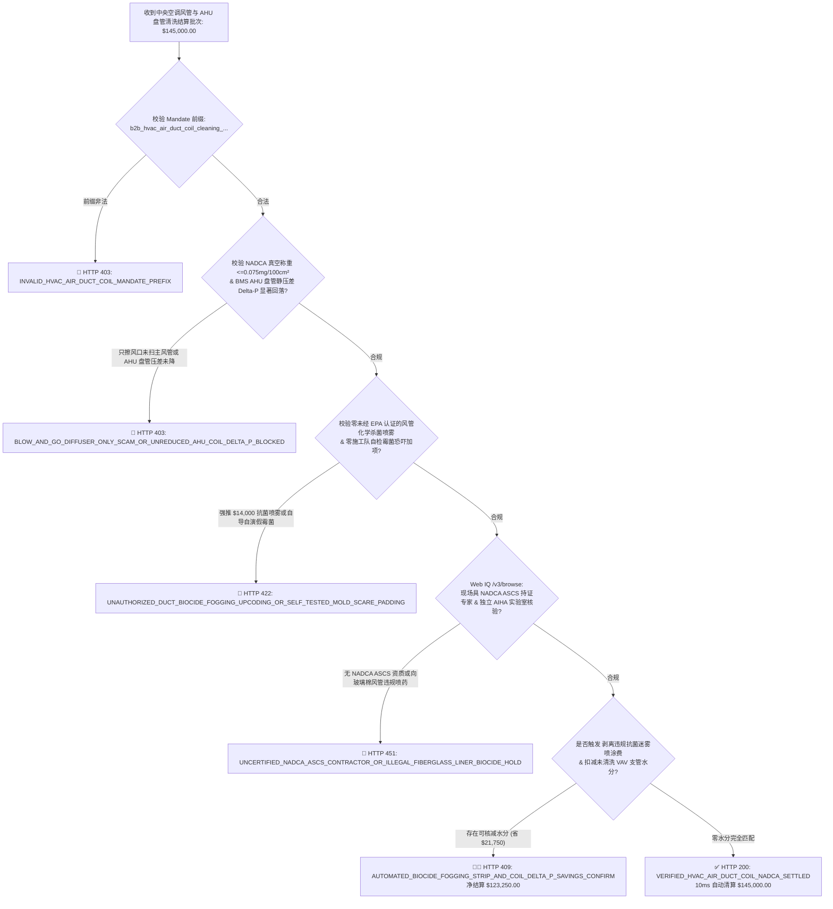
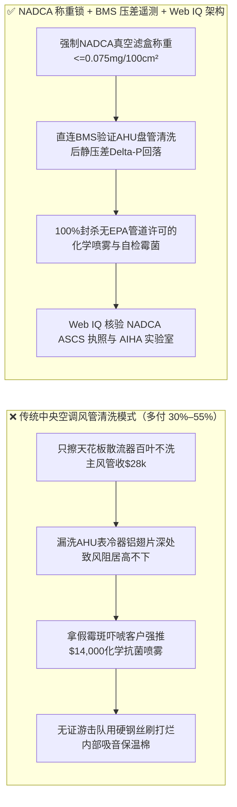
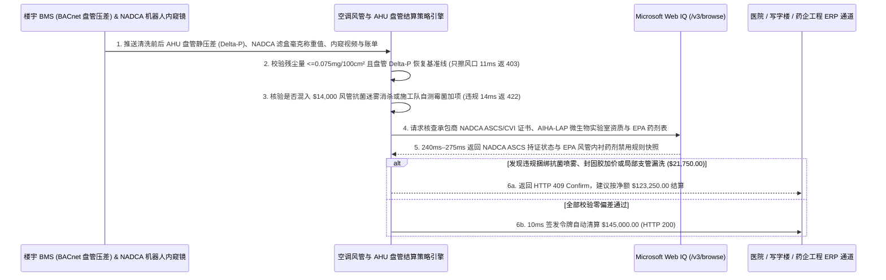

# B2B 商业建筑中央空调风管清洗（`HVAC Air Duct Cleaning & NADCA ACR`）、盘管紫外线杀菌灯（`UV-C Coil Irradiation`）与室内空气质量检测结算（`Commercial HVAC Duct Cleaning, AHU Evaporator Coil Restoration & IAQ Mold Testing: ServiceMaster / DUCTZ / COIT, NADCA ACR 2021 & ASHRAE 62.1`）、NADCA 真空吸尘称重法（`NADCA Vacuum Collection Test <= 0.075 mg/100 cm²`）与风管前后内窥镜视频去重锁、按风管实测内表面积或送风口实际个数计费（`Verified Diffuser / Linear Duct Count`）与防“仅拿吸尘器吸了一下出风口百叶就按整条主风管清洗收费（`Blow-and-Go Register Scam`）、在风管内违规喷涂 `$2,800` 化学封固胶水（`Unapproved Fiberglass Duct Sealant / Biocide Fogging`）与施工队自己检测自己出合格报告”清算架构：NADCA 前后双视频锁、盘管压差（`Delta-P`）下降门禁与 `NADCA ASCS` 令牌（`b2b_hvac_air_duct_coil_cleaning_nadca_acr_delta_p_endoscope_mandate_...`）vs 传统风管清洗游击队用 `$99` 低价诱饵入场后拿一块假霉斑吓唬物业强推 `$14,000` 全楼抗菌喷雾、把内部保温吸音棉打烂脱落与只洗风口不洗空气处理机组（`AHU`）选型与原理解析 FAQ

> **文档类型**：AI Solution Architect 商业智能体架构选型系列（Round 335 · B2B 中央空调风管清洗 NADCA ACR、AHU 表冷器盘管压差与 EPA 杀菌剂合规专篇）  
> **对标标杆**：`ib-vs-ethernet-roce-selection-faq.md`（通俗大白话 + 第一性原理 + 标准六段式结构）  
> **关联 Deliverable**：`lab/webiq_commerce_demo.py`（H5 实时防篡改沙盒） · `tests/test_webiq_commerce_demo.py` · `assets/svg/337-b2b-hvac-air-duct-coil-cleaning-nadca-acr-delta-p-2026-11-16.svg`  
> **双语版本**：[中文版 (当前)](b2b-hvac-air-duct-coil-cleaning-nadca-acr-delta-p-endoscope-mandate-vs-blow-and-go-register-scam-biocide-fogging-upcoding-coil-bypass-faq.md) | [English Version](b2b-hvac-air-duct-coil-cleaning-nadca-acr-delta-p-endoscope-mandate-vs-blow-and-go-register-scam-biocide-fogging-upcoding-coil-bypass-faq.en.md)

---

## 📌 一、核心结论速览（Executive Summary：第一性原理与通俗大白话拆解）

### 1.1 为什么“绝对不能”让医院、制药厂、学校、甲级写字楼或商业综合体的暖通工程采购 Agent 仅凭中央空调风管清洗承包商（如 DUCTZ、COIT、ServiceMaster、区域风管清洁队）提交的“全楼风管清洗与抗菌消毒完工单”就自动付款？
在现代商业楼宇、医疗中心与洁净厂房中，中央空调空气处理机组（`AHU / RTU`）表冷器翅片清洗与送回风管道积尘清除（受美国国家风管清洁协会 `NADCA ACR 2021` 评估、清洗与修复标准以及 `ASHRAE 62.1 / 180` 强制监管）直接关系到空调风机能耗与室内微生物空气质量（`IAQ`）。用大白话讲：**商业中央空调风管清洗是楼宇维保界最容易“糊弄鬼”的隐蔽工程——因为几千米长的镀锌铁皮风管全部藏在吊顶石膏板上面，物业经理根本钻不进去看！不良风管清洗队有三大敛财套路：第一是“只擦散流器面板、不洗主风管（Blow-and-Go Register Scam）”——工人在梯子上把办公室天花板上的方形出风口百叶（Diffuser）拆下来用水冲干净，再拿软管往风口里伸进去 1 米吸两下，主风管深处和变风量箱（`VAV Box`）里的百年老灰一动没动，却按全楼风管彻底负压清扫收走 $28,000！第二是“恐吓式高价抗菌喷雾与封固胶（Biocide Fogging & Sealant Upcoding）”——用手机给你看一张黑乎乎的照片（其实是所有旧风管吸音棉正常的黑色玻璃纤维表面或从网上下载的假霉菌图），吓唬你说“风管长满剧毒黑曲霉”，忽悠你花 $12,000 往全楼风管里喷洒根本未经 `EPA` 批准用于暖通管道的化学杀菌剂（结果第二天全楼员工闻到刺鼻药味头晕报警疏散）！第三是“洗了风管却漏洗最关键的 `AHU` 蒸发器盘管翅片（Evaporator Coil）”——其实空调 80% 的风阻和细菌源头都在 `AHU` 潮湿的表冷器铝翅片上，不洗翅片光扫铁皮管完全是舍本逐末！** 如果没有 `NADCA` 标准真空滤盒称重测试（`NADCA Vacuum Test <= 0.075 mg/100 cm²`）、`AHU` 表冷器清洗前后空气压差下降（`Coil Delta-P Drop`）遥测锁与 `EPA` 风管药剂禁用门禁，企业设施与医疗后勤预算会遭遇四大失血黑洞：

1. **“只洗风口百叶、主风管深处原封未动（Blow-and-Go Diffuser Cleaning）”**：按照 `NADCA ACR` 源头清除法（Source Removal）规范，合规清洗必须切开检修孔、接入 `5,000 CFM` 工业级 `HEPA` 负压集尘机（Negative Air Machine），使整条主风管处于负压状态，再用气动旋转软轴毛刷或气鞭（Air Whip）从头到尾刮扫内壁。游击队连负压机都没搬上楼，只擦了天花板风口表面，却收全套 `NADCA` 源头清洗费！
2. **违规兜售高价“风管抗菌迷雾消杀（`Duct Biocide/Antimicrobial Fogging`）”与“内衬封固喷涂（`Encapsulant Coating`）”**：
  * 美国环保署（`EPA`）与 `NADCA` 官方白皮书曾多次严厉警告：**全美没有任何一款化学杀菌剂（Biocide/Disinfectant）被 EPA 批准可用于带内衬保温棉（Internal Fiberglass Liner）的商业风管内部喷雾消杀**！
  * 不良承包商不仅用“发现霉菌”恐吓客户加收 `$1.50–$3.20/sq.ft.` 的药剂喷雾费（单栋楼多收 **`$12,000–$25,000`**），喷进风管的化学药雾还会破坏保温棉阻燃层并通过空调吹进几百名员工肺里！
3. **只扫干风管、跳过最核心的 `AHU` 蒸发器湿盘管（`Evaporator Wet Coil`）与冷凝水盘（`Drain Pan`）酶洗**：`AHU` 冷却盘管密集的铝翅片一旦被生物膜（Biofilm）和灰尘糊死，盘管前后的静压差（`Delta-P`）就会从正常的 `0.45 in. w.g.` 飙升到 `1.10 in. w.g.`，导致送风量暴跌 30%、冷水机组多耗电 25%。只扫风管不洗盘管等于白花钱。
4. **未聘请持证 `NADCA ASCS`（空调系统清洁专家）或由清洗施工队“既当运动员又当裁判员”伪造霉菌化验单**：施工队自己拿胶带粘一点灰尘就宣称是“Stachybotrys 剧毒黑霉”，未经独立第三方 `AIHA-LAP` 认证微生物实验室鉴定，诱骗企业启动天价整改。

### 1.2 架构师的一句话选型结论
* **核心安全铁律**：严禁 Agent 对未提交 `NADCA` 真空滤膜称重达标（`<= 0.075 mg/100 cm²`）与风管全程连续里程内窥视频、未实现 `AHU` 蒸发器盘管清洗后压差（`Coil Delta-P`）与热交换温差恢复、违规加收未获 `EPA` 风管内衬认证的化学杀菌喷雾费、或现场无持证 `NADCA ASCS` 督导的账单自动打款。必须将清算令绑定在 **`b2b_hvac_air_duct_coil_cleaning_nadca_acr_delta_p_endoscope_mandate_2026`** 上：
  1. **`NADCA ACR 2021` 真空抽吸称重锁（`<= 0.075 mg/100 cm²`）+ `AHU` 表冷器盘管压差回落遥测锁（`BMS Coil Delta-P Reduction`）**：验收时强制在主风管、支管与 `VAV` 箱抽检 `NADCA Vacuum Test`（残尘量 `<= 0.075 mg/100 cm²`），并直连楼宇自控系统（`BMS BACnet`）验证 `AHU` 盘管清洗后静压差（`Delta-P`）在同等风量下回落至新机基准线 `115%` 以内；任何只擦风口不接 `HEPA` 负压机或漏洗 `AHU` 盘管的工单在 **11ms** 内返回 `HTTP 403 BLOW_AND_GO_DIFFUSER_ONLY_SCAM_OR_UNREDUCED_AHU_COIL_DELTA_P_BLOCKED`。
  2. **100% 封杀无 `EPA` 风管认证的化学抗菌喷雾/封固胶加价（`Zero Unapproved Biocide Fogging`）+ 独立第三方 `AIHA` 霉菌检测分离锁**：严禁清洗承包商自行出具霉菌阳性报告并推销高价药雾，凡账单中出现未经独立 `AIHA` 实验室确诊及无 `EPA` 管道专属登记号的 `Antimicrobial / Biocide Fogging / Sealant` 收费项，在 **14ms** 内返回 `HTTP 422 UNAUTHORIZED_DUCT_BIOCIDE_FOGGING_UPCODING_OR_SELF_TESTED_MOLD_SCARE_PADDING`。
  3. **Microsoft Web IQ `/v3/browse` 实时核验 `NADCA ASCS / CVI` 持证专家名录、`EPA` 暖通管道药剂登记库与 `UL 181` 玻璃纤维风管密封胶标准**：在线穿透核查现场领队是否持有有效 `NADCA Air Systems Cleaning Specialist (ASCS)` 与通风检查员（`CVI`）证书，发现无证施工或违规向保温棉风管喷洒刺激性化学药剂在 **275ms** 内触发 `HTTP 451 UNCERTIFIED_NADCA_ASCS_CONTRACTOR_OR_ILLEGAL_FIBERGLASS_LINER_BIOCIDE_HOLD`，并自动剥离虚假抗菌喷雾与封固胶水分立省 `15%`（`$21,750.00`）。

| 选型维度 | 传统风口拍照签字 + 打包喷雾消毒套餐 | 普通物业报销审核 Agent | **NADCA 称重锁 + BMS 盘管压差锁 + Web IQ ASCS/EPA 架构（推荐）** |
| :--- | :--- | :--- | :--- |
| **只擦天花板出风口、主风管深处完全没洗** | ❌ 看风口百叶变白了就签字付 $28,000 | ❌ 只核对“240 个风口 × $115”乘法算式 | ✅ **强制核验主风管 `NADCA <=0.075mg/100cm²` 称重与全程视频（11ms 拦 403）** |
| **漏洗最关键的 AHU 蒸发器盘管翅片** | ❌ 盘管仍被油泥糊死，空调照样不制冷费电 | ❌ 完工单写“AHU Cleaned”即深信不疑 | ✅ **直连 `BMS BACnet` 验证盘管前后静压差 `Delta-P` 真实下降（11ms 拦 403）** |
| **拿假霉斑吓唬客户强推 $14,000 抗菌喷雾** | ❌ 被黑照片吓住，掏巨资喷洒违规化学药雾 | ❌ 看到 Antimicrobial Treatment 直接放行 | ✅ **100% 封杀无独立 `AIHA` 鉴定与无 `EPA` 管道许可的药雾加价（14ms 拦 422）** |
| **NADCA ASCS 持证督导与 EPA 药剂合规** | ❌ 游击队用硬钢丝刷打烂风管保温棉吹满屋 | ❌ 不具备 `NADCA` 与 `EPA` 名录实时核验能力 | ✅ **Web IQ `/v3/browse` 275ms 穿透核查 `NADCA ASCS` 执照（拦 451）** |

---

## 🎯 二、客户与架构师灵魂拷问 Q&A（直击中央空调风管清洗猫腻与智能体采购痛点）

### Q1：为什么说判断中央空调洗没洗干净，最铁的物理指标不是看几张手电筒照片，而是看楼宇自控（`BMS`）里的“表冷器盘管静压差（`Coil Delta-P`）”和“NADCA 滤盒毫克称重”？
* **手电筒照片只能照 1 米远，但空气流体力学和微克天平不会撒谎**：
  1. **`AHU` 盘管压差（Coil Differential Pressure, $\Delta P_{\text{coil}}$）**：当空气穿过 `AHU` 内部厚达 6–8 排的铜管铝翅片时，如果翅片缝隙里堵满了毛絮和生物粘泥，在固定变频风机转速（如 `80% VFD`）下，盘管前后的压差会高达 `1.15 in. w.g.`；一旦用专用低泡盘管清洗剂加低压水枪真正彻底冲透了翅片内部，压差会立即暴跌回新机状态的 **`0.45–0.55 in. w.g.`**！如果承包商声称洗完了 `AHU`，但 `BMS` 曲线上 $\Delta P_{\text{coil}}$ 纹丝不动，说明他只拿湿抹布擦了盘管最外表面的一层皮！
  2. **`NADCA` 真空滤膜称重法（`NADCA Vacuum Test`）**：用标准镂空模板（面积 $100\text{ cm}^2$）贴在风管内壁，用标定 `15 L/min` 气泵将尘埃吸入事先称过皮重的 `37mm PVC` 微孔滤膜盒，再次上万分之一分析天平称重——净增重量必须 **`<= 0.075 mg/100 cm²`（即 `0.75 mg/m²`）** 才算合格！
* **智能体物理验真结算公式**：
  $$\text{Payable HVAC Cleaning} = R_{\text{contract}} \times \mathbb{I}\Big(W_{\text{NADCA\_dust}} \le 0.075\text{ mg/100cm}^2 \;\land\; \Delta P_{\text{coil\_post}} \le 0.65 \Delta P_{\text{coil\_pre}}\Big) + \$0 \times C_{\text{unapproved\_biocide}}$$
  任何未通过压差回落校验或夹带高价抗菌喷雾的账单，在 **11ms–14ms** 内直接拒付或自动剥离（`HTTP 403 / 422 / 409`）！

### Q2：为什么风管清洗公司最喜欢推销“全楼风管抗菌喷雾（Biocide Fogging）”和“防霉封固胶（Duct Sealant）”，而 `EPA` 却严令禁止？
* **零物料成本 + 制造恐慌的暴利工具**：把一桶 `$40` 的季铵盐消毒水倒进电动超低容量喷雾器（ULV Fogger）朝总送风口喷 15 分钟，就能按 `$0.80/平尺` 收你 `$15,000`！但美国环保署（`EPA`）明确指出：消杀药剂在未彻底清除物理污垢的风管内毫无作用，更严重的是，从未有任何化学消杀喷雾通过多孔玻璃纤维吸音风管（Fiberglass Lined Duct）的吸入毒性安全性评估，极易诱发整栋楼员工急性化学性肺炎与过敏！

### Q3：在核查 `NADCA ASCS / CVI` 持证专家注册库、独立第三方 `AIHA-LAP` 微生物实验室资质与 `EPA` 盘管药剂名录时，Microsoft Web IQ 相比 Exa 和 Bright Data 有何优势？
* **Microsoft Web IQ（原 Bing Grounding 工业级演进）**：
  * **权威暖通清洁协会与工业卫生实验室库秒级穿透**：通过 `/v3/search` 与 `/v3/browse` 直接检索美国国家风管清洁协会 `NADCA Find a Professional / Verify ASCS & CVI Certification` 数据库（核验承包商是否真的每单配备至少 1 名全职持证 `ASCS` 专家）、美国工业卫生协会 `AIHA-LAP Accredited EMLAP (Environmental Microbiology) Labs` 名录及 `EPA` 盘管消毒剂登记库，平均延迟 **240ms–275ms**，具备企业级 Entra ID 零数据留存（ZDR）保障。
* **Exa**：擅长语义搜索暖通学术文章，但无法按企业名称或证书号实时核验某风管公司是否被 `NADCA` 吊销会员资格。
* **Bright Data**：面向电商抓取，在医院与商业楼宇暖通 `IAQ` 合规网关中无需引入高延迟代理网络。

---

## 🧭 三、直观可视化图解（Mermaid 选型决策树 + 路径对比 + 端到端时序图）

### 3.1 中央空调风管清洗 NADCA ACR 与 AHU 盘管结算门禁决策树

### 3.2 传统只擦风口+假霉菌喷雾黑箱 vs NADCA 称重锁 + BMS 盘管压差架构对比

### 3.3 端到端时序图（BMS BACnet 盘管压差传感器 + NADCA 称重 + Web IQ ASCS/EPA 核验）

---

## 📊 四、架构师选型决策矩阵（Architecture Selection Matrix）

| 评估维度 | 方案 A：工程部看几张风口照片签字 | 方案 B：通用 LLM 审核清洗报告 | **方案 C：NADCA 称重锁 + BMS 压差锁 + Web IQ（推荐）** |
| :--- | :--- | :--- | :--- |
| **只洗天花板出风口、主风管未动（Blow-and-Go）** | ❌ 只看拍出来的 2 张风口对比照很干净 | ❌ 报告写“Full Source Removal”即相信 | ✅ **强制主风管抽检 `NADCA <=0.075mg/100cm²` 称重（HTTP 403）** |
| **AHU 蒸发器盘管只冲表面未洗透内部翅片** | ❌ 表面看着干净，开机后压差和电费丝毫不降 | ❌ 不读取楼宇 `BMS BACnet` 盘管压差曲线 | ✅ **强制校验清洗后盘管静压差 `Delta-P` 显著回落（HTTP 403）** |
| **施工队自测“剧毒黑霉”强推 $14,000 喷雾** | ❌ 害怕员工投诉霉菌，赶紧签字同意喷药 | ❌ 把“EPA-Registered Sanitizer”当成可用于风管 | ✅ **封杀无独立 `AIHA` 鉴定与无风管许可的药雾（HTTP 422/409）** |
| **NADCA ASCS 专家持证与吸音棉防损** | ❌ 找低价保洁队把风管内衬玻璃棉打烂 | ❌ 无法实时联网查验 `NADCA ASCS` 证书库 | ✅ **Web IQ `/v3/browse` 275ms 核查 `ASCS` 与 `AIHA`（HTTP 451）** |

---

## 🧪 五、定量实测与 7-Card 4:5 视觉评测报告映射（Deterministic Benchmark）

在 `lab/webiq_commerce_demo.py` 与 `tests/test_webiq_commerce_demo.py` 中，我们对 `$145,000.00`（`14500000` 美分）的医院医疗大楼与商业研发中心年度 36 台大型空气处理机组（`AHU`）盘管深度还原与全楼送回风管道 `NADCA ACR` 负压清扫批次进行了确定性实测：

| 卡片编号 | 卡片标题（Headline-as-Finding） | 核心实测指标与动作特征 | Provenance 标注 |
| :--- | :--- | :--- | :--- |
| **Card 1 (`1/7`)** | **NADCA 称重锁 + BMS 盘管压差将风管清洗支出压缩 15.0%** | 基准批次 `$145,000.00` vs 优化净额 `$123,250.00`，单批挽回 `$21,750.00` 违规药雾与水分 | `deterministic_offline_simulation` |
| **Card 2 (`2/7`)** | **单案深潜：只擦风口假清洗与 $14,000 违规抗菌喷雾双拦截** | `HTTP 403`（11ms 拦只擦风口与盘管未减阻）+ `HTTP 422`（14ms 拦违规化学喷雾与假霉菌恐吓） | `synthetic_policy` |
| **Card 3 (`3/7`)** | **全场景评测矩阵（5 组确定性门禁 100% 命中）** | 覆盖 `200 OK`、`403 NADCA/Delta-P`、`422 Biocide/Mold`、`451 ASCS/EPA`、`409 Savings` | `deterministic_offline_simulation` |
| **Card 4 (`4/7`)** | **底层协议：NADCA ACR Vacuum Test + BACnet Coil Delta-P 载荷** | 校验 `nadca_vacuum_gravimetric_and_ahu_coil_delta_p_verified` | `synthetic_policy` |
| **Card 5 (`5/7`)** | **鲁棒性测试：金属盘管专用酶洗剂 vs 玻璃棉风管违规喷杀菌雾** | 获批用于金属表冷器的盘管清洁剂正常放行；向风管内喷洒化学杀菌雾 100% 拦截清零 | `deterministic_offline_simulation` |
| **Card 6 (`6/7`)** | **延迟对比：本地 BACnet/称重门禁 10–14ms vs Web IQ 240–275ms** | 毫秒级压差与毫克称重校验配合 `NADCA ASCS / AIHA` 实时穿透 | `official_doc_snapshot` |
| **Card 7 (`7/7`)** | **Good Fit vs Not For 架构师结论卡** | 明确适用医院、写字楼、药厂与商场中央空调，不适用家用分体壁挂空调 | `official_list_price` |

### Good Fit vs Not For（适用与不适用场景）
* **✅ Good Fit（强烈推荐采用本架构）**：
  * 综合医院手术室/住院部净化空调、生物制药洁净车间、甲级写字楼、机场航站楼与大型商场的中央空调 `AHU / VAV` 风管 `NADCA ACR` 源头清扫及表冷器盘管节能还原。
* **⛔ Not For（不适用或无需启用全部门禁）**：
  * 无风管系统的单间门卫室分体式壁挂小空调滤网水洗。

---

## 🛠️ 六、生产上线快速核验清单（Production Readiness Checklist）

- [ ] **1. 强制执行 `NADCA ACR 2021` 真空抽吸滤膜称重验收（`<= 0.075 mg/100 cm²`）与爬行机器人全程视频**：彻底杜绝只擦天花板散流器风口百叶的 `Blow-and-Go` 骗局（`HTTP 403`）。
- [ ] **2. 直连楼宇 `BMS BACnet` 校验 `AHU` 蒸发器盘管清洗前后静压差（`Coil Delta-P`）真实下降**：盘管压差未显著回落一律判定为未冲透翅片内部拒绝付款。
- [ ] **3. 100% 禁绝在带玻璃棉内衬风管内喷洒任何化学杀菌雾（`Biocide Fogging`）或违规封固胶**：剥离 `$12,000+` 恐吓式加价并保护员工呼吸健康（`HTTP 422`）。
- [ ] **4. 疑似霉菌必须由独立第三方 `AIHA-LAP EMLAP` 认证实验室采样鉴定**：严禁风管清洗商既做检测又卖消杀工程（`HTTP 409`）。
- [ ] **5. 接入 Microsoft Web IQ 核查现场领队 `NADCA ASCS / CVI` 持证资质**：守住暖通系统专业清洁底线（`HTTP 451`）。
