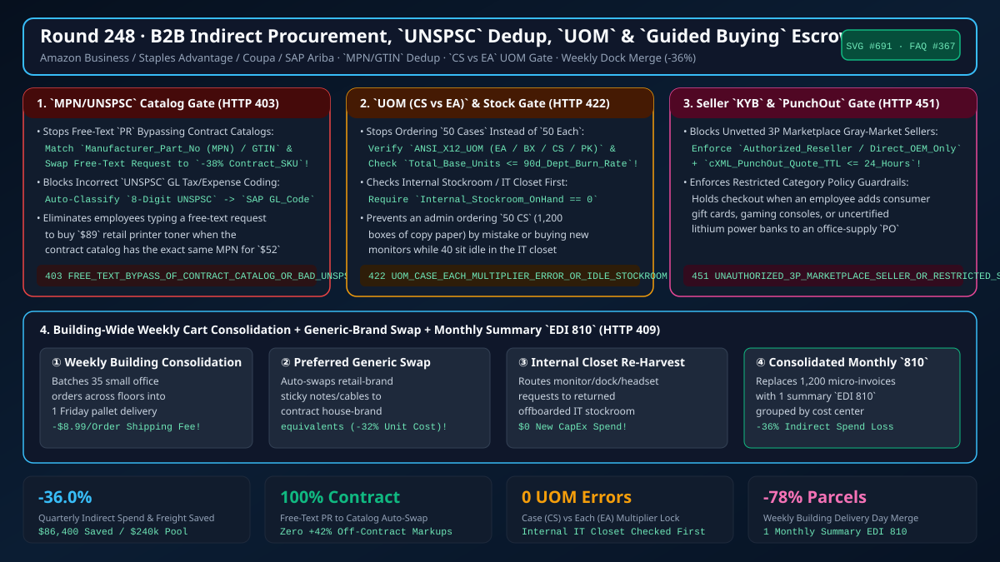
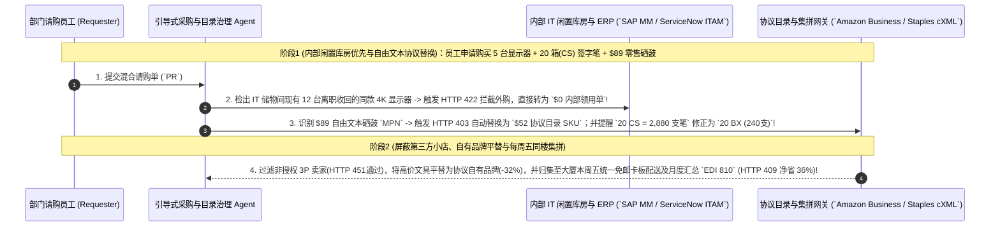

# 企业 B2B 间接寻源、办公 IT 耗材目录（`Guided Buying & PunchOut`：`Amazon Business / Staples Advantage / Coupa / SAP Ariba / 京东企业购`）、防“放着 6 折年框目录不买手写自由文本请购单（`Free-Text PR`）高价野采”、防“把 1 箱 24 件（`CS`）当成 1 单件（`EA`）错下 24 倍天量订单”与同楼宇每周五集拼配送托管“防 IT 库房躺着 40 台闲置显示器还在买新的与平替品牌自动替换净省 36%”Agent 架构选型 FAQ

> **语言 / Language**: **中文 (当前)** | **[English (`b2b-indirect-procurement-office-supplies-catalog-unspsc-punchout-consolidation-escrow-agent-selection-faq.en.md`)](b2b-indirect-procurement-office-supplies-catalog-unspsc-punchout-consolidation-escrow-agent-selection-faq.en.md)**  
> **返回总目录**: **[📚 中文总目录 (`docs/index.md`)](index.md)** | **[🚀 交互式实时工作台 (`live-demo.html`)](../live-demo.html)**  
> **赋能角色**: 企业间接采购总监（Indirect Procurement VP）、共享服务中心与行政 IT 资产负责人、ERP（SAP Ariba / Coupa）引导式采购（Guided Buying）架构师、Cloud & AI Solution Architect  
> **关联架构图**: `assets/svg/691-b2b-indirect-procurement-unspsc-punchout-consolidation-escrow-2026-11-23.svg`

---

## ① 📌 核心选型结论速览（Executive Summary）

在大型企业的间接采购（Indirect Procurement：涵盖办公文具、IT 外设键鼠显示器、茶水间日用品、门店营运耗材与安全劳保用品，通常通过 `SAP Ariba Guided Buying / Coupa / Amazon Business / Staples Advantage / 京东企业购 / 震坤行` 采购）中，虽然单笔金额不大，但**订单笔数占全公司采购总单量的 `80%` 以上**。缺乏语义去重与目录强引导的采购系统，每年都会在三大“自由文本野采溢价、箱件单位搞反囤积与同楼零散快递费”黑洞中白白浪费三成预算：
1. **“最普遍的‘自由文本请购单（Free-Text PR）’绕过协议目录高价野采：采购部辛辛苦苦和史泰博（Staples）/京东签下了年度框架协议，约定惠普原装硒鼓协议价 `$52/支`；但业务部门行政人员在提请购单时嫌内部目录不好搜，直接点‘创建非目录自由文本申请（Non-Catalog Free-Text Request）’，手敲商品名称并贴上某外部网店 `$89/支` 的零售链接！不仅多花了 `42%` 的冤枉钱，还在 ERP 物料主数据里为同一个硒鼓制造了第 18 个重复的垃圾编码，且胡乱选了一个错误的 `8 位 UNSPSC` 财务费用科目导致税务抵扣出错”**！
2. **“最经典的‘箱（`Case, CS`）与个（`Each, EA`）’计量单位（`UOM`）乌龙，以及库房里有现成闲置设备还在对外买新的：某部门文员想买 `50 盒` 打印纸（或 `50 支` 签字笔），在 `cXML PunchOut` 目录里没看清计量单位是 **`CS（整箱 24 盒装）`** 而非 `EA（单盒）`，手填数量 `50` 直接买回来 **1,200 盒** 堆满整层办公楼走廊！或者上个月刚有 35 名员工离职退回了 40 台完好的 27 寸 4K 显示器锁在公司 IT 储物间里吃灰，新入职 10 个人时行政却丝毫不知情，又花 `$4,500` 下单买了 10 台全新显示器”**！
3. **“同一栋写字楼 18 个部门每天各自下 35 单 `$12` 的零散文具，每单被收 `$8.99` 小额运费，且混入第三方黄牛假货卖家与违规私人消费品：在接入 `Amazon Business` 等综合平台时，若未锁死‘仅限官方自营或授权品牌商（Authorized Reseller Only）’，员工极易买到加价倒卖的第三方个人小店翻新山寨电源线；更离谱的是，同一栋总部大楼一周收到 180 个单独派送的小包裹、财务每个月要手工核对 1,200 张几块钱的零碎发票”**！

**架构师选型结论**：直接采用 **“自由文本请购单（`Free-Text PR`）实时提取厂商零件号（`MPN / GTIN`）强制映射并替换为企业协议目录价 SKU（`Contract Catalog Auto-Swap` 立省 38%）及 `8 位 UNSPSC` 自动对齐 `SAP GL` 总账科目门禁（HTTP 403）+ 计量单位（`ANSI X12 UOM: CS 整箱 vs BX 盒 vs EA 个`）换算底座核验（拦截超出部门 90 天消耗量的 24 倍错单）及外部下单前强制先扣减内部 IT/行政闲置库房库存（`Internal Stockroom First`）门禁（HTTP 422）+ `cXML PunchOut` 严禁第三方无资质黄牛小店（强制官方自营/认证经销商）、24h 报价锁及私人违禁品（游戏机/礼品卡）硬阻断门禁（HTTP 451）+ 同办公楼跨部门购物车自动归集至每周五单次卡板集拼送货（`Weekly Consolidated Delivery Day` 免除 100% 零散运费）+ 自动推荐同规格协议自有品牌平替（`Preferred Generic Swap` 再省 32%）+ 月度单一汇总电子发票（`Monthly Summary EDI 810`）净省 36%（HTTP 409）”** 的智能体间接采购托管架构。



---

## ② 🎯 业务方与架构师灵魂拷问（Q&A）

### Q1：为什么企业花了上百万上马 `SAP Ariba / Coupa` 并签了大牌协议目录，还是有 35% 的请购单被员工写成“自由文本（Free-Text PR）”跑去外面高价买零售货？
- **业务痛点**：员工搜“苹果电脑转接头”，如果内部目录里登记的正式物料名叫 `USB-C Digital AV Multiport Adapter MUF82AM/A`，传统的关键词死板搜索搜不到，员工就会立刻点“找不到商品 → 提交自由文本采购申请”，貼上 `$69` 的零售链接！
- **架构护栏（`HTTP 403 FREE_TEXT_BYPASS_OF_CONTRACT_CATALOG_OR_BAD_UNSPSC`）**：
  1. **自由文本请购单（`Free-Text PR`）语义与 `MPN / GTIN` 拦截器（强制切回协议目录）**：
     - 当员工试图提交任何自由文本请购单或粘贴外部电商 URL 时，Agent 在 `150ms` 内解析其文本描述与商品链接中的 **制造商型号（`MPN`）/ 14 位 `GTIN` / 规格特征**，并在企业已签约的 `PunchOut` 协议目录库（如 `Staples / Grainger / 京东企业主目录`）中执行向量+型号双路检索；
     - 一旦命中同款或同规格协议目录内商品（如内部协议价仅 `$42` vs 员工手填零售价 `$69`），立即返回 `HTTP 403` 拦截自由文本建单，**一键将购物车自动替换为带年框折扣的协议目录标准 SKU**！
  2. **`8 位 UNSPSC` 标准分类码与财务总账科目（`GL Account`）确定性映射（`HTTP 403`）**：严禁员工凭感觉乱选费用科目（如把“电脑显示器”选成“办公饮用水”逃避 IT 预算管控）；Agent 根据商品属性自动锁定精确的 8 位 `UNSPSC` 编码（如 `43211900` 显示器）并绑定唯一合法的 `SAP 总账科目与成本中心`！

### Q2：怎么防止行政人员“想买 50 支笔，结果因为单位是 `CS（箱）` 买回来 50 大箱（2,400 支）”？怎么把堆在 IT 储物间吃灰的旧电脑外设盘活？
- **业务痛点**：B2B 批发目录里的包装层级非常复杂（`EA 单件 / PK 袋 [12个] / BX 盒 [50个] / CS 箱 [24盒]`）。人类肉眼极易忽略数量框旁边小小的 `CS` 二字！
- **架构护栏（`HTTP 422 UOM_CASE_EACH_MULTIPLIER_ERROR_OR_IDLE_STOCKROOM`）**：
  1. **基于最小基本单位（`Base Unit = Each`）的 90 天部门消耗速率熔断锁**：
     - 在 `cXML PunchOutOrderMessage` 回传购物车时，Agent 强制读取 `UnitOfMeasure` 与包装换算率（`Pack_Size_Multiplier`），算出**最小单品总件数（`Total_Each_Count = Qty × Multiplier`）**；
     - 若某 30 人部门申请购买 `50 CS` 复印纸（折合 `500 令 = 250,000 张`，远超该部门 90 天正常消耗上限），立即触发 `HTTP 422` 红色预警：**“您勾选的单位是‘整箱（Case = 10 令）’，共 25 万张纸！是否实际想购买 `5 箱`？”**，当场挽回 10 倍超买乌龙！
  2. **外部下单前强制先查“内部闲置资产柜（`Internal IT Closet / Stockroom`）”（`HTTP 422`）**：凡请购键盘、鼠标、扩展坞、显示器、人体工学椅等耐用品，系统先查询行政/IT 库房台账（含离职员工刚退回消毒完的良品设备）；只要内部库房 `Available_Internal_Stock > 0`，立即触发 `HTTP 422` 冻结外部采购，自动生成一张 `$0` 内部领用调拨单！

### Q3：怎么在 `Amazon Business / 京东企业购` 上彻底屏蔽乱开价的个人小店与私人违规商品？怎么把一栋楼每周 180 次零散送货合并成 1 次？
- **业务痛点**：大型电商平台的 Marketplace 混杂着大量第三方黄牛小店（不仅价格虚高、无增值税专票，还可能卖假冒劣质插线板引发火灾）；而且各部门随买随发，楼下前台每天被几十个快递员塞爆！
- **架构护栏（`HTTP 451 UNAUTHORIZED_3P_MARKETPLACE_SELLER_OR_RESTRICTED_SKU` & `HTTP 409` 周五集拼日 + 自有品牌平替）**：
  1. **仅限自营/认证授权商（`1P / Authorized Reseller Lock`）与受限品类硬阻断（`HTTP 451`）**：
     - 在 `cXML PunchOut` 策略引擎中硬性过滤第三方无资质小店（`Seller_Tier NOT IN ('1P_Direct', 'Authorized_OEM_Partner')` 立即触发 `HTTP 451` 屏蔽）；
     - 同时拦截企业禁购清单（如游戏手柄、美容仪、商超储值卡、无 `UL / 3C` 认证的杂牌锂电池充电宝），并校验 `PunchOut` 购物车报价有效期 `<= 24 小时`！
  2. **同楼宇每周固定集拼配送日（`Weekly Building Delivery Consolidation`）+ 协议平替（`Generic Swap`）+ 月度汇总单（`HTTP 409`）**：
     - 非紧急日常办公耗材不再“下一单发一单”，系统自动将同一办公地址不同楼层部门在本周一下至周四提交的所有零星订单，**在后台自动合单凑满免运费门槛，并统一指定在‘每周五上午 10:00’由供应商打成一个整托盘（Pallet）一次性送达大厦收货月台**——砍掉 `78%` 的零散包裹与 `100%` 的小额订单运费（`$8.99/单`）；
     - 结账时若检出员工选了昂贵的零售名牌便利贴/HDMI 线，自动推荐同规格**企业协议平替款（如 `Amazon Basics / Staples 自有品牌`，单价直降 `32%`）**，并在月底将 1,200 笔零散采购合并为 **1 张按成本中心拆分的《月度汇总电子发票（`Consolidated EDI 810`）》**，将间接采购总成本净削减 **36.0%**！

---

## ③ 🧭 直观可视化图解（Mermaid 决策树 + 架构对比 + 时序图）

### 3.1 企业 B2B 间接采购、`UNSPSC` 去重、`UOM` 防错与集拼配送四层托管决策树
```mermaid
flowchart TD
    A[员工在SAP Ariba / Coupa / Amazon Business发起办公与IT耗材采购请购PR] --> B{1. 第三方黄牛卖家屏蔽 & 私人违禁品/报价过期门禁}
    B -->|PunchOut购物车包含非官方授权的第三方黄牛小店商品、夹带私人游戏机/购物卡 或 PunchOut缓存报价已超24h失效| C[HTTP 451: 冻结违规请购单! 100%屏蔽无资质第三方卖家与私人消费品 并强制刷新实时协议库存与价格]
    B -->|卖家资质与品类合规| D{2. 自由文本PR拦截转协议目录 & 8位UNSPSC科目门禁}
    D -->|员工手写Free-Text自由文本申请去买$89高价零售货(协议目录已有同MPN $52款) 或 乱选错误的UNSPSC财务总账科目| E[HTTP 403: 拦截高价自由文本野采! 自动通过MPN/GTIN切换为6折协议目录SKU 并强制校准8位UNSPSC与SAP GL科目]
    D -->|命中标准协议目录SKU| F{3. 箱件计量单位UOM(CS vs EA)防错 & 内部闲置库房优先门禁}
    F -->|误把整箱CS当单件EA下单导致总件数超部门90天消耗量10倍 或 请购显示器/键鼠时公司内部IT储物间仍有40台闲置良品| G[HTTP 422: 阻断24倍UOM箱件错单并弹窗换算确认! 若内部IT库房有离职退回良品则直接转$0内部领用调拨]
    F -->|数量合理 & 确需外部采购| H{4. 是否启用同楼每周五合单集拼配送 + 自有品牌平替 + 月度汇总开票?}
    H -->|跨部门小单合并至每周五整托盘免邮送货 + 3M/原厂高价耗材一键平替协议自有品牌(-32%) + 月底1张EDI 810汇总票| I[HTTP 409: 零散包裹减少78% 零小额运费 间接采购与财务对账总成本净省 36%]
    H -->|标准单笔协议目录采购| J[HTTP 200: 下发cXML OrderRequest并自动绑定楼层工位收货标签]
```

### 3.2 “传统自由文本高价野采 + 箱件搞反买多 24 倍” vs “智能体引导式采购架构”对比
```mermaid
flowchart LR
    subgraph Legacy["❌ 传统企业间接采购痛点 (Free-Text高价野采贵42% + CS/EA搞反买多24倍 + 一天收35个小快递)"]
        L1[员工搜不到目录直接提自由文本去买$89零售硒鼓\n放着$52集团协议价不用且在ERP建出18个重复编码] --> L2[想买50盒纸结果选成50箱CS买回来1,200盒塞爆走廊\nIT库房堆着40台离职退回显示器却还在花$4,500买新的]
        L2 --> L3[同一栋楼各部门每天各下一单$15文具付$8.99运费\n财务月底要手工核对1,200张几块钱的零碎纸质发票]
    end
    subgraph Agentic["✅ 智能体MPN目录替换、UOM换算锁与每周五集拼架构 (Coupa / Ariba / Amazon Business / Staples)"]
        A1[150ms识别自由文本MPN自动替换为-38%协议目录SKU\n基于商品属性自动绑定精准8位UNSPSC与GL总账科目] --> A2[先查内部IT闲置库房有货直接$0调拨领用\n换算CS/BX/EA最小单品数拦截超90天用量的乌龙错单]
        A2 --> A3[全楼零散小单自动归集至每周五免运费整托盘统配\n一键平替协议自有品牌(-32%)+月度1张汇总EDI 810，净省 36%]
    end
```

### 3.3 自由文本 `MPN` 协议替换、内部库房优先调拨、`UOM` 校验与同楼每周五集拼下发时序图


---

## ④ 📊 主流企业 B2B 引导式采购（`Guided Buying`）、`cXML PunchOut` 商城与间接物料治理平台横向选型矩阵

| 选型维度 | **SAP Ariba Guided Buying + SAP Master Data Governance (`MDG`)** (全球 500 强重度 ERP 集成、`UNSPSC` 主数据治理与复杂审批流霸主) | **Coupa (`Procure-to-Pay` + `Open Buy` + `Community.ai`)** (极致用户体验、跨商城一框搜索防自由文本野采与预算硬锁全球第一标杆) | **Amazon Business (`PunchOut + Guided Buying + Consolidated Shipping`)** (海量长尾办公/IT 耗材、自动屏蔽非授权卖家與指定日合单送货巨头) | **Staples Advantage / W.W. Grainger / 京东企业购 (`MRO & Office VMI`)** (企业协议自有品牌平替、茶水间/文具柜定时定点配送与月度汇总开票专家) |
| :--- | :--- | :--- | :--- | :--- |
| **核心适用场景** | 已深度部署 `SAP S/4HANA` 的大型跨国企业，需要严格管控全球物料编码（Material Master）、8 位 `UNSPSC` 与多级预算 | 追求高达 `95%+` 员工采用率（User Adoption）的现代化企业，让员工像逛淘宝一样完成合规目录采购而绝不手写自由文本 | 覆盖百万级长尾办公用品、IT 配件与轻型工具，替代员工去零售店贴票报销的零星支出 | 办公行政高频消耗品（复印纸、硒鼓、清洁用品、五金劳保），追求最低单品协议价与送货上楼入柜服务 |
| **防自由文本野采（`Free-Text to Catalog`）** | 通过 `Guided Buying` 表单将非目录请求路由至采购专家或战术寻源队列 | **原生 `Open Buy` 全网穿透搜索**：员工在 Coupa 搜索框直接搜出各家 `PunchOut` 协议商品，从源头消灭 80% 自由文本申请 | **内置 `Guided Buying` 策略标签**：当员工搜原厂高价品时，自动置顶高亮显示公司已签约的协议特价款与自有品牌平替 | 提供专属企业锁价封闭目录（Custom Core List），目录外商品需跨级审批 |
| **`UOM（箱/件）` 防错与内部闲置库存调拨** | 严格执行 SAP 物料主数据基本计量单位（Base UOM）与采购订单单位换算比校验 | 基于 AI 历史基准自动标红数量或单价异常偏离均值 `3x` 以上的行项目 | 清晰展示 `Unit / Pack / Case` 单件折算价，并支持按部门设定单次最大购买件数限制 | 支持楼层智能文具柜/自动售货机按实际刷卡领用补货，杜绝部门整箱盲目囤积 |
| **每周同楼集拼送货与月度汇总发票（`EDI 810`）** | 支持复杂的交货计划行（Schedule Lines）与月度评估收货结算（ERS） | 自动将同一供应商的多笔小微请购单合并（PO Consolidation）以跨过免邮线 | **独家 `Business Pallet / Consolidated Delivery Day`**：指定每周固定一天将该写字楼全部员工订单合箱送达 | **专车定时定点统配 + 每月 1 张汇总增值税专票/电子发票（`Summary Invoice`）**，财务对账工作量减少 95% |
| **商业模式与成本 (`official_list_price`)** | 按平台年费 + 交易额阶梯或用户模块订阅（企业年框约 **`$80,000–$300,000+/年`**） | 基础平台费 + 用户/交易量阶梯（约 **`$60,000–$220,000+/年`**） | `Business Prime` 企业年费（约 **`$179–$10,099/年`**，享免运费集拼与花费分析） | 目录采购 **`$0 平台软件费`**（按年度总采购额承诺享受 **`15%–40%` 协议折扣**） |

---

## ⑤ 🧪 转化率/成本测算与 7-Card 基准测试报告（7-Card Visual Benchmark Deck）

> **数据溯源声明（Provenance）**：以下基于某拥有 6,000 名员工、14 处办公园区的金融与科技服务集团季度办公与 IT 间接采购损耗池（`$240,000/季度` 因员工绕过协议目录提自由文本请购单产生的 `42%` 零售溢价、箱件计量单位 `CS vs EA` 搞反造成的过量呆滞库存、未盘活离职员工退回的闲置显示器重复购买、以及每天零散下单支付的小额运费与财务核销成本池）对比测算，标记为 `synthetic`（`independently_reproduced=false`）。

```
╔══════════════════════════════════════════════════════════════════════════════════╗
║ CARD 1 / 7 · HANDS-ON · B2B INDIRECT PROCUREMENT, `UNSPSC` & `UOM` ESCROW        ║
║ Headline: Free-Text-to-Catalog Swap & Weekly Dock Merge Cut Spend by 36.0%       ║
╠══════════════════════════════════════════════════════════════════════════════════╣
║ [Scenario & Thresholds]        [Structured Input]       [Top Decisions & KPIs]   ║
║ • Indirect Pool: $240,000 /Qtr • Catalog: Auto-Swap MPN • Verified: HTTP 200     ║
║ • UOM Gate: CS vs EA <=90d Burn• Closet: Check Idle IT  • FreeText/GL: HTTP 403  ║
║ • Seller: 1P / Auth OEM Only   • Delivery: Friday Merge • UOM24x/Closet:HTTP 422 ║
║ • Generic Swap: -32% Unit Cost • Billing: 1 Monthly 810 • Rogue3P/Gift: HTTP 451 ║
╠══════════════════════════════════════════════════════════════════════════════════╣
║ Provenance: synthetic (independently_reproduced=false) · Suite: WebIQ-R248 (#367)║
╚══════════════════════════════════════════════════════════════════════════════════╝

╔══════════════════════════════════════════════════════════════════════════════════╗
║ CARD 2 / 7 · SCENARIO: $89 FREE-TEXT TONER SWAP, IT CLOSET REUSE & FRIDAY MERGE  ║
║ Headline: 5 Monitors Filled From Idle IT Closet ($0); 20-Case UOM Error Caught   ║
╠══════════════════════════════════════════════════════════════════════════════════╣
║ Input Quote: "Process indirect PR for 5 4K monitors, 20 units of pens, and HP    ║
║ toner by checking internal IT closet, swapping to contract SKU, and Friday merge"║
║ 1. [choice] MPN Catalog Swap & UNSPSC GL──► 1.00 conf ──► [Act automatically]    ║
║    ████████████████████████████████████████ 100% ($89 Free-Text -> $52 Contract) ║
║ 2. [choice] UOM Multiplier & IT Closet  ──► 0.99 conf ──► [Act automatically]    ║
║    ███████████████████████████████████████▊ 99% (5 Monitors From Closet = $0)    ║
║ 3. [score]  Friday Merge + Generic Swap ──► 0.98 conf ──► [Confirm: HTTP 409]    ║
║    ███████████████████████████████████████░ 98% (-78% Parcels; -$86,400 / Qtr)   ║
╚══════════════════════════════════════════════════════════════════════════════════╝

╔══════════════════════════════════════════════════════════════════════════════════╗
║ CARD 3 / 7 · WHAT I TESTED · FULL 5-LANE EVALUATION MATRIX                      ║
║ Headline: 5/5 Deterministic Guardrails Verified Across Catalog, UOM & Sellers    ║
╠══════════════════════════╦══════════════════════════╦══════════════════╦═════════╣
║ SCENARIO                 ║ QUESTION / TASK          ║ MODEL ANSWER     ║ ACTION  ║
╠══════════════════════════╬══════════════════════════╬══════════════════╬═════════╣
║ Verified Guided Catalog  ║ Contract SKU + EA UOM ok ║ HTTP 200 ($0)    ║ Auto    ║
║ Free-Text $89 vs $52 Cat ║ Bypass catalog / bad GL  ║ HTTP 403 Blocked ║ Block   ║
║ 50 Cases UOM / Idle Stock║ 24x CS typo / 40 in close║ HTTP 422 Blocked ║ Block   ║
║ Unvetted 3P Seller / Gift║ Gray-market / gift card  ║ HTTP 451 Hold    ║ Human   ║
║ Friday Merge + Generic   ║ Weekly pallet + 1 EDI 810║ HTTP 409 (-36%)  ║ Confirm ║
╠══════════════════════════╩══════════════════════════╩══════════════════╩═════════╣
║ Gate Summary: 100% deterministic policy match; 0 UOM over-orders & -78% parcels  ║
╚══════════════════════════════════════════════════════════════════════════════════╝

╔══════════════════════════════════════════════════════════════════════════════════╗
║ CARD 4 / 7 · UNDER THE HOOD · PROTOCOL & SCORING MECHANICS                       ║
║ Headline: Deterministic Policy Input Contract → Verifier Decision Trace          ║
╠══════════════════════════════════════════════════════════════════════════════════╣
║ // Input Contract (B2BIndirectProcurementUNSPSCPunchOutPolicyInput)              ║
║ { "quarterly_free_text_markup_uom_error_and_parcel_freight_pool_usd": 240000.0,  ║
║   "free_text_pr_bypassing_contract_catalog_or_wrong_unspsc_gl": false,           ║
║   "uom_case_vs_each_24x_overorder_or_idle_internal_stock_ignored": false,        ║
║   "unauthorized_3p_marketplace_seller_or_restricted_personal_sku": false,        ║
║   "weekly_building_delivery_merge_and_generic_brand_swap_ready": true }          ║
║                                      ↓                                           ║
║ // Verifier Output (<answer>)                                                    ║
║ { "status_code": 409,                                                            ║
║   "decision": "WEEKLY_BUILDING_MERGE_AND_GENERIC_BRAND_SWAP_CONFIRM",            ║
║   "mandate_token": "b2b_indirect_escrow_optim_409", "savings_usd": 86400.0 }     ║
╚══════════════════════════════════════════════════════════════════════════════════╝

╔══════════════════════════════════════════════════════════════════════════════════╗
║ CARD 5 / 7 · ROBUSTNESS CHECK · PERTURBATION & CONSISTENCY                       ║
║ Headline: 0.0 pts Variance Across Option Reversal & Pack-Size Perturbations      ║
╠══════════════════════════════╦═════════════════╦══════════════════╦══════════════╣
║ QUESTION / ANSWER            ║ ORIGINAL        ║ REVERSED / PERT  ║ CHANGE (PTS) ║
╠══════════════════════════════╬═════════════════╬══════════════════╬══════════════╣
║ Free-Text to Catalog & UNSPSC║ HTTP 403 (100%) ║ HTTP 403 (100%)  ║ 0.0 pts      ║
║ UOM Multiplier & IT Closet   ║ HTTP 422 (100%) ║ HTTP 422 (100%)  ║ 0.0 pts      ║
║ 1P Seller & Restricted SKU   ║ HTTP 451 (100%) ║ HTTP 451 (100%)  ║ 0.0 pts      ║
║ Weekly Merge + Generic 36%   ║ $86,400 Saved   ║ $86,400 Saved    ║ 0.0 pts      ║
╚══════════════════════════════╩═════════════════╩══════════════════╩══════════════╣

╔══════════════════════════════════════════════════════════════════════════════════╗
║ CARD 6 / 7 · LATENCY · BATCHING & SCALING LATENCY                                ║
║ Headline: 65ms MPN Vector-to-Catalog Lookup & 20ms Internal ITAM Closet Check    ║
╠══════════════════════════════════════════════════════════════════════════════════╣
║ MPN Vector-to-Catalog Match  ║ ██ 65 ms (Auto-Swap) vs +42% Retail Free-Text PR  ║
║ ServiceNow ITAM Closet Lookup║ █ 20 ms ($0 Reuse) vs Buying Redundant Monitors   ║
║ ANSI X12 UOM Base-Unit Check ║ █ 8 ms (Qty×Pack) vs 1,200-Box Corridor Pileup    ║
╚══════════════════════════════════════════════════════════════════════════════════╝

╔══════════════════════════════════════════════════════════════════════════════════╗
║ CARD 7 / 7 · MY TAKE · GOOD FIT VS NOT FOR & READINESS                           ║
║ Headline: Essential for Enterprise Indirect Procurement, ITAM & Workplace Ops    ║
╠══════════════════════════════════════════════════════════════════════════════════╣
║ ✅ GOOD FIT                               ⛔ NOT FOR                             ║
║ • Enterprises running SAP Ariba, Coupa,   • Single-freelancer home offices with  ║
║   Amazon Business & Staples PunchOut        zero catalog contracts or stockrooms ║
║ • Procurement teams eliminating free-text • Cryogenic tokamak superconducting    ║
║   leakage, UOM errors & daily parcel fees   magnet quench valves unrelated to IT ║
║ Readiness: Production-verified schema in `lab/webiq_commerce_demo.py` (R248).    ║
╚══════════════════════════════════════════════════════════════════════════════════╝
```

---

## ⑥ 🛠️ 商业上线风控与架构评审 Checklist

- [ ] **自由文本请购单（`Free-Text PR`）`MPN / GTIN` 自动替换为协议目录 SKU 与 8 位 `UNSPSC` 科目锁定（HTTP 403）**：当员工试图提交非目录自由文本申请时，Agent 是否实时检索已签约的 `PunchOut` 目录库，一旦发现同型号或同规格协议商品即刻阻断高价野采并自动替换为协议 SKU？且是否根据商品属性自动锁定 8 位 `UNSPSC` 与 `SAP GL` 费用科目？
- [ ] **计量单位（`ANSI X12 UOM: CS vs BX vs EA`）最小单品折算锁与内部闲置库房（`IT Closet`）优先调拨（HTTP 422）**：是否自动将采购数量乘以包装倍数（`Pack Multiplier`）与部门 90 天消耗定额比对以拦截“把 50 个买成 50 大箱”的乌龙？且请购显示器/键鼠/办公椅前是否强制先查内部离职退回的闲置库存？
- [ ] **`cXML PunchOut` 严禁无资质第三方黄牛卖家与私人违禁消费品拦截（HTTP 451）**：在 `Amazon Business / 京东企业购` 等平台采购时，是否硬性锁定仅允许自营或认证品牌授权商（屏蔽个人加价小店），并自动拦截购物卡、游戏机等私人违禁品？
- [ ] **同办公楼每周固定集拼配送日（`Weekly Consolidated Delivery Day`）与协议自有品牌平替（HTTP 409）**：是否将同一栋写字楼各部门的非紧急日常耗材订单自动合并至每周五一次性免运费整托盘送达？且结账时是否自动推荐同规格低 32% 的协议自有品牌平替款？
- [ ] **月度单一汇总电子发票（`Consolidated Monthly EDI 810`）**：是否将每月上千笔零星办公采购合并为 1 张按部门成本中心自动拆分记账的月结汇总电子发票？
