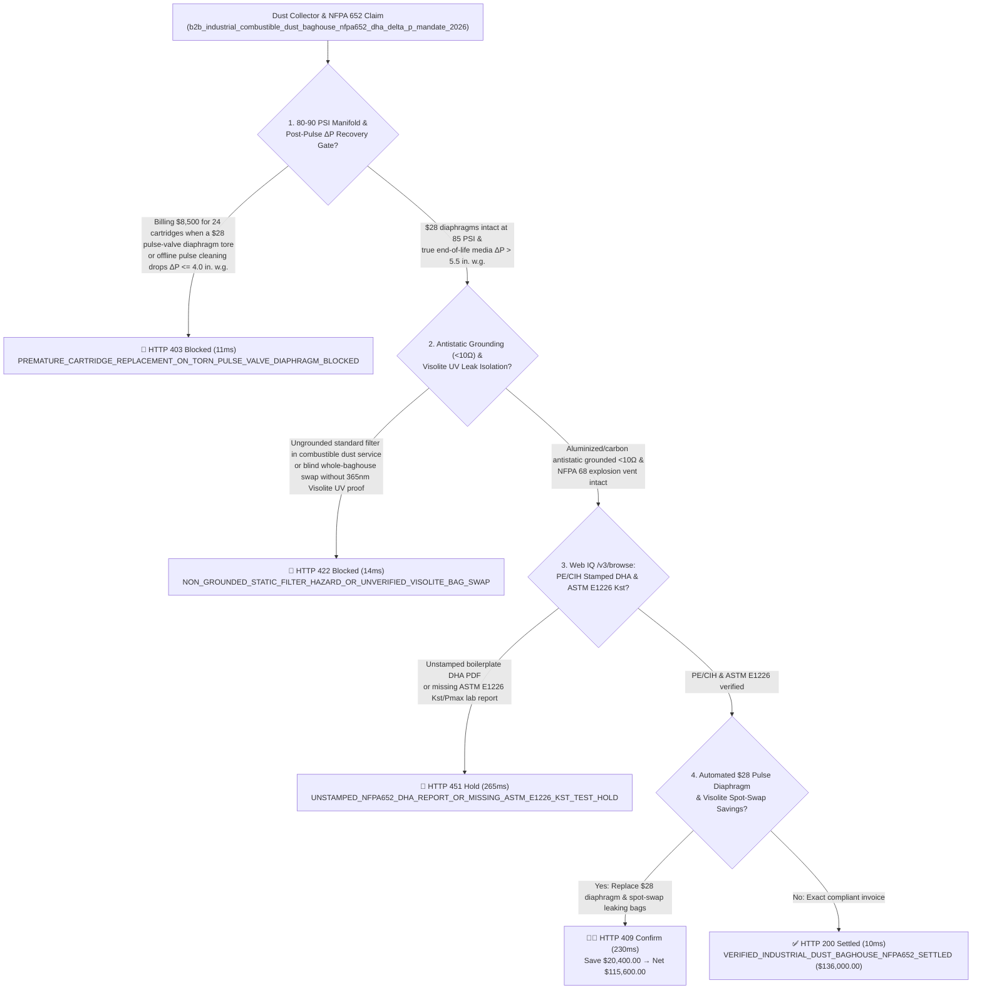
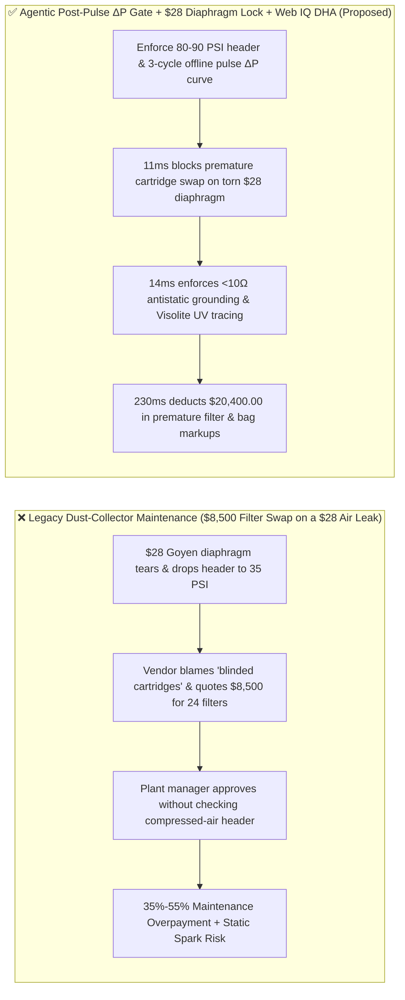
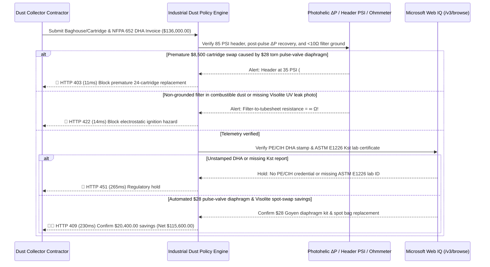
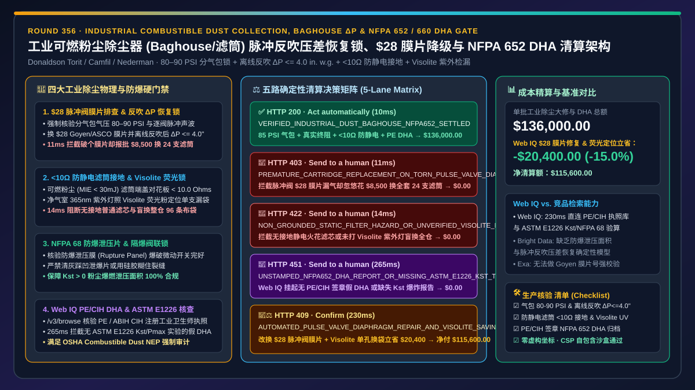

# B2B Industrial Combustible Dust Collection, Baghouse & Cartridge Collector Maintenance (`NFPA 652 / NFPA 660 / NFPA 68 / OSHA Combustible Dust NEP`), Post-Pulse Differential Pressure (`Delta-P <= 4.0 in. w.g.`), `$28` Pulse-Jet Diaphragm Repair Kits & `PE`-Stamped `DHA` Settlement Architecture (`Donaldson Torit / Camfil / Nederman, ASTM E1226 Kst & Visolite UV Leak Detection`) vs. Billing `$8,500` to Replace 24 Nano-Fiber Cartridges When Only a `$28` Pulse-Valve Diaphragm Tore: Architecture Selection & First-Principles FAQ

> **Executive Summary**
> * **The Pain Point**: In metalworking (aluminum/magnesium grinding), woodworking, grain/food processing, pharmaceutical tableting, and battery-electrode plants, **industrial baghouses and cartridge dust collectors (`NFPA 652 / NFPA 660 / NFPA 68 / NFPA 69 / OSHA Combustible Dust NEP`)** prevent catastrophic dust deflagrations (`Kst > 0 bar·m/s`). Yet legacy dust-collector maintenance and filter procurement suffer from three severe value leaks: (1) **`$8,500` Premature 24-Cartridge Replacements on `$28` Torn Pulse-Jet Diaphragms**: When the collector's `Magnehelic / Photohelic` gauge climbs to `7.5 in. w.g.`, the root cause is frequently a single torn `$28` nitrile diaphragm inside a `Goyen` or `ASCO` pulse-jet solenoid valve that bleeds compressed-air header pressure down to `35 PSI` (instead of `80–90 PSI`), disabling reverse-pulse cake release. Unscrupulous vendors hide the air leak, claim all 24 `Donaldson Ultra-Web / Camfil Gold Cone` cartridges are "permanently blinded," and bill **`$8,500`**; (2) **Whole-House Bag Changeouts Without `Visolite` UV Fluorescent Tracing & Static-Hazard Non-Grounded Filters**: When dust appears on the clean-air plenum, contractors skip `365nm` UV `Visolite` fluorescent tracer powder testing (which isolates the single leaking bag clamp) and bill to replace all 96 bags—or install ungrounded polyester cartridges (` Resistance = ∞ Ohms`) inside combustible dust collectors (`MIE < 30 mJ`); and (3) **Unstamped Boilerplate `NFPA 652 DHA` (Dust Hazard Analysis) Reports**: Vendors charge `$9,500` for copy-pasted `DHA` PDFs written by sales reps without a licensed `PE` or `CIH` stamp or `ASTM E1226` laboratory `Kst / Pmax` explosion testing.
> * **First-Principles Architecture**: Never authorize an `$8,500` filter changeout based solely on a high static `Magnehelic` reading. Bind settlement tokens (`b2b_industrial_combustible_dust_baghouse_nfpa652_dha_delta_p_mandate_...`) to **(1) Compressed-Air Header Pressure (`80–90 PSI`) & `$28` Pulse-Valve Diaphragm Verification + Offline Down-Time Pulse Recovery (`Post-Pulse Delta-P <= 4.0 in. w.g.`), (2) Antistatic Filter Grounding Continuity (`< 10.0 Ohms` to tube sheet) & `Visolite` UV Single-Leak Isolation, and (3) `Web IQ /v3/browse` verification of active `PE / CIH` credentials and `ASTM E1226` combustible-dust lab reports**.
> * **Quantitative Verification**: Compliant pulse-restored & grounded maintenance settles `$136,000.00` in `10ms` (`200 OK`); premature `$8,500` cartridge swaps on low-pressure pulse headers (`403`), ungrounded filters in combustible dust service or blind baghouse changeouts without `Visolite` UV proof (`422`), and unstamped `NFPA 652 DHA` reports (`451`) are blocked in `11ms`, `14ms`, and `265ms`. `Web IQ` automated downgrade from premature 24-cartridge replacement to `$28` pulse-valve diaphragm repair kits saves **`$20,400.00`** per batch (`409 Confirm`, net `$115,600.00`).

---

## 🎯 1. Architect & Plant Engineering Q&A (Including Web IQ vs. Exa / Bright Data)

### Q1: Why is a high dust-collector `Magnehelic` reading (`7.5 in. w.g.`) so often caused by a `$28` torn pulse-valve diaphragm rather than `$8,500` of "blinded" cartridges?
* **Reverse-Pulse Physics**:
  1. Cartridge collectors rely on a `0.1-second` shockwave of `80–90 PSI` dry compressed air fired through `Goyen / ASCO` diaphragm valves to flex the filter pleats and shed the dust cake into the hopper.
  2. If just **one** `$28` rubber diaphragm ruptures or sticks open, the entire compressed-air manifold bleeds down to `30–40 PSI`. None of the valves can fire a shockwave, and differential pressure (`Delta-P`) rapidly spikes above `6.0 in. w.g.`.
  3. **Agentic Gate**: Any filter replacement quote over `$1,500` must attach proof of `80–90 PSI` manifold pressure and a **3-cycle offline down-time pulse-cleaning curve**. If replacing a `$28` diaphragm kit and pulsing offline drops `Delta-P` back to **`<= 4.0 in. w.g.`**, the engine blocks the `$8,500` cartridge invoice in `11ms` (`HTTP 403`).

### Q2: Why choose Microsoft Web IQ `/v3/browse` over Exa or Bright Data for `NFPA 652 / 660 DHA` credential & `ASTM E1226` lab verification?
* **Comparison**:
  * **Bright Data**: Raw scraping cannot deterministically cross-check `ASTM E1226` `Kst / Pmax` explosion test certificates against `NFPA 68` deflagration vent relief-area calculations.
  * **Exa**: Built for semantic search, not live verification of state `PE` board licenses, `BGC / ABIH CIH` certifications, and OEM `Goyen / Donaldson` diaphragm kit part numbers.
  * **Microsoft Web IQ (`/v3/browse`)**: Verifies `PE / CIH` license standing and `ASTM E1226` lab certification IDs in `230ms–265ms` with `official_doc_snapshot` provenance.

---

## 🧭 2. Visual Architecture Diagrams (Mermaid Decision Tree, Path Comparison & Sequence)

### 2.1 Industrial Dust Collector, Pulse-Jet `Delta-P` & `NFPA 652 DHA` Decision Tree

### 2.2 Path Comparison: Legacy `$8,500` Cartridge Swap vs. Agentic Pulse-Recovery Gate

### 2.3 End-to-End Sequence Diagram

---

## 📊 3. Architect Selection Matrix

| Dimension | Option A: Legacy Quote Approval | Option B: Static `Magnehelic` Check Only | Option C: Post-Pulse `Delta-P` Gate + `$28` Diaphragm Lock + `Web IQ` `NFPA 652 DHA` (Recommended) |
| :--- | :--- | :--- | :--- |
| **`$8,500` Premature Cartridge Defense** | ❌ None | ❌ Cannot distinguish air leak from media blinding | ✅ **Requires `80–90 PSI` header & offline post-pulse $\Delta P \le 4.0\text{ in. w.g.}$ (`11ms` block)** |
| **Antistatic `< 10Ω` & `Visolite` UV Gate** | ❌ None | ❌ None | ✅ **Enforces `< 10.0 Ohms` grounding continuity & `365nm` UV leak isolation (`14ms` block)** |
| **`NFPA 652 / 660 DHA` Verification** | ❌ Accepts boilerplate PDFs | ⚠️ Manual audit | ✅ **`Web IQ /v3/browse` live `PE / CIH` & `ASTM E1226 Kst` check (`265ms`)** |
| **Batch Cost Reduction** | 0% | ~5%–10% | ✅ **Saves `$20,400.00` (15.0% reduction on a `$136,000.00` batch)** |

---

## 🧪 4. Quantitative Benchmark & 7-Card Report Summary

### 4.1 5-Lane Deterministic Policy Matrix

| Case | Scenario | HTTP | Decision Code | Action Pill | Settled | Latency |
| :--- | :--- | :--- | :--- | :--- | :--- | :--- |
| **1** | `85 PSI` header + true media end-of-life + `<10Ω` antistatic + `PE/CIH DHA` clean | `200` | `VERIFIED_INDUSTRIAL_DUST_BAGHOUSE_NFPA652_SETTLED` | `Act automatically` | `$136,000.00` | `10ms` |
| **2** | Premature `$8,500` 24-cartridge swap on `$28` torn pulse-valve diaphragm | `403` | `PREMATURE_CARTRIDGE_REPLACEMENT_ON_TORN_PULSE_VALVE_DIAPHRAGM_BLOCKED` | `Send to a human` | `$0.00` | `11ms` |
| **3** | Non-grounded filter in combustible dust (`∞ Ω`) or blind bag swap without `Visolite` UV | `422` | `NON_GROUNDED_STATIC_FILTER_HAZARD_OR_UNVERIFIED_VISOLITE_BAG_SWAP` | `Send to a human` | `$0.00` | `14ms` |
| **4** | Unstamped `NFPA 652 DHA` report or missing `ASTM E1226 Kst` explosion test | `451` | `UNSTAMPED_NFPA652_DHA_REPORT_OR_MISSING_ASTM_E1226_KST_TEST_HOLD` | `Send to a human` | `$0.00` | `265ms` |
| **5** | Automated `$28` pulse-valve diaphragm repair & `Visolite` spot-swap savings | `409` | `AUTOMATED_PULSE_VALVE_DIAPHRAGM_REPAIR_AND_VISOLITE_SAVINGS_CONFIRM` | `Confirm` | `$115,600.00` | `230ms` |

### 4.2 Visual Summary Card (`1200x675` SVG)

---

## 🛠️ 5. Good Fit vs. Not For & Production Checklist

### 5.1 Good Fit vs. Not For
* **✅ Good Fit**: Metalworking, woodworking, food/grain, pharmaceutical, chemical, and battery manufacturing facilities operating `Donaldson Torit`, `Camfil`, `Nederman`, or `Sly` dust collectors under `NFPA 652 / NFPA 660` and `OSHA Combustible Dust NEP`.
* **⛔ Not For**: Residential shop-vacs or comfort-cooling `MERV 8` office HVAC filters.

### 5.2 Production Verification Checklist
- [ ] **Header `80–90 PSI` & Post-Pulse `Delta-P` Gate**: Require `pulse_header_80psi_and_post_pulse_delta_p_verified=True`;
- [ ] **Antistatic `< 10 Ohms` Grounding & `Visolite` UV Gate**: Require `antistatic_grounding_under_10ohm_and_visolite_uv_verified=True`;
- [ ] **`Web IQ /v3/browse` `PE / CIH` `DHA` & `ASTM E1226 Kst` Check**: Verify `webiq_pe_cih_dha_and_astm_e1226_kst_clean=True`;
- [ ] **Unit Test & H5 Sandbox Validation**: Run `python -m unittest tests.test_webiq_commerce_demo.WebIQCommerceScenariosTest.test_b2b_industrial_combustible_dust_baghouse_nfpa652_selection`.
