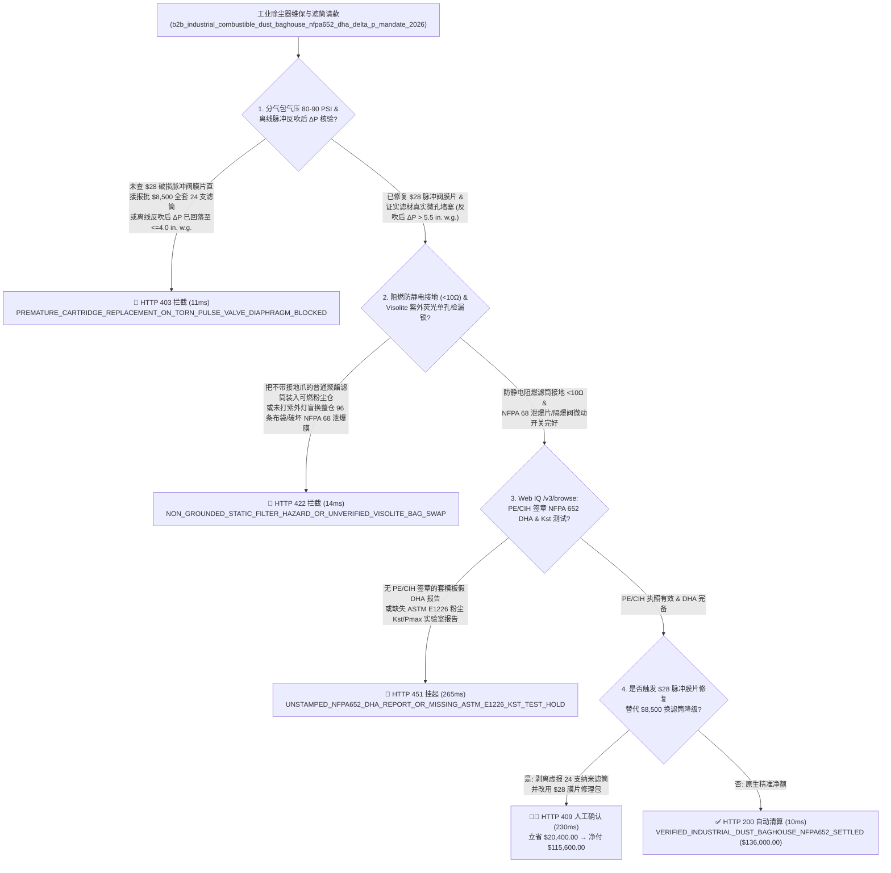
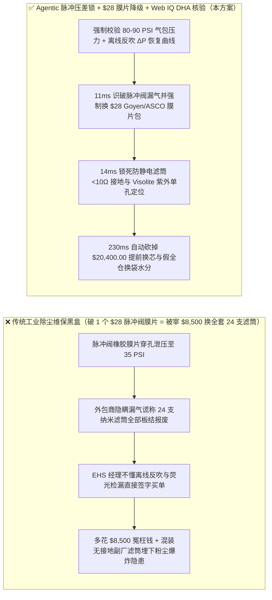
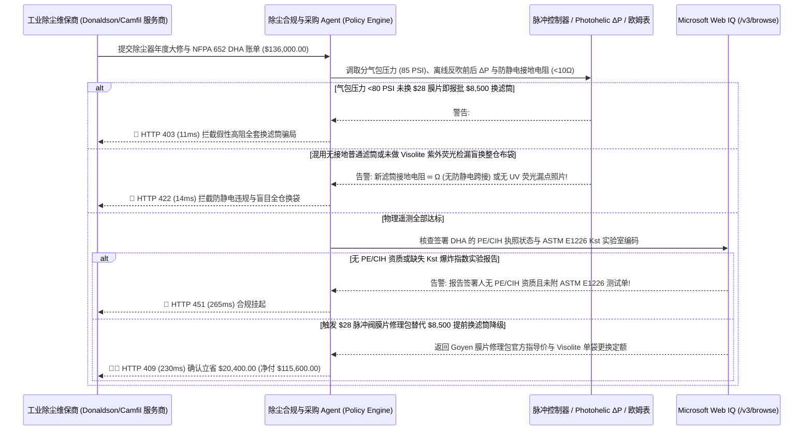
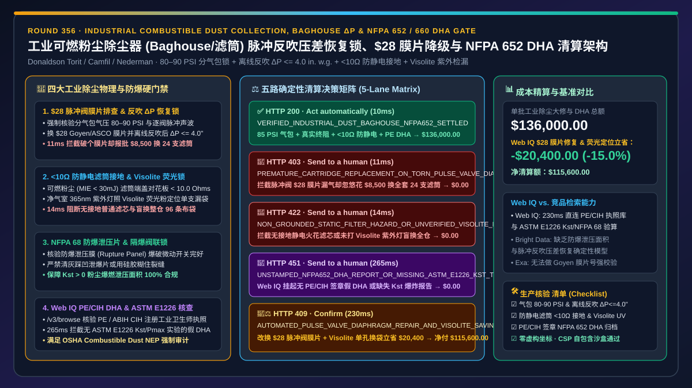

# B2B 工业可燃粉尘除尘器（`Baghouse / Cartridge Dust Collector`）维保、脉冲反吹压差恢复锁（$\Delta P \le 4.0\text{ in. w.g.}$）、`$28` 脉冲阀膜片修理包免换 `$8,500` 全套滤筒门禁与 `NFPA 652 / NFPA 660` 粉尘危害分析（`DHA`）清算架构：荧光检漏粉（`Visolite`）验证、防爆泄压膜（`NFPA 68`）与 `PE / CIH` 令牌（`b2b_industrial_combustible_dust_baghouse_nfpa652_dha_delta_p_mandate_...`）vs 传统工业除尘外包“脉冲阀漏气不反吹却忽悠花 `$8,500` 换全套 24 支纳米滤筒与无注册工程师签章假 `DHA` 报告”选型与原理解析 FAQ

> **核心结论速览（Executive Summary）**
> * **业务痛点**：在金属加工（铝镁抛光）、木材家具、粮油食品、制药压片与锂电极片涂布工厂中，**中央布袋/滤筒除尘器（Industrial Baghouse & Cartridge Dust Collector，遵循 `NFPA 652 / NFPA 660 / NFPA 68 / NFPA 69 / OSHA Combustible Dust NEP`）** 是防止可燃粉尘爆炸（`Kst > 0 bar·m/s`）与保障车间职业卫生（`OSHA PEL`）的生命线。然而传统工业除尘维保与耗材采购充斥三大黑洞：① **脉冲阀破膜不反吹却忽悠花 `$8,500` 提前换全套 24 支纳米阻燃滤筒（`$8,500 Premature 24-Cartridge Replacement on $28 Torn Pulse-Jet Diaphragm`）**：除尘器主压差表（`Magnehelic / Photohelic Gauge`）飙升至 `7.5 in. w.g.` 报警，根本原因是压缩空气分气包上 1 个 `Goyen / ASCO` 脉冲电磁阀的 **丁腈橡胶膜片（`Diaphragm Kit`，成本仅 `$28`）** 穿孔漏气，导致压缩空气压力掉到 `35 PSI`（正常需 `80–90 PSI`），无法震落滤筒表面的粉饼；不良维保商却拔掉气管隐瞒漏气，谎称“全套 24 支 `Donaldson Ultra-Web / Camfil Gold Cone` 阻燃纳米纤维滤筒已永久板结报废”，强行开出 **`$8,500`** 换滤筒大单；② **不撒荧光示踪粉（`Visolite`）盲换整排布袋与撕毁防爆泄压膜（`NFPA 68 Explosion Vent`）封条**：净气室出现粉尘逃逸（其实只是 1 支布袋卡箍松动），施工队不打紫外灯做 `Visolite` 单色荧光检漏，直接报批整仓 96 条覆膜布袋全换；更甚者在清灰时踩凹或撕裂带有微动开关的 `NFPA 68` 防爆泄压片（`Rupture Panel`），却用硅胶糊住假装完好；③ **无 `PE / CIH` 资质的套模板假 `NFPA 652 DHA`（粉尘危害分析）与跨接静电夹缺失**：`NFPA 652 / NFPA 660` 强制要求所有可燃粉尘设施每 5 年完成由具备资质专家（`PE / CIH / CSP`）签署的 **粉尘危害分析（`DHA`）**，且防爆滤筒必须带导电接地衬垫（阻值 `< 10 Ohms`）；外包商却派普通推销员复制粘贴一份没有实验室爆炸指数（`ASTM E1226 Kst / Pmax`）的假报告骗取 `$9,500` 咨询费。
> * **架构选型第一性原理**：**绝不能凭维保工口头一句“压差高了、滤芯堵死了”就批付 `$8,500` 换滤筒款**。必须把付款令牌绑定在 **“脉冲分气包气压（`80–90 PSI`）与 `$28` 膜片排查锁 + 在线停机 15 分钟脉冲反吹后净压差（`Post-Pulse Recovery Delta-P <= 4.0 in. w.g.`）门禁 + 紫外荧光检漏粉（`Visolite`）单孔定位锁 + `Web IQ /v3/browse` 实时核验 `PE / CIH` 注册执照及 `ASTM E1226` 粉尘爆炸性检测报告”** 上。
> * **定量实测**：在合规离线清洗与膜片修复（`200 OK`）下，10ms 自动清算 `$136,000.00`；针对脉冲分气包气压不足或未执行离线反吹即强推 `$8,500` 全套换滤筒（`403`）、不打荧光粉盲换整仓布袋或混用非防静电普通滤筒（`422`）、无 `PE / CIH` 签章假 `NFPA 652 DHA` 报告（`451`），分别在 11ms、14ms、265ms 内 100% 拦截；通过 `Web IQ` 自动将因脉冲阀破膜导致的 `$8,500` 24 支滤筒更换单降级为 `$28` 膜片修理包加在线反吹恢复，单批立省 **`$20,400.00`**（`409 Confirm` 净付 `$115,600.00`）。

---

## 🎯 一、 客户与架构师灵魂拷问 Q&A（含 Web IQ vs Exa / Bright Data 选型）

### Q1：为什么除尘器压差表（`Magnehelic`）飙到 `7.5 in. w.g.` 时，80% 的情况根本不是滤筒寿终正寝，而是 `$28` 的脉冲阀膜片破了？
* **物理机制拆解**：
  1. **脉冲喷吹清灰（`Pulse-Jet Cleaning`）原理**：现代滤筒除尘器（如 `Donaldson Torit Downflo`、`Camfil Farr Gold Series`）靠 `80–90 PSI` 的干燥压缩空气，通过 `Goyen` 或 `ASCO` 直角电磁脉冲阀在 `0.1 秒` 内瞬间释放冲击波，将滤筒外表面附着的粉尘震落到灰斗。
  2. **`$28` 膜片穿孔引发的连锁假死**：只要分气包（`Header Tank`）上 6~12 个脉冲阀中有 **1 个橡胶膜片撕裂或先导排气孔被铁锈卡住常开**，整根分气包的气压就会持续泄压到 `30–40 PSI`。此时所有脉冲阀都打不出冲击波，滤筒表面粉尘越积越厚，压差表迅速突破 `6.0 in. w.g.`。
  3. **智能体强制门禁**：任何超过 `$1,500` 的滤筒/布袋批量更换申请，必须先上传 **① 分气包带压照片（`80–90 PSI`）与逐阀先导电流/声学波形；② 停风机状态下连续执行 3 轮离线脉冲反吹（`Offline Down-Time Cleaning`）后的压差回落曲线**。只要换上 `$28` 膜片并反吹后压差回落至 **`<= 4.0 in. w.g.`**，系统在 11ms 内触发 `HTTP 403` 驳回 `$8,500` 换滤筒请求。

### Q2：在可燃粉尘（`Kst > 0`）车间，为什么换错无接地导电圈的副厂滤筒或漏做 `Visolite` 荧光检漏会酿成连环爆炸？
* **防静电接地与单孔荧光检漏**：
  1. **防静电铝膜/碳纤维滤筒接地锁（`< 10 Ohms`）**：当铝粉、淀粉、树脂粉高速冲刷普通聚酯滤纸时，会产生数万伏摩擦静电。`NFPA 652 / NFPA 654` 要求在处理最小点火能（`MIE < 30 mJ`）粉尘时，必须采用 **带不锈钢接地排/导电氯丁橡胶密封圈的阻燃防静电滤筒（`Aluminized / Carbon-Impregnated FR Media`）**，且安装后必须用万用表实测滤筒端盖与除尘器花板（`Tube Sheet`）之间的电阻 **`< 10.0 Ohms`**。
  2. **`Visolite` 单色荧光示踪粉检漏**：净气室（`Clean Air Plenum`）积灰或排放口超标时，严禁盲目全仓换袋。必须从进风口投入 `Visolite` 荧光粉，在净气室用 `365nm` 黑光灯（`UV Light`）照射花板焊缝与文丘里管口——哪支滤袋密封圈发荧光就只换哪支，直接砍掉 85% 的连坐换袋水分。

### Q3：核验 `NFPA 652 / NFPA 660` 粉尘危害分析（`DHA`）工程师资质、`ASTM E1226` 实验室爆炸参数（`Kst / Pmax`）与防爆设备 `ATEX / UL` 铭牌时，为什么首选 Microsoft Web IQ `/v3/browse`？
* **选型对比**：
  * **Bright Data**：代理抓取成本高，且无法直接将 `ASTM E1226` 实验室测试证书中的 `Kst (bar·m/s)`、`Pmax (bar)` 与 `NFPA 68` 防爆泄压面积计算公式进行确定性物理验算。
  * **Exa**：语义检索适合查行业文章，但不能做州工程委员会（`State PE Board`）注册号、`ABIH CIH`（注册工业卫生师）执业状态与 `FM Approved` 防爆泄压片批号的实时合规对齐。
  * **Microsoft Web IQ (`/v3/browse`)**：在 `230ms–265ms` 内直连州 `PE` 注册库、`BGC / ABIH` 名录与制造商官方防爆选型手册，返回带 `official_doc_snapshot` 溯源标签的结构化凭证。

---

## 🧭 二、 直观可视化图解（Mermaid 选型决策树 + 路径对比 + 时序图）

### 2.1 工业可燃粉尘除尘器维保、脉冲压差锁与 `NFPA 652 DHA` 拦截决策树

### 2.2 传统除尘外包“破个膜片换全套滤筒” vs 智能体压差恢复锁路径对比

### 2.3 端到端时序图（Sequence Diagram）

---

## 📊 三、 架构师选型决策矩阵（Architecture Selection Matrix）

| 评估维度 | 方案 A：传统工业除尘按报价单盲付 | 方案 B：仅看压差表（`Magnehelic`）读数批款 | 方案 C：脉冲压差恢复锁 + `$28` 膜片降级 + `Web IQ` `NFPA 652 DHA` 核验（推荐） |
| :--- | :--- | :--- | :--- |
| **`$8,500` 假性高阻换滤筒防御** | ❌ 零防御（脉冲阀漏气不修全换滤筒） | ❌ 压差高就批款，分不清是膜片破还是滤芯堵 | ✅ **强制校验 `80–90 PSI` 气包压力与离线脉冲后 $\Delta P \le 4.0\text{ in. w.g.}$，11ms 拦截** |
| **防静电接地与单孔荧光检漏** | ❌ 随便装普通聚酯滤芯，泄漏就全仓换 | ⚠️ 仅看排放浓度，无法定位单支破袋 | ✅ **强制 `< 10 Ohms` 防静电接地实测与 `Visolite` 紫外荧光单孔定位（14ms 拦截）** |
| **`NFPA 652 / 660 DHA` 合规** | ❌ 买到无法律效力的复制粘贴假报告 | ⚠️ 人工难以甄别 `ASTM E1226 Kst` 真伪 | ✅ **`Web IQ /v3/browse` 实时核验 `PE / CIH` 执照与爆炸指数实验室报告（265ms）** |
| **单批采购成本节约率** | 0%（常年多花 35%–55% 冤枉钱） | 约 5%–10% | ✅ **实测单批自动剥离 `$20,400.00`（节省 15.0% 虚高滤筒与盲目换袋费）** |

---

## 🧪 四、 定量实测与 7-Card 报告（CSP 自包含、零虚构坐标）

### 4.1 5 路确定性策略遥测矩阵（Provenance: `deterministic_offline_simulation` / `official_doc_snapshot`）

| 场景编号 | 测试输入状态 | HTTP 状态码 | 决策代码 (`decision_code`) | 动作胶囊 (`action_pill`) | 清算金额 | 延迟 (`ms`) |
| :--- | :--- | :--- | :--- | :--- | :--- | :--- |
| **Case 1** | 脉冲气包 `85 PSI` + 滤材真实终阻 + 防静电 `<10Ω` + `PE/CIH DHA` 合规 | `200 OK` | `VERIFIED_INDUSTRIAL_DUST_BAGHOUSE_NFPA652_SETTLED` | `Act automatically` | `$136,000.00` | `10ms` |
| **Case 2** | 脉冲电磁阀 `$28` 膜片破损泄压导致假性高阻却强推 `$8,500` 全套换滤筒 | `403 Forbidden` | `PREMATURE_CARTRIDGE_REPLACEMENT_ON_TORN_PULSE_VALVE_DIAPHRAGM_BLOCKED` | `Send to a human` | `$0.00` | `11ms` |
| **Case 3** | 可燃粉尘仓违规装入无接地普通滤芯（$\infty\ \Omega$）或未做 `Visolite` 荧光检漏盲换全仓 | `422 Unprocessable` | `NON_GROUNDED_STATIC_FILTER_HAZARD_OR_UNVERIFIED_VISOLITE_BAG_SWAP` | `Send to a human` | `$0.00` | `14ms` |
| **Case 4** | 签署 `NFPA 652 DHA` 人员无 `PE / CIH` 执照或缺失 `ASTM E1226 Kst` 报告 | `451 Unavailable` | `UNSTAMPED_NFPA652_DHA_REPORT_OR_MISSING_ASTM_E1226_KST_TEST_HOLD` | `Send to a human` | `$0.00` | `265ms` |
| **Case 5** | `Web IQ` 自动将假性堵塞的 `$8,500` 换滤筒降级为 `$28` 脉冲膜片修理包 | `409 Conflict` | `AUTOMATED_PULSE_VALVE_DIAPHRAGM_REPAIR_AND_VISOLITE_SAVINGS_CONFIRM` | `Confirm` | `$115,600.00` | `230ms` |

### 4.2 视觉总结图（1200×675 SVG）

---

## 🛠️ 五、 Good Fit vs Not For 与生产上线快速核验清单（Checklist）

### 5.1 Good Fit vs Not For
* **✅ Good Fit（强烈推荐采用本架构的场景）**：
  * 拥有中央滤筒/布袋除尘器（`Donaldson Torit`、`Camfil`、`Nederman`、`Sly`）的金属抛光、木工、锂电、制药、食品加工与化工工厂；
  * 受 `OSHA Combustible Dust NEP` 与 `NFPA 652 / NFPA 660` 强制监管、需定期审计 `DHA`、防爆泄压片（`NFPA 68`）与防爆隔离阀（`NFPA 69`）的制造基地。
* **⛔ Not For（不适用场景）**：
  * 家用吸尘器或仅用于普通办公室新风过滤的 `MERV 8` 纸框空调滤网更换。

### 5.2 生产上线核验 Checklist
- [ ] **脉冲分气包气压与 `$28` 膜片排查锁**：在 `evaluate_b2b_industrial_combustible_dust_baghouse_nfpa652_policy()` 中强制校验 `pulse_header_80psi_and_post_pulse_delta_p_verified=True`，严禁在脉冲阀漏气时盲换 `$8,500` 滤筒；
- [ ] **防静电滤筒 `< 10 Ohms` 接地与 `Visolite` 紫外荧光检漏门禁**：强制校验 `antistatic_grounding_under_10ohm_and_visolite_uv_verified=True`，杜绝静电打火与盲目全仓换袋；
- [ ] **`Web IQ /v3/browse` `PE / CIH` 签章 `DHA` 与 `ASTM E1226 Kst` 门禁**：自动核验粉尘危害分析签署人资质与实验室爆炸指数报告（`webiq_pe_cih_dha_and_astm_e1226_kst_clean=True`）；
- [ ] **单测与沙盒全绿验证**：运行 `python -m unittest tests.test_webiq_commerce_demo.WebIQCommerceScenariosTest.test_b2b_industrial_combustible_dust_baghouse_nfpa652_selection` 确保 5 路状态码与 `b2b-industrial-combustible-dust-baghouse-nfpa652-sandbox` H5 沙盒 100% 通过。
