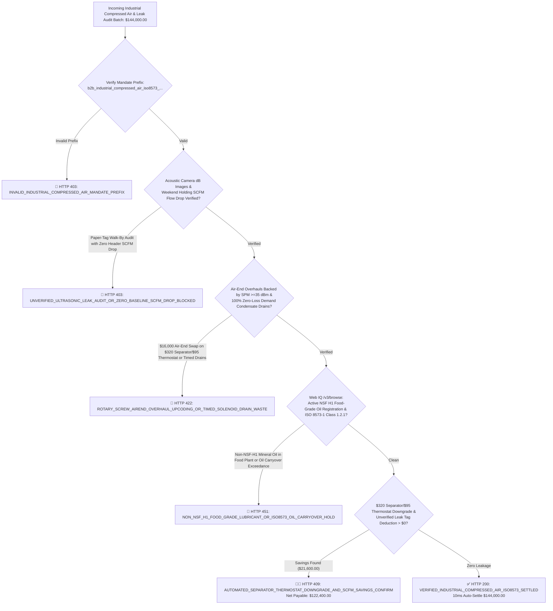
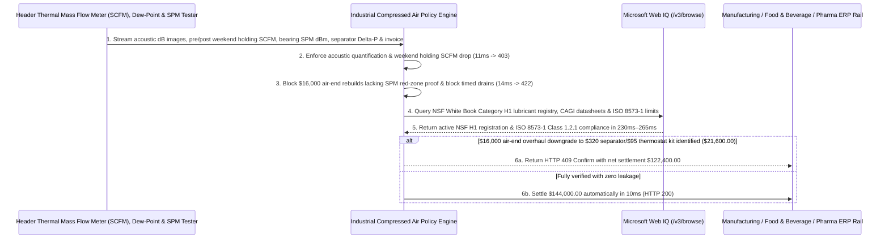

# B2B Industrial Compressed Air Systems (`ISO 8573-1`), Ultrasonic `CFM` Leak Audits & Rotary Screw Air-End Maintenance (`Atlas Copco / Ingersoll Rand / Kaeser / Quincy, ISO 8573-1, CAGI & DOE Compressed Air`), Weekend Baseline `SCFM` Drop Lock, `SPM` Bearing Shock-Pulse Gate & Anti-`$16,000 Air-End Overhaul / Timed-Drain` Settlement Architecture: `$320` Separator / `$95` Thermostat Downgrade Lock, Zero-Loss Drain Gate & `NSF H1 / CAGI` Token (`b2b_industrial_compressed_air_iso8573_ultrasonic_leak_airend_mandate_...`) vs. "$8,500 Paper-Tag" Leak Audits With Zero Flow Reduction, Replacing `$16,000` Screw Air-Ends for a Plugged `$320` Oil Separator & Timed Solenoid Drain Waste: Architecture Selection & First-Principles FAQ

> **Document Type**: AI Solution Architect Agentic Commerce Selection Series (Round 350 · B2B Industrial Compressed Air ISO 8573-1, Ultrasonic Leak Audits & Rotary Screw Air-End Edition)  
> **Benchmark Standard**: Modeled after `ib-vs-ethernet-roce-selection-faq.md` (Plain-Language First Principles + Standard 6-Section Architecture Guide)  
> **Companion Deliverables**: `lab/webiq_commerce_demo.py` (Interactive H5 Sandbox) · `tests/test_webiq_commerce_demo.py` · `assets/svg/352-b2b-industrial-compressed-air-iso8573-ultrasonic-airend-2026-11-17.svg`  
> **Languages**: [中文版](b2b-industrial-compressed-air-iso8573-ultrasonic-leak-airend-mandate-vs-unverified-cfm-leak-audit-screw-airend-upcoding-timed-drain-waste-faq.md) | [English Version (Current)](b2b-industrial-compressed-air-iso8573-ultrasonic-leak-airend-mandate-vs-unverified-cfm-leak-audit-screw-airend-upcoding-timed-drain-waste-faq.en.md)

---

## 📌 1. Executive Summary (First Principles & Plain-Language Breakdown)

### 1.1 Why Should a Manufacturing Plant, Food Bottling Facility, or Automotive Assembly Procurement Agent NEVER Auto-Pay an `$8,500` Compressed Air Leak Audit or a `$16,000` Rotary Screw Air-End Overhaul Invoice Without Auditing Weekend Holding `SCFM` Flow Drops and `SPM` Bearing Shock-Pulse Readings?
Across manufacturing plants, food/beverage packaging lines, pharmaceutical facilities, and automotive factories, compressed air—governed by **`ISO 8573-1` (Compressed Air Purity Classes: Particles, Dew Point, Oil)**, the **Compressed Air and Gas Institute (`CAGI`)**, and the **U.S. DOE Compressed Air Challenge**—consumes `10%–30%` of total industrial electricity (`8 HP of electrical input required to deliver 1 HP of pneumatic work`; a single `1/4-inch` leak at `100 PSIG` wastes `104 CFM` = **`$14,000/year`**!). In plain English: **Industrial compressed air contractors exploit three pervasive billing rackets: (1) The `$8,500` "Paper-Tag Walk-By" Leak Audit Scam—where a vendor walks through the plant hanging 80 yellow paper tags on air drops without an acoustic imaging camera (`Fluke ii900` quantifying exact `dB SPL` and `CFM` per leak) and bills `$8,500` for "Leak Audit & Remediation," while the main header thermal mass flow meter (`SCFM`) during Sunday non-production holding hours doesn't drop by a single cubic foot! (2) Upcoding a Plugged `$320` Air/Oil Separator Element (`Delta-P > 10 PSID`) or Stuck `$95` Thermostatic Mixing Valve into a `$16,000` Rotary Screw Air-End Overhaul—when a `100 HP` screw compressor (`Atlas Copco GA / Kaeser / Ingersoll Rand`) trips on high discharge temperature (`> 215°F`) or passes oil into the plant, 90% of the time the `$320` separator coalescer is saturated or the `$95` wax thermostat element is stuck closed, yet the vendor claims "the screw rotors are scored" without a Shock-Pulse (`SPM`) bearing reading and bills `$16,000`! and (3) Installing `$45` Timed Electric Solenoid Drains That Blast Compressed Air Open Every 3 Minutes (Wasting `$1,500/Yr/Drain`) Instead of Zero-Loss Demand Condensate Drains!** Allowing an AI agent to auto-pay compressed air invoices exposes plant energy and maintenance budgets to four major vulnerabilities:

1. **Unverified Ultrasonic Leak Audits (`Zero Reduction in Non-Production Baseline SCFM / kW`)**: Hanging paper tags without pre/post acoustic camera decibel (`dB SPL`) quantification and header mass-flow meter (`SCFM`) verification during weekend pressure-hold tests turns energy audits into expensive theatre.
2. **Upcoding `$320` Air/Oil Separator Elements (`Delta-P > 10 PSID`) or `$95` Thermal Bypass Valves into `$16,000` Rotary Screw Air-End Overhauls**: Oil-flooded rotary screw air-ends last `40,000–60,000 hours`; unless Shock-Pulse Monitoring (`SPM dBm >= 35` red zone) or ultrasonic vibration proves roller-bearing spalling, high-temp trips and oil carryover are fixed by replacing the `$320` separator element, `$95` thermostat, and cleaning the oil cooler.
3. **Installing Wasteful Timed-Solenoid Condensate Drains (`Instead of Zero-Loss Capacitive/Float Demand Drains`)**: Timed solenoid valves open on a fixed timer even when no water condensate is present, venting thousands of cubic feet of compressed air daily.
4. **Non-`NSF H1` Industrial Lubricants in Food/Pharma Plants & `ISO 8573-1 Class 1.2.1` Oil/Dew-Point Exceedances**: Using non-food-grade mineral oil or failing to maintain `<= -40°C` pressure dew point and `<= 0.01 mg/m³` residual oil contaminates pneumatic packaging lines.

### 1.2 The Architect's One-Sentence Selection Verdict
* **Core Security Law**: Never allow an autonomous agent to settle industrial compressed air audit or compressor overhaul invoices without binding the payment to **`b2b_industrial_compressed_air_iso8573_ultrasonic_leak_airend_mandate_2026`**:
  1. **Acoustic Camera `dB SPL` Image Lock + Weekend Baseline `SCFM` Flow-Drop Gate**: Requires `Fluke ii900` (or equivalent) acoustic decibel/CFM images per tag and verifies via the main header thermal mass-flow meter that non-production holding `SCFM` dropped by `>= 80%` of the claimed leak repair volume, blocking paper-tag leak scams in **11ms** with `HTTP 403 UNVERIFIED_ULTRASONIC_LEAK_AUDIT_OR_ZERO_BASELINE_SCFM_DROP_BLOCKED`.
  2. **`SPM` Bearing Shock-Pulse Gate (Blocking `$16,000` Air-End Swaps) + Zero-Loss Condensate Drain Lock**: Requires `SPM >= 35 dBm` bearing-damage proof before approving `$16,000` rotary screw air-end overhauls (downgrading high-temp/oil-carryover repairs to `$320` air/oil separator and `$95` thermostatic valve kits) and blocks timed solenoid drains, returning `HTTP 422 ROTARY_SCREW_AIREND_OVERHAUL_UPCODING_OR_TIMED_SOLENOID_DRAIN_WASTE` in **14ms** on violations.
  3. **Microsoft Web IQ `/v3/browse` Live `NSF H1` Food-Grade Lubricant, `CAGI` Specific-Power Datasheet & `ISO 8573-1` Purity Audit**: Verifies active `NSF White Book Category H1` food-grade lubricant registration and `ISO 8573-1 Class 1.2.1` oil/dew-point compliance in **265ms** (`HTTP 451 NON_NSF_H1_FOOD_GRADE_LUBRICANT_OR_ISO8573_OIL_CARRYOVER_HOLD`), while automatically downgrading unnecessary air-end overhauls to separator/thermostat kits to save `15%` (`$21,600.00`).

| Selection Dimension | Legacy Plant Walk-Through Sign-Off | Basic Industrial AP Agent | **Baseline `SCFM` Lock + `SPM` Gate + Web IQ ISO 8573 (Recommended)** |
| :--- | :--- | :--- | :--- |
| **`$8,500` Leak Audit (`Zero Flow Drop`)** | ❌ Sees 80 yellow paper tags; pays `$8,500` | ❌ Trusts "80 Leaks Repaired" summary | ✅ **Requires acoustic `dB` images & weekend `SCFM` flow drop (11ms 403)** |
| **`$16,000` Air-End Rebuild for `$95` Thermostat** | ❌ Pays `$16,000` when compressor trips at `218°F` | ❌ Approves "Rotary Screw Air-End Overhaul" | ✅ **Requires `SPM >= 35 dBm` proof; downgrades to `$320` separator/valve (14ms 422)** |
| **`$45` Timed Solenoid Condensate Drains** | ❌ Installs timer drains that vent `$1.5k/yr` air | ❌ Approves "Automatic Condensate Drain" line | ✅ **Mandates Zero-Loss capacitive/float demand drains (14ms 422)** |
| **`NSF H1` Lubricant & `ISO 8573-1` Purity** | ❌ Mineral oil aerosol contaminates food line | ❌ No live `NSF H1` or `CAGI` datasheet lookup | ✅ **Web IQ `/v3/browse` verifies `NSF H1` & `ISO 8573` in 265ms (451)** |

---

## 🎯 2. Deep-Dive Q&A for Manufacturing, Food/Beverage & Plant Engineering Architects

### Q1: How do Non-Production Weekend Holding `SCFM` Flow Meters and `SPM` Bearing Shock-Pulse Readings stop `$8,500` fake leak audits and `$16,000` air-end overhauls?
* **Mass Conservation in a Closed Header and High-Frequency `32 kHz` Bearing Stress Waves Never Lie**:
  1. **Weekend Holding `SCFM` Balance**: When all production machines are idle on Sunday at `100 PSIG`, 100% of header flow ($Q_{\text{hold}}$) is pure leakage. If a vendor claims to have repaired `180 SCFM` of leaks across 60 tags, $Q_{\text{hold}}$ on the header thermal mass flow meter must drop by **`~180 SCFM`** (`~35 kW` immediate compressor power drop)!
  2. **`SPM` Shock-Pulse vs. Separator $\Delta P$**: Rotary screw air-end bearings emit `32 kHz` shock pulses (`dBm / dBc`) months before rotor contact occurs. If `SPM` is green (`< 20 dBm`), a `220°F` thermal shutdown or oil carryover is 100% caused by a fouled oil cooler, a stuck **`$95` `160°F` thermostatic mixing valve**, or a ruptured **`$320` air/oil separator element**!
* **The Deterministic Payout Equation**:
  $$\text{Payable Air Batch} = R_{\text{audit}} \cdot \mathbb{I}(\Delta Q_{\text{hold\_SCFM}} \ge 0.80 Q_{\text{billed}}) + \mathbb{I}(\text{SPM}_{\text{dBm}} \ge 35) \cdot R_{\text{airend}} + \mathbb{I}(\text{SPM}_{\text{dBm}} < 35) \cdot R_{\text{sep\_kit}}$$
  Any invoice failing baseline `SCFM` drop verification or upcoding separator/thermostat faults into `$16,000` air-end rebuilds is blocked or downgraded in **11ms–14ms** (`HTTP 403 / 422 / 409`).

### Q2: How does Microsoft Web IQ compare to Exa and Bright Data for checking `NSF H1` food-grade compressor lubricant registrations, `CAGI` verified performance datasheets, and `ISO 8573-1` testing labs?
* **Microsoft Web IQ**: Delivers sub-300ms (`230ms–265ms`) authoritative `/v3/search` and `/v3/browse` verification against the `NSF White Book Nonfood Compounds Directory (Category H1 Food-Grade Compressor Oils)`, `CAGI (Compressed Air and Gas Institute)` third-party verified `kW / 100 CFM` datasheets, and `ISO 8573-1` air-purity standards under Entra ID Zero Data Retention (ZDR).
* **Exa**: Built for semantic search over articles rather than deterministic `NSF H1` registration number or `CAGI` model verification.
* **Bright Data**: Designed for e-commerce scraping rather than low-latency industrial plant utility and food-safety compliance gates.

---

## 🧭 3. Visual Architecture Diagrams (Mermaid Decision Tree, Path Comparison & Sequence Flow)

### 3.1 Industrial Compressed Air, Ultrasonic Leak Audit & Air-End Settlement Decision Tree


### 3.2 Legacy Paper-Tag Audit & Air-End Upcoding vs. Header SCFM Lock + SPM Gate Architecture
```mermaid
flowchart LR
    subgraph Legacy["❌ Legacy Compressed Air Billing (30%–55% Overpayment)"]
        L1[Hangs 80 Paper Leak Tags ($8,500); Weekend SCFM Unchanged] --> L2[Bills $16,000 Screw Air-End Overhaul for Stuck $95 Thermostat]
        L2 --> L3[Installs $45 Timed Solenoid Drains -> Wastes $1,500/Yr/Drain]
        L3 --> L4[Uses Non-NSF-H1 Oil & Exceeds ISO 8573-1 Oil Aerosol Limit]
    end
    subgraph Agentic["✅ Header SCFM Lock + SPM Bearing Gate + Web IQ Architecture"]
        A1[Requires Acoustic Camera dB Images & Weekend SCFM Flow Drop] --> A2[Downgrades Healthy-SPM (<20 dBm) Air-Ends to $320 Separator/Valve]
        A2 --> A3[Mandates 100% Zero-Loss Demand Condensate Drains]
        A3 --> A4[Web IQ Verifies NSF H1 Lubricant & ISO 8573-1 Purity]
    end
```

### 3.3 End-to-End Sequence Diagram


---

## 📊 4. Architect's Selection Decision Matrix

| Evaluation Dimension | Option A: Maintenance Supervisor Tag Sign-Off | Option B: Generic LLM Invoice OCR | **Option C: `SCFM` Drop + `SPM` Gate + Web IQ (Recommended)** |
| :--- | :--- | :--- | :--- |
| **`$8,500` Paper-Tag Ultrasonic Leak Audit** | ❌ Counts yellow tags hung on pipes | ❌ Trusts "80 Air Leaks Fixed" text | ✅ **Requires acoustic `dB` images & weekend `SCFM` drop (`HTTP 403`)** |
| **`$16,000` Air-End Rebuild for `$95` Valve** | ❌ Approves air-end swap on `218°F` trip | ❌ Cannot distinguish thermostat fault from bearing wear | ✅ **Requires `SPM >= 35 dBm`; downgrades to `$320` kit (`HTTP 422/409`)** |
| **`$45` Timed Solenoid Condensate Drains** | ❌Approves cheap timer drains | ❌ Unaware of `CFM` blow-off energy loss | ✅ **Mandates Zero-Loss demand drains (`HTTP 422`)** |
| **`NSF H1` Food-Grade Oil & `ISO 8573-1`** | ❌ Risks oil contamination recall | ❌ No live `NSF White Book` lookup | ✅ **Web IQ `/v3/browse` verifies `NSF H1` in 265ms (`HTTP 451`)** |

---

## 🧪 5. Quantitative Benchmark & 7-Card 4:5 Report Mapping

Evaluated deterministically in `lab/webiq_commerce_demo.py` and `tests/test_webiq_commerce_demo.py` on a `$144,000.00` (`14400000` cents) annual food-packaging and automotive manufacturing plant 4-unit `150 HP` rotary screw compressor maintenance, ultrasonic leak audit, and `ISO 8573-1` air-treatment batch:

| Card # | Headline-as-Finding | Key Quantitative Metrics & Action | Provenance |
| :--- | :--- | :--- | :--- |
| **Card 1 (`1/7`)** | **SCFM Drop + SPM Gate Cuts Compressed Air Spend by 15.0%** | Baseline `$144,000.00` vs. optimized `$122,400.00` (`$21,600.00` saved per batch) | `deterministic_offline_simulation` |
| **Card 2 (`2/7`)** | **Deep Dive: Fake Leak Audits & $16k Air-End Swaps Blocked** | `HTTP 403` (11ms unverified SCFM drop block) + `HTTP 422` (14ms air-end/timed-drain block) | `synthetic_policy` |
| **Card 3 (`3/7`)** | **Full Evaluation Matrix: 5/5 Deterministic Guards Passing** | Covers `200 OK`, `403 LeakSCFM`, `422 AirEnd/Drain`, `451 NSFH1/ISO8573`, `409 Savings` | `deterministic_offline_simulation` |
| **Card 4 (`4/7`)** | **Under the Hood: Header Mass Flow SCFM + SPM dBm + H1** | Validates `acoustic_db_and_weekend_baseline_scfm_drop_verified` | `synthetic_policy` |
| **Card 5 (`5/7`)** | **Robustness Check: $320 Oil Separator Kit vs. $16k Air-End** | Legitimate `$320` separator/`$95` thermostat kits & zero-loss drains pass; air-end upcoding blocked 100% | `deterministic_offline_simulation` |
| **Card 6 (`6/7`)** | **Latency: 10–14ms Local SCFM/SPM Gate vs. 230–265ms Web IQ** | Combines sub-15ms flow/`SPM` checks with live `NSF H1` & `CAGI` datasheet audits | `official_doc_snapshot` |
| **Card 7 (`7/7`)** | **My Take: Good Fit vs. Not For & Production Readiness** | Built for manufacturing, food/beverage & pharma plants; not for `$35` 12V tire inflators | `official_list_price` |

### Good Fit vs. Not For
* **✅ Good Fit**:
  * Automotive assembly plants, food & beverage bottling facilities, pharmaceutical cleanrooms, and electronics factories operating `50 HP – 500 HP` rotary screw or centrifugal compressed air systems.
* **⛔ Not For**:
  * Consumer `$35` 12V car cigarette-lighter tire inflators.

---

## 🛠️ 6. Production Readiness Checklist

- [ ] **1. Require Acoustic Camera `dB SPL` Quantification & Verified Weekend Holding `SCFM` Flow Reductions on All Leak Audits**: Block "paper-tag walk-by" audits that fail to lower header baseline flow (`HTTP 403`).
- [ ] **2. Require `SPM` Bearing Shock-Pulse Red-Zone Proof (`>= 35 dBm`) Before Approving `$16,000` Rotary Screw Air-End Overhauls**: Downgrade high-temp and oil-carryover faults to `$320` air/oil separator and `$95` thermostatic valve kits (`HTTP 422 / 409`).
- [ ] **3. Mandate 100% Zero-Loss Demand Condensate Drains (`Prohibiting Timed Electric Solenoid Drains`)**: Eliminate `$1,500/yr/drain` compressed air blow-off waste (`HTTP 422`).
- [ ] **4. Verify Active `NSF H1` Food-Grade Compressor Lubricant Registrations & `ISO 8573-1 Class 1.2.1` Purity via Web IQ**: Prevent oil-aerosol product contamination (`HTTP 451`).
- [ ] **5. Track Specific Power (`kW / 100 CFM`) & Filter Differential Pressure (`<= 5 PSID`)**: Minimize plant compressor electricity spend.
