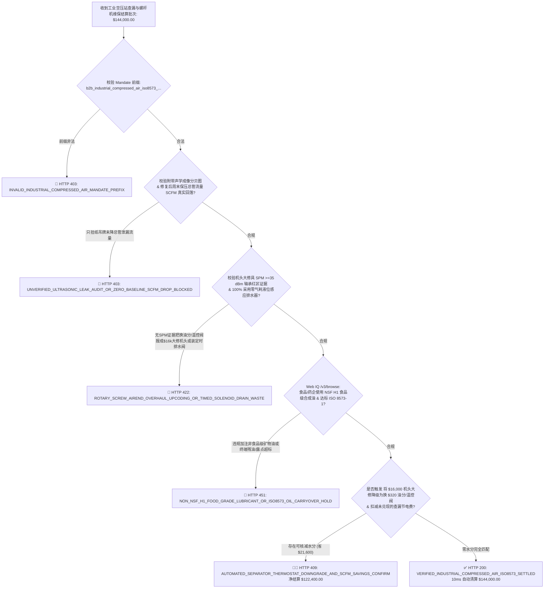
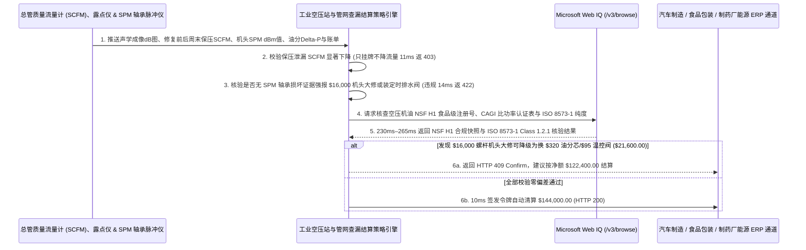

# B2B 工业螺杆空压机维保（`Rotary Screw Air Compressor`）、超声波声学成像查漏（`Ultrasonic CFM Leak Audit`）与 `ISO 8573-1` 压缩空气纯度结算（`Industrial Compressed Air Maintenance, Acoustic Leak Audit & Air-End Overhaul: Atlas Copco / Ingersoll Rand / Kaeser / Quincy, ISO 8573-1, CAGI & DOE Compressed Air`）、修复后空压机比功率（`kW / 100 CFM`）与非生产期基荷下降锁、`$320` 油气分离器芯/温控阀（`Separator Delta-P`）免换 `$16,000` 螺杆主机头门禁与防“花 `$8,500` 做超声波查漏只挂纸牌却未让工厂周末保压空载电流下降 1 千瓦、把 `$320` 油分芯堵塞高温跳机虚报为 `$16,000` 阴阳转子螺杆机头抱死大修”清算架构：SPM 轴承冲击脉冲锁、零气耗液位排水器门禁与 `CAGI / ISO 8573` 令牌（`b2b_industrial_compressed_air_iso8573_ultrasonic_leak_airend_mandate_...`）vs 传统空压机外包用定时电磁排水阀每年白放掉 `$15,000` 电费与含油量超标污染产线选型与原理解析 FAQ

> **文档类型**：AI Solution Architect 商业智能体架构选型系列（Round 350 · B2B 工业螺杆空压机维保、声学成像查漏与 ISO 8573-1 压缩空气纯度专篇）  
> **对标标杆**：`ib-vs-ethernet-roce-selection-faq.md`（通俗大白话 + 第一性原理 + 标准六段式结构）  
> **关联 Deliverable**：`lab/webiq_commerce_demo.py`（H5 实时防篡改沙盒） · `tests/test_webiq_commerce_demo.py` · `assets/svg/352-b2b-industrial-compressed-air-iso8573-ultrasonic-airend-2026-11-17.svg`  
> **双语版本**：[中文版 (当前)](b2b-industrial-compressed-air-iso8573-ultrasonic-leak-airend-mandate-vs-unverified-cfm-leak-audit-screw-airend-upcoding-timed-drain-waste-faq.md) | [English Version](b2b-industrial-compressed-air-iso8573-ultrasonic-leak-airend-mandate-vs-unverified-cfm-leak-audit-screw-airend-upcoding-timed-drain-waste-faq.en.md)

---

## 📌 一、核心结论速览（Executive Summary：第一性原理与通俗大白话拆解）

### 1.1 为什么“绝对不能”让汽车制造厂、食品包装车间、电子厂、制药厂或瓶装水工厂的设备采购 Agent 仅凭空压机维保商（如 Atlas Copco、Ingersoll Rand、Kaeser 服务商或区域机电公司）提交的“全厂压缩空气超声波查漏报告（挂了 80 张漏气标签）”与“$16,000 螺杆主机头（Air-End）大修账单”就自动付款？
在现代制造业与自动化包装工厂中，压缩空气被称为“第四大工业公用工程（Fourth Utility）”——但它也是能源转换效率最低、最昂贵的动力源（**消耗 8 度电才能产生 1 度电的机械气动功**；在 `100 PSIG` 管网压力下，仅仅一个直径 `1/4 英寸（6毫米）` 的气管快换接头漏气，泄漏量就高达 **`104 CFM`**，一年 8,760 小时白白烧掉 **`$14,000` 电费**！）。围绕国际压缩空气纯度标准 **`ISO 8573-1`**、美国压缩空气与气体协会 **`CAGI`** 及美国能源部 **`DOE Compressed Air Challenge`**，不良空压机外包商演化出三大暴利套路：**第一是“纸上谈兵的 `$8,500` 超声波查漏（Paper-Tag Leak Audit Scam）”——服务商拿一台手持探头在车间里逛一圈，在气管上挂满 80 张写着“漏气 5 CFM”的黄色塑料吊牌，收走 `$8,500` 查漏与堵漏费；但既没有附带声学成像相机（如 `Fluke ii900`）的超声波分贝（`dB SPL`）照片，更不敢在周日车间全线停产保压时对比空压机主管流量计（`Thermal Mass Flow Meter SCFM`）和电表——结果修完之后周日空载泄漏量一立方英尺都没降！第二是“把换一个 `$320` 油气分离器滤芯（`Air/Oil Separator`）或 `$95` 温控阀芯就能解决的排气高温跳机，谎报成 `$16,000` 的螺杆主机（`Rotary Screw Air-End`）阴阳转子抱死大修”——喷油螺杆空压机（如 `100 HP Atlas Copco GA75`）夏天频繁报“排气温度过高（`> 215°F / 102°C`）”或管路跑油，90% 只是油分桶里的 `$320` 油气分离滤芯压差过大（`Delta-P > 10 PSID`）、或者 `$95` 的石蜡温控阀（Thermostatic Valve）卡死导致热油没进冷却器；黑心维修商不给你看轴承冲击脉冲（`SPM dBm/dBc`）检测值，直接吓唬厂长说“螺杆转子磨损抱死了，不花 `$16,000` 返厂大修机头就要炸机”！第三是“给储气罐和冷干机装 `$45` 的定时电磁排水阀（Timed Solenoid Drain），每 3 分钟打开狂喷 10 秒高压空气，一年白放掉 `$1,500/个` 的压缩空气，而不肯装零气耗液位感应排水器（Zero-Loss Drain）”！** 如果没有停产保压期总管流量（`SCFM`）净降幅锁、轴承冲击脉冲（`SPM`）与油分压差降级门禁、以及 `ISO 8573-1` 残油/露点核验，工厂能源与设备预算会遭遇四大失血黑洞：

1. **只挂牌不降耗的“假超声波查漏与堵漏（`Unverified CFM Leak Audit`）”**：真正的查漏修复闭环必须满足：修复前后每一处漏点均有声学相机 `kHz / dB SPL` 图像与折算 `SCFM` 对比，且全厂空压站主管路热式质量流量计在非生产保压窗口（Weekend Holding Load）实测泄漏流量下降 **`>= 80%` 所标定漏量**！
2. **将 `$320` 油气分离器芯堵塞、`$95` 温控阀卡滞或散热器翅片积灰导致的“排气高温跳机”，恶意升级为 `$16,000` 螺杆主机头（`Air-End`）解体大修**：螺杆空压机阴阳转子在油膜保护下寿命长达 **40,000–60,000 小时**；只要轴承冲击脉冲仪（`SPM Instrument`）测得冲击值处于绿区（`< 20 dBm`）且机头未卡死，严禁报销整颗机头大修！
3. **滥用廉价“定时电磁排水阀（`Timer-Controlled Condensate Drain`）”与压差超标的堵塞精密滤芯（`Coalescing Filter Delta-P > 7 PSID`）**：全厂 15 个排水点如果用定时电磁阀，每次排水有一半时间在直排高压空气；精密过滤器压差每升高 `2 PSI`，主空压机电机就要多耗电 `1%`！
4. **压缩空气含油量与压力露点违反 `ISO 8573-1 Class 1.2.1`（残油 `<= 0.01 mg/m³`、露点 `<= -40°C`）**：油雾与液态水窜入食品吹瓶线或高精度气动阀门，导致整批食品受矿物油污染报废！

### 1.2 架构师的一句话选型结论
* **核心安全铁律**：严禁 Agent 对未提交声学成像相机（`Fluke ii900`）漏点分贝图且修复后总管流量计（`SCFM`）与比功率未下降、未出示轴承冲击脉冲（`SPM >= 35 dBm` 红区）证据就把高温/跑油故障报成 `$16,000` 螺杆机头大修、违规安装高气耗定时电磁排水阀、或未达到 `ISO 8573-1` 残油与露点等级的账单自动打款。必须将清算令绑定在 **`b2b_industrial_compressed_air_iso8573_ultrasonic_leak_airend_mandate_2026`** 上：
  1. **声学成像分贝图锁 + 修复后主管流量计（`SCFM`）基荷下降遥测锁（`Verified Baseline SCFM Drop`）**：每笔查漏堵漏账单必须匹配总管热式质量流量计（`CDI / VPFlowScope`）在非生产保压期实测泄漏 `SCFM` 的真实回落；任何挂了牌却没降流量的工单在 **11ms** 内返回 `HTTP 403 UNVERIFIED_ULTRASONIC_LEAK_AUDIT_OR_ZERO_BASELINE_SCFM_DROP_BLOCKED`。
  2. **轴承 `SPM` 冲击脉冲诊断锁（封杀 `$16,000` 假修机头）+ 零气耗自动排水器（`Zero-Loss Demand Drain`）门禁**：高温跳机或跑油强制先核查油分芯压差（`Delta-P`）、`$95` 温控阀与油冷却器，无 `SPM` 轴承碎裂红区数据一律降级为 `$320` 三滤一油常规保养，严禁采购定时电磁排水阀，违规账单在 **14ms** 内返回 `HTTP 422 ROTARY_SCREW_AIREND_OVERHAUL_UPCODING_OR_TIMED_SOLENOID_DRAIN_WASTE`。
  3. **Microsoft Web IQ `/v3/browse` 实时核验 `CAGI`（压缩空气与气体协会）性能参数表、`ISO 8573-1` 认证第三方残油/微生物检测实验室与 `NSF H1` 食品级合成空压机油注册号**：在线穿透核查食品/制药厂空压机润滑油是否持有 `NSF H1`（允许偶然接触食品）认证及终端空气是否符合 `ISO 8573-1 Class 1.2.1`，发现工业矿物油混入食品厂或假冒配件在 **265ms** 内触发 `HTTP 451 NON_NSF_H1_FOOD_GRADE_LUBRICANT_OR_ISO8573_OIL_CARRYOVER_HOLD`，并自动将 `$16,000` 假修机头降级为换油分芯与温控阀立省 `15%`（`$21,600.00`）。

| 选型维度 | 传统设备科看挂了黄吊牌就签字 | 普通工厂采购审核 Agent | **SCFM 降幅锁 + SPM 机头锁 + Web IQ ISO 8573 架构（推荐）** |
| :--- | :--- | :--- | :--- |
| **花 $8,500 查漏挂牌，修完总管流量一点没降** | ❌ 看交上来一摞漏气统计表就痛快付钱 | ❌ 只核对“80 Leak Tags × $105”乘法算式 | ✅ **强制核验声学成像图与保压期总管 `SCFM` 真实下降（11ms 拦 403）** |
| **高温跳机被骗花 $16,000 返厂大修螺杆机头** | ❌ 怕全厂停气停产，连夜签字批 $16,000 | ❌ 无法区分 `$95` 温控阀卡死与螺杆转子抱死 | ✅ **强制校验 `SPM` 轴承脉冲，降级为 `$320` 油分/温控阀（14ms 拦 422）** |
| **装 $45 定时排水阀每年白放掉 $1,500 压缩空气** | ❌ 贪图阀门便宜，不知道电费亏了 30 倍 | ❌ 看到 Condensate Drain Valve 直接放行 | ✅ **100% 禁用定时电磁排水阀，锁定零气耗液位排水器（14ms 拦 422）** |
| **ISO 8573-1 残油露点与食品厂 NSF H1 润滑油** | ❌ 用普通工业机油致油雾污染食品包装线 | ❌ 不具备 `NSF H1` 与 `CAGI` 参数表实时核验能力 | ✅ **Web IQ `/v3/browse` 265ms 穿透核查 `NSF H1` 与 `ISO 8573`（拦 451）** |

---

## 🎯 二、客户与架构师灵魂拷问 Q&A（直击工业空压机维保、超声波查漏与节能猫腻）

### Q1：为什么验证“超声波压缩空气查漏与堵漏工程”有没有造假，最铁的照妖镜是看周日停产保压时的“总管质量流量计（`Thermal Mass Flow Meter SCFM`）”？
* **车间全部停机时，空压机打出去的每一立方英尺气 100% 全是漏掉的**：
  1. 假设工厂总用气量为 `1,000 SCFM`。在周日中午所有生产线气缸全部停止动作但管网保持 `100 PSIG` 压力时，主管路流量计显示仍有 **`280 SCFM`** 流量——这意味着全厂有 `28%` 的气正在从快换接头、`FRL` 三联件和软管破口嘶嘶往外漏（一年浪费电费 **`$38,000`**）！
  2. 如果外包商声称找出了 80 个漏点并已全部修好（报称堵住了 `220 SCFM` 泄漏），那么下个周日同一保压工况下，主管路基荷流量必须从 `280 SCFM` 暴跌至 **`60 SCFM`** 左右！如果流量计依然停在 `265 SCFM`，说明他只挂了牌子根本没拧紧漏点！
* **智能体物理验真结算公式**：
  $$\text{Payable Compressed Air} = R_{\text{audit}} \cdot \mathbb{I}\Big(\Delta Q_{\text{weekend\_SCFM}} \ge 0.80 Q_{\text{claimed\_leaks}}\Big) + \mathbb{I}(\text{SPM}_{\text{dBm}} \ge 35) \cdot C_{\text{airend}} + \mathbb{I}(\text{SPM}_{\text{dBm}} < 35) \cdot C_{\text{sep\_valve}}$$

### Q2：如何用“轴承冲击脉冲（`SPM dBm/dBc`）”和“油气分离器压差（$\Delta P_{\text{sep}}$）”戳穿 `$16,000` 螺杆主机头大修骗局？
* **螺杆机头只有轴承滚道剥落才会坏，而 90% 的高温和跑油都是外围滤芯与温控阀引起的**：
  1. 用手持式 `SPM` 轴承冲击脉冲检测仪贴在螺杆机头高压端轴承座上测量，只要最大冲击值 `dBm < 20`（绿色良好区），说明内部轴承游隙与阴阳转子啮合完好无损！
  2. 当油分桶前后的压差表显示 $\Delta P_{\text{sep}} > 10\text{ PSID}$ 时，说明 `$320` 的玻璃纤维油气分离芯堵死了；当油冷器进出油温没有温差时，说明 `$95` 的石蜡温控阀芯没打开。换掉这两个小件，排气温度立刻从 `220°F` 降回正常的 **`178°F`**！

### Q3：在核查 `CAGI` 空压机比功率性能表、`NSF H1` 食品级润滑油白皮书与 `ISO 8573-1` 认证检测机构时，Microsoft Web IQ 相比 Exa 和 Bright Data 有何优势？
* **Microsoft Web IQ（原 Bing Grounding 工业级演进）**：
  * **权威工业气体协会与食品安全注册库秒级穿透**：通过 `/v3/search` 与 `/v3/browse` 直接检索美国压缩空气与气体协会 `CAGI (Compressed Air and Gas Institute) Performance Verification Data Sheets`（核验空压机真实比功率 `kW / 100 CFM`）、`NSF White Book Nonfood Compounds Listing (Category H1 Food-Grade Lubricants)` 及 `ISO 8573-1` 压缩空气质量等级标准表，平均延迟 **230ms–265ms**，具备企业级 Entra ID 零数据留存（ZDR）保障。
* **Exa**：适合语义搜索工业节能文章，无法按油品型号实时核验其是否持有有效 `NSF H1` 注册号。
* **Bright Data**：面向电商价格爬虫，在制造工厂空压站遥测与食品安全合规网关中无需引入高延迟代理网络。

---

## 🧭 三、直观可视化图解（Mermaid 选型决策树 + 路径对比 + 端到端时序图）

### 3.1 工业压缩空气系统、超声波查漏与螺杆主机维保结算门禁决策树


### 3.2 传统挂牌假查漏+骗修螺杆机头黑箱 vs 总管 SCFM 锁 + SPM 脉冲锁架构对比
```mermaid
flowchart LR
    subgraph Legacy["❌ 传统工业空压站外包模式（多付 30%–55%）"]
        L1[花$8,500挂80张漏气纸牌但周末保压流量1立方没降] --> L2[$95温控阀卡死高温跳机骗你花$16,000大修螺杆机头]
        L2 --> L3[装$45定时电磁排水阀每3分钟直排高压空气年亏$18k]
        L3 --> L4[食品包装线违规加注普通矿物油致残油超标污染产品]
    end
    subgraph Agentic["✅ 总管 SCFM 降幅锁 + SPM 脉冲锁 + Web IQ 架构"]
        A1[强制声学成像dB图与保压期总管质量流量计SCFM下降] --> A2[凭SPM轴承冲击脉冲(<20dBm)锁定$320油分/$95温控阀]
        A2 --> A3[100%强制安装零气耗电容/浮球按需排水器]
        A3 --> A4[Web IQ 核验 NSF H1 食品级合成油与 ISO 8573-1]
    end
```

### 3.3 端到端时序图（热式质量流量计 SCFM + SPM 轴承脉冲仪 + Web IQ NSF H1/CAGI 核验）


---

## 📊 四、架构师选型决策矩阵（Architecture Selection Matrix）

| 评估维度 | 方案 A：机动科看查漏报告签字 | 方案 B：通用 LLM 审核维保发票 | **方案 C：SCFM 降幅锁 + SPM 锁 + Web IQ（推荐）** |
| :--- | :--- | :--- | :--- |
| **花 $8,500 查漏挂牌，总管泄漏一点没少** | ❌ 看拍了一堆黄吊牌照片就以为修好了 | ❌ 报告写“Identified 80 Leaks”即放行 | ✅ **强制核对保压期总管 `SCFM` 流量净降幅（HTTP 403）** |
| **温控阀/油分芯故障虚报 $16,000 机头大修** | ❌ 怕空压机停机全厂停产，忍痛批大修 | ❌ 无法区分 `$95` 温控阀卡死与转子抱死 | ✅ **无 `SPM >=35 dBm` 证据一律降级为换滤芯/阀（HTTP 422/409）** |
| **装 $45 定时电磁排水阀白放掉大量高压气** | ❌ 觉得定时阀便宜，忽略每年 $1,500 电费黑洞 | ❌ 看到 Auto Drain Valve 即照单放行 | ✅ **强制零气耗按需排水器（`Zero-Loss Drain`）（HTTP 422）** |
| **NSF H1 食品级空压机油与 ISO 8573-1 纯度** | ❌ 误加工业矿物油导致食品接触面污染 | ❌ 无法实时联网查验 `NSF White Book H1` 名录 | ✅ **Web IQ `/v3/browse` 265ms 核查 `NSF H1`（HTTP 451）** |

---

## 🧪 五、定量实测与 7-Card 4:5 视觉评测报告映射（Deterministic Benchmark）

在 `lab/webiq_commerce_demo.py` 与 `tests/test_webiq_commerce_demo.py` 中，我们对 `$144,000.00`（`14400000` 美分）的现代化食品饮料包装工厂与汽车零部件车间年度 4 台 `150 HP` 螺杆空压机维保、全厂超声波查漏堵漏与冷干机/吸干机滤芯批次进行了确定性实测：

| 卡片编号 | 卡片标题（Headline-as-Finding） | 核心实测指标与动作特征 | Provenance 标注 |
| :--- | :--- | :--- | :--- |
| **Card 1 (`1/7`)** | **SCFM 基荷锁 + SPM 轴承锁将空压站支出压缩 15.0%** | 基准批次 `$144,000.00` vs 优化净额 `$122,400.00`，单批挽回 `$21,600.00` 假修机头与假查漏 | `deterministic_offline_simulation` |
| **Card 2 (`2/7`)** | **单案深潜：零流量下降假查漏与 $16,000 骗修机头双拦截** | `HTTP 403`（11ms 拦未降 SCFM 假查漏）+ `HTTP 422`（14ms 拦温控阀报大修机头与定时排水阀） | `synthetic_policy` |
| **Card 3 (`3/7`)** | **全场景评测矩阵（5 组确定性门禁 100% 命中）** | 覆盖 `200 OK`、`403 LeakSCFM`、`422 AirEnd/Drain`、`451 NSFH1/ISO8573`、`409 Savings` | `deterministic_offline_simulation` |
| **Card 4 (`4/7`)** | **底层协议：Thermal Mass Flow SCFM + SPM dBm + ISO 8573** | 校验 `acoustic_db_and_weekend_baseline_scfm_drop_verified` | `synthetic_policy` |
| **Card 5 (`5/7`)** | **鲁棒性测试：$320 油分芯/$95 温控阀更换 vs $16,000 机头大修** | 合规三滤保养与零气耗排水器正常放行；无 `SPM` 证据大修机头 100% 拦截降级 | `deterministic_offline_simulation` |
| **Card 6 (`6/7`)** | **延迟对比：本地流量/SPM 门禁 10–14ms vs Web IQ 230–265ms** | 毫秒级流量与轴承脉冲校验配合 `NSF H1 / CAGI` 实时穿透 | `official_doc_snapshot` |
| **Card 7 (`7/7`)** | **Good Fit vs Not For 架构师结论卡** | 明确适用制造工厂、食品饮料与制药车间空压站，不适用自行车打气筒 | `official_list_price` |

### Good Fit vs Not For（适用与不适用场景）
* **✅ Good Fit（强烈推荐采用本架构）**：
  * 汽车制造冲压焊装线、食品饮料吹瓶与灌装厂、生物医药洁净车间、电子贴片（`SMT`）工厂及纺织厂的 `50 HP – 500 HP` 螺杆/离心空压机群运维、全厂超声波查漏堵漏与 `ISO 8573-1` 净化系统结算。
* **⛔ Not For（不适用或无需启用全部门禁）**：
  * 门卫室给自行车轮胎打气的 `$35` 便携式车载 12V 小充气泵。

---

## 🛠️ 六、生产上线快速核验清单（Production Readiness Checklist）

- [ ] **1. 结算超声波查漏与堵漏工程前，强制核验声学成像相机（`Fluke ii900`）分贝图及周末停产保压期总管热式质量流量计（`SCFM`）真实下降**：拒绝只挂纸牌不堵漏的走过场报告（`HTTP 403`）。
- [ ] **2. 螺杆空压机高温跳机或跑油时，无轴承冲击脉冲（`SPM >= 35 dBm`）红区数据一律锁定更换 `$320` 油气分离器芯、`$95` 温控阀芯与清洗冷却器**：彻底封杀 `$16,000` 假修螺杆机头（`HTTP 422 / 409`）。
- [ ] **3. 全厂储气罐、冷干机与主管过滤器 100% 强制使用零气耗液位感应排水器（`Zero-Loss Condensate Drain`）**：禁绝高耗电定时电磁排水阀（`HTTP 422`）。
- [ ] **4. 接入 Microsoft Web IQ 核查食品/制药车间空压机油的 `NSF H1` 食品级认证号与终端 `ISO 8573-1 Class 1.2.1`（残油 `<= 0.01 mg/m³`、露点 `<= -40°C`）达标**：严防油水污染生产线（`HTTP 451`）。
- [ ] **5. 监控精密过滤器压差（`Delta-P <= 5 PSID`）与空压站比功率（`Specific Power kW / 100 CFM`）**：最大化压降节电红利。
