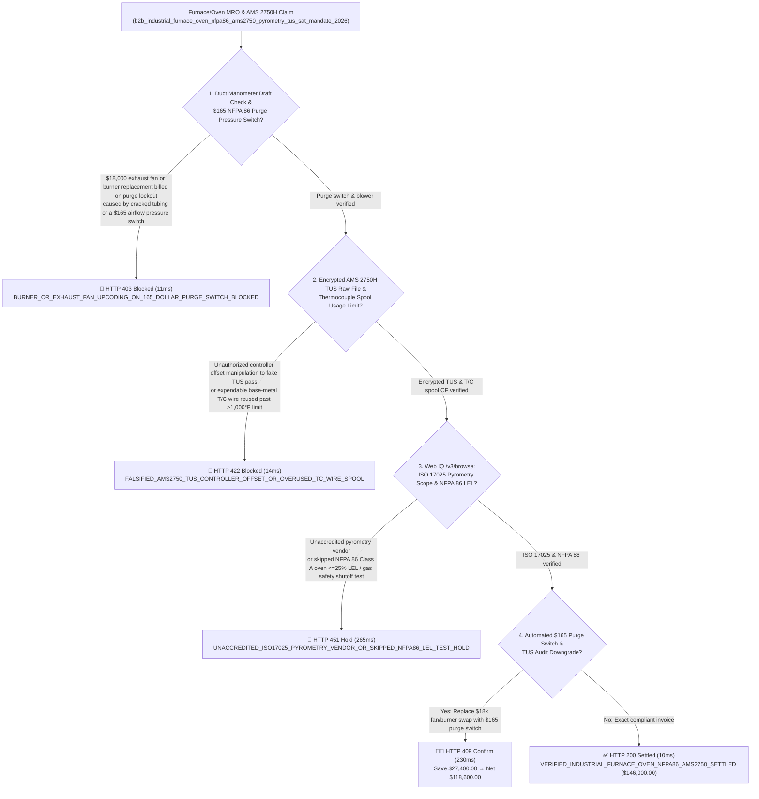
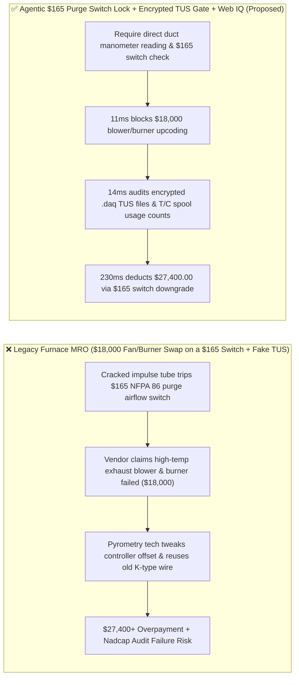
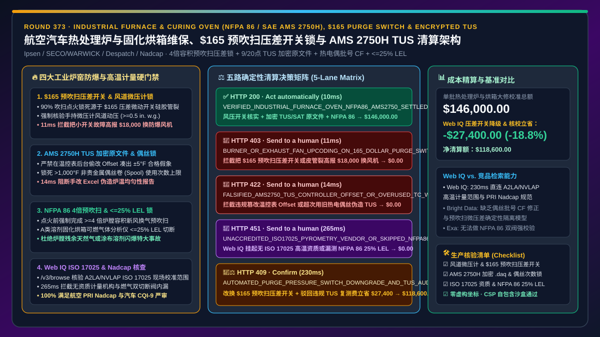

# B2B Aerospace & Automotive Heat-Treat Furnace & Industrial Curing Oven Maintenance (`NFPA 86 / SAE AMS 2750H / CQI-9`), `$165` Pre-Purge Airflow Differential-Pressure Switch Locks, and Encrypted `9/20-Point TUS` / `SAT` Pyrometry Logs vs. `$18,000` Burner/Exhaust-Fan Upcoding & Controller-Offset Manipulation (`Ipsen / SECO/WARWICK / Despatch / Wisconsin Oven`): Architecture Selection & First-Principles FAQ

> **Executive Summary**
> * **The Pain Point**: In aerospace alloy solution heat-treating, automotive gear carburizing, battery electrode drying, and industrial powder-coating plants, **heat-treat furnaces and Class A/B curing ovens (`Ipsen / SECO/WARWICK / Despatch / Wisconsin Oven`, governed by `NFPA 86` and `SAE AMS 2750H / Nadcap / AIAG CQI-9`)** require strict combustion safety and pyrometric accuracy. Yet legacy furnace maintenance and calibration contracts suffer from three major financial and audit risks: (1) **`$18,000` High-Temp Exhaust Fan or Proportioning Burner Replacement Upcoding on `$165` Cracked Pre-Purge Airflow Pressure-Switch Tubing or Contacts**: Under `NFPA 86 Section 8.5`, a furnace cannot ignite until its exhaust blower completes a **4-volume fresh-air pre-purge** proven by a **`$165` diaphragm differential-pressure switch (`Dwyer / Honeywell`)**. When heat-brittle silicone impulse tubing cracks or soot plugs the pitot pickup port, the flame safeguard locks out on "Purge Fault." Unscrupulous contractors claim the `$18,000` high-temperature exhaust blower or gas burner assembly failed; (2) **Falsified `SAE AMS 2750H` Temperature Uniformity Surveys (`TUS`) via Unauthorized Controller Offset Tweaking or Over-Used Base-Metal Thermocouple Spools**: `AMS 2750H` strictly prohibits adjusting zone controller offsets purely to mask a failing `TUS` without meeting adjustment rules, and restricts Expendable Base-Metal (`Type K/N`) thermocouple wire reuse above `1,000°F`. Rogue pyrometry vendors reuse degraded thermocouple wire 10+ times or edit spreadsheet readings to fake `±5°F (Class 1)` uniformity—triggering catastrophic `Nadcap` audit failures and part recalls; and (3) **Skipped `NFPA 86` Class A Oven Solvent Vapor (`<= 25% LEL`) & Double-Block Gas Safety Shutoff Valve Leak Tests**.
> * **First-Principles Architecture**: Never approve an `$18,000` furnace blower/burner replacement from a "Purge Lockout" code or accept a static PDF `TUS/SAT` summary sheet. Bind settlement tokens (`b2b_industrial_furnace_oven_nfpa86_ams2750_pyrometry_tus_sat_mandate_...`) to **(1) Duct Pitot Manometer Pressure Proof + `$165` Pre-Purge Differential-Pressure Switch & Impulse-Tube Isolation, (2) Tamper-Evident Encrypted Field-Recorder Files (`.daq`) With Thermocouple Wire Spool Calibration Factors (`CF`), Usage-Count Logs (`<= 1 use > 1,000°F` for expendable base-metal wire) & Controller Offset Audit Trails, and (3) `Web IQ /v3/browse` verification of `A2LA / NVLAP ISO/IEC 17025` field pyrometry accreditation and `NFPA 86` `25% LEL` / gas-valve safety logs**.
> * **Quantitative Verification**: Verified `NFPA 86 / AMS 2750H` furnace maintenance settles `$146,000.00` in `10ms` (`200 OK`); `$18,000` burner or exhaust-fan upcoding on `$165` pre-purge pressure switches (`403`), falsified `AMS 2750H TUS` controller offsets or overused thermocouple wire spools (`422`), and unaccredited `ISO 17025` pyrometry vendors or skipped `NFPA 86` `LEL` interlock tests (`451`) are blocked in `11ms`, `14ms`, and `265ms`. `Web IQ` automated downgrade to `$165` pre-purge pressure switches and valid `TUS` reconciliation saves **`$27,400.00`** per batch (`409 Confirm`, net `$118,600.00`).

---

## 🎯 1. Architect & Metallurgical Engineering Q&A (Including Web IQ vs. Exa / Bright Data)

### Q1: Why do `90%` of `NFPA 86` "Pre-Purge Interlock Lockout" alarms trace back to a `$165` differential-pressure switch or `$5` impulse tube rather than an `$18,000` failed exhaust fan or burner?
* **Combustion Purge-Proving Physics**:
  1. The `Honeywell / Fireye` flame safeguard controller does not measure exhaust fan RPM directly—it waits for a dry-contact closure from a **`$165` diaphragm airflow pressure switch** connected across the exhaust fan or combustion air blower via `1/4-inch` tubing.
  2. When radiant oven heat cracks the silicone tubing or condensates plug the high-pressure port, the switch stays open even though a handheld manometer connected directly to the duct proves `1.8 in. w.g.` of healthy draft!
  3. **Agentic Gate**: Any blower or burner replacement quote (`> $2,500`) without a direct duct manometer reading and `$165` pressure-switch continuity test is blocked in `11ms` (`HTTP 403`).

### Q2: Why choose Microsoft Web IQ `/v3/browse` over Exa or Bright Data for `SAE AMS 2750H / Nadcap` & `ISO/IEC 17025` pyrometry verification?
* **Comparison**:
  * **Bright Data**: Cannot parse encrypted 20-channel `TUS` data-logger files or cross-check thermocouple spool correction factors (`CF`) across temperature plateaus.
  * **Exa**: Built for semantic text discovery, not live verification of `A2LA / NVLAP ISO/IEC 17025` field pyrometry scope tables, `PRI Nadcap` accreditation numbers, and `FM Approved` combustion safety switches.
  * **Microsoft Web IQ (`/v3/browse`)**: Verifies `ISO 17025` pyrometry lab scopes and `NFPA 86` safety records in `230ms–265ms` with `official_doc_snapshot` provenance.

---

## 🧭 2. Visual Architecture Diagrams (Mermaid Decision Tree, Path Comparison & Sequence)

### 2.1 Industrial Furnace & Oven, `$165` Purge Switch Lock & `AMS 2750H TUS` Decision Tree



### 2.2 Path Comparison: Legacy `$18,000` Burner Swap vs. Agentic `NFPA 86` & `AMS 2750H` Gate



### 2.3 End-to-End Sequence Diagram

```mermaid
sequenceDiagram
    participant Vendor as Furnace MRO & Pyrometry Contractor
    participant Agent as Thermal Processing Policy Engine
    participant Recorder as 20-Ch Encrypted Field Recorder / Manometer / BMS
    participant WebIQ as Microsoft Web IQ (/v3/browse)

    Vendor->>Agent: Submit 8-Furnace Burner Overhaul & AMS 2750H TUS/SAT Invoice ($146,000.00)
    Agent->>Recorder: Query duct draft pressure, purge switch state, encrypted TUS file & T/C spool logs
    alt $18,000 exhaust fan/burner billed when duct manometer reads 1.8 in. w.g. ($165 switch fault)
        Recorder-->>Agent: Alert: Exhaust blower healthy; $165 purge pressure switch tubing cracked!
        Agent-->>Vendor: 🛑 HTTP 403 (11ms) Block $18,000 exhaust fan & burner upcoding
    else TUS passed via unauthorized controller offset change or Type-K spool reused 8x at 1,200°F
        Recorder-->>Agent: Alert: AMS 2750H violation—Spool #Lot-88 overused & controller offset altered!
        Agent-->>Vendor: 🚨 HTTP 422 (14ms) Block falsified TUS report & invalid thermocouple wire
    else Combustion & pyrometry telemetry verified
        Agent->>WebIQ: Verify A2LA ISO/IEC 17025 pyrometry scope & NFPA 86 <=25% LEL interlock log
        alt Unaccredited pyrometry vendor or skipped Class A oven LEL test
            WebIQ-->>Agent: Hold: Vendor not ISO 17025 accredited for field TUS or missing LEL test
            Agent-->>Vendor: 🛑 HTTP 451 (265ms) Nadcap & NFPA 86 compliance hold
        else Automated $165 purge pressure switch downgrade
            WebIQ-->>Agent: Confirm Honeywell/Dwyer FM-approved pressure switch list price
            Agent-->>Vendor: 🧑‍⚖️ HTTP 409 (230ms) Confirm $27,400.00 savings (Net $118,600.00)
        end
    end
```

---

## 📊 3. Architect Selection Matrix

| Dimension | Option A: Lockout-Code Assembly Swap | Option B: Paper PDF `TUS` Summary Only | Option C: `$165` Purge Switch Lock + Encrypted `AMS 2750H` Gate + `Web IQ` `NFPA 86` (Recommended) |
| :--- | :--- | :--- | :--- |
| **`$18,000` Fan/Burner Upcode Defense** | ❌ None | ❌ None | ✅ **Requires direct duct manometer proof; locks `$165` purge switch (`11ms` block)** |
| **`AMS 2750H` Offset & Wire Fraud Defense** | ❌ None | ❌ PDF hides controller offset tampering | ✅ **Audits encrypted `.daq` files, spool `CF` & wire reuse limits (`14ms` block)** |
| **`NFPA 86` & `ISO 17025` Compliance** | ❌ Explosion & `Nadcap` audit risk | ⚠️ Manual review | ✅ **`Web IQ /v3/browse` live `A2LA ISO 17025` & `<= 25% LEL` check (`265ms`)** |
| **Batch Cost Reduction** | 0% | ~5%–10% | ✅ **Saves `$27,400.00` (18.8% reduction on a `$146,000.00` batch)** |

---

## 🧪 4. Quantitative Benchmark & 7-Card Report Summary

### 4.1 5-Lane Deterministic Policy Matrix

| Case | Scenario | HTTP | Decision Code | Action Pill | Settled | Latency |
| :--- | :--- | :--- | :--- | :--- | :--- | :--- |
| **1** | Purge switch verified + encrypted `AMS 2750H TUS/SAT` + `NFPA 86` clean | `200` | `VERIFIED_INDUSTRIAL_FURNACE_OVEN_NFPA86_AMS2750_SETTLED` | `Act automatically` | `$146,000.00` | `10ms` |
| **2** | `$18,000` burner or exhaust-fan upcoding on `$165` pre-purge pressure switch | `403` | `BURNER_OR_EXHAUST_FAN_UPCODING_ON_165_DOLLAR_PURGE_SWITCH_BLOCKED` | `Send to a human` | `$0.00` | `11ms` |
| **3** | Falsified `AMS 2750H TUS` controller offset or overused thermocouple wire spool | `422` | `FALSIFIED_AMS2750_TUS_CONTROLLER_OFFSET_OR_OVERUSED_TC_WIRE_SPOOL` | `Send to a human` | `$0.00` | `14ms` |
| **4** | Unaccredited `ISO 17025` pyrometry vendor or skipped `NFPA 86` `LEL` test | `451` | `UNACCREDITED_ISO17025_PYROMETRY_VENDOR_OR_SKIPPED_NFPA86_LEL_TEST_HOLD` | `Send to a human` | `$0.00` | `265ms` |
| **5** | Automated `$165` purge pressure-switch downgrade & `TUS` audit savings | `409` | `AUTOMATED_PURGE_PRESSURE_SWITCH_DOWNGRADE_AND_TUS_AUDIT_SAVINGS_CONFIRM` | `Confirm` | `$118,600.00` | `230ms` |

### 4.2 Visual Summary Card (`1200x675` SVG)



---

## 🛠️ 5. Good Fit vs. Not For & Production Checklist

### 5.1 Good Fit vs. Not For
* **✅ Good Fit**: Aerospace (`Nadcap / SAE AMS 2750H`), automotive (`AIAG CQI-9`), battery-electrode, composite autoclave, and powder-coating plants operating industrial heat-treat furnaces and Class A/B curing ovens (`Ipsen`, `SECO/WARWICK`, `Despatch`, `Wisconsin Oven`) under `NFPA 86`.
* **⛔ Not For**: Breakroom countertop toaster ovens.

### 5.2 Production Verification Checklist
- [ ] **Duct Manometer & `$165` Pre-Purge Airflow Switch Isolation Gate**: Require `purge_airflow_switch_isolation_and_duct_manometer_verified=True`;
- [ ] **Encrypted `AMS 2750H TUS` Raw File & Thermocouple Spool Limit Gate**: Require `ams2750_encrypted_tus_raw_log_and_tc_spool_limit_verified=True`;
- [ ] **`Web IQ /v3/browse` `ISO 17025` Pyrometry & `NFPA 86` `LEL` Interlock Check**: Verify `webiq_iso17025_pyrometry_and_nfpa86_lel_interlock_clean=True`;
- [ ] **Unit Test & H5 Sandbox Validation**: Run `python -m unittest tests.test_webiq_commerce_demo.WebIQCommerceScenariosTest.test_b2b_industrial_furnace_oven_nfpa86_ams2750_selection`.
