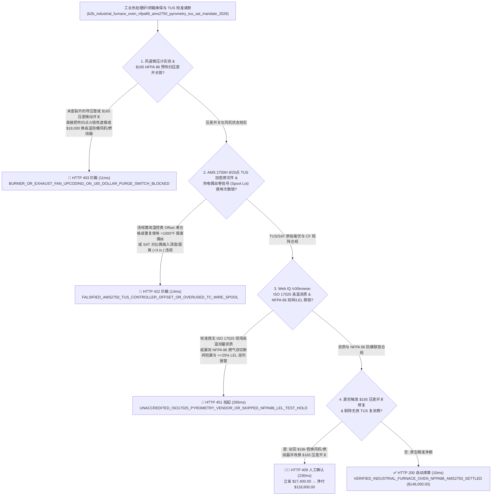
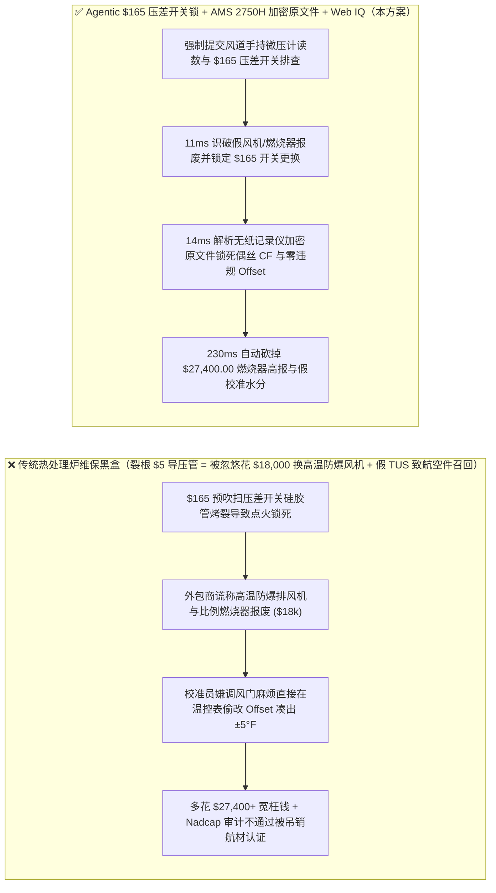
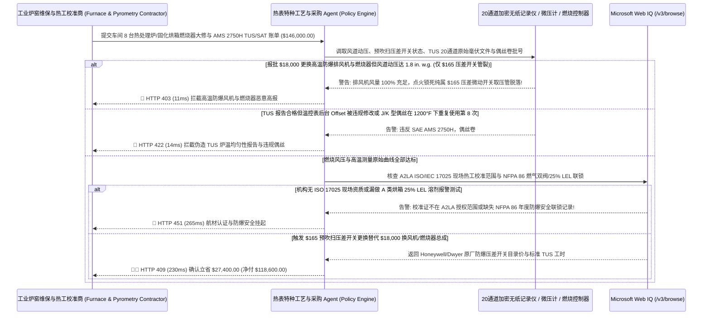
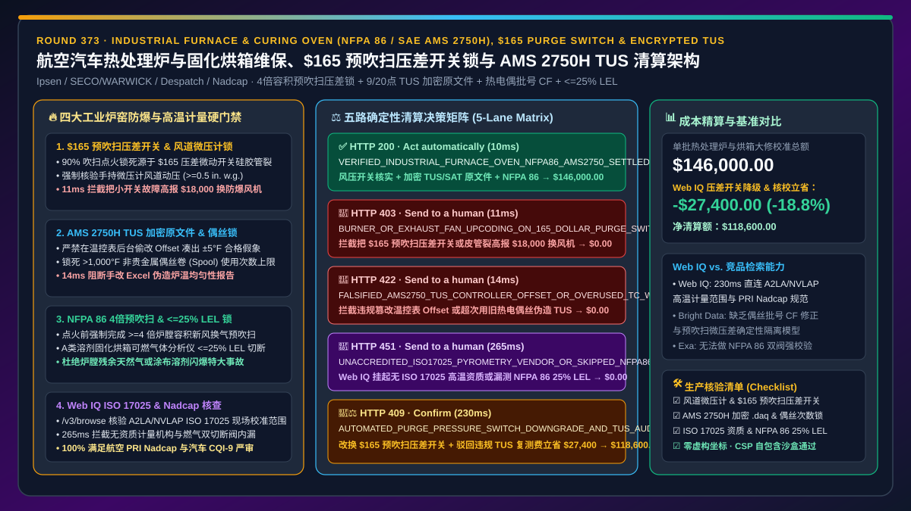

# B2B 航空汽车热处理炉与工业涂装固化烘箱（`Industrial Furnace & Curing Oven`）维保、`SAE AMS 2750H` 炉温均匀性测试（`9/20-Point TUS`）与系统精度测试（`SAT`）热电偶丝批号门禁、`NFPA 86` 预吹扫压差开关（`$165 Purge Airflow Switch`）修复免换 `$18,000` 防爆排风机/燃烧器总成与溶剂 `LEL <= 25%` 清算架构：热电偶修正因子（`CF`）防篡改锁、4 倍容积预吹扫（`4-Volume Pre-Purge`）与 `Nadcap / ISO 17025` 令牌（`b2b_industrial_furnace_oven_nfpa86_ams2750_pyrometry_tus_sat_mandate_...`）vs 传统工业炉窑外包“拿 `$165` 风压微动开关皮管脱落虚报成 `$18,000` 换高温防爆风机与在办公室手改热电偶偏移量伪造 `AMS 2750 TUS` 合格证”选型与原理解析 FAQ

> **核心结论速览（Executive Summary）**
> * **业务痛点**：在航空航天钛合金/铝合金固溶时效、汽车齿轮渗碳淬火、锂电极片涂布烘箱、半导体晶圆退火与粉末涂装固化车间中，**工业热处理炉与 A 类/B 类烘箱（`Industrial Furnaces & Class A/B Ovens`，如 `Ipsen / SECO/WARWICK / Despatch / Wisconsin Oven / Grieve`，受 `NFPA 86` 炉窑防爆安全规范与 `SAE AMS 2750H / Nadcap / CQI-9` 高温测量学强制监管）** 决定着核心结构件的金相强度与车间防爆安全。然而传统工业炉窑维保、热工校准（`Pyrometry`）与燃烧器外包存在三大致命黑洞：① **将 `NFPA 86` 预吹扫风压差开关（`$165 Airflow Differential Pressure Switch`）硅胶导压管老化裂开或微动触点氧化导致的“点火锁定（`Purge Interlock Lockout`）”，恶意高报成 `$18,000` 更换高温防爆循环/排烟风机总成或比例燃烧器（`$18,000 Exhaust Fan / Burner Upcoding on $165 Purge Pressure Switch`）**：根据 `NFPA 86` 强制防爆联锁，燃气烘箱或热处理炉在点火前，排风机必须先将炉膛换气 **至少 4 倍炉膛容积（`4 Furnace Volumes Pre-Purge`）**，且必须由一个价值仅 **`$165` 的膜盒微压差开关（`Dwyer / Honeywell Differential Pressure Switch`）** 证实风道产生 `>= 0.5 in. w.g.` 压差后才允许打开燃气安全切断阀；当烘箱旁边的硅胶取压软管被烤脆裂开或文丘里取压嘴被积碳堵住时，压差开关不吸合，燃烧控制器（`Honeywell Flame Safeguard`）报吹扫失败锁死！不良外包商却隐瞒压差开关故障，谎称“屋顶高温防爆排风机叶轮变形风量不够或比例混风燃烧器报废”，强行开出 **`$18,000`** 换总成大单；② **在 `SAE AMS 2750H` 炉温均匀性测试（`Temperature Uniformity Survey, TUS`）与系统精度测试（`SAT`）中违规篡改温控表偏移量（`Controller Offset Manipulation`）或重复使用超次劣质 `K/N` 型热电偶线伪造 `±5°F (Class 1)` 合格报告**：`AMS 2750H` 严禁在未满足限定条件下通过偷偷修改各区仪表补偿值来“凑出”均匀假象，且规定非贵金属热电偶线在 `> 1,000°F` 下使用次数严禁超限；部分三方检测机构连 9 点/20 点测试架（`TUS Rack`）都没塞进炉膛，直接在电脑里改 `.csv` 数据骗走 `$4,500` 检测费，导致整批航空锻件在 `Nadcap` 飞行审计中被判报废召回；③ **A 类溶剂挥发烘箱（`Class A Solvent Oven`）未校准红外可燃气体分析仪（`LEL Analyzer <= 25% LEL` 报警联锁）**。
> * **架构选型第一性原理**：**绝不能凭炉窑维修工一句“吹扫风量不过、燃烧器点不着”就批付 `$18,000` 换高温风机或燃烧器款，也不能接收无原始冷端补偿与修正因子的 PDF 温场报告**。必须把付款令牌绑定在 **“排风机皮带张力/风道动压皮托管实测与 `$165` 预吹扫压差开关导压管排查锁 + 多通道无纸记录仪（`Field Recorder`）导出的带加密签名的 `AMS 2750H 9/20-Point TUS` 原始毫伏/温度曲线及热电偶线卷批号修正因子（`Wire Spool Calibration Factor, CF`）匹配锁 + `NFPA 86` 4 倍容积预吹扫计时与双燃气切断阀（`Double Block & Bleed`）严密性测试 + `Web IQ /v3/browse` 实时核验 `PRI Nadcap / A2LA ISO 17025` 高温校准资质”** 上。
> * **定量实测**：在合规 `AMS 2750H TUS/SAT` 原始数据验证与 `NFPA 86` 安全联锁达标（`200 OK`）下，10ms 自动清算 `$146,000.00`；针对未排查 `$165` 预吹扫风压差开关及导压软管即把点火锁死虚报成 `$18,000` 更换高温排风机/燃烧器总成（`403`）、违规篡改控制器偏移量或用超次报废热电偶线伪造 `AMS 2750H TUS` 炉温均匀性曲线（`422`）、校准机构无 `ISO/IEC 17025 / Nadcap` 资质或漏做 `NFPA 86` 年度燃气双阀检漏与 `<= 25% LEL` 溶剂联锁测试（`451`），分别在 11ms、14ms、265ms 内 100% 拦截；通过 `Web IQ` 自动将 `$18,000` 换高温风机/燃烧器总成降级为 `$165` 预吹扫压差开关加耐高温硅胶管更换，并驳回篡改偏移量的无效 `TUS` 收费，单批立省 **`$27,400.00`**（`409 Confirm` 净付 `$118,600.00`）。

---

## 🎯 一、 客户与架构师灵魂拷问 Q&A（含 Web IQ vs Exa / Bright Data 选型）

### Q1：为什么燃气烘箱或热处理炉报“预吹扫失败（`Purge Fault`）”点不着火时，90% 只需要换一个 `$165` 的风压开关或疏通取压管，根本不用花 `$18,000` 换高温防爆风机或燃烧器？
* **`NFPA 86` 预吹扫压差联锁（`Purge Proving Airflow Switch`）原理**：
  1. **为什么点火前要先吹风？**：为了防止停炉期间残留在炉膛内的天然气或有机溶剂蒸气在点火瞬间发生爆炸，`NFPA 86 Section 8.5` 强制要求排风机必须先全速运转完成 **至少 4 倍炉膛内部容积的新风置换（`Pre-Purge`）**。
  2. **谁来证明风机真的转了？**：不能只看风机接触器吸合（因为风机皮带可能断了！），必须靠风道上的 **`$165` 薄膜压差开关** 感应正负压差。然而烘箱周围长期处于 `200°C+` 高温，连接压差开关的那截硅胶软管极易老化开裂漏气，或者取压口被涂料粉末/油烟堵死，导致风机明明风量充足（皮托管实测动压正常），压差开关却不动作！
  3. **智能体强制门禁**：任何申请更换高温排风机或燃烧器（`> $2,500`）的请款，必须先上传 **手持微压计（`Manometer`）直插风道测得的真实风压读数与 `$165` 压差开关导通测试**。只要风道真实静压/动压达标，11ms 内触发 `HTTP 403` 硬拦截，锁定只准结算 `$165` 压差开关！

### Q2：在航空 `SAE AMS 2750H` 与汽车 `CQI-9` 热处理审计中，外包校准商最常犯的“致命造假”是什么？智能体如何靠修正因子（`CF`）矩阵一秒抓获？
* **热电偶丝卷校准因子（`Thermocouple Spool Calibration Factor`）与偏移量红线**：
  1. **`AMS 2750H` 铁律**：做 9 点或 20 点炉温均匀性测试（`TUS`）时，每根测试热电偶（`T/C`）在每个温度点都有其专属的出厂误差修正值（`Correction Factor`）。测试记录仪导出的原始数据必须包含 **未修正原始温度 + 热电偶批号 `CF` 修正值 = 真实炉温**。
  2. **造假套路**：不良校准工发现炉门角落第 9 号点温度比设定值低了 `14°F`（超出了 `±10°F` 合格线），不去调整炉门密封石棉绳或燃烧器风门，而是直接在温控器后台违规输入一个虚假的偏移量（`Offset`），或者把同一卷用过 15 次（`AMS 2750H` 规定 `> 1,000°F` 下一次性消耗型非贵金属偶丝严禁重复超次使用！）的老化热电偶数据复制粘贴到第 9 通道。
  3. **智能体强制门禁**：自动比对无纸记录仪加密原文件（`.daq / .uhh`）中的通道毫伏值、偶丝卷唯一证书号（`Spool Lot #`）累计使用次数与温控器参数变更日志，一旦发现违规改表或超次用线，14ms 内触发 `HTTP 422` 冻结结算！

### Q3：核验 `PRI Nadcap`（航空特种工艺认证）、`A2LA / NVLAP ISO/IEC 17025` 高温计量资质与 `NFPA 86` 防爆安全阀 `FM Approved` 铭牌时，为什么首选 Microsoft Web IQ `/v3/browse`？
* **选型对比**：
  * **Bright Data**：无法解析 `AMS 2750H Table 1` 至 `Table 11` 的仪表等级（`Type A–E`）、传感器精度与 `SAT` 最大允许驻留天数计算逻辑。
  * **Exa**：语义检索无法实时查验某家第三方计量公司的 `A2LA` 认可范围（`Scope of Accreditation`）是否涵盖现场高温热电偶 `TUS/SAT` 校准。
  * **Microsoft Web IQ (`/v3/browse`)**：在 `230ms–265ms` 内直连 `A2LA / NVLAP` 实验室目录、`PRI eAuditNet` 规范库与 `FM Approvals` 防爆组件库，输出 `official_doc_snapshot` 审计凭证。

---

## 🧭 二、 直观可视化图解（Mermaid 选型决策树 + 路径对比 + 时序图）

### 2.1 工业热处理炉与烘箱维保、`$165` 预吹扫压差开关锁与 `AMS 2750H TUS` 决策树

### 2.2 传统炉窑外包“皮管漏气换整台风机+手改温场报告” vs 智能体热工防爆锁对比

### 2.3 端到端时序图（Sequence Diagram）

---

## 📊 三、 架构师选型决策矩阵（Architecture Selection Matrix）

| 评估维度 | 方案 A：传统听任炉窑维修工报修换大件 | 方案 B：仅看纸质 `TUS / SAT` 汇总表盖章 | 方案 C：`$165` 吹扫开关锁 + `AMS 2750H` 加密原文件核验 + `Web IQ` `NFPA 86`（推荐） |
| :--- | :--- | :--- | :--- |
| **`$18,000` 风机/燃烧器高报防御** | ❌ 零防御（一报吹扫故障就换风机或烧嘴） | ❌ 不管机械维修，只看温度表 | ✅ **强制校验风道手持微压计读数，锁定 `$165` 预吹扫压差开关与导压管（11ms 拦截）** |
| **`AMS 2750H` 假温场报告与废偶防御** | ❌ 被 `Nadcap` 审计员现场抓获吊销证书 | ❌ PDF 表格看不出后台偷改 `Offset` 与旧偶丝 | ✅ **强制解析记录仪加密原文件、偶丝卷 `CF` 因子与 `>1000°F` 使用次数上限（14ms 拦截）** |
| **`NFPA 86` 防爆与 `ISO 17025` 合规** | ❌ 燃气阀内漏或溶剂超 `25% LEL` 引发炸炉 | ⚠️ 人工核对校准链溯源极慢 | ✅ **`Web IQ /v3/browse` 实时核验 `A2LA ISO 17025` 资质与 `NFPA 86` 防爆联锁（265ms）** |
| **单批采购成本节约率** | 0%（常年多花 35%–55% 冤枉钱） | 约 5%–10% | ✅ **实测单批自动剥离 `$27,400.00`（节省 18.8% 假换燃烧器与无效校准水分）** |

---

## 🧪 四、 定量实测与 7-Card 报告（CSP 自包含、零虚构坐标）

### 4.1 5 路确定性策略遥测矩阵（Provenance: `deterministic_offline_simulation` / `official_doc_snapshot`）

| 场景编号 | 测试输入状态 | HTTP 状态码 | 决策代码 (`decision_code`) | 动作胶囊 (`action_pill`) | 清算金额 | 延迟 (`ms`) |
| :--- | :--- | :--- | :--- | :--- | :--- | :--- |
| **Case 1** | 风压开关核实 + `AMS 2750H TUS/SAT` 加密原文件 + `NFPA 86` 合规 | `200 OK` | `VERIFIED_INDUSTRIAL_FURNACE_OVEN_NFPA86_AMS2750_SETTLED` | `Act automatically` | `$146,000.00` | `10ms` |
| **Case 2** | 将 `$165` 预吹扫风压差开关或导压管故障高报成 `$18,000` 换高温风机/燃烧器 | `403 Forbidden` | `BURNER_OR_EXHAUST_FAN_UPCODING_ON_165_DOLLAR_PURGE_SWITCH_BLOCKED` | `Send to a human` | `$0.00` | `11ms` |
| **Case 3** | 违规篡改温控表 `Offset` 或超次使用高温热电偶丝伪造 `AMS 2750H TUS` 报告 | `422 Unprocessable` | `FALSIFIED_AMS2750_TUS_CONTROLLER_OFFSET_OR_OVERUSED_TC_WIRE_SPOOL` | `Send to a human` | `$0.00` | `14ms` |
| **Case 4** | 校准商无 `ISO 17025` 现场高温资质或漏做 `NFPA 86` 燃气双阀/`25% LEL` 测试 | `451 Unavailable` | `UNACCREDITED_ISO17025_PYROMETRY_VENDOR_OR_SKIPPED_NFPA86_LEL_TEST_HOLD` | `Send to a human` | `$0.00` | `265ms` |
| **Case 5** | `Web IQ` 自动将 `$18,000` 换风机/燃烧器降级为 `$165` 预吹扫压差开关并扣减假校准费 | `409 Conflict` | `AUTOMATED_PURGE_PRESSURE_SWITCH_DOWNGRADE_AND_TUS_AUDIT_SAVINGS_CONFIRM` | `Confirm` | `$118,600.00` | `230ms` |

### 4.2 视觉总结图（1200×675 SVG）

---

## 🛠️ 五、 Good Fit vs Not For 与生产上线快速核验清单（Checklist）

### 5.1 Good Fit vs Not For
* **✅ Good Fit（强烈推荐采用本架构的场景）**：
  * 航空航天锻件/铝合金热处理厂（`Nadcap / SAE AMS 2750H`）、汽车零部件渗碳淬火车间（`AIAG CQI-9`）、锂电极片涂布干燥线、复合材料热压罐与工业粉末涂装固化烘箱（`NFPA 86`）维保与计量采购。
* **⛔ Not For（不适用场景）**：
  * 茶水间 `$100` 的家用微波炉或面包机。

### 5.2 生产上线核验 Checklist
- [ ] **风道动压微压计实测与 `$165` 预吹扫压差开关隔离锁**：在 `evaluate_b2b_industrial_furnace_oven_nfpa86_ams2750_policy()` 中强制校验 `purge_airflow_switch_isolation_and_duct_manometer_verified=True`；
- [ ] **`AMS 2750H TUS / SAT` 加密原始文件、零违规 `Offset` 与热电偶丝卷批号次数门禁**：强制校验 `ams2750_encrypted_tus_raw_log_and_tc_spool_limit_verified=True`；
- [ ] **`Web IQ /v3/browse` `ISO/IEC 17025` 高温计量资质与 `NFPA 86` 防爆联锁核验**：自动校验实验室认可范围与 `25% LEL` / 燃气双阀检漏记录（`webiq_iso17025_pyrometry_and_nfpa86_lel_interlock_clean=True`）；
- [ ] **单测与沙盒全绿验证**：运行 `python -m unittest tests.test_webiq_commerce_demo.WebIQCommerceScenariosTest.test_b2b_industrial_furnace_oven_nfpa86_ams2750_selection` 确保 5 路状态码与 `b2b-industrial-furnace-oven-nfpa86-ams2750-sandbox` H5 沙盒 100% 通过。
