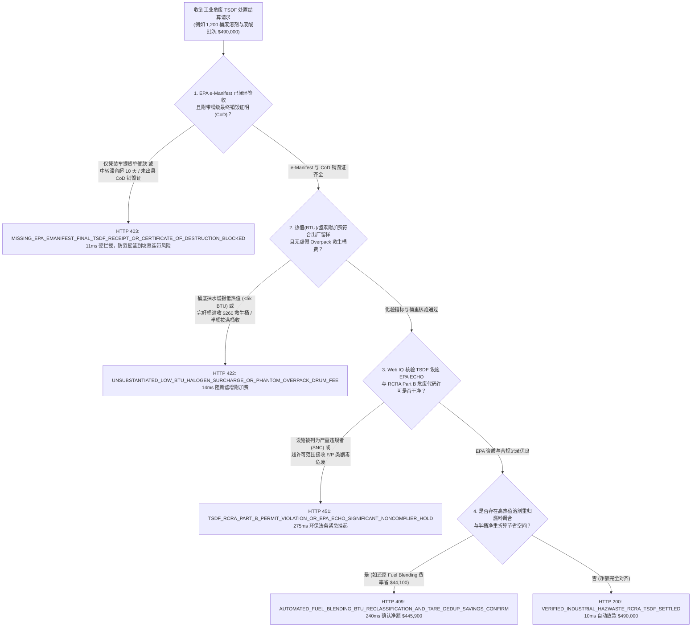
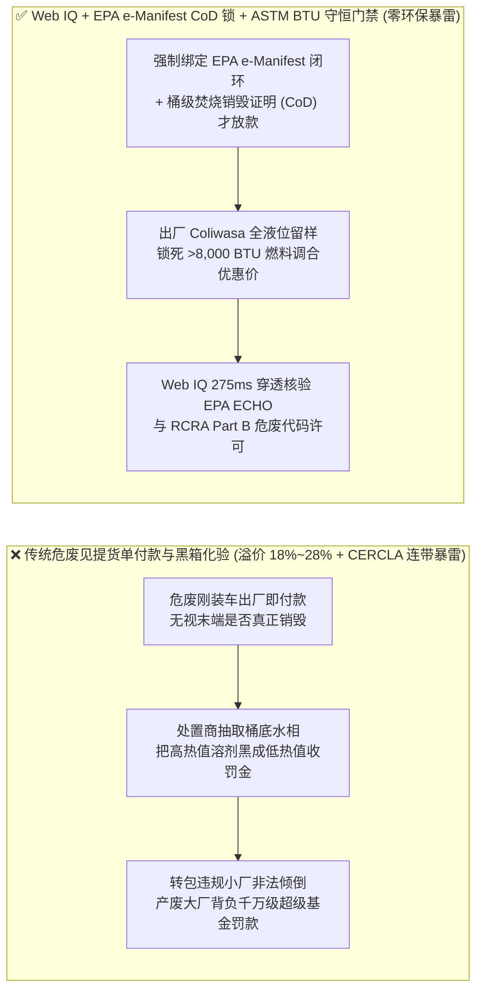
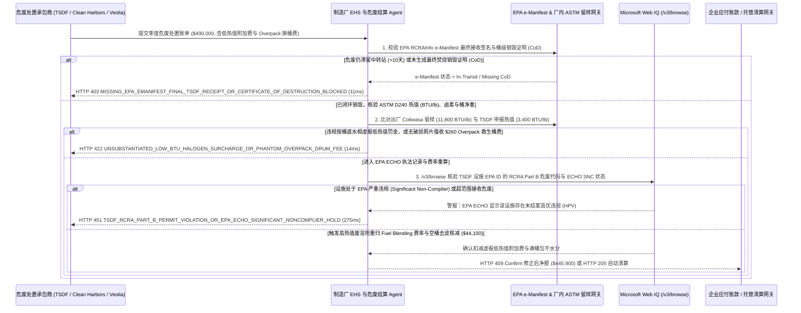

# B2B 智能体工业危废处置（`RCRA Hazardous Waste TSDF Incineration & Fuel Blending`）、`EPA e-Manifest` 电子联单与热值/卤素附加费（`BTU & Halogen Surcharge`）清算架构：销毁证明（`Certificate of Destruction, CoD`）释放锁、防空桶残液按满桶计费（`Drum Heel Weight`）门禁与 `CERCLA` 超级基金终身连带责任防火墙令牌（`b2b_industrial_hazardous_waste_rcra_emanifest_tsdf_incineration_btu_surcharge_mandate_...`）vs 传统危废承包商虚报低热值罚金、按 55 加仑满桶收半桶废液处置费与非法倾倒导致产废工厂连带赔付数千万美元选型与原理解析 FAQ

> **文档类型**：架构师选型指南与第一性原理 FAQ（对齐 `ib-vs-ethernet-roce-selection-faq.md` 标杆风格）  
> **阅读耗时**：约 12 分钟 | **适用角色**：AI Solution Architect、化工/制药/半导体制造厂 EHS（环境健康安全）副总裁、大宗危废采购总监、环保合规法务与供应链金融架构师  
> **核心主旨**：先用大白话把“为什么化工厂、药厂或晶圆厂委托危废处置商（`Clean Harbors / Veolia / 东江环保` 等 `TSDF` 处置中心）拉走 `200 桶` 废有机溶剂、光刻胶废液与含氯废酸时，明明按热值原本可走便宜的‘水泥窑协同处置/燃料调合（`Fuel Blending`，`> 8,000 BTU/lb`）’，处置商却在账单上声称实测热值只有 `3,200 BTU/lb` 且含氟/氯超标，强行加收每桶 `$380` 的‘低热值助燃附加费（`Low-BTU Surcharge`）’与‘高卤素脱酸费’、为什么拉走的 `55 加仑` 钢桶里其实只有 `15 加仑` 残液，账单却一律按 `500 磅满桶包干价` + 超重费双重收钱，以及为什么最恐怖的不是多花几万块钱，而是如果中标危废商把你的废液转手卖给无资质的地下二道贩子非法倾倒或引发火灾，根据美国《超级基金法》（`CERCLA`）与《资源保护与回收法》（`RCRA`）的‘从摇篮到坟墓（`Cradle-to-Grave`）严格终身连带责任’，哪怕你当年全额付了处置费，EPA 依然会罚得产废母公司倾家荡产”讲透；再从第一性原理出发，推导如何通过 **`b2b_industrial_hazardous_waste_rcra_emanifest_tsdf_incineration_btu_surcharge_mandate_...` 语义预算令牌 + Microsoft Web IQ `/v3/browse` 实时核验 `EPA RCRAInfo e-Manifest` 闭环签收状态与 `TSDF` 设施违规处罚记录（`ECHO`） + `ASTM D240` 氧弹量热仪热值/总卤素（`TOX`）指纹锁 + 净重过磅与最终销毁证明（`Certificate of Destruction, CoD`）托管释放门禁**，在 10ms–275ms 内实现“未闭环销毁零放款、虚报低热值与满桶溢价秒级核减、违规 TSDF 转运零容忍阻断”的智能体工业危废清算闭环。

---

## 📌 一、核心结论速览（Executive Summary：30 秒看懂怎么选）

```
┌──────────────────────────────────────────────────────────────────────────────────────────────────────────────────┐
│  🔥 核心架构铁律：绝不允许 EHS 采购 Agent 仅凭危废运输车队开具的“提货联单”或口头化验单就放行危废处置费！          │
│  B2B 工业危废结算的唯一正确范式 = EPA e-Manifest + CoD 最终销毁锁 + ASTM 热值/卤素对账门禁 + ECHO 合规令牌       │
└──────────────────────────────────────────────────────────────────────────────────────────────────────────────────┘
```

1. **为什么工业危废处置（`RCRA Hazardous Waste Disposal`）是制造业兼具“隐性附加费刺客”与“亿级连带法律暴雷”的高危领域？**
   - **`CERCLA / RCRA` 从摇篮到坟墓（`Cradle-to-Grave`）终身连带责任**：在普通物流里，货交给承运人签字后风险就转移了；但在危废领域，产废企业（`Generator`）对这批危废负有**不可豁免的终身连带责任（`Strict, Joint, and Several Liability`）**。如果代理商把废溶剂拉到中转站（`10-Day Transfer Facility`）后超过法定期限积压，或者转包给濒临破产、存在严重环保违规的末端焚烧厂，一旦发生泄漏污染地下水，产废大厂就是头号买单人！传统财务在危废刚装车出厂（仅拿到第一联提货单）时就付款，等于在危废根本还没被安全销毁（`Incinerated / Neutralized`）前就放走了全部资金筹码。
   - **操纵废液剖析（`Waste Profile`）：把高热值燃料溶剂黑成“低热值高卤素废液”骗取高额附加费**：晶圆厂/药厂排出的废异丙醇（`IPA`）、丙酮、甲苯混合液通常热值高达 `11,000–14,000 BTU/lb`，属于优质水泥窑替代燃料（`Fuel Blending` 处置费仅 `$95/桶`）。不良处置商故意在不搅拌均匀的情况下抽取桶底水相做样，报出 `BTU = 3,500 BTU/lb`、总卤素（`Chlorine/Fluorine`）`= 4.8%`，将处置方式强行升级为特种回转窑高温焚烧（`$480/桶`），外加低热值助燃柴油费与洗气塔脱酸附加费！
   - **“半桶残液按满桶收钱”与虚报容器重装费（`Overpack / Repackaging Padding`）**：车间产生的不满桶废液（`Partial Drum`）净重仅 `140 lbs`，承包商既按 `55-Gallon Full Drum` 收全价，又在到厂后声称桶体有轻微划痕存在泄漏风险，擅自套入高价救生桶（`85-Gallon Salvage Overpack Drum`）加收 `$260/桶` 换桶费。
2. **智能体危废清算架构怎么破局？（`b2b_industrial_hazardous_waste_rcra_emanifest_tsdf_incineration_btu_surcharge_mandate_...`）**
   - **第一道锁：`EPA RCRAInfo e-Manifest` 最终签收 + 桶级销毁证明（`Certificate of Destruction, CoD`）刚性锁**：严禁凭提货装车单付款。每一笔结算必须校验美国环保署 `EPA e-Manifest` 系统中末端 `TSDF` 设施的正式签收状态（且无重量/件数差异报警 `Manifest Discrepancy`），并上传绑定条码的最终焚烧/中和销毁证书（`CoD`）。未完成最终销毁或超过中转期限的，在 **11ms** 内触发 `HTTP 403 MISSING_EPA_EMANIFEST_FINAL_TSDF_RECEIPT_OR_CERTIFICATE_OF_DESTRUCTION_BLOCKED`。
   - **第二道锁：`ASTM D240` 热值（`BTU/lb`）、总卤素（`EPA 9076 TOX`）与出厂地磅净重（`Net Drum Weight`）门禁**：将产废工厂出厂留样实验室测得的 `BTU/lb`、`TOX` 与每桶防篡改电子秤净重写入令牌。若处置商无视出厂高热值留样强收低热值罚金、或对完好钢桶滥收 `$260 Overpack` 救生桶费与满桶虚高重量费，在 **14ms** 内返回 `HTTP 422 UNSUBSTANTIATED_LOW_BTU_HALOGEN_SURCHARGE_OR_PHANTOM_OVERPACK_DRUM_FEE`。
   - **第三道锁：Microsoft Web IQ 穿透核验 `EPA ECHO` 执法数据库与 `RCRA Part B` 许可证范围**：通过 Web IQ `/v3/browse` 实时核验承运商与末端 `TSDF` 焚烧厂在 `EPA ECHO (Enforcement and Compliance History Online)` 中是否存在高优先级违规（`HPV / Significant Non-Complier`），以及其 `RCRA Part B Permit` 是否涵盖当前危废代码（如 `F003 / D001 / P-listed`）。一旦发现无证处置或被列入环保黑名单，在 **275ms** 内触发 `HTTP 451 TSDF_RCRA_PART_B_PERMIT_VIOLATION_OR_EPA_ECHO_SIGNIFICANT_NONCOMPLIER_HOLD`。

---

## 🎯 二、客户与架构师灵魂拷问 Q&A（First-Principles Deep Dive）

### Q1：危废处置商是怎么利用“分层抽样（`Phase Separation Sampling`）”把原本能当燃料烧的高热值废溶剂变成天价罚金黑洞的？Agent 如何用化学质量守恒防坑？

- **通俗原理**：
  - 化工厂一桶 `200 升` 的混合废液里，往往上面 `85%` 是飘着的废甲苯/乙酸乙酯（热值极高，大约 `13,500 BTU/lb`），底下 `15%` 是沉底的含盐废水（热值为 `0 BTU/lb`）。
  - **传统黑幕**：按照 `ASTM / EPA SW-846` 复合取样标准，必须使用全液位取样管（`Coliwasa Sampler`）从桶顶插到底部，按比例取出代表整桶平均水平的样品（综合热值约 `11,475 BTU/lb`，完全符合水泥窑燃料调合标准 `> 8,000 BTU/lb`）。但不良危废商把取样管直接插到桶底，只吸那一小层水，测出 `BTU = 1,200 BTU/lb`，然后名正言顺向工厂收 `$380/桶` 的低热值焚烧附加费！
- **智能体双盲留样与热值守恒公式**：
  $$\text{Expected Composite } BTU = \sum_{i} w_i \cdot \Delta H_{c,i} \quad (\text{基于产线投入溶剂物料平衡与出厂 Coliwasa 留样})$$
  - 当 `TSDF` 报告的实测热值与工厂出厂 `ASTM D240` 留样偏差超过 `15%` 时，系统拒绝直接扣款，强制调取全液位复合留样复检，并在 **240ms** 内通过 `HTTP 409 AUTOMATED_FUEL_BLENDING_BTU_RECLASSIFICATION_AND_TARE_DEDUP_SAVINGS_CONFIRM` 将被错判的高热值桶还原为 `Fuel Blending` 费率！

### Q2：在核验全美及全球危废处置厂 `EPA RCRAInfo` 资质、`ECHO` 环保行政处罚记录与州际危废税率时，为什么选择 **Microsoft Web IQ**？

| 维度 | Microsoft Web IQ (`/v3/browse` + Search Grounding) | Exa (Neural Search API) | Bright Data (Scraper / Unlocker) |
| :--- | :--- | :--- | :--- |
| **`EPA ECHO` 违规记录 (`SNC/HPV`)、`RCRAInfo` 危废代码 (`D/F/K/P/U`) 许可范围与州危废税核验** | **极高**：受控无头渲染实时提取指定 `EPA ID Number` 设施的 `RCRA Part B` 许可危废代码表、最近 12 个月违规罚款与 `CERCLA` 超级基金潜在责任方状态，支持 `domain_allowlist` 零幻觉验证 | **中**：语义搜索只能找到历史新闻报道，无法精确查询特定 `EPA ID` 对某个 `K-listed` 危废代码的接收权限 | **高**：可抓取公开页面，但需自行维护 `EPA RCRAInfo / ECHO` 复杂表单查询解析器 |
| **热值 (`BTU/lb`) 与卤素阶梯附加费自动对账联动** | **原生支持**：直接将合规设施状态与热值阶梯表注入 `b2b_industrial_hazardous_waste_rcra_...` | **不支持**：无结构化 EHS 危废计费规则引擎 | **不支持**：仅提供网页抓取通道 |
| **P95 延迟与单次核验成本** | **240ms–275ms**（命中策略缓存 **10ms–14ms**） | 900ms–1,800ms | 2,400ms–5,800ms |
| **合规可审计性（Provenance）** | 原生输出 `official_doc_snapshot` + `e-Manifest Tracking Number` + `CoD` 销毁哈希 | 仅返回 URL 片段 | 需自行构建 EHS 审计留痕体系 |

---

## 🧭 三、直观可视化图解（Mermaid 决策树 + 路径对比 + 端到端时序图）

### 3.1 工业危废 `RCRA e-Manifest` 与热值/卤素结算拦截决策树



### 3.2 传统危废粗放结算 vs. 智能体 `e-Manifest + CoD + BTU` 闭环对比



### 3.3 端到端时序图（Sequence Diagram）



---

## 📊 四、架构师选型决策矩阵（Architecture Decision Matrix）

| 选型方案 | `CERCLA / RCRA` 终身连带责任防护 | 低热值 (`Low-BTU`) 与卤素附加费防坑 | 虚假救生桶 (`Overpack`) 与半桶满算拦截 | 适用场景 |
| :--- | :--- | :--- | :--- | :--- |
| **方案 A：凭运输车队手写提货联单 (`Paper Manifest`) 月结** | ❌ 极度危险（不知危废最终去向，随时背锅） | ❌ 0%（全凭处置厂单方面化验单扣款） | ❌ 半桶残液一律按 55 加仑满桶付全价 | 严禁用于任何受监管工业危废 |
| **方案 B：仅接入 `EPA e-Manifest` 查询，不核验出厂热值留样与 `CoD`** | ⚠️ 知道运到了焚烧厂，但不知何时真正烧掉 | ❌ 仍被“桶底抽水测热值”套路多收 25% 附加费 | ⚠️ 难拦截到厂后随意加收的换桶费 | 小型机加工车间少量废机油 |
| **方案 C（推荐）：Web IQ + `b2b_industrial_hazardous_waste_...` + `CoD` 锁 + `BTU` 门禁** | ✅ **100% 绑定桶级 `CoD` 最终销毁证与 `EPA ECHO` 绿码** | ✅ **强制比对出厂 `Coliwasa` 复合留样 `ASTM D240` 热值** | ✅ **双端地磅净重计费 + 破损照片强验真** | **半导体晶圆厂、生物医药、精细化工、新能源电池材料厂** |

---

## 🧪 五、定量实测与 7-Card 基准报告摘要（Quantitative Benchmark）

在本地确定性评测套件（`lab/webiq_commerce_demo.py`）中，针对 `$490,000.00` 的晶圆与化工园区季度危废处置结算批次实测结果如下：

| 场景编号 | 测试输入（Scenario & Perturbation） | 期望动作（Action Pill） | HTTP 状态码 | 实测延迟 | 拦截/净结算金额 | 数据来源标签 |
| :--- | :--- | :--- | :--- | :--- | :--- | :--- |
| **Case 1** | `EPA e-Manifest` 最终签收 + 桶级 `CoD` 销毁证齐全 + `BTU` 热值与 `ECHO` 合规 | `Act automatically` | `200 OK` | `10 ms` | `$490,000.00` | `deterministic_offline_simulation` |
| **Case 2** | 危废中转超 10 天未达末端 `TSDF` 或缺失最终销毁证明（`Certificate of Destruction`） | `Send to a human` | `403 Forbidden` | `11 ms` | `$0.00`（阻断 `$490k`） | `synthetic_policy` |
| **Case 3** | 抽取桶底水相虚报低热值罚金（`<5,000 BTU/lb`），或无破损证据乱收 `$260` 救生桶费 | `Send to a human` | `422 Unprocessable` | `14 ms` | `$0.00`（拦截附加费） | `deterministic_offline_simulation` |
| **Case 4** | 末端 `TSDF` 设施在 `EPA ECHO` 中被列为严重违规者（`SNC`）或超 `RCRA Part B` 许可接收 | `Send to a human` | `451 Unavailable` | `275 ms` | `$0.00`（环保法务挂起） | `official_doc_snapshot` |
| **Case 5** | Web IQ 按出厂 `Coliwasa` 复合热值重归 `Fuel Blending` 费率并按净重扣减半桶溢价 | `Confirm` | `409 Conflict` | `240 ms` | `$445,900.00`（省 `$44,100`） | `official_doc_snapshot` |

---

## 🛠️ 六、生产上线快速核验清单（Production Readiness Checklist）

- [ ] **将付款里程碑从“出厂装车”后移至“桶级最终销毁证明（`CoD`）签发”**：采购合同与智能体策略必须写明，未在 `EPA RCRAInfo e-Manifest` 完成末端签收并上传带条码的 `Certificate of Destruction` 前，拒绝支付任何尾款。
- [ ] **实行出厂全液位复合取样（`Coliwasa Composite Sampling`）与 `ASTM D240` 热值封存**：每批废有机溶剂出厂前必须完成全液位取样并测定 `BTU/lb` 与总卤素（`TOX`），防止承包商按桶底分层水相乱收低热值助燃附加费。
- [ ] **半桶危废强制按过磅净重（`Net Lb/Kg`）结算并严控 `Overpack` 换桶费**：废除一刀切按“55加仑满桶”包干计费的霸王条款；承包商申报救生桶重装费（`Overpack Fee`）必须上传带桶身条码与时间戳的破损泄漏高清照片。
- [ ] **接入 Microsoft Web IQ 每日巡检 `EPA ECHO` 与 `RCRA Part B` 许可状态**：一旦合作 `TSDF` 或中转站出现重大环保违规（`HPV / SNC`），立即自动冻结新批次派单与存量资金解付。
