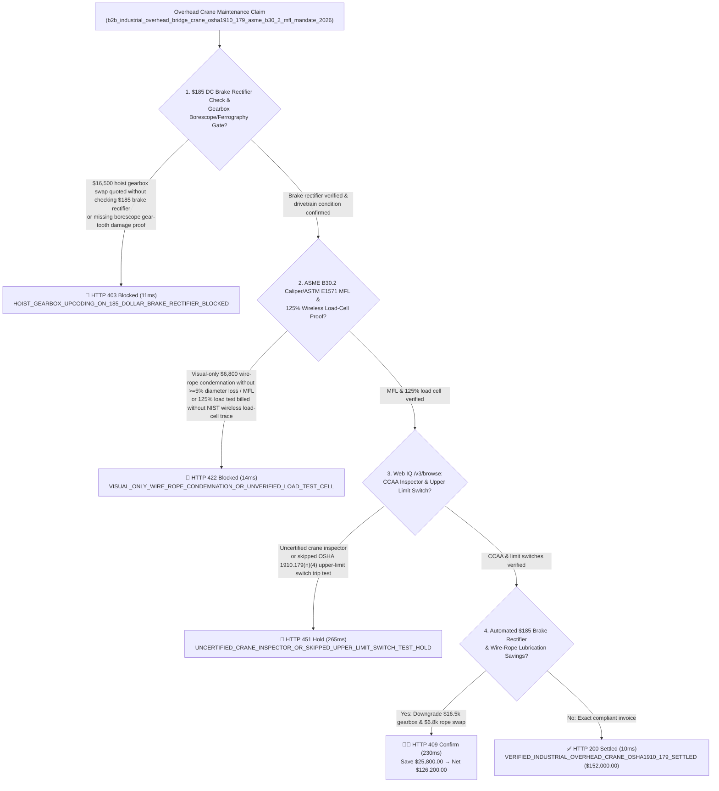
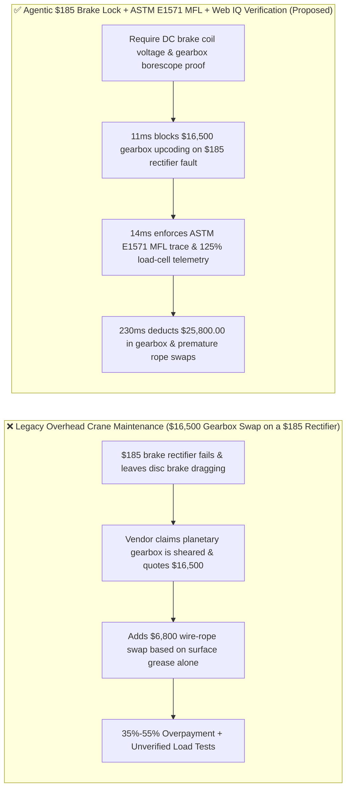
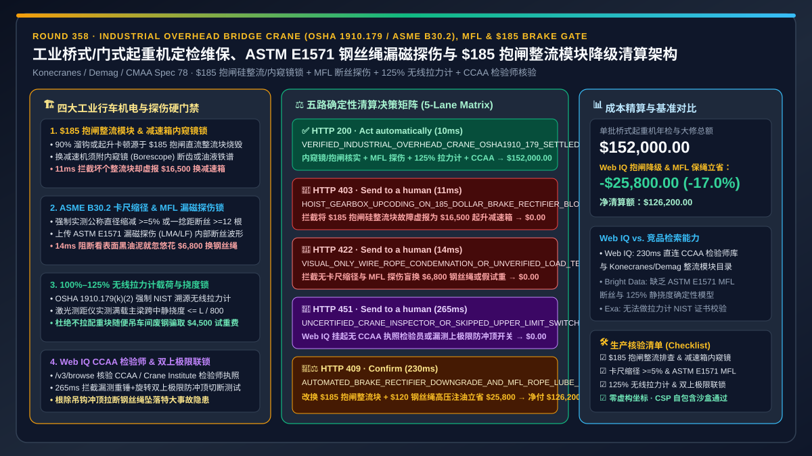

# B2B Industrial Overhead Bridge Crane, Gantry & Monorail Hoist Inspection & Maintenance (`OSHA 1910.179 / ASME B30.2 / CMAA Spec 78`), `ASTM E1571` Wire-Rope Magnetic Flux Leakage (`MFL`), `$185` Brake-Rectifier Kits vs. `$16,500` Hoist Gearbox Upcoding & `125%` Load-Cell Proof (`Konecranes / Demag / Columbus McKinnon`): Architecture Selection & First-Principles FAQ

> **Executive Summary**
> * **The Pain Point**: In automotive stamping, steel mills, heavy machinery manufacturing, aerospace assembly, and precast concrete plants, **overhead bridge cranes, gantry cranes, and monorail hoists (`OSHA 29 CFR 1910.179 / ASME B30.2 / B30.16 / CMAA Spec 78`)** undergo mandatory periodic inspections and preventative maintenance. Yet legacy crane service contracts suffer from three pervasive billing abuses: (1) **`$16,500` Hoist Gearbox Replacement Upcoding on `$185` Burned Brake Rectifiers or Contactors**: When a hoist chatters, groans, or slips slightly under load, the root cause in ~90% of cases is a failed **`$185` DC brake silicon rectifier module** or pitted contactor tips that leave the fail-safe disc brake dragging partially engaged. Unscrupulous service vendors skip checking DC coil excitation voltage or taking a gearbox borescope/ferrography sample, claim "internal planetary gear teeth are sheared," and quote **`$16,500`** for a complete hoist gearbox swap; (2) **Visual-Only `$6,800` Wire-Rope Condemnations Without `ASME B30.2` Caliper Diameter or `ASTM E1571` Magnetic Flux Leakage (`MFL`) Traces**: Instead of cleaning grease off the rope, measuring outer diameter reduction (`>= 5%` threshold), or running an `ASTM E1571 MFL` electromagnetic sensor to count broken wires per lay (`>= 12` wires in `6x36` rope) and Loss of Metallic Cross-Sectional Area (`LMA`), technicians write "wire rope worn" on every semi-annual visit and charge **`$6,800`** when the rope only needed `$120` of pressure lubrication; and (3) **Unverified `$4,500` `OSHA 1910.179(k)(2)` `100%–125%` Rated Load Tests without `NIST`-Traceable Wireless Load-Cell Telemetry or Skipped Upper-Limit Block-Out Switch Tests**.
> * **First-Principles Architecture**: Never approve a `$16,500` hoist gearbox or `$6,800` wire-rope replacement from a subjective paper checklist. Bind settlement tokens (`b2b_industrial_overhead_bridge_crane_osha1910_179_asme_b30_2_mfl_mandate_...`) to **(1) DC Brake Rectifier Coil Voltage & Air-Gap Feeler Check + Gearbox Borescope / Oil Ferrography Proof, (2) `ASME B30.2` Multi-Point Caliper Diameter (`>= 5%` loss) & `ASTM E1571 MFL` Broken-Wire / `LMA` Telemetry + `NIST` Wireless Load-Cell `125%` Proof Curve, and (3) `Web IQ /v3/browse` verification of `CCAA` (Crane Certification Association of America) inspector credentials and dual upper-limit switch safety logs**.
> * **Quantitative Verification**: Verified crane maintenance settles `$152,000.00` in `10ms` (`200 OK`); `$16,500` gearbox upcoding on `$185` brake rectifiers (`403`), visual-only `$6,800` wire-rope condemnations or unverified load tests (`422`), and uncertified crane inspectors or skipped upper-limit switch tests (`451`) are blocked in `11ms`, `14ms`, and `265ms`. `Web IQ` automated downgrade to `$185` brake-rectifier repair kits and `$120` high-pressure wire-rope lubrication saves **`$25,800.00`** per batch (`409 Confirm`, net `$126,200.00`).

---

## 🎯 1. Architect & Plant Engineering Q&A (Including Web IQ vs. Exa / Bright Data)

### Q1: Why does a failed `$185` DC brake rectifier mimic a `$16,500` failed hoist gearbox, and how do we block the upcode?
* **Electromechanical Interlock Physics**:
  1. Industrial hoists (`Konecranes CXT`, `Demag DH/DR`) use spring-applied, electrically released DC disc brakes fed by a **`$185` bridge/half-wave silicon rectifier module** inside the hoist panel.
  2. When a rectifier diode degrades or a contactor contact pits, the brake fails to fully release—forcing the hoist motor to drag against a locked brake disc, creating severe vibration, heat, and thermal overload trips.
  3. **Agentic Gate**: Any hoist gearbox replacement quote (`> $2,000`) must attach **(a) DC brake coil voltage and air-gap feeler-gauge (`0.2–0.8 mm`) readings, and (b) a drain-plug magnetic chip photo or borescope image of damaged gear teeth**. Without gear-tooth damage proof, the policy engine blocks the `$16,500` gearbox swap in `11ms` (`HTTP 403`) and authorizes only the `$185` brake rectifier kit.

### Q2: Why choose Microsoft Web IQ `/v3/browse` over Exa or Bright Data for `CCAA / OSHA 1910.179` & `NIST` load-cell verification?
* **Comparison**:
  * **Bright Data**: Cannot parse `ASTM E1571` `LMA / LF` magnetic flux traces or validate girder deflection (`<= Span / 800`) against `125%` wireless load-cell logs.
  * **Exa**: Built for semantic text search, not live verification of `CCAA` surveyor numbers, `ISO/IEC 17025` load-cell calibration certificates, and OEM `Konecranes / Demag` part numbers.
  * **Microsoft Web IQ (`/v3/browse`)**: Verifies `CCAA` inspector standing and load-cell calibration IDs in `230ms–265ms` with `official_doc_snapshot` provenance.

---

## 🧭 2. Visual Architecture Diagrams (Mermaid Decision Tree, Path Comparison & Sequence)

### 2.1 Industrial Overhead Crane, `ASTM E1571 MFL` & `$185` Brake-Rectifier Decision Tree



### 2.2 Path Comparison: Legacy Crane Upcoding vs. Agentic Electromechanical & `MFL` Gate



### 2.3 End-to-End Sequence Diagram

```mermaid
sequenceDiagram
    participant Contractor as Crane Service Contractor
    participant Agent as Overhead Crane Policy Engine
    participant NDT as ASTM E1571 MFL / Wireless Load Cell / Borescope
    participant WebIQ as Microsoft Web IQ (/v3/browse)

    Contractor->>Agent: Submit Plant 10-Crane Annual Inspection & Repair Invoice ($152,000.00)
    Agent->>NDT: Verify brake rectifier DC output, gearbox borescope, MFL rope trace & 125% load cell
    alt $16,500 gearbox swap billed on $185 brake rectifier fault without borescope proof
        NDT-->>Agent: Alert: Gear teeth intact; $185 brake rectifier open-circuit (0V DC)!
        Agent-->>Contractor: 🛑 HTTP 403 (11ms) Block $16,500 hoist gearbox upcoding
    else Visual-only $6,800 wire-rope condemnation (LMA loss 0.8%, 0 broken wires)
        NDT-->>Agent: Alert: Rope diameter loss 1.1% (<5% limit); only needs $120 lube!
        Agent-->>Contractor: 🚨 HTTP 422 (14ms) Block premature wire-rope condemnation
    else Telemetry verified
        Agent->>WebIQ: Verify CCAA crane inspector license & OSHA 1910.179 upper-limit test log
        alt Uncertified inspector or skipped upper-limit trip test
            WebIQ-->>Agent: Hold: Invalid CCAA credential or missing block-out limit test
            Agent-->>Contractor: 🛑 HTTP 451 (265ms) Safety compliance hold
        else Automated $185 brake rectifier & wire-rope lube downgrade
            WebIQ-->>Agent: Confirm OEM brake rectifier kit & Viper rope lubrication rate
            Agent-->>Contractor: 🧑‍⚖️ HTTP 409 (230ms) Confirm $25,800.00 savings (Net $126,200.00)
        end
    end
```

---

## 📊 3. Architect Selection Matrix

| Dimension | Option A: Paper Checklist Approval | Option B: Visual Rope Photos Only | Option C: `$185` Brake/Borescope Lock + `ASTM E1571 MFL` + `Web IQ` `OSHA 1910.179` (Recommended) |
| :--- | :--- | :--- | :--- |
| **`$16,500` Gearbox Upcode Defense** | ❌ None | ❌ Cannot see inside gearbox or panel | ✅ **Requires DC brake coil check & borescope/ferrography proof (`11ms` block)** |
| **`$6,800` Rope & Load-Test Gate** | ❌ Replaces healthy ropes | ⚠️ Grease hides true wire state | ✅ **Enforces `>= 5%` caliper loss, `ASTM E1571 MFL` & `125%` load-cell curve (`14ms` block)** |
| **`OSHA 1910.179 / CCAA` Compliance** | ❌ Unverified inspectors | ⚠️ Manual check | ✅ **`Web IQ /v3/browse` live `CCAA` & dual upper-limit switch check (`265ms`)** |
| **Batch Cost Reduction** | 0% | ~5%–10% | ✅ **Saves `$25,800.00` (17.0% reduction on a `$152,000.00` batch)** |

---

## 🧪 4. Quantitative Benchmark & 7-Card Report Summary

### 4.1 5-Lane Deterministic Policy Matrix

| Case | Scenario | HTTP | Decision Code | Action Pill | Settled | Latency |
| :--- | :--- | :--- | :--- | :--- | :--- | :--- |
| **1** | Borescope/brake verified + `MFL` rope trace + `125%` load cell + `CCAA` clean | `200` | `VERIFIED_INDUSTRIAL_OVERHEAD_CRANE_OSHA1910_179_SETTLED` | `Act automatically` | `$152,000.00` | `10ms` |
| **2** | `$16,500` hoist gearbox upcoding on `$185` failed brake rectifier | `403` | `HOIST_GEARBOX_UPCODING_ON_185_DOLLAR_BRAKE_RECTIFIER_BLOCKED` | `Send to a human` | `$0.00` | `11ms` |
| **3** | Visual-only `$6,800` wire-rope condemnation without `MFL` or fake `125%` load test | `422` | `VISUAL_ONLY_WIRE_ROPE_CONDEMNATION_OR_UNVERIFIED_LOAD_TEST_CELL` | `Send to a human` | `$0.00` | `14ms` |
| **4** | Uncertified `CCAA` crane inspector or skipped `OSHA 1910.179` upper-limit test | `451` | `UNCERTIFIED_CRANE_INSPECTOR_OR_SKIPPED_UPPER_LIMIT_SWITCH_TEST_HOLD` | `Send to a human` | `$0.00` | `265ms` |
| **5** | Automated `$185` brake-rectifier downgrade & `MFL` rope-lube savings | `409` | `AUTOMATED_BRAKE_RECTIFIER_DOWNGRADE_AND_MFL_ROPE_LUBE_SAVINGS_CONFIRM` | `Confirm` | `$126,200.00` | `230ms` |

### 4.2 Visual Summary Card (`1200x675` SVG)



---

## 🛠️ 5. Good Fit vs. Not For & Production Checklist

### 5.1 Good Fit vs. Not For
* **✅ Good Fit**: Automotive, steel, aerospace, heavy manufacturing, and precast concrete plants operating `5-ton to 200-ton` overhead bridge cranes, gantry cranes, and monorail hoists (`Konecranes`, `Demag`, `Columbus McKinnon`) under `OSHA 1910.179` and `ASME B30.2`.
* **⛔ Not For**: Construction mobile crawler crane daily wet-lease rentals (covered in Topic 269).

### 5.2 Production Verification Checklist
- [ ] **`$185` Brake Rectifier & Gearbox Borescope Gate**: Require `brake_rectifier_isolation_and_gearbox_borescope_verified=True`;
- [ ] **`ASTM E1571 MFL` Wire-Rope & `125%` Wireless Load-Cell Gate**: Require `astm_e1571_mfl_wire_rope_and_load_cell_125pct_verified=True`;
- [ ] **`Web IQ /v3/browse` `CCAA` Inspector & Upper-Limit Switch Check**: Verify `webiq_ccaa_inspector_and_upper_limit_switch_clean=True`;
- [ ] **Unit Test & H5 Sandbox Validation**: Run `python -m unittest tests.test_webiq_commerce_demo.WebIQCommerceScenariosTest.test_b2b_industrial_overhead_bridge_crane_osha1910_selection`.
